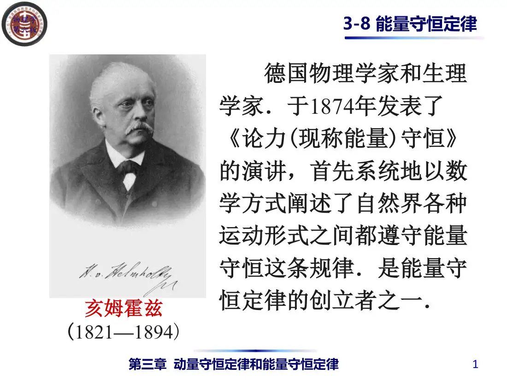
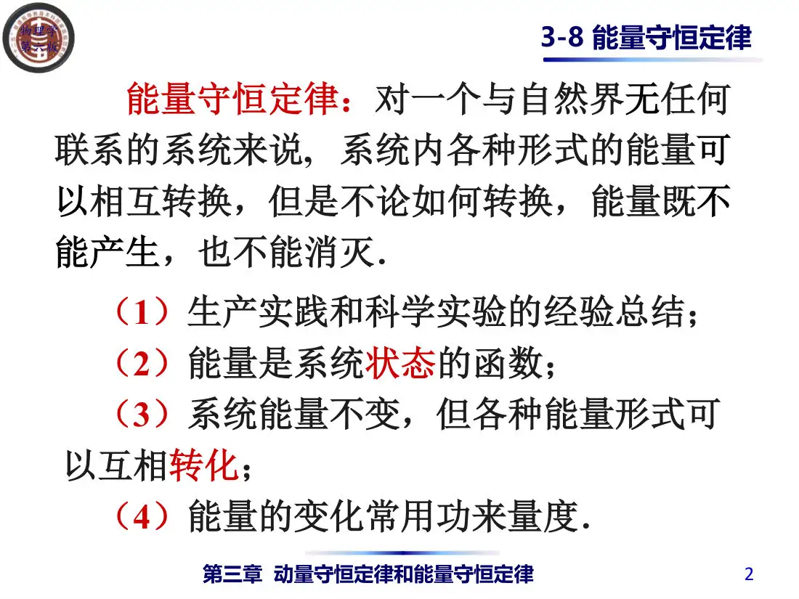

# 《大学物理》第3章 动量守恒定律和能量守恒定律 §3.8 能量守恒定律（课件）

原件的每一页，下面附识别出的文字。

### 亥姆霍兹 (1821—1894)

原文：

亥姆霍兹 (1821—1894)

德国物理学家和生理学家．于1874年发表了《论力(现称能量)守恒》的演讲，首先系统地以数学方式阐述了自然界各种运动形式之间都遵守能量守恒这条规律．是能量守恒定律的创立者之一

物理学第六版

3-8 能量守恒定律

第三章 动量守恒定律和能量守恒定律

1

### （1）生产实践和科学实验的经验总结；

原文：

能量守恒定律：对一个与自然界无任何联系的系统来说, 系统内各种形式的能量可以相互转换，但是不论如何转换，能量既不能产生，也不能消灭

（1）生产实践和科学实验的经验总结；

（2）能量是系统状态的函数；

（3）系统能量不变，但各种能量形式可以互相转化；

（4）能量的变化常用功来量度

物理学第六版

3-8 能量守恒定律

第三章 动量守恒定律和能量守恒定律

2
