# 《大学物理》第3章 动量守恒定律能量守恒定律（课件）

原件的每一页，下面附识别出的文字。

### 第三章动量守恒定律能量守恒定律

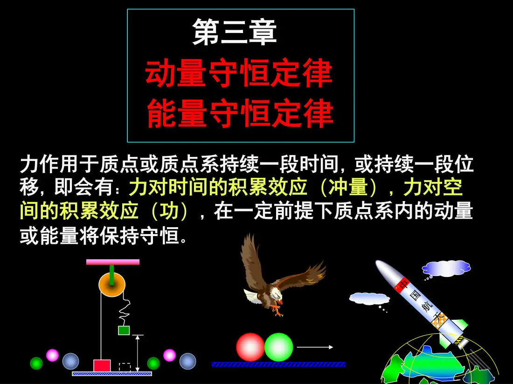

原文：

第三章动量守恒定律能量守恒定律

力作用于质点或质点系持续一段时间，或持续一段位移，即会有：力对时间的积累效应（冲量），力对空间的积累效应（功），在一定前提下质点系内的动量或能量将保持守恒。

### 本章学习的主要内容

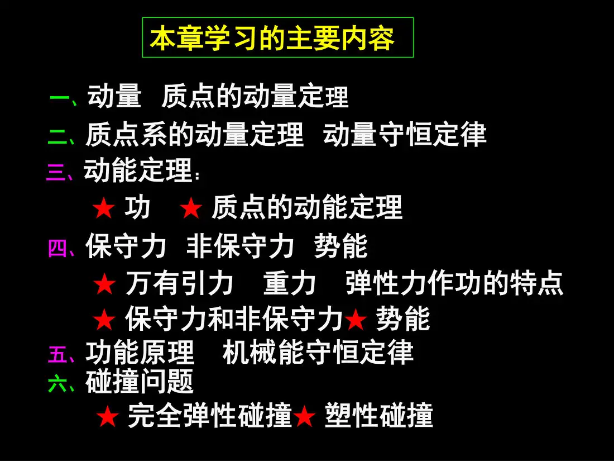

原文：

本章学习的主要内容

一、动量 质点的动量定理

二、质点系的动量定理 动量守恒定律

三、动能定理：

★ 功 ★ 质点的动能定理

四、保守力 非保守力 势能

★ 万有引力 重力 弹性力作功的特点

★ 保守力和非保守力★ 势能

五、功能原理 机械能守恒定律

六、碰撞问题

★ 完全弹性碰撞★ 塑性碰撞§3-1 质点和质点系的动量原理一. 动量 冲量 质点的动量原理当有机械运动量转移时,描述物质运动状态的一个重要物理量。是矢量，用P 来表示。

### 1.动量：

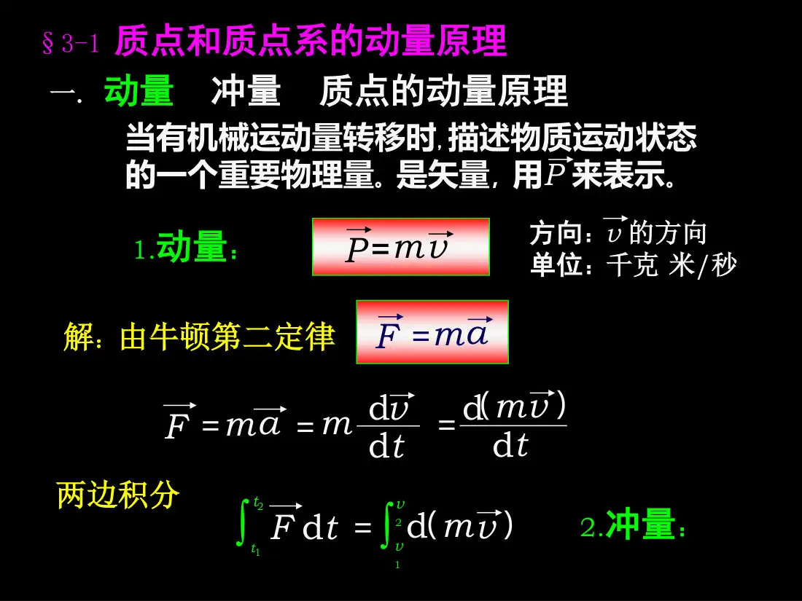

原文：

1.动量：

$$
\vec {P} = m \vec {\nu}
$$

方向：v 的方向

单位：千克 米/秒

解：由牛顿第二定律 ${ \overrightarrow { F } } = m { \overrightarrow { a } }$

$$
\overrightarrow {F} = m \overrightarrow {a} = m \frac {\mathrm{d} \overrightarrow {v}}{\mathrm{d} t} = \frac {\mathrm{d} (m \overrightarrow {v})}{\mathrm{d} t}
$$

两边积分

$1 1 2 \times 1 2 = 1 1 \times 1 0 ( c m ^ { 2 } )$ 2.冲量：

### 2.冲量：

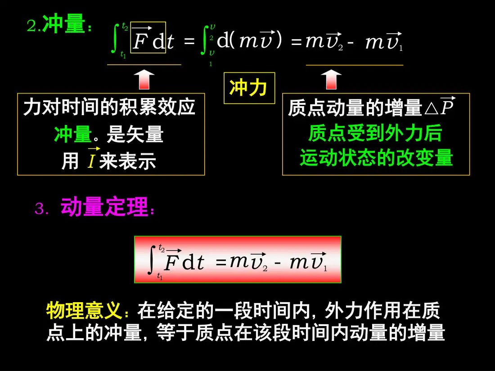

原文：

2.冲量：

冲力

力对时间的积累效应冲量。是矢量用 I 来表示

质点动量的增量 $\pmb { \bigtriangledown } = \frac { 1 } { \sqrt { \pmb { \bigtriangledown } } } - \frac { 1 } { \sqrt { \pmb { \bigtriangledown } } } = \frac { 1 } { \sqrt { \pmb { \bigtriangledown } } }$ 质点受到外力后运动状态的改变量

3. 动量定理：

$$
\int_ {t _ {1}} ^ {t _ {2}} \overrightarrow {F} \mathrm{d} t = m \overrightarrow {\nu} _ {2} - m \overrightarrow {\nu} _ {1}
$$

物理意义：在给定的一段时间内，外力作用在质点上的冲量，等于质点在该段时间内动量的增量

### $$

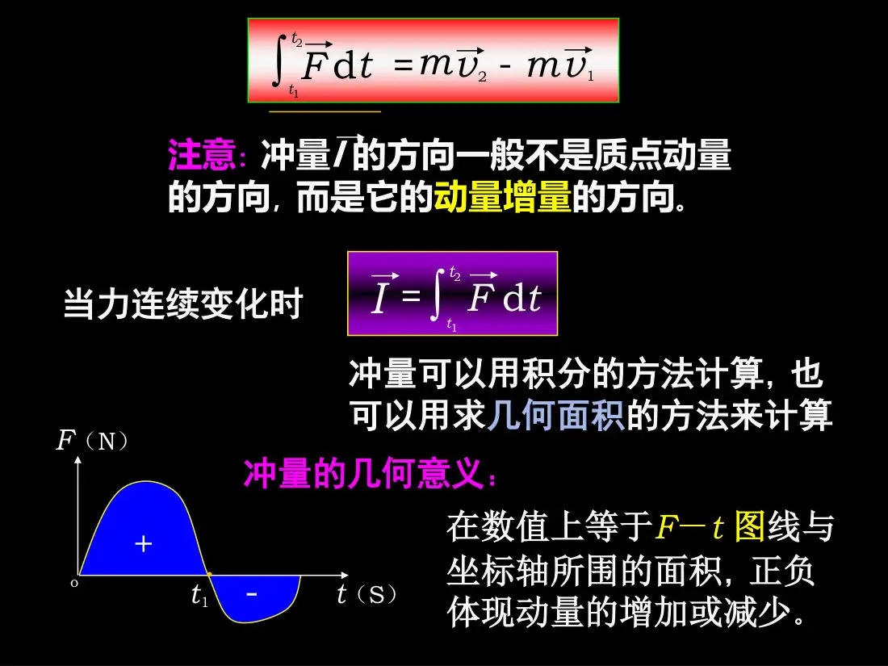

原文：

$$
\int_ {t _ {1}} ^ {t _ {2}} \overrightarrow {F} \mathrm{d} t = m \overrightarrow {\nu} _ {2} - m \overrightarrow {\nu} _ {1}
$$

注意：冲量I的方向一般不是质点动量的方向，而是它的动量增量的方向。

当力连续变化时

$$
\overrightarrow {I} = \int_ {t _ {1}} ^ {t _ {2}} \overrightarrow {F} \mathrm{d} t
$$

冲量可以用积分的方法计算，也可以用求几何面积的方法来计算冲量的几何意义：

t（S）

在数值上等于F－t 图线与坐标轴所围的面积，正负体现动量的增加或减少。

### 冲量是矢量，它在直角坐标系（二维或三维）中可由以下的分量形式出现

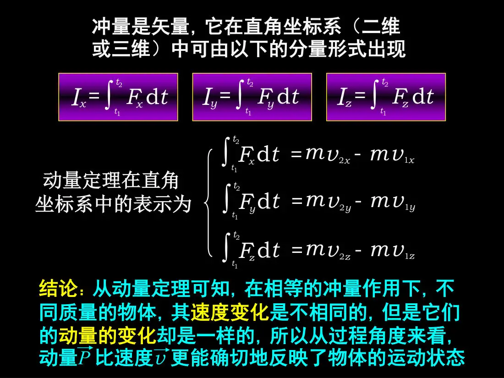

原文：

冲量是矢量，它在直角坐标系（二维或三维）中可由以下的分量形式出现

$$
I _ {x} = \int_ {t _ {1}} ^ {t _ {2}} F _ {x} \mathrm{d} t
$$

$$
I _ {y} = \int_ {t _ {1}} ^ {t _ {2}} F _ {y} \mathrm{d} t
$$

$$
I _ {z} = \int_ {t _ {1}} ^ {t _ {2}} F _ {z} \mathrm{d} t
$$

动量定理在直角坐标系中的表示为

$$
\left\{ \begin{array}{l l} \int_ {t _ {1}} ^ {t _ {2}} F _ {x} \mathrm{d} t = m \nu_ {2 x} - m \nu_ {1 x} \\ \int_ {t _ {1}} ^ {t _ {2}} F _ {y} \mathrm{d} t = m \nu_ {2 y} - m \nu_ {1 y} \\ \int_ {t _ {1}} ^ {t _ {2}} F _ {z} \mathrm{d} t = m \nu_ {2 z} - m \nu_ {1 z} \end{array} \right.
$$

结论：从动量定理可知，在相等的冲量作用下，不同质量的物体，其速度变化是不相同的，但是它们的动量的变化却是一样的，所以从过程角度来看，动量P 比速度v 更能确切地反映了物体的运动状态

### 使用动量定理的优越性：

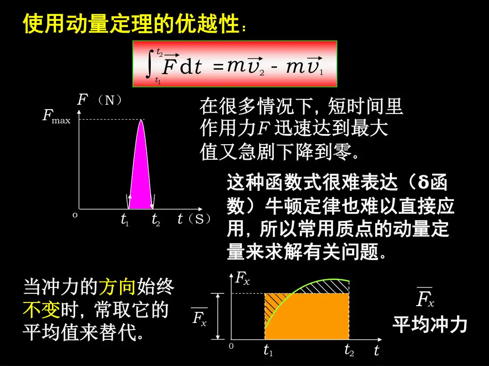

原文：

使用动量定理的优越性：

$$
\int_ {t _ {1}} ^ {t _ {2}} \overrightarrow {F} \mathrm{d} t = m \overrightarrow {\nu} _ {2} - m \overrightarrow {\nu} _ {1}
$$

在很多情况下，短时间里作用力F 迅速达到最大值又急剧下降到零。

这种函数式很难表达（δ函数）牛顿定律也难以直接应用，所以常用质点的动量定量来求解有关问题。

当冲力的方向始终不变时，常取它的平均值来替代。

Fx平均冲力当冲力的方向始终不变时，常取它的平均值来替代。

### Fx平均冲力

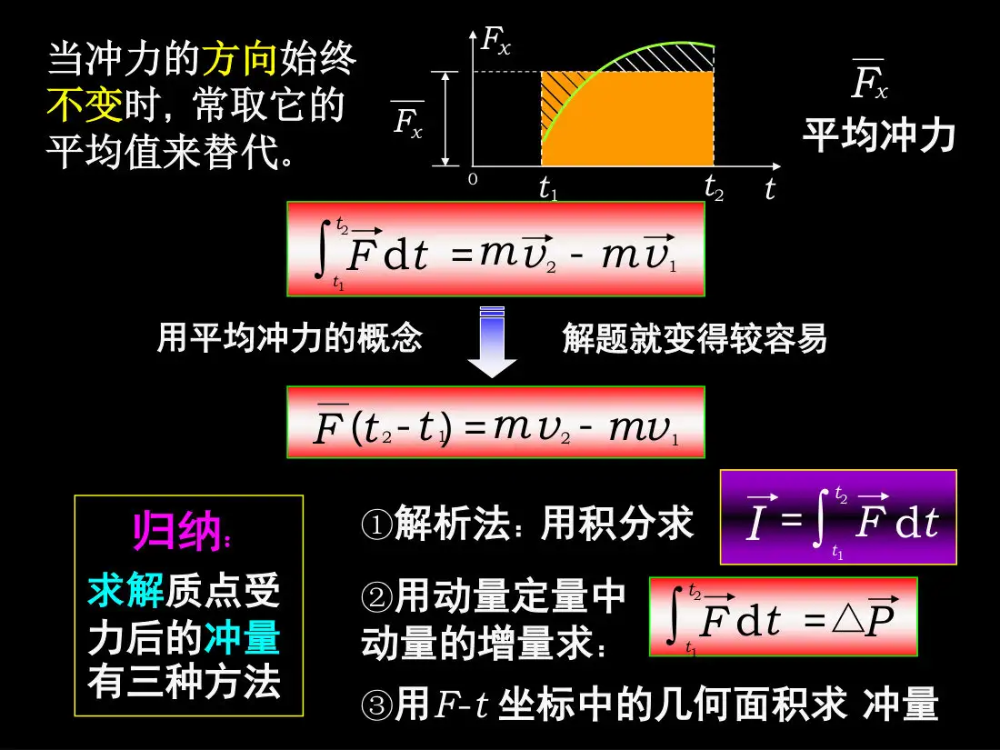

原文：

Fx平均冲力

$$
\int_ {t _ {1}} ^ {t _ {2}} \overrightarrow {F} \mathrm{d} t = m \overrightarrow {\nu} _ {2} - m \overrightarrow {\nu} _ {1}
$$

用平均冲力的概念

解题就变得较容易

$$
\overline {{F}} (t _ {2} - t _ {1}) = m \nu_ {2} - m \nu_ {1}
$$

归纳：求解质点受力后的冲量有三种方法

①解析法：用积分求

②用动量定量中动量的增量求：

$$
\overrightarrow {I} = \int_ {t _ {1}} ^ {t _ {2}} \overrightarrow {F} \mathrm{d} t
$$

$$
\int_ {t _ {1}} ^ {t _ {2}} \overrightarrow {F} \mathrm{d} t = \triangle \overrightarrow {P}
$$

③用F-t 坐标中的几何面积求 冲量例题：今有一个弹簧，其弹性力符合胡克定律$1 0 0 - 1 0 0 = 1 0 0 0$ ，其中 $0 . 0 2 \times 0 . 1 4 \times 0 . 0 2 = 0 . 0 2 6$ 。 求：t＝0 到 $1 0 0 = \frac { 1 1 1 } { 1 0 0 }$ 内该弹性力的冲量I

### $$

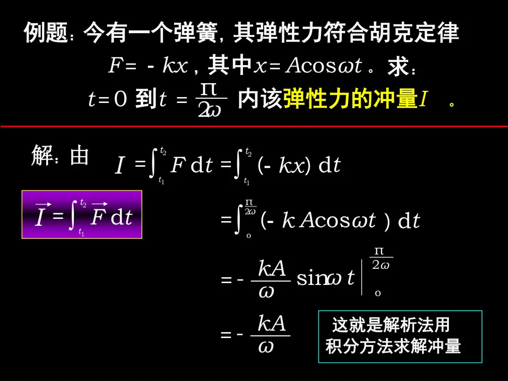

原文：

$$
I = \int_ {t _ {1}} ^ {t _ {2}} F \mathrm{d} t = \int_ {t _ {1}} ^ {t _ {2}} (- k x) \mathrm{d} t
$$

这就是解析法用积分方法求解冲量

### x ＝3t－4t 2＋t 3

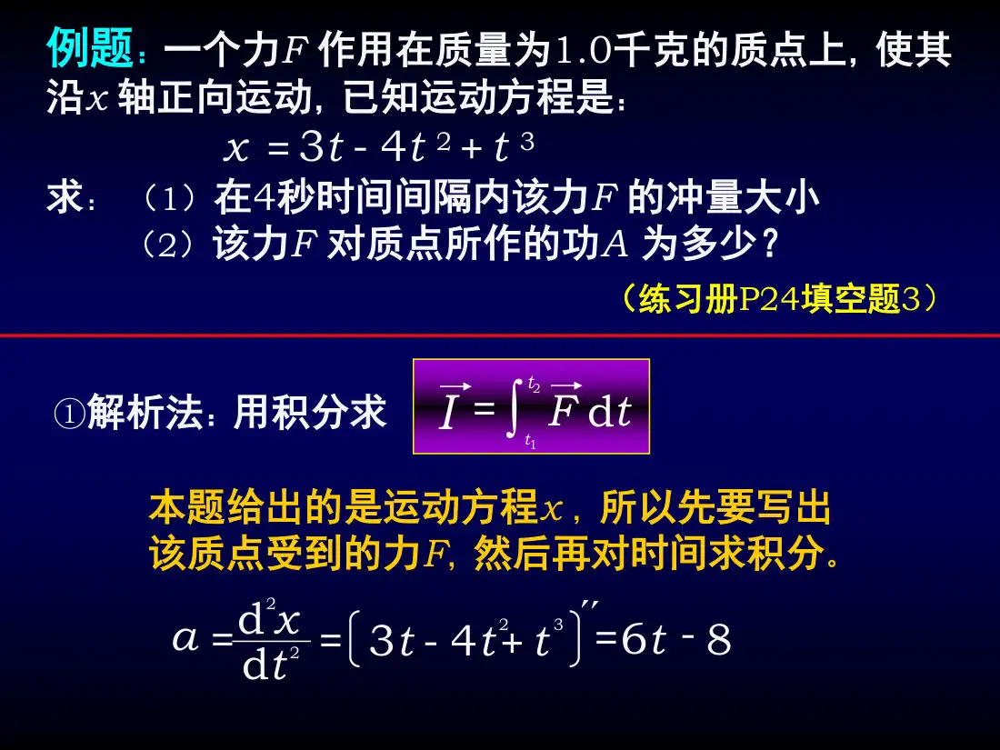

原文：

例题：一个力F作用在质量为1.0千克的质点上，使其沿x 轴正向运动，已知运动方程是：

x ＝3t－4t 2＋t 3

求： （1）在4秒时间间隔内该力F 的冲量大小

（2）该力F 对质点所作的功A 为多少？

（练习册P24填空题3）

①解析法：用积分求

$$
\overrightarrow {I} = \int_ {t _ {1}} ^ {t _ {2}} \overrightarrow {F} \mathrm{d} t
$$

本题给出的是运动方程x ，所以先要写出该质点受到的力F，然后再对时间求积分。

a d xdt2 = 3t－4t＋t 2 3 ´´=6t－8 dt²

### $$

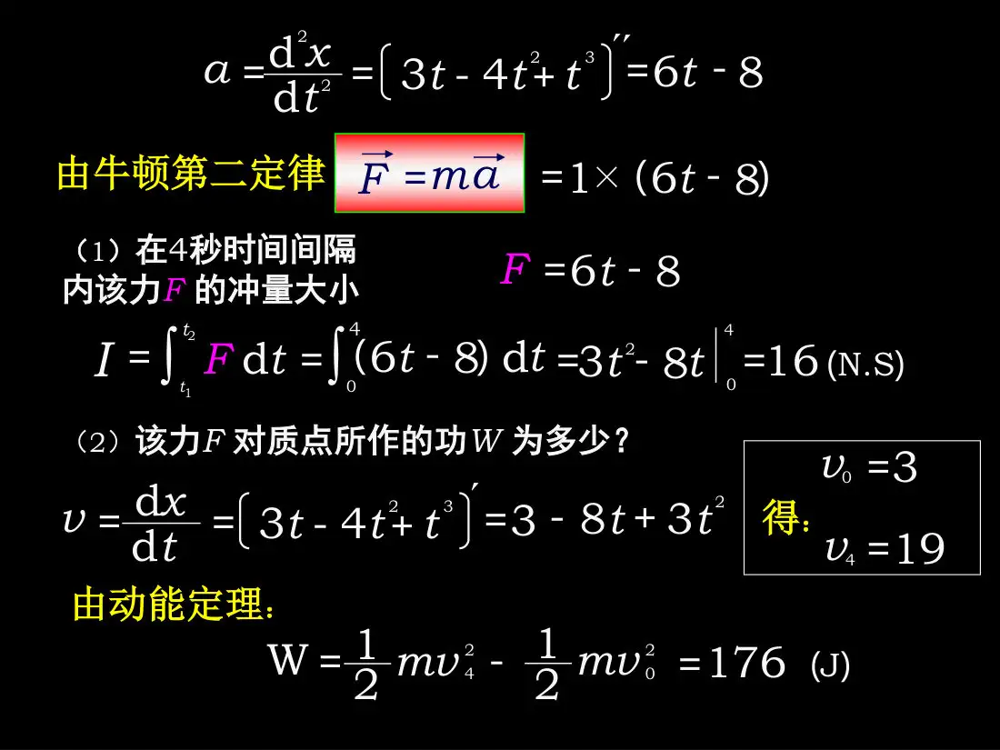

原文：

$$
\alpha = \frac {\mathrm{d} ^ {2} x}{\mathrm{d} t ^ {2}} = \left(3 t - 4 t ^ {2} + t ^ {3}\right) ^ {\prime \prime} = 6 t - 8
$$

由牛顿第二定律

$$
\vec {F} = m \vec {a} = 1 \times (6 t - 8)
$$

（1）在4秒时间间隔内该力F的冲量大小

$$
F = 6 t - 8
$$

$$
I = \int_ {t _ {1}} ^ {t _ {2}} F \mathrm{d} t = \int_ {0} ^ {4} (6 t - 8) \mathrm{d} t = 3 t ^ {2} - \left. 8 t \right| _ {0} ^ {4} = 1 6 (\mathrm{N.S})
$$

（2）该力F对质点所作的功W为多少？

$$
\nu = \frac {\mathrm{d} x}{\mathrm{d} t} = \left(3 t - 4 t ^ {2} + t ^ {3}\right) ^ {\prime} = 3 - 8 t + 3 t ^ {2}
$$

$$
\nu_ {0} = 3
$$

得：

$$
\nu_ {4} = 1 9
$$

由动能定理：

$$
\mathrm{W} = \frac {1}{2} m v _ {4} ^ {2} - \frac {1}{2} m v _ {0} ^ {2} = 1 7 6 (\mathrm{J})
$$

### 解：本题用第 种方法：②由动量定量中的动量增量求冲量。 建坐标

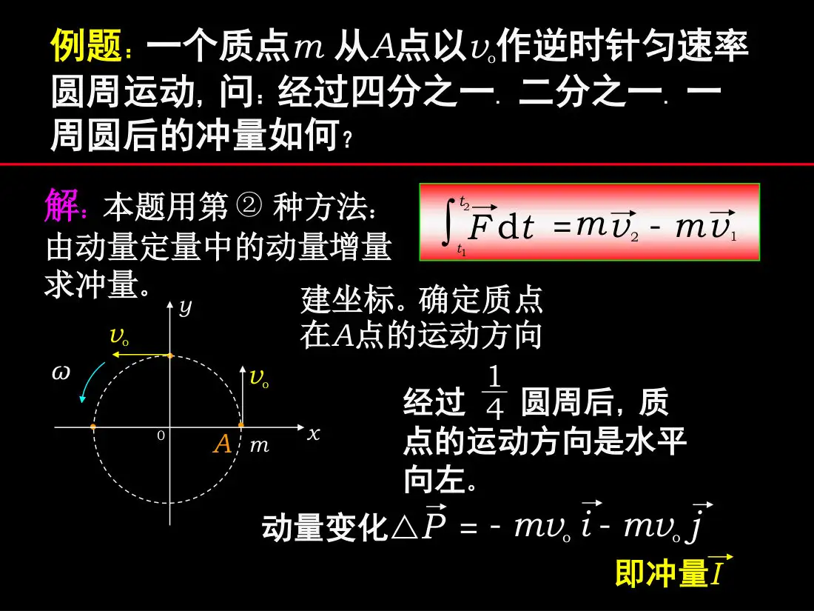

原文：

例题：一个质点m 从A点以v作逆时针匀速率圆周运动，问：经过四分之一. 二分之一. 一周圆后的冲量如何？

解：本题用第 种方法：②由动量定量中的动量增量求冲量。 建坐标

$$
\int_ {t _ {1}} ^ {t _ {2}} \overrightarrow {F} \mathrm{d} t = m \overrightarrow {\nu} _ {2} - m \overrightarrow {\nu} _ {1}
$$

。确定质点在A点的运动方向

1经过 4 圆周后，质点的运动方向是水平向左。

动量变化 $\Delta A D C \cong \Delta A D C ( A A S ) .$ j

即冲量I

### 经过一个圆周后，质点的运动方向是过A点竖直向上。

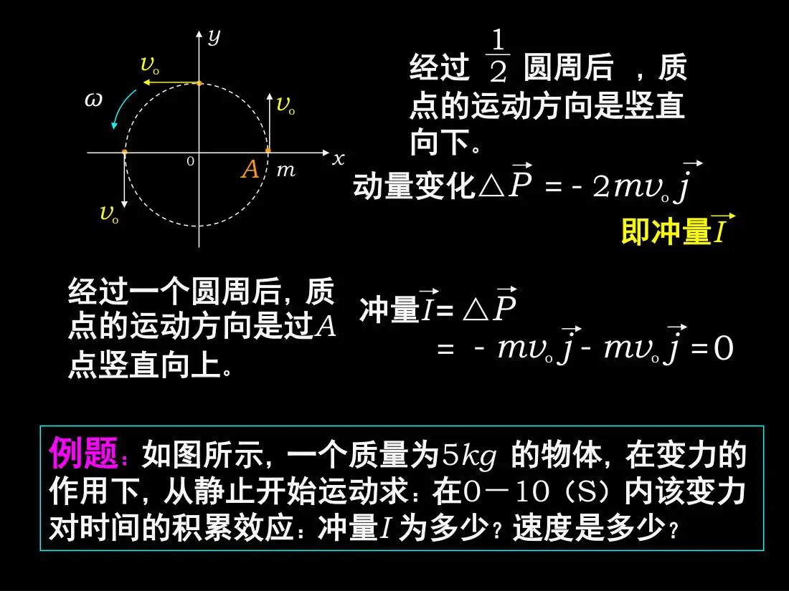

原文：

经过一个圆周后，质点的运动方向是过A点竖直向上。

经过 $\frac { 1 1 } { 2 }$ 圆周后 ，质点的运动方向是竖直向下。动量变化 $\Delta B E C \cong \Delta B E C$ j

即冲量I

冲量 $\frac { 1 } { 2 } \times \frac { 1 0 } { 3 } = \frac { 1 } { 2 } ( m ^ { 2 } )$

例题：如图所示，一个质量为5kg 的物体，在变力的作用下，从静止开始运动求：在0－10（S）内该变力对时间的积累效应：冲量I 为多少？速度是多少？

### 解：这是③用F-t 坐标中的几何面积求冲量

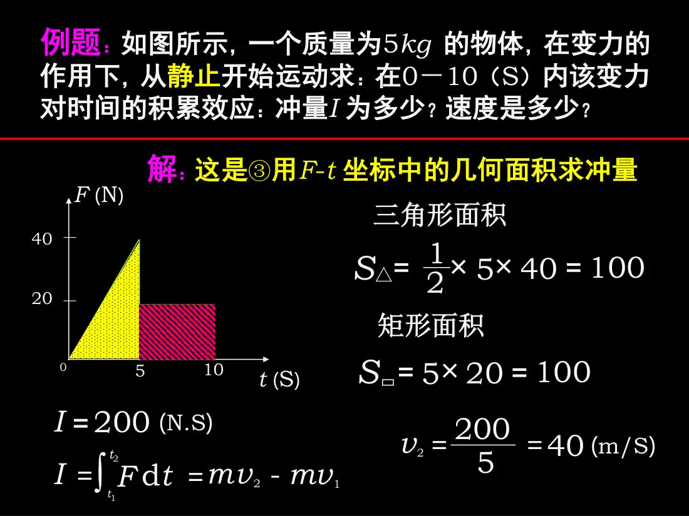

原文：

例题：如图所示，一个质量为5kg 的物体，在变力的作用下，从静止开始运动求：在0－10（S）内该变力对时间的积累效应：冲量I 为多少？速度是多少？

解：这是③用F-t 坐标中的几何面积求冲量

I ＝200 (N.S)

$$
I = \int_ {t _ {1}} ^ {t _ {2}} F \mathrm{d} t = m \nu_ {2} - m \nu_ {1}
$$

三角形面积

$$
S _ {\triangle} = \frac {1}{2} \times 5 \times 4 0 = 1 0 0
$$

矩形面积

$$
S _ {\square} = 5 \times 2 0 = 1 0 0
$$

$$
\nu_ {2} = \frac {2 0 0}{5} = 4 0 (\mathrm{m/S})
$$

### 设：乒乓球向球拍运动的方向为沿x 轴正方向（1）乒乓球得到的冲量的大小

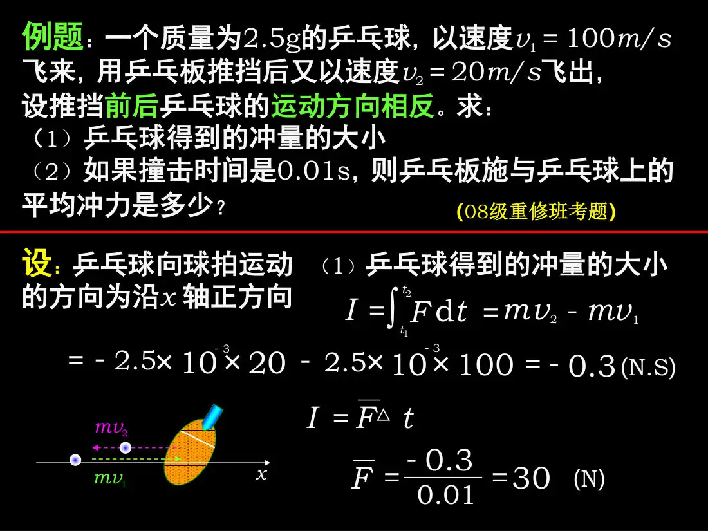

原文：

例题：一个质量为2.5g的乒乓球，以速度 $( D / - \operatorname { v o r } ( 0 . 0 ) / \operatorname { m } / -$ 飞来，用乒乓板推挡后又以速度 $( \pmb { \mathscr { D } } ) = \pmb { \mathscr { D } } ( \pmb { 0 } ) \pmb { \mathscr { W } } ( \pmb { 0 } ) =$ 飞出，设推挡前后乒乓球的运动方向相反。求：（1）乒乓球得到的冲量的大小（2）如果撞击时间是0.01s，则乒乓板施与乒乓球上的平均冲力是多少？ （08级重修班考题）

设：乒乓球向球拍运动的方向为沿x 轴正方向（1）乒乓球得到的冲量的大小

$$
I = \int_ {t _ {1}} ^ {t _ {2}} F \mathrm{d} t = m \nu_ {2} - m \nu_ {1}
$$

$$
= - 2. 5 \times 1 0 ^ {- 3} \times 2 0 - 2. 5 \times 1 0 ^ {- 3} \times 1 0 0 = - 0. 3 (\mathrm{N.S})
$$

$$
I = \overline {{F}} ^ {\triangle} t
$$

$$
\overline {{F}} = \frac {- 0 . 3}{0 . 0 1} = 3 0
$$

(N)

### （1）小球在匀速转动一周的过程中，它的动量增量为：0

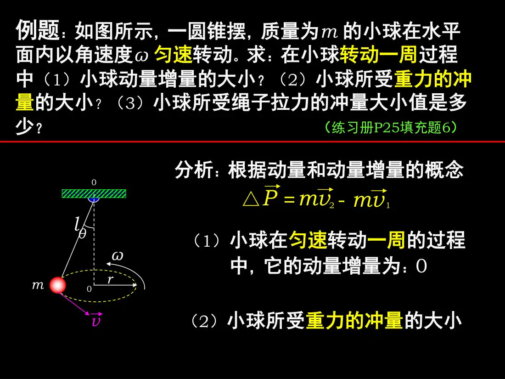

原文：

例题：如图所示，一圆锥摆，质量为m 的小球在水平面内以角速度ω 匀速转动。求：在小球转动一周过程中（1）小球动量增量的大小？（2）小球所受重力的冲量的大小？（3）小球所受绳子拉力的冲量大小值是多少？ （练习册P25填充题6）

分析：根据动量和动量增量的概念$\Delta B E F \cong \Delta B D C$

（1）小球在匀速转动一周的过程中，它的动量增量为：0

（2）小球所受重力的冲量的大小

### （2）小球所受重力的冲量的大小:

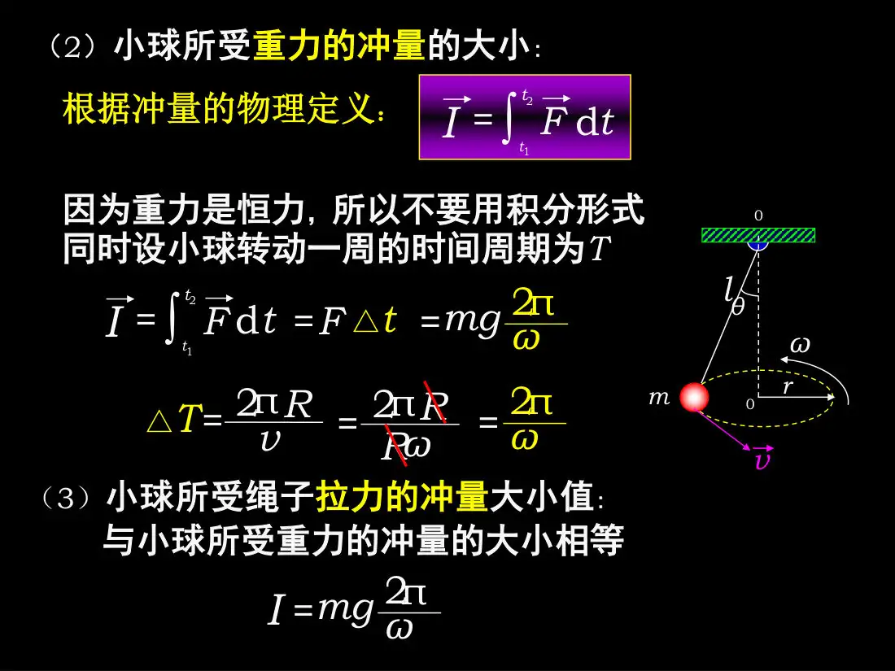

原文：

（2）小球所受重力的冲量的大小:

根据冲量的物理定义：

$$
\overrightarrow {I} = \int_ {t _ {1}} ^ {t _ {2}} \overrightarrow {F} \mathrm{d} t
$$

因为重力是恒力，所以不要用积分形式同时设小球转动一周的时间周期为T

$$
\overrightarrow {I} = \int_ {t _ {1}} ^ {t _ {2}} \overrightarrow {F} \mathrm{d} t = F \triangle t = m g \frac {2 \pi}{\omega}
$$

$$
\triangle T = \frac {2 \pi R}{\nu} = \frac {2 \pi R}{R \omega} = \frac {2 \pi}{\omega}
$$

（3）小球所受绳子拉力的冲量大小值:与小球所受重力的冲量的大小相等

2π I =mg ω

### （1）画出F－t图

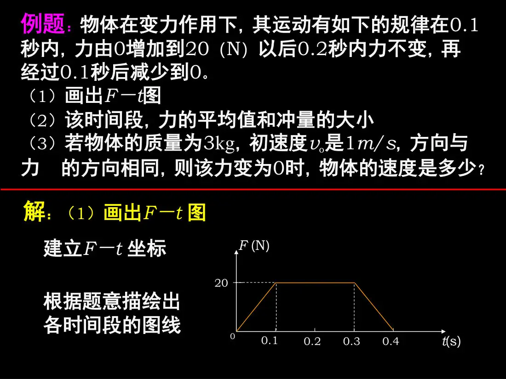

原文：

例题：物体在变力作用下，其运动有如下的规律在0.1秒内，力由0增加到20（N）以后0.2秒内力不变，再经过0.1秒后减少到0。

（1）画出F－t图

（2）该时间段，力的平均值和冲量的大小

（3）若物体的质量为3kg，初速度v是1m/s，方向与力 的方向相同，则该力变为0时，物体的速度是多少？

解：（1）画出F－t 图

建立F－t 坐标

根据题意描绘出

各时间段的图线

### （2）该时间段，力的平均值和冲量的大小

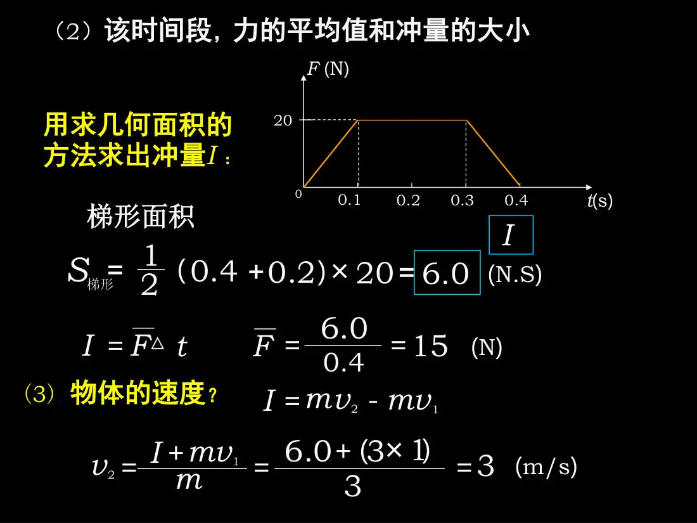

原文：

（2）该时间段，力的平均值和冲量的大小

用求几何面积的方法求出冲量I ：

梯形面积

$( 1 ) ( 1 0 - 1 0 ) ( 1 0 - 1 0 ) ( 2 ) ( 1 0 - 1 0 ) = ( 1 0 - 1 0 ) ( 2 )$ (N.S)

I = F △ t $1 2 = \frac { 1 0 } { 1 0 } = 1 1 5$ (N)

(3) 物体的速度？ $1 1 0 = 1 1 0 0 0 0 0 0 0 0 0 0 0 0 0 0 0 0 0 0 0 0 0 0 0 0 0 0 0 0 0 0 0 0 0 0 0 0 0 0 0 0 0 0 0 0 0 0 0 0 0 0 0 0 0 0 0 0 0$

$$
\nu_ {2} = \frac {I + m \nu_ {1}}{m} = \frac {6 . 0 + (3 \times 1)}{3} = 3 (\mathrm{m/s})
$$

### （1）在(b)上画出木箱运动过程F－t坐标图

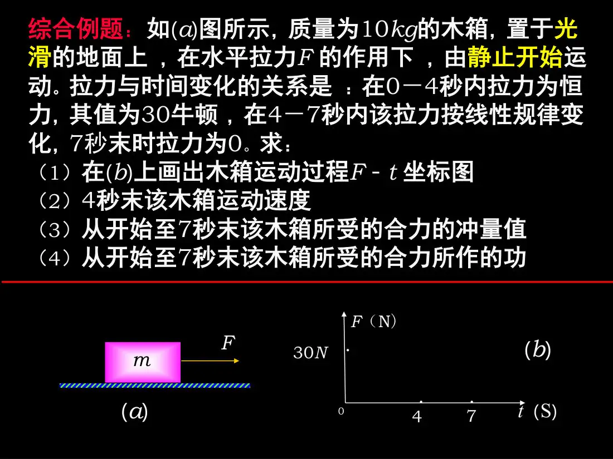

原文：

综合例题：如(a)图所示，质量为10kg的木箱，置于光滑的地面上 ，在水平拉力F 的作用下 ，由静止开始运动。拉力与时间变化的关系是 ：在0－4秒内拉力为恒力，其值为30牛顿 ，在4－7秒内该拉力按线性规律变化，7秒末时拉力为0。求：

（1）在(b)上画出木箱运动过程F－t坐标图

（2）4秒末该木箱运动速度

（3）从开始至7秒末该木箱所受的合力的冲量值

（4）从开始至7秒末该木箱所受的合力所作的功

### （1）在(b)上画出木箱运动过程F－t 坐标图

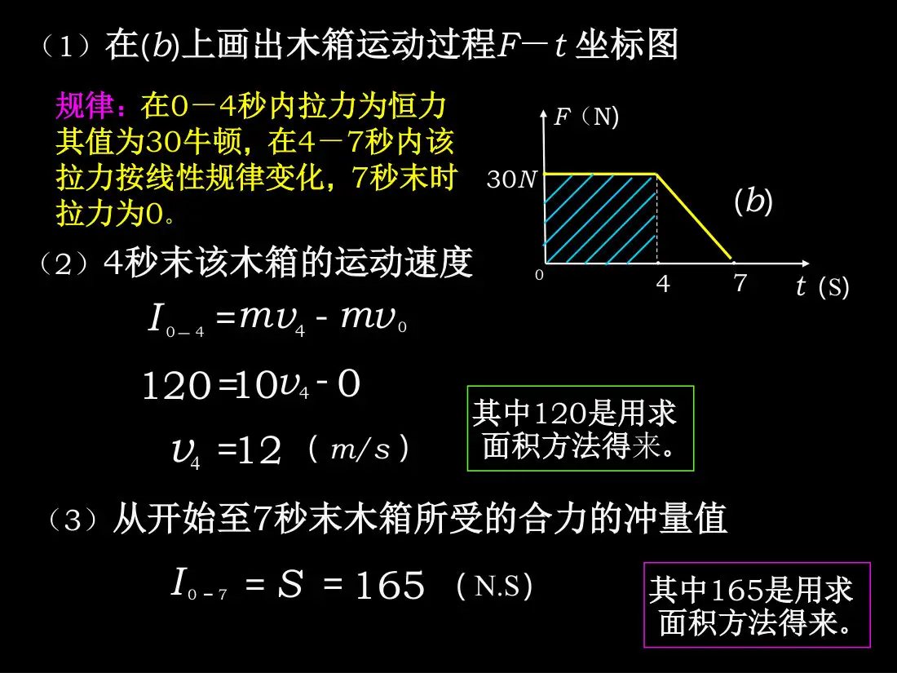

原文：

（1）在(b)上画出木箱运动过程F－t 坐标图

规律：在0－4秒内拉力为恒力其值为30牛顿，在4－7秒内该拉力按线性规律变化，7秒末时拉力为0。

（2）4秒末该木箱的运动速度

$$
I _ {0 - 4} = m \nu_ {4} - m \nu_ {0}
$$

120=10v4 0-

$$
\nu_ {4} = 1 2 (m / s)
$$

其中120是用求面积方法得来。

（3）从开始至7秒末木箱所受的合力的冲量值

I 0 7 = S = 165 ( N.S ) -其中165是用求面积方法得来。

### （4）从开始至7秒末木箱所受的合力所作的功

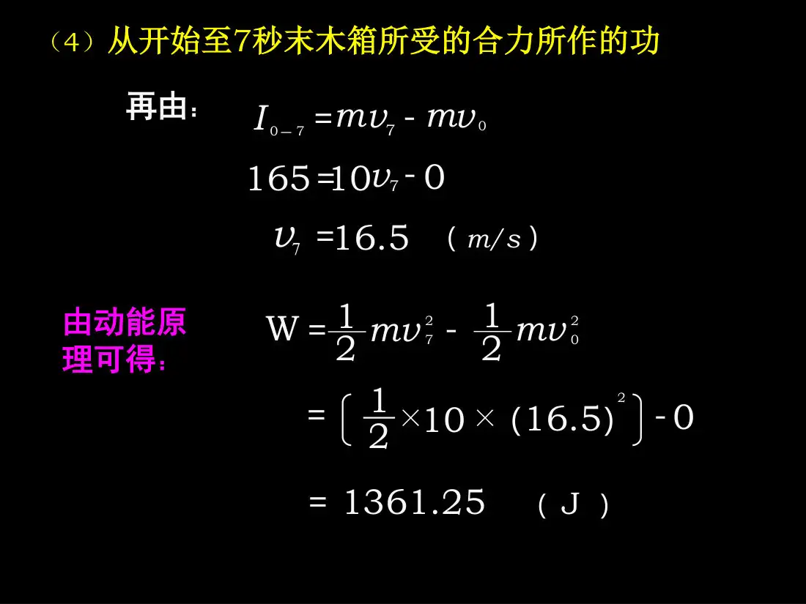

原文：

（4）从开始至7秒末木箱所受的合力所作的功

再由：

$$
I _ {0 - 7} = m \nu_ {7} - m \nu_ {0}
$$

$$
1 6 5 = 1 0 \nu_ {7} - 0
$$

$$
\nu_ {7} = 1 6. 5 \quad (m / s)
$$

由动能原理可得：

$$
\begin{array}{r l} & W = \frac {1}{2} m \nu_ {7} ^ {2} - \frac {1}{2} m \nu_ {0} ^ {2} \\ & = \left(\frac {1}{2} \times 1 0 \times (1 6. 5) ^ {2}\right) - 0 \\ & = 1 3 6 1. 2 5 \quad (\textrm {J}) \end{array}
$$

### 本题有多种解题的方法解一：对碰撞过程应用动量原理

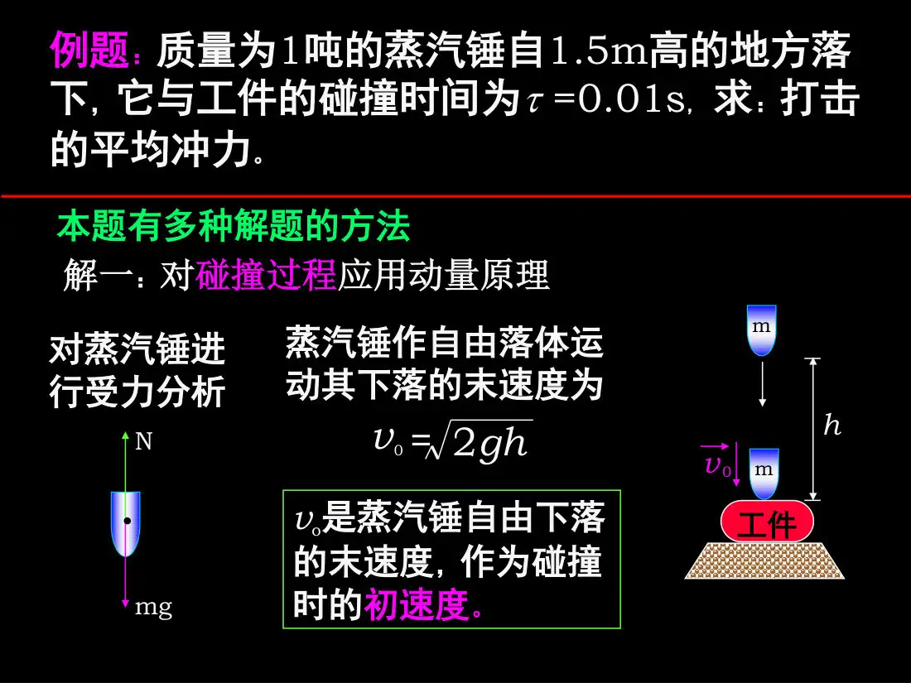

原文：

例题：质量为1吨的蒸汽锤自1.5m高的地方落下，它与工件的碰撞时间为=0.01s, 求：打击的平均冲力。

本题有多种解题的方法解一：对碰撞过程应用动量原理

对蒸汽锤进行受力分析蒸汽锤作自由落体运动其下落的末速度为

v0= 2gh

v是蒸汽锤自由下落的末速度，作为碰撞时的初速度。

### 设：竖直向上为y正方向并由动量原理得：

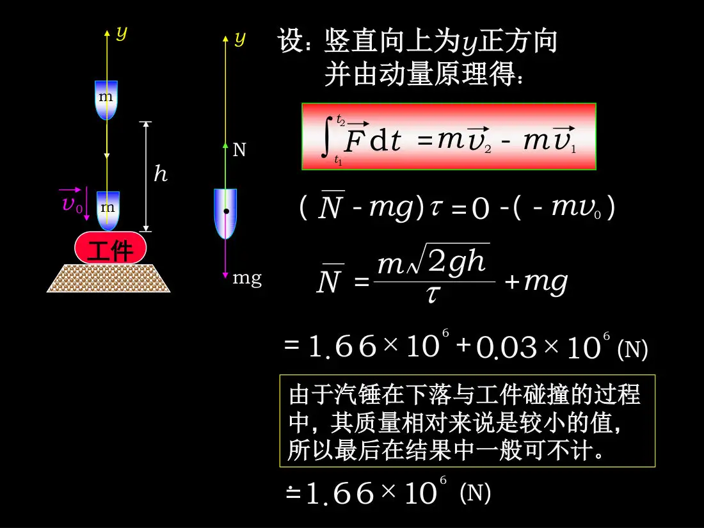

原文：

设：竖直向上为y正方向并由动量原理得：

$$
\int_ {t _ {1}} ^ {t _ {2}} \overrightarrow {F} \mathrm{d} t = m \overrightarrow {\nu} _ {2} - m \overrightarrow {\nu} _ {1}
$$

$$
(\overline {{N}} - m g) \tau = 0 - (- m \nu_ {0})
$$

$$
\overline {{N}} = \frac {m \sqrt {2 g h}}{\tau} + m g
$$

$$
= 1. 6 6 \times 1 0 ^ {6} + 0. 0 3 \times 1 0 ^ {6} (\mathrm{N})
$$

由于汽锤在下落与工件碰撞的过程中，其质量相对来说是较小的值，所以最后在结果中一般可不计。

$$
\doteq 1. 6 6 \times 1 0 ^ {6} (\mathrm{N})
$$

### 解二：对整个过程应用动量原理

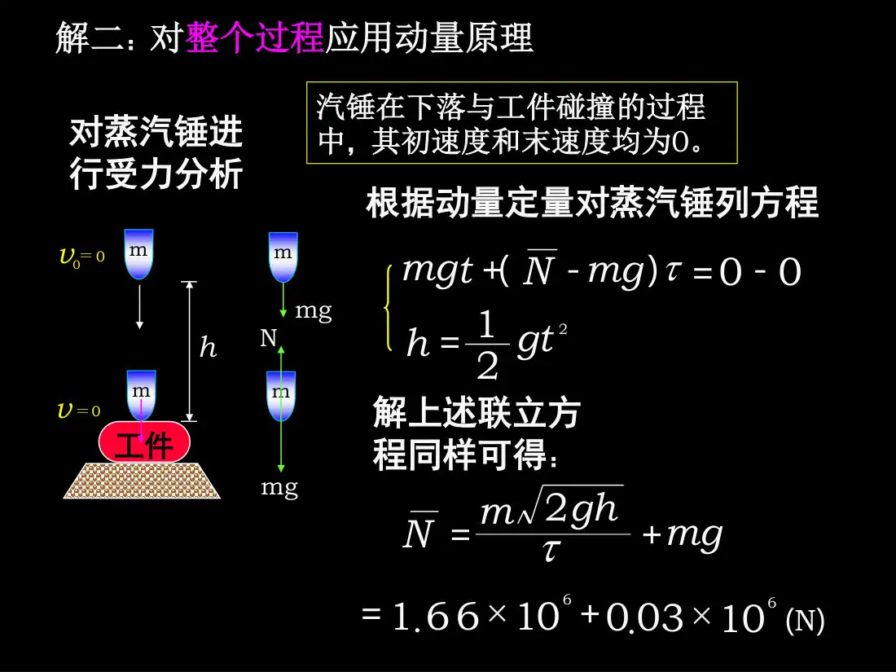

原文：

解二：对整个过程应用动量原理

对蒸汽锤进行受力分析

汽锤在下落与工件碰撞的过程中，其初速度和末速度均为0。

根据动量定量对蒸汽锤列方程

$$
h = \frac {1}{2} g t ^ {2}
$$

解上述联立方程同样可得：

m 2gh N = T +mg = × ×6 61.66 10 +0.03 10 (N)

### 解：建立直角坐标,对小球进行受力分析速度分解

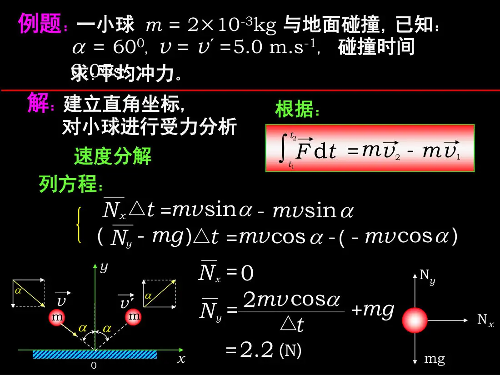

原文：

例题：一小球 $\angle A C E = \angle D A E = \angle C A E = 9 0 ^ { \circ }$ 与地面碰撞，已知：$\cos ( 0 . 2 \sqrt { 2 } - \sqrt { 2 } ) = \cos ( 0 . 2 \sqrt { 2 } - \sqrt { 2 } ) = \cos ( 0 . 2 \sqrt { 2 } - \sqrt { 2 } )$ 碰撞时间0.05s求:平均冲力。

解：建立直角坐标,对小球进行受力分析速度分解

根据：

$$
\int_ {t _ {1}} ^ {t _ {2}} \overrightarrow {F} \mathrm{d} t = m \overrightarrow {\nu} _ {2} - m \overrightarrow {\nu} _ {1}
$$

列方程：

$$
\begin{array}{c} \alpha \\ \text {   } \\ \text {   } \\ m \end{array} \quad \begin{array}{c} \nu \\ \text {   } \\ \text {   } \\ m \end{array} \quad \begin{array}{c} \alpha \\ \text {   } \\ \text {   } \\ \text {   } \\ 0 \end{array} \quad \begin{array}{c} \alpha \\ \text {   } \\ \text {   } \\ \text {   } \\ x \end{array}
$$

$$
\begin{array}{l} \overline {{N}} _ {x} = 0 \\ \overline {{N}} _ {y} = \frac {2 m \nu \cos \alpha}{\triangle t} + m g \\ = 2. 2 (\mathrm{N}) \end{array}
$$

### 解：对物体进行受力分析分别对M及m 应用动量原理

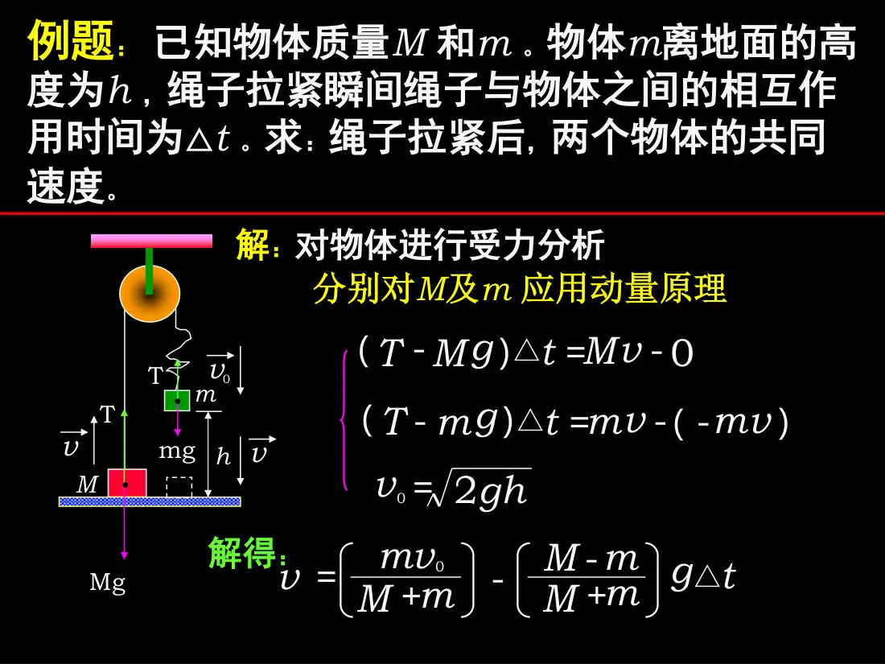

原文：

例题： 已知物体质量M 和m 。物体m离地面的高度为h ，绳子拉紧瞬间绳子与物体之间的相互作用时间为△t 。求：绳子拉紧后，两个物体的共同速度。

解：对物体进行受力分析分别对M及m 应用动量原理

$$
\left\{ \begin{array}{l} (T - M g) \triangle t = M \nu - 0 \\ (T - m g) \triangle t = m \nu - (- m \nu) \\ \nu_ {0} = \sqrt {2 g h} \end{array} \right.
$$

解得： mv 0 M－m=v △t gM m + M m+

### 二、 质点系的动量定理

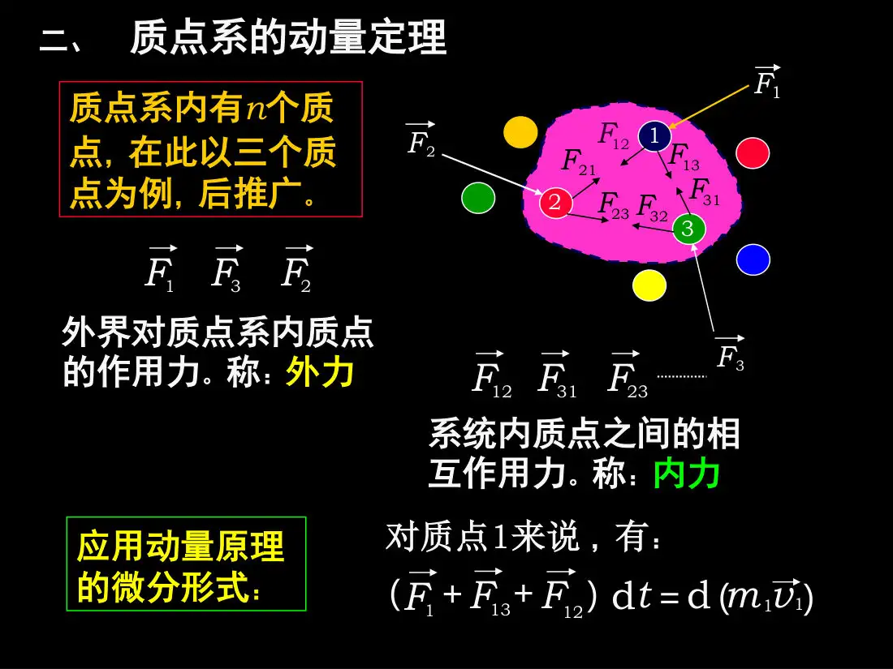

原文：

二、 质点系的动量定理

质点系内有n个质点，在此以三个质点为例，后推广。

F F3 F外界对质点系内质点的作用力。称：外力

F F F3

系统内质点之间的相互作用力。称：内力

应用动量原理的微分形式：

对质点1来说 ，有：$\textcircled { 1 2 } = \textcircled { 1 2 } = \textcircled { 1 2 }$ dt＝d（m v1 1）

### $$

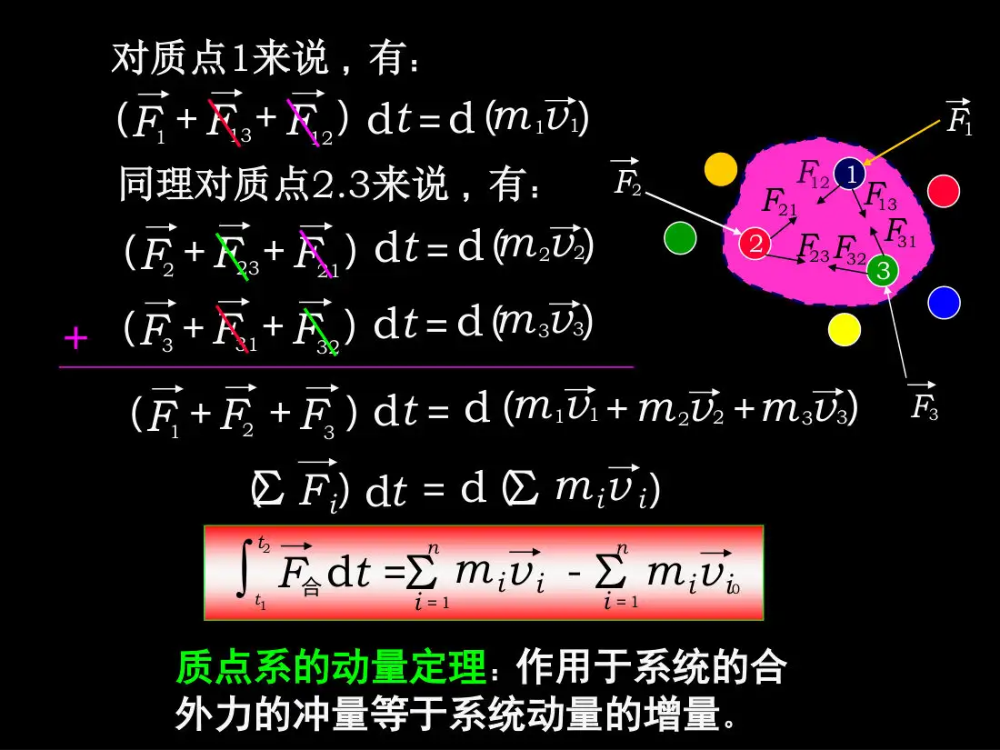

原文：

$$
(\overrightarrow {F _ {1}} + \overrightarrow {F _ {1 3}} + \overrightarrow {F _ {1 2}}) d t = d (m _ {1} \overrightarrow {\nu_ {1}})
$$

$$
(\vec {F} _ {2} + \vec {F} _ {2 3} + \vec {F} _ {2 1}) \mathrm{d} t = \mathrm{d} (m _ {2} \vec {\nu} _ {2})
$$

$$
(\overrightarrow {F _ {3}} + \overrightarrow {F _ {3 1}} + \overrightarrow {F _ {3 2}}) \mathrm{d} t = \mathrm{d} (m _ {3} \overrightarrow {\nu_ {3}})
$$

$$
(\sum \overrightarrow {F _ {i}}) \mathrm{d} t = \mathrm{d} (\sum m _ {i} \overrightarrow {\nu_ {i}})
$$

$$
\int_ {t _ {1}} ^ {t _ {2}} \overrightarrow {F} _ {\mathrm{合}} \mathrm{d} t = \sum_ {i = 1} ^ {n} m _ {i} \overrightarrow {\upsilon} _ {i} - \sum_ {i = 1} ^ {n} m _ {i} \overrightarrow {\upsilon} _ {i _ {0}}
$$

质点系的动量定理：作用于系统的合外力的冲量等于系统动量的增量。

### $$

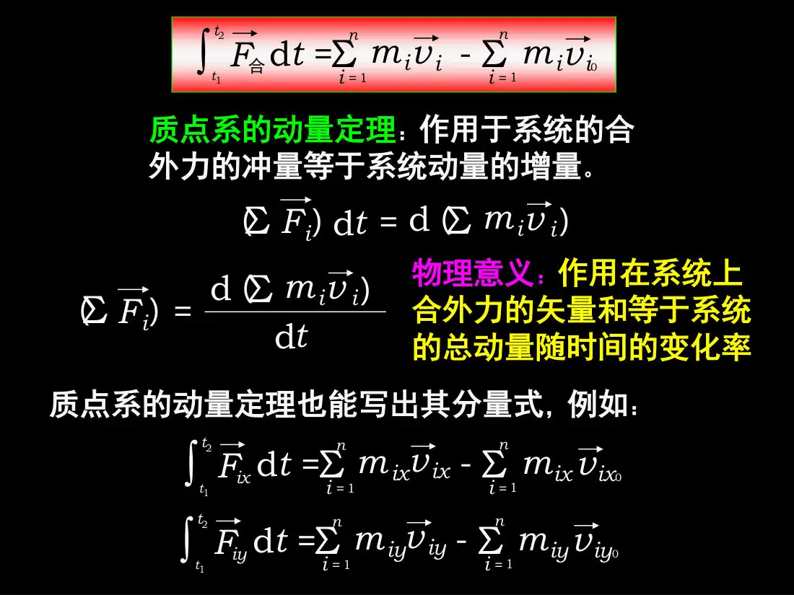

原文：

$$
\int_ {t _ {1}} ^ {t _ {2}} \overrightarrow {F} _ {\mathrm{合}} \mathrm{d} t = \sum_ {i = 1} ^ {n} m _ {i} \overrightarrow {\upsilon} _ {i} - \sum_ {i = 1} ^ {n} m _ {i} \overrightarrow {\upsilon} _ {i 0}
$$

质点系的动量定理：作用于系统的合外力的冲量等于系统动量的增量。

（Σ Fi）dt ＝d（Σ miv i）

$$
(\sum \overrightarrow {F _ {i}}) = \frac {\mathrm{d} (\sum m _ {i} \overrightarrow {\nu_ {i}})}{\mathrm{d} t}
$$

物理意义：作用在系统上合外力的矢量和等于系统的总动量随时间的变化率

质点系的动量定理也能写出其分量式，例如：

$$
\begin{array}{r} \int_ {t _ {1}} ^ {t _ {2}} \overrightarrow {F} _ {i x} \mathrm{d} t = \sum_ {i = 1} ^ {n} m _ {i x} \overrightarrow {\nu} _ {i x} - \sum_ {i = 1} ^ {n} m _ {i x} \overrightarrow {\nu} _ {i x _ {0}} \\ \int_ {t _ {1}} ^ {t _ {2}} \overrightarrow {F} _ {i y} \mathrm{d} t = \sum_ {i = 1} ^ {n} m _ {i y} \overrightarrow {\nu} _ {i y} - \sum_ {i = 1} ^ {n} m _ {i y} \overrightarrow {\nu} _ {i y _ {0}} \end{array}
$$

### 特别提示

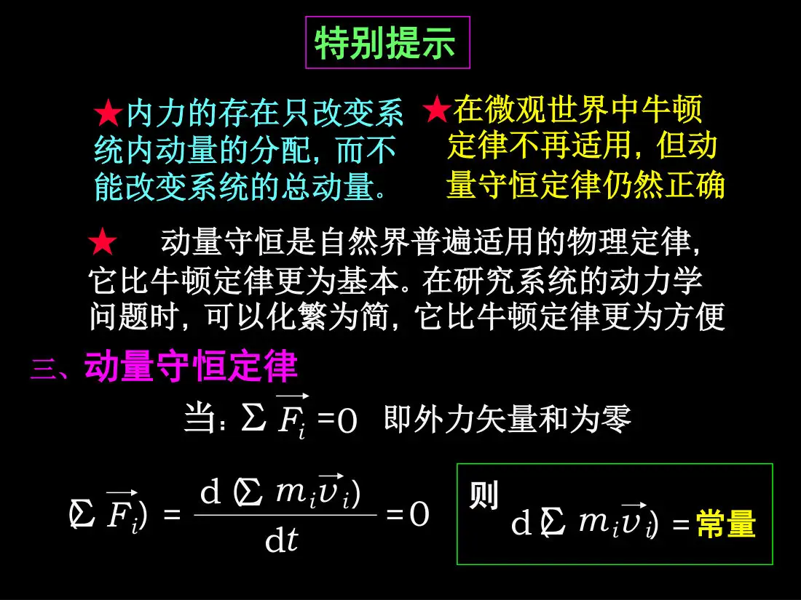

原文：

特别提示

★内力的存在只改变系 ★在微观世界中牛顿统内动量的分配，而不 定律不再适用，但动能改变系统的总动量。 量守恒定律仍然正确

动量守恒是自然界普遍适用的物理定律，它比牛顿定律更为基本。在研究系统的动力学问题时，可以化繁为简，它比牛顿定律更为方便

三、动量守恒定律

当： $p _ { 2 } = \frac { 1 } { 2 }$ 即外力矢量和为零

$$
(\sum \overrightarrow {F _ {i}}) = \frac {\mathrm{d} (\sum m _ {i} \overrightarrow {\nu_ {i}})}{\mathrm{d} t} = 0
$$

则

### 三、动量守恒定律

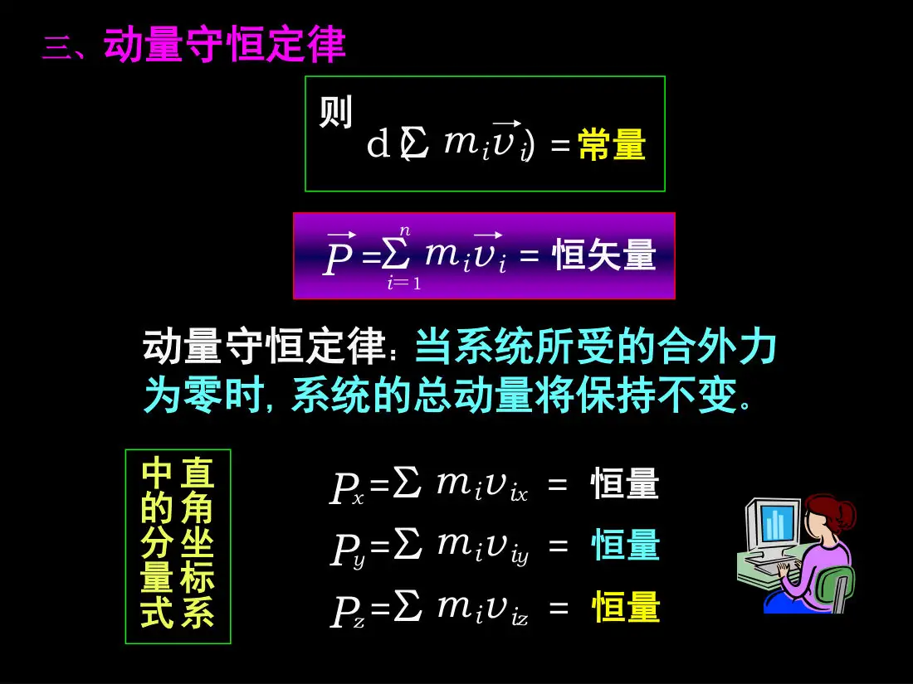

原文：

三、动量守恒定律

则 d（Σ miv i）＝常量

＝Σ mivi ＝恒矢量P

动量守恒定律：当系统所受的合外力为零时，系统的总动量将保持不变。

直
角
坐
标
系中
的
分
量
式

P＝Σ mivix ＝ 恒量

Py＝Σ miviy ＝ 恒量

P＝Σ miviz ＝ 恒量

### ＝Σ mivi＝恒矢量P i＝1

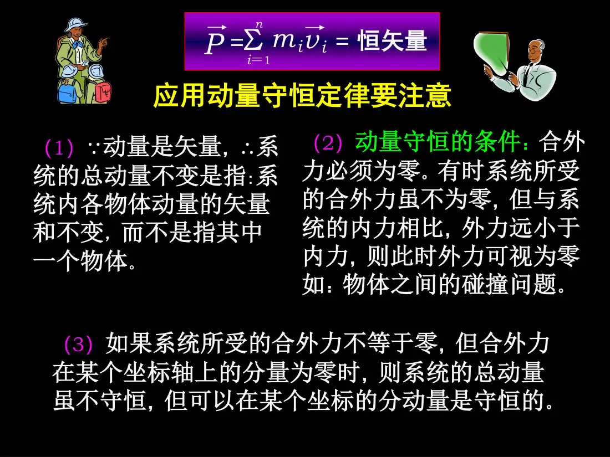

原文：

＝Σ mivi＝恒矢量P i＝1

应用动量守恒定律要注意

（1）∵动量是矢量，∴系统的总动量不变是指:系统内各物体动量的矢量和不变，而不是指其中一个物体。

（2）动量守恒的条件：合外力必须为零。有时系统所受的合外力虽不为零，但与系统的内力相比，外力远小于内力，则此时外力可视为零如：物体之间的碰撞问题。

（3）如果系统所受的合外力不等于零，但合外力在某个坐标轴上的分量为零时，则系统的总动量虽不守恒，但可以在某个坐标的分动量是守恒的。

### 炮弹爆炸前后系统动量守恒,可以列出方程：

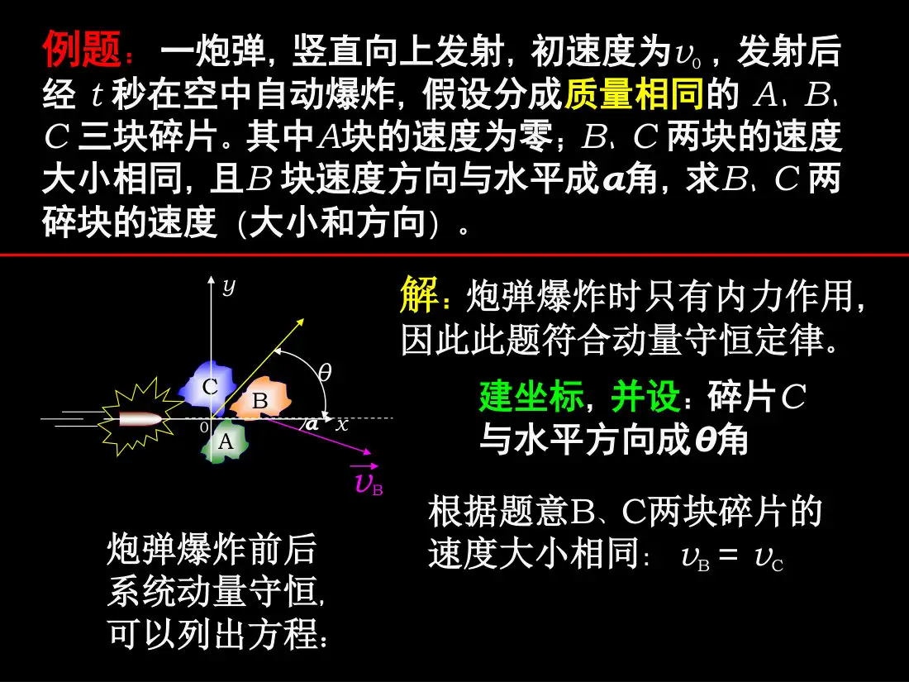

原文：

例题： 一炮弹，竖直向上发射，初速度为 $\textcircled { 1 } \textcircled { \div } \textcircled { \div } \textcircled { \div } \textcircled { \div } \textcircled { \div } \textcircled { \div } \textcircled { \div }$ ，发射后经 t 秒在空中自动爆炸，假设分成质量相同的 A BC 三块碎片。其中A块的速度为零；B C 两块的速度大小相同，且B 块速度方向与水平成α角，求B C 两碎块的速度（大小和方向）。

炮弹爆炸前后系统动量守恒,可以列出方程：

解：炮弹爆炸时只有内力作用，因此此题符合动量守恒定律。

建坐标，并设：碎片C与水平方向成θ角

根据题意B、C两块碎片的速度大小相同: $( \frac { 1 0 } { 1 5 } ) = 1 0 \%$ 根据题意B、C两块碎片的速度大小相同:

### $$

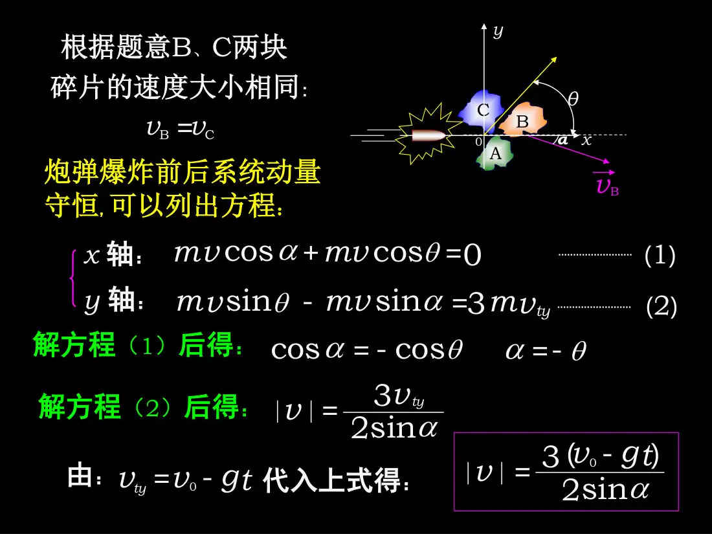

原文：

$$
\nu_ {\mathrm{B}} = \nu_ {\mathrm{C}}
$$

炮弹爆炸前后系统动量守恒,可以列出方程：

x 轴： $m _ { i } ( { \boldsymbol { \mu } } { \boldsymbol { \nu } } ) ( \mathbf { \mu } \mathbf { \circ } ( \mathbf { \circ } ) \mathbf { \circ } \mathbf { \circ } ( { \boldsymbol { \sigma } } ) ) ( { \boldsymbol { \mu } } { \boldsymbol { \cdot } } \mathbf { \circ } ( { \boldsymbol { \mu } } { \boldsymbol { \mu } } ) ) ( \mathbf { \circ } ( \mathbf { \circ } ) \mathbf { \circ } ( { \boldsymbol { \mu } } ) = \mathbf { \circ } )$

y 轴： mvsin －mv sin $\cos = \sin ( \frac { \pi } { 2 } \pi + \frac { \pi } { 2 } \pi )$ (2)

解方程（1）后得： $( \bullet ( \bullet ) \bullet \forall \bullet = \bullet ( \bullet ( \bullet ) \bullet \bullet )$ $\textcircled { \bullet }$

解方程（2）后得： $\vert \overrightarrow { a } \vert = \frac { \vert \overrightarrow { a } / / / \overrightarrow { b } / / / } { \vert \overrightarrow { a } / / / \overrightarrow { b } / / / \overrightarrow { b } / / / \overrightarrow { a } / / }$

由： $( \overrightarrow { a } ) = ( \overrightarrow { b } ) = ( \overrightarrow { a } )$ 代入上式得：

$$
| \nu | = \frac {3 (\nu_ {0} - g t)}{2 \sin \alpha}
$$

### 解：每一个石子都作自由落体运动，落到秤盘时的速度为：

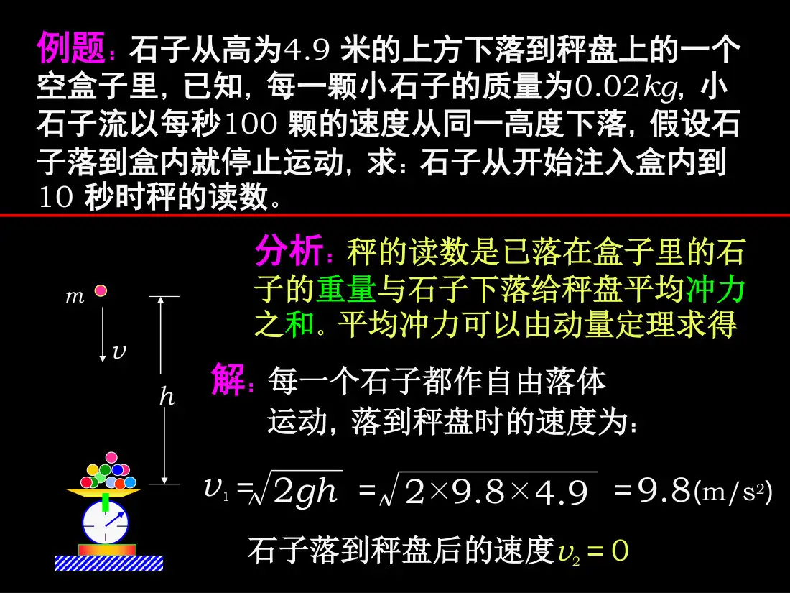

原文：

例题：石子从高为4.9 米的上方下落到秤盘上的一个空盒子里，已知，每一颗小石子的质量为0.02kg，小石子流以每秒100 颗的速度从同一高度下落，假设石子落到盒内就停止运动，求：石子从开始注入盒内到10 秒时秤的读数。

分析：秤的读数是已落在盒子里的石子的重量与石子下落给秤盘平均冲力之和。平均冲力可以由动量定理求得

解：每一个石子都作自由落体运动，落到秤盘时的速度为：

v1= 2gh = 2×9.8×4.9 =9.8(m/s2)

石子落到秤盘后的速度v＝0解：每一个石子都作自由落体运动，落到秤盘时的速度为：

### $$

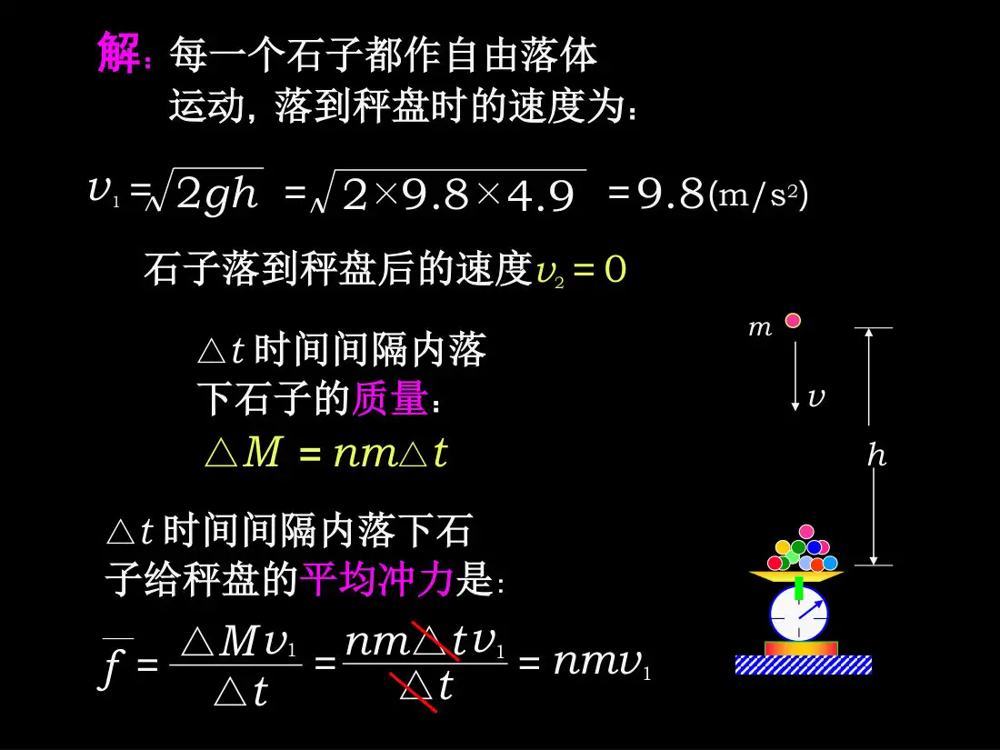

原文：

$$
\nu_ {1} = \sqrt {2 g h} = \sqrt {2 \times 9 . 8 \times 4 . 9} = 9. 8 (\mathrm{m} / \mathrm{s} ^ {2})
$$

石子落到秤盘后的速度 $[ b ] = [ 0 ]$

△t 时间间隔内落下石子的质量：△M＝nm△t

△t 时间间隔内落下石子给秤盘的平均冲力是:

$$
\overline {{f}} = \frac {\triangle M v _ {1}}{\triangle t} = \frac {n m \triangle t v _ {1}}{\triangle t} = n m v _ {1}
$$

### △t 时间间隔内落下石子给秤盘的平均冲力是:

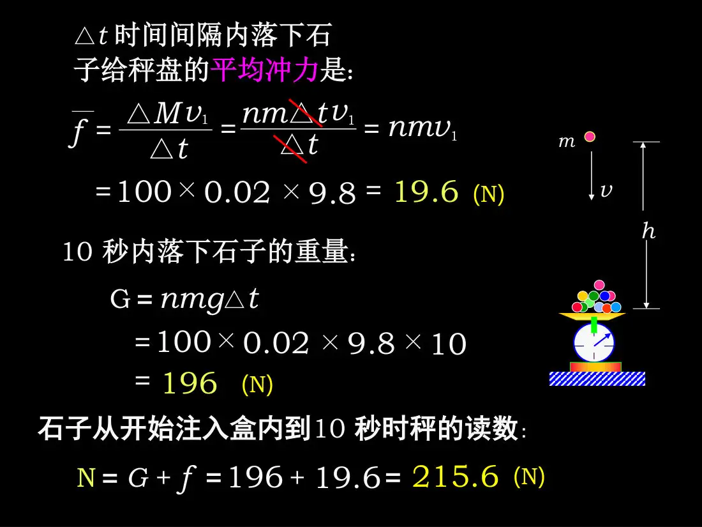

原文：

△t 时间间隔内落下石子给秤盘的平均冲力是:

$$
\begin{array}{r l} \overline {{f}} = & \frac {\triangle M v _ {1}}{\triangle t} = \frac {n m \triangle t v _ {1}}{\triangle t} = n m v _ {1} \\ = & 1 0 0 \times 0. 0 2 \times 9. 8 = 1 9. 6 (\mathrm{N}) \end{array}
$$

10 秒内落下石子的重量：

$$
\begin{array}{r l} & {\mathrm{G=nmg} \triangle t} \\ & {= 1 0 0 \times 0. 0 2 \times 9. 8 \times 1 0} \\ & {= 1 9 6 \quad (\mathrm{N})} \end{array}
$$

石子从开始注入盒内到10 秒时秤的读数:

N＝G + f＝196 + 19.6＝ 215.6 (N)

### 光滑桌面

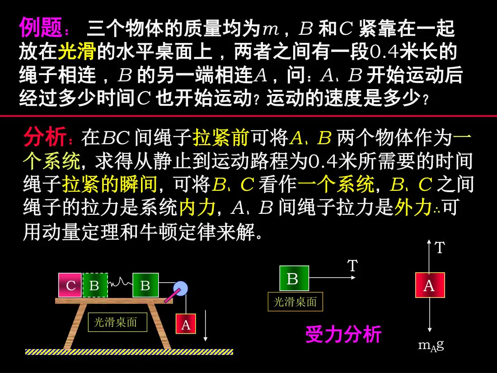

原文：

例题： 三个物体的质量均为m ，B 和C 紧靠在一起放在光滑的水平桌面上 ，两者之间有一段0.4米长的绳子相连 ，B 的另一端相连A ，问：A、 B 开始运动后经过多少时间C 也开始运动？运动的速度是多少？

分析：在BC 间绳子拉紧前可将A、 B两个物体作为一个系统，求得从静止到运动路程为0.4米所需要的时间绳子拉紧的瞬间，可将B、 C看作一个系统，B、 C之间绳子的拉力是系统内力，A B 间绳子拉力是外力∴可用动量定理和牛顿定律来解。

光滑桌面

光滑桌面

受力分析

### 第 40 页

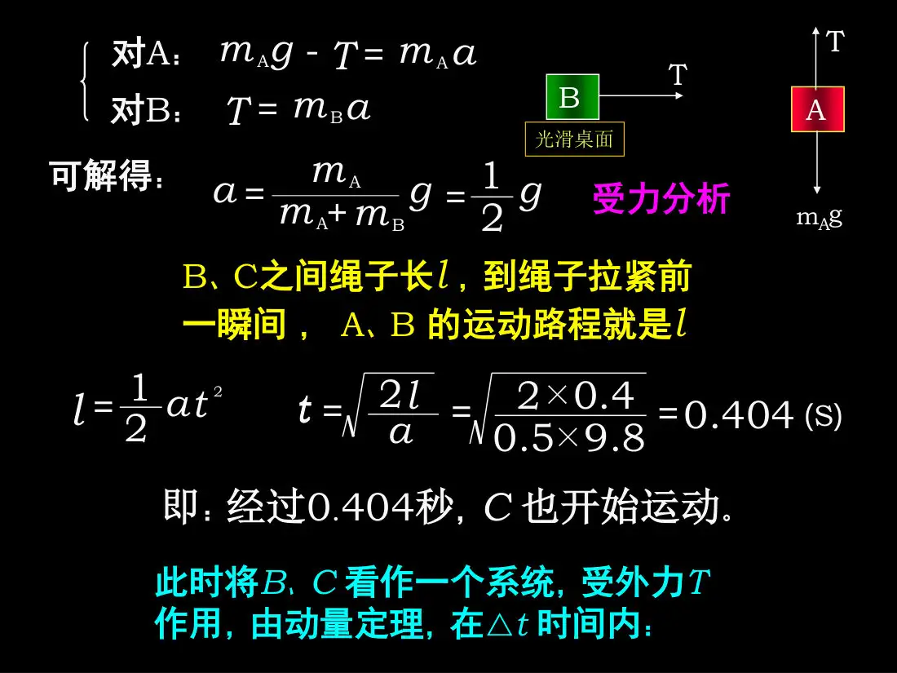

原文：

对A： $\angle B A C = \angle B = \angle A B C$ TT对B： $\angle B = \angle C A B = \angle C$ B A光滑桌面可解得： $\cos ( \theta ) = \frac { 1 1 } { 2 } \times \frac { 1 1 } { 2 } = \frac { 1 1 } { 2 } \times \frac { 1 1 } { 2 }$ 受力分析mAgB、C之间绳子长l ，到绳子拉紧前一瞬间 ， A、B 的运动路程就是l$1 1 - \frac { 1 } { 1 0 } = 1 1$ $\frac { 1 } { 2 } \times \frac { 2 } { 3 } = \frac { 1 } { 2 } \times \frac { 2 } { 3 } = \frac { 1 } { 2 } \times \frac { 2 } { 3 } = \frac { 1 } { 2 } \times \frac { 2 } { 3 } = \frac { 1 } { 2 } \times ( 2 ) .$ 即：经过0.404秒，C 也开始运动。此时将B、 C 看作一个系统，受外力T作用，由动量定理，在△t 时间内：

### $$

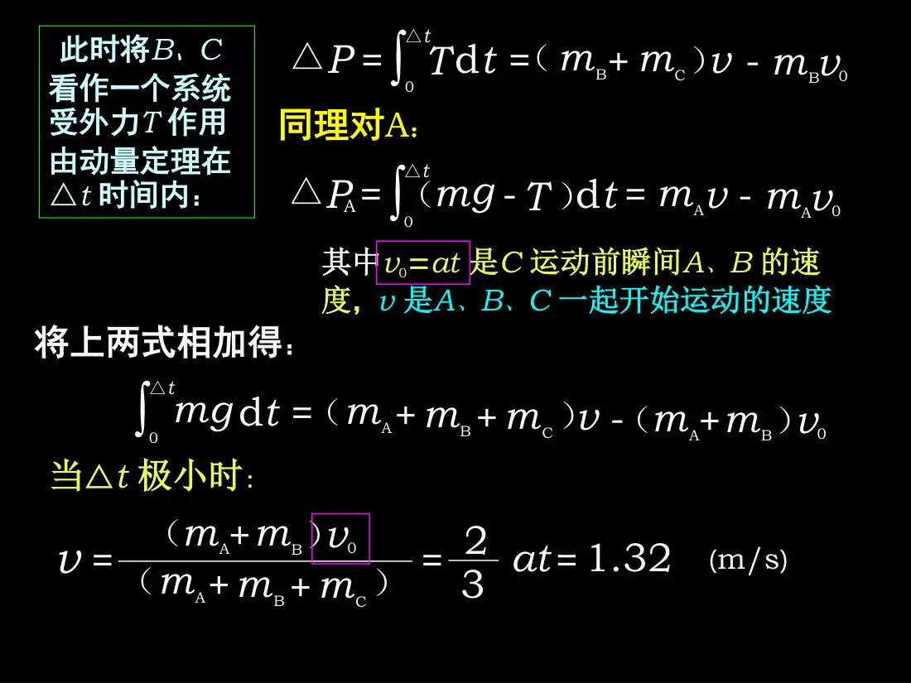

原文：

此时将B、 C看作一个系统受外力T 作用由动量定理在$\Delta G$ 时间内：

$$
\triangle P = \int_ {0} ^ {\triangle t} T \mathrm{d} t = (m _ {\mathrm{B}} + m _ {\mathrm{C}}) \nu - m _ {\mathrm{B}} \nu_ {0}
$$

同理对A：

$$
\triangle P _ {\mathrm{A}} = \int_ {0} ^ {\triangle t} (m g - T) \mathrm{d} t = m _ {\mathrm{A}} \nu - m _ {\mathrm{A}} \nu_ {0}
$$

其中 $1 0 0 = 1 0 0$ 是C 运动前瞬间A、 B 的速度，v 是A、 B、 C 一起开始运动的速度将上两式相加得：

$\angle B A C = \angle B A C = \angle C A B = \angle C A B = \angle C A B = \angle C A B = \angle C A B = 9 0 ^ { \circ }$ 当 $\Delta G$ 极小时:

$$
\nu = \frac {(m _ {\mathrm{A}} + m _ {\mathrm{B}}) \nu_ {0}}{(m _ {\mathrm{A}} + m _ {\mathrm{B}} + m _ {\mathrm{C}})} = \frac {2}{3} a t = 1. 3 2 (\mathrm{m/s})
$$

### 解：建立坐标oy向下为正,T 时刻链条下落长度为y

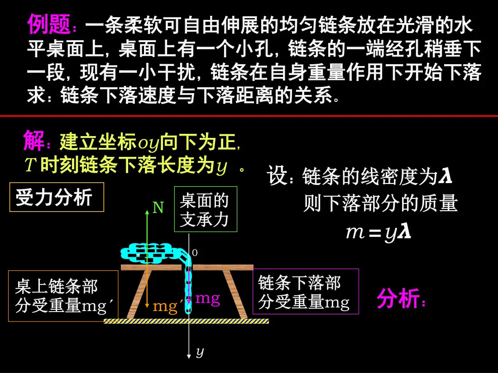

原文：

例题：一条柔软可自由伸展的均匀链条放在光滑的水平桌面上，桌面上有一个小孔，链条的一端经孔稍垂下一段，现有一小干扰，链条在自身重量作用下开始下落求：链条下落速度与下落距离的关系。

解：建立坐标oy向下为正,T 时刻链条下落长度为y

受力分析桌面的支承力

设：链条的线密度为λ则下落部分的质量

电

m y ＝ λ

桌上链条部

分受重量mg

mg mg´

链条下落部

分受重量mg

分析：

y

### 受力分析

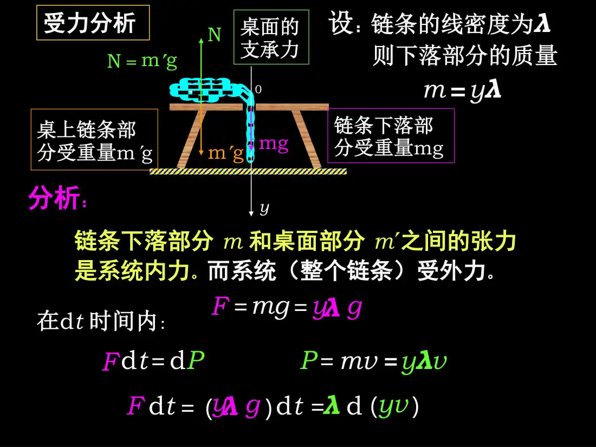

原文：

受力分析

$$
\mathrm{N} = \mathrm {m^ {\prime} g}
$$

桌面的支承力 的

设：链条的线密度为λ则下落部分的质量

m y ＝ λ

桌上链条部分受重量m g´链条下落部分受重量mg

分析：

链条下落部分 m 和桌面部分 m 之间的张力´是系统内力。而系统（整个链条）受外力。

在dt 时间内:

F＝mg＝yλ g

Fdt＝dP

P＝mv＝yλv

$$
F \mathrm{d} t = (\mathcal {Y} \Lambda g) \mathrm{d} t = \pmb {\lambda} \mathrm{d} (y \nu)
$$

### $$

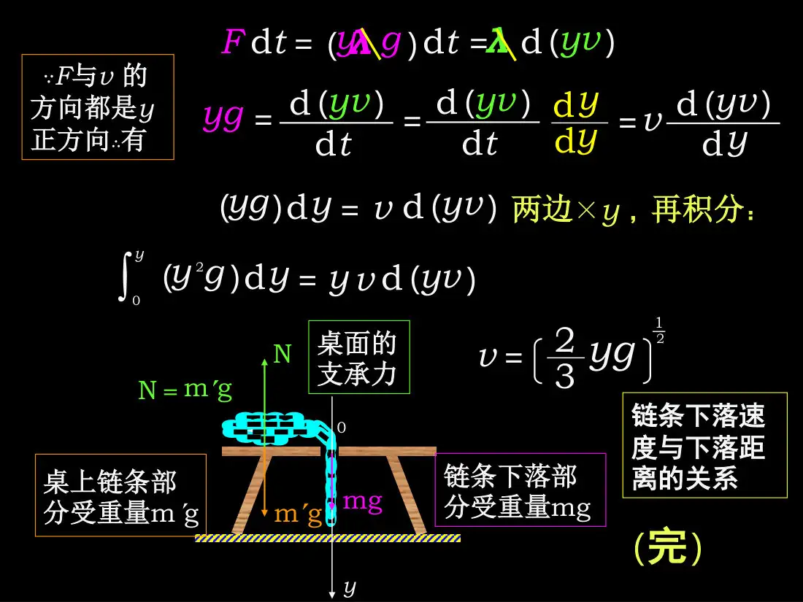

原文：

$$
F \mathrm{d} t = (y \lambda g) \mathrm{d} t = \lambda \mathrm{d} (y \nu)
$$

∵F与v 的方向都是y正方向∴有

yg d（yv ) d（yv ) dy ＝v d（yv ) dt dt dy dy

（yg )dy＝ v d（yv ) 两边×y ，再积分：

y $( \psi _ { k } \mathcal { O } _ { k } ) \chi _ { 0 } \lvert \psi _ { k } \rvert = \lvert \langle J _ { k } \mathcal { D } _ { k } \rvert \langle \psi _ { k } \rangle _ { 0 }$

桌面的支承力

$$
\nu = \left(\frac {2}{3} y g \right. ^ {\frac {1}{2}}
$$

$$
\mathrm{N} = \mathrm {m^ {\prime} g}
$$

桌上链条部分受重量m g´链条下落部分受重量mg链条下落速度与下落距离的关系

（完）

### 第 45 页

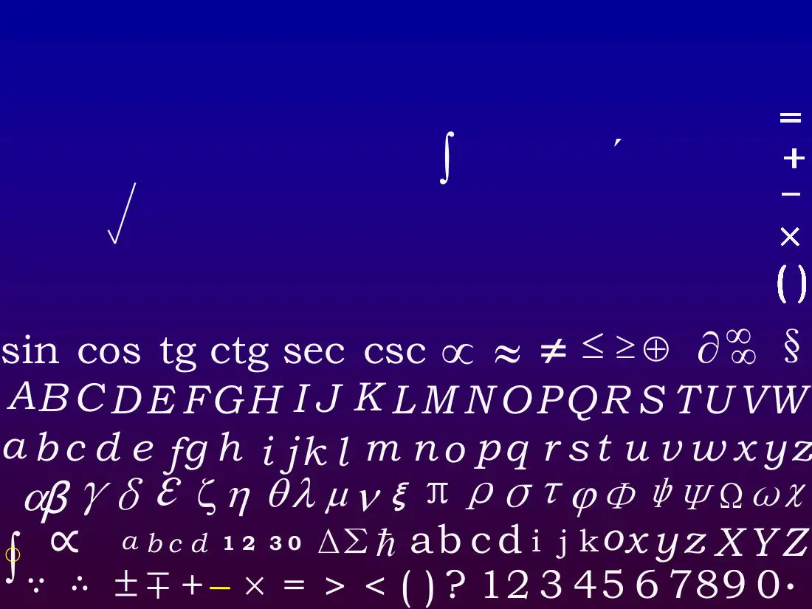

原文：

sin cos tg ctg sec csc ∝ ≈ ≠ ≤≥⊕ ∂∞ § AB C DEFGH IJ K LMNOPQRSTUVW a b c d e fg h i jk l m no pq r s t u v w x yz α γ δ ζ η λ µ ν ξπρ σ τ φ Φ ψ Ψ Ω ω χ 0 a b c d 1 2 3 0 ΔΣ a b c d i j kox y z XYZ∝ ∵∴ ±干+−× = > < ()?1234567890.

### ①②③

原文：

0601 ΑΒΓΔΕΖΗΘΙΚ 0611 ΛΜΝΞΟΠΡΣΤΥ 0621 ΦΧΨΩ 0631 αβγδεζηθ 0641ικλμνξοπρσ 0651 τυφχψω 0101 〃 C 0111 ～‖… 0121 〉 《》「」『』〖〗 0131 】±×÷∶∧∨∑∏∪ 0141 ∩∈∷√⊥∥∠⌒⊙∫ 0151 ∮≡≌≈∽∝≠≮≯≤ 0161 ≥∞∵∴ °′″℃ 0171 ＄¤￠￡‰§№☆★○ 0181 ■△▲※→ 0191 ←↑↓〓→ 0201 ⅰⅱⅲⅳⅴⅵⅶⅷⅸⅹ

0701 АБВГДЕЁЖЗИ 0711 ЙКЛМНОПРСТ 0721 УФХЦЧШЩЪЫЬ 0731 ЭЮЯ

①②③

0211 ⒈⒉⒊⒋0221 ⒌⒍⒎⒏⒐⒑⒒⒓⒔⒕0231 ⒖⒗⒘⒙⒚⒛⑴⑵⑶⑷0241 ⑸⑹⑺⑻⑼⑽⑾⑿⒀⒁0251 ⒂⒃⒄⒅⒆⒇①②③④0261 ⑤⑥⑦⑧⑨⑩ ㈠㈡0271 ㈢㈣㈤㈥㈦㈧㈨㈩0281 ⅠⅡⅢⅣⅤⅥⅦⅧⅨⅩ0291 ⅪⅫ Ⅹ

-WW WW
