# 《大学物理》第3章 守恒定律 3-2 动量守恒定律（课件）

原件的每一页，下面附识别出的文字。

### 3-2 动量守恒定律

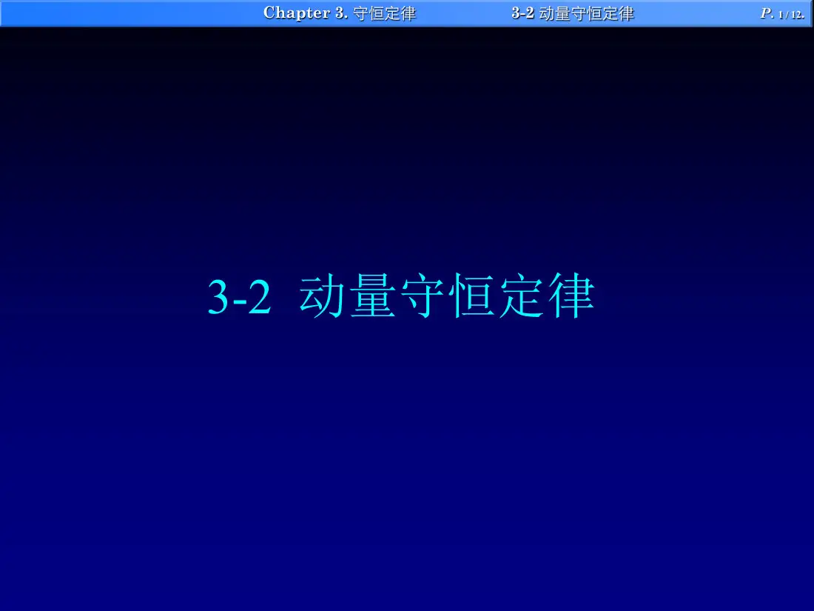

原文：

3-2 动量守恒定律

Chapter 3. 守恒定律

3-2 动量守恒定律

P. 1/12.

### 一、动量守恒定律 由质点系的动量定理:

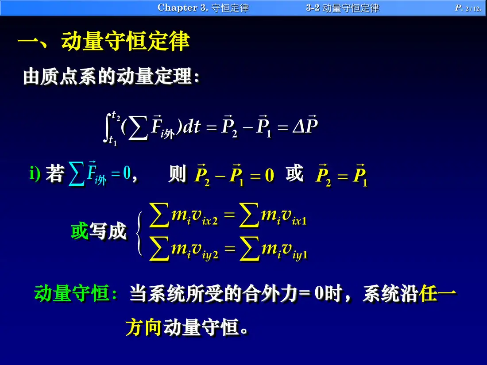

原文：

一、动量守恒定律 由质点系的动量定理:

$$
\int_ {t _ {1}} ^ {t _ {2}} \left(\sum \vec {F} _ {i \text {外}}\right) d t = \vec {P} _ {2} - \vec {P} _ {1} = \Delta \vec {P}
$$

i) 若 $\sum\vec{F}_{i外}=0$ ，则 $\vec{P}_{2}-\vec{P}_{1}=0$ 或 $\vec{P}_{2}=\vec{P}_{1}$

或写成 $\left\{\begin{array}{l}\sum m_{i}v_{ix2}=\sum m_{i}v_{ix1}\\ \sum m_{i}v_{iy2}=\sum m_{i}v_{iy1}\end{array}\right.$

动量守恒: 当系统所受的合外力 $= 0$ 时, 系统沿任一方向动量守恒。

Chapter 3. 守恒定律

3-2 动量守恒定律

P. 2 / 12.

### 3-2 动量守恒定律

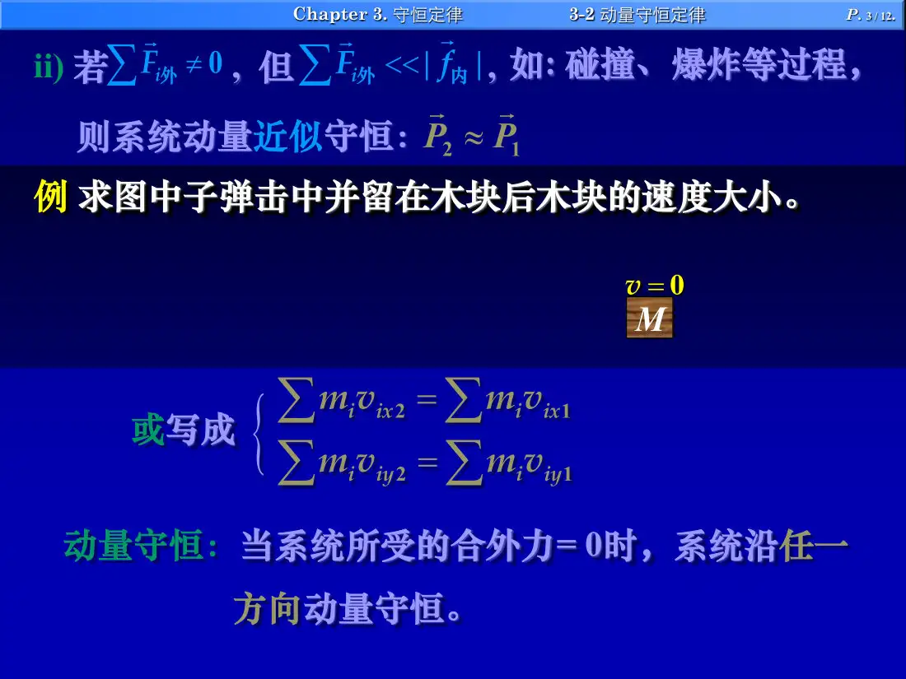

原文：

3-2 动量守恒定律

ii) 若 $\sum \vec{F}_{i\text{外}} \neq 0$ ，但 $\sum \vec{F}_{i\text{外}} << |\vec{f}_{\text{内}}|$ ，如：碰撞、爆炸等过程，则系统动量近似守恒： $\vec{P}_2 \approx \vec{P}_1$ 例求图中子弹击中并留在木块后木块的速度大小。

$$
\begin{array}{c} \mathbf {v} = 0 \\ \boxed {M} \end{array}
$$

或写成

$$
\left\{ \begin{array}{l} \sum m _ {i} v _ {i x 2} = \sum m _ {i} v _ {i x 1} \\ \sum m _ {i} v _ {i y 2} = \sum m _ {i} v _ {i y 1} \end{array} \right.
$$

动量守恒: 当系统所受的合外力 $= 0$ 时, 系统沿任一方向动量守恒。

Chapter 3. 守恒定律

### 例 求图中子弹击中并留在木块后木块的速度大小。

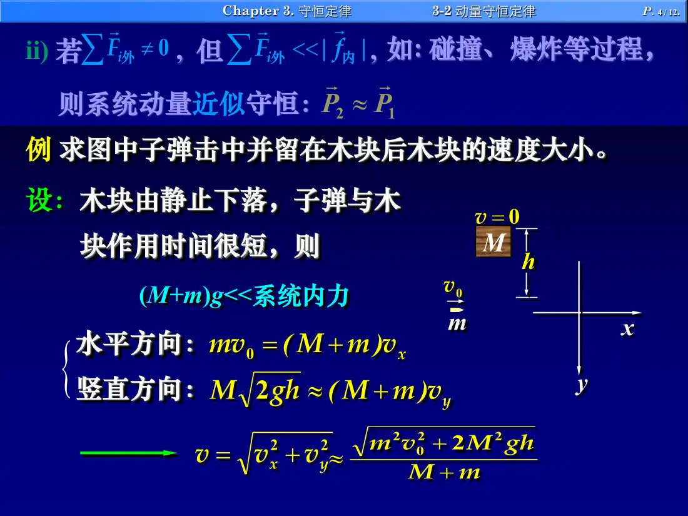

原文：

ii) 若 $\sum \vec{F}_{i\text{外}} \neq 0$ ，但 $\sum \vec{F}_{i\text{外}} << |\vec{f}_{\text{内}}|$ ，如：碰撞、爆炸等过程，

则系统动量近似守恒: $\vec{P}_{2} \approx \vec{P}_{1}$

例 求图中子弹击中并留在木块后木块的速度大小。

设：木块由静止下落，子弹与木块作用时间很短，则

$(M+m)g<<$ 系统内力

水平方向： $mv_{0}=(M+m)v_{x}$

竖直方向： $M\sqrt{2gh}\approx(M+m)v_{y}$ iii) 若 $\sum \vec{F}_{i\text{外}} \neq 0$ ，但在某方向上合外力 $= 0$ ，则该方向上动量守恒。

Chapter 3. 守恒定律

3-2 动量守恒定律

### 水平方向: $mv_{0} = (M + m)v_{x}$

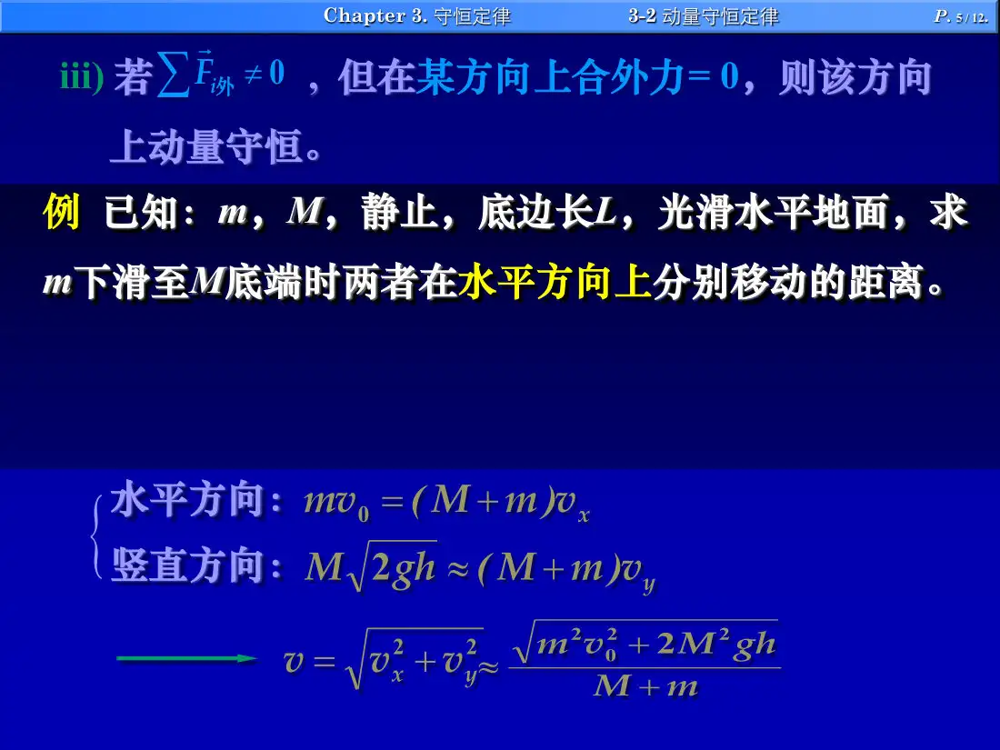

原文：

例 已知：m，M，静止，底边长L，光滑水平地面，求m下滑至M底端时两者在水平方向上分别移动的距离。

水平方向: $mv_{0} = (M + m)v_{x}$

竖直方向: $M \sqrt{2 g h} \approx (M + m) v _ {y}$

$$
v = \sqrt {v _ {x} ^ {2} + v _ {y} ^ {2}} \approx \frac {\sqrt {m ^ {2} v _ {0} ^ {2} + 2 M ^ {2} g h}}{M + m}
$$

Chapter 3. 守恒定律

3-2 动量守恒定律

P. 5/12.

### $$

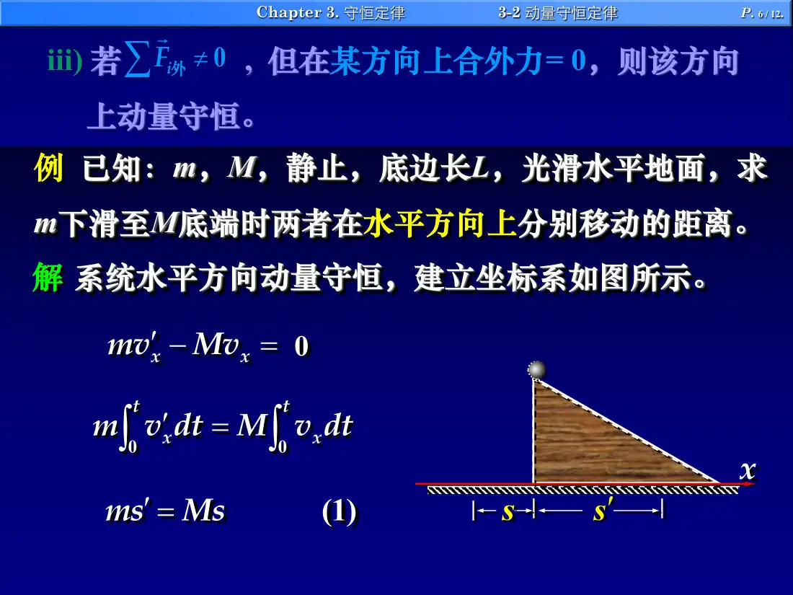

原文：

iii) 若 $\sum \vec{F}_{i\text{外}} \neq 0$ ，但在某方向上合外力 $= 0$ ，则该方向上动量守恒。

例 已知：m，M，静止，底边长L，光滑水平地面，求m下滑至M底端时两者在水平方向上分别移动的距离。解 系统水平方向动量守恒，建立坐标系如图所示。

$$
m v _ {x} ^ {\prime} - M v _ {x} = 0
$$

$$
m \int_ {0} ^ {t} v _ {x} ^ {\prime} d t = M \int_ {0} ^ {t} v _ {x} d t
$$

Chapter 3. 守恒定律

3-2 动量守恒定律

P. 6/12.

$ms' = Ms$

(1)

$\left|\leftarrow S\rightarrow\right|\leftarrow S^{\prime}\rightarrow\left|\right|$

x

### 由图可知:

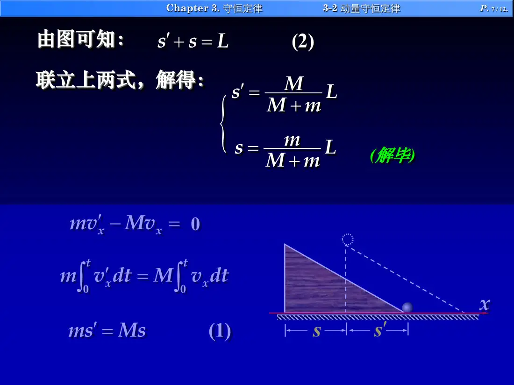

原文：

由图可知:

$$
s ^ {\prime} + s = L\tag{2}
$$

联立上两式，解得：

$$
s ^ {\prime} = \frac {M}{M + m} L
$$

$$
s = \frac {m}{M + m} L
$$

(解毕)

$$
m v _ {x} ^ {\prime} - M v _ {x} = 0
$$

$$
m \int_ {0} ^ {t} v _ {x} ^ {\prime} d t = M \int_ {0} ^ {t} v _ {x} d t
$$

$$
m s ^ {\prime} = M s\tag{1}
$$

Chapter 3. 守恒定律

3-2 动量守恒定律

P. 7/12.

### 由图可知:

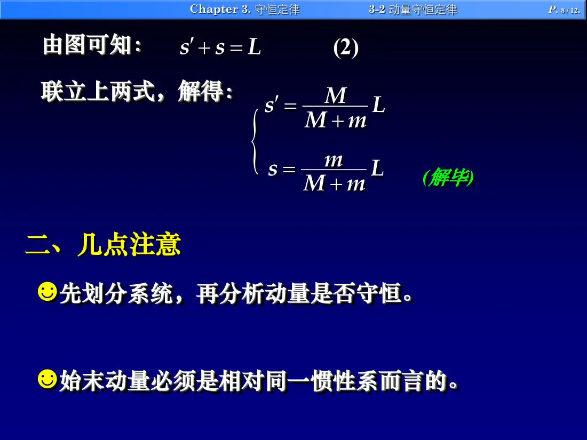

原文：

由图可知:

$$
s ^ {\prime} + s = L\tag{2}
$$

联立上两式，解得：

$$
s ^ {\prime} = \frac {M}{M + m} L
$$

$$
s = \frac {m}{M + m} L
$$

(解毕)

二、几点注意

先划分系统，再分析动量是否守恒。

始末动量必须是相对同一惯性系而言的。

Chapter 3. 守恒定律

3-2 动量守恒定律

P. 8/12.

### 涉及相对速度时，应注意相对速度与牵连速度之间的同时性。

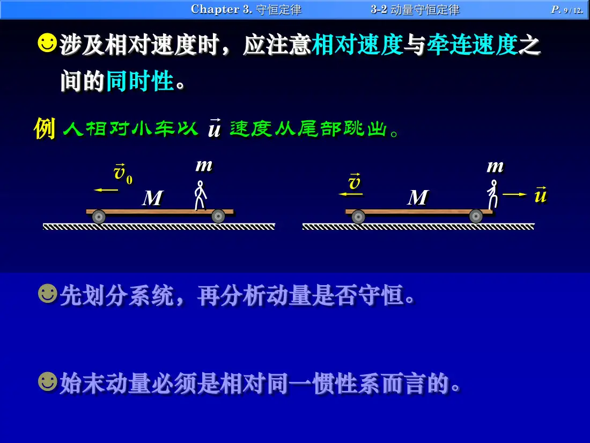

原文：

涉及相对速度时，应注意相对速度与牵连速度之间的同时性。

例 人相对小车以 $\vec{u}$ 速度从尾部跳出。

先划分系统，再分析动量是否守恒。

始末动量必须是相对同一惯性系而言的。

Chapter 3. 守恒定律

3-2 动量守恒定律

P. 9/12.

### 涉及相对速度时，应注意相对速度与牵连速度之间的同时性。

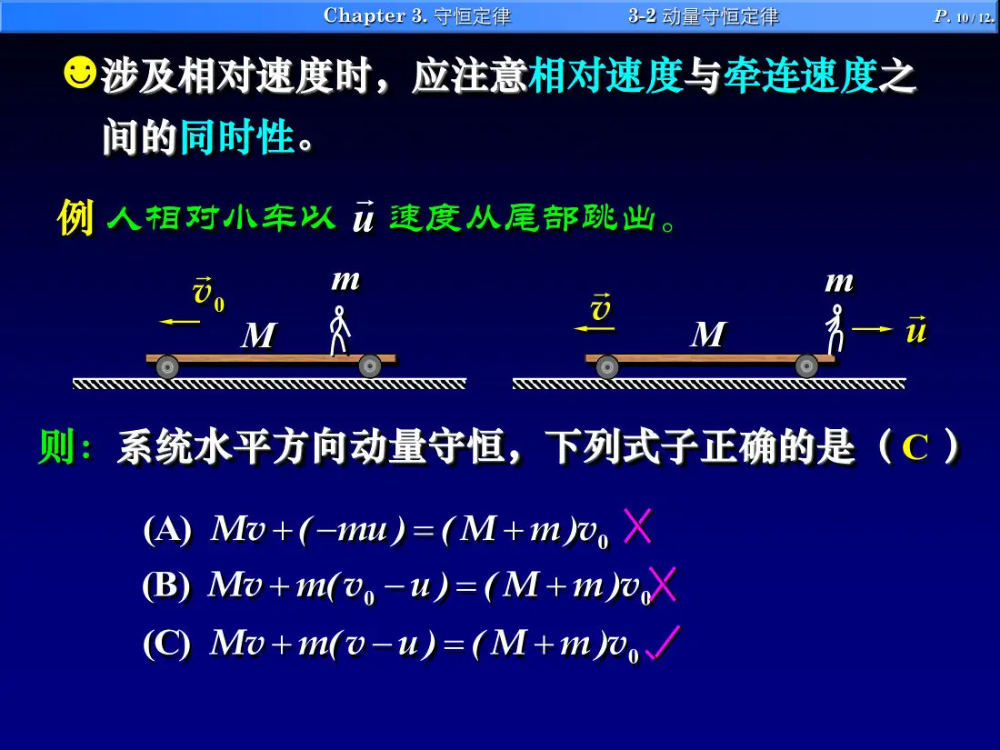

原文：

涉及相对速度时，应注意相对速度与牵连速度之间的同时性。

例 人相对小车以 $\vec{u}$ 速度从尾部跳出。

则：系统水平方向动量守恒，下列式子正确的是（C）

(A) $Mv + (-mu) = (M + m)v_{0} \times$

(B) $Mv + m(v_{0} - u) = (M + m)v_{0} \times$

(C) $Mv + m(v - u) = (M + m)v_{0}$ 😊内力虽不改变系统的动量，但可使系统的动量在系统内部转移，并可对系统作功。

Chapter 3. 守恒定律

3-2 动量守恒定律

### 归纳

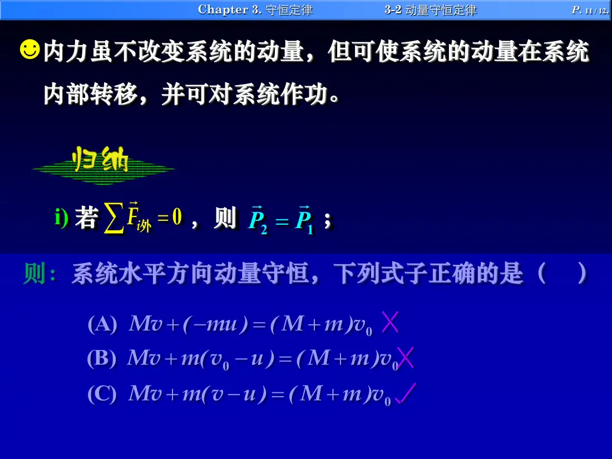

原文：

归纳

i) 若 $\sum\vec{F}_{外}=0$ ，则 $\vec{P}_{2}=\vec{P}_{1}$ ;

则：系统水平方向动量守恒，下列式子正确的是（）

(A) $Mv + (-mu) = (M + m)v_{0} \times$

(B) $Mv + m(v_{0} - u) = (M + m)v_{0}$

(C) $Mv + m(v - u) = (M + m)v_{0}$ 😊内力虽不改变系统的动量，但可使系统的动量在系统内部转移，并可对系统作功。

P. 11 / 12.

Chapter 3. 守恒定律

3-2 动量守恒定律

### 归纳

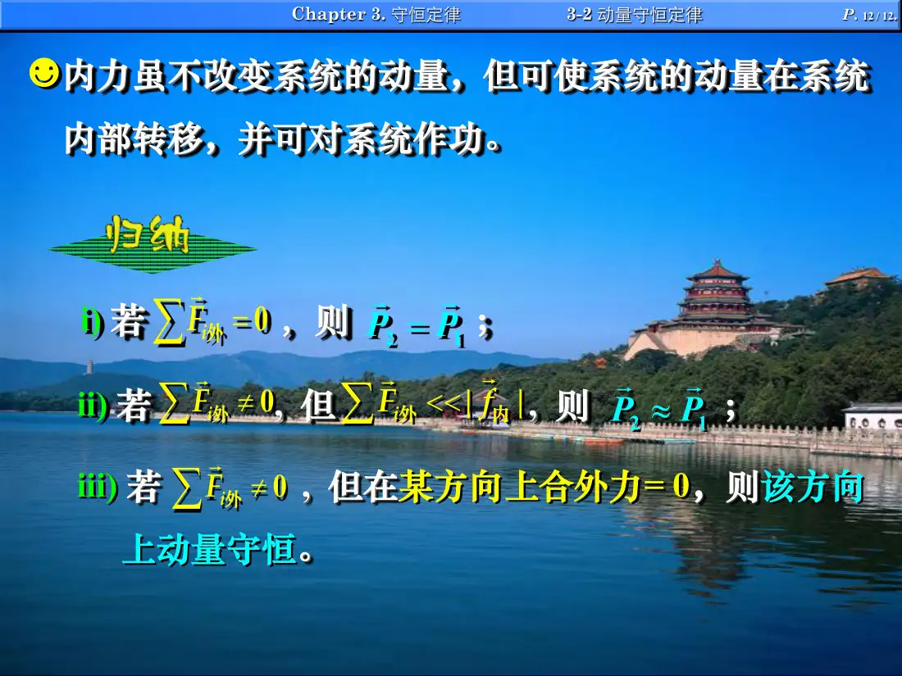

原文：

归纳

i) 若 $\sum\vec{F}_{外}=0$ ，则 $\vec{P}_{2}=\vec{P}_{1}$ ;

ii) 若 $\sum\vec{F}_{i外} \neq 0$ ，但 $\sum\vec{F}_{i外} << |f_{内}|$ ，则 $\vec{P}_{2} \approx \vec{P}_{1}$ ;

iii) 若 $\sum \vec{F}_{i\text{外}} \neq 0$ ，但在某方向上合外力 $= 0$ ，则该方向上动量守恒。

Chapter 3. 守恒定律

3-2 动量守恒定律

P. 12 / 12.
