# 《大学物理》第3章 守恒定律 3-4 动能定理（课件）

原件的每一页，下面附识别出的文字。

### 3-4 动能定理

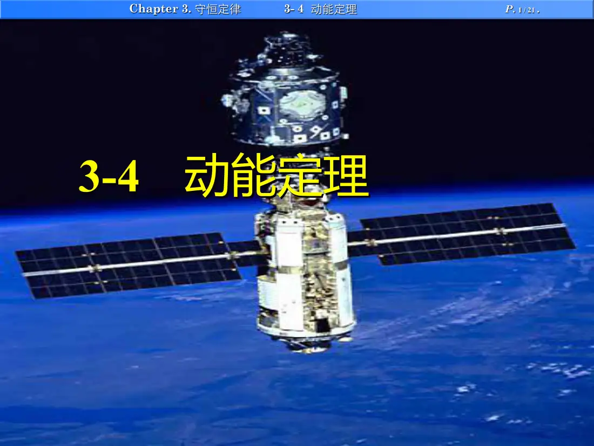

原文：

3-4 动能定理

Chapter 3. 守恒定律

3-4 动能定理

P. 1/21.

### 一、功(Work)

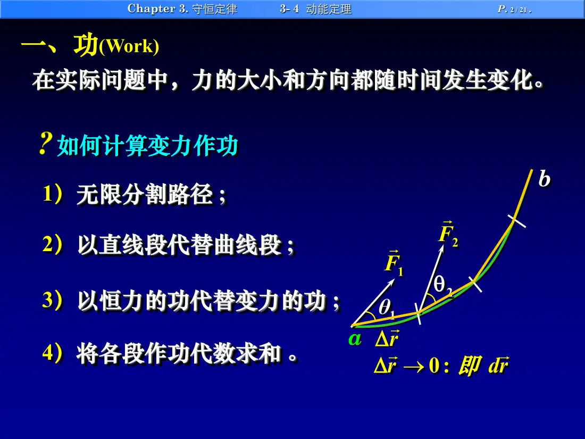

原文：

一、功(Work)

在实际问题中，力的大小和方向都随时间发生变化。

? 如何计算变力作功

1）无限分割路径；

2）以直线段代替曲线段；

3）以恒力的功代替变力的功；

4）将各段作功代数求和。

$\Delta \vec{r} \rightarrow 0$ : 即 $d\vec{r}$

Chapter 3. 守恒定律

3-4 动能定理

P. 2/21.

### 1. 定义

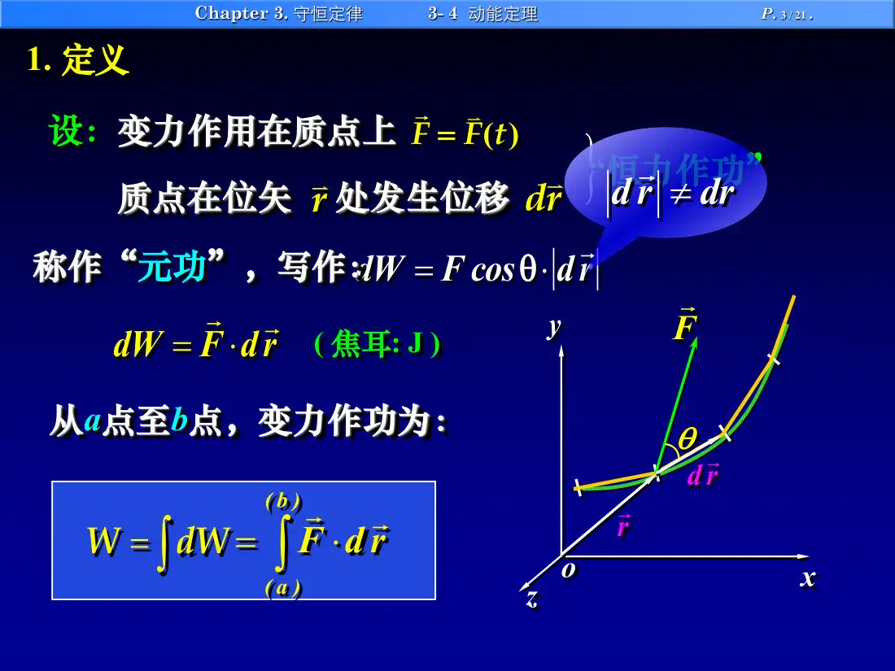

原文：

1. 定义

设：变力作用在质点上 $\vec{F} = \vec{F}(t)$

质点在位矢 $\vec{r}$ 处发生位移 $d\vec{r}$

$$
| d \vec {r} | \neq d r
$$

称作 “元功”，写作: $dW = F \cos \theta \cdot |d\vec{r}|$

$dW = \vec{F} \cdot d\vec{r}$ （焦耳：J）

从 $a$ 点至 $b$ 点，变力作功为：

$$
W = \int d W = \int_ {(a)} ^ {(b)} \vec {F} \cdot d \vec {r}
$$

Chapter 3. 守恒定律

3-4 动能定理

P. 3/21.

### 2. 功的一般特点

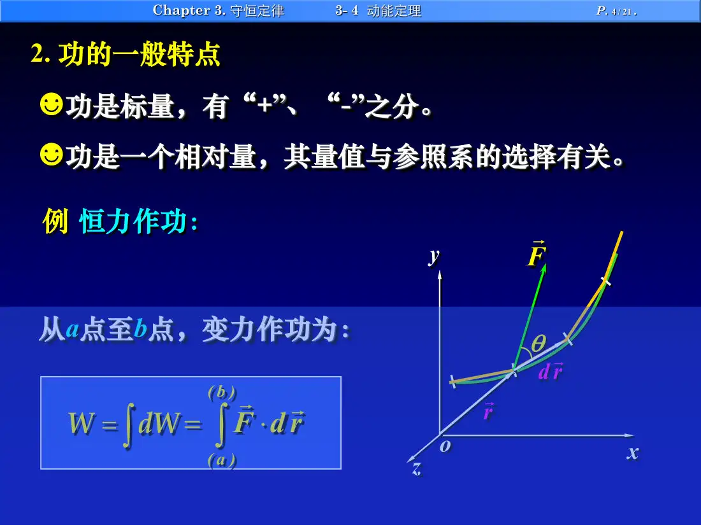

原文：

2. 功的一般特点

😊功是标量，有“+”、“-”之分。

功是一个相对量，其量值与参照系的选择有关。

例 恒力作功:

从 $a$ 点至 $b$ 点，变力作功为：

$$
W \equiv \int d W = \int_ {(a)} ^ {(b)} \vec {F} \cdot d \vec {r}
$$

Chapter 3. 守恒定律

3-4 动能定理

P. 4/21.

### 2. 功的一般特点

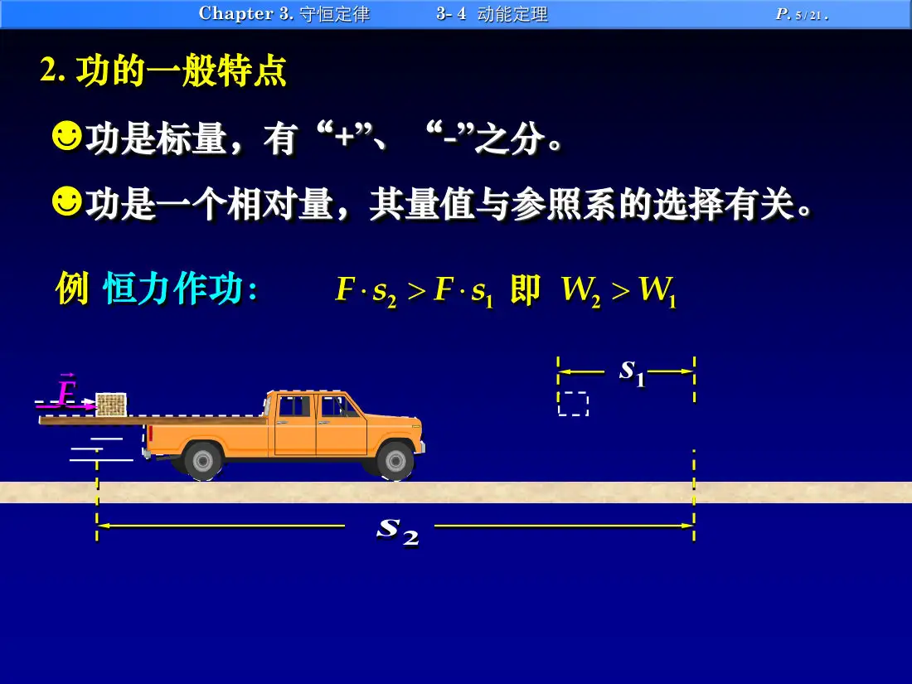

原文：

2. 功的一般特点

😊功是标量，有“+”、“-”之分。

功是一个相对量，其量值与参照系的选择有关。

例 恒力作功: $F \cdot s_{2} > F \cdot s_{1}$ 即 $W_{2} > W_{1}$

Chapter 3. 守恒定律 3-4 动能定理

P. 5/21.

### 2. 功的一般特点

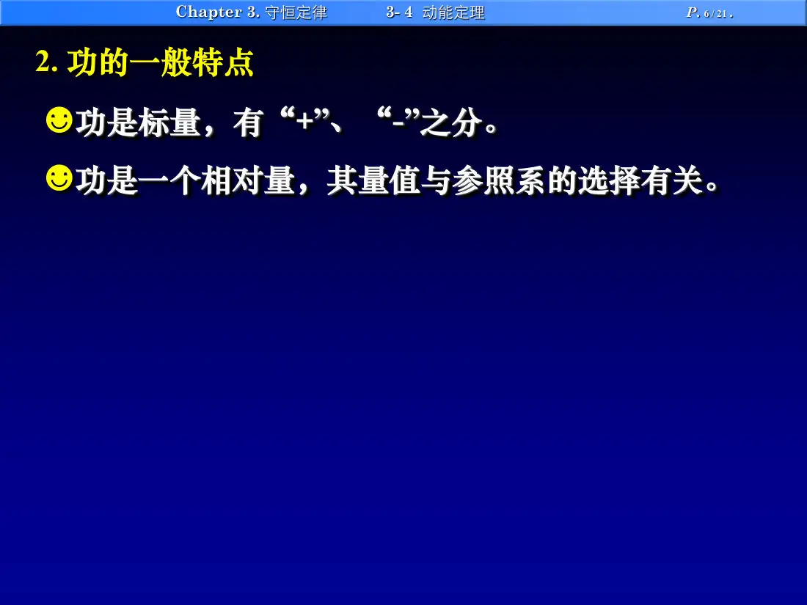

原文：

2. 功的一般特点

😊功是标量，有“+”、“-”之分。

功是一个相对量，其量值与参照系的选择有关。

Chapter 3. 守恒定律

3-4 动能定理

P. 6/21.

### 2. 功的一般特点

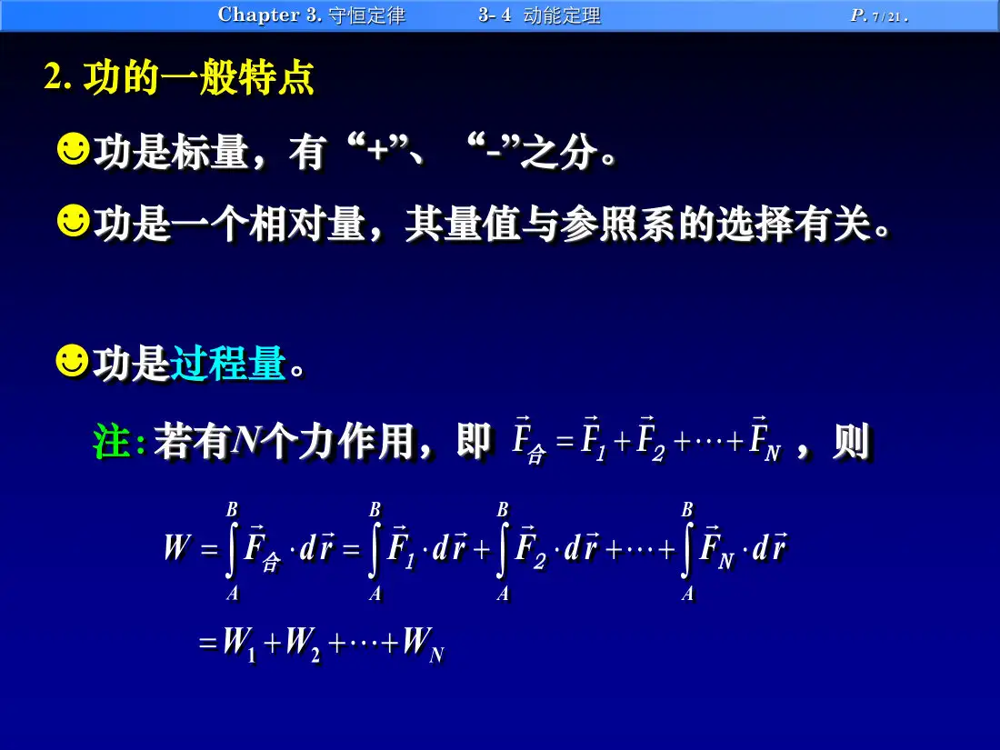

原文：

2. 功的一般特点

😊功是标量，有“+”、“-”之分。

功是一个相对量，其量值与参照系的选择有关。

😊功是过程量。

注: 若有N个力作用, 即 $\vec{F}_{\text {合}} = \vec{F}_1 + \vec{F}_2 + \dots + \vec{F}_N$ , 则

$$
\begin{array}{r l} W & = \int_ {A} ^ {B} \vec {F} _ {\text {合}} \cdot d \vec {r} = \int_ {A} ^ {B} \vec {F} _ {1} \cdot d \vec {r} + \int_ {A} ^ {B} \vec {F} _ {2} \cdot d \vec {r} + \dots + \int_ {A} ^ {B} \vec {F} _ {N} \cdot d \vec {r} \\ & = W _ {1} + W _ {2} + \dots + W _ {N} \end{array}
$$

Chapter 3. 守恒定律

3-4 动能定理

P. 7/21.

### 3. 功的几何意义

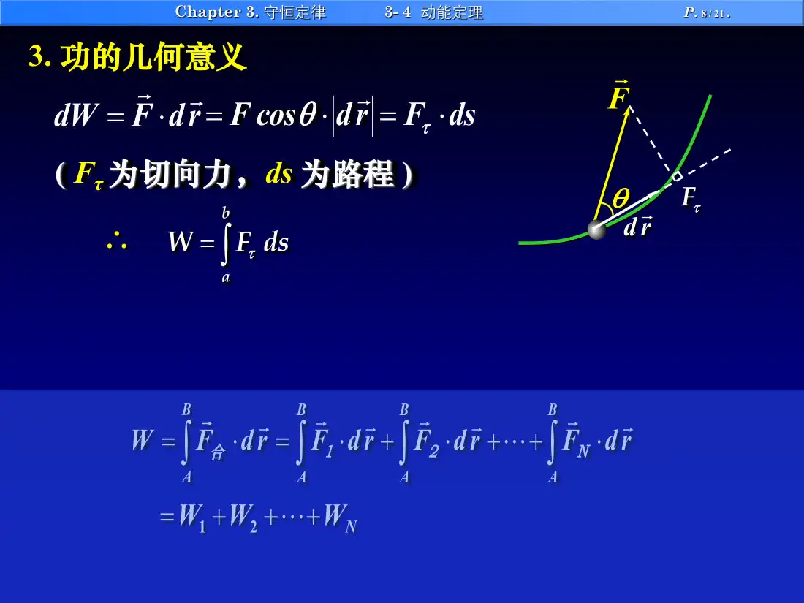

原文：

3. 功的几何意义

$$
d W = \vec {F} \cdot d \vec {r} = F \cos \theta \cdot | d \vec {r} | = F _ {\tau} \cdot d s
$$

$(F_{\tau}$ 为切向力，ds为路程）

$$
\therefore \quad W = \int_ {a} ^ {b} F _ {\tau} d s
$$

$$
\begin{array}{r l} W & = \int_ {A} ^ {B} \vec {F} _ {\text {合}} \cdot d \vec {r} = \int_ {A} ^ {B} \vec {F} _ {1} \cdot d \vec {r} + \int_ {A} ^ {B} \vec {F} _ {2} \cdot d \vec {r} + \dots + \int_ {A} ^ {B} \vec {F} _ {N} \cdot d \vec {r} \\ & = W _ {1} + W _ {2} + \dots + W _ {N} \end{array}
$$

Chapter 3. 守恒定律

3-4 动能定理

P. 8/21.

### 3. 功的几何意义

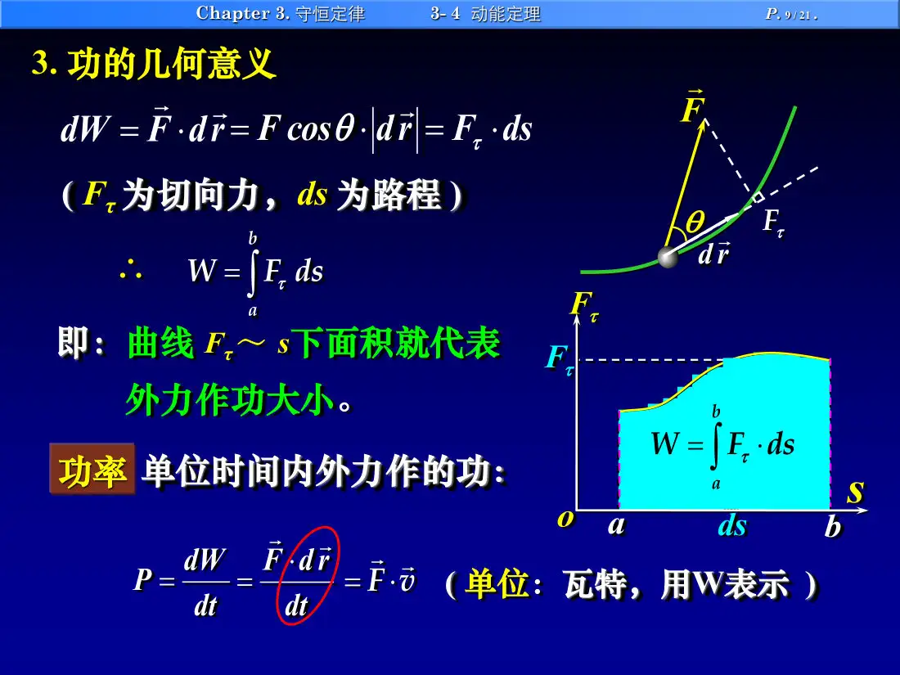

原文：

3. 功的几何意义

$$
d W = \vec {F} \cdot d \vec {r} = F \cos \theta \cdot | d \vec {r} | = F _ {\tau} \cdot d s
$$

$(F_{\tau} \text{为切向力，} ds \text{为路程})$

∴ $W = \int_{a}^{b} F_{\tau} ds$

即: 曲线 $F_{\tau} \sim s$ 下面积就代表外力作功大小。

功率 单位时间内外力作的功:

$P=\frac{dW}{dt}=\frac{\vec{F}\cdot d\vec{r}}{dt}=\vec{F}\cdot\vec{v}$ （单位：瓦特，用W表示）

Chapter 3. 守恒定律

3-4 动能定理

P. 9/21.

### 4. 功值的计算

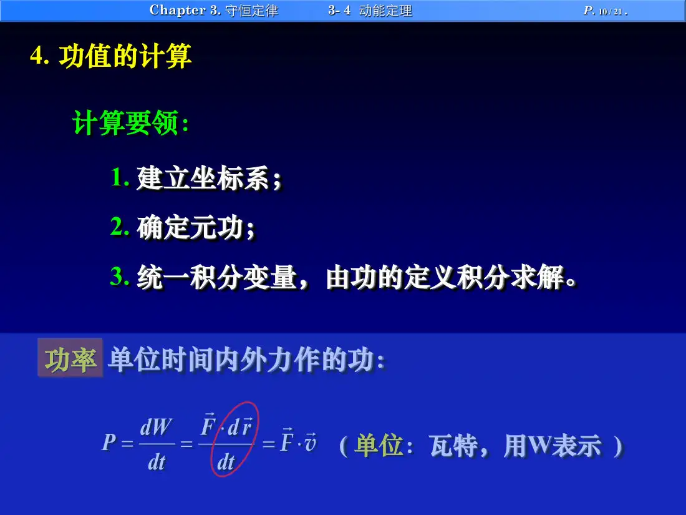

原文：

4. 功值的计算

计算要领:

1. 建立坐标系；

2. 确定元功;

3. 统一积分变量，由功的定义积分求解。

功率 单位时间内外力作的功：

$P=\frac{dW}{dt}=\frac{\vec{F}\cdot d\vec{r}}{dt}=\vec{F}\cdot\vec{v}$ （单位：瓦特，用W表示）

Chapter 3. 守恒定律

3-4 动能定理

P. 10/21.

### 4. 功值的计算

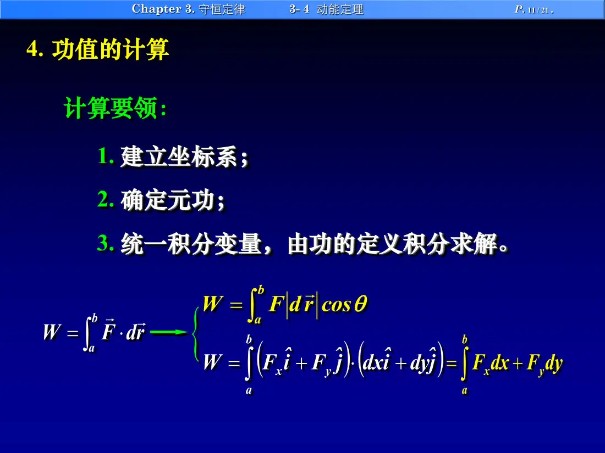

原文：

4. 功值的计算

计算要领:

1. 建立坐标系；

2. 确定元功;

3. 统一积分变量，由功的定义积分求解。

$$
W = \int_ {a} ^ {b} \vec {F} \cdot d \vec {r} \longrightarrow \left\{ \begin{array}{l} W = \int_ {a} ^ {b} F | d \vec {r} | \cos \theta \\ W = \int_ {a} ^ {b} \left(F _ {x} \hat {\boldsymbol {i}} + F _ {y} \hat {\boldsymbol {j}}\right) \cdot (d x \hat {\boldsymbol {i}} + d y \hat {\boldsymbol {j}}) = \int_ {a} ^ {b} F _ {x} d x + F _ {y} d y \end{array} \right.
$$

Chapter 3. 守恒定律

3-4 动能定理

P. 11/21.

### $$

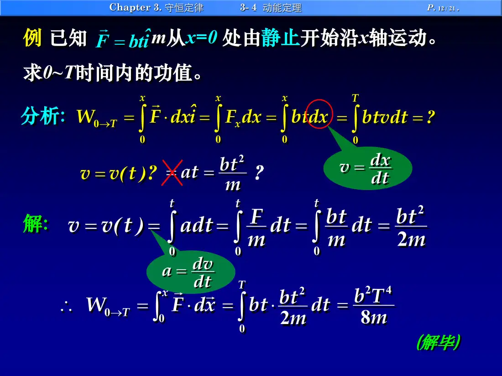

原文：

例 已知 $\vec{F} = b t i \hat{m}$ 从 $x = 0$ 处由静止开始沿 $x$ 轴运动。求 $0 \sim T$ 时间内的功值。

分析: $W_{0 \to T} = \int_{0}^{x} \vec{F} \cdot d x \hat{i} = \int_{0}^{x} F_x dx = \int_{0}^{x} b t dx = \int_{0}^{T} b t v dt = ?$

$$
v = v (t)? \times a t = \frac {b t ^ {2}}{m}?
$$

$$
v = \frac {d x}{d t}
$$

解:

$$
v = v (t) = \int_ {0} ^ {t} a d t = \int_ {0} ^ {t} \frac {F}{m} d t = \int_ {0} ^ {t} \frac {b t}{m} d t = \frac {b t ^ {2}}{2 m}
$$

$$
a = \frac {d v}{d t}
$$

$$
\therefore W _ {0 \rightarrow T} = \int_ {0} ^ {x} \vec {F} \cdot d \vec {x} = \int_ {0} ^ {T} b t \cdot \frac {b t ^ {2}}{2 m} d t = \frac {b ^ {2} T ^ {4}}{8 m}
$$

(解毕)

Chapter 3. 守恒定律

3-4 动能定理

P. 12/21.

### 二、动能定理

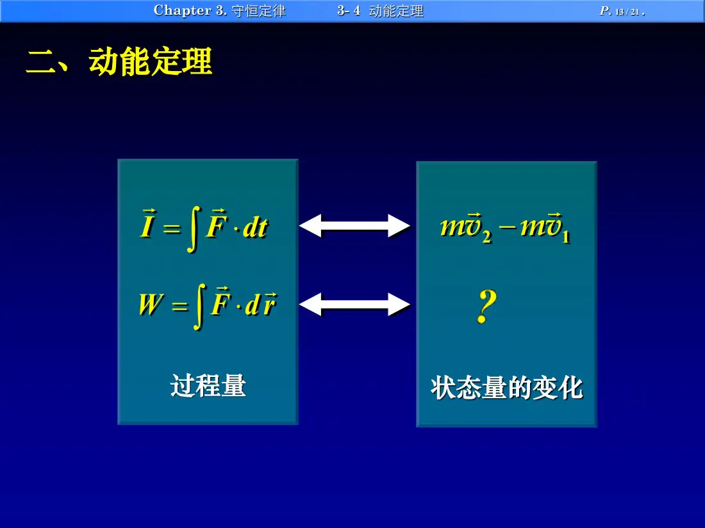

原文：

二、动能定理

$$
\vec {I} = \int \vec {F} \cdot d t
$$

$$
\leftarrow \rightleftharpoons
$$

$$
m \vec {v} _ {2} - m \vec {v} _ {1}
$$

$$
W = \int \vec {F} \cdot d \vec {r}
$$

$$
\leftarrow \rightleftharpoons
$$

$$
\mathrm{?}
$$

过程量

状态量的变化

Chapter 3. 守恒定律

3-4 动能定理

P. 13/21.

### 二、动能定理

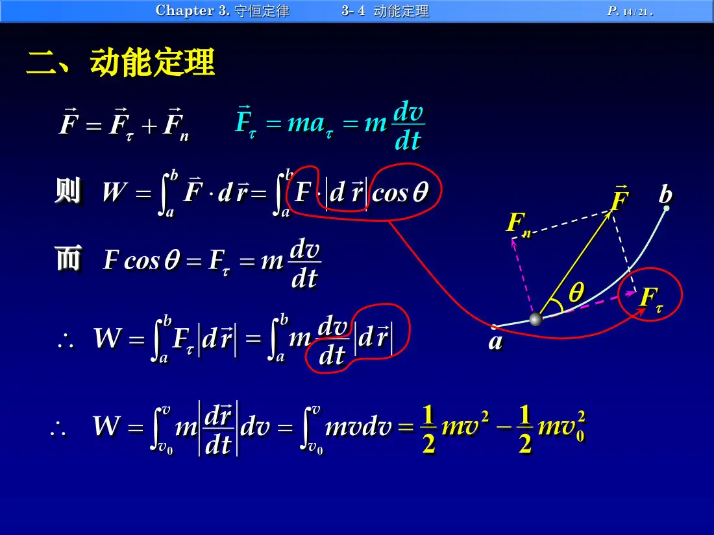

原文：

二、动能定理

$$
\vec {F} = \vec {F} _ {\tau} + \vec {F} _ {n} \qquad \vec {F} _ {\tau} = m a _ {\tau} = m \frac {d v}{d t}
$$

则 $W = \int_{a}^{b} \vec{F} \cdot d\vec{r} = \int_{a}^{b} F \cdot |d\vec{r}| \cos \theta$

而 $F \cos \theta = F_{\tau} = m \frac{dv}{dt}$

$$
\therefore W = \int_ {a} ^ {b} F _ {\tau} | d \vec {r} | = \int_ {a} ^ {b} m \frac {d v}{d t} | d \vec {r} |
$$

$\therefore W = \int_{v_0}^v m\left|\frac{d\vec{r}}{dt}\right|dv = \int_{v_0}^v mv dv = \frac{1}{2} mv^2 -\frac{1}{2} mv_0^2$

Chapter 3. 守恒定律 3-4 动能定理

P. 14/21.

### $$

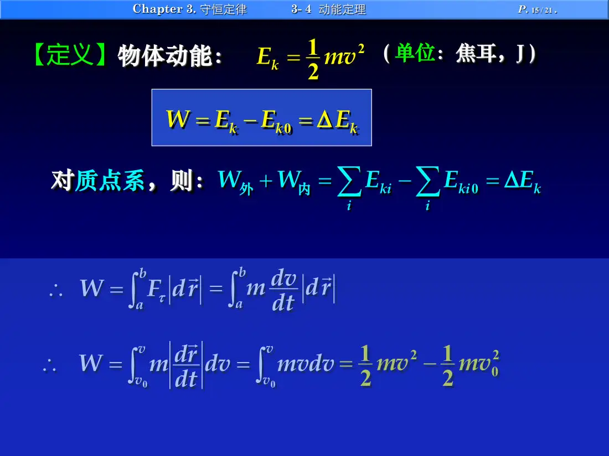

原文：

【定义】物体动能: $E_{k} = \frac{1}{2} m v^{2}$ （单位：焦耳，J）

$$
W = E _ {k} - E _ {k 0} = \Delta E _ {k}
$$

对质点系，则： $W_{外} + W_{内} = \sum_{i} E_{ki} - \sum_{i} E_{ki0} = \Delta E_{k}$

$$
\therefore W = \int_ {a} ^ {b} F _ {\tau} | d \vec {r} | = \int_ {a} ^ {b} m \frac {d v}{d t} | d \vec {r} |
$$

$$
\therefore W = \int_ {v _ {0}} ^ {v} m \left| \frac {d \vec {r}}{d t} \right| d v = \int_ {v _ {0}} ^ {v} m v d v = \frac {1}{2} m v ^ {2} - \frac {1}{2} m v _ {0} ^ {2}
$$

Chapter 3. 守恒定律

3-4 动能定理

### $$

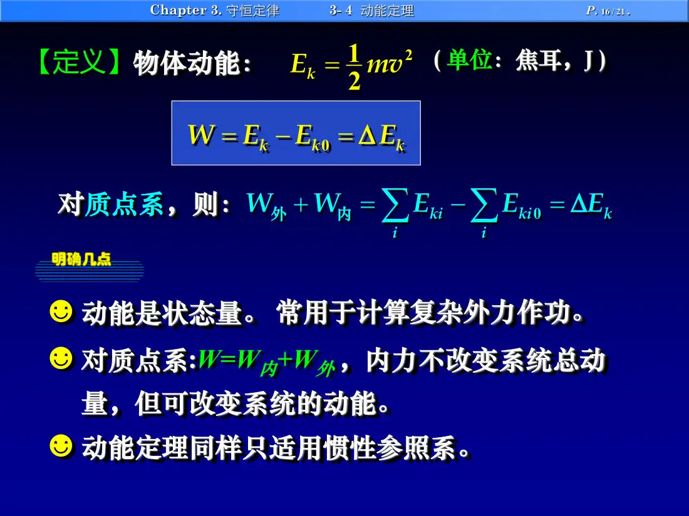

原文：

【定义】物体动能: $E_{k} = \frac{1}{2} m v^{2}$ （单位：焦耳，J）

$$
W = E _ {k} - E _ {k 0} = \Delta E _ {k}
$$

对质点系，则： $W_{外} + W_{内} = \sum_{i} E_{ki} - \sum_{i} E_{ki0} = \Delta E_{k}$

明确几点

动能是状态量。常用于计算复杂外力作功。

对质点系: $W = W_{\text {内}} + W_{\text {外}}$ ，内力不改变系统总动量，但可改变系统的动能。

动能定理同样只适用惯性参照系。

Chapter 3. 守恒定律

3-4 动能定理

P. 16/21.

### $$

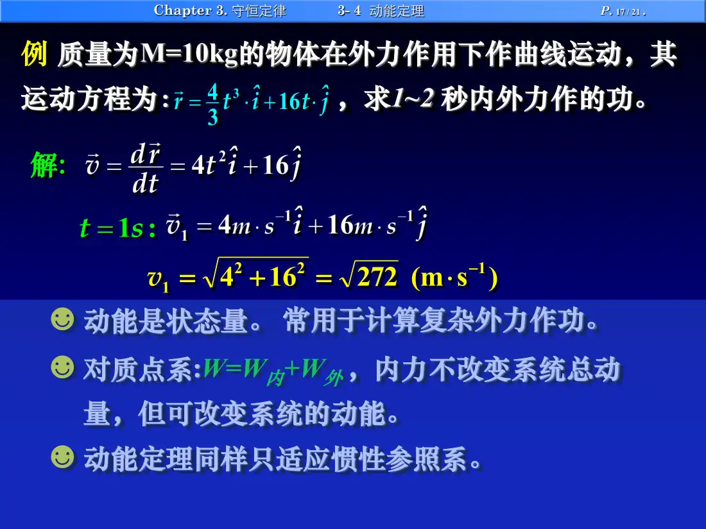

原文：

例 质量为M=10kg的物体在外力作用下作曲线运动，其运动方程为: $\vec{r}=\frac{4}{3}t^{3}\cdot\hat{i}+16t\cdot\hat{j}$ ，求1\~2秒内外力作的功。

解: $\vec{v} = \frac{d\vec{r}}{dt} = 4t^2\hat{i} + 16\hat{j}$

$$
t = 1 s: \vec {v} _ {1} = 4 m \cdot s ^ {- 1} \hat {i} + 1 6 m \cdot s ^ {- 1} \hat {j}
$$

$$
v _ {1} = \sqrt {4 ^ {2} + 1 6 ^ {2}} = \sqrt {2 7 2} (\mathrm{m} \cdot \mathrm{s} ^ {- 1})
$$

动能是状态量。常用于计算复杂外力作功。

对质点系: $W = W_{\text {内}} + W_{\text {外}}$ ，内力不改变系统总动量，但可改变系统的动能。

动能定理同样只适应惯性参照系。

Chapter 3. 守恒定律

3-4 动能定理

P. 17/21.

### (解毕)

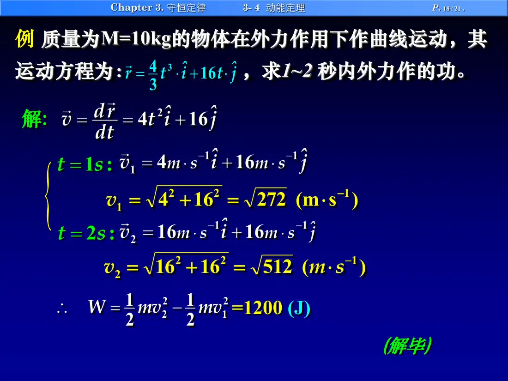

原文：

例 质量为M=10kg的物体在外力作用下作曲线运动，其运动方程为： $\vec{r}=\frac{4}{3}t^{3}\cdot\hat{i}+16t\cdot\hat{j}$ ，求1\~2秒内外力作的功。
解： $\vec{v}=\frac{d\vec{r}}{dt}=4t^{2}\hat{i}+16\hat{j}$ $\left\{\begin{aligned}&t=1s:\vec{v}_{1}=4m\cdot s^{-1}\hat{i}+16m\cdot s^{-1}\hat{j}\\&v_{1}=\sqrt{4^{2}+16^{2}}=\sqrt{272}(m\cdot s^{-1})\\&t=2s:\vec{v}_{2}=16m\cdot s^{-1}\hat{i}+16m\cdot s^{-1}\hat{j}\\&v_{2}=\sqrt{16^{2}+16^{2}}=\sqrt{512}(m\cdot s^{-1})\end{aligned}\right.$ $\therefore W=\frac{1}{2}mv_{2}^{2}-\frac{1}{2}mv_{1}^{2}=1200(J)$

(解毕)

Chapter 3. 守恒定律

3-4 动能定理

P. 18/21.

### 变力做功: $dW = \vec{F} \cdot d\vec{r}$

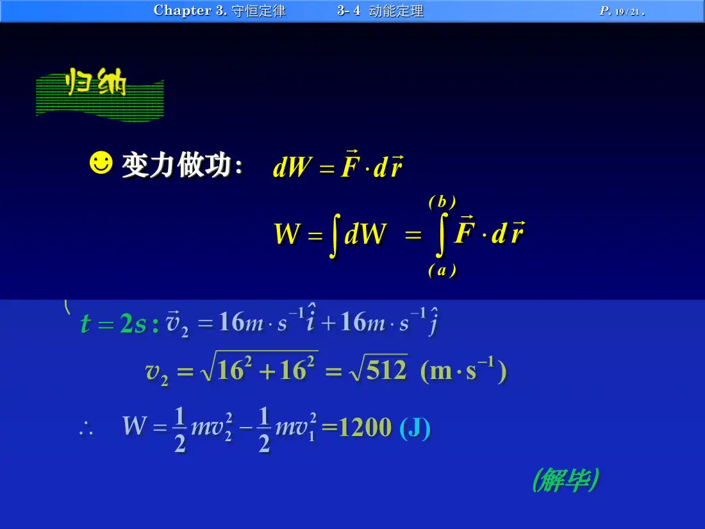

原文：

变力做功: $dW = \vec{F} \cdot d\vec{r}$

$$
W = \int d W = \int_ {(a)} ^ {(b)} \vec {F} \cdot d \vec {r}
$$

$$
t = 2 s: \vec {v} _ {2} = 1 6 m \cdot s ^ {- 1} \hat {i} + 1 6 m \cdot s ^ {- 1} \hat {j}
$$

$$
v _ {2} = \sqrt {1 6 ^ {2} + 1 6 ^ {2}} = \sqrt {5 1 2} (\mathrm{m} \cdot \mathrm{s} ^ {- 1})
$$

∴ $W = \frac{1}{2}mv_{2}^{2} - \frac{1}{2}mv_{1}^{2} = 1200 \, (\text{J})$

(解毕)

Chapter 3. 守恒定律

3-4 动能定理

P. 19/21.

### 变力做功： $dW = \vec{F} \cdot d\vec{r}$

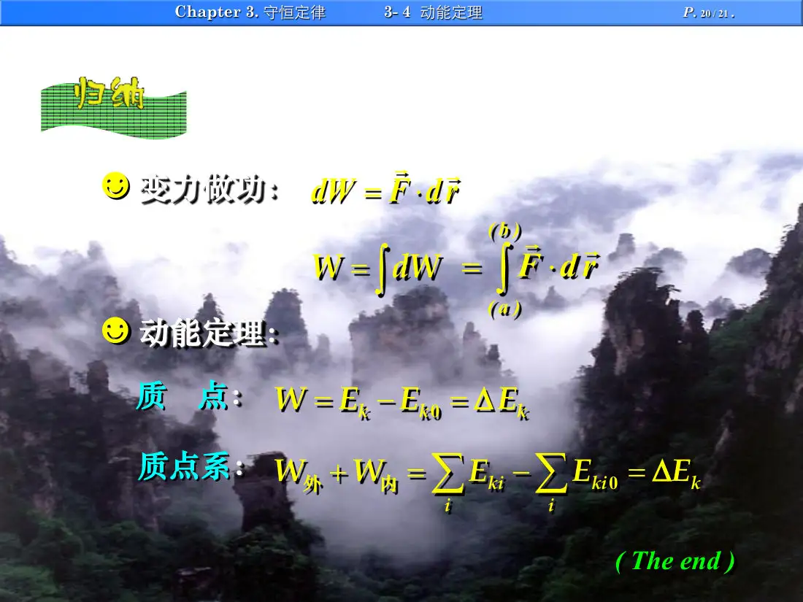

原文：

变力做功： $dW = \vec{F} \cdot d\vec{r}$

$$
W = \int d W = \int^ {(b)} \vec {F} \cdot d \vec {r}
$$

动能定理：

(a)

质 点： $W = E_{k} - E_{k0} = \Delta E_{k}$

质点系: $W_{\text {外}} + W_{\text {内}} = \sum_{i} E_{ki} = \sum_{i} E_{ki0} = \Delta E_{k}$ 课堂练习 在光滑水平面上，m 以 $v_{0}$ 沿切线方向从半圆型滑轨的 A 端入射，设 m 与环间的摩擦系数为 $\mu$ ，求 m 从 B 端滑出时，摩擦力所作的功。

Chapter 3. 守恒定律 3-4 动能定理

P. 20 / 21.

### 提示:

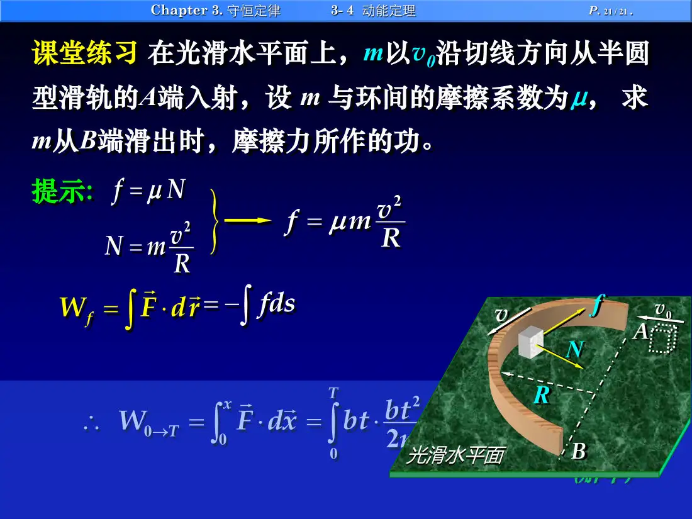

原文：

提示:

$$
\left. \begin{array}{l} f = \mu N \\ N = m \frac {v ^ {2}}{R} \end{array} \right\} \longrightarrow f = \mu m \frac {v ^ {2}}{R}
$$

$$
W _ {f} = \int \vec {F} \cdot d \vec {r} = - \int f d s
$$

$$
W _ {0 \rightarrow T} = \int_ {0} ^ {x} \vec {F} \cdot d \vec {x} = \int_ {0} ^ {T} b t \cdot \frac {b t ^ {2}}{2 r}
$$

光滑水平面

Chapter 3. 守恒定律

3-4 动能定理

P. 21/21.

(如下)

### 提示:

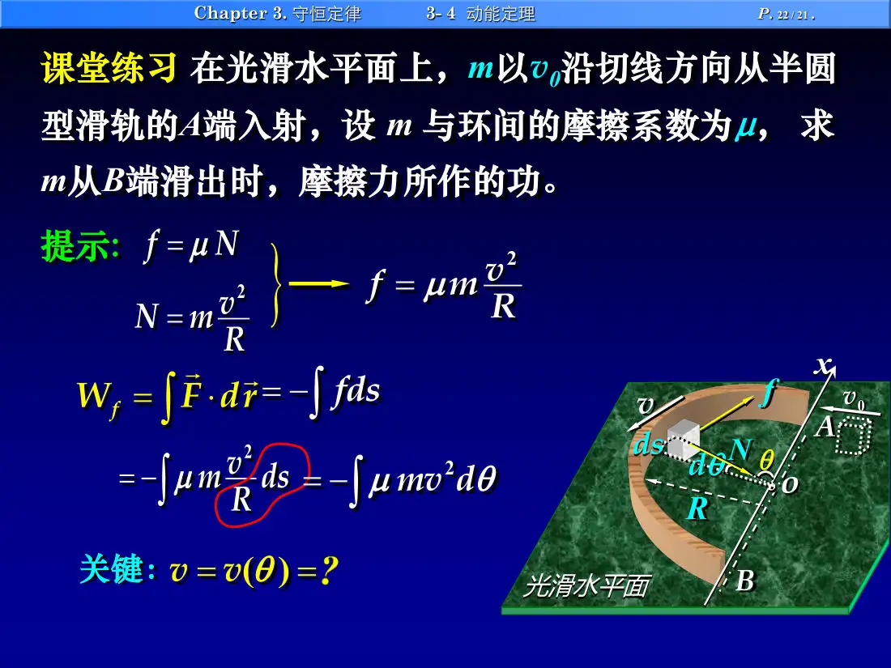

原文：

课堂练习 在光滑水平面上，m 以 $v_{0}$ 沿切线方向从半圆型滑轨的 A 端入射，设 m 与环间的摩擦系数为 $\mu$ ，求 m 从 B 端滑出时，摩擦力所作的功。

提示:

$$
\left. \begin{array}{l} f = \mu N \\ N = m \frac {v ^ {2}}{R} \end{array} \right\} \longrightarrow f = \mu m \frac {v ^ {2}}{R}
$$

$$
\begin{array}{r l} & W _ {f} = \int \vec {F} \cdot d \vec {r} = - \int f d s \\ & = - \int \mu m \frac {v ^ {2}}{R} d s = - \int \mu m v ^ {2} d \theta \end{array}
$$

关键: $v = v(\theta) = ?$

光滑水平面

Chapter 3. 守恒定律

3-4 动能定理

P. 22/21.

### $$

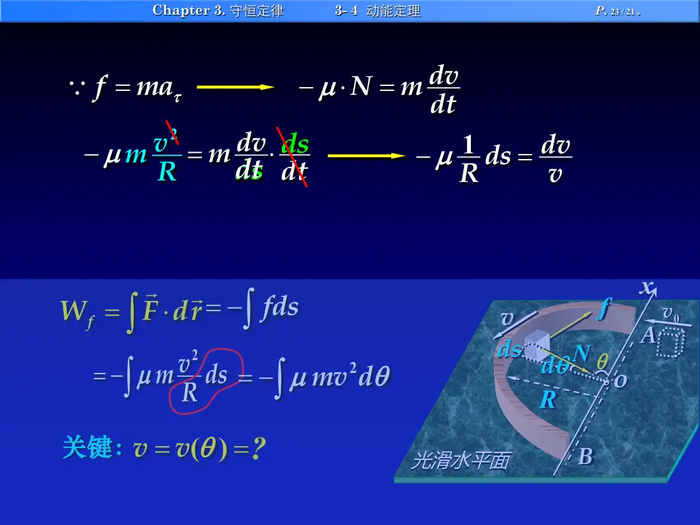

原文：

$$
\begin{array}{r l} & {\because f = m a _ {\tau} \longrightarrow - \mu \cdot N = m \frac {d v}{d t}} \\ & {- \mu m \frac {v ^ {2}}{R} = m \frac {d v}{d t} \cdot \frac {d s}{d t} \longrightarrow - \mu \frac {1}{R} d s = \frac {d v}{v}} \end{array}
$$

$$
\begin{array}{r l} & W _ {f} = \int \vec {F} \cdot d \vec {r} = - \int f d s \\ & = - \int \mu m \frac {v ^ {2}}{R} d s = - \int \mu m v ^ {2} d \theta \end{array}
$$

关键: $v = v(\theta) = ?$

光滑水平面

Chapter 3. 守恒定律

3-4 动能定理

P. 23/21.

### $$

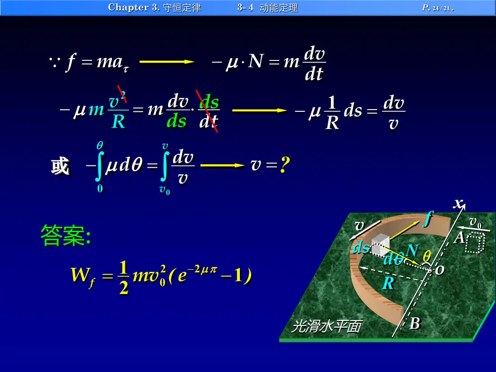

原文：

$$
\because f = m a _ {\tau} \longrightarrow - \mu \cdot N = m \frac {d v}{d t}
$$

$$
- \mu m \frac {v ^ {2}}{R} = m \frac {d v}{d s} \cdot \frac {d s}{d t} \longrightarrow - \mu \frac {1}{R} d s = \frac {d v}{v}
$$

或 $-\int_{0}^{\theta}\mu d\theta=\int_{v_{0}}^{v}\frac{dv}{v}\longrightarrow v=$ ?

答案:

$$
W _ {f} = \frac {1}{2} m v _ {0} ^ {2} (e ^ {- 2 \mu \pi} - 1)
$$

光滑水平面

Chapter 3. 守恒定律

3-4 动能定理

P. 24/21.
