# 《大学物理》第3章 守恒定律 3-5 保守力与非保守力及势能（课件）

原件的每一页，下面附识别出的文字。

### 3-5 保守力与非保守力、势能

原文：

3-5 保守力与非保守力、势能

Chapter 3. 守恒定律

3-5 保守力与非保守力、势能

### 一、保守力

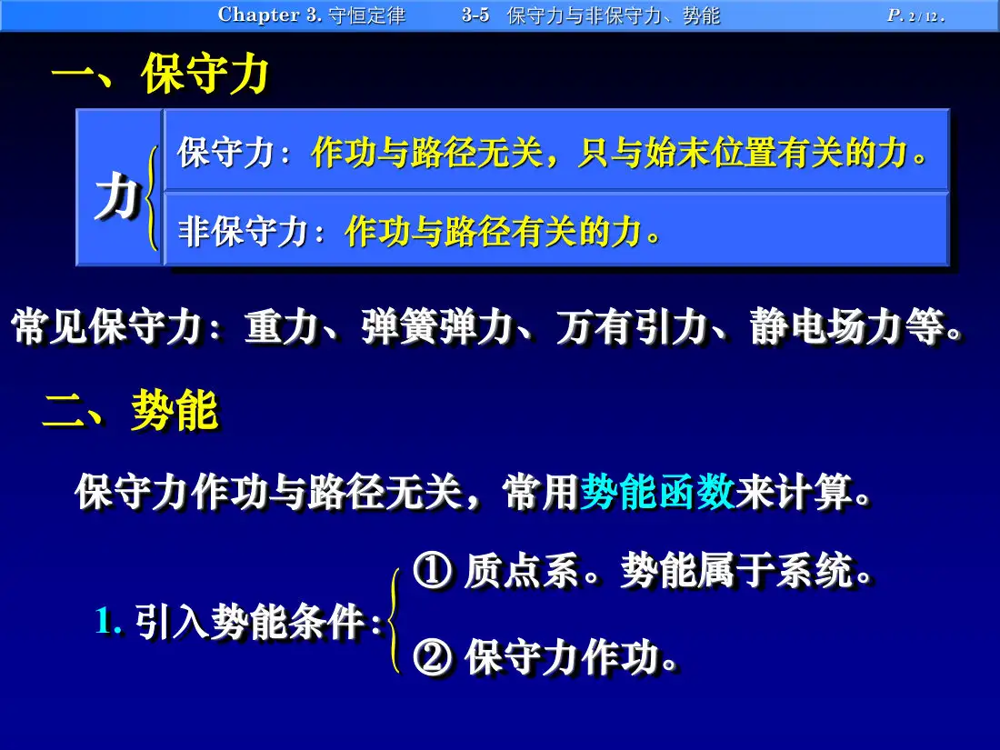

原文：

一、保守力

保守力：作功与路径无关，只与始末位置有关的力。

力

非保守力：作功与路径有关的力。

常见保守力：重力、弹簧弹力、万有引力、静电场力等。

二、势能

保守力作功与路径无关，常用势能函数来计算。

① 质点系。势能属于系统。

1. 引入势能条件:

②保守力作功。

Chapter 3. 守恒定律 3-5 保守力与非保守力、势能

P. 2 / 12.

### 2. 势能函数选取应遵从的原则：

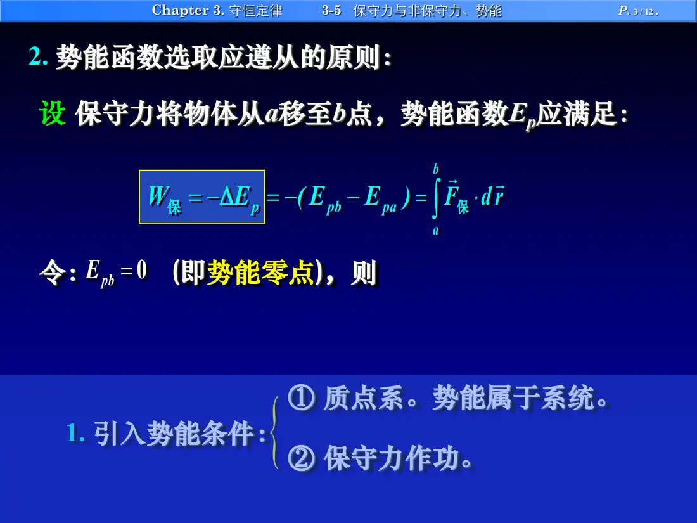

原文：

2. 势能函数选取应遵从的原则：

设保守力将物体从 $a$ 移至 $b$ 点，势能函数 $E_{p}$ 应满足：

$$
W _ {\text {保}} = - \Delta E _ {p} = - \left(E _ {p b} - E _ {p a}\right) = \int_ {a} ^ {b} \vec {F} _ {\text {保}} \cdot d \vec {r}
$$

令： $E_{pb}=0$ （即势能零点），则

① 质点系。势能属于系统。

1. 引入势能条件:

②保守力作功。

Chapter 3. 守恒定律

3-5 保守力与非保守力、势能

P. 3/12.

### 2. 势能函数选取应遵从的原则：

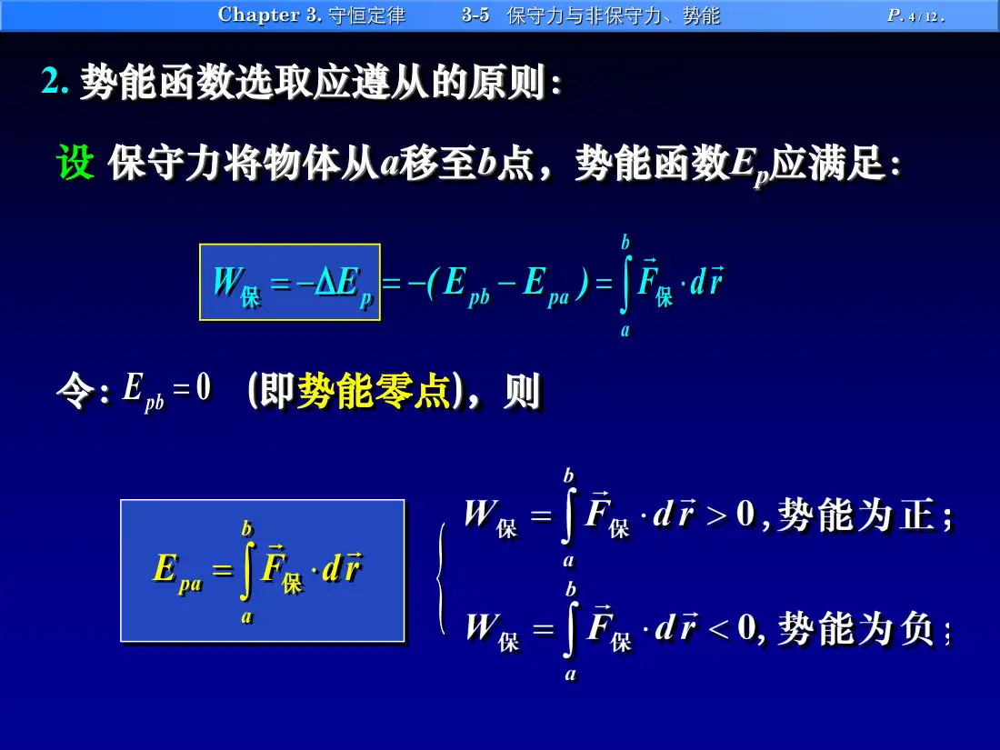

原文：

2. 势能函数选取应遵从的原则：

设 保守力将物体从 $a$ 移至 $b$ 点，势能函数 $E_{p}$ 应满足：

$$
W _ {\text {保}} = - \Delta E _ {p} = - \left(E _ {p b} - E _ {p a}\right) = \int_ {a} ^ {b} \vec {F} _ {\text {保}} \cdot d \vec {r}
$$

令: $E_{pb} = 0$ (即势能零点), 则

$$
E _ {p a} = \int_ {a} ^ {b} {\vec {F}} _ {\mathrm{保}} \cdot d {\vec {r}}
$$

$W_{保}=\int\limits_{a}^{b}\vec{F}_{保}\cdot d\vec{r}>0$ ,势能为正;

$W_{保}=\int\limits_{a}^{b}\vec{F}_{保}\cdot d\vec{r}<0,$ 势能为负；

Chapter 3. 守恒定律 3-5 保守力与非保守力、势能

P. 4/12.

### 3. 三种势能函数:

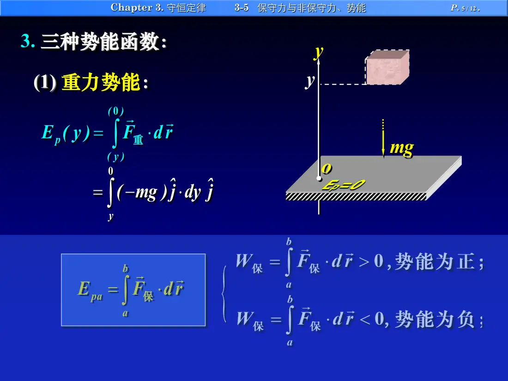

原文：

3. 三种势能函数:

(1) 重力势能:

$$
\begin{array}{r l} E _ {p} (y) & = \int_ {(y)} ^ {(0)} \vec {F} _ {\text {重}} \cdot d \vec {r} \\ & = \int_ {y} ^ {0} (- m g) \hat {j} \cdot d y \hat {j} \end{array}
$$

$$
E _ {p a} = \int_ {a} ^ {b} {\vec {F}} _ {\mathrm{保}} \cdot d {\vec {r}}
$$

$W_{保}=\int\limits_{a}^{b}\vec{F}_{保}\cdot d\vec{r}>0,$ 势能为正;

$W_{保}=\int\limits_{a}^{b}\vec{F}_{保}\cdot d\vec{r}<0,$ 势能为负；

P. 5/12.

Chapter 3. 守恒定律 3-5 保守力与非保守力、势能

### 3. 三种势能函数：

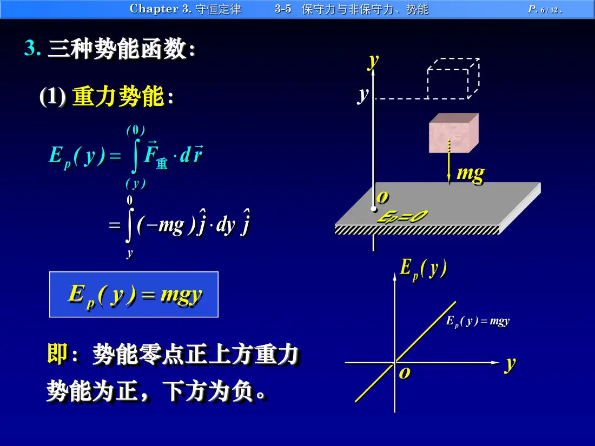

原文：

3. 三种势能函数：

(1) 重力势能:

$$
\begin{array}{r l} E _ {p} (y) & = \int_ {(y)} ^ {(0)} \vec {F} _ {\text {重}} \cdot d \vec {r} \\ & = \int_ {y} ^ {0} (- m g) \hat {j} \cdot d y \hat {j} \end{array}
$$

$$
E _ {p} (y) \equiv m g y
$$

即：势能零点正上方重力势能为正，下方为负。

P. 6/12.

Chapter 3. 守恒定律

3-5 保守力与非保守力、势能

### (2) 弹性势能:

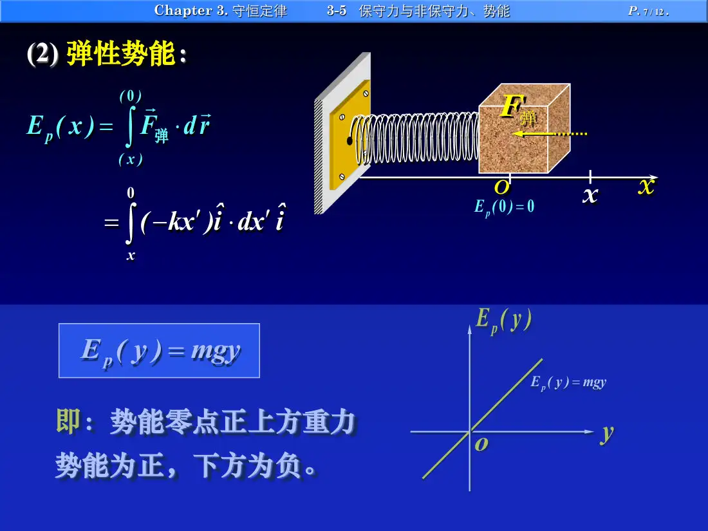

原文：

(2) 弹性势能:

$$
\begin{array}{r l} E _ {p} (x) & = \int_ {(x)} ^ {(0)} \vec {F} _ {\text {弹}} \cdot d \vec {r} \\ & = \int_ {x} ^ {0} (- k x ^ {\prime}) \hat {i} \cdot d x ^ {\prime} \hat {i} \end{array}
$$

$$
E _ {p} (y) \equiv m g y
$$

即：势能零点正上方重力势能为正，下方为负。

P. 7/12.

Chapter 3. 守恒定律

3-5 保守力与非保守力、势能

### (2) 弹性势能:

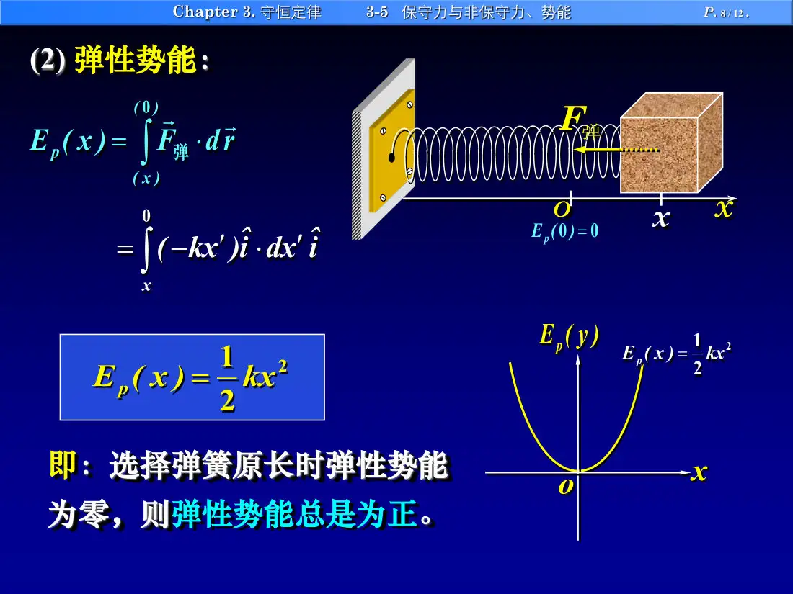

原文：

(2) 弹性势能:

$$
\begin{array}{r l} E _ {p} (x) & = \int_ {(x)} ^ {(0)} \vec {F} _ {\text {弹}} \cdot d \vec {r} \\ & = \int_ {x} ^ {0} (- k x ^ {\prime}) \hat {i} \cdot d x ^ {\prime} \hat {i} \end{array}
$$

$$
E _ {p} (x) = \frac {1}{2} k x ^ {2}
$$

即：选择弹簧原长时弹性势能为零，则弹性势能总是为正。

P. 8/12.

Chapter 3. 守恒定律

3-5 保守力与非保守力、势能

### (3) 万有引力势能:

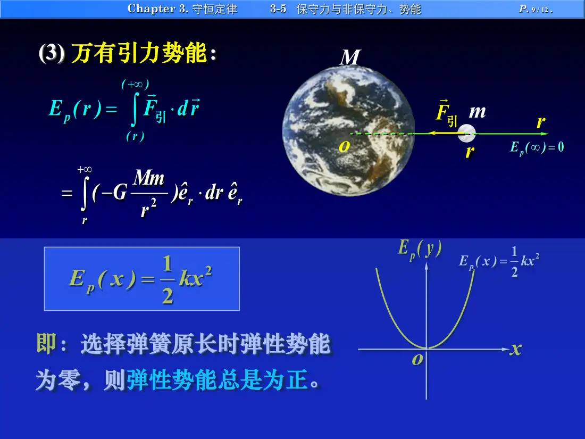

原文：

(3) 万有引力势能:

$$
E _ {p} (r) = \int_ {(r)} ^ {(+ \infty)} \vec {F} _ {\text {引}} \cdot d \vec {r}
$$

$$
= \int_ {r} ^ {+ \infty} (- G \frac {M m}{r ^ {2}}) \hat {\boldsymbol {e}} _ {r} \cdot d \boldsymbol {r} \hat {\boldsymbol {e}} _ {r}
$$

$$
E _ {p} (x) = \frac {1}{2} k x ^ {2}
$$

即：选择弹簧原长时弹性势能为零，则弹性势能总是为正。

Chapter 3. 守恒定律

3-5 保守力与非保守力、势能

P. 9/12.

### (3) 万有引力势能:

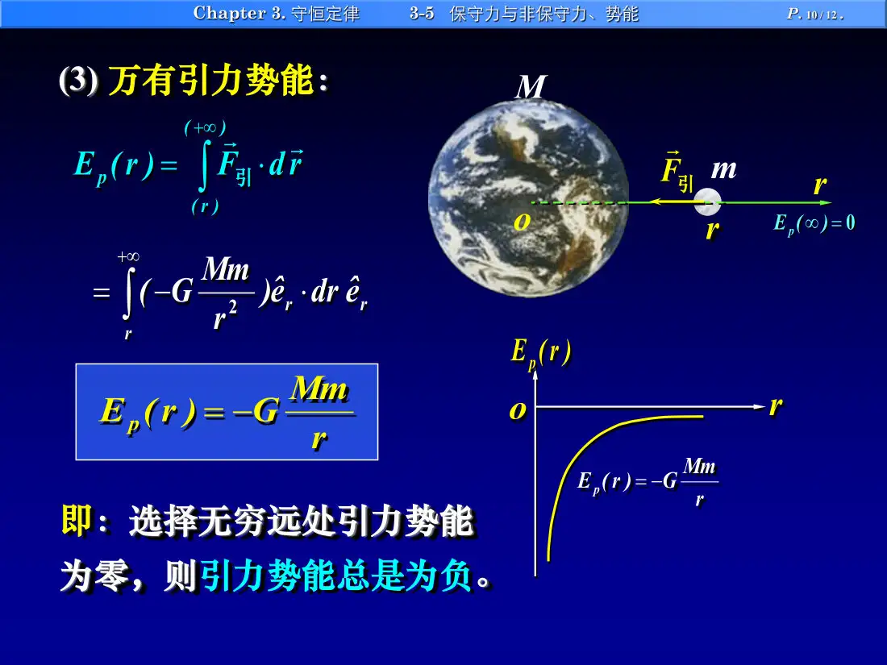

原文：

(3) 万有引力势能:

$$
E _ {p} (r) = \int_ {(r)} ^ {(+ \infty)} \vec {F} _ {\text {引}} \cdot d \vec {r}
$$

$$
= \int_ {r} ^ {+ \infty} (- G \frac {M m}{r ^ {2}}) \hat {\boldsymbol {e}} _ {r} \cdot d \boldsymbol {r} \hat {\boldsymbol {e}} _ {r}
$$

$$
E _ {p} (r) = - G \frac {M m}{r}
$$

即：选择无穷远处引力势能为零，则引力势能总是为负。

$$
E _ {p} (r) = - G \frac {M m}{r}
$$

Chapter 3. 守恒定律

3-5 保守力与非保守力、势能

P. 10 / 12.

### 归纳:

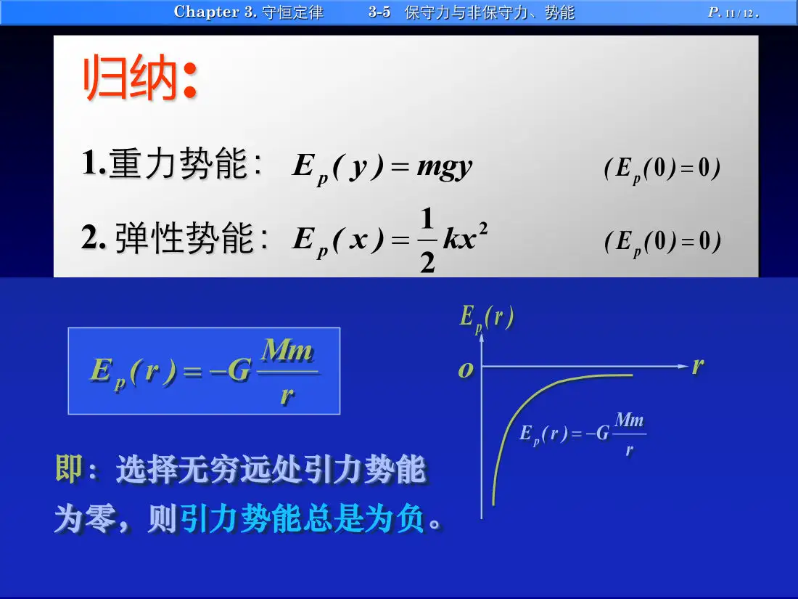

原文：

归纳:

1. 重力势能: $E_{p}(y) = mgy$

$$
(E _ {p} (\mathbf {0}) = \mathbf {0})
$$

2. 弹性势能: $E_{p} (x) = \frac{1}{2} k x^{2}$

$$
(E _ {p} (\mathbf {0}) = \mathbf {0})
$$

$$
E _ {p} (r) = - G \frac {M m}{r}
$$

$$
E _ {p} (r) = - G \frac {M m}{r}
$$

即：选择无穷远处引力势能为零，则引力势能总是为负。

Chapter 3. 守恒定律

3-5 保守力与非保守力、势能

P. 11 / 12.

### 归纳：

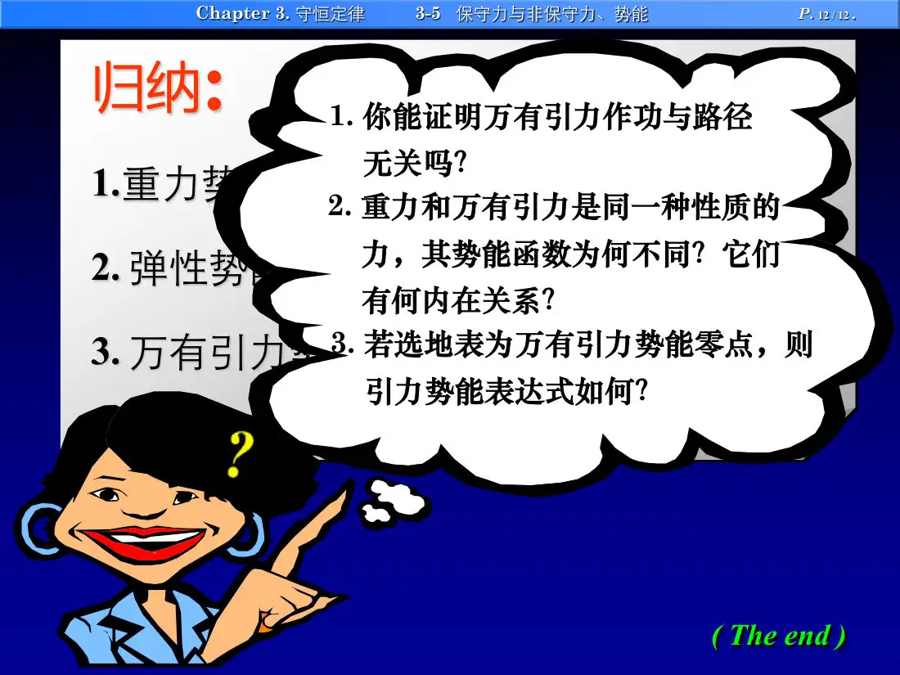

原文：

归纳：

1.重力势

2. 弹性势

3. 万有引力

1. 你能证明万有引力作功与路径无关吗？

2. 重力和万有引力是同一种性质的力，其势能函数为何不同？它们有何内在关系？

3. 若选地表为万有引力势能零点，则引力势能表达式如何？

P. 12 / 12.

Chapter 3. 守恒定律 3-5 保守力与非保守力、势能

(The end)

### 万有引力做功与路径无关

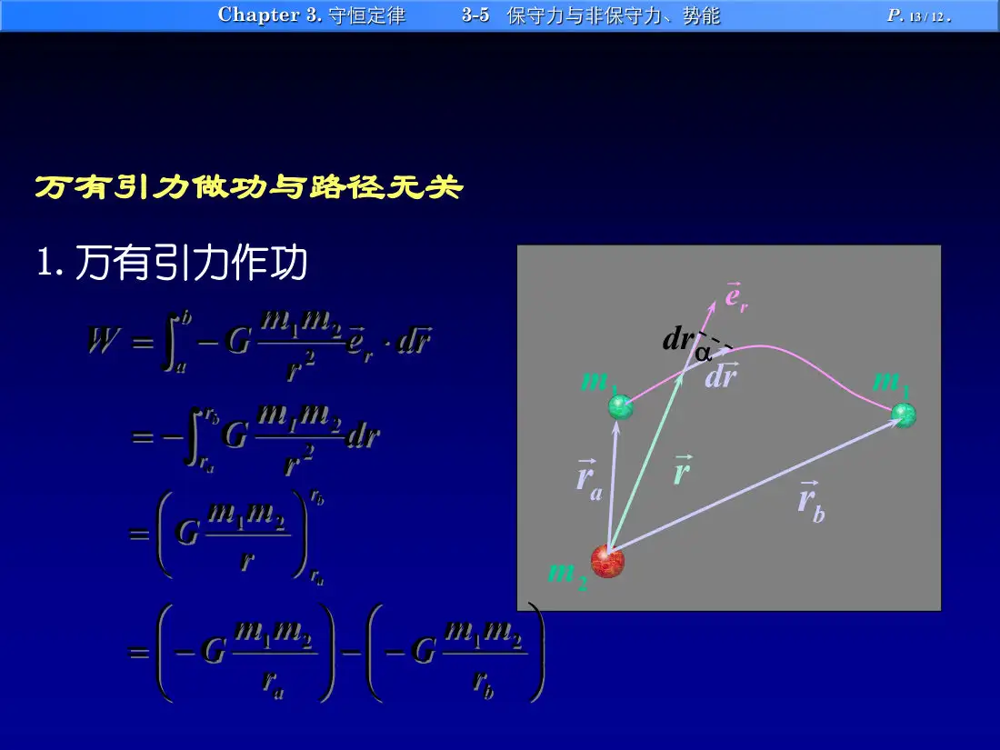

原文：

万有引力做功与路径无关

1. 万有引力作功

$$
\begin{array}{l} W = \int_ {a} ^ {b} - G \frac {m _ {1} m _ {2}}{r ^ {2}} \vec {e} _ {r} \cdot d \vec {r} \\ = - \int_ {r _ {a}} ^ {r _ {b}} G \frac {m _ {1} m _ {2}}{r ^ {2}} d r \\ = \left(G \frac {m _ {1} m _ {2}}{r}\right) _ {r _ {a}} ^ {r _ {b}} \\ = \left(- G \frac {m _ {1} m _ {2}}{r _ {a}}\right) - \left(- G \frac {m _ {1} m _ {2}}{r _ {b}}\right) \end{array}
$$

Chapter 3. 守恒定律

3-5 保守力与非保守力、势能

P. 13/12.

### 重力势能是地球表面物体的万有引力势能的一个特例。取地面为零势能点

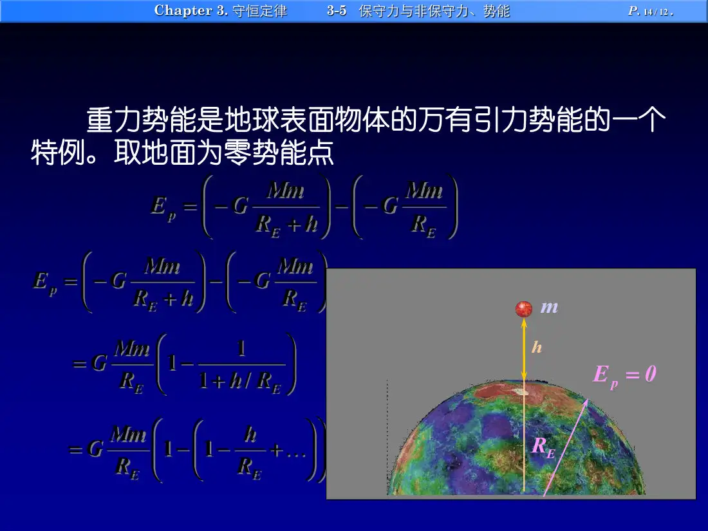

原文：

重力势能是地球表面物体的万有引力势能的一个特例。取地面为零势能点

$$
E _ {p} = \left(- G \frac {M m}{R _ {E} + h}\right) - \left(- G \frac {M m}{R _ {E}}\right)
$$

$$
\begin{array}{r l} E _ {p} & = \left(- G \frac {M m}{R _ {E} + h}\right) - \left(- G \frac {M m}{R _ {E}}\right) \\ & = G \frac {M m}{R _ {E}} \left(1 - \frac {1}{1 + h / R _ {E}}\right) \\ & = G \frac {M m}{R _ {E}} \left(1 - \left(1 - \frac {h}{R _ {E}} + \dots\right)\right) \end{array}
$$

$$
E _ {p} = 0
$$

Chapter 3. 守恒定律

3-5 保守力与非保守力、势能

P. 14/12.

### $$

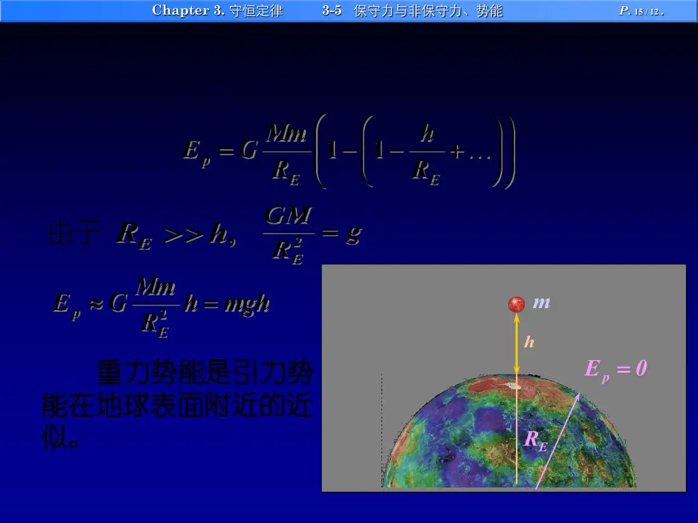

原文：

$$
E _ {p} = G \frac {M m}{R _ {E}} \left(1 - \left(1 - \frac {h}{R _ {E}} + \dots\right)\right)
$$

由于 $R_{E} >> h,\quad \frac{GM}{R_{E}^{2}} = g$

$$
E _ {p} \approx G \frac {M m}{R _ {E} ^ {2}} h = m g h
$$

重力势能是引力势能在地球表面附近的近似。

Chapter 3. 守恒定律

3-5 保守力与非保守力、势能

P. 15/12.
