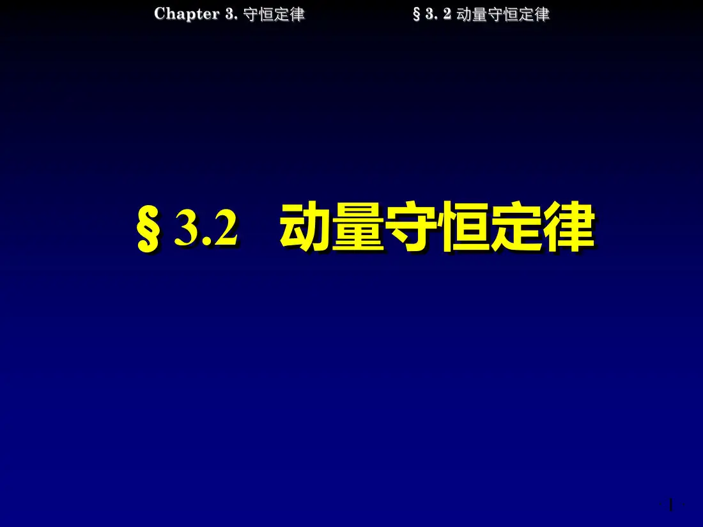
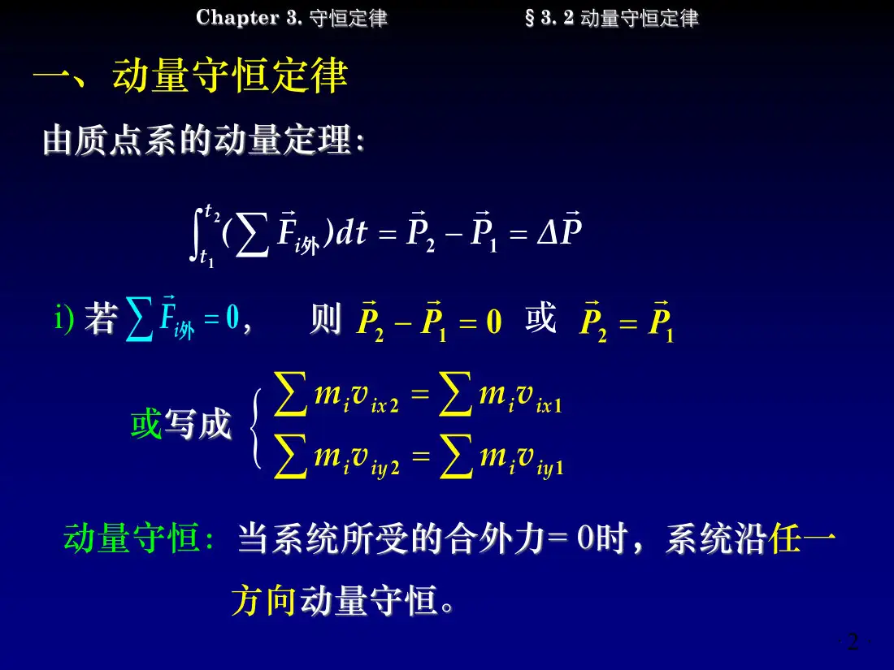
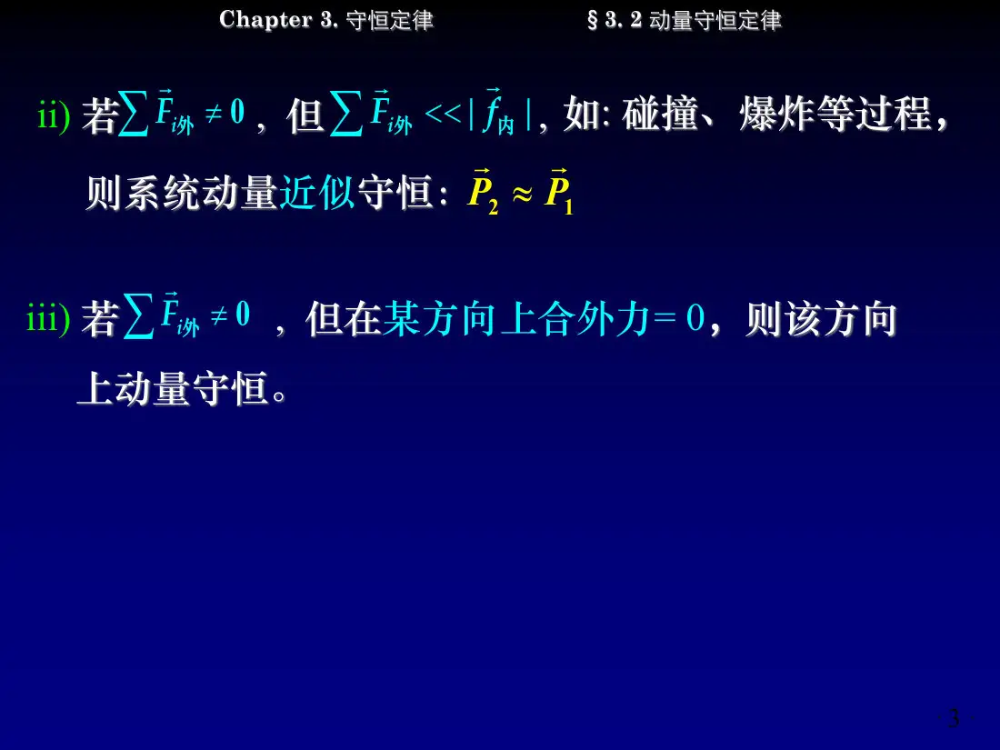
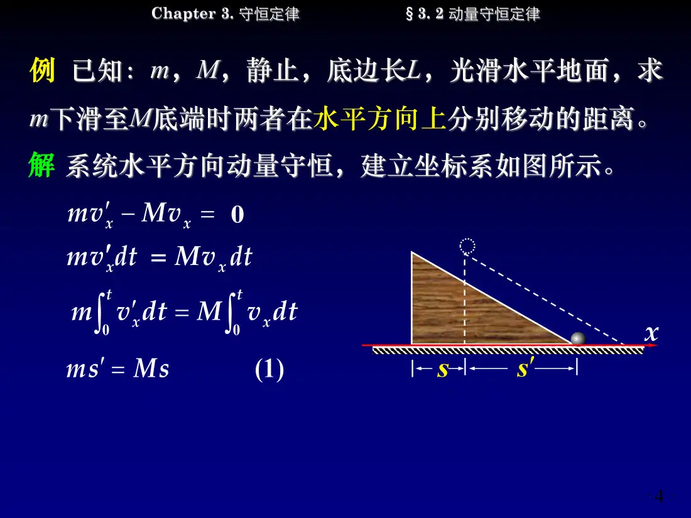
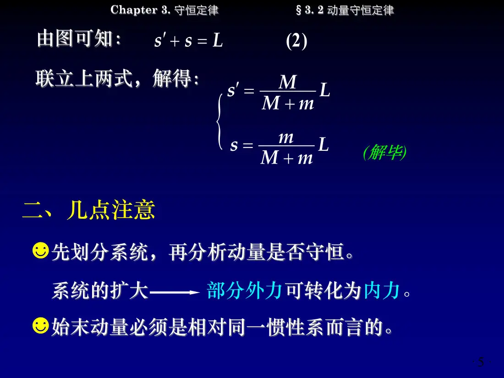
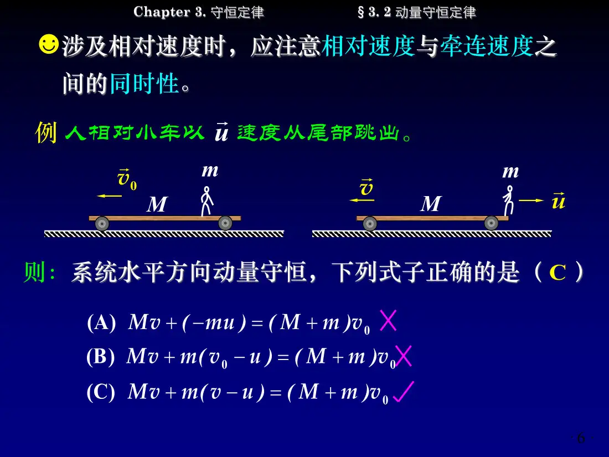
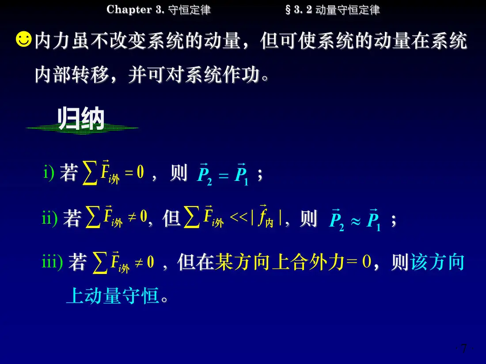

# 《大学物理》第3章 守恒定律 §3.2 动量守恒定律（课件）

原件的每一页，下面附识别出的文字。

### § 3.2 动量守恒定律

原文：

§ 3.2 动量守恒定律

Chapter 3. 守恒定律

§ 3.2 动量守恒定律

### 一、动量守恒定律

原文：

一、动量守恒定律

$$
\int_ {t _ {1}} ^ {t _ {2}} \left(\sum \vec {F} _ {i \text {外}}\right) d t = \vec {P} _ {2} - \vec {P} _ {1} = \Delta \vec {P}
$$

i) 若 $\sum\vec{F}_{i外}=0$ ，则 $\vec{P}_{2}-\vec{P}_{1}=0$ 或 $\vec{P}_{2}=\vec{P}_{1}$

或写成 $\left\{\begin{array}{l}\sum m_{i}v_{ix2}=\sum m_{i}v_{ix1}\\ \sum m_{i}v_{iy2}=\sum m_{i}v_{iy1}\end{array}\right.$

动量守恒: 当系统所受的合外力 $= 0$ 时, 系统沿任一方向动量守恒。

Chapter 3. 守恒定律

§ 3.2 动量守恒定律

2

### Chapter 3. 守恒定律

原文：

Chapter 3. 守恒定律

§ 3.2 动量守恒定律

ii) 若 $\sum\vec{F}_{i外} \neq 0$ ，但 $\sum\vec{F}_{i外} << |\vec{f}_{内}|$ ，如：碰撞、爆炸等过程，则系统动量近似守恒： $\vec{P}_{2} \approx \vec{P}_{1}$

iii) 若 $\sum\vec{F}_{i外} \neq 0$ ，但在某方向上合外力 = 0，则该方向上动量守恒。

3

### Chapter 3. 守恒定律

原文：

Chapter 3. 守恒定律

§ 3.2 动量守恒定律

例 已知：m，M，静止，底边长L，光滑水平地面，求m下滑至M底端时两者在水平方向上分别移动的距离。
解 系统水平方向动量守恒，建立坐标系如图所示。

$$
m v _ {x} ^ {\prime} - M v _ {x} = 0
$$

$$
m v _ {x} ^ {\prime} d t = M v _ {x} d t
$$

$$
m \int_ {0} ^ {t} v _ {x} ^ {\prime} d t = M \int_ {0} ^ {t} v _ {x} d t
$$

$$
m s ^ {\prime} = M s\tag{1}
$$

x

4

### Chapter 3. 守恒定律

原文：

Chapter 3. 守恒定律

由图可知:

§ 3.2 动量守恒定律

$$
s ^ {\prime} + s = L\tag{2}
$$

联立上两式，解得：

$$
s ^ {\prime} = \frac {M}{M + m} L
$$

$$
s = \frac {m}{M + m} L
$$

(解毕)

二、几点注意

先划分系统，再分析动量是否守恒。

系统的扩大——部分外力可转化为内力。

始末动量必须是相对同一惯性系而言的。

5

### Chapter 3. 守恒定律

原文：

Chapter 3. 守恒定律

§ 3.2 动量守恒定律

涉及相对速度时，应注意相对速度与牵连速度之间的同时性。

例 人相对小车以 $\vec{u}$ 速度从尾部跳出。

则：系统水平方向动量守恒，下列式子正确的是（C）

(A) $Mv + (-mu) = (M + m)v_{0} \times$

(B) $Mv + m(v_{0} - u) = (M + m)v_{0}$

(C) $Mv + m(v - u) = (M + m)v_{0}$

6

### Chapter 3. 守恒定律

原文：

Chapter 3. 守恒定律

§ 3.2 动量守恒定律

内力虽不改变系统的动量，但可使系统的动量在系统内部转移，并可对系统作功。

归纳

i) 若 $\sum\vec{F}_{i\text{外}}=0$ ，则 $\vec{P}_{2}=\vec{P}_{1}$ ;

ii) 若 $\sum\vec{F}_{i外} \neq 0$ ，但 $\sum\vec{F}_{i外} << |\vec{f}_{内}|$ ，则 $\vec{P}_{2} \approx \vec{P}_{1}$ ;

iii) 若 $\sum \vec{F}_{\text{外}} \neq 0$ ，但在某方向上合外力 $= 0$ ，则该方向上动量守恒。

7
