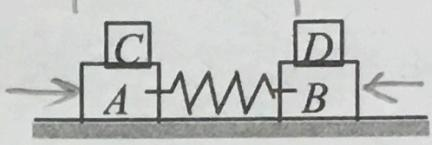
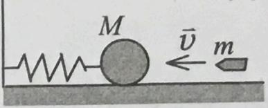
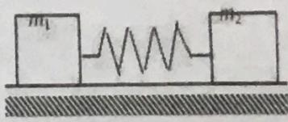

# 《大学物理》第3章 守恒定律（同步练习册）

原件经识别和整理；“参考解答”是我们补的。

### 选择 1

在两个质点组成的系统中，若质点之间只有万有引力作用，且此系统所受外力的矢量和为零，则此系统

- A. 动量与机械能一定都守恒。
- B. 动量与机械能一定都不守恒。
- C. 动量不一定守恒，机械能一定守恒。
- D. 动量一定守恒，机械能不一定守恒。

答案：D。

知识点：[动量定理与动量守恒定律](../../../topics/大学物理/动量定理与动量守恒.md)、[功能原理与机械能守恒定律](../../../topics/大学物理/功能原理与机械能守恒.md)

### 选择 2

关于机械能守恒条件和动量守恒条件有以下几种说法，其中正确的是

- A. 不受外力作用的系统，其动量和机械能必然同时守恒。
- B. 所受合外力为零，内力都是保守力的系统，其机械能必然守恒。
- C. 不受外力，而内力都是保守力的系统，其动量和机械能必然同时守恒。
- D. 外力对一个系统做的功为零，则该系统的机械能和动量必然同时守恒。

答案：C。

知识点：[动量定理与动量守恒定律](../../../topics/大学物理/动量定理与动量守恒.md)、[功能原理与机械能守恒定律](../../../topics/大学物理/功能原理与机械能守恒.md)、[保守力及其势能、中心力场与有效势](../../../topics/大学物理/保守力与势能.md)

### 选择 3

两个质量相等、速率也相等的粘土球相向碰撞后粘在一起而停止运动。在此过程中，由这两个粘土球组成的系统

- A. 动量守恒，动能也守恒。
- B. 动量守恒，动能不守恒。
- C. 动量不守恒，动能守恒。
- D. 动量不守恒，动能也不守恒。

答案：B。

知识点：[动量定理与动量守恒定律](../../../topics/大学物理/动量定理与动量守恒.md)、[弹性碰撞与非弹性碰撞](../../../topics/大学物理/碰撞问题.md)、[功的定义、功率与质点动能定理](../../../topics/大学物理/功与动能定理.md)

### 选择 4

如图所示，质量分别为 $m_1$ 和 $m_2$ 的物体 A 和 B，置于光滑桌面上，A 和 B 之间连有一轻弹簧。另有质量为 $m_1$ 和 $m_2$ 的物体 C 和 D 分别置于物体 A 与 B 之上，且物体 A 和 C、B 和 D 之间的摩擦系数均不为零。首先用外力沿水平方向相向推压 A 和 B，使弹簧被压缩。然后撤掉外力，则在 A 和 B 弹开的过程中，对 A、B、C、D、弹簧组成的系统

- A. 动量守恒，机械能守恒。
- B. 动量不守恒，机械能守恒。
- C. 动量不守恒，机械能不守恒。
- D. 动量守恒，机械能不一定守恒。

知识点：[动量定理与动量守恒定律](../../../topics/大学物理/动量定理与动量守恒.md)、[功能原理与机械能守恒定律](../../../topics/大学物理/功能原理与机械能守恒.md)、[常见力（重力、弹力、摩擦力）的受力分析](../../../topics/大学物理/常见力分析.md)

### 选择 5

一质量为 M 的弹簧振子，水平放置且静止在平衡位置，如图所示。一质量为 m 的子弹以水平速度 $\vec{v}$ 射入振子中，并随之一起运动。如果水平面光滑，此后弹簧的最大势能为

- A. $\frac{1}{2}mv^{2}$
- B. $\frac{m^{2}v^{2}}{2(M+m)}$
- C. $(M+m)\frac{m^{2}}{2M^{2}}v^{2}$
- D. $\frac{m^{2}}{2M}v^{2}$

答案：B。

知识点：[弹性碰撞与非弹性碰撞](../../../topics/大学物理/碰撞问题.md)、[动量定理与动量守恒定律](../../../topics/大学物理/动量定理与动量守恒.md)、[功能原理与机械能守恒定律](../../../topics/大学物理/功能原理与机械能守恒.md)

### 选择 6

如图，两木块质量为 $m_1$ 和 $m_2$，由一轻弹簧连接，放在光滑水平桌面上，先使两木块靠近而将弹簧压紧，然后由静止释放。若在弹簧伸长到原长时，$m_1$ 的速率为 $v_1$，则弹簧原来在压缩状态时所具有的势能是

- A. $\frac{1}{2}m_1v_1^2$
- B. $\frac{1}{2}m_2\frac{m_1+m_2}{m_1}v_1^2$
- C. $\frac{1}{2}(m_1+m_2)v_1^2$
- D. $\frac{1}{2}m_1\frac{m_1+m_2}{m_2}v_1^2$

答案：D。

知识点：[动量定理与动量守恒定律](../../../topics/大学物理/动量定理与动量守恒.md)、[功能原理与机械能守恒定律](../../../topics/大学物理/功能原理与机械能守恒.md)
