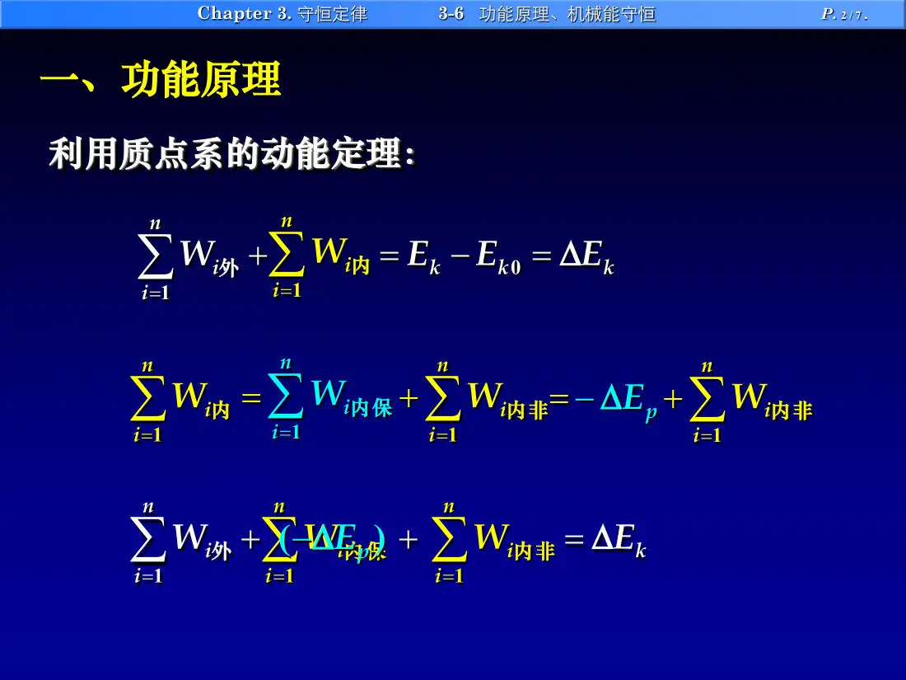
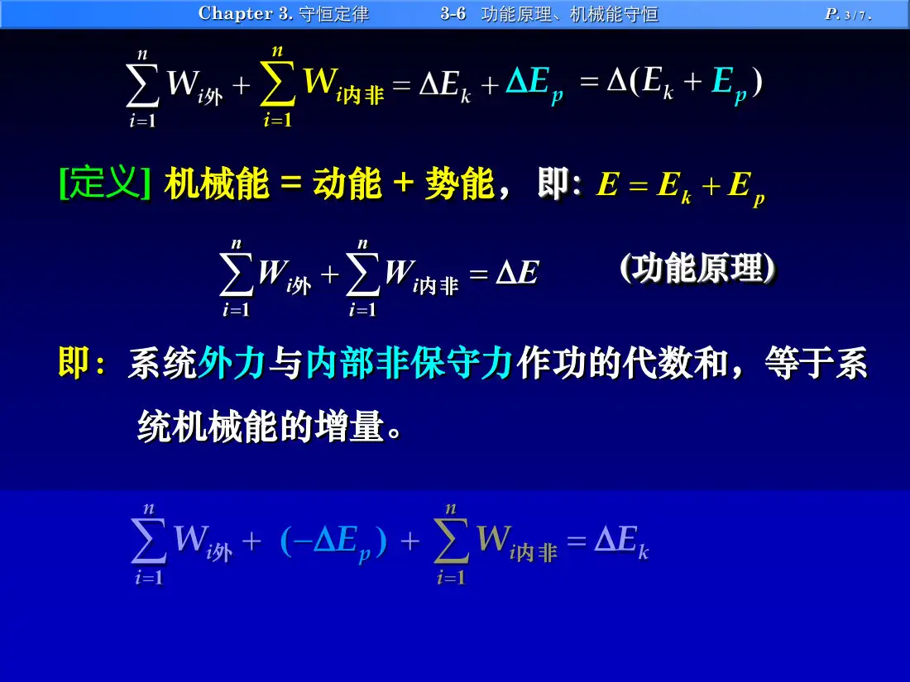
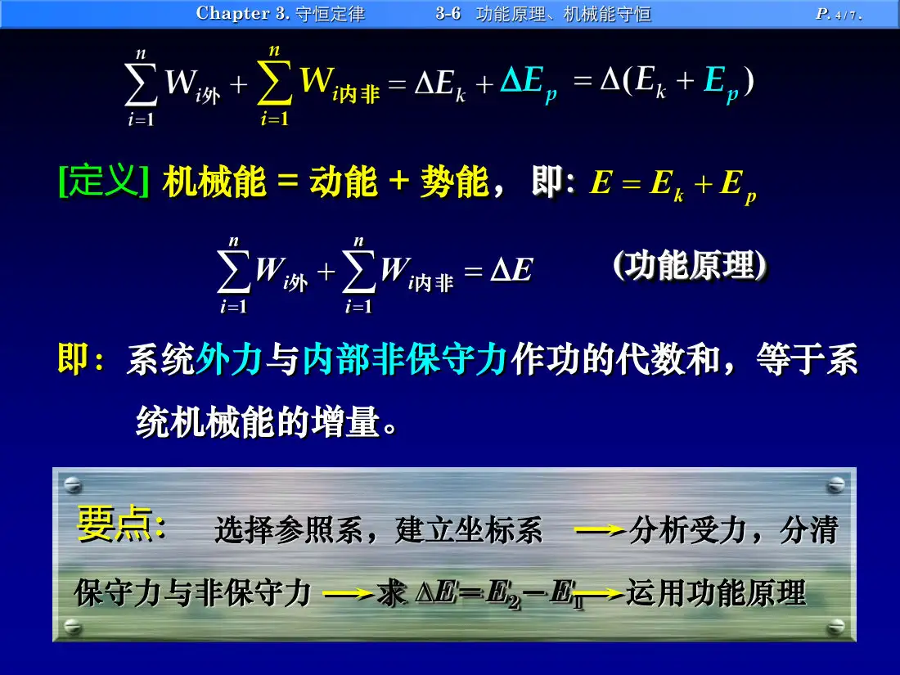
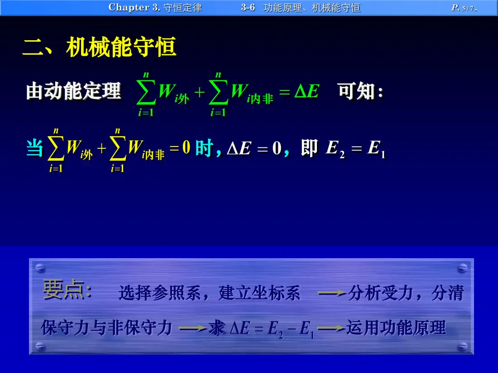
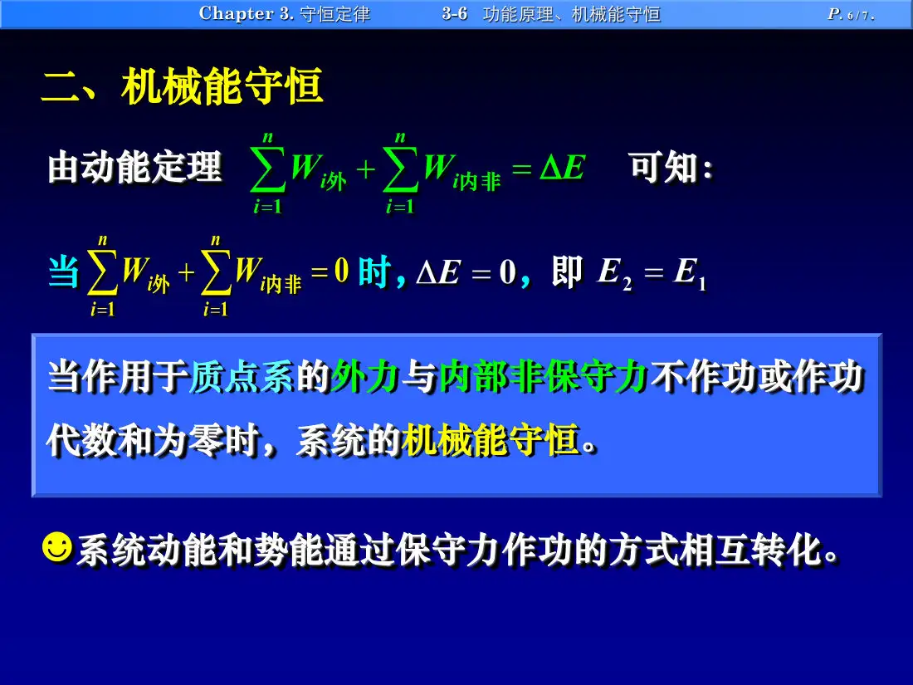
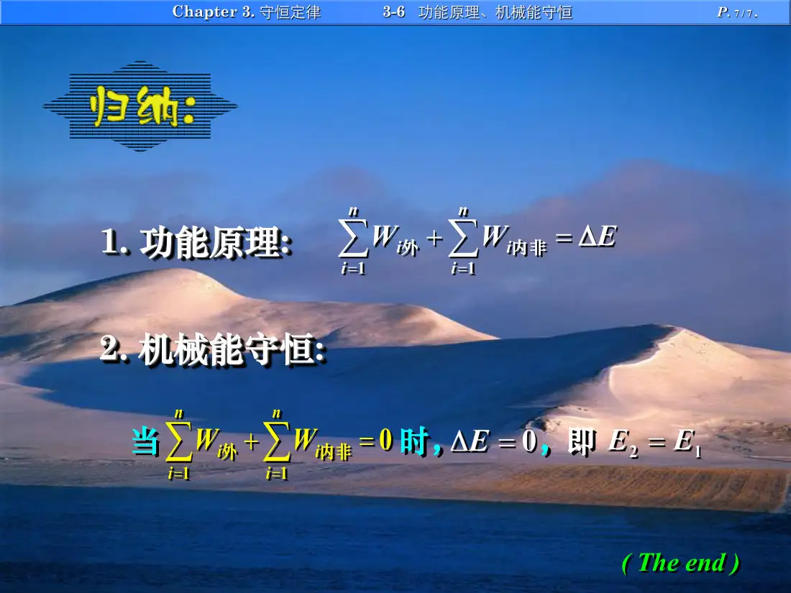

# 《大学物理》第3章 守恒定律：3-6 功能原理及机械能守恒（课件）

原件的每一页，下面附识别出的文字。

### 3-6 功能原理机械能守恒

原文：

3-6 功能原理机械能守恒

Chapter 3. 守恒定律

者：杨茂田3-6 功能原理、机械能守恒

P. 1 / 7 .

### 一、功能原理

原文：

一、功能原理

利用质点系的动能定理：

$$
\sum_ {i = 1} ^ {n} W _ {i \text {外}} + \sum_ {i = 1} ^ {n} W _ {i \text {内}} = E _ {k} - E _ {k 0} = \Delta E _ {k}
$$

$$
\sum_ {i = 1} ^ {n} W _ {i \text {内}} = \sum_ {i = 1} ^ {n} W _ {i \text {内保}} + \sum_ {i = 1} ^ {n} W _ {i \text {内非}} = - \Delta E _ {p} + \sum_ {i = 1} ^ {n} W _ {i \text {内非}}
$$

$$
\sum_ {i = 1} ^ {n} W _ {i \text {外}} + \sum_ {i = 1} ^ {n} (- \Delta E _ {\text {内保}}) + \sum_ {i = 1} ^ {n} W _ {i \text {内非}} = \Delta E _ {k}
$$

Chapter 3. 守恒定律

者：杨茂田3-6 功能原理、机械能守恒

P. 2 / 7 .

### Chapter 3. 守恒定律

原文：

Chapter 3. 守恒定律

$$
\sum_ {i = 1} ^ {n} W _ {i \text {外}} + \sum_ {i = 1} ^ {n} W _ {i \text {内非}} = \Delta E _ {k} + \Delta E _ {p} = \Delta (E _ {k} + E _ {p})
$$

[定义] 机械能 = 动能 + 势能，即: $1 0 \div 7 0 = 1 0$

$$
\sum_ {i = 1} ^ {n} W _ {i \text {外}} + \sum_ {i = 1} ^ {n} W _ {i \text {内非}} = \Delta E
$$

(功能原理)

即：系统外力与内部非保守力作功的代数和，等于系统机械能的增量。

$$
\sum_ {i = 1} ^ {n} W _ {i \text {外}} + (- \Delta E _ {p}) + \sum_ {i = 1} ^ {n} W _ {i \text {内非}} = \Delta E _ {k}
$$

者：杨茂田3-6 功能原理、机械能守恒

P. 3 / 7 .

### $$

原文：

$$
\sum_ {i = 1} ^ {n} W _ {i \text {外}} + \sum_ {i = 1} ^ {n} W _ {i \text {内非}} = \Delta E _ {k} + \Delta E _ {p} = \Delta (E _ {k} + E _ {p})
$$

[定义] 机械能 = 动能 + 势能，即: $1 0 \div 7 0 = 1 0$

$$
\sum_ {i = 1} ^ {n} W _ {i \text {外}} + \sum_ {i = 1} ^ {n} W _ {i \text {内非}} = \Delta E
$$

(功能原理)

即：系统外力与内部非保守力作功的代数和，等于系统机械能的增量。

要点： 选择参照系，建立坐标系 分析受力，分清保守力与非保守力 求 $\Delta { l l } _ { l } ^ { \prime } { = } l f _ { l { 2 } } ^ { \prime } { = } l f _ { l } ^ { \prime }$ 运用功能原理

Chapter 3. 守恒定律

者：杨茂田3-6 功能原理、机械能守恒

P. 4 / 7 .

### 二、机械能守恒

原文：

二、机械能守恒

由动能定理 $2 ( c m ) ^ { 2 } - ( 2 m ) ^ { 2 } = 1 2 m ^ { 2 }$ 可知：当 $\frac { 1 } { 1 5 } : ( \frac { 1 } { 2 } ) : \frac { 1 } { 1 5 } = \frac { 1 } { 1 5 } : ( \frac { 1 } { 2 } ) : ( \frac { 1 } { 2 } ) = ( 1 )$ 时， $| \Delta | \bigcirc | \bigcirc | | \bigcirc | |$ ，即 $| \mathcal { P } _ { 2 } | = | \mathcal { P } _ { 2 } |$

要点： 选择参照系，建立坐标系 分析受力，分清保守力与非保守力 求 $\Delta E = E _ { 2 } - E _ { 1 }$ 运用功能原理

Chapter 3. 守恒定律

者：杨茂田3-6 功能原理、机械能守恒

P. 5 / 7 .

### 二、机械能守恒

原文：

二、机械能守恒

由动能定理 $2 ( c m ) ^ { 2 } - ( 2 m ) ^ { 2 } = 1 2 m ^ { 2 }$ 可知：

当 $\frac { 1 } { 1 5 } : ( \frac { 1 } { 2 } ) : \frac { 1 } { 1 5 } = \frac { 1 } { 1 5 }$ 时， $| \Delta | \bigcirc | \bigcirc | | \bigcirc | |$ ，即 $| \mathcal { P } _ { \beta } | = | \mathcal { P } _ { \beta } |$

当作用于质点系的外力与内部非保守力不作功或作功代数和为零时，系统的机械能守恒。

☻系统动能和势能通过保守力作功的方式相互转化。

Chapter 3. 守恒定律

者：杨茂田3-6 功能原理、机械能守恒

P. 6 / 7 .

### 归纳：

原文：

归纳：

1. 功能原理: $\frac { n } { i = 1 } , v _ { i , j _ { i } } + \frac { n } { i = 1 } , v _ { i , j , j _ { i } } = \frac { \Delta V _ { i } } { i = 1 }$

2. 机械能守恒:

$\equiv [ \underbrace { \binom { n } { 1 } } _ { m } , \underbrace { \binom { n } { 1 } } _ { n } ] \div \underbrace { \binom { n } { 1 } } _ { m } , \underbrace { \binom { n } { 1 } } _ { n } ] = 0$ 时， $\Delta V _ { B } ^ { \prime } = 0$ 即 $\underline { { \vec { v } } } _ { z } ^ { \prime } = \underline { { \vec { v } } } _ { \perp } ^ { \prime }$

$$
(T h e e n d)
$$

Chapter 3. 守恒定律

者：杨茂田 3-6 功能原理、机械能守恒

P. 7 / 7 .
