# 《大学物理》第4章 刚体定轴转动 §4.3 质点角动量及其守恒定律（课件）

原件的每一页，下面附识别出的文字。

### § 4.3 质点角动量及其守恒定律

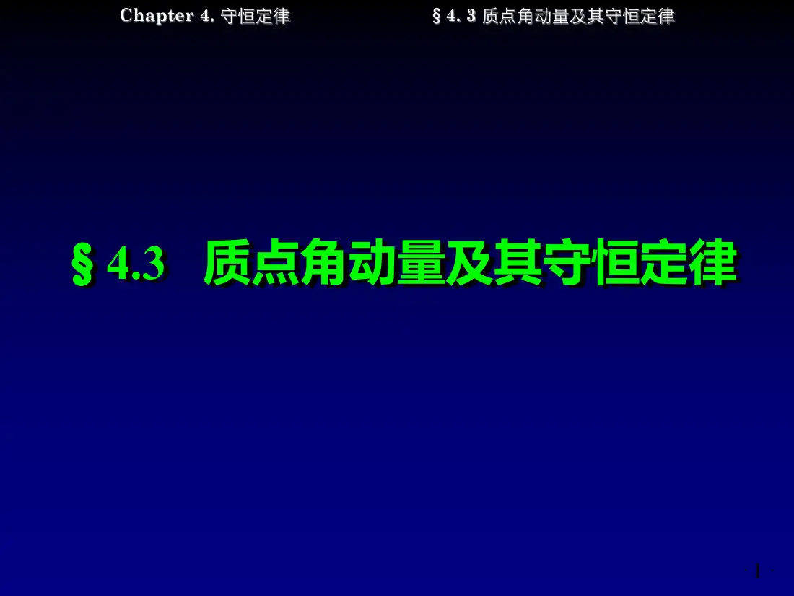

原文：

§ 4.3 质点角动量及其守恒定律

Chapter 4. 守恒定律

§ 4.3 质点角动量及其守恒定律

### v=常数,

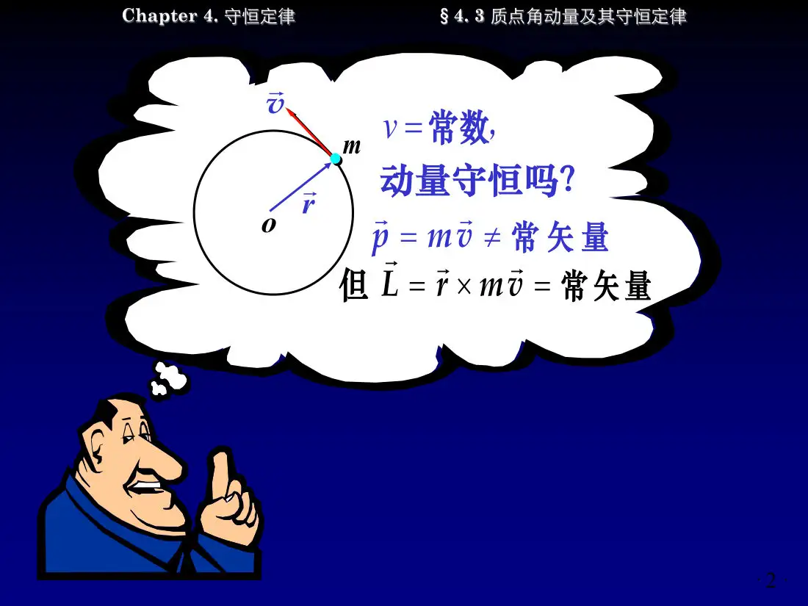

原文：

v=常数,
动量守恒吗? $\vec{p}=m\vec{v}\neq$ 常矢量 $\vec{L}=\vec{r}\times m\vec{v}=$ 常矢量$\vec{p} = m\vec{v}\neq$ 常矢量

Chapter 4. 守恒定律

§ 4.3 质点角动量及其守恒定律

2

### $\vec{L}=\vec{r}\times m\vec{v}=$ 常矢量

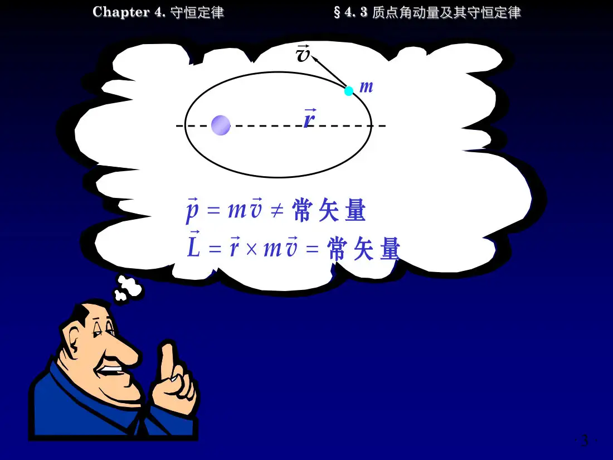

原文：

$\vec{L}=\vec{r}\times m\vec{v}=$ 常矢量

Chapter 4. 守恒定律

§ 4.3 质点角动量及其守恒定律

3

### Chapter 4. 守恒定律

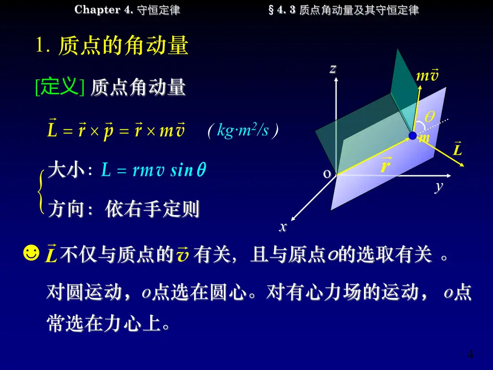

原文：

Chapter 4. 守恒定律

1. 质点的角动量

[定义] 质点角动量

$\vec{L} = \vec{r}\times \vec{p} = \vec{r}\times m\vec{v}\quad (kg\cdot m^2 /s)$

大小： $L = rmv \sin \theta$

方向：依右手定则

§ 4.3 质点角动量及其守恒定律

$\vec{L}$ 不仅与质点的 $\vec{v}$ 有关，且与原点o的选取有关。对圆运动，o点选在圆心。对有心力场的运动，o点常选在力心上。

4

### Chapter 4. 守恒定律

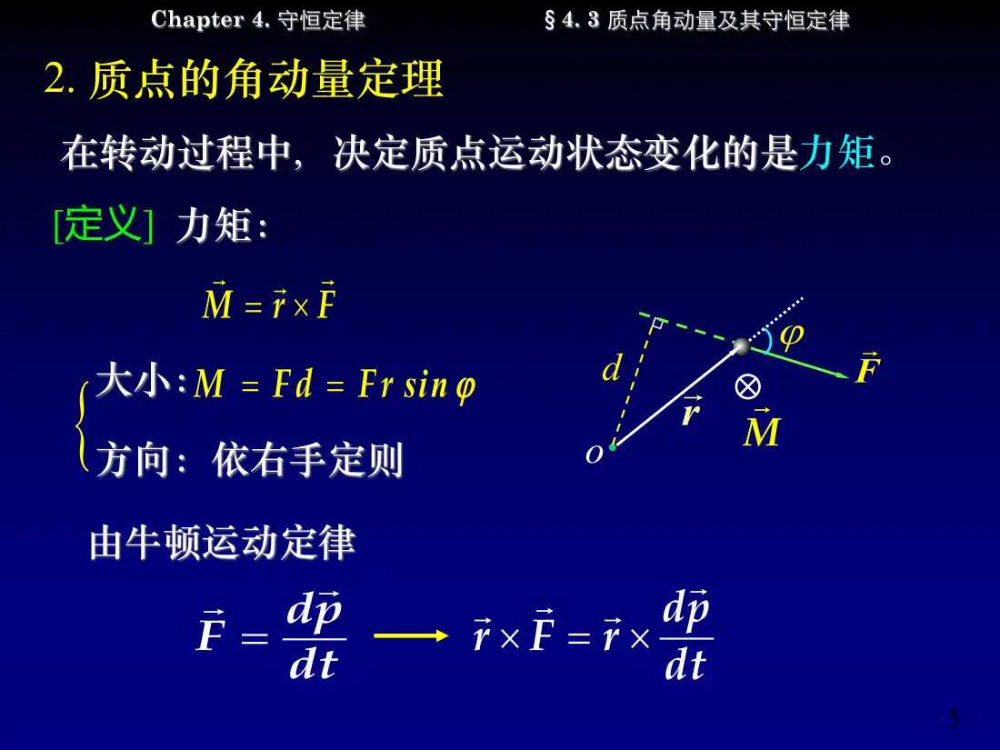

原文：

Chapter 4. 守恒定律

§ 4.3 质点角动量及其守恒定律

2. 质点的角动量定理

在转动过程中，决定质点运动状态变化的是力矩。

[定义] 力矩:

$$
\vec {M} = \vec {r} \times \vec {F}
$$

大小: M = Fd = Fr sin $\varphi$

方向：依右手定则

由牛顿运动定律

$$
\vec {F} = \frac {d \vec {p}}{d t} \longrightarrow \vec {r} \times \vec {F} = \vec {r} \times \frac {d \vec {p}}{d t}
$$

5

### Chapter 4. 守恒定律

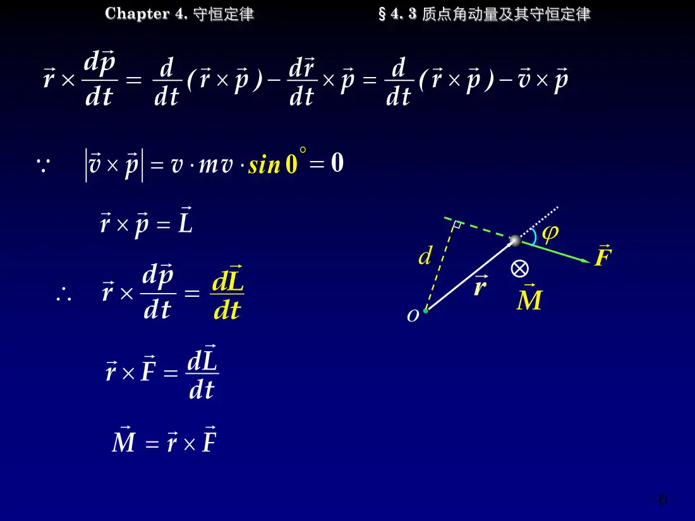

原文：

Chapter 4. 守恒定律

§ 4.3 质点角动量及其守恒定律

$$
\vec {r} \times \frac {d \vec {p}}{d t} = \frac {d}{d t} (\vec {r} \times \vec {p}) - \frac {d \vec {r}}{d t} \times \vec {p} = \frac {d}{d t} (\vec {r} \times \vec {p}) - \vec {v} \times \vec {p}
$$

$$
\left| \vec {v} \times \vec {p} \right| = v \cdot m v \cdot s i n 0 ^ {\circ} = 0
$$

$$
\vec {r} \times \vec {p} = \vec {L}
$$

$$
\therefore \vec {r} \times \frac {d \vec {p}}{d t} = \frac {d \vec {L}}{d t}
$$

$$
\vec {r} \times \vec {F} = \frac {d \vec {L}}{d t}
$$

$$
\vec {M} = \vec {r} \times \vec {F}
$$

6

### Chapter 4. 守恒定律

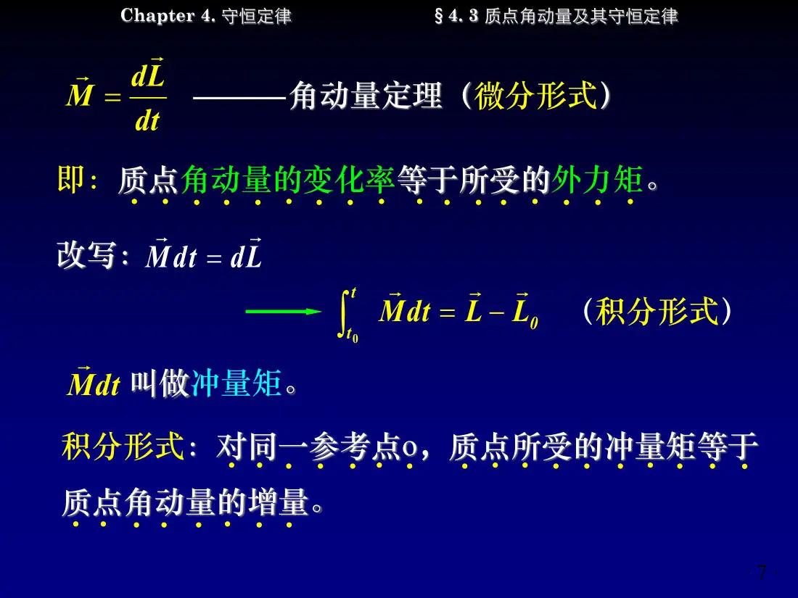

原文：

Chapter 4. 守恒定律

§ 4.3 质点角动量及其守恒定律

$\vec{M}=\frac{d\vec{L}}{dt}$ ——角动量定理（微分形式）

即：质点角动量的变化率等于所受的外力矩。

改写: $\vec{M}dt = d\vec{L}$

$$
\longrightarrow \int_ {t _ {0}} ^ {t} \vec {M} d t = \vec {L} - \vec {L} _ {0}
$$

(积分形式)

$\vec{M}dt$ 叫做冲量矩。

积分形式: 对同一参考点o, 质点所受的冲量矩等于质点角动量的增量。

7

### Chapter 4. 守恒定律

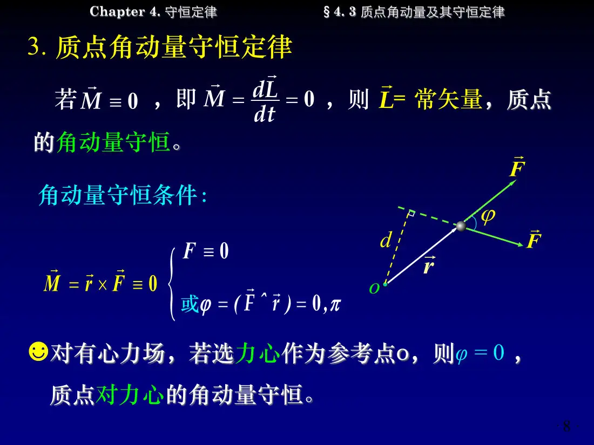

原文：

Chapter 4. 守恒定律

3. 质点角动量守恒定律

若 $\vec{M} \equiv 0$ ，即 $\vec{M} = \frac{d\vec{L}}{dt} = 0$ ，则 $\vec{L} =$ 常矢量，质点的角动量守恒。

角动量守恒条件:

$\vec{M} = \vec{r} \times \vec{F} \equiv 0$ $\left\{ \begin{array}{l} F \equiv 0 \\ \text{或} \varphi = (\vec{F} \hat{} \vec{r}) = 0, \pi \end{array} \right.$

对有心力场，若选力心作为参考点o，则 $\varphi=0$ ，质点对力心的角动量守恒。

§ 4.3 质点角动量及其守恒定律

8

### 万有引力场：地球角动量守恒

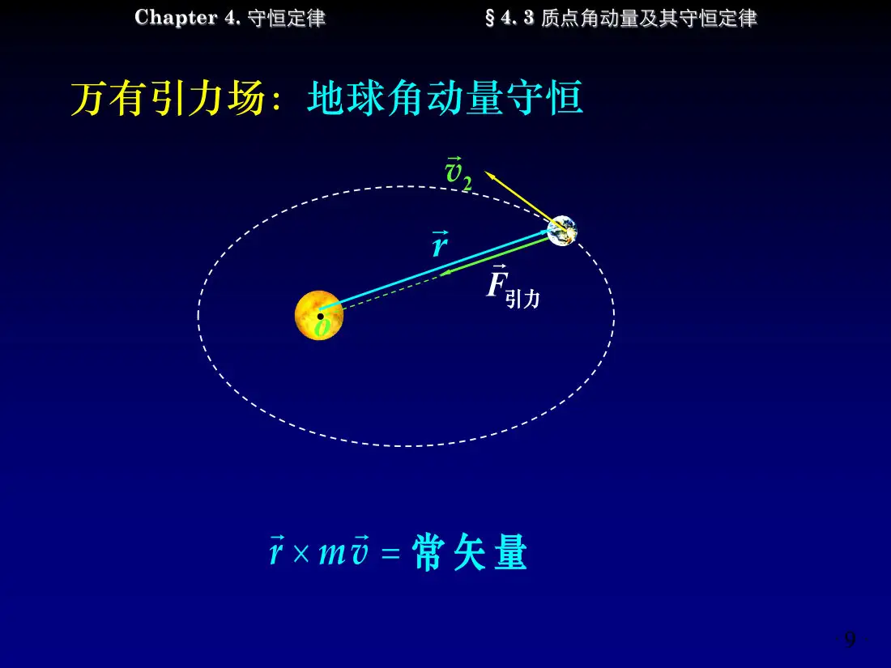

原文：

万有引力场：地球角动量守恒

$\vec{r} \times m\vec{v} =$ 常矢量

Chapter 4. 守恒定律

§ 4.3 质点角动量及其守恒定律

9

### Chapter 4. 守恒定律

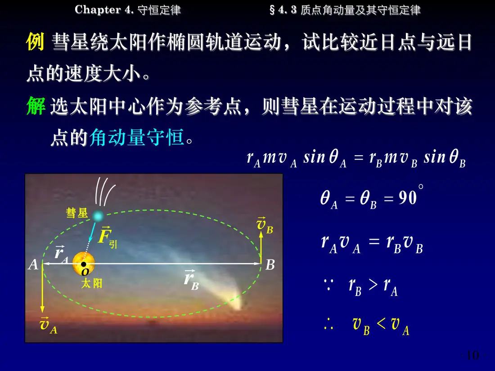

原文：

Chapter 4. 守恒定律

§ 4.3 质点角动量及其守恒定律

例 彗星绕太阳作椭圆轨道运动，试比较近日点与远日点的速度大小。

解 选太阳中心作为参考点，则彗星在运动过程中对该点的角动量守恒。

$$
r _ {A} m v _ {A} \sin \theta_ {A} = r _ {B} m v _ {B} \sin \theta_ {B}
$$

$$
\theta_ {A} = \theta_ {B} = 9 0 ^ {\circ}
$$

$$
r _ {A} v _ {A} = r _ {B} v _ {B}
$$

$$
\because r _ {B} > r _ {A}
$$

$$
\therefore v _ {B} <   v _ {A}
$$

10

### 水平台面上转动的小球角动量守恒

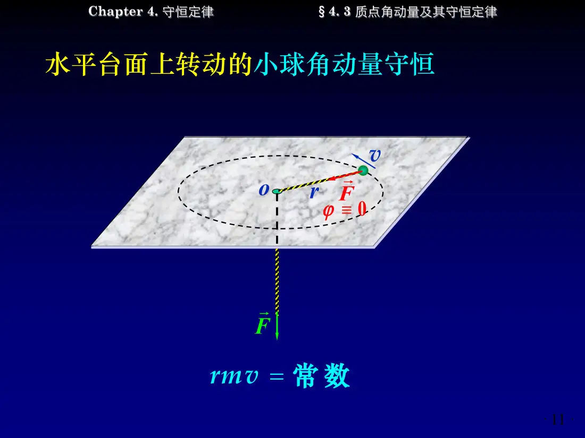

原文：

水平台面上转动的小球角动量守恒

rmv = 常数

Chapter 4. 守恒定律

§ 4.3 质点角动量及其守恒定律

11

### 水平台面上转动的木块角动量守恒

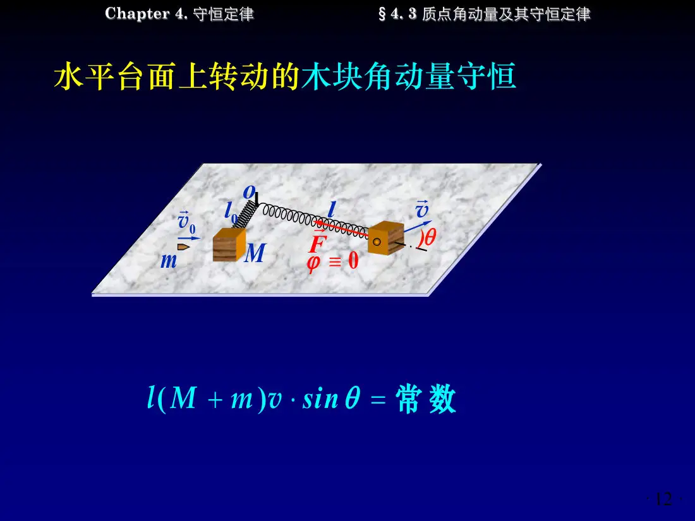

原文：

水平台面上转动的木块角动量守恒

$l(M+m)v\cdot\sin\theta=$ 常数

Chapter 4. 守恒定律

§ 4.3 质点角动量及其守恒定律

12

### 归纳

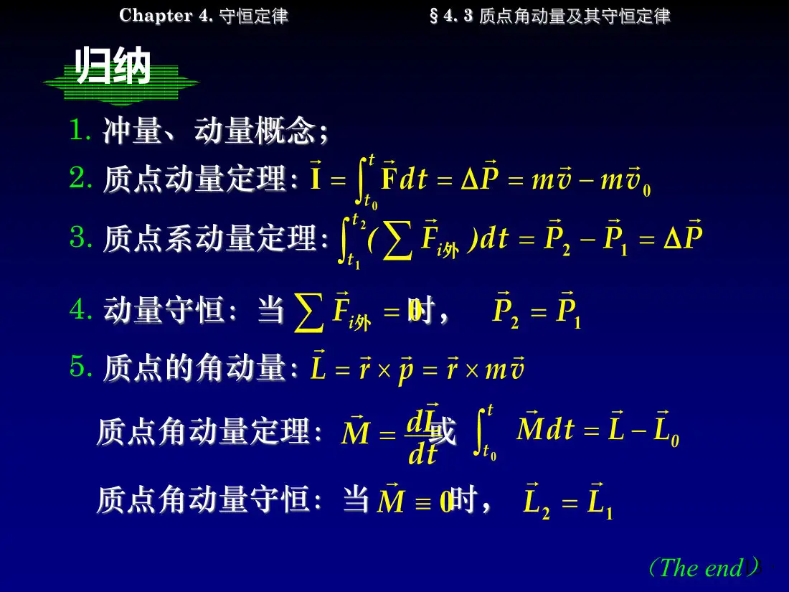

原文：

归纳

1. 冲量、动量概念;

2. 质点动量定理: $\vec{\mathbf{I}} = \int_{t_0}^{t} \vec{\mathbf{F}} dt = \Delta \vec{P} = m \vec{v} - m \vec{v}_0$

3. 质点系动量定理: $\int_{t_1}^{t_2} (\sum \vec{F}_{i\text{外}}) dt = \vec{P}_2 - \vec{P}_1 = \Delta \vec{P}$

4. 动量守恒: 当 $\sum \vec{F}_{i\text{外}} = \text{时,} \vec{P}_2 = \vec{P}_1$

5. 质点的角动量: $\vec{L} = \vec{r} \times \vec{p} = \vec{r} \times m\vec{v}$ 质点角动量定理: $\vec{M} = \frac{d\vec{L}}{dt}$ 或 $\int_{t_0}^{t} \vec{M} dt = \vec{L} - \vec{L}_0$ 质点角动量守恒: 当 $\vec{M} \equiv 0$ 时, $\vec{L}_2 = \vec{L}_1$

Chapter 4. 守恒定律

§ 4.3 质点角动量及其守恒定律

(The end $^{1}$ )
