# 《大学物理》第4章 刚体的定轴转动（课件）

原件的每一页，下面附识别出的文字。

### §4.2 刚体的转动惯量

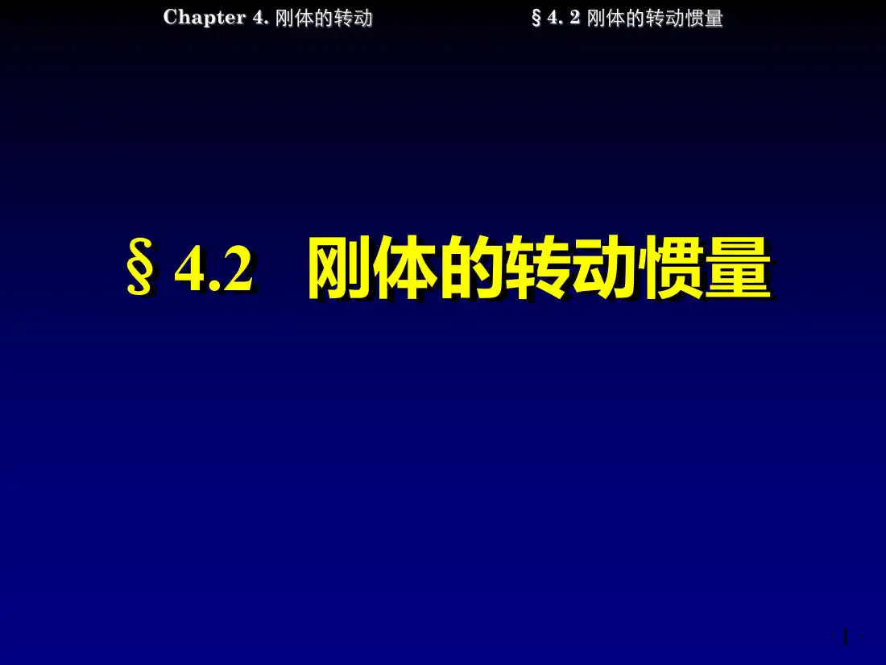

原文：

§4.2 刚体的转动惯量

Chapter 4. 刚体的转动

§4. 2 刚体的转动惯量

### 考察刚体的动能:

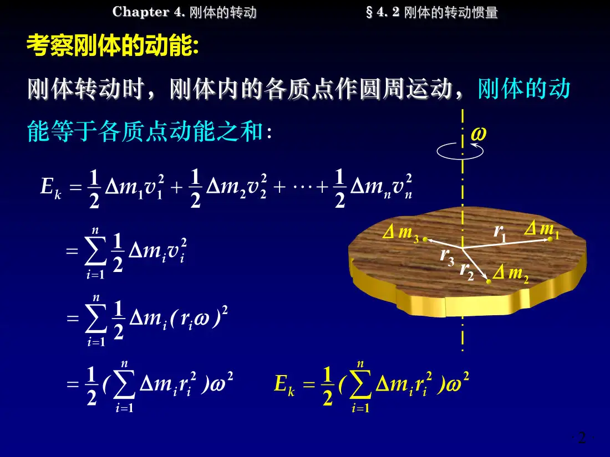

原文：

考察刚体的动能:

刚体转动时，刚体内的各质点作圆周运动，刚体的动能等于各质点动能之和： ω

$$
\begin{array}{r l} & E _ {k} = \frac {1}{2} \Delta m _ {1} v _ {1} ^ {2} + \frac {1}{2} \Delta m _ {2} v _ {2} ^ {2} + \dots + \frac {1}{2} \Delta m _ {n} v _ {n} ^ {2} \\ & = \sum_ {i = 1} ^ {n} \frac {1}{2} \Delta m _ {i} v _ {i} ^ {2} \\ & = \sum_ {i = 1} ^ {n} \frac {1}{2} \Delta m _ {i} (r _ {i} \omega) ^ {2} \\ & = \frac {1}{2} (\sum_ {i = 1} ^ {n} \Delta m _ {i} r _ {i} ^ {2}) \omega^ {2} \quad E _ {k} = \frac {1}{2} (\sum_ {i = 1} ^ {n} \Delta m _ {i} r _ {i} ^ {2}) \omega^ {2} \end{array}
$$

Chapter 4. 刚体的转动

§4. 2 刚体的转动惯量

· 2

### Chapter 4. 刚体的转动

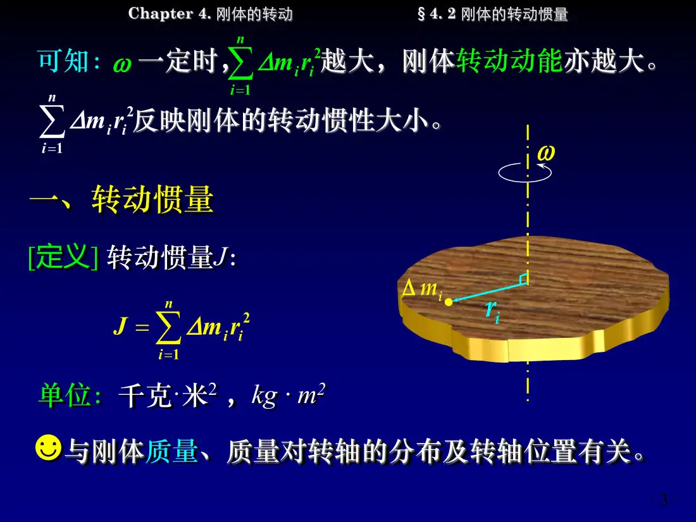

原文：

Chapter 4. 刚体的转动

§4. 2 刚体的转动惯量

可知： 一定时， 越大，刚体转动动能亦越大。i=1n$2 \sqrt { 1 1 7 } \times 1 0 ^ { 3 }$ 反映刚体的转动惯性大小。i=1

一、转动惯量

[定义] 转动惯量J：

$$
J = \sum_ {i = 1} ^ {n} \Delta m _ {i} r _ {i} ^ {2}
$$

单位：千克·米2 ， $1 5 \div 2 = 1 7 \cdots 2$

☻与刚体质量、质量对转轴的分布及转轴位置有关。

· 3

### 二、转动惯量计算举例

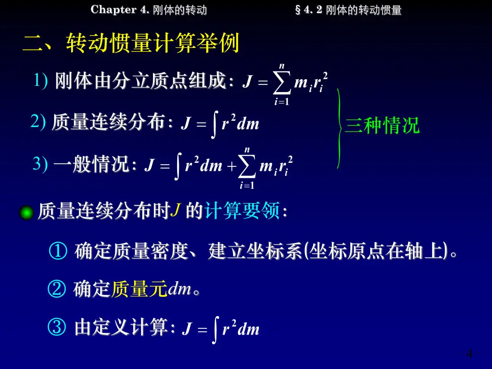

原文：

二、转动惯量计算举例

1) 刚体由分立质点组成： $\angle B = \angle A = \angle B = \angle C$

2) 质量连续分布： $V _ { 1 } = \sqrt { 1 2 } ( m )$

三种情况

3) 一般情况： $y _ { 1 } = \sqrt { 1 - \frac { \sqrt { 1 1 } } { 2 } } \cdot \sqrt { 1 1 } \cdot \sqrt { 1 1 } \cdot \sqrt { 1 1 } \cdot \sqrt { 1 1 }$

质量连续分布时J 的计算要领：

① 确定质量密度、建立坐标系(坐标原点在轴上)。

② 确定质量元dm。

③ 由定义计算： $V _ { 2 } = \sqrt { 1 2 } ( m )$

Chapter 4. 刚体的转动

§4. 2 刚体的转动惯量

· 4

### Chapter 4. 刚体的转动

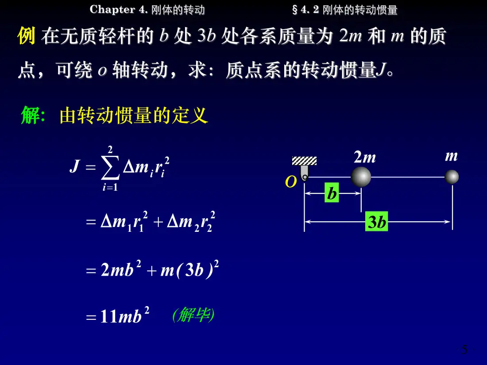

原文：

Chapter 4. 刚体的转动

例 在无质轻杆的 b 处 3b 处各系质量为 2m 和 m 的质点，可绕 o 轴转动，求：质点系的转动惯量J。

解: 由转动惯量的定义

$$
\begin{array}{r l} J & = \sum_ {i = 1} ^ {2} \Delta m _ {i} r _ {i} ^ {2} \\ & = \Delta m _ {1} r _ {1} ^ {2} + \Delta m _ {2} r _ {2} ^ {2} \\ & = 2 m b ^ {2} + m (3 b) ^ {2} \\ & = 1 1 m b ^ {2} \quad (\text {解毕}) \end{array}
$$

$$
\begin{array}{c c c} & 2 m & m \\ \hline o & b & \\ & 3 b & \end{array}
$$

§4. 2 刚体的转动惯量

· 5

### Chapter 4. 刚体的转动

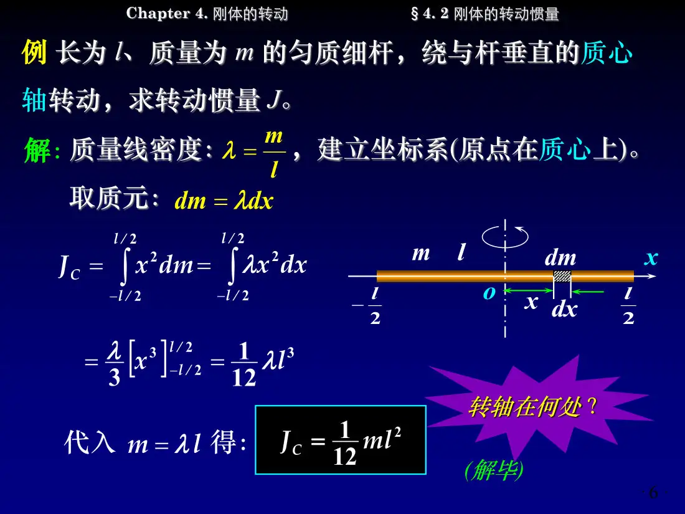

原文：

Chapter 4. 刚体的转动

§4. 2 刚体的转动惯量

例 长为 l、质量为 m 的匀质细杆，绕与杆垂直的质心轴转动，求转动惯量 J。

解：质量线密度： $a = \frac { 1 1 } { 1 6 }$ ，建立坐标系(原点在质心上)。

取质元： $\langle \langle I m = \lambda \rangle \langle n \rangle$

$$
\begin{array}{l} J _ {C} = \int_ {- l / 2} ^ {l / 2} x ^ {2} d m = \int_ {- l / 2} ^ {l / 2} \lambda x ^ {2} d x \\ = \frac {\lambda}{3} \left[ x ^ {3} \right] _ {- l / 2} ^ {l / 2} = \frac {1}{1 2} \lambda l ^ {3} \end{array}
$$

转轴在何处？

代入 $m = 2 7$ 得：

$$
J _ {c} = \frac {1}{1 2} m l ^ {2}
$$

(解毕)

6

### Chapter 4. 刚体的转动

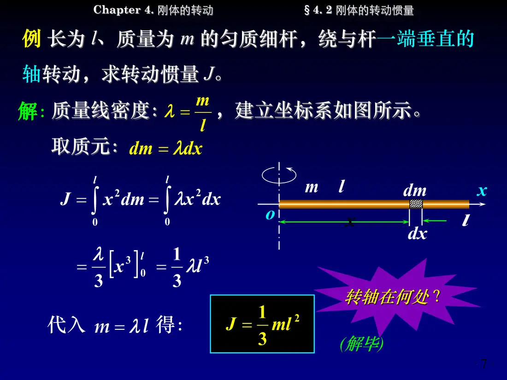

原文：

Chapter 4. 刚体的转动

§4. 2 刚体的转动惯量

例 长为 l、质量为 m 的匀质细杆，绕与杆一端垂直的轴转动，求转动惯量 J。

解：质量线密度： $a = \frac { 1 1 } { 1 6 }$ ，建立坐标系如图所示。

取质元： $\langle \langle I | \langle I | = \langle \langle \langle \langle \rangle | \langle \langle \rangle |$

$$
\begin{array}{r l} J & = \int_ {0} ^ {l} x ^ {2} d m = \int_ {0} ^ {l} \lambda x ^ {2} d x \\ & = \frac {\lambda}{3} \left[ x ^ {3} \right] _ {0} ^ {l} = \frac {1}{3} \lambda l ^ {3} \end{array}
$$

代入 $u _ { n } = \mathbb { E } \mathbb { I }$ 得：

转轴在何处？

$$
J = \frac {1}{3} m l ^ {2}
$$

(解毕)

· 7

### Chapter 4. 刚体的转动

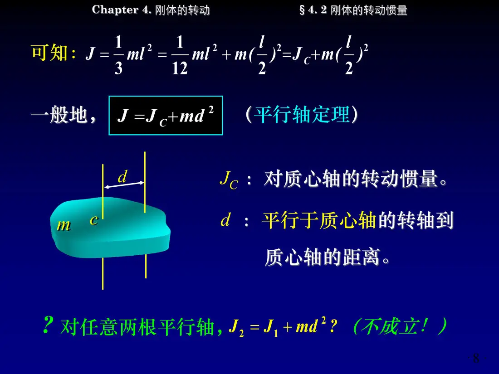

原文：

Chapter 4. 刚体的转动

§4. 2 刚体的转动惯量

可知： $\angle A = \angle B = \angle C A E = \angle C A E = \angle C A E = \angle C A E = \angle C A E$

一般地，

$$
J = J _ {c} + m d ^ {2}
$$

（平行轴定理）

$\%$ ：对质心轴的转动惯量。

$\circledcirc$ ：平行于质心轴的转轴到质心轴的距离。

? 对任意两根平行轴， $V _ { 1 } = V _ { 2 } = \frac { 1 } { 2 } m / l ^ { 2 }$ (不成立！)

8

### Chapter 4. 刚体的转动

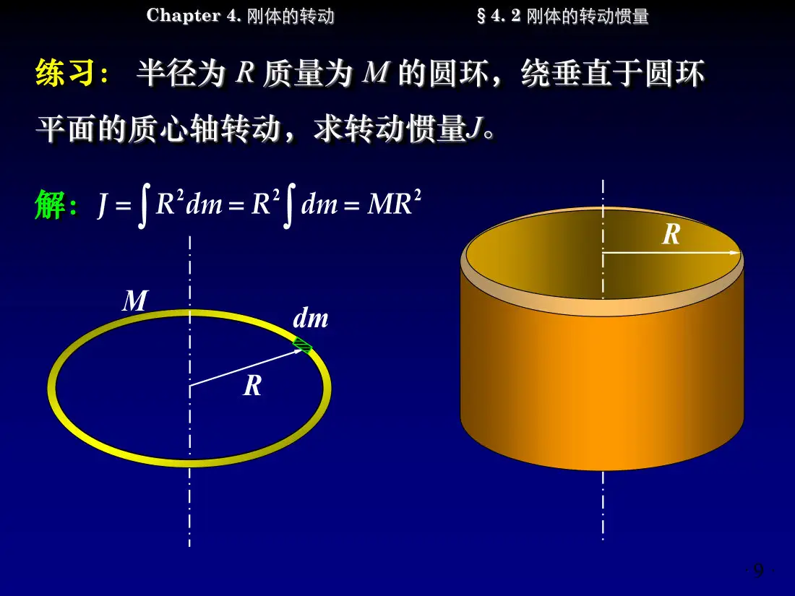

原文：

Chapter 4. 刚体的转动

§4. 2 刚体的转动惯量

练习： 半径为 R 质量为 M 的圆环，绕垂直于圆环平面的质心轴转动，求转动惯量J。

解： $1 5 - 1 1 = 1 5 ( c m ) = 1 5 5 - 1 5 ( c m ) = 1 5 ( c m )$

· 9

### Chapter 4. 刚体的转动

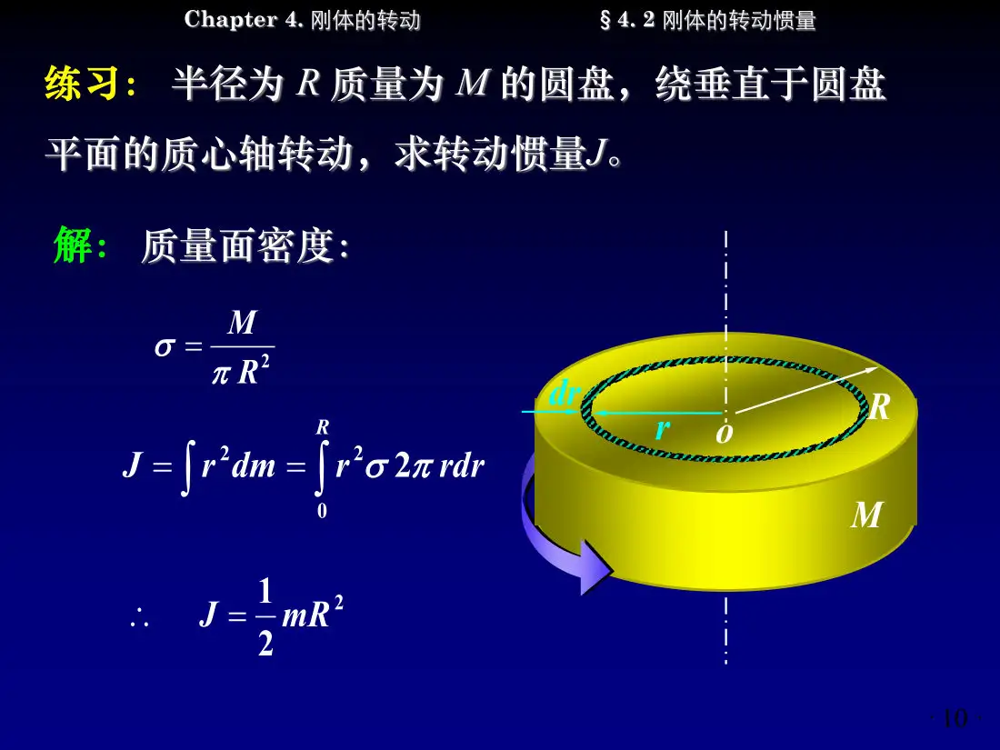

原文：

Chapter 4. 刚体的转动

§4. 2 刚体的转动惯量

练习： 半径为 R 质量为 M 的圆盘，绕垂直于圆盘平面的质心轴转动，求转动惯量J。

解：质量面密度：

$$
\sigma = \frac {M}{\pi R ^ {2}}
$$

$$
J = \int r ^ {2} d m = \int_ {0} ^ {R} r ^ {2} \sigma 2 \pi r d r
$$

$$
\therefore \quad J = \frac {1}{2} m R ^ {2}
$$

· 10

### 三、几种典型刚体的转动惯量

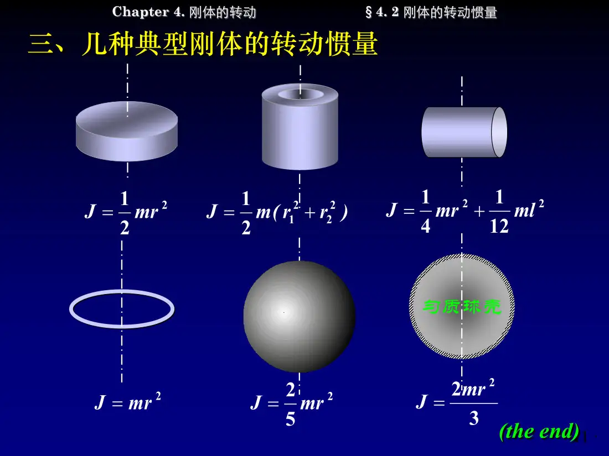

原文：

三、几种典型刚体的转动惯量

$$
J = \frac {1}{2} m r ^ {2}
$$

$$
J = \frac {1}{2} m (r _ {1} ^ {2} + r _ {2} ^ {2})
$$

$$
J = \frac {1}{4} m r ^ {2} + \frac {1}{1 2} m l ^ {2}
$$

$$
J = m r ^ {2}
$$

$$
J = \frac {2}{5} m r ^ {2}
$$

$$
J = \frac {2 ^ {\mathrm{i}} m r ^ {2}}{3}
$$

Chapter 4. 刚体的转动

§4. 2 刚体的转动惯量

(the end)· 11
