# 《大学物理》第4章 刚体的转动 4-1 刚体定轴转动（课件）

原件的每一页，下面附识别出的文字。

### 4-1 刚体定轴转动

原文：

4-1 刚体定轴转动

Chapter 4. 刚体的转动

4-1 刚体定轴转动

P. 1/19.

### 什么是刚体？

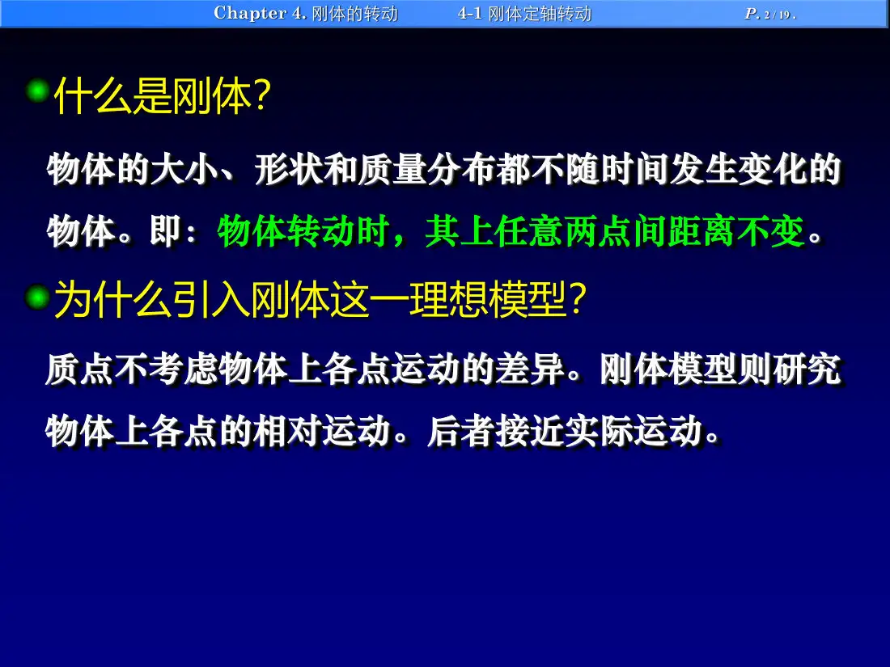

原文：

什么是刚体？

物体的大小、形状和质量分布都不随时间发生变化的物体。即：物体转动时，其上任意两点间距离不变。

为什么引入刚体这一理想模型？

质点不考虑物体上各点运动的差异。刚体模型则研究物体上各点的相对运动。后者接近实际运动。

Chapter 4. 刚体的转动

4-1 刚体定轴转动

P. 2/19.

### 刚体作定轴转动有哪些特点？

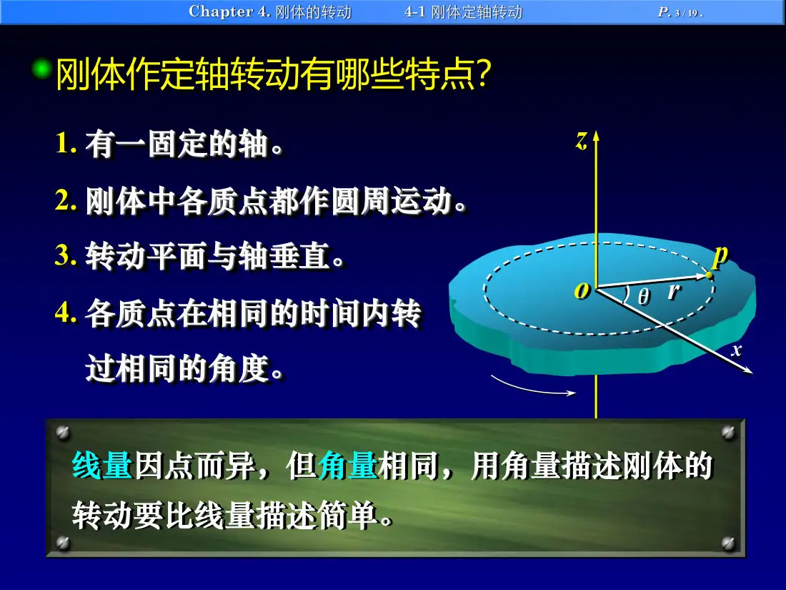

原文：

刚体作定轴转动有哪些特点？

1. 有一固定的轴。

2. 刚体中各质点都作圆周运动。

3. 转动平面与轴垂直。

4. 各质点在相同的时间内转过相同的角度。

线量因点而异，但角量相同，用角量描述刚体的转动要比线量描述简单。

Chapter 4. 刚体的转动

4-1 刚体定轴转动

P. 3/19.

### 一、刚体定轴转动的描述量

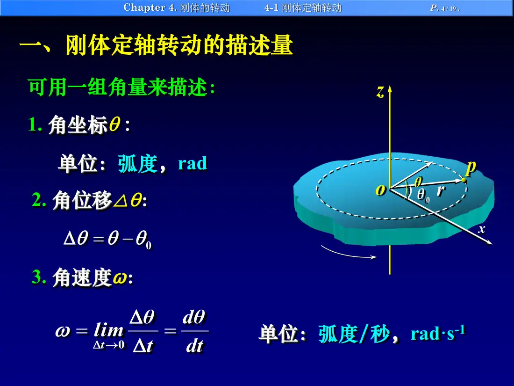

原文：

一、刚体定轴转动的描述量

可用一组角量来描述:

1. 角坐标 $\theta$ :

单位：弧度，rad

2. 角位移 $\triangle \theta$ :

$$
\Delta \theta = \theta - \theta_ {0}
$$

3. 角速度ω:

$$
\omega = \lim _ {\Delta t \rightarrow 0} \frac {\Delta \theta}{\Delta t} = \frac {d \theta}{d t}
$$

单位：弧度/秒，rad·s $^{-1}$

Chapter 4. 刚体的转动

4-1 刚体定轴转动

P. 4/19.

### ω方向：(右手定则)右手四指沿刚体转动方向右旋时的大拇指指向。

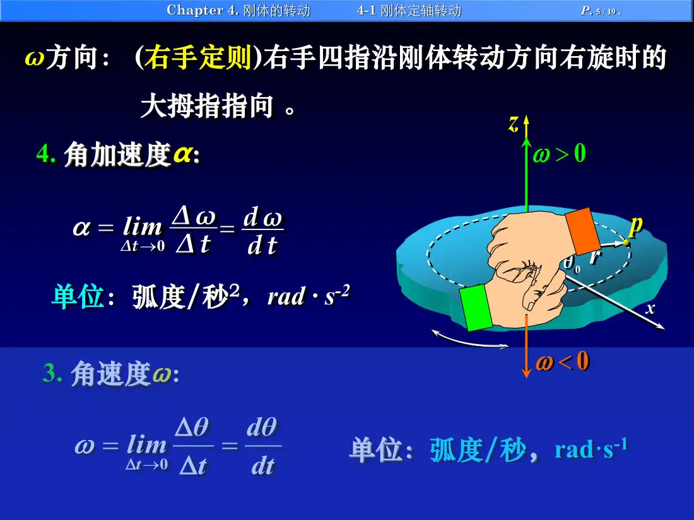

原文：

ω方向：(右手定则)右手四指沿刚体转动方向右旋时的大拇指指向。

4. 角加速度 $\alpha$ :

$$
\alpha = \lim _ {\Delta t \rightarrow 0} \frac {\Delta \omega}{\Delta t} = \frac {d \omega}{d t}
$$

单位：弧度/秒²，rad·s⁻²

3. 角速度ω:

$$
\omega = \lim _ {\Delta t \rightarrow 0} \frac {\Delta \theta}{\Delta t} = \frac {d \theta}{d t}
$$

单位：弧度/秒，rad·s $^{-1}$

Chapter 4. 刚体的转动

4-1 刚体定轴转动

P. 5/19.

### ω方向：(右手定则)右手四指沿刚体转动方向右旋时的大拇指指向。

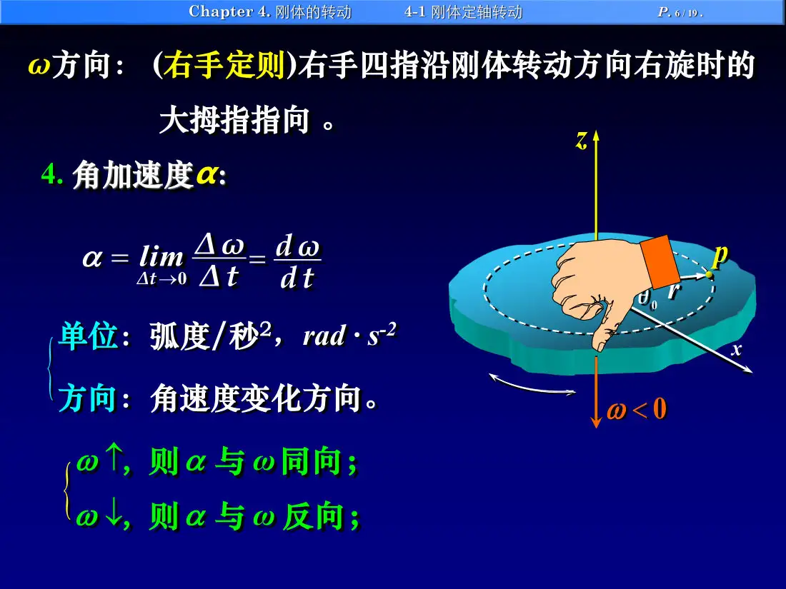

原文：

ω方向：(右手定则)右手四指沿刚体转动方向右旋时的大拇指指向。

4. 角加速度 $\alpha$ :

$$
\alpha = \lim _ {\Delta t \rightarrow 0} \frac {\Delta \omega}{\Delta t} = \frac {d \omega}{d t}
$$

单位：弧度/秒²，rad·s⁻²

方向：角速度变化方向。

$\omega\uparrow,$ 则 $\alpha$ 与 $\omega$ 同向；

$\omega\downarrow$ ，则 $\alpha$ 与 $\omega$ 反向；

Chapter 4. 刚体的转动

4-1 刚体定轴转动

P. 6/19.

### 3'29" Chapter 4. 刚体的转动

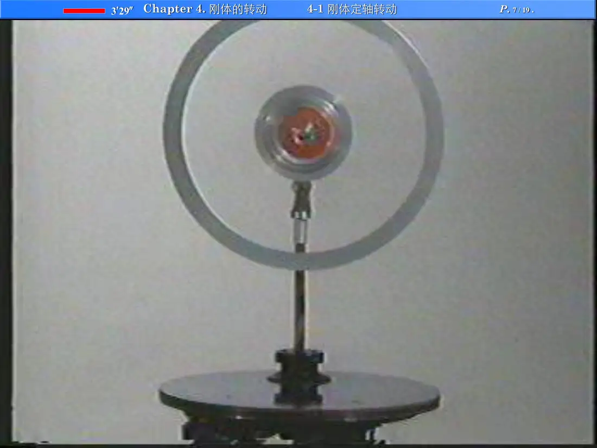

原文：

3'29" Chapter 4. 刚体的转动

4-1 刚体定轴转动

P. 7/19.

### 二、角量与线量间的关系

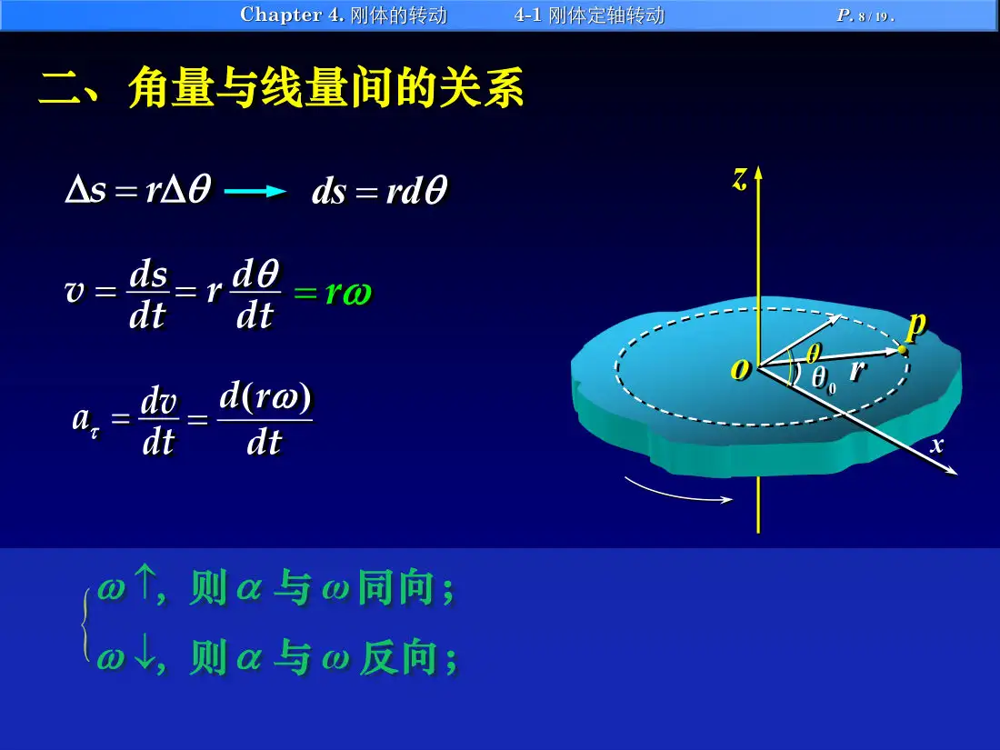

原文：

二、角量与线量间的关系

$$
\Delta s = r \Delta \theta \longrightarrow d s = r d \theta
$$

$$
v = \frac {d s}{d t} = r \frac {d \theta}{d t} = r \omega
$$

$$
a _ {\tau} = \frac {d v}{d t} = \frac {d (r \omega)}{d t}
$$

$\omega \uparrow$ ，则 $\alpha$ 与 $\omega$ 同向；

$\omega \downarrow$ ，则 $\alpha$ 与 $\omega$ 反向；

P. 8/19.

Chapter 4. 刚体的转动

4-1 刚体定轴转动

### 二、角量与线量间的关系

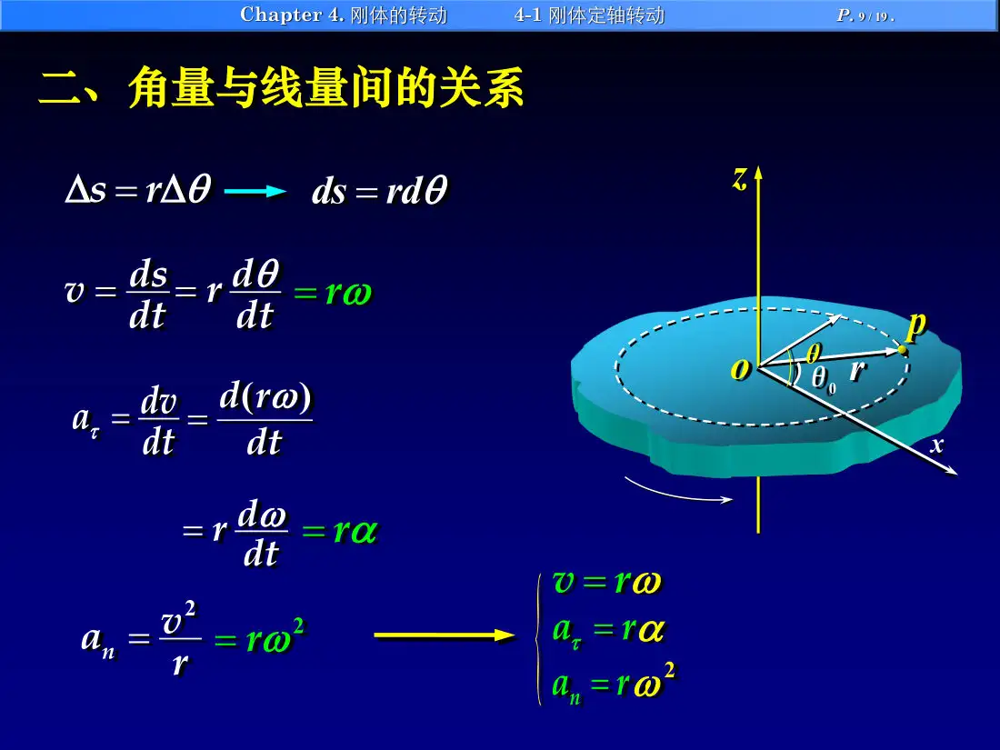

原文：

二、角量与线量间的关系

$$
\Delta s = r \Delta \theta \longrightarrow d s = r d \theta
$$

$$
v = \frac {d s}{d t} = r \frac {d \theta}{d t} = r \omega
$$

$$
a _ {\tau} = \frac {d v}{d t} = \frac {d (r \omega)}{d t}
$$

$$
= r \frac {d \omega}{d t} = r \alpha
$$

$$
a _ {n} = \frac {v ^ {2}}{r} = r \omega^ {2}
$$

$$
\left\{ \begin{array}{l} \boldsymbol {v} = r \boldsymbol {\omega} \\ a _ {\tau} = r \boldsymbol {\alpha} \\ a _ {n} = r \boldsymbol {\omega} ^ {2} \end{array} \right.
$$

Chapter 4. 刚体的转动

4-1 刚体定轴转动

P. 9/19.

### 三、角量与线量的计算

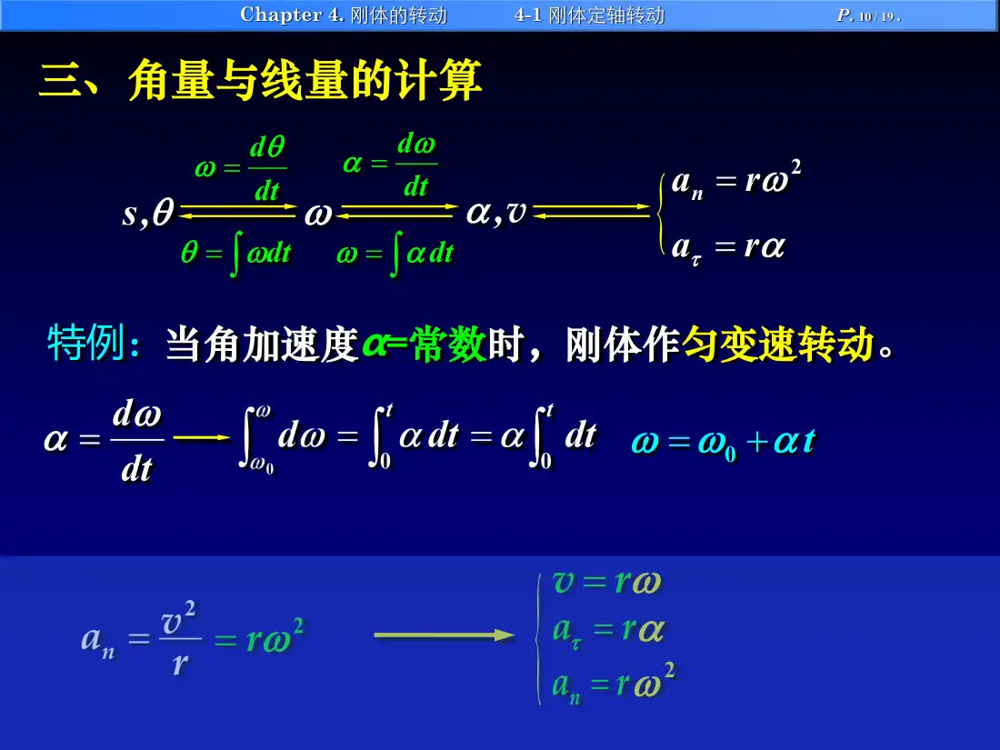

原文：

三、角量与线量的计算

$$
s, \theta \xrightarrow [ \theta = \int \omega d t ]{\omega = \frac {d \theta}{d t}} \omega \xrightarrow [ \omega = \int \alpha d t ]{\alpha = \frac {d \omega}{d t}} \alpha , v \xleftarrow {} \left\{ \begin{array}{l} a _ {n} = r \omega^ {2} \\ a _ {\tau} = r \alpha \end{array} \right.
$$

特例：当角加速度 $\alpha =$ 常数时，刚体作匀变速转动。

$$
\alpha = \frac {d \omega}{d t} \longrightarrow \int_ {\omega_ {0}} ^ {\omega} d \omega = \int_ {0} ^ {t} \alpha d t = \alpha \int_ {0} ^ {t} d t \quad \omega = \omega_ {0} + \alpha t
$$

$$
a _ {n} = \frac {v ^ {2}}{r} = r \omega^ {2} \quad \longrightarrow \left\{ \begin{array}{l} v = r \omega \\ a _ {\tau} = r \alpha \\ a _ {n} = r \omega^ {2} \end{array} \right.
$$

Chapter 4. 刚体的转动

4-1 刚体定轴转动

P. 10/19.

### 三、角量与线量的计算

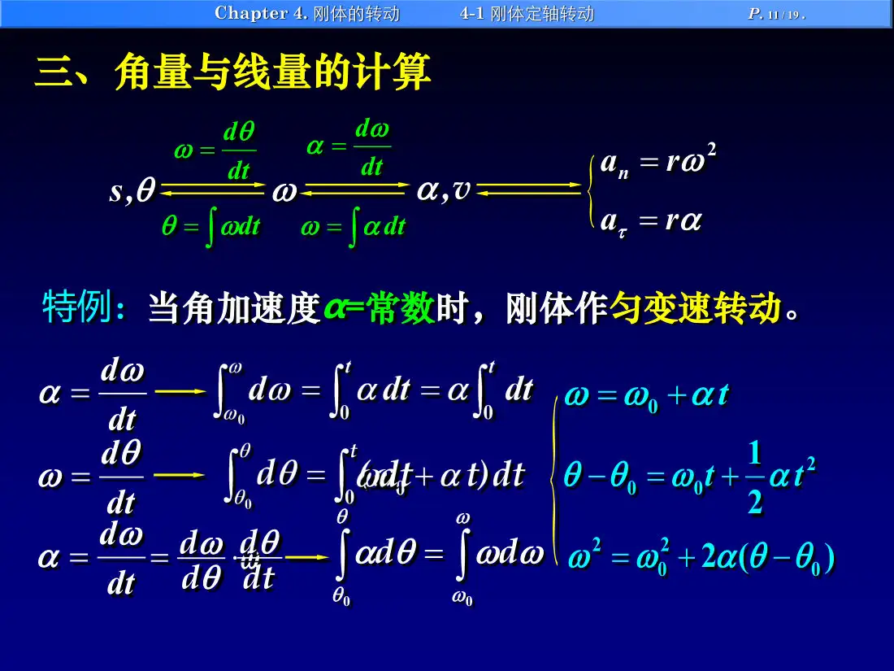

原文：

三、角量与线量的计算

$$
s, \theta \xrightarrow [ \theta = \int \omega d t ]{\omega = \frac {d \theta}{d t}} \omega \xrightarrow [ \omega = \int \alpha d t ]{\alpha = \frac {d \omega}{d t}} \alpha , v \xleftarrow {} \left\{ \begin{array}{l} a _ {n} = r \omega^ {2} \\ a _ {\tau} = r \alpha \end{array} \right.
$$

特例：当角加速度 $\alpha =$ 常数时，刚体作匀变速转动。

$$
\begin{array}{l} \alpha = \frac {d \omega}{d t} \longrightarrow \int_ {\omega_ {0}} ^ {\omega} d \omega = \int_ {0} ^ {t} \alpha d t = \alpha \int_ {0} ^ {t} d t \\ \omega = \frac {d \theta}{d t} \longrightarrow \int_ {\theta_ {0}} ^ {\theta} d \theta = \int_ {0} ^ {t} (\omega d t + \alpha t) d t \\ \alpha = \frac {d \omega}{d t} = \frac {d \omega}{d \theta} \cdot \frac {d \theta}{d t} \longrightarrow \int_ {\theta_ {0}} ^ {\theta} \alpha d \theta = \int_ {\omega_ {0}} ^ {\omega} \omega d \omega \\ \end{array} \left\{ \begin{array}{l} \omega = \omega_ {0} + \alpha t \\ \theta - \theta_ {0} = \omega_ {0} t + \frac {1}{2} \alpha t ^ {2} \\ \omega^ {2} = \omega_ {0} ^ {2} + 2 \alpha (\theta - \theta_ {0}) \end{array} \right.
$$

Chapter 4. 刚体的转动 4-1 刚体定轴转动

P. 11 / 19.

### 三、角量与线量的计算

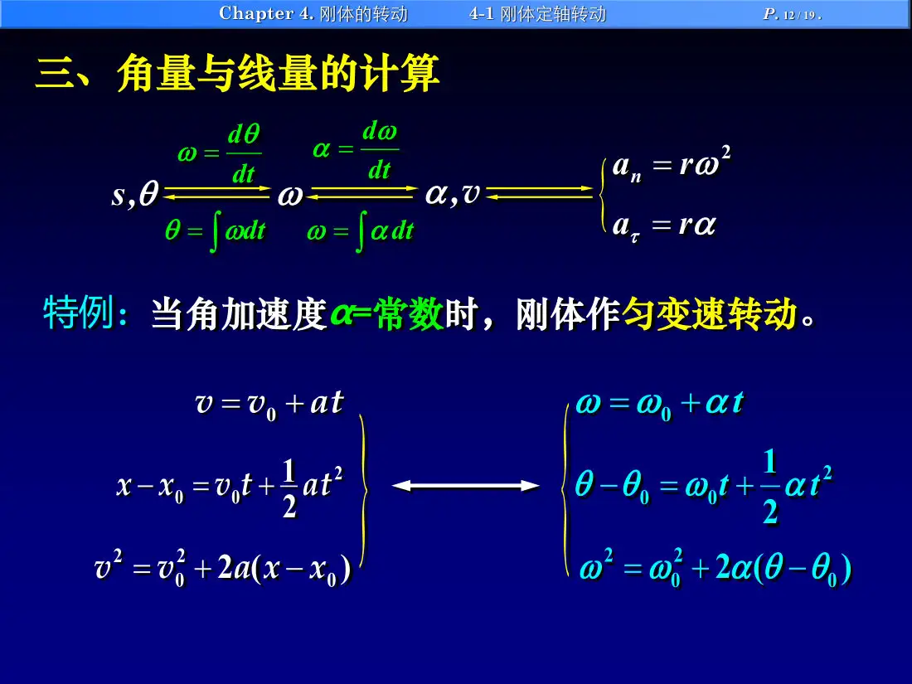

原文：

三、角量与线量的计算

$$
s, \theta \xrightarrow [ \theta = \int \omega d t ]{\omega = \frac {d \theta}{d t}} \omega \xrightarrow [ \omega = \int \alpha d t ]{\alpha = \frac {d \omega}{d t}} \alpha , v \xleftarrow {} \left\{ \begin{array}{l} a _ {n} = r \omega^ {2} \\ a _ {\tau} = r \alpha \end{array} \right.
$$

特例：当角加速度 $\alpha =$ 常数时，刚体作匀变速转动。

$$
\left. \begin{array}{c} v = v _ {0} + a t \\ x - x _ {0} = v _ {0} t + \frac {1}{2} a t ^ {2} \\ v ^ {2} = v _ {0} ^ {2} + 2 a (x - x _ {0}) \end{array} \right\} \longleftrightarrow \left\{ \begin{array}{l} \omega = \omega_ {0} + \alpha t \\ \theta - \theta_ {0} = \omega_ {0} t + \frac {1}{2} \alpha t ^ {2} \\ \omega^ {2} = \omega_ {0} ^ {2} + 2 \alpha (\theta - \theta_ {0}) \end{array} \right.
$$

Chapter 4. 刚体的转动

4-1 刚体定轴转动

P. 12 / 19.

### 解: 设 $\alpha = ct$ ，则

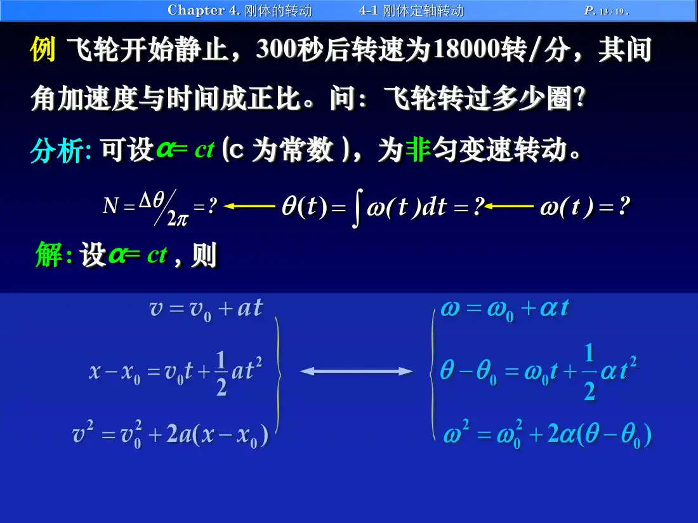

原文：

例 飞轮开始静止，300秒后转速为18000转/分，其间角加速度与时间成正比。问：飞轮转过多少圈？分析: 可设 $\alpha = c t$ (c 为常数)，为非匀变速转动。

$N=\Delta\theta/2\pi=?$ $\leftarrow$ $\theta(t)=\int\omega(t)dt=?$ $\leftarrow$ $\omega(t)=?$

解: 设 $\alpha = ct$ ，则

$$
v = v _ {0} + a t
$$

$$
x - x _ {0} = v _ {0} t + \frac {1}{2} a t ^ {2}
$$

$$
v ^ {2} = v _ {0} ^ {2} + 2 a (x - x _ {0})
$$

$$
\omega = \omega_ {0} + \alpha t
$$

$$
\theta - \theta_ {0} = \omega_ {0} t + \frac {1}{2} \alpha t ^ {2}
$$

$$
\omega^ {2} = \omega_ {0} ^ {2} + 2 \alpha (\theta - \theta_ {0})
$$

Chapter 4. 刚体的转动

4-1 刚体定轴转动

P. 13 / 19.

### $$

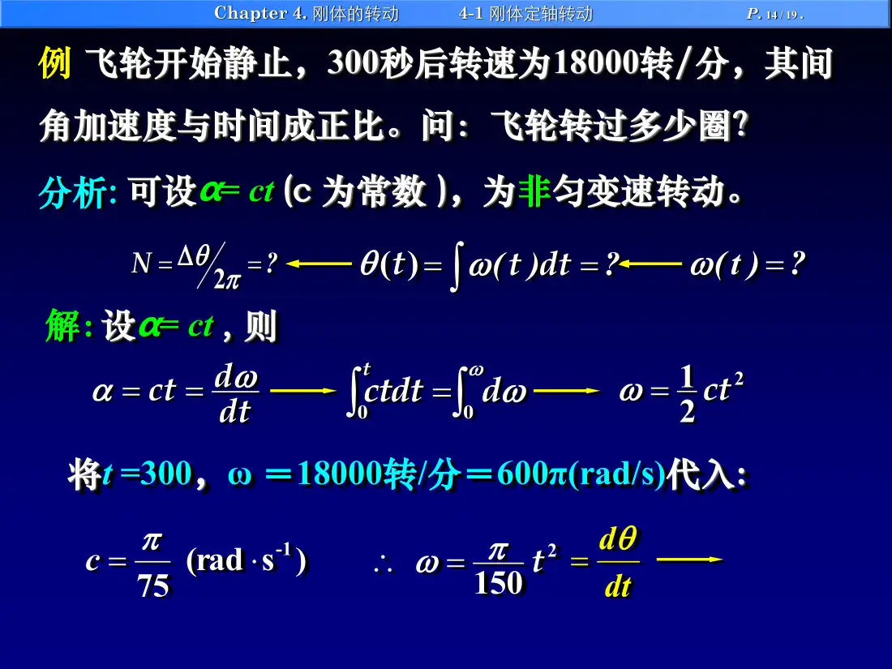

原文：

例 飞轮开始静止，300秒后转速为18000转/分，其间角加速度与时间成正比。问：飞轮转过多少圈？分析: 可设 $\alpha = c t$ (c 为常数)，为非匀变速转动。

$$
N = \Delta \theta / 2 \pi = ? \longleftarrow \theta (t) = \int \omega (t) d t = ? \longleftarrow \omega (t) = ?
$$

解: 设 $\alpha = ct$ ，则

$$
\alpha = c t = \frac {d \omega}{d t} \longrightarrow \int_ {0} ^ {t} c t d t = \int_ {0} ^ {\omega} d \omega \longrightarrow \omega = \frac {1}{2} c t ^ {2}
$$

将t=300， $\omega=18000$ 转/分=600 $\pi$ (rad/s)代入：

$$
c = \frac {\pi}{7 5} (\mathrm{rad} \cdot \mathrm{s} ^ {- 1}) \quad \therefore \omega = \frac {\pi}{1 5 0} t ^ {2} = \frac {d \theta}{d t} \longrightarrow
$$

4-1 刚体定轴转动

### $$

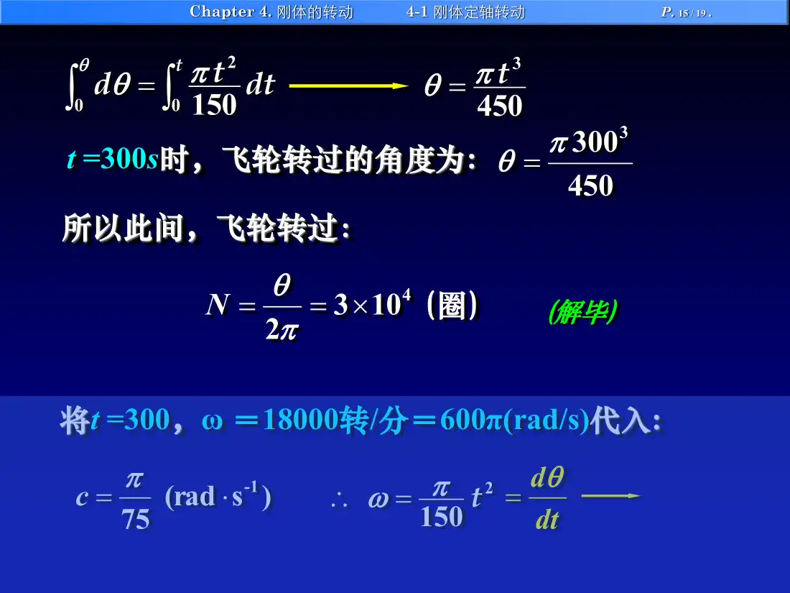

原文：

$\int_{0}^{\theta} d\theta = \int_{0}^{t} \frac{\pi t^{2}}{150} dt \longrightarrow \theta = \frac{\pi t^{3}}{450}$ $t = 300s$ 时，飞轮转过的角度为： $\theta = \frac{\pi 300^{3}}{450}$ 所以此间，飞轮转过：

$$
N = \frac {\theta}{2 \pi} = 3 \times 1 0 ^ {4} (\text {圈})
$$

(解毕)

将 $t = 300$ ， $\omega = 18000$ 转/分 $= 600\pi (\mathrm{rad / s})$ 代入：

$$
c = \frac {\pi}{7 5} (\mathrm{rad} \cdot \mathrm{s} ^ {- 1}) \quad \therefore \omega = \frac {\pi}{1 5 0} t ^ {2} = \frac {d \theta}{d t} \longrightarrow
$$

Chapter 4. 刚体的转动

4-1 刚体定轴转动

P. 15/19.

### $$

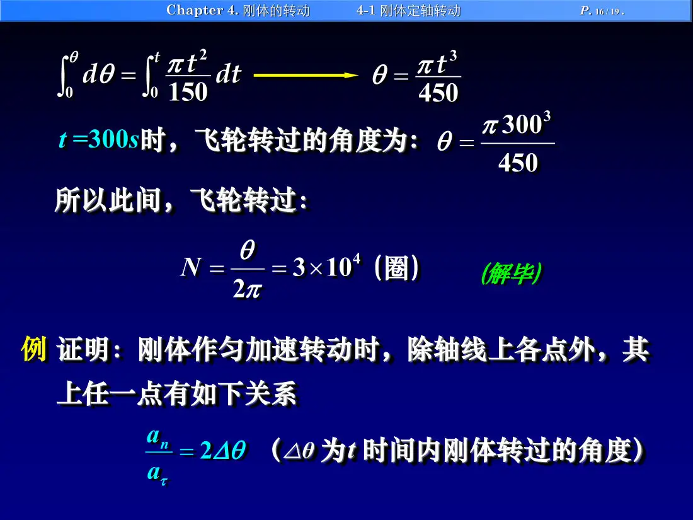

原文：

$\int_{0}^{\theta} d\theta = \int_{0}^{t} \frac{\pi t^{2}}{150} dt \longrightarrow \theta = \frac{\pi t^{3}}{450}$ $t = 300s$ 时，飞轮转过的角度为： $\theta = \frac{\pi 300^{3}}{450}$ 所以此间，飞轮转过：

$$
N = \frac {\theta}{2 \pi} = 3 \times 1 0 ^ {4} (\text {圈})
$$

(解毕)

例 证明：刚体作匀加速转动时，除轴线上各点外，其上任一点有如下关系

$\frac{a_{n}}{a_{\tau}}=2\Delta\theta$ ( $\Delta\theta$ 为 t 时间内刚体转过的角度)

Chapter 4. 刚体的转动

4-1 刚体定轴转动

P. 16 / 19.

### 证明: $\omega_{0} = 0, \alpha = const.$ 则

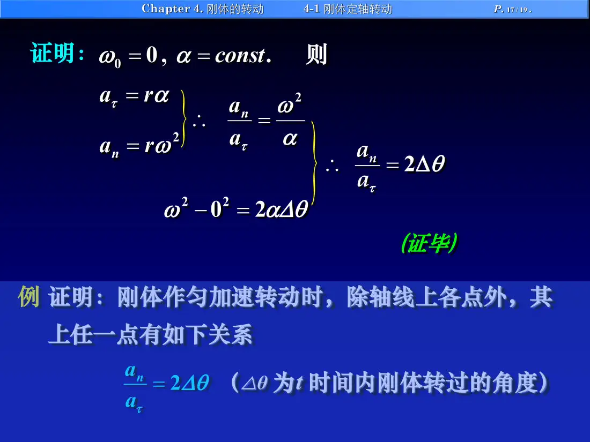

原文：

证明: $\omega_{0} = 0, \alpha = const.$ 则

$$
\left. \begin{array}{c} a _ {\tau} = r \alpha \\ a _ {n} = r \omega^ {2} \end{array} \right\} \therefore \left. \begin{array}{c} \frac {a _ {n}}{a _ {\tau}} = \frac {\omega^ {2}}{\alpha} \\ \omega^ {2} - 0 ^ {2} = 2 \alpha \Delta \theta \end{array} \right\} \therefore \frac {a _ {n}}{a _ {\tau}} = 2 \Delta \theta
$$

(证毕)

例 证明：刚体作匀加速转动时，除轴线上各点外，其上任一点有如下关系

$\frac{a_{n}}{a_{\tau}}=2\Delta\theta$ ( $\Delta\theta$ 为 t 时间内刚体转过的角度)

Chapter 4. 刚体的转动

4-1 刚体定轴转动

P. 17/19.

### $$

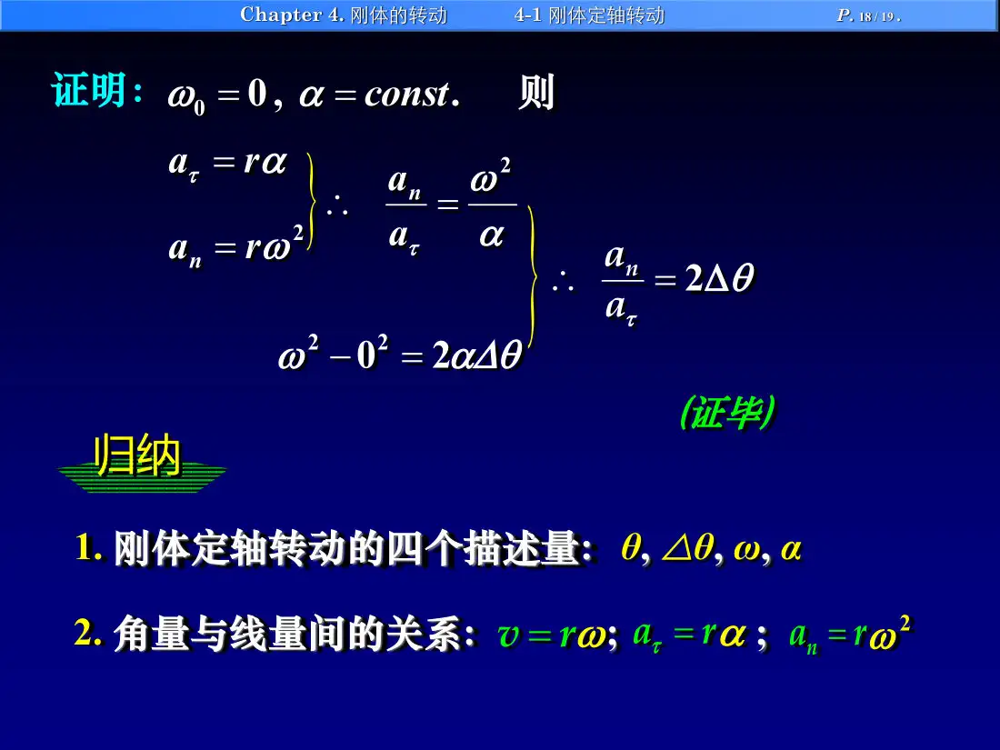

原文：

证明: $\omega_{0} = 0, \alpha = \text {const. }$ 则

$$
\left. \begin{array}{l} a _ {\tau} = r \alpha \\ a _ {n} = r \omega^ {2} \end{array} \right\} \therefore \left. \begin{array}{l} \frac {a _ {n}}{a _ {\tau}} = \frac {\omega^ {2}}{\alpha} \\ \omega^ {2} - 0 ^ {2} = 2 \alpha \Delta \theta \end{array} \right\} \therefore \frac {a _ {n}}{a _ {\tau}} = 2 \Delta \theta
$$

归纳

(证毕)

1. 刚体定轴转动的四个描述量: $\theta, \triangle \theta, \omega, \alpha$

2. 角量与线量间的关系: $v = r\omega; a_{\tau} = r\alpha; a_{n} = r\omega^{2}$

Chapter 4. 刚体的转动

4-1 刚体定轴转动

P. 18/19.

### $$

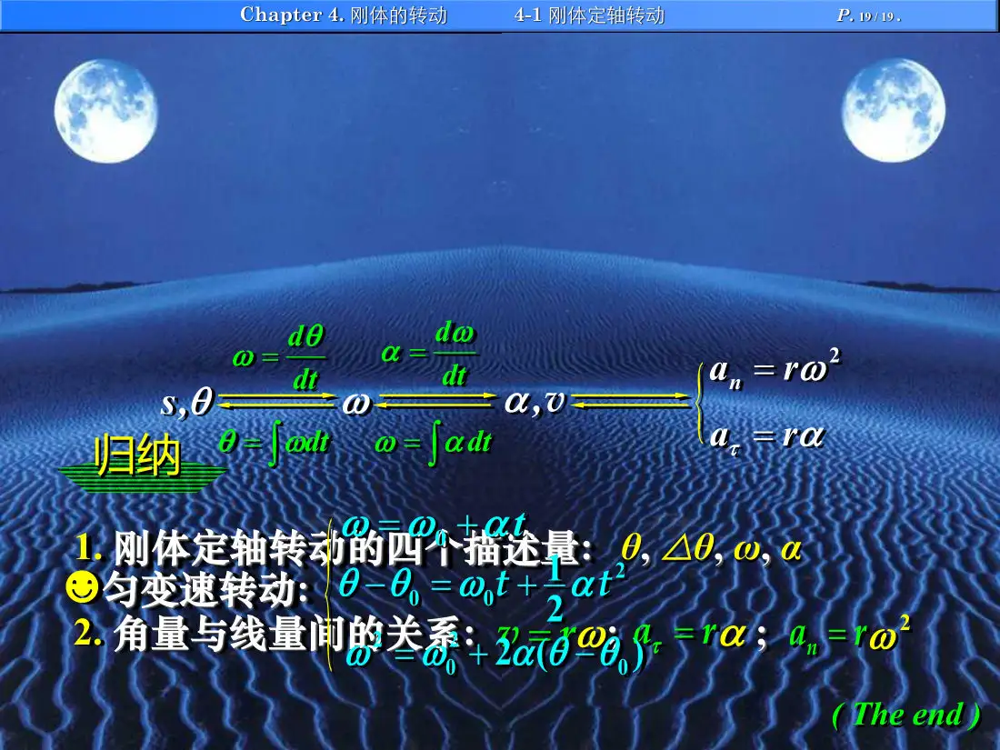

原文：

$$
\begin{array}{c c} \omega = \frac {d \theta}{d t} & \alpha = \frac {d \omega}{d t} \\ s, \theta \xrightarrow {\quad} \omega \xrightarrow {\quad} \alpha , v \xrightarrow {\quad} \\ \text {内} & \theta = \int \omega d t \quad \omega = \int \alpha d t \end{array}
$$

归纳

$$
\left\{ \begin{array}{l} a _ {n} = r \omega^ {2} \\ a _ {\tau} = r \alpha \end{array} \right.
$$

1. 刚体定轴转动的四个描述量: $\theta, \Delta\theta, \omega, \alpha$ 匀变速转动: $\theta - \theta_0 = \omega_0 t + \frac{1}{2} \alpha t^2$ 2. 角量与线量间的关系: $\omega^2 = \omega_0^2 + 2\alpha (\theta - \theta_0)$ $a_\tau = r\alpha; a_n = r\omega^2$

Chapter 4. 刚体的转动

4-1 刚体定轴转动

P. 19 / 19.

( The end )
