# 《大学物理》第4章 刚体的转动 4-3-2 刚体定轴转动的角动量及角动量定律（课件）

原件的每一页，下面附识别出的文字。

### 4-3-2 刚体定轴转动的角动量及角动量定律

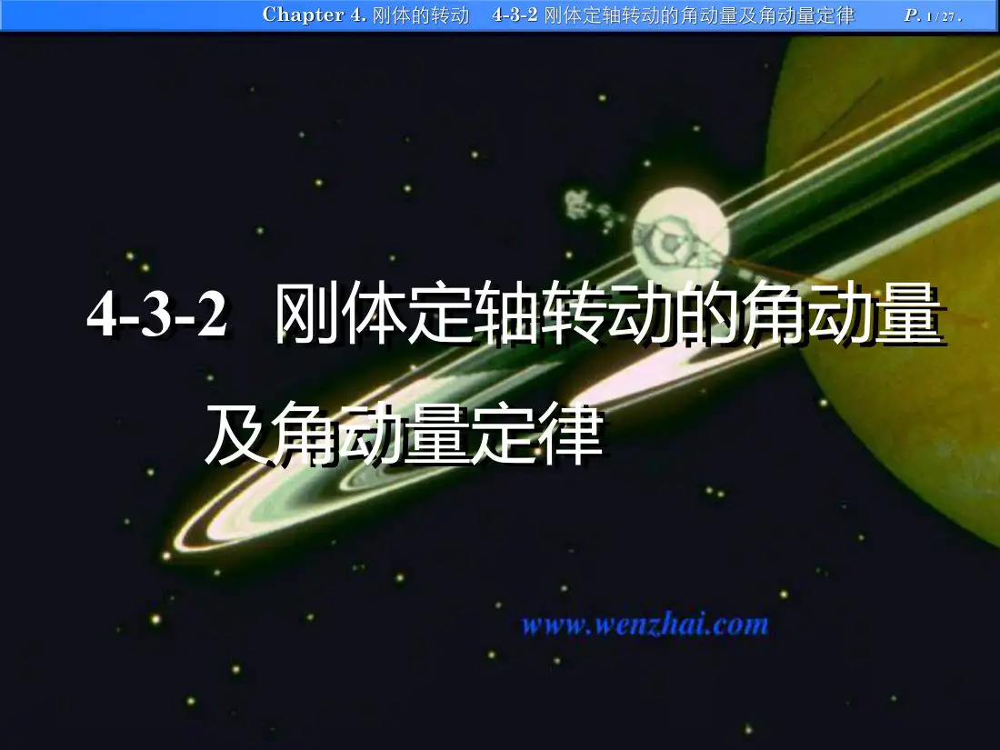

原文：

4-3-2 刚体定轴转动的角动量及角动量定律

www.wenzhai.com

Chapter 4. 刚体的转动 4-3-2 刚体定轴转动的角动量及角动量定律

P. 1/27.

### 回顾质点的角动量定理:

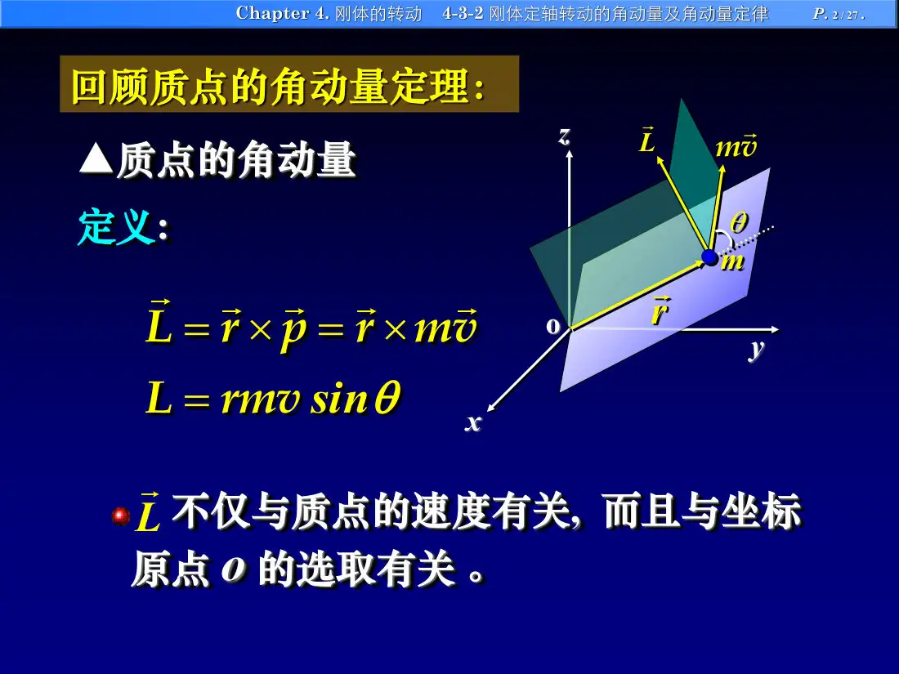

原文：

回顾质点的角动量定理:

▲质点的角动量
定义:

$$
\vec {L} = \vec {r} \times \vec {p} = \vec {r} \times m \vec {v}
$$

$$
L = r m v \sin \theta
$$

\- $L$ 不仅与质点的速度有关, 而且与坐标原点 $o$ 的选取有关。

Chapter 4. 刚体的转动 4-3-2 刚体定轴转动的角动量及角动量定律

P. 2 / 27.

### 一、刚体角动量与对轴角动量

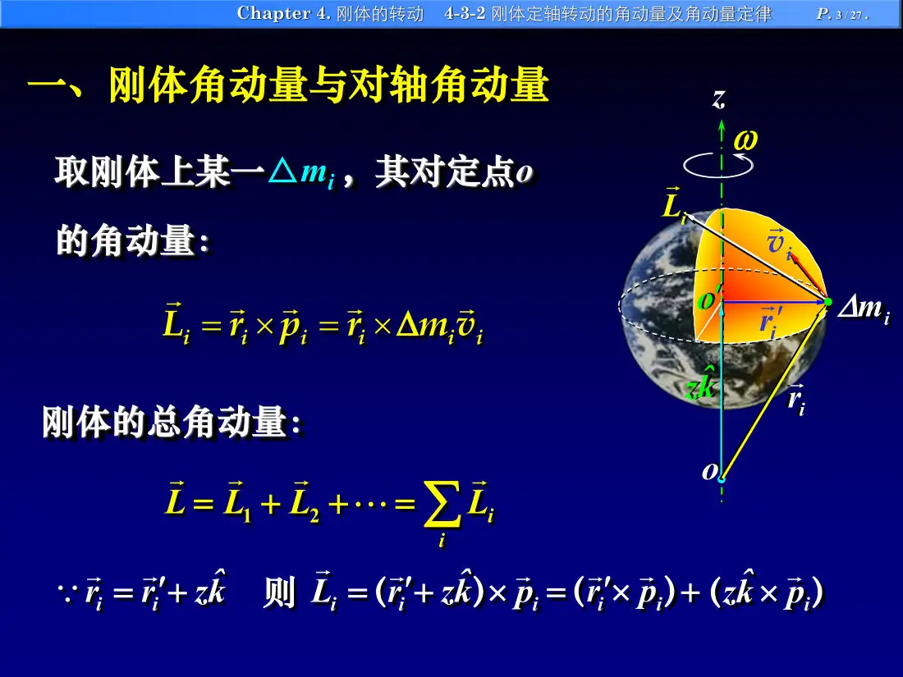

原文：

一、刚体角动量与对轴角动量

取刚体上某一 $\triangle m_{i}$ , 其对定点 $o$ 的角动量:

$$
\vec {L} _ {i} = \vec {r} _ {i} \times \vec {p} _ {i} = \vec {r} _ {i} \times \Delta m _ {i} \vec {v} _ {i}
$$

刚体的总角动量:

$$
\vec {L} = \vec {L} _ {1} + \vec {L} _ {2} + \dots = \sum_ {i} \vec {L} _ {i}
$$

$\because \vec{r}_i = \vec{r}_i' + z\hat{k}$ 则 $\vec{L}_i = (\vec{r}_i' + z\hat{k})\times \vec{p}_i = (\vec{r}_i'\times \vec{p}_i) + (z\hat{k}\times \vec{p}_i)$

Chapter 4. 刚体的转动 4-3-2 刚体定轴转动的角动量及角动量定律

P. 3 / 27.

### 刚体的总角动量:

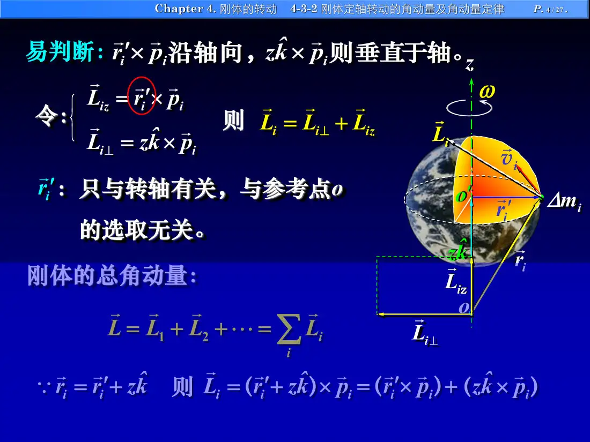

原文：

易判断: $\vec{r}_{i}^{\prime} \times \vec{p}_{i}$ 沿轴向, $z\hat{k} \times \vec{p}_{i}$ 则垂直于轴。

令： $\left\{\begin{aligned}\vec{L}_{iz}&=\vec{r}_{i}^{\prime}\times\vec{p}_{i}\\ \vec{L}_{i\perp}&=z\hat{k}\times\vec{p}_{i}\end{aligned}\right.$ 则 $\vec{L}_{i}=\vec{L}_{i\perp}+\vec{L}_{iz}$

$\vec{r}_{i}^{\prime}$ ：只与转轴有关，与参考点 $o$ 的选取无关。

刚体的总角动量:

$$
\vec {L} = \vec {L} _ {1} + \vec {L} _ {2} + \dots = \sum_ {i} \vec {L} _ {i}
$$

$\because \vec{r}_i = \vec{r}_i' + z\hat{k}$ 则 $\vec{L}_i = (\vec{r}_i' + z\hat{k})\times \vec{p}_i = (\vec{r}_i'\times \vec{p}_i) + (z\hat{k}\times \vec{p}_i)$

Chapter 4. 刚体的转动 4-3-2 刚体定轴转动的角动量及角动量定律

P. 4/27.

### z：与o的选取有关。

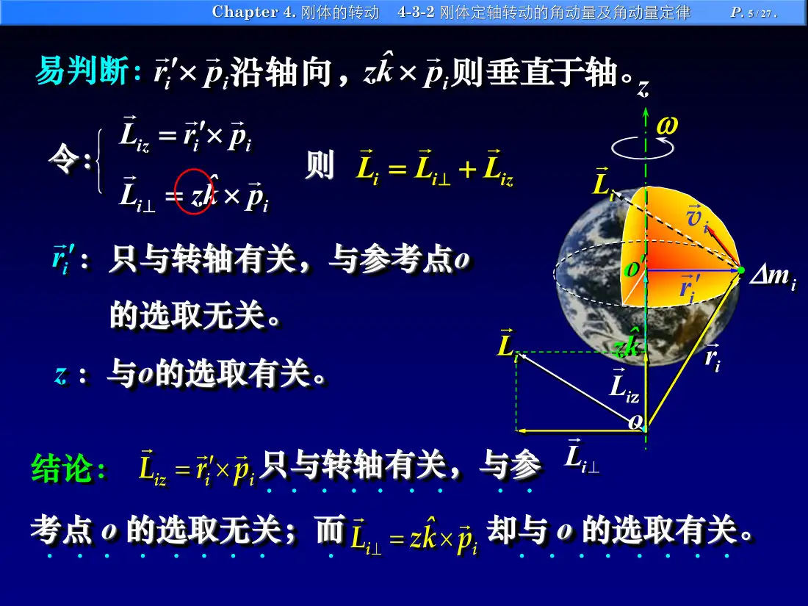

原文：

易判断: $\vec{r}_{i}^{\prime} \times \vec{p}_{i}$ 沿轴向, $z\hat{k} \times \vec{p}_{i}$ 则垂直于轴。

令： $\left\{\begin{array}{l}\vec{L}_{iz}=\vec{r}_{i}^{\prime}\times\vec{p}_{i}\\ \vec{L}_{i\perp}=z\hat{k}\times\vec{p}_{i}\end{array}\right.$ 则 $\vec{L}_{i}=\vec{L}_{i\perp}+\vec{L}_{iz}$

$\vec{r}_{i}^{\prime}$ ：只与转轴有关，与参考点 $o$ 的选取无关。

z：与o的选取有关。

结论： $\vec{L}_{iz} = \vec{r}_i' \times \vec{p}_i$ 只与转轴有关，与参 $L_{i\perp}$ 考点 $o$ 的选取无关；而 $\vec{L}_{i\perp} = z\hat{k} \times \vec{p}_i$ 却与 $o$ 的选取有关。

Chapter 4. 刚体的转动 4-3-2 刚体定轴转动的角动量及角动量定律

P. 5/27.

### 称其为：刚体对转轴角动量

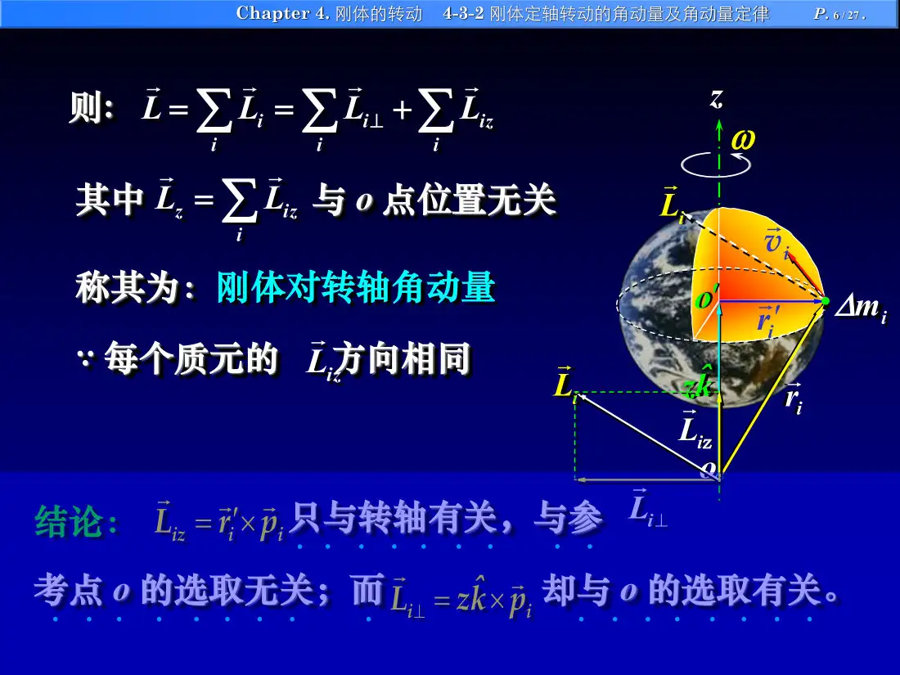

原文：

则： $\vec{L} = \sum_{i}\vec{L}_{i} = \sum_{i}\vec{L}_{i\perp} + \sum_{i}\vec{L}_{iz}$

其中 $\vec{L}_{z}=\sum_{i}\vec{L}_{iz}$ 与 o 点位置无关

称其为：刚体对转轴角动量

∵每个质元的 $\vec{L}_{iz}$ 方向相同

结论： $\vec{L}_{iz} = \vec{r}_i' \times \vec{p}_i$ 只与转轴有关，与参 $\vec{L}_{i\perp}$

考点 o 的选取无关；而 $\vec{L}_{i\perp}=z\hat{k}\times\vec{p}_{i}$ 却与 o 的选取有关。

Chapter 4. 刚体的转动 4-3-2 刚体定轴转动的角动量及角动量定律

P. 6/27.

### 称其为：刚体对转轴角动量

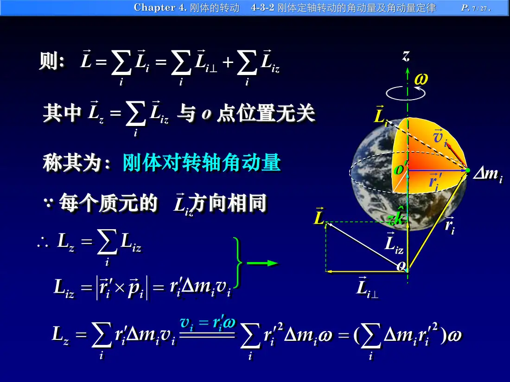

原文：

则： $\vec{L} = \sum_{i}\vec{L}_{i} = \sum_{i}\vec{L}_{i\perp} + \sum_{i}\vec{L}_{iz}$

其中 $\vec{L}_z = \sum_i\vec{L}_{iz}$ 与 $o$ 点位置无关

称其为：刚体对转轴角动量

∵每个质元的 $\vec{L}_{iz}$ 方向相同

$$
\therefore L _ {z} = \sum_ {i} L _ {i z}
$$

$$
\boldsymbol {L} _ {i z} = | \vec {r} _ {i} ^ {\prime} \times \vec {p} _ {i} | = r _ {i} ^ {\prime} \Delta m _ {i} v _ {i}
$$

$$
L _ {z} = \sum_ {i} r _ {i} ^ {\prime} \Delta m _ {i} v _ {i} \stackrel {v _ {i} = r _ {i} ^ {\prime} \omega} {=} \sum_ {i} r _ {i} ^ {\prime 2} \Delta m _ {i} \omega = (\sum_ {i} \Delta m _ {i} r _ {i} ^ {\prime 2}) \omega
$$

Chapter 4. 刚体的转动 4-3-2 刚体定轴转动的角动量及角动量定律

P. 7/27.

### $$

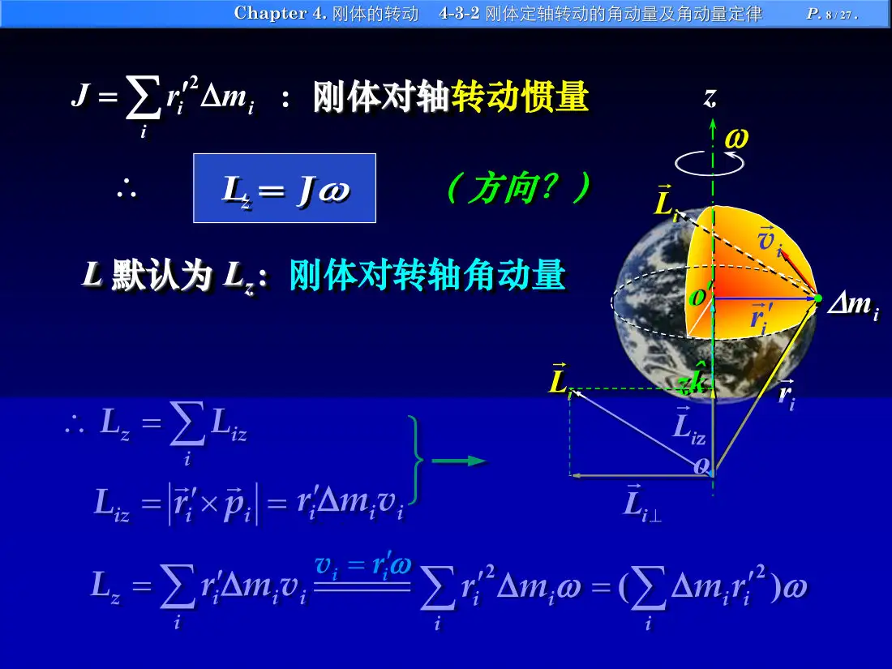

原文：

$J = \sum_{i} r_{i}^{\prime 2} \Delta m_{i}$ ：刚体对轴转动惯量

$$
L _ {z} = J \omega
$$

(方向？)

L 默认为 $L_{z}$ ：刚体对转轴角动量

$$
\therefore L _ {z} = \sum_ {i} L _ {i z}
$$

$$
L _ {i z} = | \vec {r} _ {i} ^ {\prime} \times \vec {p} _ {i} | = r _ {i} ^ {\prime} \Delta m _ {i} v _ {i}
$$

$$
L _ {z} = \sum_ {i} r _ {i} ^ {\prime} \Delta m _ {i} v _ {i} \stackrel {v _ {i} = r _ {i} ^ {\prime} \omega} {=} \sum_ {i} r _ {i} ^ {\prime 2} \Delta m _ {i} \omega = (\sum_ {i} \Delta m _ {i} r _ {i} ^ {\prime 2}) \omega
$$

Chapter 4. 刚体的转动 4-3-2 刚体定轴转动的角动量及角动量定律

P. 8/27.

### $$

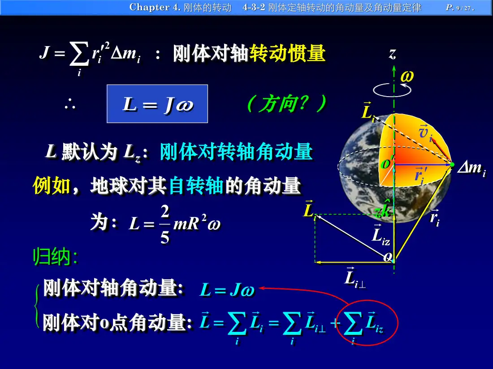

原文：

$J = \sum_{i} r_{i}^{\prime 2} \Delta m_{i}$ ：刚体对轴转动惯量

$$
L = J \omega
$$

(方向？)

L 默认为 $L_{z}$ ：刚体对转轴角动量例如，地球对其自转轴的角动量

为： $L=\frac{2}{5}mR^{2}\omega$

归纳：

刚体对轴角动量: $L = J \omega$

刚体对0点角动量: $\vec{L} = \sum_{i_1} \vec{L}_{i_i} = \sum_{i_i} \vec{L}_{i_\perp} + \sum_{i_i} \vec{L}_{iz}$

Chapter 4. 刚体的转动 4-3-2 刚体定轴转动的角动量及角动量定律

P. 9/27.

### 二、刚体定轴转动的角动量定理

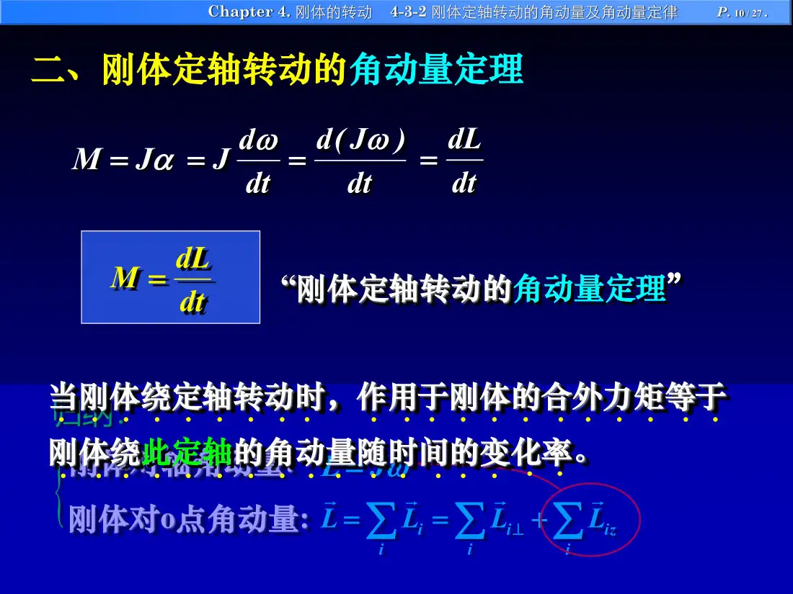

原文：

二、刚体定轴转动的角动量定理

$$
M = J \alpha = J \frac {d \omega}{d t} = \frac {d (J \omega)}{d t} = \frac {d L}{d t}
$$

$$
M = \frac {d L}{d t}
$$

“刚体定轴转动的角动量定理”

当刚体绕定轴转动时, 作用于刚体的合外力矩等于刚体绕此定轴的角动量随时间的变化率。

刚体对o点角动量: $\vec{L} = \sum_{i} \vec{L}_{i} = \sum_{i} \vec{L}_{i\perp} + \sum_{i} \vec{L}_{iz}$

Chapter 4. 刚体的转动 4-3-2 刚体定轴转动的角动量及角动量定律

P. 10 / 27.

### 或者写成： $Mdt = dL$

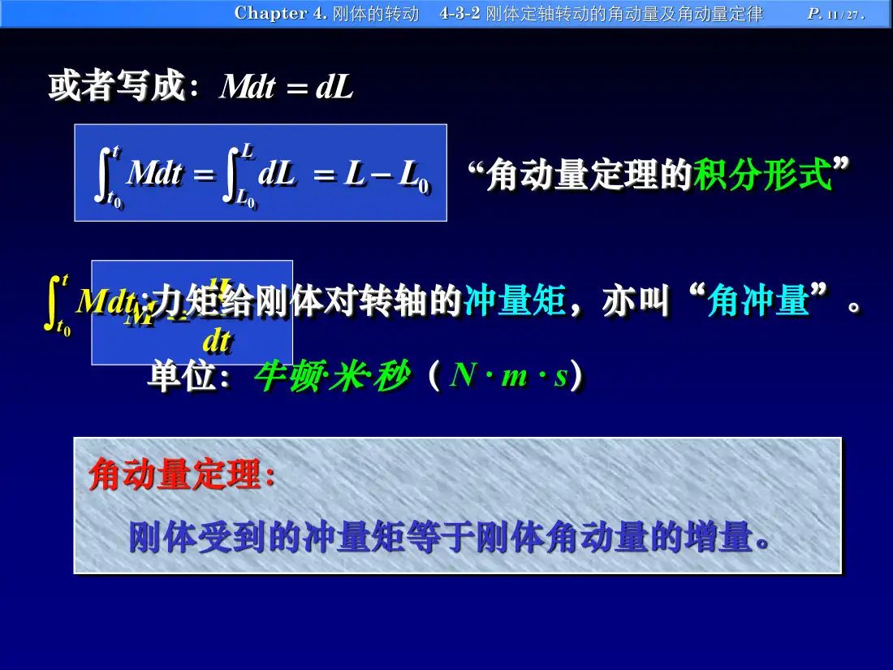

原文：

或者写成： $Mdt = dL$

$$
\int_ {t _ {0}} ^ {t} M d t = \int_ {L _ {0}} ^ {L} d L = L - L _ {0}
$$

“角动量定理的积分形式”

$Mdt_{M}$ 力矩给刚体对转轴的冲量矩，亦叫“角冲量”。

单位：牛顿米秒（N·m·s）

角动量定理:

刚体受到的冲量矩等于刚体角动量的增量。

Chapter 4. 刚体的转动 4-3-2 刚体定轴转动的角动量及角动量定律

P. 11 / 27.

### 或者写成: $Mdt = dL$

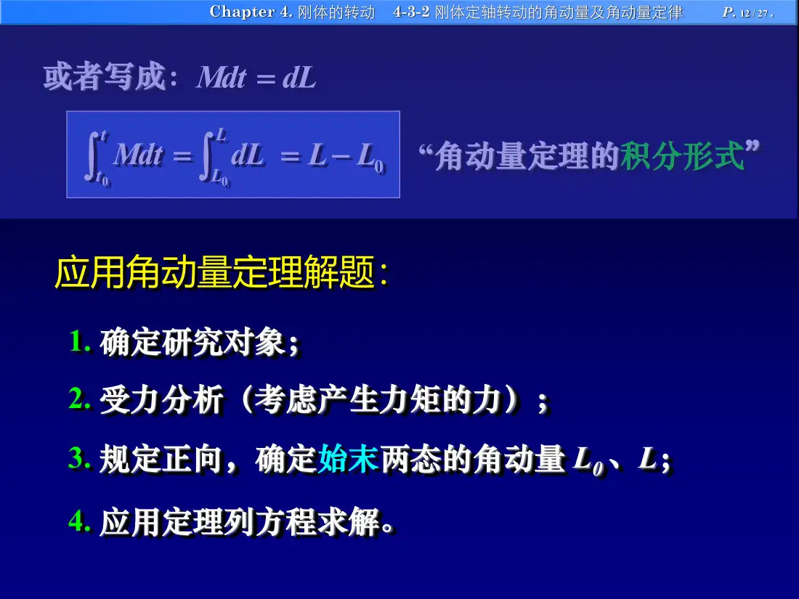

原文：

或者写成: $Mdt = dL$

$\int_{t_0}^{t} M dt = \int_{L_0}^{L} dL = L - L_0$ “角动量定理的积分形式”

应用角动量定理解题：

1. 确定研究对象；

2. 受力分析（考虑产生力矩的力）；

3. 规定正向，确定始末两态的角动量 $L_{0}$ 、 $L$ ;

4. 应用定理列方程求解。

Chapter 4. 刚体的转动 4-3-2 刚体定轴转动的角动量及角动量定律

P. 12 / 27.

### 解: 在冲击瞬间, 细杆未摆起, 只有力 $F$ 产生力矩, 可视为恒力矩。

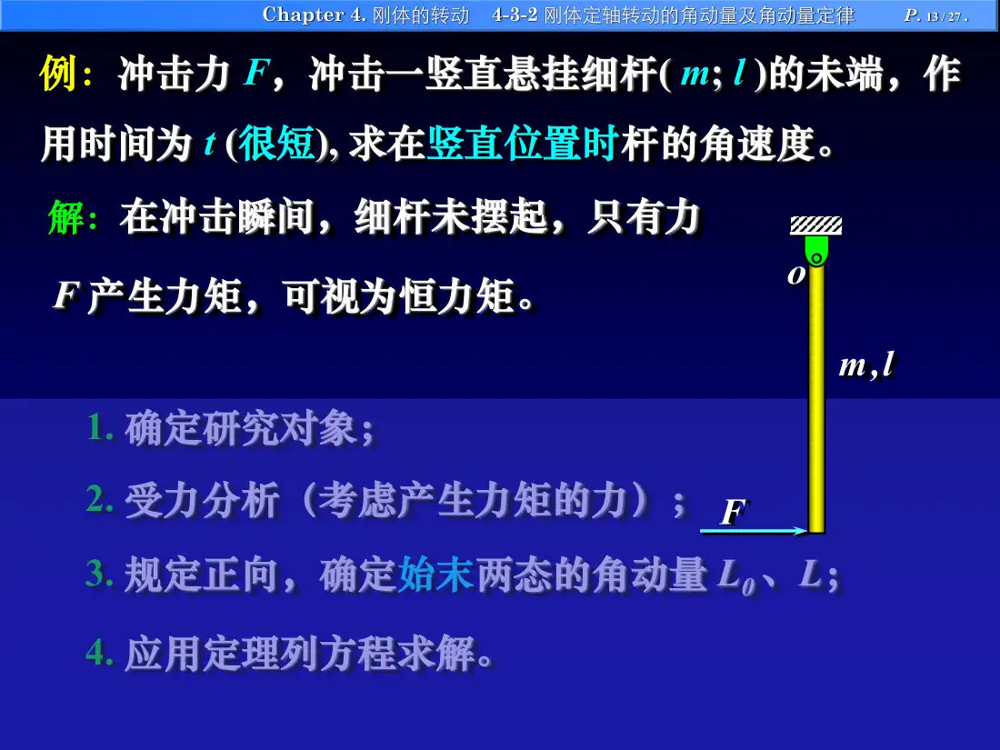

原文：

例: 冲击力 $F$ , 冲击一竖直悬挂细杆 $(m; l)$ 的末端, 作用时间为 $t$ (很短), 求在竖直位置时杆的角速度。

解: 在冲击瞬间, 细杆未摆起, 只有力 $F$ 产生力矩, 可视为恒力矩。

1. 确定研究对象；

2. 受力分析（考虑产生力矩的力）；F

3. 规定正向，确定始末两态的角动量 $L_{0}$ 、 $L$ ;

4. 应用定理列方程求解。

Chapter 4. 刚体的转动 4-3-2 刚体定轴转动的角动量及角动量定律

### 解：在冲击瞬间，细杆未摆起，只有力 $F$ 产生力矩，可视为恒力矩。

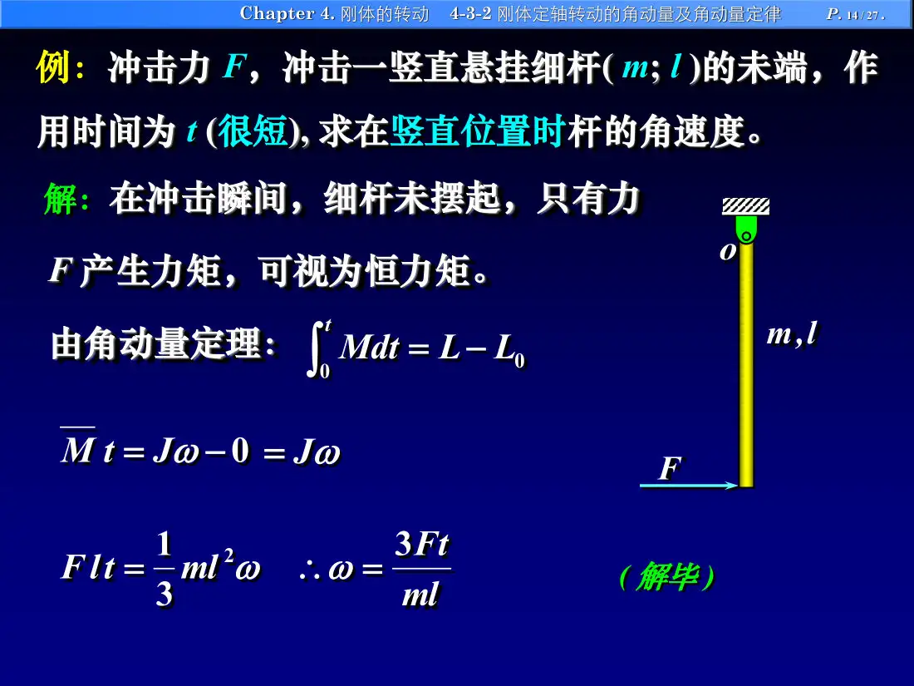

原文：

例: 冲击力 $F$ , 冲击一竖直悬挂细杆 $(m; l)$ 的末端, 作用时间为 $t$ (很短), 求在竖直位置时杆的角速度。

解：在冲击瞬间，细杆未摆起，只有力 $F$ 产生力矩，可视为恒力矩。

由角动量定理: $\int_0^t M dt = L - L_0$

$$
\overline {{M}} t = J \omega - 0 = J \omega
$$

$$
F l t = \frac {1}{3} m l ^ {2} \omega \quad \therefore \omega = \frac {3 F t}{m l}
$$

(解毕)

Chapter 4. 刚体的转动 4-3-2 刚体定轴转动的角动量及角动量定律

### $$

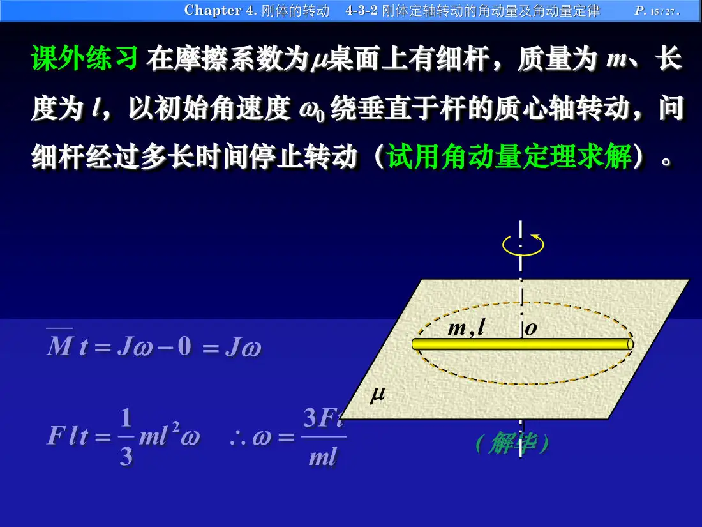

原文：

课外练习 在摩擦系数为 $\mu$ 桌面上有细杆, 质量为 $m$ 、长度为 $l$ , 以初始角速度 $\omega_0$ 绕垂直于杆的质心轴转动, 问细杆经过多长时间停止转动 (试用角动量定理求解)。

$$
\overline {{M}} t = J \omega - 0 = J \omega
$$

$$
F l t = \frac {1}{3} m l ^ {2} \omega \quad \therefore \omega = \frac {3 F t}{m l}
$$

(解学)

P. 15 / 27.

Chapter 4. 刚体的转动 4-3-2 刚体定轴转动的角动量及角动量定律

### 提示：如图取元，元摩擦力矩

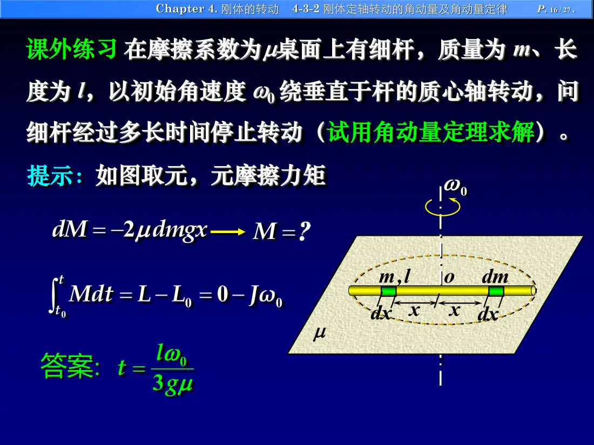

原文：

课外练习 在摩擦系数为 $\mu$ 桌面上有细杆, 质量为 $m$ 、长度为 $l$ , 以初始角速度 $\omega_0$ 绕垂直于杆的质心轴转动, 问细杆经过多长时间停止转动 (试用角动量定理求解)。

提示：如图取元，元摩擦力矩

$dM = -2\mu dmgx \rightarrow M = ?$

$$
\int_ {t _ {0}} ^ {t} M d t = L - L _ {0} = 0 - J \omega_ {0}
$$

答案: $t = \frac{l \omega_ {0}}{3 g \mu}$

Chapter 4. 刚体的转动 4-3-2 刚体定轴转动的角动量及角动量定律

P. 16 / 27.

### 三、刚体的角动量守恒定律

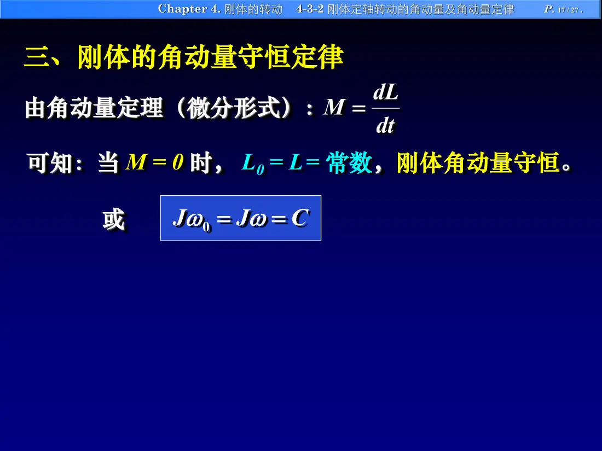

原文：

三、刚体的角动量守恒定律

由角动量定理（微分形式）: $M = \frac{dL}{dt}$

可知：当 M=0 时， $L_{0}=L=$ 常数，刚体角动量守恒。

或

$$
J \omega_ {0} = J \omega = C
$$

Chapter 4. 刚体的转动 4-3-2 刚体定轴转动的角动量及角动量定律

P. 17 / 27.

### 三、刚体的角动量守恒定律

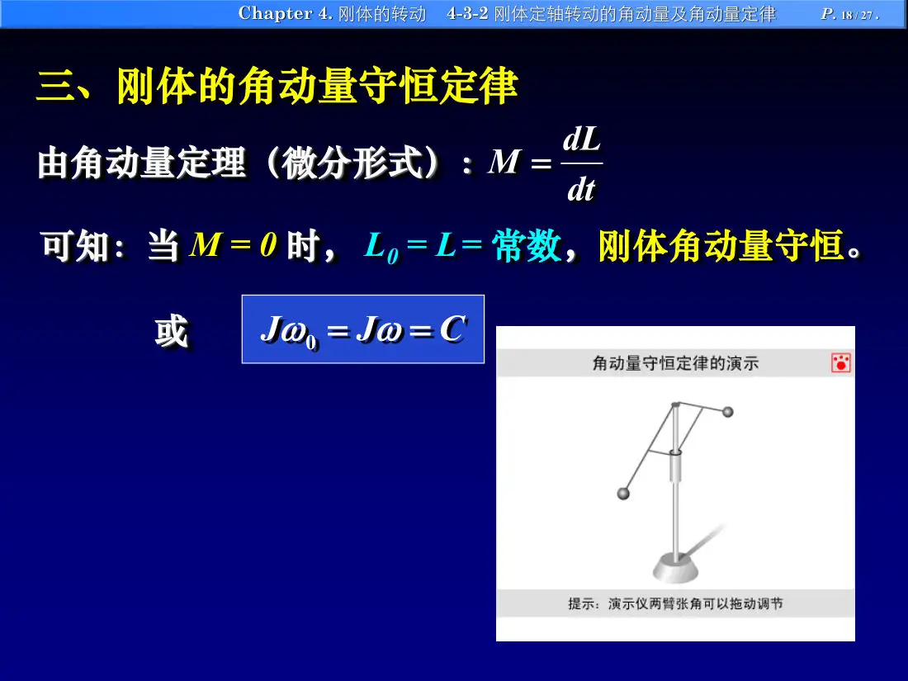

原文：

三、刚体的角动量守恒定律

由角动量定理（微分形式）： $M=\frac{dL}{dt}$

可知：当 M=0 时， $L_{0}=L=$ 常数，刚体角动量守恒。

或

$$
J \omega_ {0} = J \omega = C
$$

Chapter 4. 刚体的转动 4-3-2 刚体定轴转动的角动量及角动量定律

P. 18 / 27.

### 三、刚体的角动量守恒定律

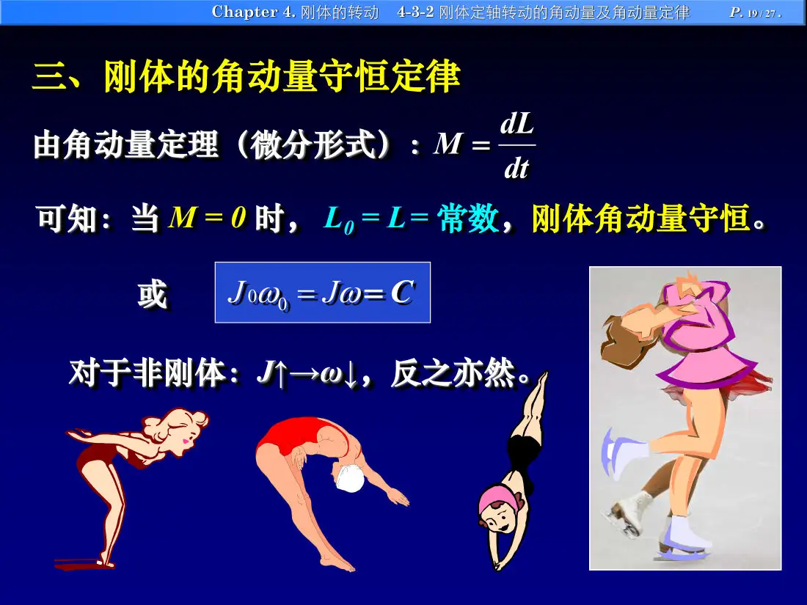

原文：

三、刚体的角动量守恒定律

由角动量定理（微分形式）: $M = \frac{dL}{dt}$

可知：当 M=0 时， $L_{0}=L=$ 常数，刚体角动量守恒。

或

$$
J _ {0} \omega_ {0} = J \omega = C
$$

对于非刚体: $J \uparrow \rightarrow \omega \downarrow$ , 反之亦然。

Chapter 4. 刚体的转动 4-3-2 刚体定轴转动的角动量及角动量定律

P. 19 / 27.

### 插播录像：

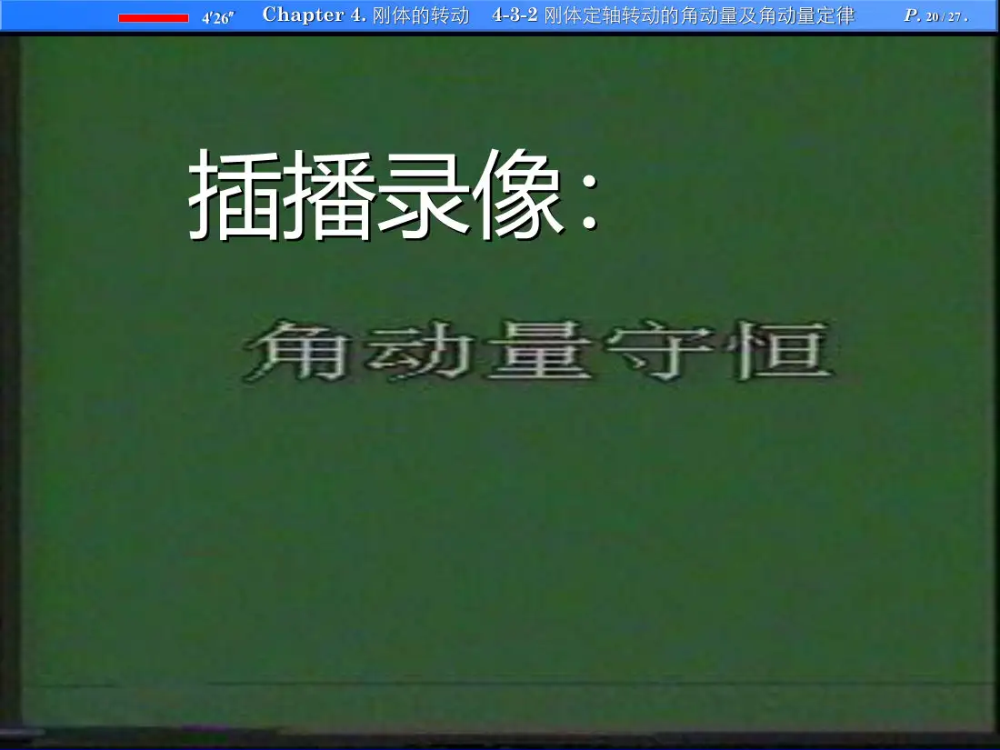

原文：

插播录像：

角动量守恒例：如图，匀质直棒: $l$ 、 $M$ ，一端挂在光滑水平轴而静止下垂。有一质量为 $m$ 的子弹一 $v_{0}$ 水平射入棒的下端而不复出。求棒和子弹开始一起运动时的角速度。

4'26" Chapter 4. 刚体的转动 4-3-2 刚体定轴转动的角动量及角动量定律

P. 20 / 27.

### 解: 子弹和棒组成的系统受重力、轴作用力，动量不守恒，但角动量守恒：

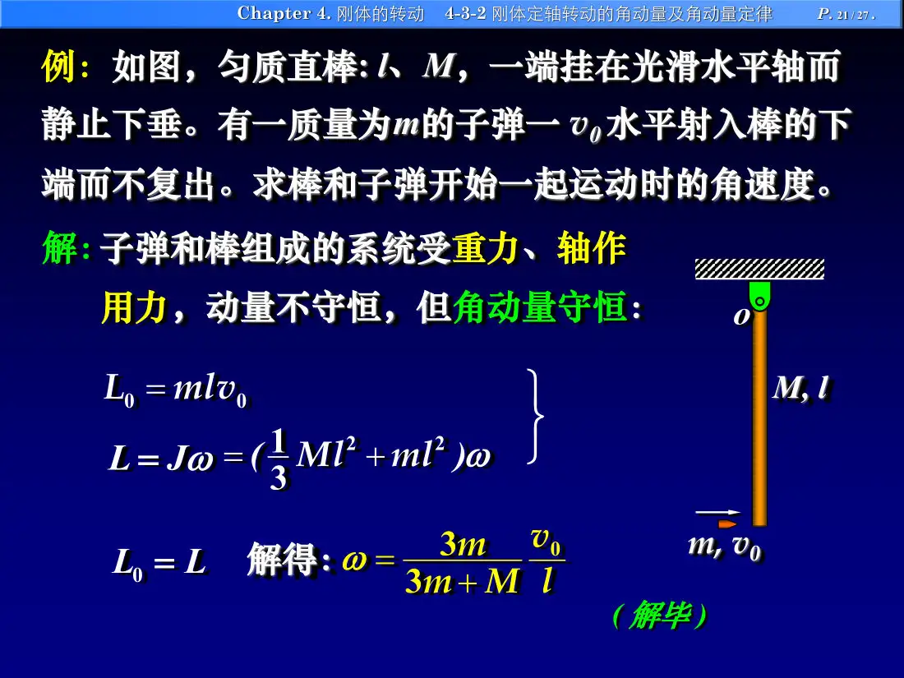

原文：

解: 子弹和棒组成的系统受重力、轴作用力，动量不守恒，但角动量守恒：

$$
L _ {0} = m l v _ {0}
$$

$$
L = J \omega = (\frac {1}{3} M l ^ {2} + m l ^ {2}) \omega
$$

$$
L _ {0} = L
$$

解得: $\omega=\frac{3m}{3m+M}\frac{v_{0}}{l}$

(解毕)

P. 21 / 27.

Chapter 4. 刚体的转动 4-3-2 刚体定轴转动的角动量及角动量定律

### 解: 人和转台组成的系统, 外力对转轴的的力矩为零, 即系统对轴角动量守恒:

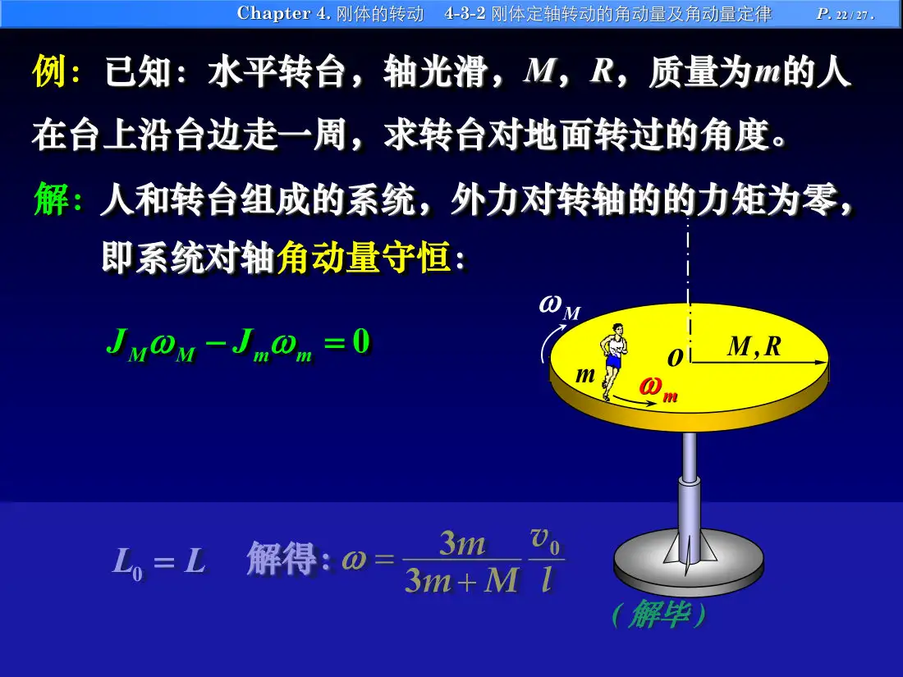

原文：

例：已知：水平转台，轴光滑，M，R，质量为m的人在台上沿台边走一周，求转台对地面转过的角度。

解: 人和转台组成的系统, 外力对转轴的的力矩为零, 即系统对轴角动量守恒:

$$
J _ {M} \omega_ {M} - J _ {m} \omega_ {m} = 0
$$

$L_{0}=L$ 解得: $\omega=\frac{3m}{3m+M}\frac{v_{0}}{l}$

(解毕)

Chapter 4. 刚体的转动 4-3-2 刚体定轴转动的角动量及角动量定律

### 解: 人和转台组成的系统, 外力对转轴的的力矩为零, 即系统对轴角动量守恒:

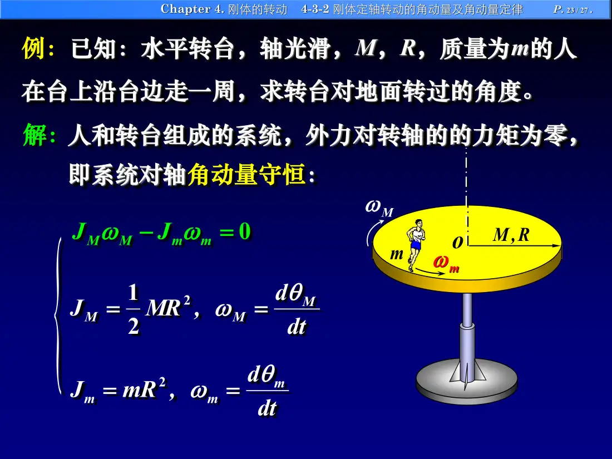

原文：

例：已知：水平转台，轴光滑，M，R，质量为m的人在台上沿台边走一周，求转台对地面转过的角度。

解: 人和转台组成的系统, 外力对转轴的的力矩为零, 即系统对轴角动量守恒:

$$
J _ {M} \omega_ {M} - J _ {m} \omega_ {m} = 0
$$

$$
J _ {M} = \frac {1}{2} M R ^ {2}, \omega_ {M} = \frac {d \theta_ {M}}{d t}
$$

$$
J _ {m} = m R ^ {2}, \omega_ {m} = \frac {d \theta_ {m}}{d t}
$$

Chapter 4. 刚体的转动 4-3-2 刚体定轴转动的角动量及角动量定律

P. 23 / 27.

### $$

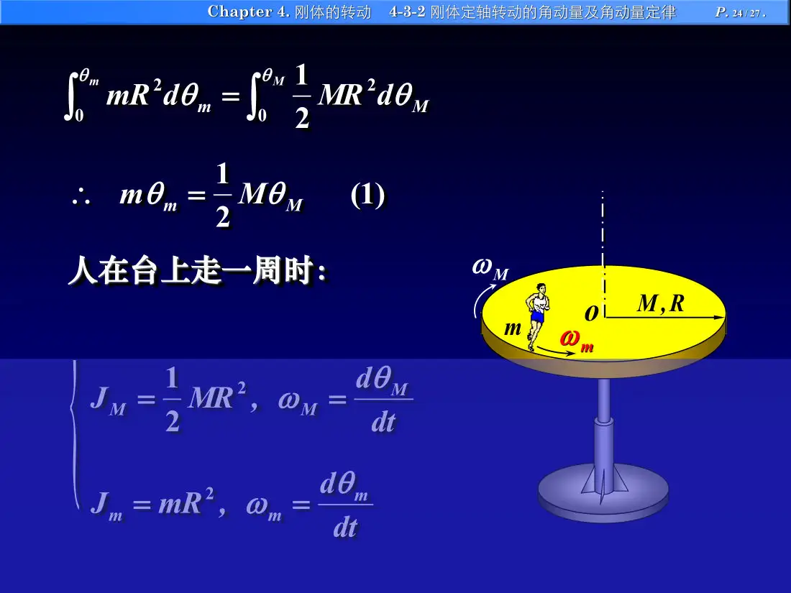

原文：

$$
\int_ {0} ^ {\theta_ {m}} m R ^ {2} d \theta_ {m} = \int_ {0} ^ {\theta_ {M}} \frac {1}{2} M R ^ {2} d \theta_ {M}
$$

$$
\therefore m \theta_ {m} = \frac {1}{2} M \theta_ {M}\tag{1}
$$

人在台上走一周时：

$$
J _ {M} = \frac {1}{2} M R ^ {2}, \omega_ {M} = \frac {d \theta_ {M}}{d t}
$$

$$
J _ {m} = m R ^ {2}, \omega_ {m} = \frac {d \theta_ {m}}{d t}
$$

Chapter 4. 刚体的转动 4-3-2 刚体定轴转动的角动量及角动量定律

P. 24 / 27.

### $$

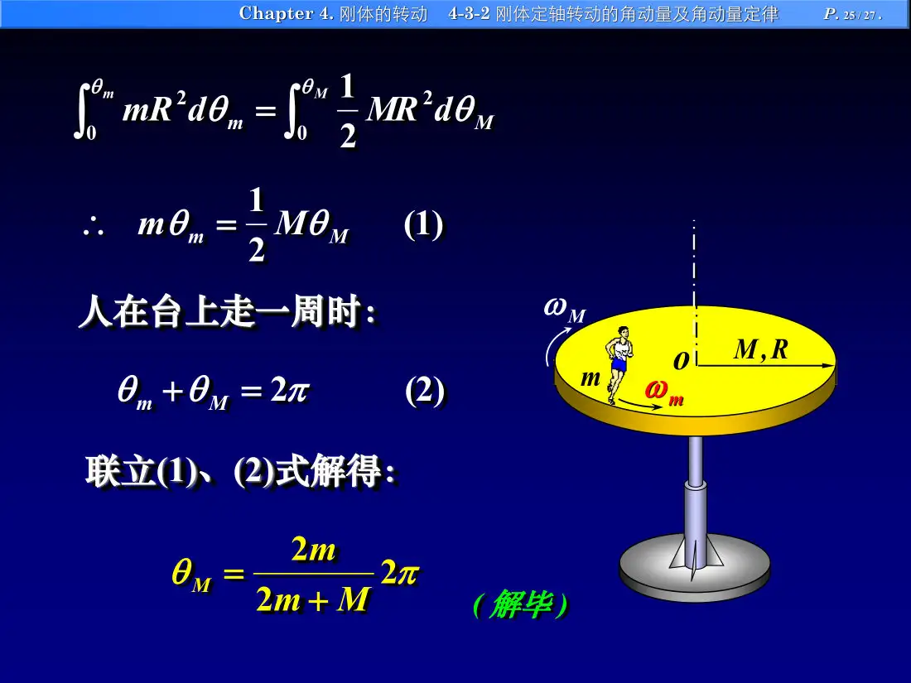

原文：

$$
\int_ {0} ^ {\theta_ {m}} m R ^ {2} d \theta_ {m} = \int_ {0} ^ {\theta_ {M}} \frac {1}{2} M R ^ {2} d \theta_ {M}
$$

$$
\therefore m \theta_ {m} = \frac {1}{2} M \theta_ {M}\tag{1}
$$

人在台上走一周时:

$$
\theta_ {m} + \theta_ {M} = 2 \pi\tag{2}
$$

联立(1)、(2)式解得:

$$
\theta_ {M} = \frac {2 m}{2 m + M} 2 \pi
$$

(解毕)

Chapter 4. 刚体的转动 4-3-2 刚体定轴转动的角动量及角动量定律

P. 25 / 27.

### 归纳:

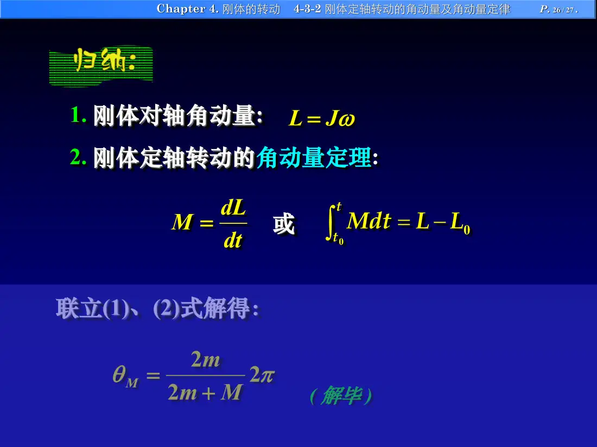

原文：

归纳:

1. 刚体对轴角动量: $L = J \omega$

2. 刚体定轴转动的角动量定理:

$$
M = \frac {d L}{d t} \quad \text {或} \quad \int_ {t _ {0}} ^ {t} M d t = L - L _ {0}
$$

联立(1)、(2)式解得:

$$
\theta_ {M} = \frac {2 m}{2 m + M} 2 \pi
$$

(解毕)

Chapter 4. 刚体的转动 4-3-2 刚体定轴转动的角动量及角动量定律

P. 26 / 27.

### 归纳:

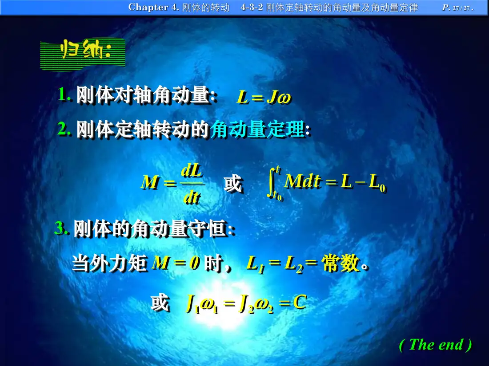

原文：

归纳:

1. 刚体对轴角动量: $L = J \omega$

2. 刚体定轴转动的角动量定理:

$M = \frac{dL}{dt}$ 或 $\int_{t_0}^{t_t}Mdt = L - L_0$

3. 刚体的角动量守恒:
当外力矩 M=0 时, $L_{1}=L_{2}=$ 常数。

或 $J_{1}\omega_{1}=J_{2}\omega_{2}=C$

Chapter 4. 刚体的转动 4-3-2 刚体定轴转动的角动量及角动量定律

P. 27 / 27.

(The end)
