# 《大学物理》第4章 刚体的转动 4-4 刚体定轴转动的功和能（课件）

原件的每一页，下面附识别出的文字。

### 4- 4 刚体定轴转动的功和能

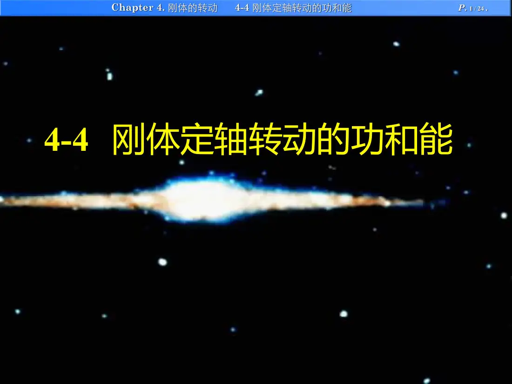

原文：

4- 4 刚体定轴转动的功和能

Chapter 4. 刚体的转动 4-4 刚体定轴转动的功和能

P. 1/24.

### 考察外力对刚体做的功

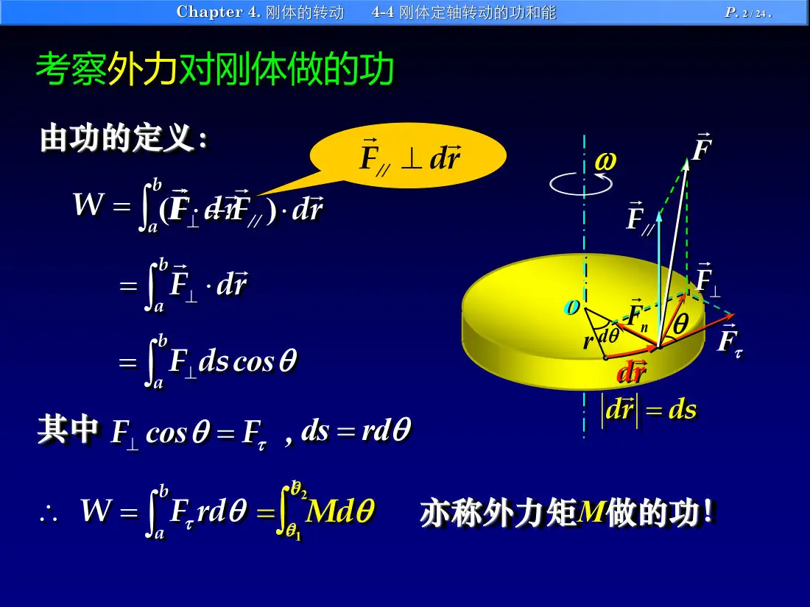

原文：

考察外力对刚体做的功

由功的定义:

$$
\vec {F} _ {/ /} \perp d \vec {r}
$$

$$
\begin{array}{r l} W & = \int_ {a} ^ {b} (\vec {F} _ {\perp} \cdot d \vec {r} \vec {F} _ {/ /}) \cdot d \vec {r} \\ & = \int_ {a} ^ {b} \vec {F} _ {\perp} \cdot d \vec {r} \\ & = \int_ {a} ^ {b} F _ {\perp} d s \cos \theta \end{array}
$$

其中 $F_{\perp}\cos\theta=F_{\tau}$ ，ds=rdθ

∴ $W = \int_{a}^{b} F_{\tau} r d\theta = \int_{\theta_{1}}^{\theta_{2}} M d\theta$ 亦称外力矩M做的功!

Chapter 4. 刚体的转动 4-4 刚体定轴转动的功和能

P. 2/24.

### 一、力矩的功

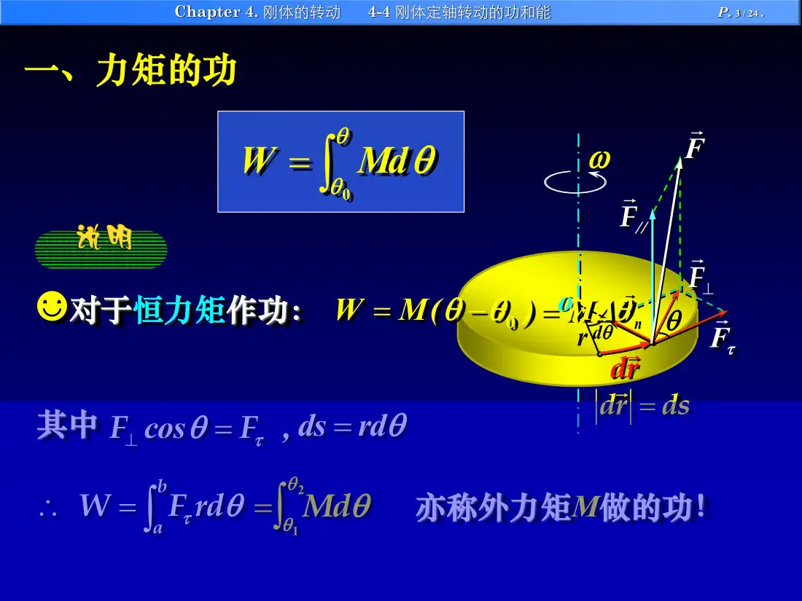

原文：

一、力矩的功

$$
W = \int_ {\theta_ {0}} ^ {\theta} M d \theta
$$

说明

对于恒力矩作功： $W = M(\theta - \theta_0) = M\left[\Delta \vec{\theta}_n\right]$

其中 $F_{\perp}\cos\theta=F_{\tau}$ ，ds=rdθ

$$
| \vec {d r} | = d s
$$

∴ $W = \int_{a}^{b} F_{\tau} rd \theta = \int_{\theta_{1}}^{\theta_{2}} M d\theta$ 亦称外力矩M做的功!

Chapter 4. 刚体的转动 4-4 刚体定轴转动的功和能

P. 3/24.

### 一、力矩的功

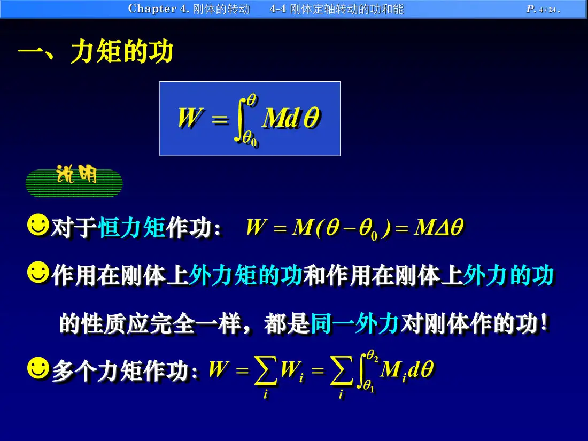

原文：

一、力矩的功

$$
W = \int_ {\theta_ {0}} ^ {\theta} M d \theta
$$

说明

对于恒力矩作功： $W = M(\theta - \theta_{0}) = M\Delta\theta$

作用在刚体上外力矩的功和作用在刚体上外力的功的性质应完全一样，都是同一外力对刚体作的功！多个力矩作功： $W = \sum_{i} W_{i} = \sum_{i} \int_{\theta_{1}}^{\theta_{2}} M_{i} d\theta$

Chapter 4. 刚体的转动 4-4 刚体定轴转动的功和能

P. 4/24.

### 二、力矩的功率

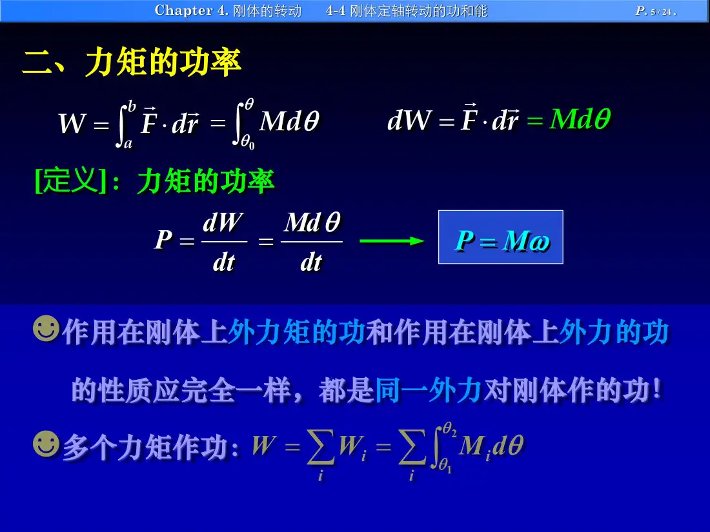

原文：

二、力矩的功率

$$
W = \int_ {a} ^ {b} \vec {F} \cdot d \vec {r} = \int_ {\theta_ {0}} ^ {\theta} M d \theta
$$

$$
d W = \vec {F} \cdot d \vec {r} = M d \theta
$$

[定义]：力矩的功率

$$
P = \frac {d W}{d t} = \frac {M d \theta}{d t} \longrightarrow P \equiv M \omega
$$

作用在刚体上外力矩的功和作用在刚体上外力的功

的性质应完全一样，都是同一外力对刚体作的功！

😊多个力矩作功: $W = \sum_{i} W_{i} = \sum_{i} \int_{\theta_{1}}^{\theta_{2}} M_{i} d\theta$

Chapter 4. 刚体的转动 4-4 刚体定轴转动的功和能

P. 5/24.

### 二、力矩的功率

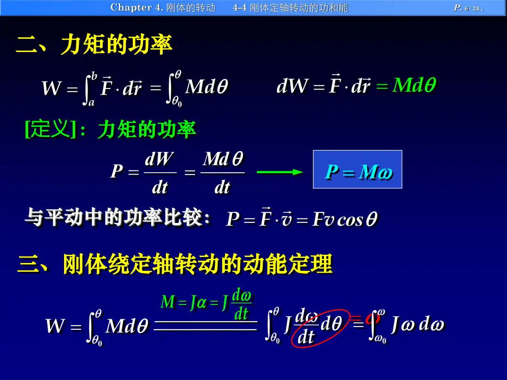

原文：

二、力矩的功率

$$
W = \int_ {a} ^ {b} \vec {F} \cdot d \vec {r} = \int_ {\theta_ {0}} ^ {\theta} M d \theta \quad d W = \vec {F} \cdot d \vec {r} = M d \theta
$$

[定义]：力矩的功率

$$
P = \frac {d W}{d t} = \frac {M d \theta}{d t} \longrightarrow P \equiv M \omega
$$

与平动中的功率比较: $P = \vec{F} \cdot \vec{v} = F v \cos \theta$

三、刚体绕定轴转动的动能定理

$$
W = \int_ {\theta_ {0}} ^ {\theta} M d \theta \stackrel {M = J \alpha = J \frac {d \omega}{d t}} {=} \int_ {\theta_ {0}} ^ {\theta} J \frac {d \omega}{d t} d \theta \equiv \int_ {\omega_ {0}} ^ {\omega} J \omega d \omega
$$

Chapter 4. 刚体的转动 4-4 刚体定轴转动的功和能

P. 6/24.

### $$

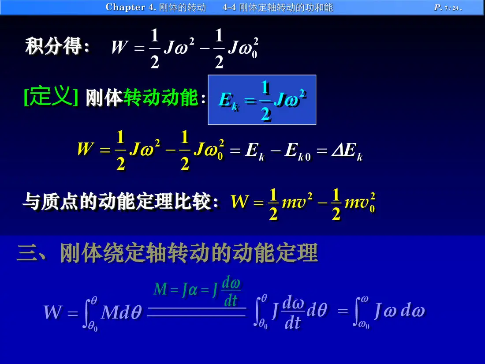

原文：

积分得: $W = \frac{1}{2} J \omega^2 - \frac{1}{2} J \omega_0^2$

[定义] 刚体转动动能: $E_{k} = \frac{1}{2} J\omega^{2}$

$$
W = \frac {1}{2} J \omega^ {2} - \frac {1}{2} J \omega_ {0} ^ {2} = E _ {k} - E _ {k 0} = \Delta E _ {k}
$$

与质点的动能定理比较: $W = \frac{1}{2} m v^{2} - \frac{1}{2} m v_{0}^{2}$

三、刚体绕定轴转动的动能定理

$$
W = \int_ {\theta_ {0}} ^ {\theta} M d \theta \xlongequal {M = J \alpha = J \frac {d \omega}{d t}} \int_ {\theta_ {0}} ^ {\theta} J \frac {d \omega}{d t} d \theta = \int_ {\omega_ {0}} ^ {\omega} J \omega d \omega
$$

Chapter 4. 刚体的转动 4-4 刚体定轴转动的功和能

P. 7/24.

### $$

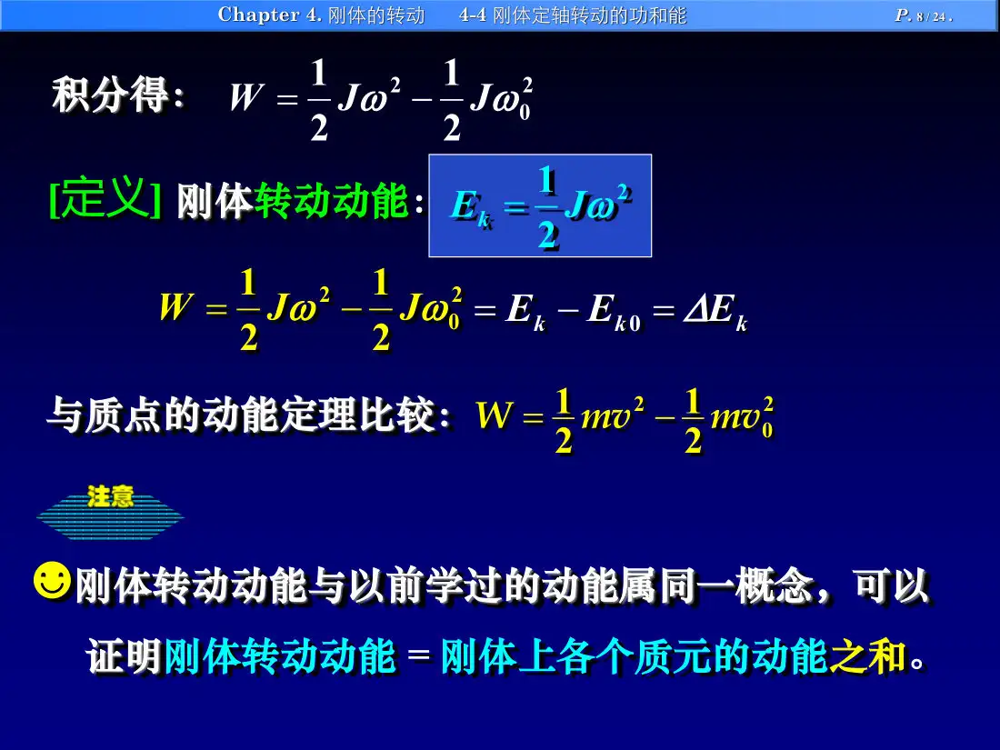

原文：

积分得: $W = \frac{1}{2} J \omega^2 - \frac{1}{2} J \omega_0^2$

[定义] 刚体转动动能: $E_{k} = \frac{1}{2} J\omega^{2}$

$$
W = \frac {1}{2} J \omega^ {2} - \frac {1}{2} J \omega_ {0} ^ {2} = E _ {k} - E _ {k 0} = \Delta E _ {k}
$$

与质点的动能定理比较: $W = \frac{1}{2} m v^{2} - \frac{1}{2} m v_{0}^{2}$

😊刚体转动动能与以前学过的动能属同一概念，可以证明刚体转动动能 = 刚体上各个质元的动能之和。

Chapter 4. 刚体的转动 4-4 刚体定轴转动的功和能

P. 8/24.

### 四、应用转动动能定理解题方法

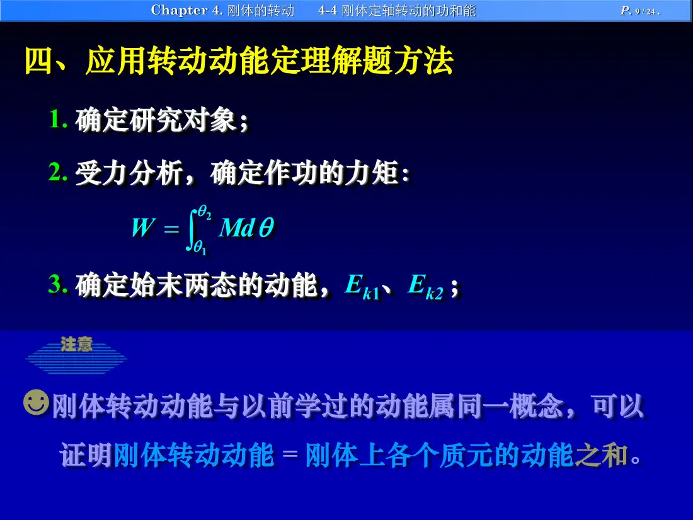

原文：

四、应用转动动能定理解题方法

1. 确定研究对象;

2. 受力分析，确定作功的力矩：

$$
W = \int_ {\theta_ {1}} ^ {\theta_ {2}} M d \theta
$$

3. 确定始末两态的动能， $E_{k1}$ 、 $E_{k2}$ ;

注意

😊刚体转动动能与以前学过的动能属同一概念，可以证明刚体转动动能 = 刚体上各个质元的动能之和。

Chapter 4. 刚体的转动 4-4 刚体定轴转动的功和能

P. 9/24.

### 四、应用转动动能定理解题方法

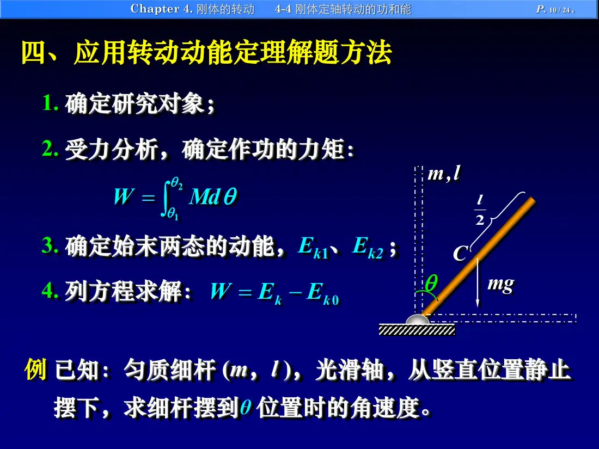

原文：

四、应用转动动能定理解题方法

1. 确定研究对象；

2. 受力分析，确定作功的力矩：

$$
W = \int_ {\theta_ {1}} ^ {\theta_ {2}} M d \theta
$$

3. 确定始末两态的动能， $E_{k1}$ 、 $E_{k2}$ ;

4. 列方程求解: $W = E_{k} - E_{k0}$

例 已知：匀质细杆 $(m, l)$ ，光滑轴，从竖直位置静止摆下，求细杆摆到 $\theta$ 位置时的角速度。

Chapter 4. 刚体的转动 4-4 刚体定轴转动的功和能

P. 10 / 24.

### 解：只有重力矩，且重力矩随摆角变化而变化。

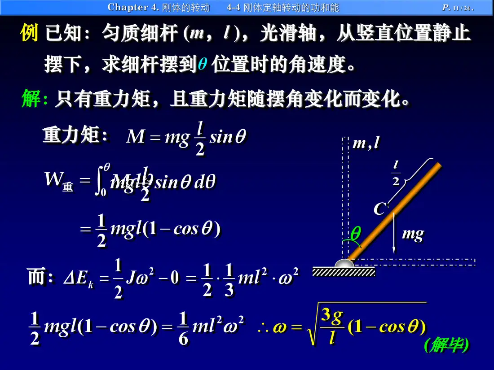

原文：

例 已知: 匀质细杆 $(m, l)$ , 光滑轴, 从竖直位置静止摆下, 求细杆摆到 $\theta$ 位置时的角速度。

解：只有重力矩，且重力矩随摆角变化而变化。

重力矩: $M = m g \frac{l}{2} \sin \theta$

$$
\begin{array}{r l} W _ {\text {重}} & = \int_ {0} ^ {\theta} m g d \frac {b}{2} \sin \theta d \theta \\ & = \frac {1}{2} m g l (1 - \cos \theta) \end{array}
$$

而： $\Delta E_{k}=\frac{1}{2}J\omega^{2}-0=\frac{1}{2}\cdot\frac{1}{3}ml^{2}\cdot\omega^{2}$

$$
\frac {1}{2} m g l (1 - \cos \theta) = \frac {1}{6} m l ^ {2} \omega^ {2} \quad \therefore \omega = \sqrt {\frac {3 g}{l}} (1 - \cos \theta)
$$

Chapter 4. 刚体的转动 4-4 刚体定轴转动的功和能

P. 11/24.

(解毕)

### 分析：以圆盘为研究对象，只有摩擦力矩作功。

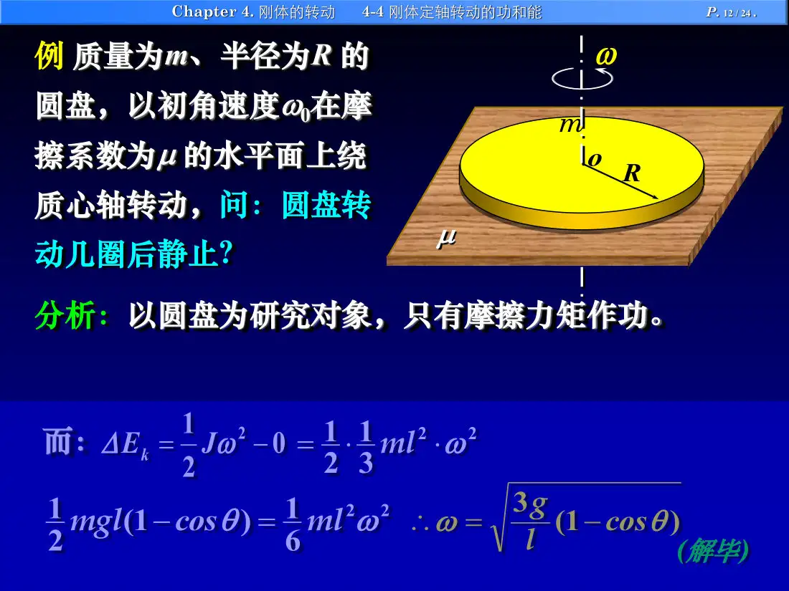

原文：

例 质量为m、半径为R的圆盘，以初角速度 $\omega_{0}$ 在摩擦系数为 $\mu$ 的水平面上绕质心轴转动，问：圆盘转动几圈后静止？

分析：以圆盘为研究对象，只有摩擦力矩作功。

而： $\Delta E_{k}=\frac{1}{2}J\omega^{2}-0=\frac{1}{2}\cdot\frac{1}{3}ml^{2}\cdot\omega^{2}$ $\frac{1}{2}mgl(1-\cos\theta)=\frac{1}{6}ml^{2}\omega^{2}\quad\therefore\omega=\sqrt{\frac{3g}{l}(1-\cos\theta)}$ 例 质量为m、半径为R的圆盘，以初角速度 $\omega_{0}$ 在摩擦系数为 $\mu$ 的水平面上绕质心轴转动，问：圆盘转动几圈后静止？

Chapter 4. 刚体的转动 4-4 刚体定轴转动的功和能

P. 12 / 24.

(解毕)

### 分析：以圆盘为研究对象，只有

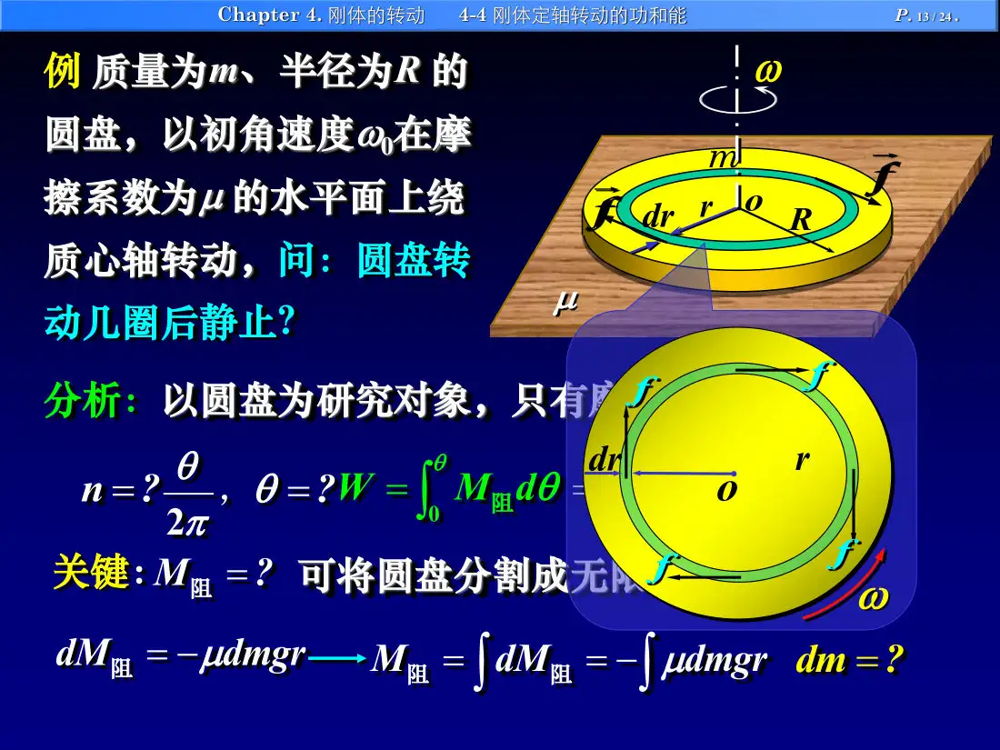

原文：

分析：以圆盘为研究对象，只有

$$
n = ? \frac {\theta}{2 \pi}, \quad \theta = ? W = \int_ {0} ^ {\theta} M _ {\text {阻}} d \theta =
$$

关键: $M_{\text {阻}} = ?$ 可将圆盘分割成无

$$
d M _ {\text {阻}} = - \mu d m g r \longrightarrow M _ {\text {阻}} = \int d M _ {\text {阻}} = - \int \mu d m g r d m = ?
$$

Chapter 4. 刚体的转动 4-4 刚体定轴转动的功和能

P. 13 / 24.

### 解: 将圆盘分割成无限多个圆环, 则

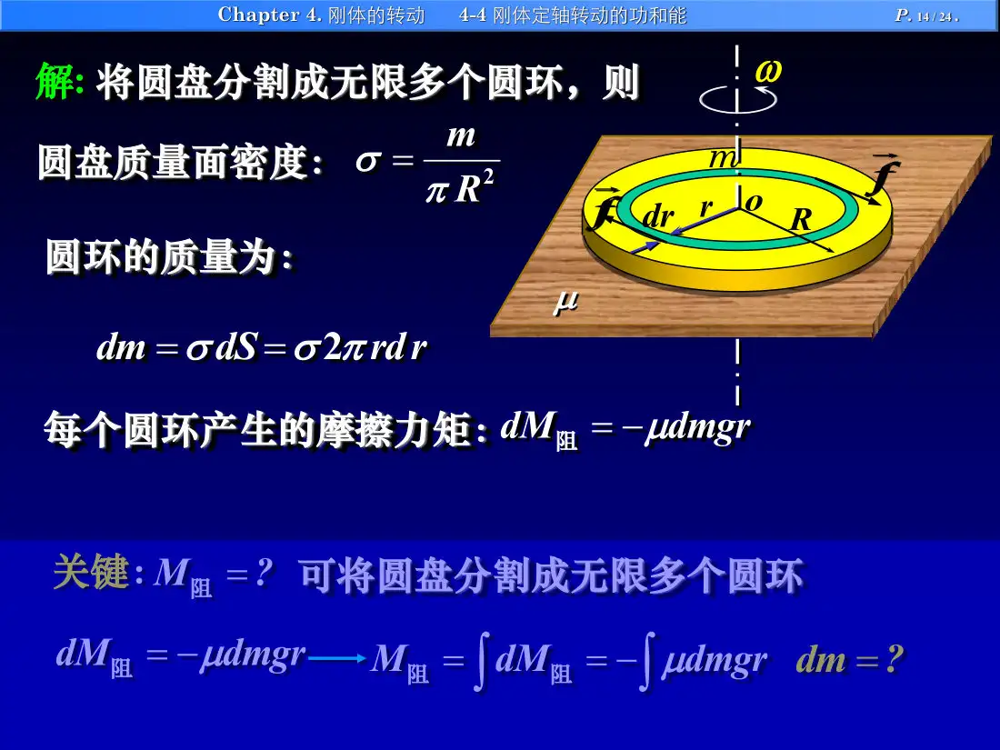

原文：

解: 将圆盘分割成无限多个圆环, 则

圆盘质量面密度: $\sigma = \frac{m}{\pi R^{2}}$

圆环的质量为:

$$
d m = \sigma d S = \sigma 2 \pi r d r
$$

每个圆环产生的摩擦力矩: $dM_{\text {阻}} = -\mu d m g r$

关键: $M_{\text {阻}} = ?$ 可将圆盘分割成无限多个圆环

$$
d M _ {\text {阻}} = - \mu d m g r \longrightarrow M _ {\text {阻}} = \int d M _ {\text {阻}} = - \int \mu d m g r d m = ?
$$

Chapter 4. 刚体的转动 4-4 刚体定轴转动的功和能

P. 14 / 24.

### 解: 将圆盘分割成无限多个圆环, 则

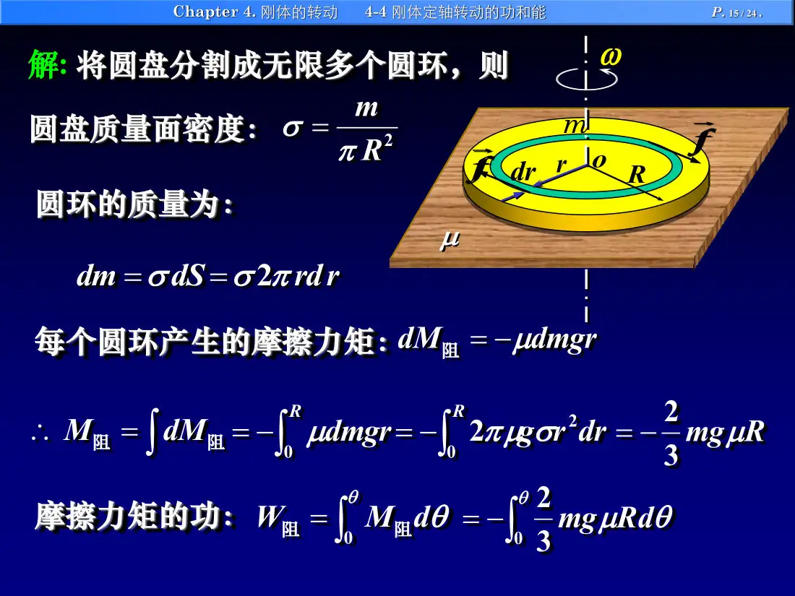

原文：

解: 将圆盘分割成无限多个圆环, 则

圆盘质量面密度: $\sigma = \frac{m}{\pi R^{2}}$

圆环的质量为:

$$
d m = \sigma d S = \sigma 2 \pi r d r
$$

每个圆环产生的摩擦力矩: $dM_{\text {阻}} = -\mu dmgr$

$$
\therefore M _ {\text {阻}} = \int d M _ {\text {阻}} = - \int_ {0} ^ {R} \mu d m g r = - \int_ {0} ^ {R} 2 \pi \mu g \sigma r ^ {2} d r = - \frac {2}{3} m g \mu R
$$

摩擦力矩的功: $W_{\text {阻}} = \int_0^\theta M_{\text {阻}}d\theta = -\int_0^\theta \frac{2}{3} mg\mu Rd\theta$

Chapter 4. 刚体的转动 4-4 刚体定轴转动的功和能

P. 15 / 24.

### 始末两态动能:

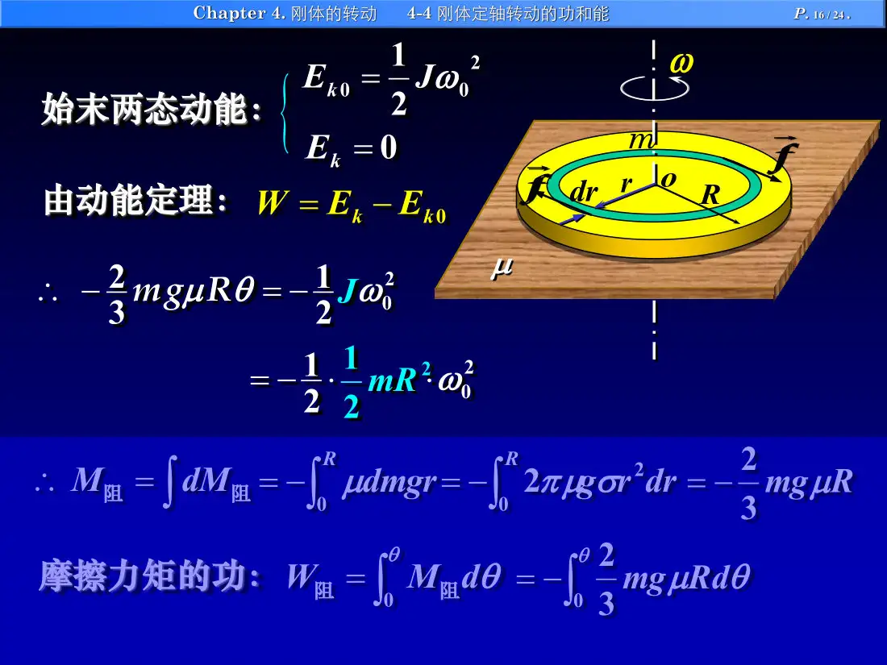

原文：

始末两态动能:

$$
\left\{ \begin{array}{l} E _ {k 0} = \frac {1}{2} J \omega_ {0} ^ {2} \\ E _ {k} = 0 \end{array} \right.
$$

由动能定理: $W = E_{k} - E_{k0}$

$$
\begin{array}{r l} \therefore - \frac {2}{3} m g \mu R \theta & = - \frac {1}{2} J \omega_ {0} ^ {2} \\ & = - \frac {1}{2} \cdot \frac {1}{2} m R ^ {2} \cdot \omega_ {0} ^ {2} \end{array}
$$

$$
\therefore M _ {\text {阻}} = \int d M _ {\text {阻}} = - \int_ {0} ^ {R} \mu d m g r = - \int_ {0} ^ {R} 2 \pi \mu g \sigma r ^ {2} d r = - \frac {2}{3} m g \mu R
$$

摩擦力矩的功: $W_{\text {阻}} = \int_0^\theta M_{\text {阻}}d\theta = -\int_0^\theta \frac{2}{3} mg\mu Rd\theta$

Chapter 4. 刚体的转动 4-4 刚体定轴转动的功和能

### 始末两态动能:

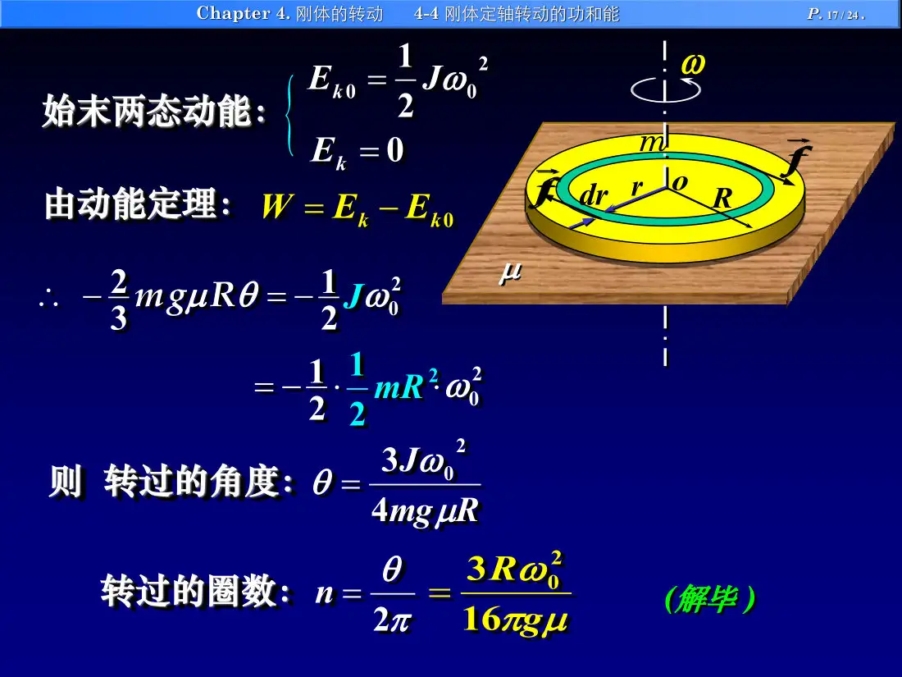

原文：

始末两态动能:

$$
\left\{ \begin{array}{l} E _ {k 0} = \frac {1}{2} J \omega_ {0} ^ {2} \\ E _ {k} = 0 \end{array} \right.
$$

由动能定理: $W = E_{k} - E_{k0}$

$$
\therefore - \frac {2}{3} m g \mu R \theta = - \frac {1}{2} J \omega_ {0} ^ {2}
$$

$$
= - \frac {1}{2} \cdot \frac {1}{2} m R ^ {2} \cdot \omega_ {0} ^ {2}
$$

则 转过的角度: $\theta = \frac{3J\omega_{0}^{2}}{4mg\mu R}$

转过的圈数: $n = \frac{\theta}{2\pi} = \frac{3R\omega_0^2}{16\pi g\mu}$

(解毕)

Chapter 4. 刚体的转动 4-4 刚体定轴转动的功和能

### 五、刚体的机械能守恒

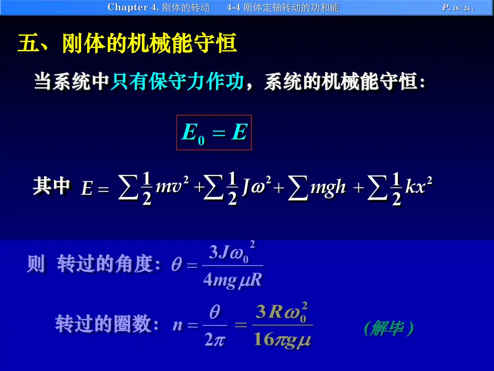

原文：

五、刚体的机械能守恒
当系统中只有保守力作功，系统的机械能守恒：

$$
E _ {0} \equiv E
$$

其中 $E = \sum \frac{1}{2} mv^2 +\sum \frac{1}{2} J\omega^2 +\sum mgh + \sum \frac{1}{2} kx^2$

则 转过的角度: $\theta = \frac{3J\omega_{0}^{2}}{4mg\mu R}$

转过的圈数: $n = \frac{\theta}{2 \pi} = \frac{3 R \omega_0^2}{16 \pi g \mu}$

(解毕)

Chapter 4. 刚体的转动 4-4 刚体定轴转动的功和能

P. 18 / 24.

### 五、刚体的机械能守恒

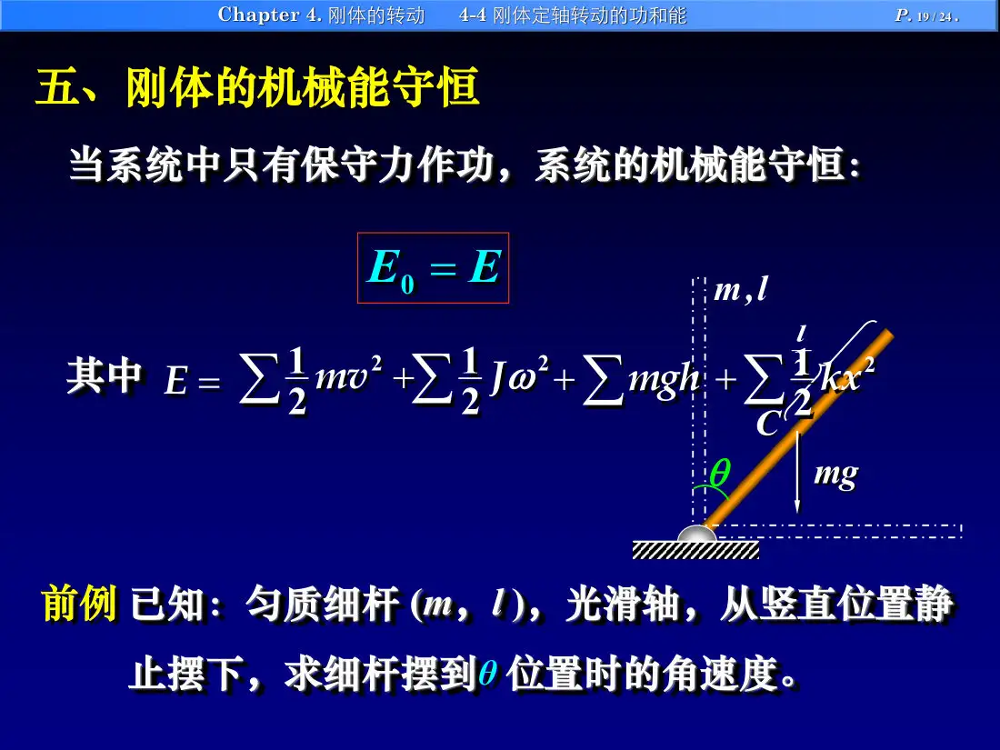

原文：

五、刚体的机械能守恒

当系统中只有保守力作功，系统的机械能守恒：

$$
E _ {0} \equiv E
$$

其中 $E = \sum \frac{1}{2} mv^2 +\sum \frac{1}{2} J\omega^2 +\sum mgh + \sum \frac{1}{2} kx^2$

前例 已知：匀质细杆 $(m, l)$ ，光滑轴，从竖直位置静止摆下，求细杆摆到 $\theta$ 位置时的角速度。

P. 19 / 24.

Chapter 4. 刚体的转动 4-4 刚体定轴转动的功和能

### 解：以杆、地球为一系统，则系统机械能守恒：

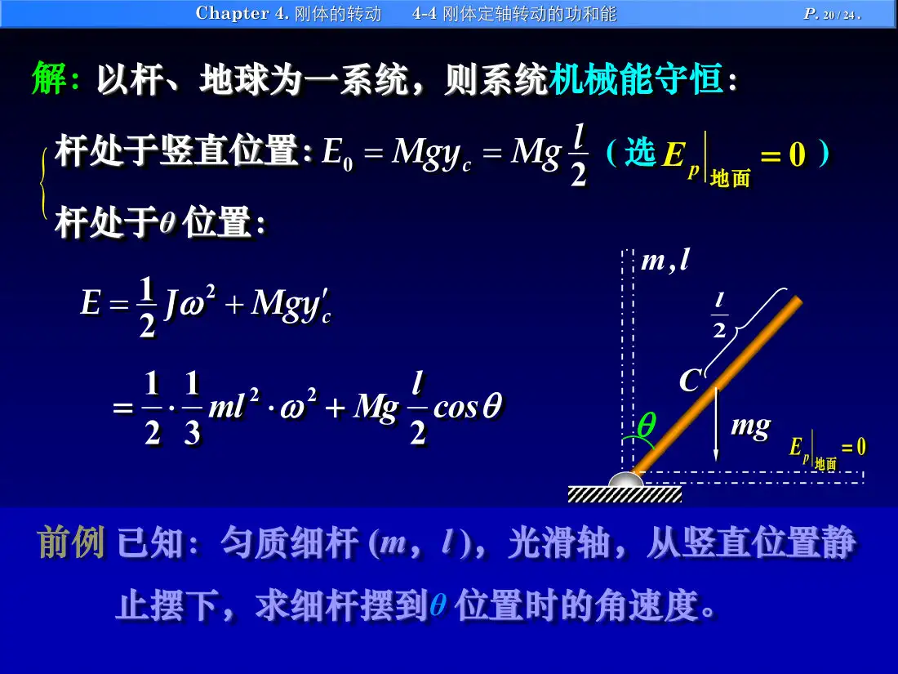

原文：

解：以杆、地球为一系统，则系统机械能守恒：

杆处于竖直位置: $E_{0}=Mgy_{c}=Mg\frac{l}{2}$ (选 $E_{p}\big|_{地面}=0$ )
杆处于θ位置:

$$
\begin{array}{r l} & E = \frac {1}{2} J \omega^ {2} + M g y _ {c} ^ {\prime} \\ & = \frac {1}{2} \cdot \frac {1}{3} m l ^ {2} \cdot \omega^ {2} + M g \frac {l}{2} \cos \theta \end{array}
$$

前例 已知: 匀质细杆 $(m, l)$ , 光滑轴, 从竖直位置静止摆下, 求细杆摆到 $\theta$ 位置时的角速度。

Chapter 4. 刚体的转动 4-4 刚体定轴转动的功和能

P. 20 / 24.

### 解：以杆、地球为一系统，则系统机械能守恒：

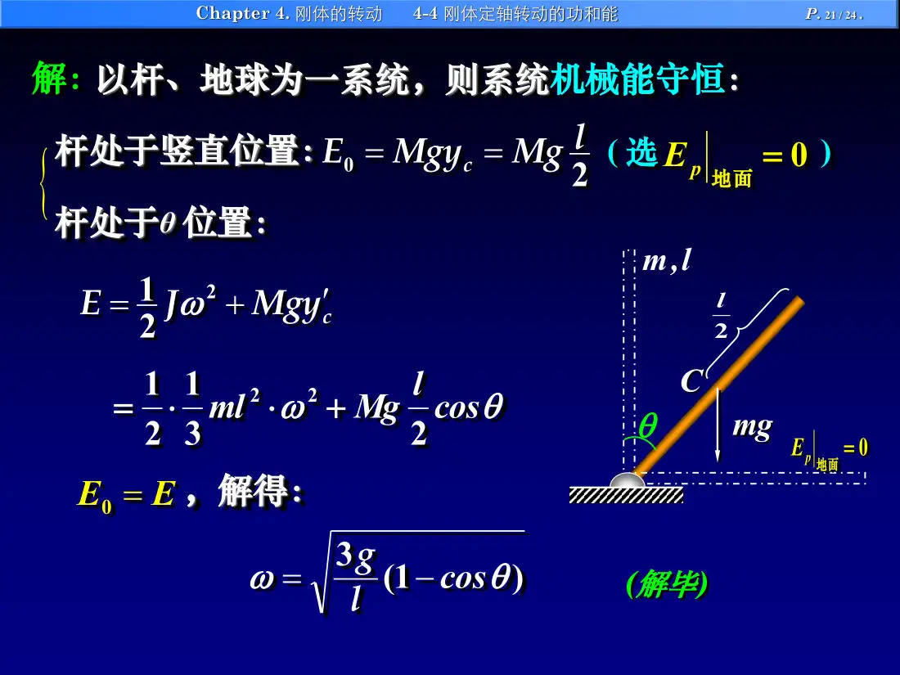

原文：

解：以杆、地球为一系统，则系统机械能守恒：

杆处于竖直位置: $E_{0} = Mgy_{c} = Mg\frac{l}{2}$ （选 $E_{p}\bigg|_{\text{地面}} = 0$ ）杆处于 $\theta$ 位置：

$$
\begin{array}{r l} & E = \frac {1}{2} J \omega^ {2} + M g y _ {c} ^ {\prime} \\ & = \frac {1}{2} \cdot \frac {1}{3} m l ^ {2} \cdot \omega^ {2} + M g \frac {l}{2} \cos \theta \\ & E _ {0} = E, \text {解得:} \end{array}
$$

$$
\omega = \sqrt {\frac {3 g}{l} (1 - \cos \theta)}
$$

(解毕)

P. 21 / 24.

Chapter 4. 刚体的转动 4-4 刚体定轴转动的功和能

### 提示: 系统 = 弹簧 + 滑轮 + 物体 + 地球:

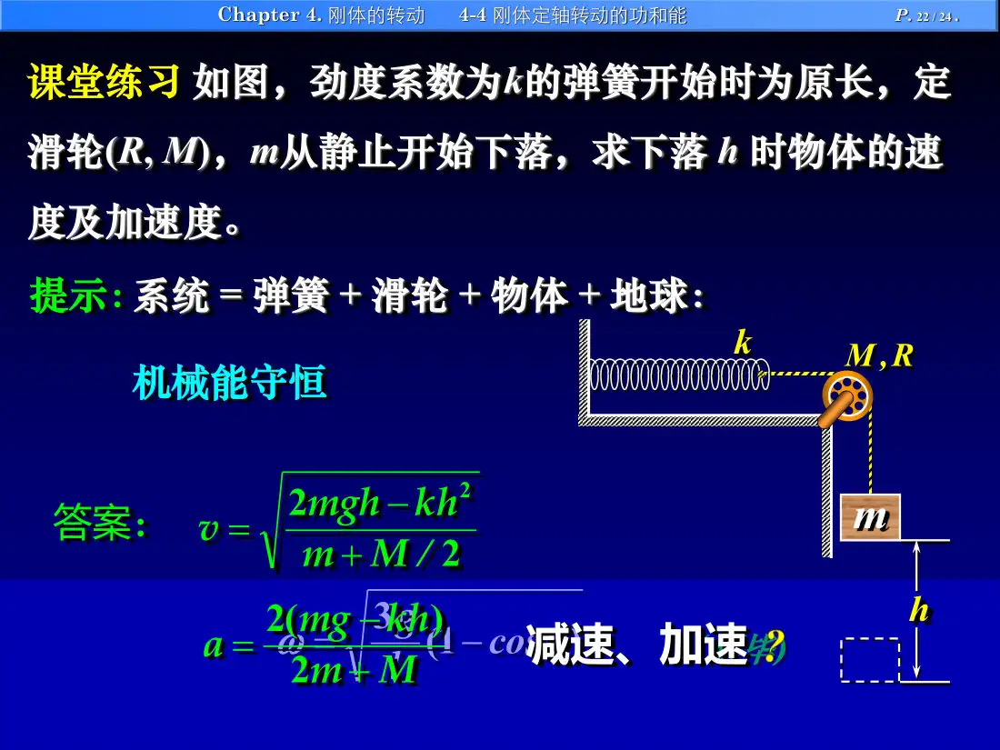

原文：

课堂练习 如图，劲度系数为 $k$ 的弹簧开始时为原长，定滑轮 $(R, M)$ ， $m$ 从静止开始下落，求下落 $h$ 时物体的速度及加速度。

提示: 系统 = 弹簧 + 滑轮 + 物体 + 地球:

机械能守恒

答案:

$$
v = \sqrt {\frac {2 m g h - k h ^ {2}}{m + M / 2}}
$$

$a=\frac{2(mg-3kh)}{2m+M}(1-cos$ 减速、加速？

P. 22 / 24.

Chapter 4. 刚体的转动 4-4 刚体定轴转动的功和能

### 归纳

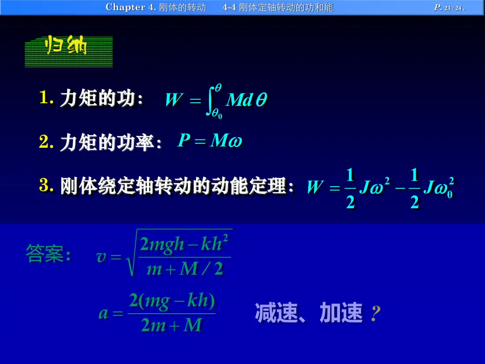

原文：

归纳

1. 力矩的功: $W = \int_{\theta_0}^{\theta} M d \theta$

2. 力矩的功率: $P = M \omega$

3. 刚体绕定轴转动的动能定理: $W = \frac{1}{2} J \omega^2 - \frac{1}{2} J \omega_0^2$

答案: $v = \sqrt{\frac{2mgh - kh^2}{m + M / 2}}$

$$
a = \frac {2 (m g - k h)}{2 m + M}
$$

减速、加速？

Chapter 4. 刚体的转动 4-4 刚体定轴转动的功和能

P. 23 / 24.

### 归纳

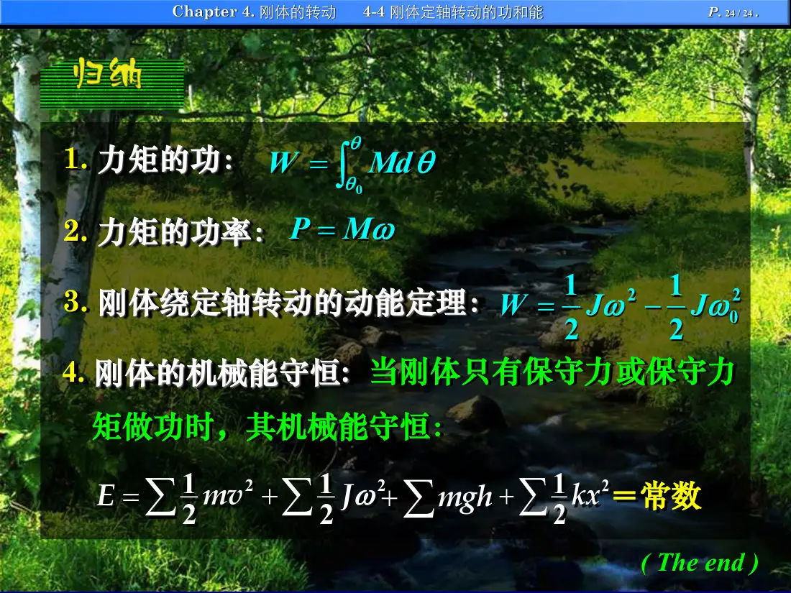

原文：

归纳

1. 力矩的功: $W = \int_{\theta_0}^{\theta} M d \theta$

2. 力矩的功率: $P = M \omega$

3. 刚体绕定轴转动的动能定理: $W = \frac{1}{2} J \omega^2 - \frac{1}{2} J \omega_0^2$

4. 刚体的机械能守恒: 当刚体只有保守力或保守力矩做功时, 其机械能守恒:

$E = \sum \frac{1}{2} mv^{2} + \sum \frac{1}{2} J\omega^{2} + \sum mgh + \sum \frac{1}{2} kx^{2} = \text{常数}$

Chapter 4. 刚体的转动 4-4 刚体定轴转动的功和能

P. 24 / 24.
