# 《大学物理》第4章 刚体的转动 §4.2 力矩 转动定律（课件）

原件的每一页，下面附识别出的文字。

### § 4.3 力矩 转动定律

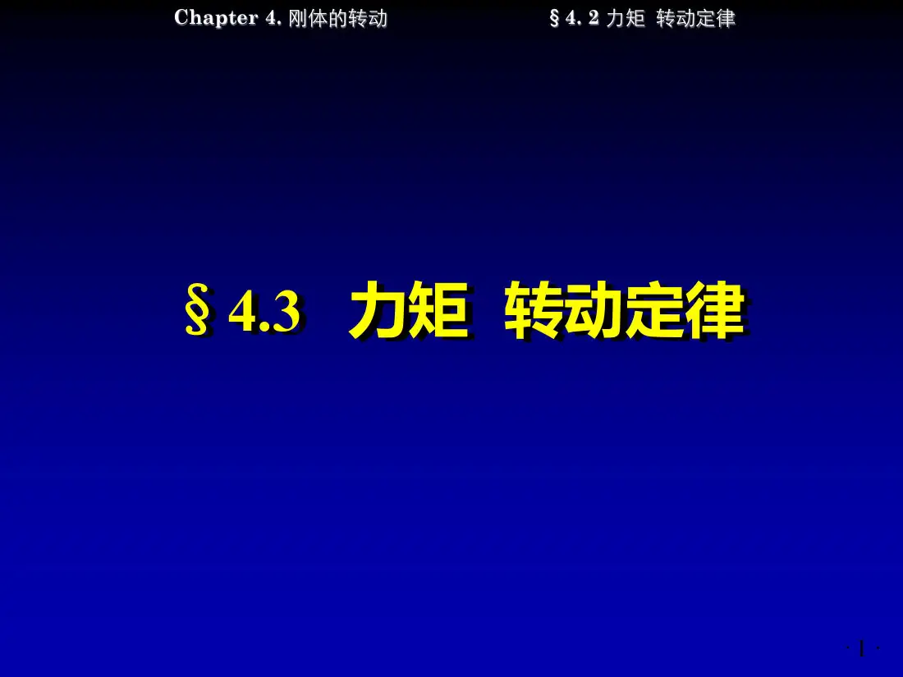

原文：

§ 4.3 力矩 转动定律

Chapter 4. 刚体的转动

§ 4.2 力矩 转动定律

### Chapter 4. 刚体的转动

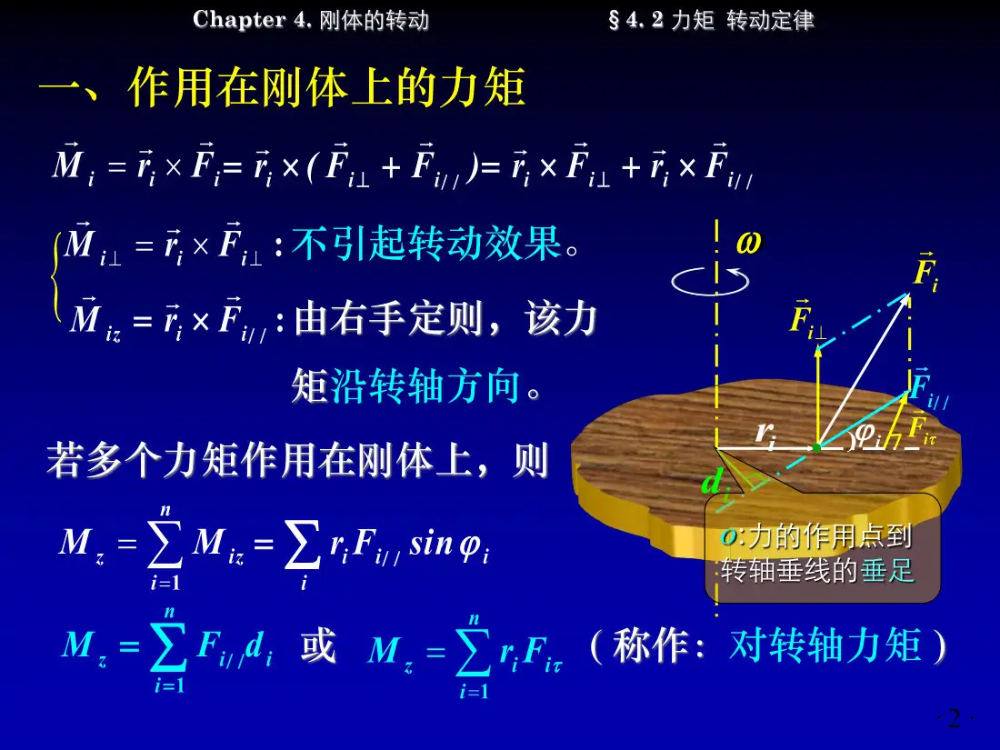

原文：

Chapter 4. 刚体的转动

§ 4.2 力矩 转动定律

一、作用在刚体上的力矩

$$
\vec {M} _ {i} = \vec {r} _ {i} \times \vec {F} _ {i} = \vec {r} _ {i} \times (\vec {F} _ {i \perp} + \vec {F} _ {i / /}) = \vec {r} _ {i} \times \vec {F} _ {i \perp} + \vec {r} _ {i} \times \vec {F} _ {i / /}
$$

$\vec{M}_{i\perp} = \vec{r}_i\times \vec{F}_{i\perp}$ ：不引起转动效果。

$\vec{M}_{iz} = \vec{r}_i \times \vec{F}_{i//}$ : 由右手定则，该力矩沿转轴方向。

若多个力矩作用在刚体上，则

$$
M _ {z} = \sum_ {i = 1} ^ {n} M _ {i z} = \sum_ {i} r _ {i} F _ {i / /} \sin \varphi_ {i}
$$

o:力的作用点到转轴垂线的垂足

$M_{z}=\sum_{i=1}^{n}F_{i//}d_{i}$ 或 $M_{z}=\sum_{i=1}^{n}r_{i}F_{i\tau}$ （称作：对转轴力矩）

2

### Chapter 4. 刚体的转动

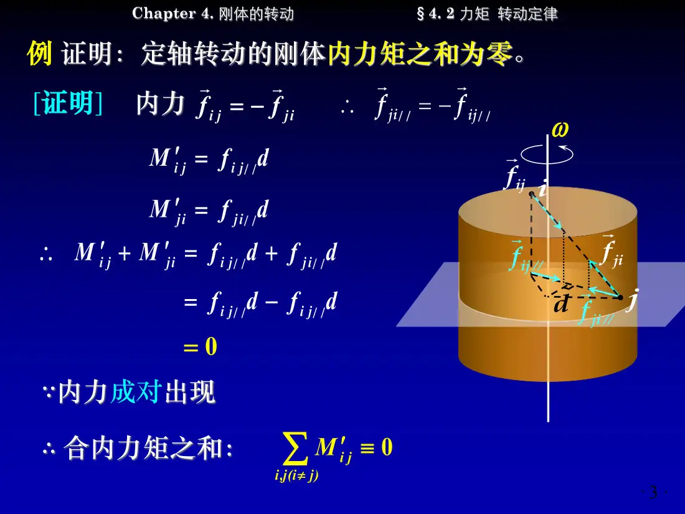

原文：

Chapter 4. 刚体的转动

§ 4.2 力矩 转动定律

例 证明：定轴转动的刚体内力矩之和为零。

[证明] 内力 $\vec{f}_{ij} = -\vec{f}_{ji}$ $\therefore \vec{f}_{ji//} = -\vec{f}_{ij//}$

$$
M _ {i j} ^ {\prime} = f _ {i j / /} d
$$

$$
M _ {j i} ^ {\prime} = f _ {j i / /} d
$$

$$
\begin{array}{r l} M _ {i j} ^ {\prime} + M _ {j i} ^ {\prime} & = f _ {i j / /} d + f _ {j i / /} d \\ & = f _ {i j / /} d - f _ {i j / /} d \\ & = 0 \end{array}
$$

∵内力成对出现

∴合内力矩之和:

$$
\sum_ {i, j (i \neq j)} M _ {i j} ^ {\prime} \equiv 0
$$

3

### Chapter 4. 刚体的转动

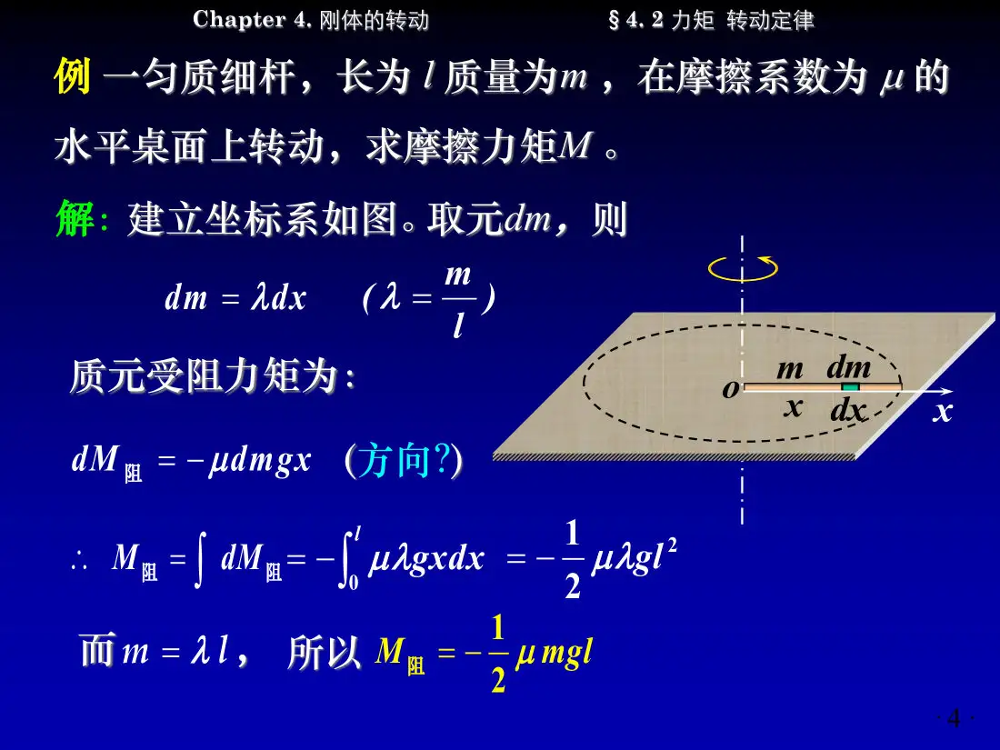

原文：

Chapter 4. 刚体的转动

§ 4.2 力矩 转动定律

例 一匀质细杆，长为 l 质量为 m，在摩擦系数为 $\mu$ 的水平桌面上转动，求摩擦力矩 M。

解：建立坐标系如图。取元 $dm$ ，则

$$
d m = \lambda d x
$$

$$
(\lambda = \frac {m}{l})
$$

质元受阻力矩为：

$dM_{阻} = -\mu dmgx$ (方向?)

$$
\therefore M _ {\text {阻}} = \int d M _ {\text {阻}} = - \int_ {0} ^ {l} \mu \lambda g x d x = - \frac {1}{2} \mu \lambda g l ^ {2}
$$

而 $m = \lambda l$ ，所以 $M_{阻} = -\frac{1}{2}\mu mgl$

4

### 二、转动定律

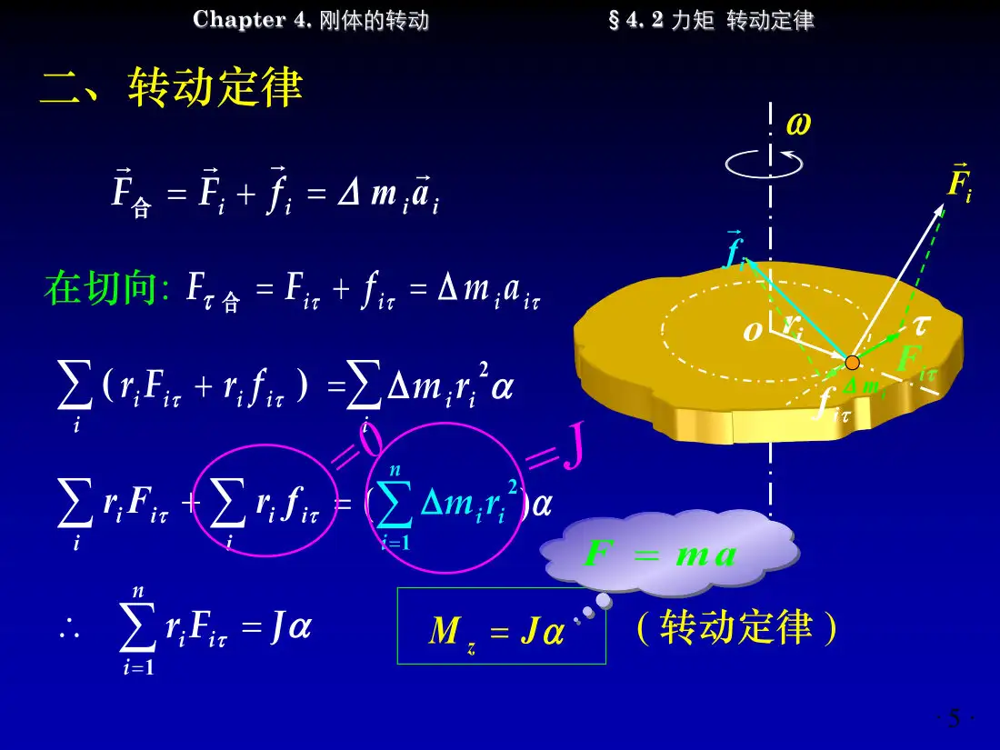

原文：

二、转动定律

$$
\vec {F} _ {\text {合}} = \vec {F} _ {i} + \vec {f} _ {i} = \Delta m _ {i} \vec {a} _ {i}
$$

在切向： $F_{\tau \text{合}} = F_{i\tau} + f_{i\tau} = \Delta m_i a_{i\tau}$

$$
\sum_ {i} (r _ {i} F _ {i \tau} + r _ {i} f _ {i \tau}) = \sum_ {i} \Delta m _ {i} r _ {i} ^ {2} \alpha
$$

$$
\sum_ {i} r _ {i} F _ {i \tau} + \sum_ {i} r _ {i} f _ {i \tau} = (\sum_ {i = 1} ^ {n} \Delta m _ {i} r _ {i} ^ {2}) \alpha
$$

$$
\therefore \sum_ {i = 1} ^ {n} r _ {i} F _ {i \tau} = J \alpha
$$

$$
M _ {z} = J \alpha
$$

(转动定律)

Chapter 4. 刚体的转动

§ 4.2 力矩 转动定律

5

### 明确几点

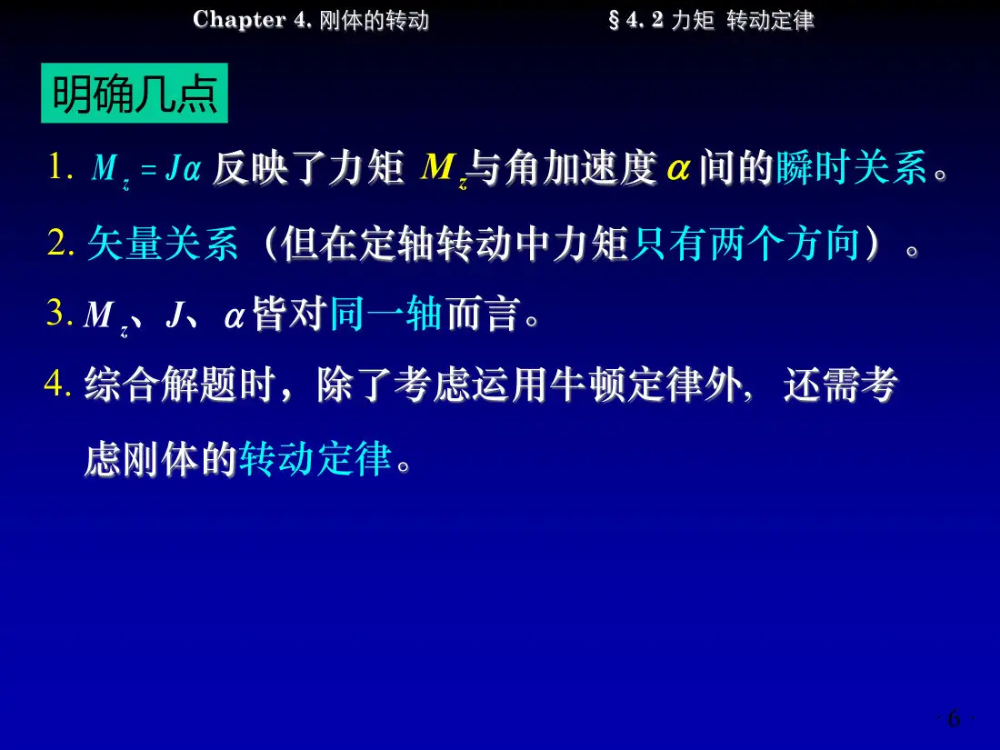

原文：

明确几点

1. $M_{z} = J \alpha$ 反映了力矩 $M_{z}$ 与角加速度 $\alpha$ 间的瞬时关系。

2. 矢量关系（但在定轴转动中力矩只有两个方向）。

3. $M_{z}$ 、 $J$ 、 $\alpha$ 皆对同一轴而言。

4. 综合解题时，除了考虑运用牛顿定律外，还需考虑刚体的转动定律。

Chapter 4. 刚体的转动

§ 4.2 力矩 转动定律

6

### Chapter 4. 刚体的转动

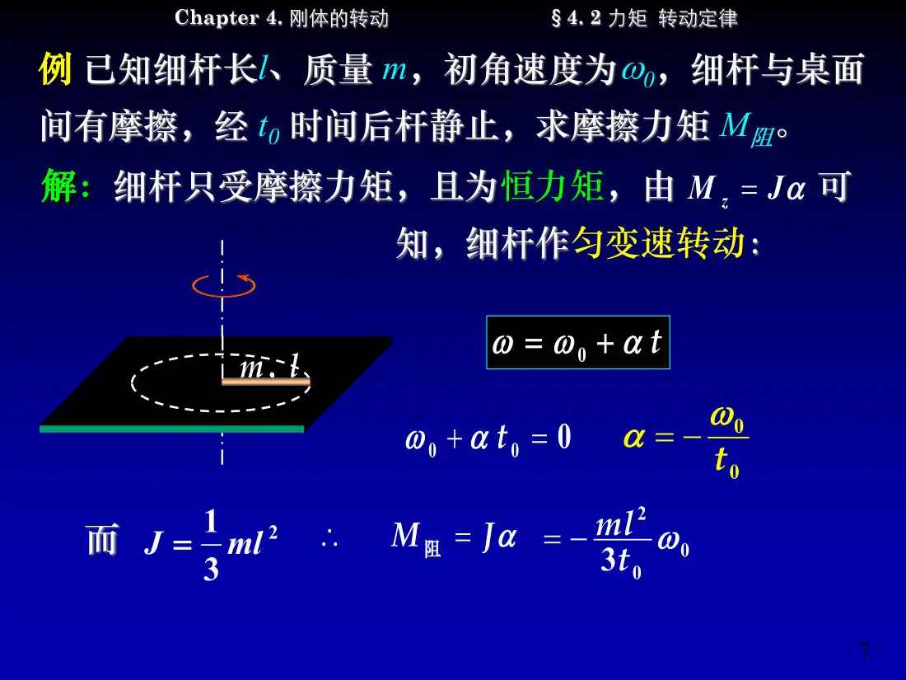

原文：

Chapter 4. 刚体的转动

§ 4.2 力矩 转动定律

例 已知细杆长 $l$ 、质量 $m$ ，初角速度为 $\omega_0$ ，细杆与桌面间有摩擦，经 $t_0$ 时间后杆静止，求摩擦力矩 $M_{\text{阻}}$ 。

解：细杆只受摩擦力矩，且为恒力矩，由 $M_{z} = J\alpha$ 可

而

$$
J = \frac {1}{3} m l ^ {2}
$$

知，细杆作匀变速转动：

$$
\omega = \omega_ {0} + \alpha t
$$

$$
\omega_ {0} + \alpha t _ {0} = 0 \quad \alpha = - \frac {\omega_ {0}}{t _ {0}}
$$

$$
M _ {\text {阻}} = J \alpha = - \frac {m l ^ {2}}{3 t _ {0}} \omega_ {0}
$$

7

### Chapter 4. 刚体的转动

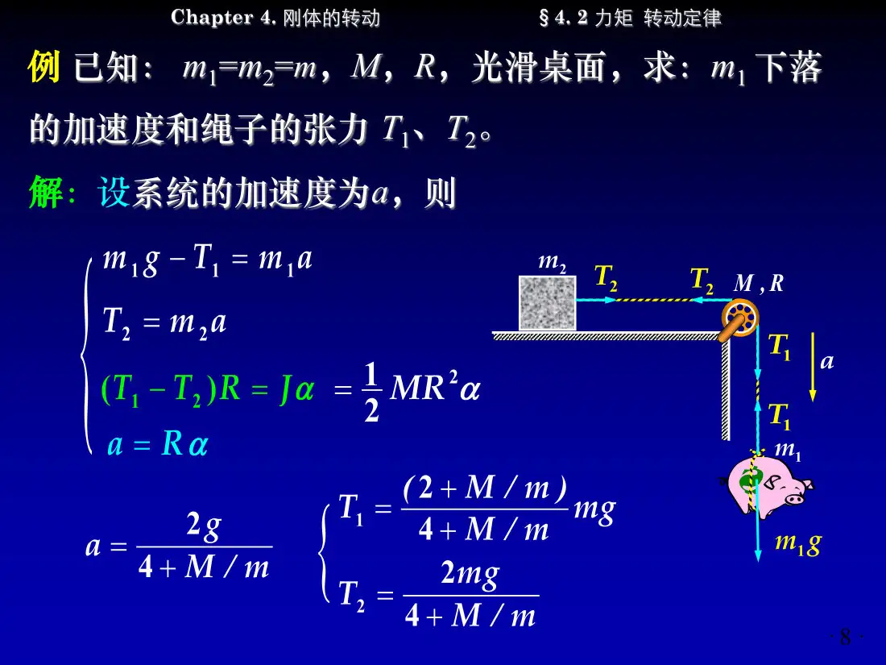

原文：

Chapter 4. 刚体的转动

§ 4.2 力矩 转动定律

例 已知: $m_{1} = m_{2} = m$ , $M, R$ , 光滑桌面, 求: $m_{1}$ 下落的加速度和绳子的张力 $T_{1} 、 T_{2}$ 。

解：设系统的加速度为 $a$ ，则

$$
\left\{ \begin{array}{l} m _ {1} g - T _ {1} = m _ {1} a \\ T _ {2} = m _ {2} a \end{array} \right.
$$

$$
\left( \begin{array}{l} (T _ {1} - T _ {2}) R = J \alpha = \frac {1}{2} M R ^ {2} \alpha \\ a = R \alpha \end{array} \right.
$$

$$
a = \frac {2 g}{4 + M / m}
$$

$$
\left\{ \begin{array}{l} T _ {1} = \frac {(2 + M / m)}{4 + M / m} m g \\ T _ {2} = \frac {2 m g}{4 + M / m} \end{array} \right.
$$

$$
\begin{array}{c} T _ {1} \\ \text {   a   } \\ T _ {1} \\ m _ {1} \\ m _ {1} g \end{array}
$$

8

### Chapter 4. 刚体的转动

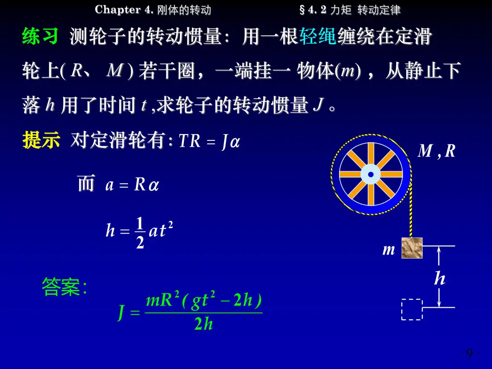

原文：

Chapter 4. 刚体的转动

§ 4.2 力矩 转动定律

练习 测轮子的转动惯量: 用一根轻绳缠绕在定滑轮上 $(R, M)$ 若干圈, 一端挂一 物体 $(m)$ , 从静止下落 $h$ 用了时间 $t$ , 求轮子的转动惯量 $J$ 。

提示 对定滑轮有: $TR = J\alpha$

而 $a = R\alpha$

$$
h = \frac {1}{2} a t ^ {2}
$$

答案:

$$
J = \frac {m R ^ {2} (g t ^ {2} - 2 h)}{2 h}
$$

9

### Chapter 4. 刚体的转动

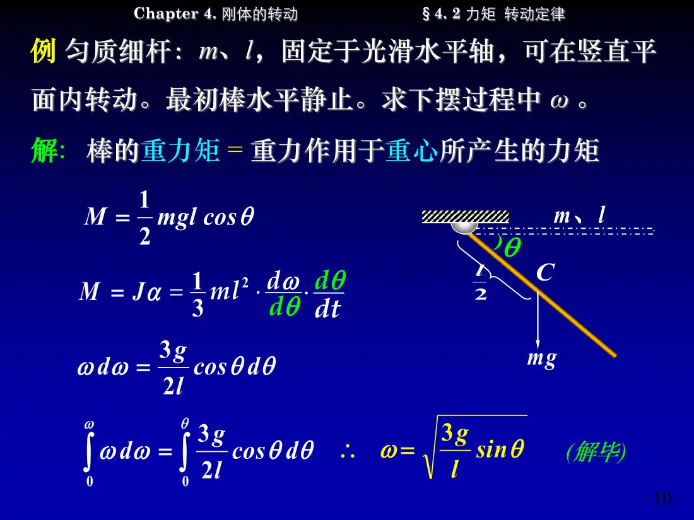

原文：

Chapter 4. 刚体的转动

§ 4.2 力矩 转动定律

例 匀质细杆：m、l，固定于光滑水平轴，可在竖直平面内转动。最初棒水平静止。求下摆过程中 $\omega$ 。

解: 棒的重力矩 = 重力作用于重心所产生的力矩

$$
M = \frac {1}{2} m g l \cos \theta
$$

$$
M = J \alpha = \frac {1}{3} m l ^ {2} \cdot \frac {d \omega}{d \theta} \cdot \frac {d \theta}{d t}
$$

$$
\omega d \omega = \frac {3 g}{2 l} \cos \theta d \theta
$$

$$
\int_ {0} ^ {\omega} \omega d \omega = \int_ {0} ^ {\theta} \frac {3 g}{2 l} \cos \theta d \theta
$$

$$
\omega = \sqrt {\frac {3 g}{l} \sin \theta}
$$

(解毕)

10

### 归纳

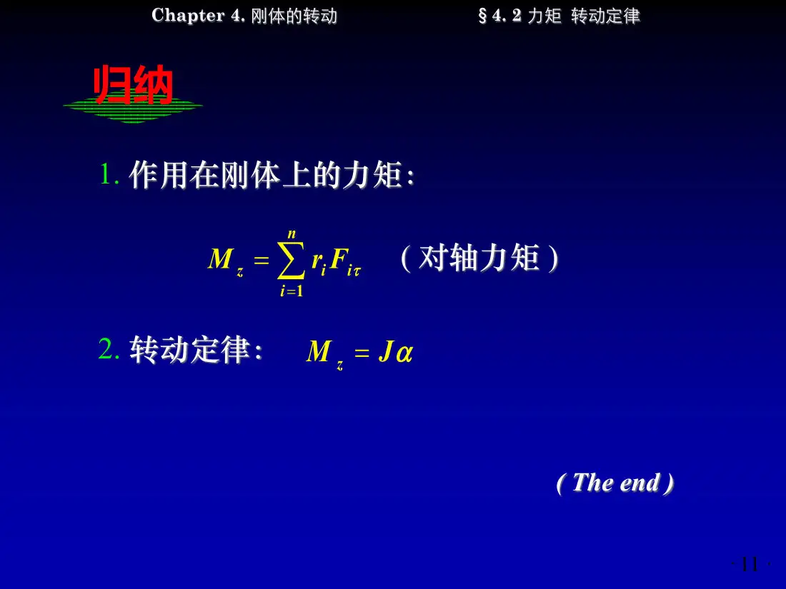

原文：

归纳

1. 作用在刚体上的力矩:

$M_{z}=\sum_{i=1}^{n}r_{i}F_{i\tau}$ （对轴力矩）

2. 转动定律: $M_{z} = J \alpha$

$$
(T h e e n d)
$$

Chapter 4. 刚体的转动

§ 4.2 力矩 转动定律

11
