# 《大学物理》第4章 刚体的转动惯量（课件）

原件的每一页，下面附识别出的文字。

### 4-2 刚体的转动惯量

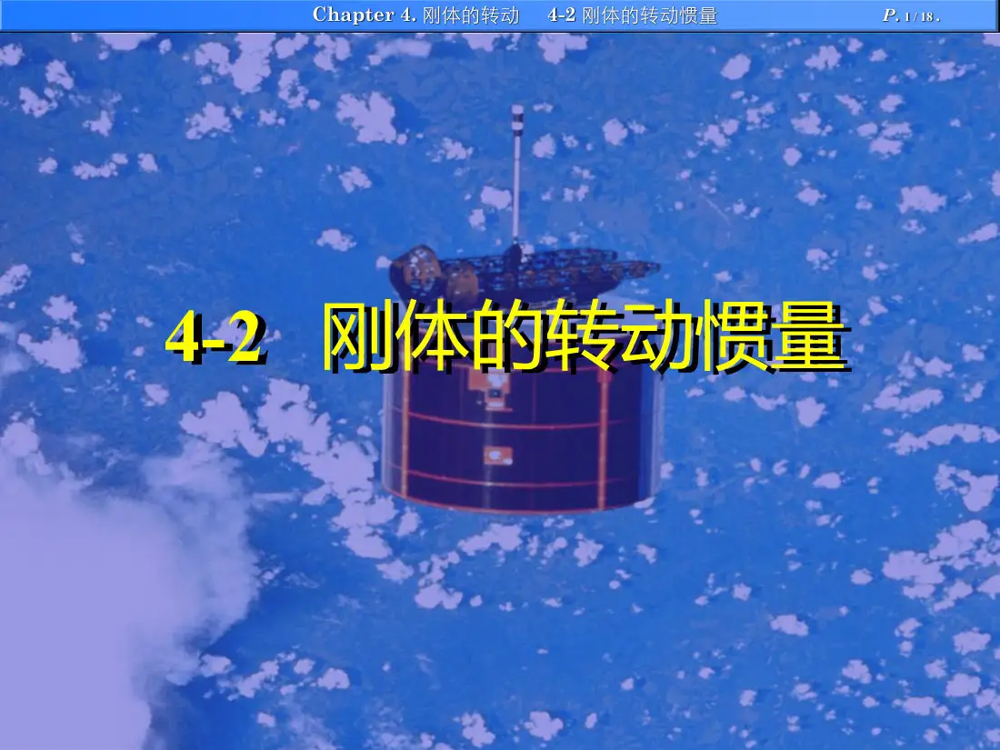

原文：

4-2 刚体的转动惯量

者：杨茂田Chapter 4. 作者：杨茂田刚体的转动 4-2 刚体的转动惯量

### 考察刚体的动能:

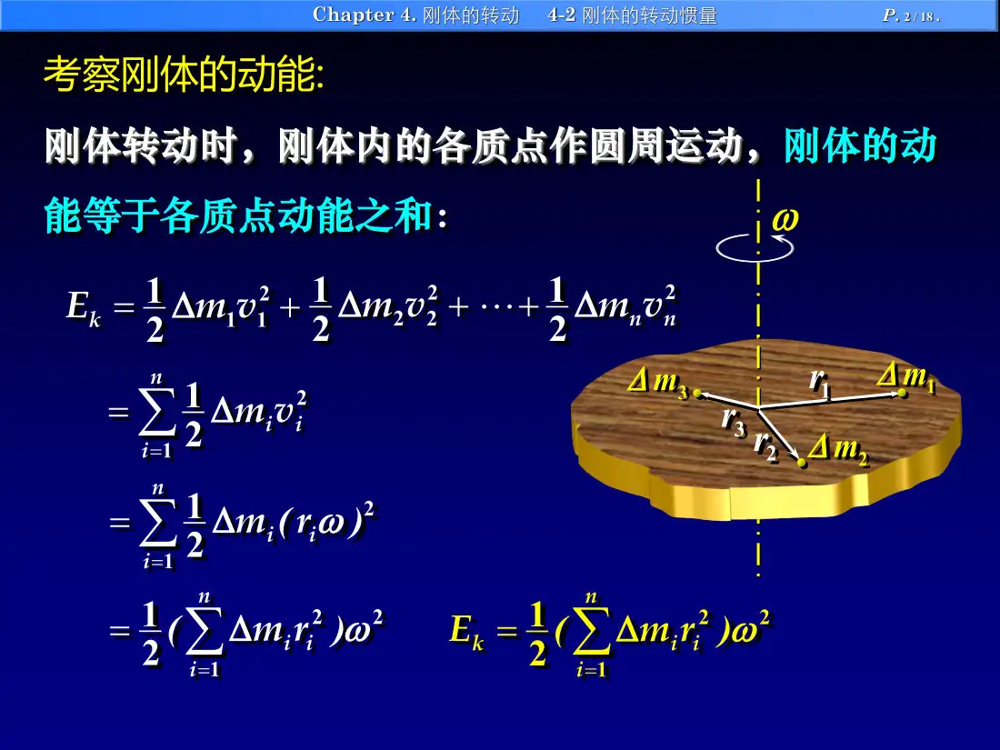

原文：

考察刚体的动能:

刚体转动时，刚体内的各质点作圆周运动，刚体的动能等于各质点动能之和： ω

$$
\begin{array}{r l} & E _ {k} = \frac {1}{2} \Delta m _ {1} v _ {1} ^ {2} + \frac {1}{2} \Delta m _ {2} v _ {2} ^ {2} + \dots + \frac {1}{2} \Delta m _ {n} v _ {n} ^ {2} \\ & = \sum_ {i = 1} ^ {n} \frac {1}{2} \Delta m _ {i} v _ {i} ^ {2} \\ & = \sum_ {i = 1} ^ {n} \frac {1}{2} \Delta m _ {i} (r _ {i} \omega) ^ {2} \\ & = \frac {1}{2} (\sum_ {i = 1} ^ {n} \Delta m _ {i} r _ {i} ^ {2}) \omega^ {2} \quad E _ {k} = \frac {1}{2} (\sum_ {i = 1} ^ {n} \Delta m _ {i} r _ {i} ^ {2}) \omega^ {2} \end{array}
$$

者：杨茂田Chapter 4. 作者：杨茂田刚体的转动 4-2 刚体的转动惯量

P. 2 / 18 .

### 转动惯量

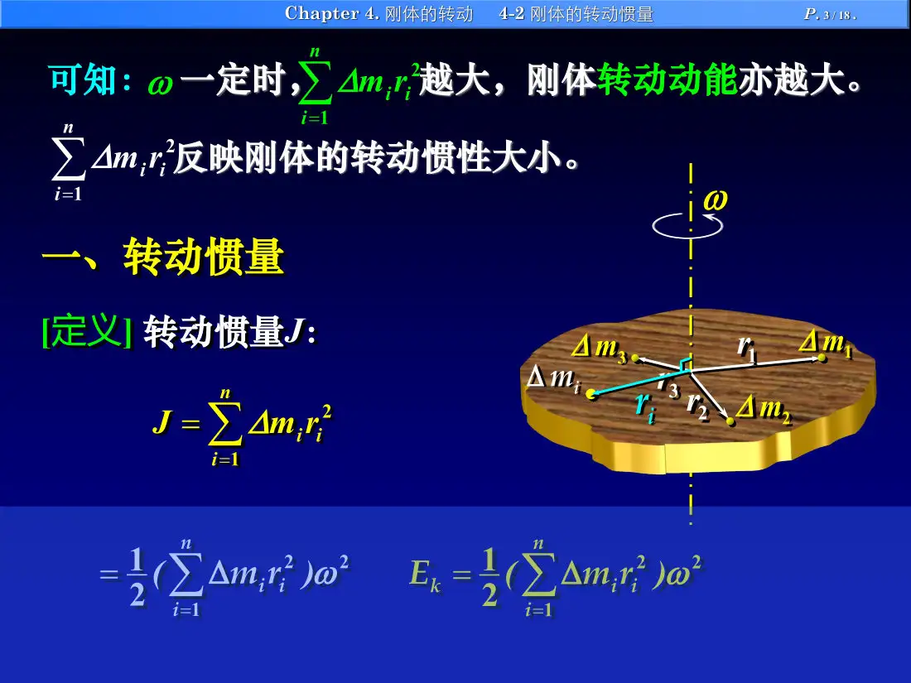

原文：

n可知： 一定时， 越大，刚体转动动能亦越大。i=1n$a \sqrt { 1 0 } = \sqrt { 2 }$ 反映刚体的转动惯性大小。0

转动惯量

[定义] 转动惯量J：

$$
J = \sum_ {i = 1} ^ {n} \Delta m _ {i} r _ {i} ^ {2}
$$

$$
= \frac {1}{2} (\sum_ {i = 1} ^ {n} \Delta m _ {i} r _ {i} ^ {2}) \omega^ {2}
$$

$$
E _ {k} = \frac {1}{2} (\sum_ {i = 1} ^ {n} \Delta m _ {i} r _ {i} ^ {2}) \omega^ {2}
$$

者：杨茂田Chapter 4. 作者：杨茂田刚体的转动 4-2 刚体的转动惯量

P. 3 / 18 .

### 一、 转动惯量

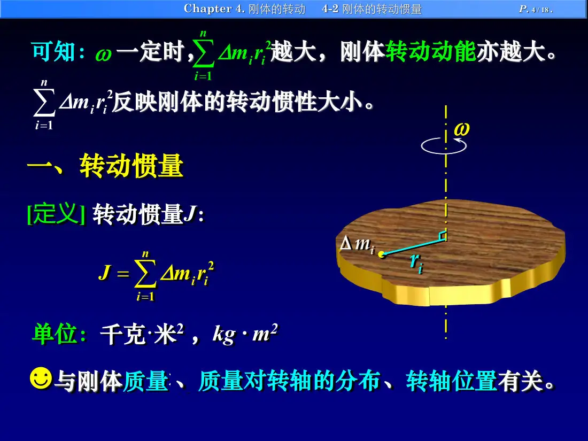

原文：

n可知： 一定时， 越大，刚体转动动能亦越大。i=1n$a \sqrt { 1 0 0 } = \sqrt { 2 }$ 反映刚体的转动惯性大小。 \_

一、 转动惯量

[定义] 转动惯量J：

$$
J = \sum_ {i = 1} ^ {n} \Delta m _ {i} r _ {i} ^ {2}
$$

单位：千克·米2， $1 5 3 - 1 7 1 = 1 7 1$

☻与刚体质量有关；、质量对转轴的分布有关； 、转轴位置有关。

者：杨茂田Chapter 4. 作者：杨茂田刚体的转动 4-2 刚体的转动惯量

P. 4 / 18 .

### 录像：

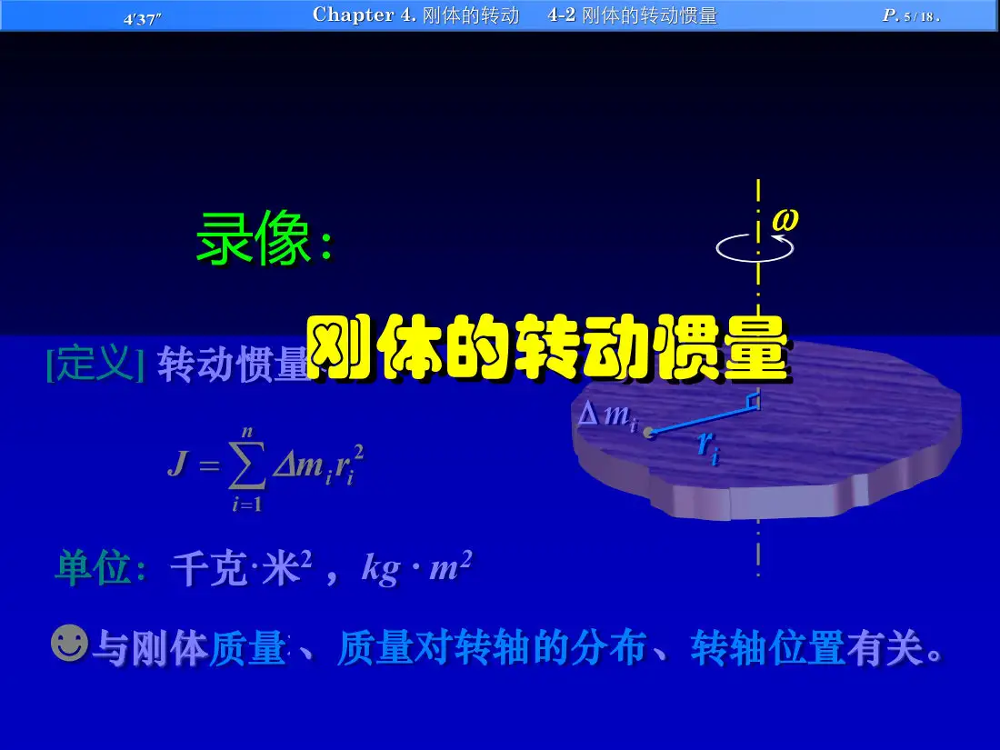

原文：

录像：

[定义] 转动惯量J：刚体的转动惯量

$$
J = \sum_ {i = 1} ^ {n} \Delta m _ {i} r _ {i} ^ {2}
$$

单位：千克·米2， $1 4 3 - 1 0 1 = 1 1 1$

☻与刚体质量有关；、质量对转轴的分布有关； 、转轴位置有关。

4'37"

者：杨茂田Chapter 4. 作者：杨茂田刚体的转动 4-2 刚体的转动惯量

P. 5 / 18 .

### 者：杨茂田Chapter 4. 作者：杨茂田刚体的转动 4-2 刚体的转动惯量

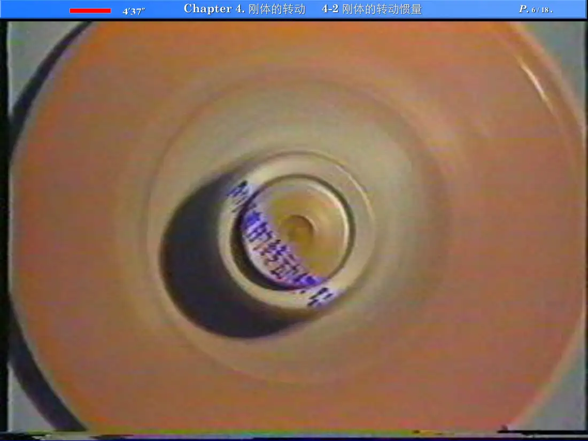

原文：

者：杨茂田Chapter 4. 作者：杨茂田刚体的转动 4-2 刚体的转动惯量

P. 6 / 18 .

### 二、转动惯量计算举例

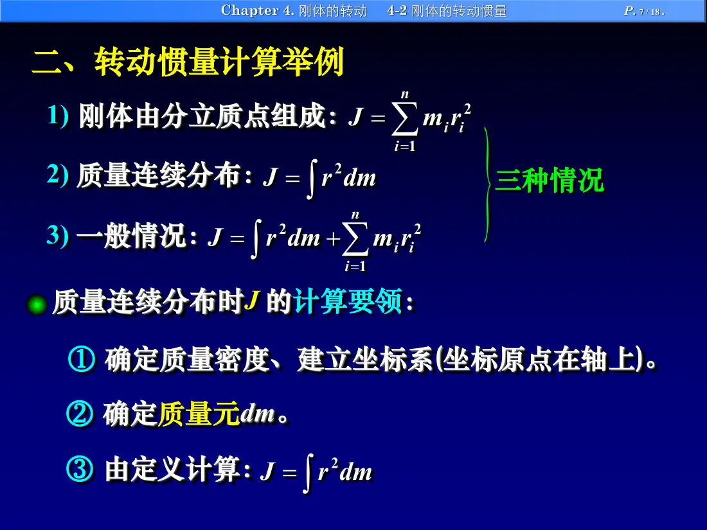

原文：

二、转动惯量计算举例

1) 刚体由分立质点组成： $y _ { 1 } = \frac { \sqrt { 3 } } { 2 } \cdot \sqrt { 3 }$

2) 质量连续分布： $y = \sqrt { 1 2 } - \sqrt { 1 1 }$

三种情况

3) 一般情况： $y = \frac { 1 } { 2 } \sqrt { 1 - \frac { 3 } { 2 } } \times \frac { 1 } { 2 }$

质量连续分布时J 的计算要领：

① 确定质量密度、建立坐标系(坐标原点在轴上)。

确定质量元dm。

由定义计算： $y = \sqrt { 1 2 } - \sqrt { 1 1 }$

者：杨茂田Chapter 4. 作者：杨茂田刚体的转动 4-2 刚体的转动惯量

P. 7 / 18 .

### 解: 由转动惯量的定义

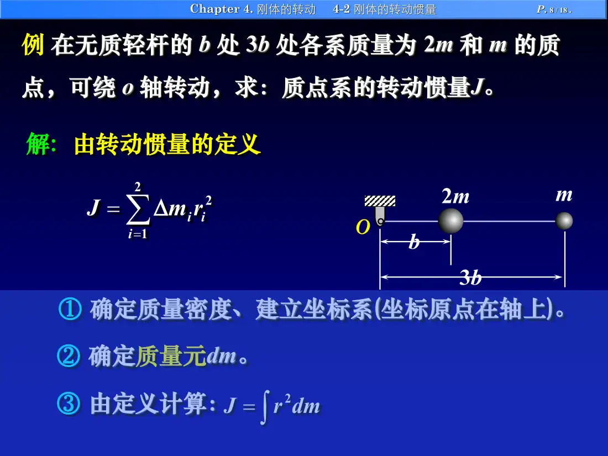

原文：

例 在无质轻杆的b 处 3b 处各系质量为2m 和 m 的质点，可绕 o 轴转动，求：质点系的转动惯量J。

解: 由转动惯量的定义

$$
J = \sum_ {i = 1} ^ {2} \Delta m _ {i} r _ {i} ^ {2}
$$

① 确定质量密度、建立坐标系(坐标原点在轴上)。

确定质量元dm。

由定义计算： $y = \sqrt { 1 0 ^ { 2 } - 1 } \sqrt { 1 0 }$

者：杨茂田Chapter 4. 作者：杨茂田刚体的转动 4-2 刚体的转动惯量

P. 8 / 18 .

### 解: 由转动惯量的定义

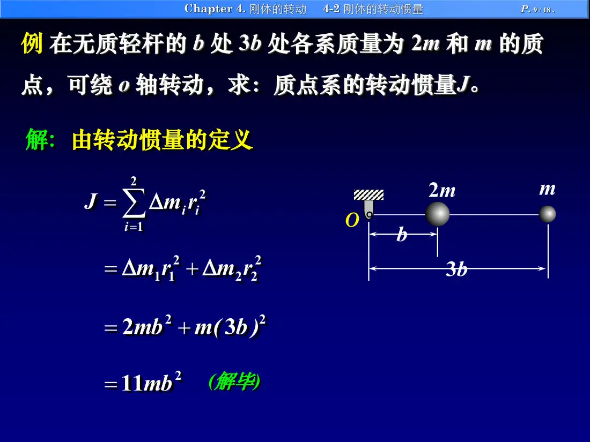

原文：

例 在无质轻杆的b 处 3b 处各系质量为2m 和 m 的质点，可绕 o 轴转动，求：质点系的转动惯量J。

解: 由转动惯量的定义

$$
\begin{array}{r l} J & = \sum_ {i = 1} ^ {2} \Delta m _ {i} r _ {i} ^ {2} \\ & = \Delta m _ {1} r _ {1} ^ {2} + \Delta m _ {2} r _ {2} ^ {2} \\ & = 2 m b ^ {2} + m (3 b) ^ {2} \\ & = 1 1 m b ^ {2} \quad (\text {解毕}) \end{array}
$$

$$
\begin{array}{c} 2 m \\ m \end{array}
$$

P. 9 / 18 .

者：杨茂田Chapter 4. 作者：杨茂田刚体的转动 4-2 刚体的转动惯量

### $$

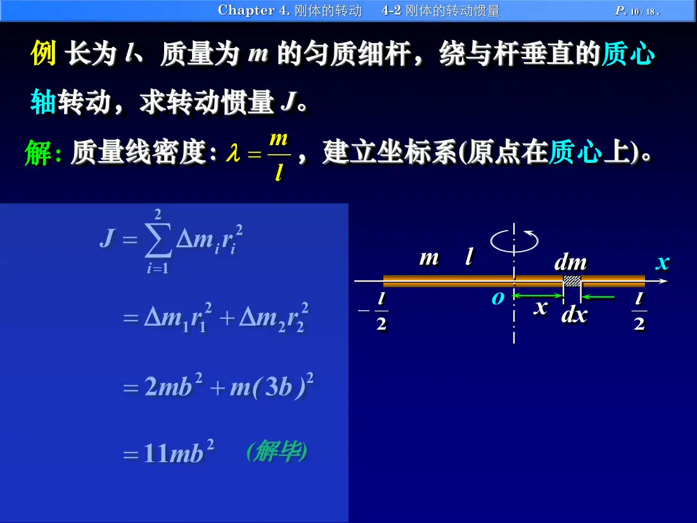

原文：

例 长为 l、质量为 m 的匀质细杆，绕与杆垂直的质心轴转动，求转动惯量 $\pmb { \mathscr { L } }$

解：质量线密度： $x _ { 1 } = \frac { 1 1 } { 7 }$ 建立坐标系(原点在质心上)。

$$
\begin{array}{r l} J & = \sum_ {i = 1} ^ {2} \Delta m _ {i} r _ {i} ^ {2} \\ & = \Delta m _ {1} r _ {1} ^ {2} + \Delta m _ {2} r _ {2} ^ {2} \\ & = 2 m b ^ {2} + m (3 b) ^ {2} \\ & = 1 1 m b ^ {2} \quad (\text {解毕}) \end{array}
$$

$$
\begin{array}{c c c} m & l \\ - \frac {l}{2} \end{array} \quad \begin{array}{c c c} d m \\ 0 & x & d x \end{array} \quad \begin{array}{c c c} x \\ - \frac {l}{2} \end{array}
$$

者：杨茂田 Chapter 4. 作者：杨茂田 刚体的转动 4-2 刚体的转动惯量

P. 10 / 18 .

### $$

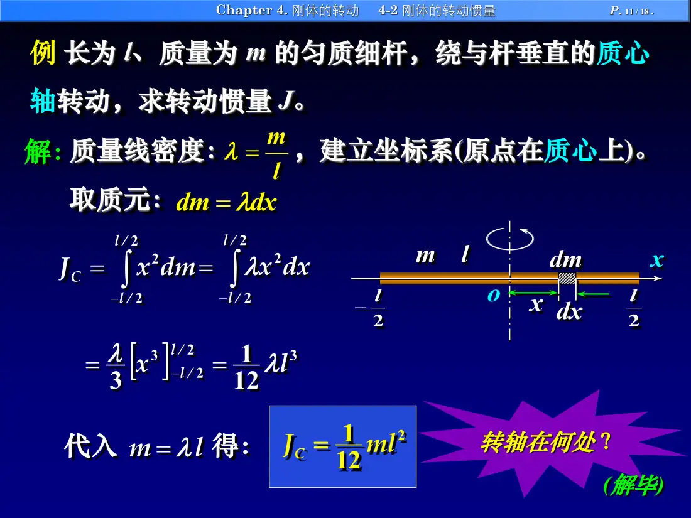

原文：

例 长为 l、质量为 m 的匀质细杆，绕与杆垂直的质心轴转动，求转动惯量 $\pmb { \mathscr { L } }$

解：质量线密度： $x _ { 2 } = \frac { 1 1 1 } { 1 1 }$ 建立坐标系(原点在质心上)。取质元： $\langle \langle I | \langle I | = \langle \langle \langle \langle \langle \rangle | \langle \langle \langle \langle \rangle |$

$$
\begin{array}{l} J _ {C} = \int_ {- l / 2} ^ {l / 2} x ^ {2} d m = \int_ {- l / 2} ^ {l / 2} \lambda x ^ {2} d x \\ = \frac {\lambda}{3} \left[ x ^ {3} \right] _ {- l / 2} ^ {l / 2} = \frac {1}{1 2} \lambda l ^ {3} \end{array}
$$

代入 $1 1 3 = 1 1 1$ 得：

$$
J _ {c} = \frac {1}{1 2} m l ^ {2}
$$

转轴在何处？

(解毕)

者：杨茂田 Chapter 4. 作者：杨茂田 刚体的转动 4-2 刚体的转动惯量

P. 11 / 18 .

### $$

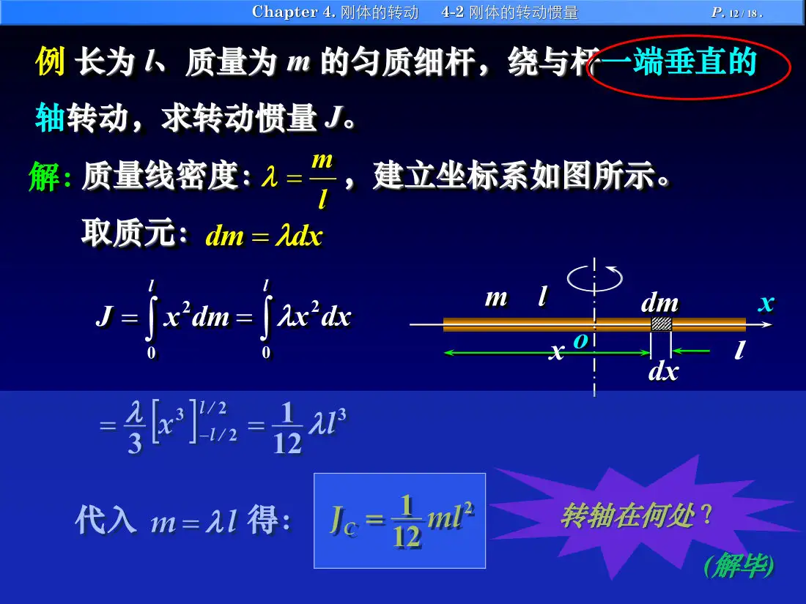

原文：

例 长为 l、质量为 m 的匀质细杆，绕与杆一端垂直的轴转动，求转动惯量 $\pmb { \mathscr { L } }$

解：质量线密度： $x _ { 2 } = \frac { 1 1 1 } { 1 1 }$ 建立坐标系如图所示。

取质元： $\langle \langle I | \langle I | = \langle \langle \langle \langle \langle \rangle | \langle \langle \langle \langle \rangle |$

$$
J = \int_ {0} ^ {l} x ^ {2} d m = \int_ {0} ^ {l} \lambda x ^ {2} d x
$$

$$
= \frac {\lambda}{3} \left[ x ^ {3} \right] _ {- l / 2} ^ {l / 2} = \frac {1}{1 2} \lambda l ^ {3}
$$

代入 $1 1 0 = 2 1$ 得：

$$
J _ {c} = \frac {1}{1 2} m l ^ {2}
$$

转轴在何处？

(解毕)

者：杨茂田Chapter 4. 作者：杨茂田刚体的转动 4-2 刚体的转动惯量

P. 12 / 18 .

### $$

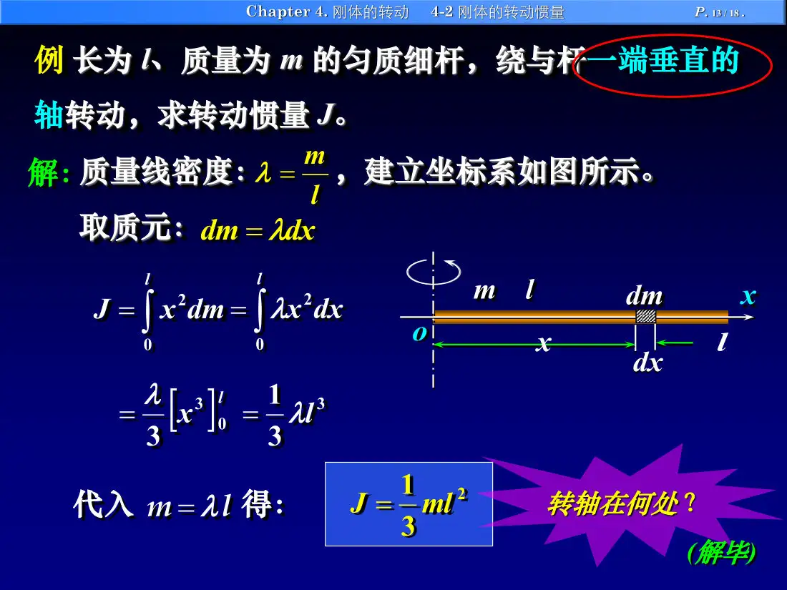

原文：

例 长为 l、质量为 m 的匀质细杆，绕与杆一端垂直的轴转动，求转动惯量 $\pmb { \mathscr { L } }$

解：质量线密度： $x _ { 2 } = \frac { 1 1 1 } { 1 1 }$ 建立坐标系如图所示。

取质元： $\langle \langle I | \langle I | = \langle \langle \langle \langle \langle \rangle | \langle \langle \langle \langle \rangle |$

$$
\begin{array}{r l} J & = \int_ {0} ^ {l} x ^ {2} d m = \int_ {0} ^ {l} \lambda x ^ {2} d x \\ & = \frac {\lambda}{3} \left[ x ^ {3} \right] _ {0} ^ {l} = \frac {1}{3} \lambda l ^ {3} \end{array}
$$

代入 $1 1 0 = 2 1$ 得：

$$
J = \frac {1}{3} m l ^ {2}
$$

转轴在何处？

(解毕)

者：杨茂田Chapter 4. 作者：杨茂田刚体的转动 4-2 刚体的转动惯量

P. 13 / 18 .

### $$

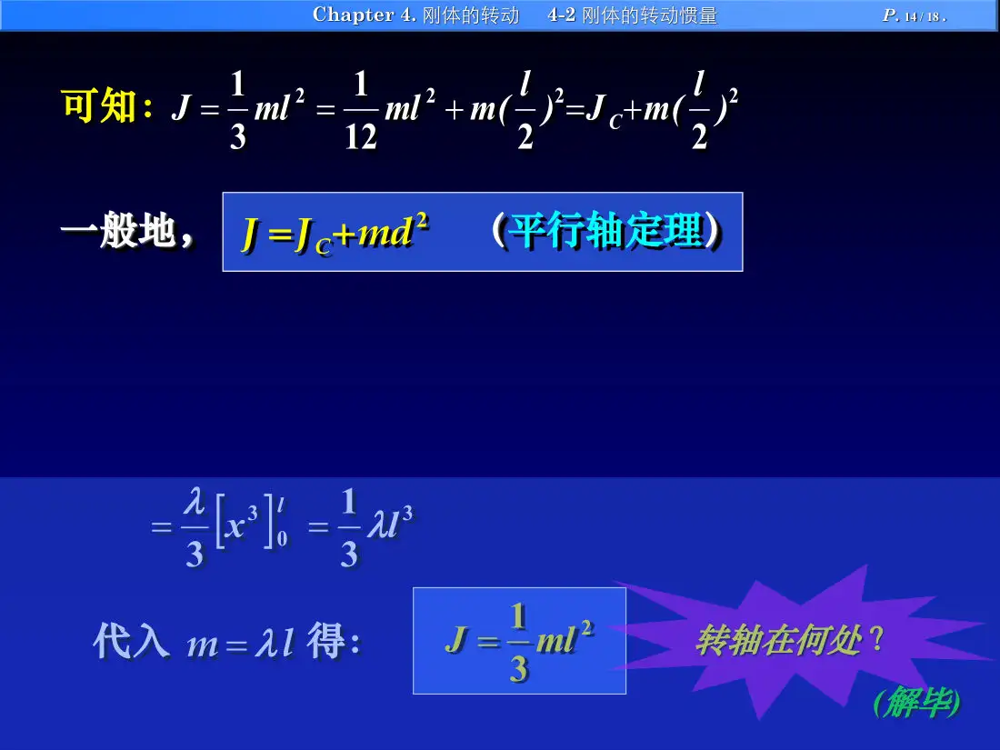

原文：

可知： $\angle B = \angle C D E = \angle D C E = \angle C A E = \angle C A E = \angle C A E = \angle C A E$ 一般地， $\scriptstyle | J = | J _ { c } - | J _ { n } | \leq | J _ { c } | ^ { 2 }$ （平行轴定理）

$$
= \frac {\lambda}{3} \left[ x ^ {3} \right] _ {0} ^ {l} = \frac {1}{3} \lambda l ^ {3}
$$

代入 $1 1 0 = 2 1$ 得：

$$
J = \frac {1}{3} m l ^ {2}
$$

转轴在何处？

(解毕)

者：杨茂田Chapter 4. 作者：杨茂田刚体的转动 4-2 刚体的转动惯量

P. 14 / 18 .

### $y = \frac { 1 } { 2 }$ ：对质心轴的转动惯量。

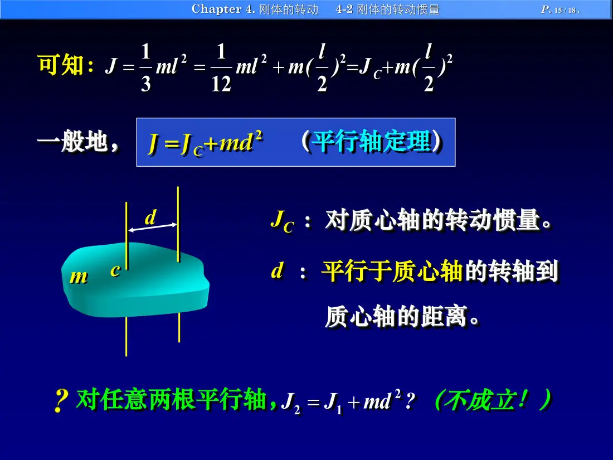

原文：

可知： $\angle A = \angle B = \angle C A E = \angle C A E = \angle C A E = \angle C A E = \angle C A E$ 一般地， $\scriptstyle | J = | J _ { c } - | J _ { n } | | { \boldsymbol { \mathit { 2 } } } | ^ { 2 }$ （平行轴定理）

$y = \frac { 1 } { 2 }$ ：对质心轴的转动惯量。

d ：平行于质心轴的转轴到质心轴的距离。

对任意两根平行轴， $U _ { 0 } = U _ { 1 } = \frac { 1 } { 2 } ( m ) ^ { 2 }$ （不成立！）

者：杨茂田Chapter 4. 作者：杨茂田刚体的转动 4-2 刚体的转动惯量

P. 15 / 18 .

### 解：

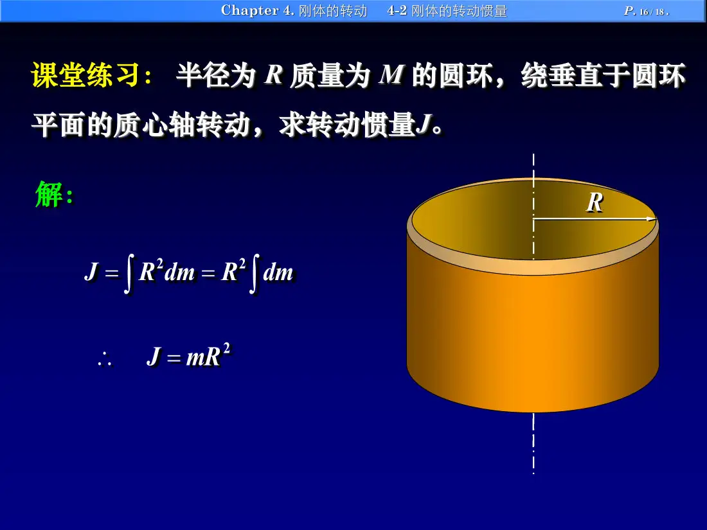

原文：

课堂练习： 半径为 R 质量为 M 的圆环，绕垂直于圆环平面的质心轴转动，求转动惯量J。

解：

$$
J = \int R ^ {2} d m = R ^ {2} \int d m
$$

$$
\therefore J = m R ^ {2}
$$

者：杨茂田Chapter 4. 作者：杨茂田刚体的转动 4-2 刚体的转动惯量

P. 16 / 18 .

### 解：质量面密度：

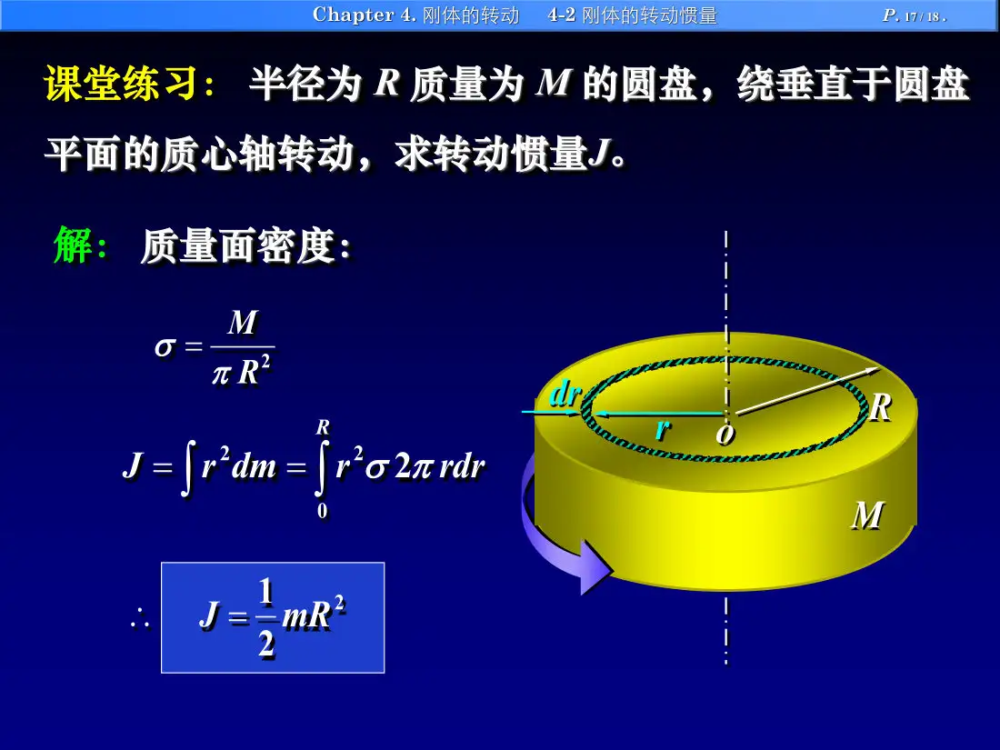

原文：

课堂练习： 半径为 R 质量为 M 的圆盘，绕垂直于圆盘平面的质心轴转动，求转动惯量J。

解：质量面密度：

$$
\sigma = \frac {M}{\pi R ^ {2}}
$$

$$
J = \int r ^ {2} d m = \int_ {0} ^ {R} r ^ {2} \sigma 2 \pi r d r
$$

$$
J \equiv \frac {1}{2} m R ^ {2}
$$

者：杨茂田Chapter 4. 作者：杨茂田刚体的转动 4-2 刚体的转动惯量

P. 17 / 18 .

### 三、几种典型刚体的转动惯量

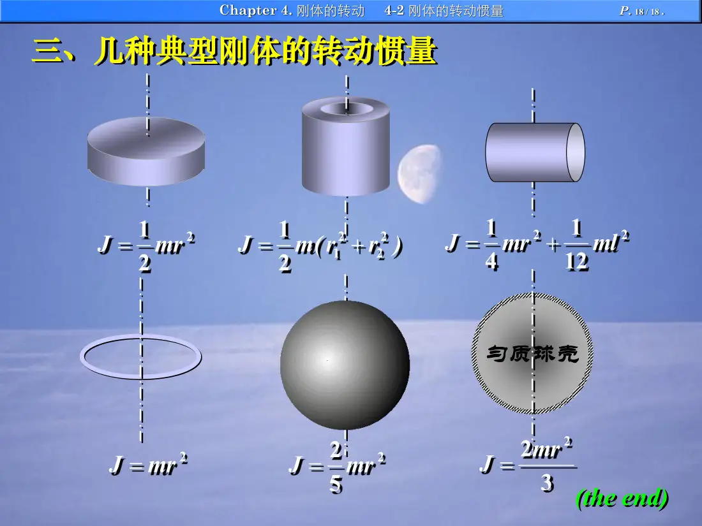

原文：

三、几种典型刚体的转动惯量

$$
J = \frac {1}{2} m r ^ {2}
$$

$$
J = \frac {1}{2} m (r _ {1} ^ {2} + r _ {2} ^ {2})
$$

$$
J = \frac {1}{4} m r ^ {2} + \frac {1}{1 2} m l ^ {2}
$$

匀质球壳

$$
J \equiv m r ^ {2}
$$

$$
J \equiv \frac {2 i}{5} m r ^ {2}
$$

$$
J = \frac {2 m r ^ {2}}{3}
$$

者：杨茂田Chapter 4. 作者：杨茂田刚体的转动 4-2 刚体的转动惯量

P. 18 / 18 .

(the end)
