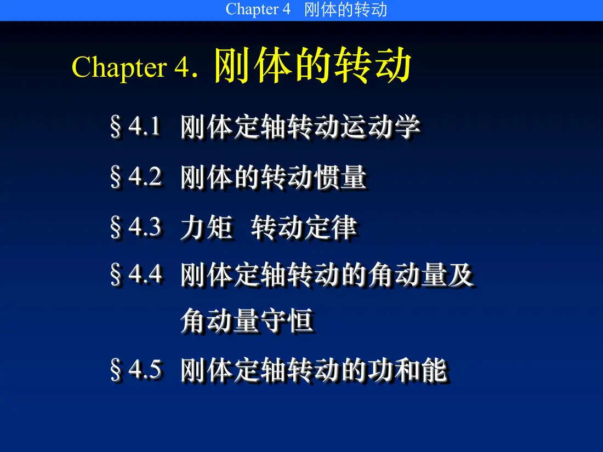
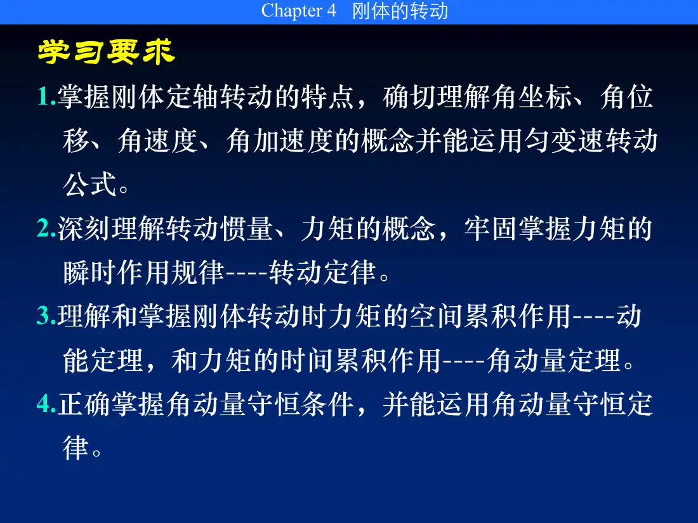

# 《大学物理》第4章 刚体的转动（课件）

原件的每一页，下面附识别出的文字。

### Chapter 4 刚体的转动

原文：

Chapter 4 刚体的转动

Chapter 4. 刚体的转动
§ 4.1 刚体定轴转动运动学
§ 4.2 刚体的转动惯量
§ 4.3 力矩 转动定律
§ 4.4 刚体定轴转动的角动量及角动量守恒
§ 4.5 刚体定轴转动的功和能

### Chapter 4 刚体的转动

原文：

Chapter 4 刚体的转动

学习要求

1.掌握刚体定轴转动的特点，确切理解角坐标、角位移、角速度、角加速度的概念并能运用匀变速转动公式。

2.深刻理解转动惯量、力矩的概念，牢固掌握力矩的瞬时作用规律----转动定律。

3.理解和掌握刚体转动时力矩的空间累积作用----动能定理，和力矩的时间累积作用----角动量定理。

4.正确掌握角动量守恒条件，并能运用角动量守恒定律。
