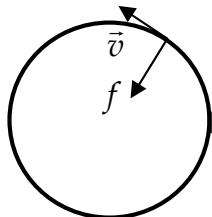

# 《大学物理》第4章 牛顿定律同步练习册参考答案

原件经识别和整理；“参考解答”是我们补的。

## 牛顿定律

### 简答 1

（A）恒力是指大小和方向均保持不变的力。物体在恒力作用下，由牛顿第二定律 $\vec{F} = m\vec{a}$，物体的加速度保持不变；当物体初速度为零，或初速度方向与恒定的加速度方向在同一直线上时，物体将做直线运动，否则可做曲线运动，例如斜抛运动中，重力是恒力，物体的轨迹为抛物线。

（B）变力是指力的大小或方向随时间变化的力。若物体在一方向不变但大小不断变化的变力作用下，由静止或者初速度方向与变力方向相同，物体将做直线运动。

（C）物体在垂直于速度方向（轨迹切线方向），且大小不变的力作用下，由切向力：$F_t = m a_t = m\frac{\mathrm{d}v}{\mathrm{d}t} = 0 \Rightarrow \mathrm{d}v = 0$，即物体运动的速度大小（速率）将保持不变；又由法向力大小不变，即 $F_n = m a_n = m\frac{v^2}{\rho}$，得物体运动轨迹的曲率半径 $\rho$ 将不变；但在上述条件下，物体并不一定做圆周运动，例如带电粒子在均匀磁场中做螺旋运动（电磁学部分）。

（D）圆周运动可分为匀速圆周运动和变速圆周运动。匀速圆周运动中，物体只受到法向加速度（法向力）；在变速圆周运动中，由切向加速度和法向加速度合成的总加速度（力 $\vec{F} = m\vec{a}$）并不一定垂直于速度方向。

$F_t = m a_t = m\frac{\mathrm{d}v}{\mathrm{d}t} = 0 \Rightarrow \mathrm{d}v = 0$，即物体运动的速度大小（速率）将保持不变；又由法向力大小可变，$F_n = m a_n = m\frac{v^2}{\rho}$，得物体运动轨迹的曲率半径 $\rho$ 可以变化；物体可以做匀速率曲线运动。

答案：本题选（E）。

知识点：[速度、加速度的定义与微分关系](../../../topics/大学物理/速度与加速度定义.md)、[自然参数下的切向加速度与法向加速度](../../../topics/大学物理/自然坐标系下的运动.md)、[圆周运动的角量描述（角速度、角加速度）](../../../topics/大学物理/圆周运动描述.md)

### 计算 2

在左图中，物体 A、B 共同运动的加速度大小相等：

$$m_A g - \mu m_B g = (m_A + m_B)a \quad \Longrightarrow \quad a = \frac{m_A g - \mu m_B g}{m_A + m_B}$$

在右图中：

$$T - \mu m_B g = m_B a' \quad (\text{又 } T = m_A g) \Rightarrow a' = \frac{m_A g - \mu m_B g}{m_B}$$

从而得到 $a < a'$。

答案：本题选（C）。

### 简答 3

由于斜面与地面之间无摩擦，斜面和砖构成的系统在水平方向不受外力，且砖相对斜面不往下滑动（即砖和斜面相对静止），则砖和斜面构成的系统在水平方向将保持初始状态（原来静止），所以斜面保持静止。

知识点：[动量定理与动量守恒定律](../../../topics/大学物理/动量定理与动量守恒.md)、[牛顿定律在变力问题中的应用（如 ma_t = -mg sinθ）](../../../topics/大学物理/牛顿定律应用.md)

### 简答 4

重物在弹簧弹力和重力作用下向上做匀加速运动，弹簧被拉伸；当手突然停止运动瞬间，弹簧形变没有来得及改变，弹簧仍处于拉伸状态，弹簧弹力在此瞬间没有突然变化，故重物将在弹力和重力作用下向上做加速运动。

知识点：[牛顿定律在变力问题中的应用（如 ma_t = -mg sinθ）](../../../topics/大学物理/牛顿定律应用.md)、[常见力（重力、弹力、摩擦力）的受力分析](../../../topics/大学物理/常见力分析.md)

### 计算 5

物体 A 和圆盘一起做圆周运动时，圆盘对物体 A 的静摩擦力提供向心力，如图所示。

要使物体 A 不至于飞出，则静摩擦力：$f \geq m\frac{v^2}{r}$

$$\Rightarrow \quad \mu m g \geq m\frac{v^2}{r} = m r \omega^2 \quad \Rightarrow \quad \omega \leq \sqrt{\frac{\mu g}{r}}$$

知识点：[圆周运动的角量描述（角速度、角加速度）](../../../topics/大学物理/圆周运动描述.md)、[常见力（重力、弹力、摩擦力）的受力分析](../../../topics/大学物理/常见力分析.md)

### 计算 6

设图中轻绳 $l_1$ 中张力大小为 $T_1$，轻绳 $l_2$ 中张力大小为 $T_2$；由于轻绳不计质量，各段轻绳中张力大小处处相等。物体 $m_2$ 在张力 $T_2$ 的作用下做半径为 $(l_1 + l_2)$ 的匀速圆周运动，则

$$T_2 = m_2\frac{v_2^2}{l_1 + l_2} = m_2(l_1 + l_2)\omega^2$$

其中物体 $m_2$ 的运动速率：$v_2 = (l_1 + l_2)\omega$。

物体 $m_1$ 在张力 $T_1$ 和 $T_2$ 的作用下做半径为 $l_1$ 的匀速圆周运动，则

$$
\begin{array}{r l}
& T_1 - T_2 = m_1\frac{v_1^2}{l_1} = m_1 l_1 \omega^2, \text{其中物体} m_1 \text{的运动速率:} v_1 = l_1 \omega \\
& \Rightarrow T_1 = m_1 l_1 \omega^2 + T_2 = m_1 l_1 \omega^2 + m_2(l_1 + l_2)\omega^2.
\end{array}
$$

知识点：[圆周运动的角量描述（角速度、角加速度）](../../../topics/大学物理/圆周运动描述.md)、[牛顿定律在变力问题中的应用（如 ma_t = -mg sinθ）](../../../topics/大学物理/牛顿定律应用.md)

### 计算 7

设物体 $m_1$ 相对地面的加速度大小为 $a_1$，方向竖直向下；环 $m_2$ 相对地面的加速度大小为 $a_2'$，方向竖直向下；环与绳之间的摩擦力大小为 $f$，由于轻绳中张力处处相等，绳对物体 $m_1$ 的拉力大小等于摩擦力 $T = f$。

受力分析：物体 $m_1$ 受到重力 $m_1 g$ 和绳拉力 $T$（$T = f$）的作用，$m_1 g - f = m_1 a_1$（1）式；环 $m_2$ 受到重力 $m_2 g$ 和摩擦力 $f$ 的作用，$m_2 g - f = m_2 a_2'$（2）式。

又根据相对运动，环 $m_2$ 相对绳的加速度：$\vec{a}_{2\text{相对}} = \vec{a}_2' + \vec{a}_{\text{绳}}$，若取竖直向下为正方向，有：$a_2 = a_2' - (-a_1)$。物体 $m_1$ 相对地面的加速度 $a_1$ 向下；则滑轮右侧绳相对地面的加速度也为 $a_1$，向下 $\Rightarrow a_2 = a_2' + a_1$（3）式。

联立（1）（2）（3）式：

$$\left\{ \begin{array}{l} m_1 g - f = m_1 a_1 \\ m_2 g - f = m_2 a_2' \\ a_2 = a_2' + a_1 \end{array} \right.$$

解得

$$\left\{ \begin{array}{l} a_1 = \dfrac{(m_1 - m_2)g + m_2 a_2}{m_1 + m_2} \\ a_2' = \dfrac{m_1 a_2 - (m_1 - m_2)g}{m_1 + m_2} \\ f = \dfrac{m_1 m_2}{m_1 + m_2}(2g - a_2) \end{array} \right.$$

知识点：[相对运动与伽利略变换](../../../topics/大学物理/相对运动.md)、[牛顿三定律与惯性系](../../../topics/大学物理/牛顿三定律.md)、[常见力（重力、弹力、摩擦力）的受力分析](../../../topics/大学物理/常见力分析.md)

### 计算 8

建立水平方向的 ox 轴，设 $t = 0$ 时子弹在坐标原点处以速度 $v_0$ 射入沙土，在水平方向子弹只受到沙土的阻力。

$$f = -kv = ma = m\frac{\mathrm{d}v}{\mathrm{d}t} \Rightarrow -kv = m\frac{\mathrm{d}v}{\mathrm{d}t}$$

（1）求速度随时间的变化关系：

$$-kv = m\frac{\mathrm{d}v}{\mathrm{d}t} \Rightarrow \frac{\mathrm{d}v}{v} = -\frac{k}{m}\mathrm{d}t \Rightarrow \int_{v_0}^{v}\frac{\mathrm{d}v}{v} = \int_{0}^{t}-\frac{k}{m}\mathrm{d}t$$

$$\Rightarrow \ln\frac{v}{v_0} = -\frac{k}{m}t \Rightarrow \text{速度随时间的变化关系：} v = v_0 e^{-\frac{k}{m}t}$$

（2）求子弹射入沙土的最大深度：

$$-kv = m\frac{\mathrm{d}v}{\mathrm{d}t} \Rightarrow -kv = m\frac{\mathrm{d}v}{\mathrm{d}x}\frac{\mathrm{d}x}{\mathrm{d}t} \Rightarrow -kv = mv\frac{\mathrm{d}v}{\mathrm{d}x} \Rightarrow \mathrm{d}x = -\frac{m}{k}\mathrm{d}v$$

$$\Rightarrow \int_{0}^{x}\mathrm{d}x = \int_{v_0}^{v}-\frac{m}{k}\mathrm{d}v \Rightarrow x = -\frac{m}{k}(v - v_0)$$

当子弹到达最大深度时，$v = 0$，所以最大深度：$x_{\max} = \frac{m}{k}v_0$。

知识点：[速度、加速度的定义与微分关系](../../../topics/大学物理/速度与加速度定义.md)、[牛顿定律在变力问题中的应用（如 ma_t = -mg sinθ）](../../../topics/大学物理/牛顿定律应用.md)

### 计算 9

设小球在距碗底为 $h$ 的水平面内做半径为 $r$ 的圆周运动。小球受到重力 $mg$ 和碗内壁的支持力 $N$，方向沿半球形碗的半径 $R$ 指向球心；重力 $mg$ 和支持力 $N$ 的合力提供小球在水平面内做圆周运动的向心力：$F_n = mr\omega^2$。

由相似三角形，$\frac{mg}{F_n} = \frac{R - h}{r} \Rightarrow F_n = \frac{r}{R - h}mg = mr\omega^2 \Rightarrow R - h = \frac{g}{\omega^2} \Rightarrow$ 距碗底高：$h = R - \frac{g}{\omega^2}$。

# 《大学物理》第 4 章 牛顿定律同步练习册参考答案

本资料为《大学物理》第 4 章牛顿定律同步练习册的参考答案部分，经整理识别内容，修正了明显的排版错误和公式格式。

## 计算题 10

知识点：[圆周运动的角量描述（角速度、角加速度）](../../../topics/大学物理/圆周运动描述.md)、[牛顿定律在变力问题中的应用（如 ma_t = -mg sinθ）](../../../topics/大学物理/牛顿定律应用.md)、[常见力（重力、弹力、摩擦力）的受力分析](../../../topics/大学物理/常见力分析.md)

### 选择 10（1）求物体上升的高度。

**题干：**
上升过程中，建立竖直向上的 $ox$ 轴，设 $t = 0$ 时物体在坐标原点处以初速度 $v_0$ 竖直上抛，物体受到重力和空气阻力，方向均竖直向下。

**参考解答：**
$$
\begin{array}{l}
-mg - kmv^2 = ma = m \frac{dv}{dt} \\
\Rightarrow -mg - kmv^2 = m \frac{dv}{dt} = m \frac{dv}{dx} \frac{dx}{dt} \\
\Rightarrow -mg - kmv^2 = mv \frac{dv}{dx} \\
\Rightarrow -g - kv^2 = v \frac{dv}{dx} \\
\Rightarrow dx = -\frac{v dv}{g + kv^2} \\
\Rightarrow \int_{0}^{x} dx = -\int_{v_0}^{v} \frac{v dv}{g + kv^2} \\
\Rightarrow x = -\frac{1}{2k} \ln \frac{g + kv^2}{g + kv_0^2} = \frac{1}{2k} \ln \frac{g + kv_0^2}{g + kv^2}
\end{array}
$$
当物体到达最大高度时，$v = 0$，所以最大高度：
$$x_{\mathrm{max}} = \frac{1}{2k} \ln \frac{g + kv_0^2}{g}$$

知识点：[牛顿定律在变力问题中的应用（如 ma_t = -mg sinθ）](../../../topics/大学物理/牛顿定律应用.md)、[速度、加速度的定义与微分关系](../../../topics/大学物理/速度与加速度定义.md)

### 选择 10（2）求物体返回地面时速度的大小。

**题干：**
下降过程中，建立竖直向下的 $ox$ 轴，设 $t = 0$ 时物体在坐标原点处静止下落，物体受到重力（方向竖直向下）和空气阻力（方向竖直向上），且当物体位置坐标 $x = x_{\mathrm{max}} = \frac{1}{2k} \ln \frac{g + kv_0^2}{g}$ 时，物体返回地面。

**参考解答：**
$$
\begin{array}{l}
mg - kmv^2 = ma = m \frac{dv}{dt} \\
\Rightarrow mg - kmv^2 = m \frac{dv}{dt} = m \frac{dv}{dx} \frac{dx}{dt} \\
\Rightarrow mg - kmv^2 = mv \frac{dv}{dx} \\
\Rightarrow g - kv^2 = v \frac{dv}{dx} \\
\Rightarrow dx = \frac{v dv}{g - kv^2} \\
\Rightarrow \int_{0}^{x} dx = \int_{0}^{v} \frac{v dv}{g - kv^2} \\
\Rightarrow x = -\frac{1}{2k} \ln \frac{g - kv^2}{g}
\end{array}
$$
当位置坐标 $x = x_{\mathrm{max}} = \frac{1}{2k} \ln \frac{g + kv_0^2}{g}$ 时，即：
$$x = -\frac{1}{2k} \ln \frac{g - kv^2}{g} = \frac{1}{2k} \ln \frac{g + kv_0^2}{g}$$
物体返回地面，推导如下：
$$
\begin{aligned}
&\Rightarrow \frac{1}{2k} \ln \frac{g}{g - kv^2} = \frac{1}{2k} \ln \frac{g + kv_0^2}{g} \\
&\Rightarrow \frac{g}{g - kv^2} = \frac{g + kv_0^2}{g} \\
&\Rightarrow v^2 = \frac{gv_0^2}{g + kv_0^2}
\end{aligned}
$$
⇒ 物体返回地面时速度的大小：
$$v = v_0 \sqrt{\frac{g}{g + kv_0^2}}$$

知识点：[牛顿定律在变力问题中的应用（如 ma_t = -mg sinθ）](../../../topics/大学物理/牛顿定律应用.md)、[功的定义、功率与质点动能定理](../../../topics/大学物理/功与动能定理.md)、[常见力（重力、弹力、摩擦力）的受力分析](../../../topics/大学物理/常见力分析.md)
