# 《大学物理》第4章 质点角动量及其守恒定律（课件）

原件的每一页，下面附识别出的文字。

### 4-3-1 质点角动量及其守恒定律

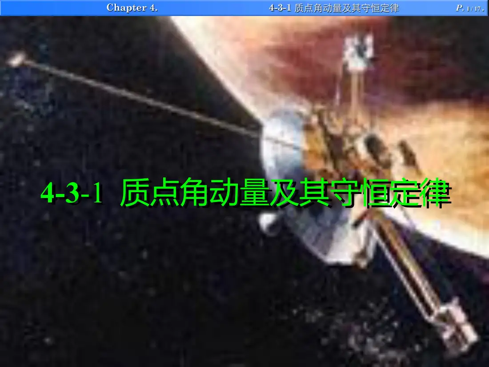

原文：

4-3-1 质点角动量及其守恒定律

Chapter 4.

4-3-1 质点角动量及其守恒定律

P. 1/17.

### 若 v = 常数，则：

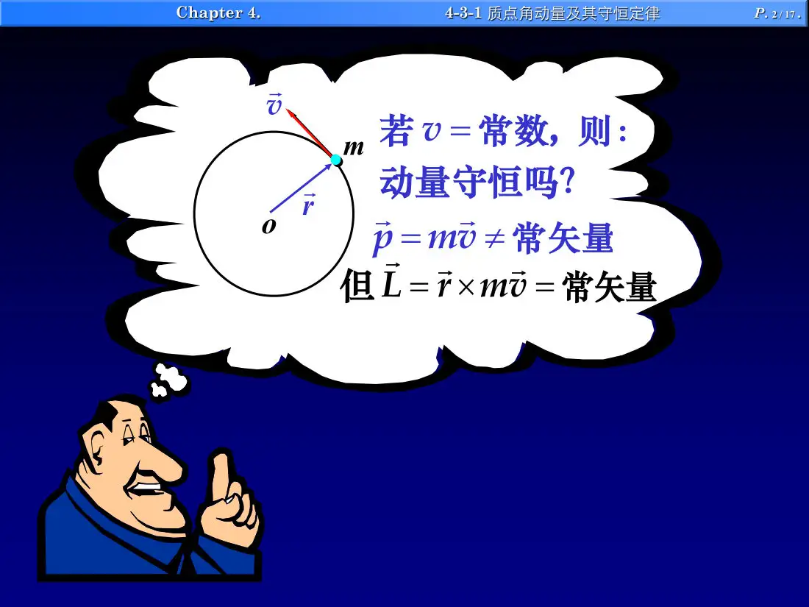

原文：

若 v = 常数，则：
动量守恒吗？ $\vec{p} = m\vec{v} \neq$ 常矢量 $\vec{L} = \vec{r} \times m\vec{v} =$ 常矢量$\vec{p} = m\vec{v}\neq$ 常矢量

Chapter 4.

4-3-1 质点角动量及其守恒定律

P. 2/17.

### $\vec{L}=\vec{r}\times m\vec{v}=$ 常矢量

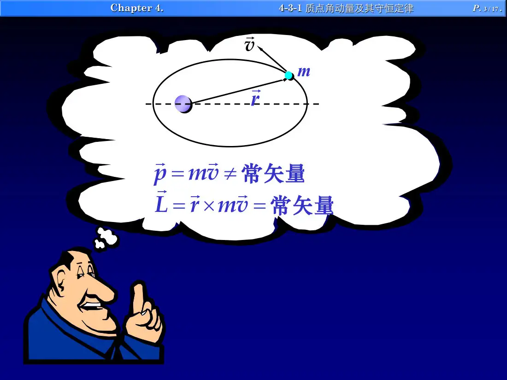

原文：

$\vec{L}=\vec{r}\times m\vec{v}=$ 常矢量

Chapter 4.

4-3-1 质点角动量及其守恒定律

P. 3/17.

### 1. 质点的角动量 (Angular Momentum) [定义] 质点角动量

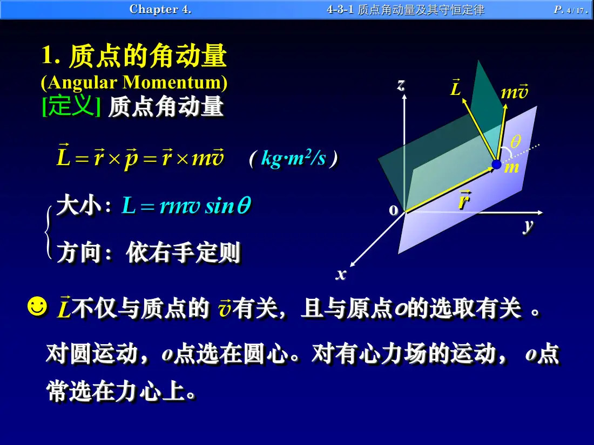

原文：

1. 质点的角动量 (Angular Momentum) [定义] 质点角动量

$\vec{L} = \vec{r} \times \vec{p} = \vec{r} \times m \vec{v}$ (kg·m²/s)

大小: $L = rmv \sin \theta$

方向：依右手定则

$\vec{L}$ 不仅与质点的 $\vec{v}$ 有关，且与原点o的选取有关。对圆运动，o点选在圆心。对有心力场的运动，o点常选在力心上。

Chapter 4.

4-3-1 质点角动量及其守恒定律

P. 4/17.

### 2. 质点的角动量定理

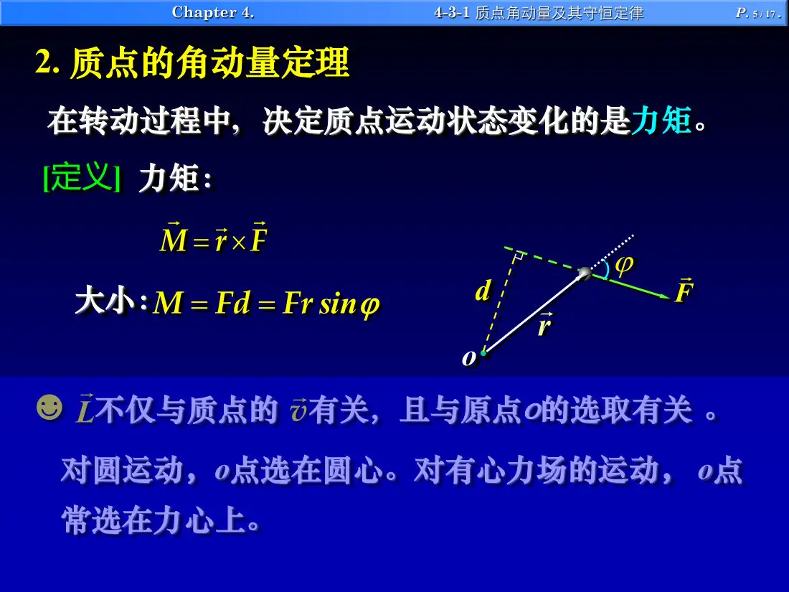

原文：

2. 质点的角动量定理
在转动过程中，决定质点运动状态变化的是力矩。
[定义] 力矩:

$\vec{M}=\vec{r}\times\vec{F}$

大小: M = Fd = Fr sin $\varphi$

$\vec{L}$ 不仅与质点的 $\vec{v}$ 有关，且与原点o的选取有关。对圆运动，o点选在圆心。对有心力场的运动，o点常选在力心上。

Chapter 4.

4-3-1 质点角动量及其守恒定律

P. 5/17.

### 2. 质点的角动量定理

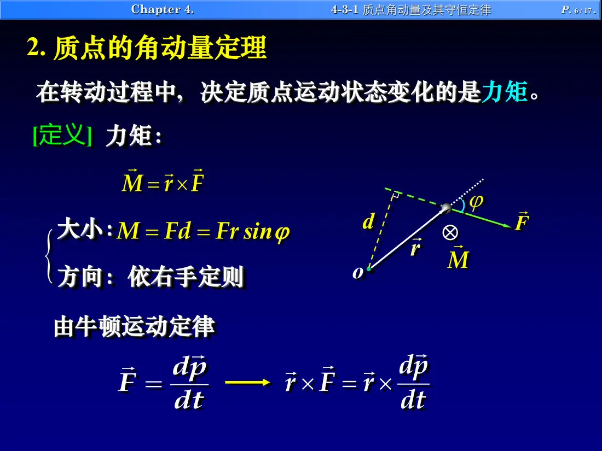

原文：

2. 质点的角动量定理

在转动过程中，决定质点运动状态变化的是力矩。

[定义] 力矩:

$$
\vec {M} = \vec {r} \times \vec {F}
$$

大小: M = Fd = Fr sin φ

方向：依右手定则

由牛顿运动定律

$$
\vec {F} = \frac {d \vec {p}}{d t} \longrightarrow \vec {r} \times \vec {F} = \vec {r} \times \frac {d \vec {p}}{d t}
$$

Chapter 4.

4-3-1 质点角动量及其守恒定律

P. 6/17.

### $$

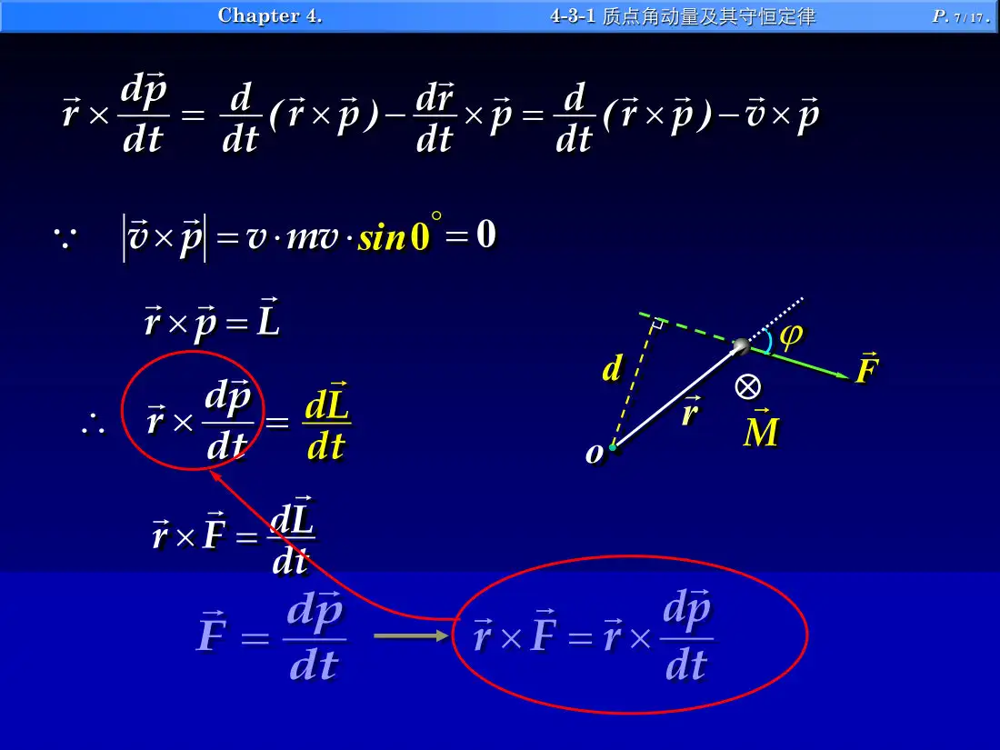

原文：

$$
\vec {r} \times \frac {d \vec {p}}{d t} = \frac {d}{d t} (\vec {r} \times \vec {p}) - \frac {d \vec {r}}{d t} \times \vec {p} = \frac {d}{d t} (\vec {r} \times \vec {p}) - \vec {v} \times \vec {p}
$$

$$
\because \quad | \vec {v} \times \vec {p} | = v \cdot m v \cdot \sin 0 ^ {\circ} = 0
$$

$$
\vec {r} \times \vec {p} = \vec {L}
$$

$$
\therefore \vec {r} \times \frac {d \vec {p}}{d t} = \frac {d \vec {L}}{d t}
$$

$$
\vec {r} \times \vec {F} = \frac {d \vec {L}}{d t}
$$

$\vec{F} = \frac{d\vec{p}}{dt}\longrightarrow \vec{r}\times \vec{F} = \vec{r}\times \frac{d\vec{p}}{dt}$

Chapter 4.

4-3-1 质点角动量及其守恒定律

P. 7/17.

### $$

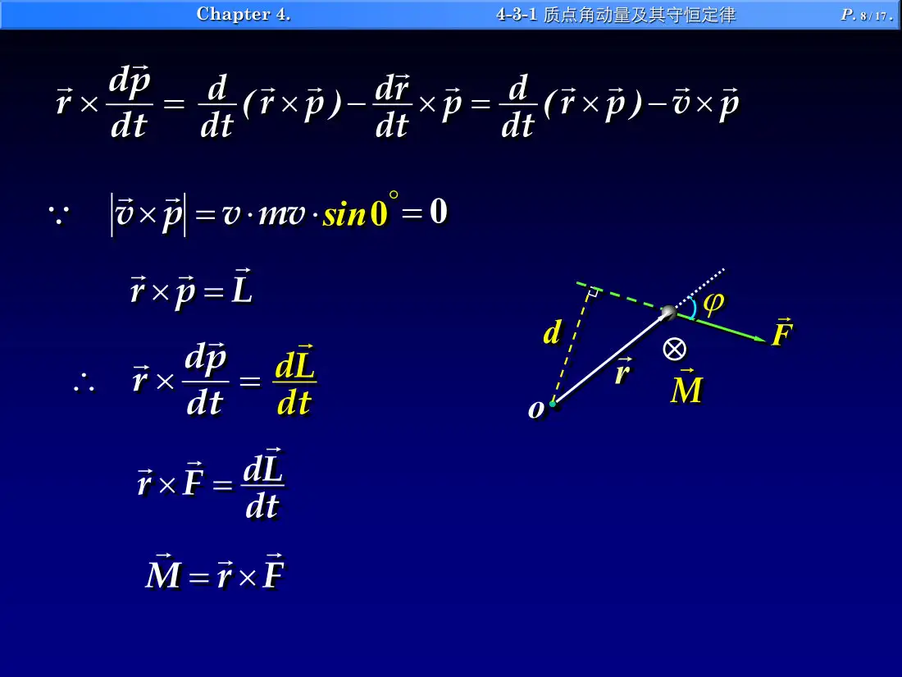

原文：

$$
\vec {r} \times \frac {d \vec {p}}{d t} = \frac {d}{d t} (\vec {r} \times \vec {p}) - \frac {d \vec {r}}{d t} \times \vec {p} = \frac {d}{d t} (\vec {r} \times \vec {p}) - \vec {v} \times \vec {p}
$$

$$
\because \quad | \vec {v} \times \vec {p} | = v \cdot m v \cdot \sin 0 ^ {\circ} = 0
$$

$$
\vec {r} \times \vec {p} = \vec {L}
$$

$$
\therefore \vec {r} \times \frac {d \vec {p}}{d t} = \frac {d \vec {L}}{d t}
$$

$$
\vec {r} \times \vec {F} = \frac {d \vec {L}}{d t}
$$

$$
\vec {M} = \vec {r} \times \vec {F}
$$

Chapter 4.

4-3-1 质点角动量及其守恒定律

P. 8/17.

### $$

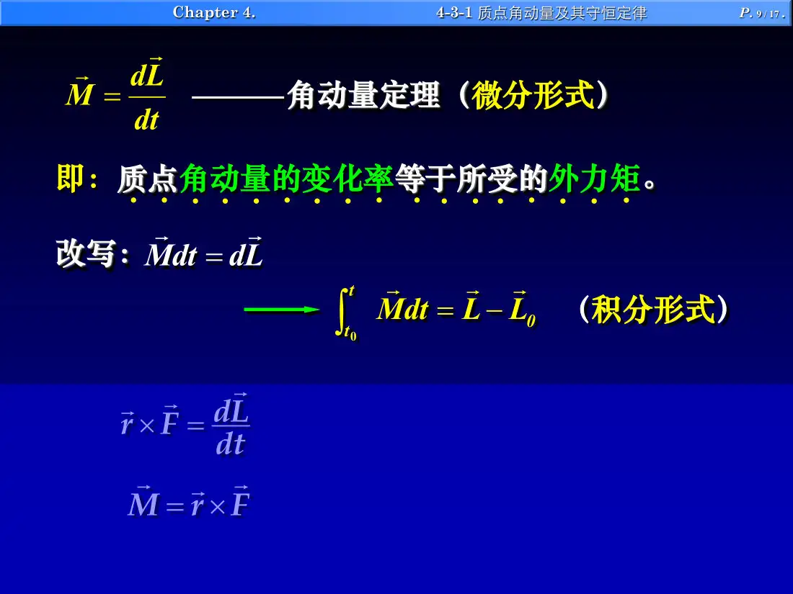

原文：

$$
\vec {M} = \frac {d \vec {L}}{d t} \quad — — \text {角动量定理（微分形式）}
$$

即：质点角动量的变化率等于所受的外力矩。

改写: $\vec{M}dt = d\vec{L}$

$$
\longrightarrow \int_ {t _ {0}} ^ {t} \vec {M} d t = \vec {L} - \vec {L} _ {0}
$$

(积分形式)

$$
\vec {r} \times \vec {F} = \frac {d \vec {L}}{d t}
$$

$$
\vec {M} = \vec {r} \times \vec {F}
$$

Chapter 4.

4-3-1 质点角动量及其守恒定律

P. 9/17.

### 即：质点角动量的变化率等于所受的外力矩。

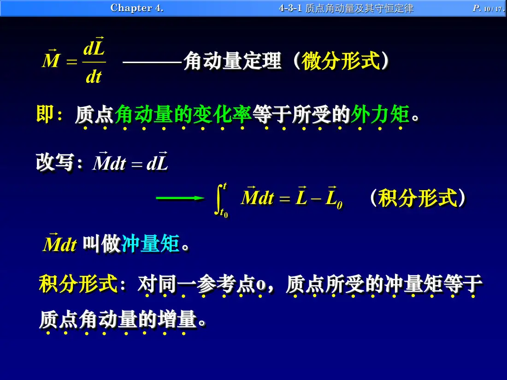

原文：

$\vec{M}=\frac{d\vec{L}}{dt}$ ——角动量定理（微分形式）

即：质点角动量的变化率等于所受的外力矩。

改写: $\vec{M}dt = d\vec{L}$

$$
\longrightarrow \int_ {t _ {0}} ^ {t} \vec {M} d t = \vec {L} - \vec {L} _ {0}
$$

(积分形式)

$\vec{M}dt$ 叫做冲量矩。

积分形式: 对同一参考点0, 质点所受的冲量矩等于质点角动量的增量。

Chapter 4.

4-3-1 质点角动量及其守恒定律

P. 10 / 17.

### 3. 质点角动量守恒定律

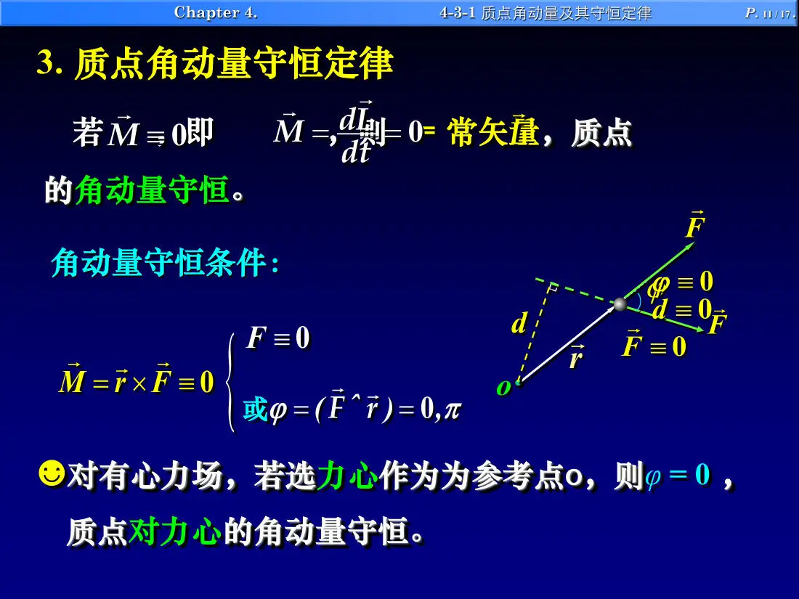

原文：

3. 质点角动量守恒定律

若 $\vec{M} \equiv 0$ 即 $\vec{M} = \frac{d\vec{I}}{dt} = 0 = \text{常矢量，质点的角动量守恒。}$

角动量守恒条件：

$$
\vec {M} = \vec {r} \times \vec {F} \equiv 0 \left\{ \begin{array}{l l} F \equiv 0 \\ \text {或} \varphi = (\vec {F} ^ {\wedge} \vec {r}) = 0, \pi \end{array} \right.
$$

$$
\begin{array}{c} \text {   } \\ \text {   } \\ \text {   } \\ \text {   } \\ \text {   } \\ \text {   } \\ \text {   } \\ \text {   } \\ \text {   } \\ \text {   } \\ \text {   } \\ \text {   } \\ \text {   } \\ \text {   } \\ \text {   } \\ \text {   } \\ \text {   } \\ \text {    } \\ \text {    } \\ \text {    } \\ \text {    } \\ \text {    } \\ \text {    } \\ \text {    } \\ \text {    } \\ \text {    } \\ \text {    } \\ \text {    } \\ \text {    } \\ \text {    } \\ \text {    } \\ \text {    } \\ \text {    } \\ \text {    } \\ \end{array}
$$

😊对有心力场，若选力心作为为参考点o，则φ = 0，质点对力心的角动量守恒。

Chapter 4.

4-3-1 质点角动量及其守恒定律

P. 11/17.

### 万有引力场：地球角动量守恒

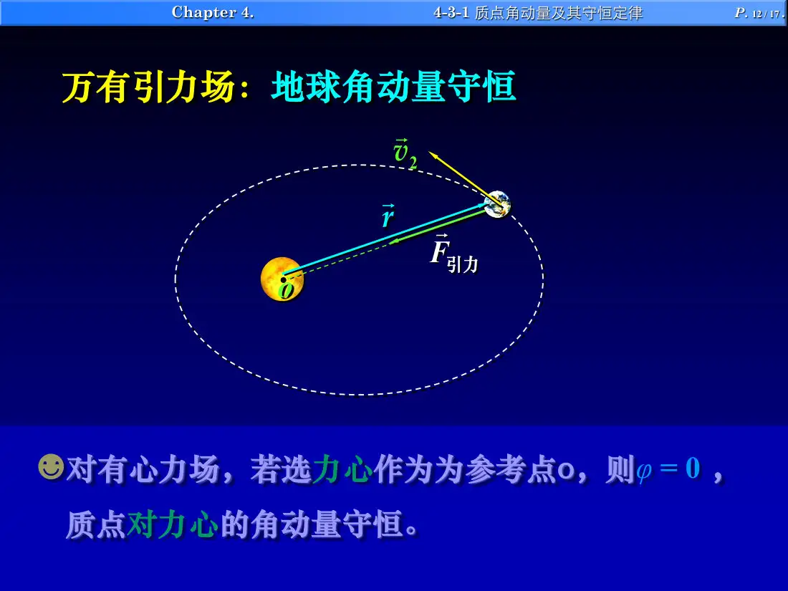

原文：

万有引力场：地球角动量守恒

对有心力场，若选力心作为为参考点o，则 $\varphi=0$ ，质点对力心的角动量守恒。

Chapter 4.

4-3-1 质点角动量及其守恒定律

P. 12 / 17.

### 万有引力场：地球角动量守恒

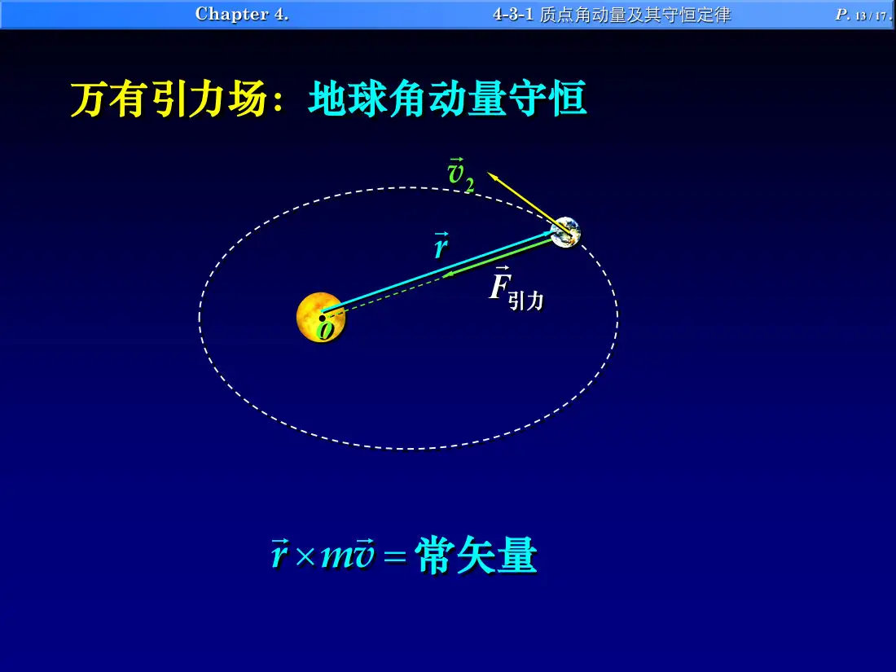

原文：

万有引力场：地球角动量守恒

$\vec{r} \times m\vec{o} =$ 常矢量

Chapter 4.

4-3-1 质点角动量及其守恒定律

P. 13 / 17.

### 例 蓮星绕太阳作椭圆轨道运动，试比较近日点与远日点的速度大小。

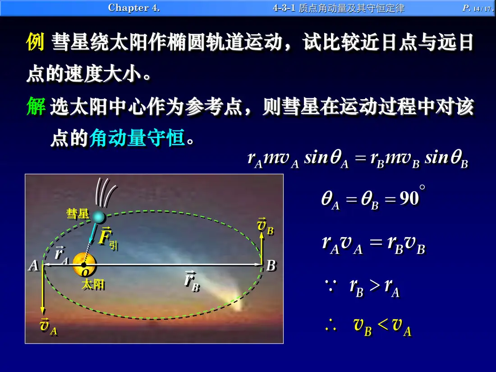

原文：

例 蓮星绕太阳作椭圆轨道运动，试比较近日点与远日点的速度大小。

解 选太阳中心作为参考点，则彗星在运动过程中对该点的角动量守恒。

$$
r _ {A} m v _ {A} \sin \theta_ {A} = r _ {B} m v _ {B} \sin \theta_ {B}
$$

$$
\theta_ {A} = \theta_ {B} = 9 0 ^ {\circ}
$$

$$
r _ {A} v _ {A} = r _ {B} v _ {B}
$$

$$
\because r _ {B} > r _ {A}
$$

$$
\therefore v _ {B} <   v _ {A}
$$

Chapter 4.

4-3-1 质点角动量及其守恒定律

P. 14/17.

### 水平台面上转动的小球角动量守恒

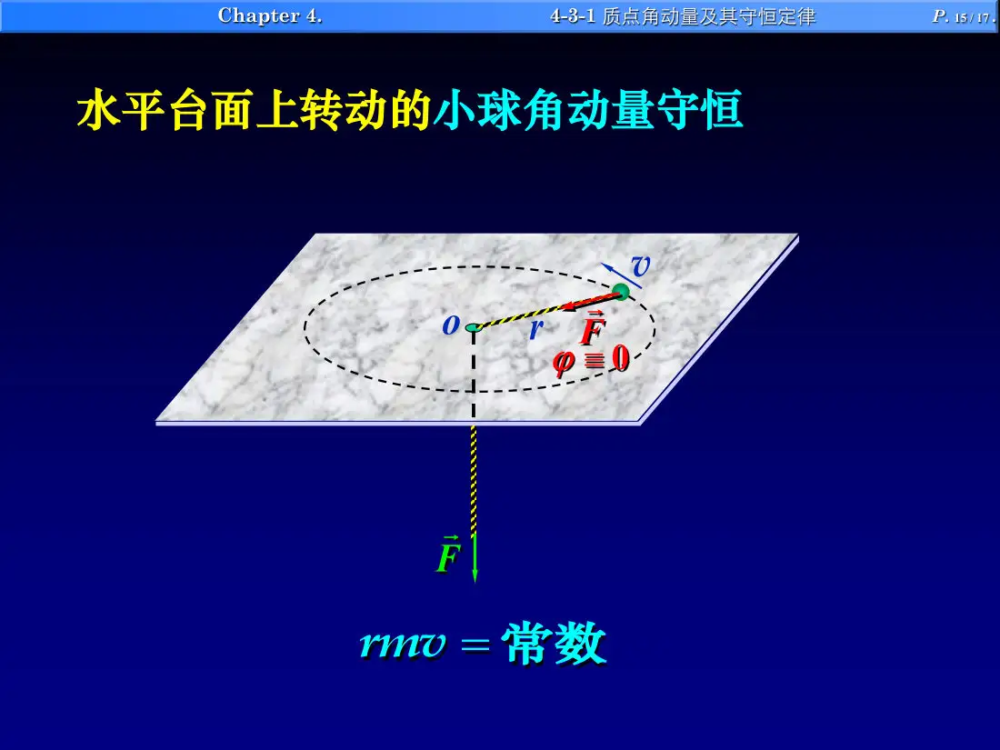

原文：

水平台面上转动的小球角动量守恒

rmv = 常数

Chapter 4.

4-3-1 质点角动量及其守恒定律

P. 15/17.

### 水平台面上转动的木块角动量守恒

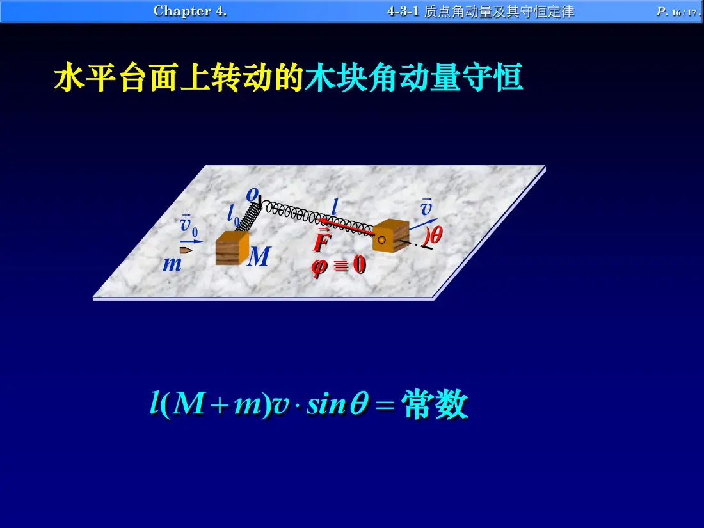

原文：

水平台面上转动的木块角动量守恒

$l(M+m)v\cdot\sin\theta=$ 常数

Chapter 4.

4-3-1 质点角动量及其守恒定律

P. 16/17.
