# 《大学物理》第5章 静电场 5-1,5-2 电荷和库仑定律（课件）

原件的每一页，下面附识别出的文字。

### 5-1,5-2 电荷和库仑定律

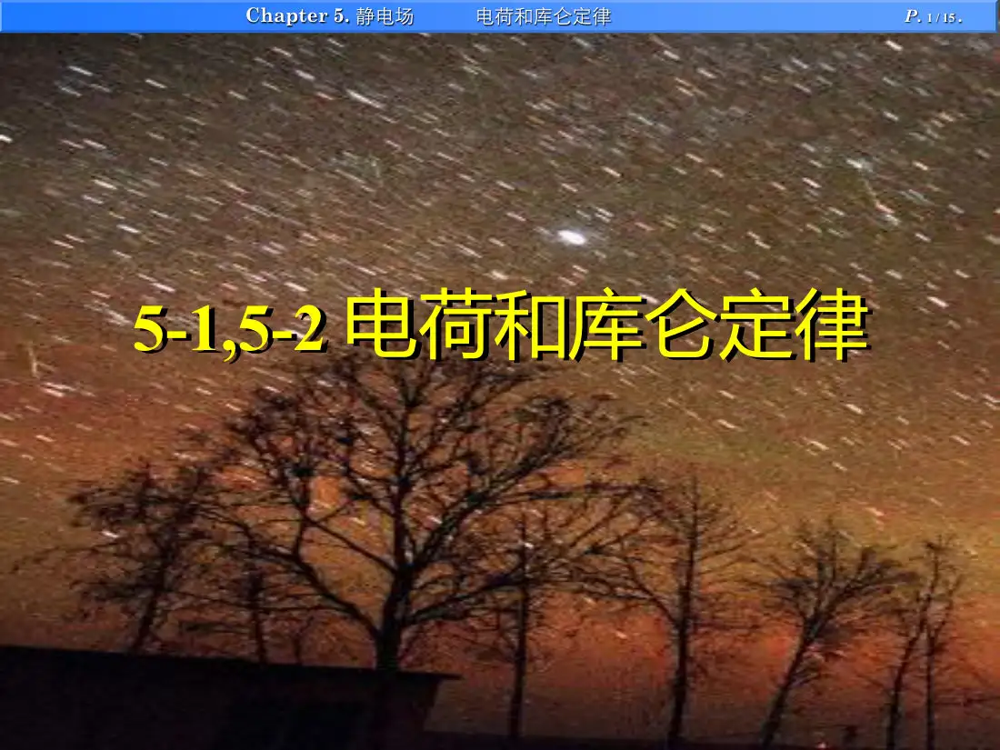

原文：

5-1,5-2 电荷和库仑定律

Chapter 5. 静电场

者：杨茂田 电荷和库仑定律

P. 1 / 15 .

### 一、电荷 电荷守恒定律

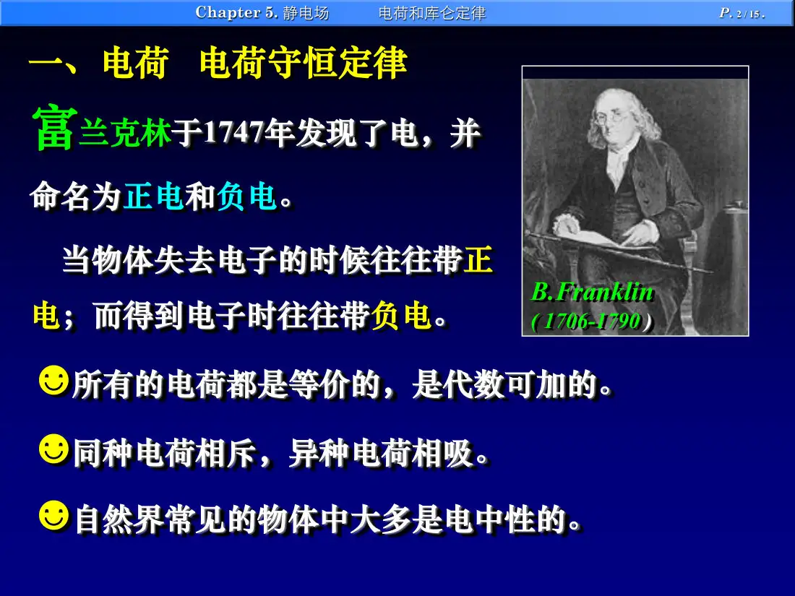

原文：

一、电荷 电荷守恒定律

富兰克林于1747年发现了电，并命名为正电和负电。

当物体失去电子的时候往往带正电；而得到电子时往往带负电。

☻所有的电荷都是等价的，是代数可加的。

☻同种电荷相斥，异种电荷相吸。

☻自然界常见的物体中大多是电中性的。

Chapter 5. 静电场 者：杨茂田 电荷和库仑定律

P. 2 / 15 .

### 密立根油滴实验

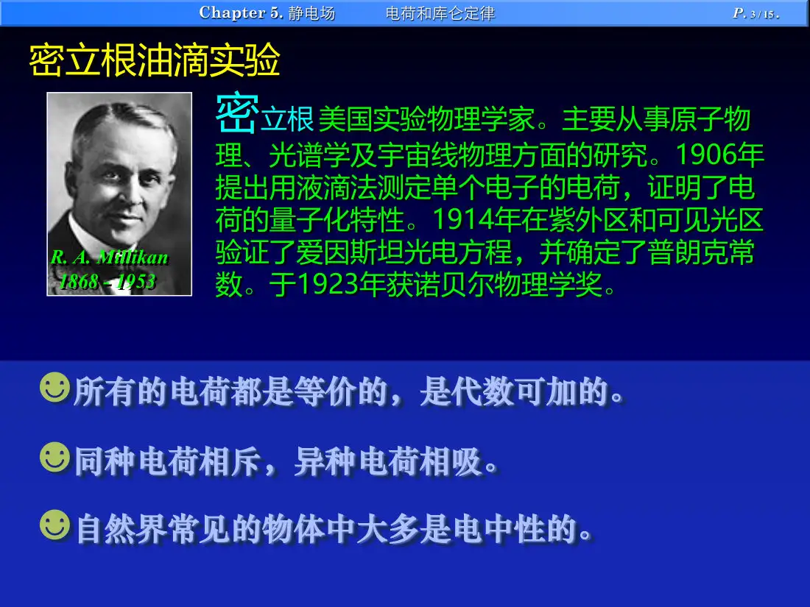

原文：

密立根油滴实验

密立根 美国实验物理学家。主要从事原子物理、光谱学及宇宙线物理方面的研究。1906年提出用液滴法测定单个电子的电荷，证明了电荷的量子化特性。1914年在紫外区和可见光区验证了爱因斯坦光电方程，并确定了普朗克常数。于1923年获诺贝尔物理学奖。

☻所有的电荷都是等价的，是代数可加的。

☻同种电荷相斥，异种电荷相吸。

☻自然界常见的物体中大多是电中性的。

Chapter 5. 静电场 者：杨茂田 电荷和库仑定律

P. 3 / 15 .

### 密立根油滴实验

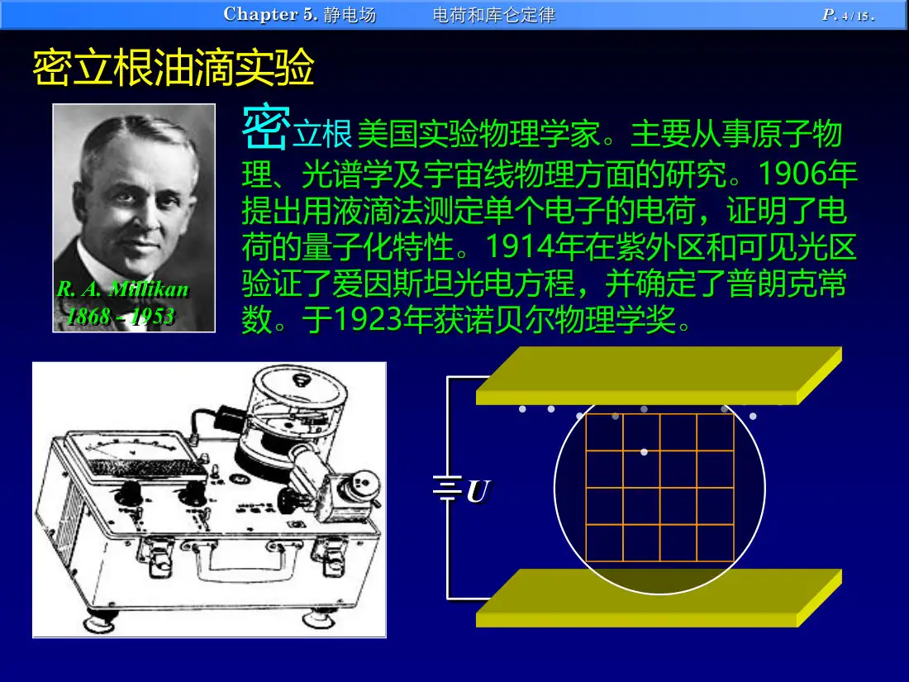

原文：

密立根油滴实验

密立根 美国实验物理学家。主要从事原子物理、光谱学及宇宙线物理方面的研究。1906年提出用液滴法测定单个电子的电荷，证明了电荷的量子化特性。1914年在紫外区和可见光区验证了爱因斯坦光电方程，并确定了普朗克常数。于1923年获诺贝尔物理学奖。

Chapter 5. 静电场 者：杨茂田 电荷和库仑定律

P. 4 / 15 .

### $$

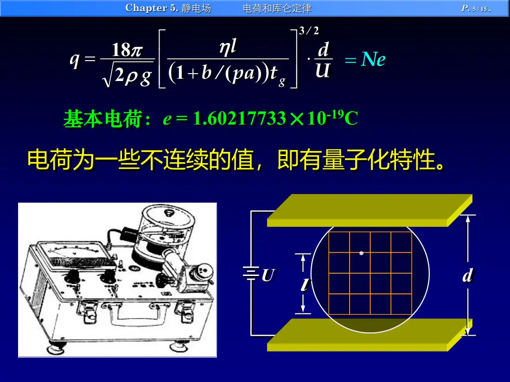

原文：

$$
q = \frac {1 8 \pi}{\sqrt {2 \rho g}} \left[ \frac {\eta l}{(1 + b / (p a)) t _ {g}} \right] ^ {3 / 2} \cdot \frac {d}{U} = N e
$$

基本电荷： $( 2 - 3 ) \times ( 2 1 ) \times 3 = 3 ( 2 0 \times 2 )$ 电荷为一些不连续的值，即有量子化特性。

Chapter 5. 静电场

者：杨茂田 电荷和库仑定律

P. 5 / 15 .

### 现代物理中的夸克模型(quark model):

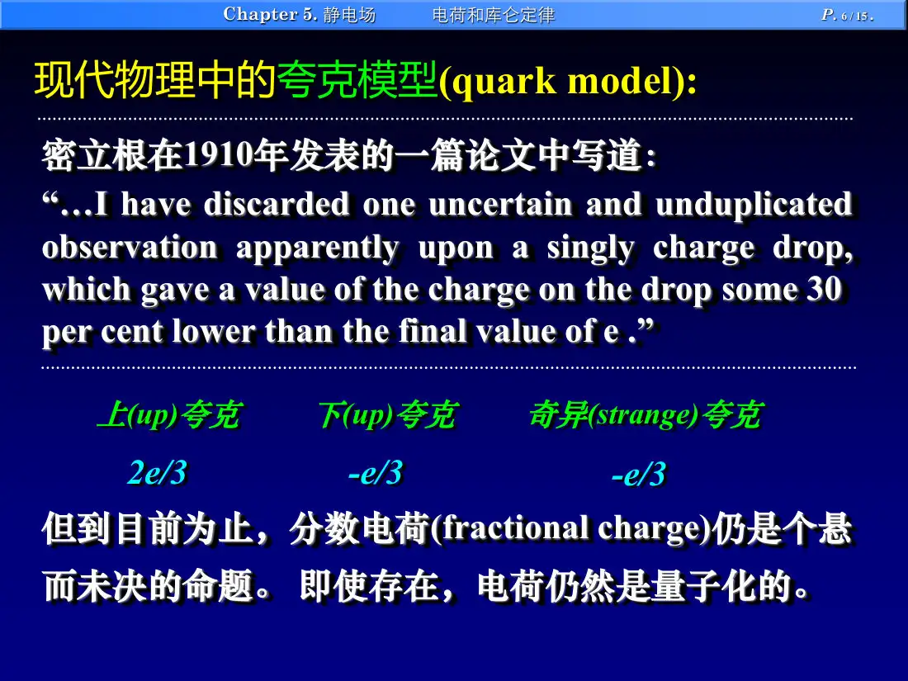

原文：

现代物理中的夸克模型(quark model):

密立根在1910年发表的一篇论文中写道：

I have discarded one uncertain and unduplicated observation apparently upon a singly charge drop, which gave a value of the charge on the drop some 30 per cent lower than the final value of e .”

(up)

(up)

(strange)

2e/3

-e/3

-e/3

但到目前为止，分数电荷(fractional charge)仍是个悬而未决的命题。 即使存在，电荷仍然是量子化的。

Chapter 5. 静电场 者：杨茂田 电荷和库仑定律

P. 6 / 15 .

### 二、电荷守恒定律

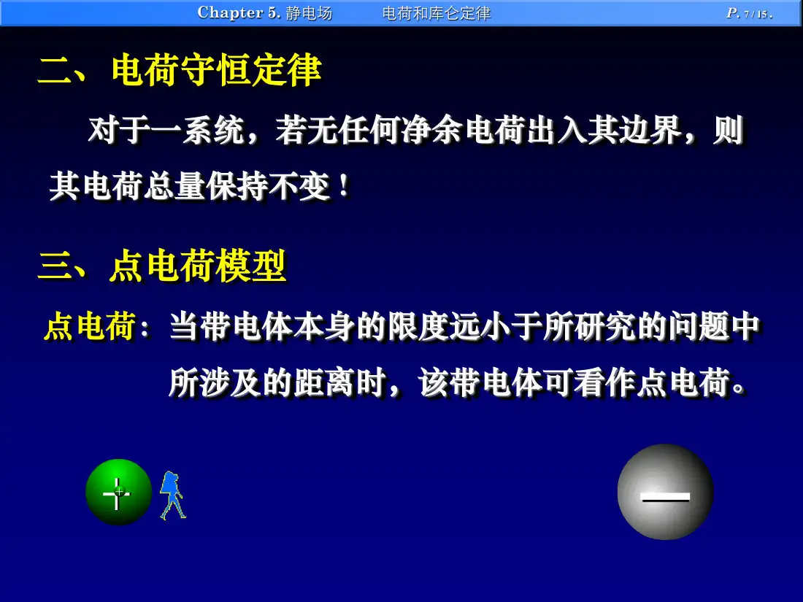

原文：

二、电荷守恒定律

对于一系统，若无任何净余电荷出入其边界，则其电荷总量保持不变 !

三、点电荷模型

点电荷：当带电体本身的限度远小于所研究的问题中所涉及的距离时，该带电体可看作点电荷。

Chapter 5. 静电场 者：杨茂田 电荷和库仑定律

P. 7 / 15 .

### 四、库仑定律

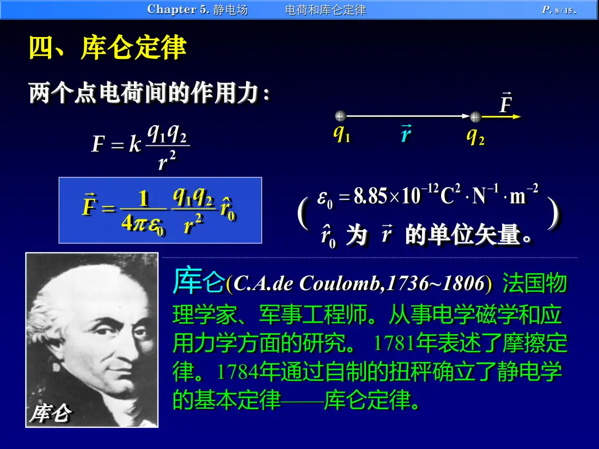

原文：

四、库仑定律

两个点电荷间的作用力：

$$
F = k \frac {q _ {1} q _ {2}}{r ^ {2}}
$$

$$
\vec {F} = \frac {1}{4 \pi \varepsilon_ {0}} \frac {q _ {1} q _ {2}}{r ^ {2}} \hat {r} _ {0}
$$

ε0 =8.85×10−12C2.N−1·m−$1 0$ 为 r 的单位矢量。

库仑(C.A.de Coulomb,1736\~1806) 法国物理学家、军事工程师。从事电学磁学和应用力学方面的研究。1781年表述了摩擦定律。1784年通过自制的扭秤确立了静电学的基本定律— 库仑定律。

Chapter 5. 静电场

者：杨茂田 电荷和库仑定律

P. 8 / 15 .

### 四、库仑定律

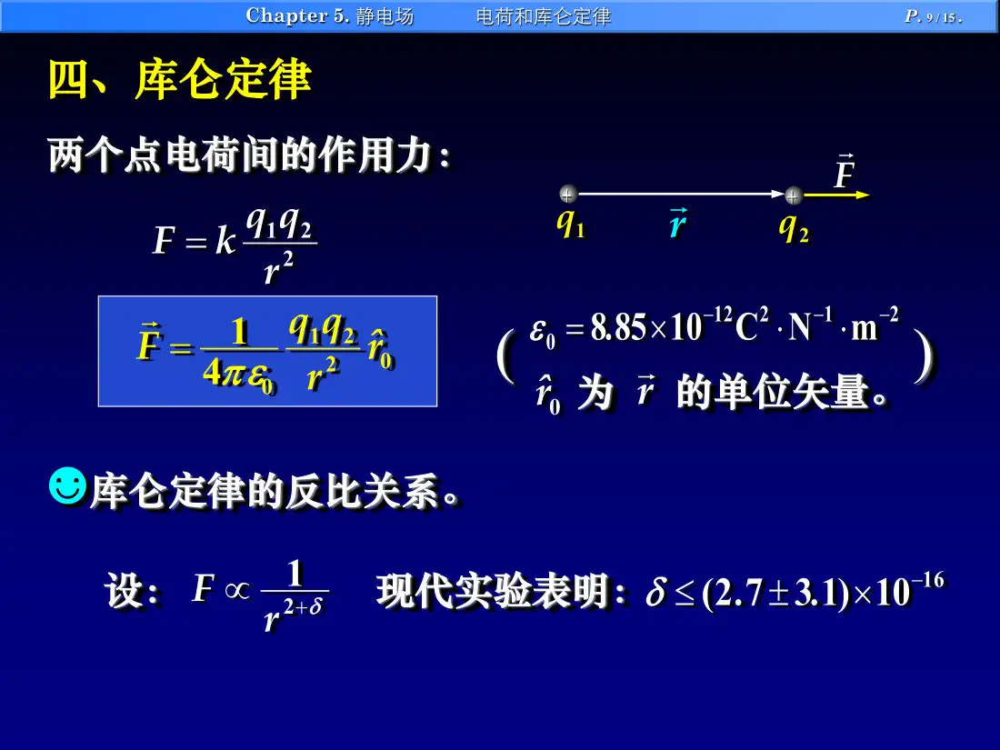

原文：

四、库仑定律

两个点电荷间的作用力：

$$
F = k \frac {q _ {1} q _ {2}}{r ^ {2}}
$$

$$
\vec {F} = \frac {1}{4 \pi \varepsilon_ {0}} \frac {q _ {1} q _ {2}}{r ^ {2}} \hat {r} _ {0}
$$

ε0 =8.85×10−12C2.N−1.m−²$\textcircled { 1 }$ 为 r 的单位矢量。

☻库仑定律的反比关系。

设： $1 2 0 0 \frac { 1 1 } { 1 2 0 0 }$ 现代实验表明： $\langle \rangle \because ( \langle \rho \rangle \langle \rho \rangle \langle \rho \rangle \langle \rho \rangle ) = \langle \rho \rangle \langle \rho \rangle ( \rho )$

Chapter 5. 静电场

者：杨茂田 电荷和库仑定律

P. 9 / 15 .

### 解 库仑引力： $1 0 0 - 1 0 0 = 1 0 0 ( c m )$

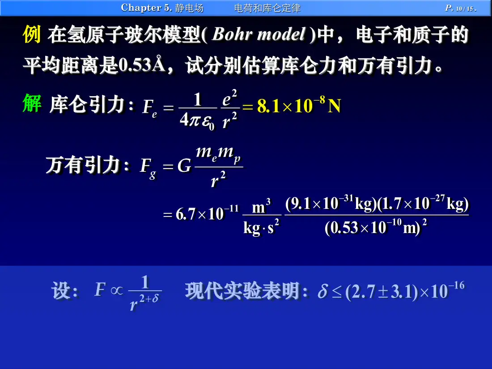

原文：

例 在氢原子玻尔模型( Bohr model )中，电子和质子的平均距离是 $\textcircled { 1 } \textcircled { < } \textcircled { < } \textcircled { < } \textcircled { < }$ ，试分别估算库仑力和万有引力。

解 库仑引力： $1 0 0 - 1 0 0 = 1 0 0 ( c m )$

万有引力： $\frac { 1 } { ( 1 8 + 1 0 ) ( 1 0 + 1 0 ) } = \frac { 1 } { ( 1 8 + 1 0 ) ( 1 0 + 1 0 ) } = \frac { 1 } { ( 1 8 + 1 0 ) ( 1 0 + 1 0 ) }$

设： $1 2 0 0 \frac { 1 1 } { 1 2 0 0 }$ 现代实验表明： $\dot { ( ) } = ( \dot { ( ) } \dot { ( ) } - \dot { ( ) } \dot { ( ) } - \dot { ( ) } \dot { ( ) } ) \dot { ( ) } \dot { ( ) } - ( \dot { ( ) } - \dot { ( ) } )$

Chapter 5. 静电场

者：杨茂田 电荷和库仑定律

P. 10 / 15 .

### 解 库仑引力： $1 0 0 - 1 0 0 = 1 0 0 ( c m )$

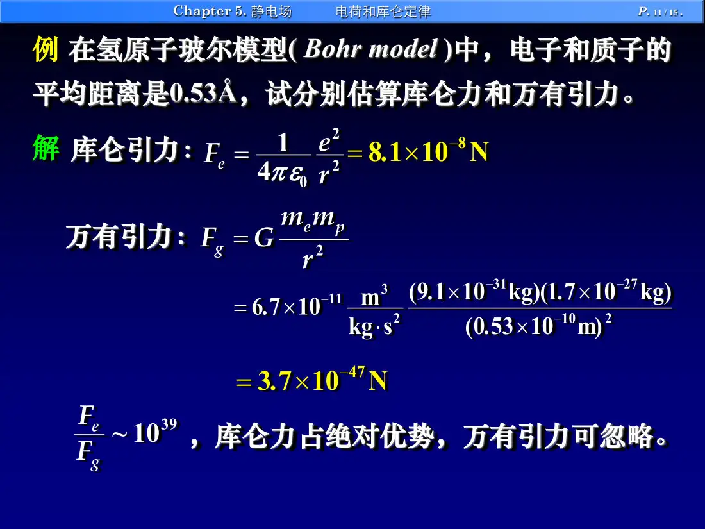

原文：

例 在氢原子玻尔模型( Bohr model )中，电子和质子的平均距离是 $\textcircled { 1 } \textcircled { < } \textcircled { < } \textcircled { < } \textcircled { < }$ ，试分别估算库仑力和万有引力。

解 库仑引力： $1 0 0 - 1 0 0 = 1 0 0 ( c m )$

万有引力： $1 0 \times 1 0 = 1 0 ( c m )$

$$
= 6. 7 \times 1 0 ^ {- 1 1} \frac {\mathrm{m} ^ {3}}{\mathrm{kg} \cdot \mathrm{s} ^ {2}} \frac {(9 . 1 \times 1 0 ^ {- 3 1} \mathrm{kg}) (1 . 7 \times 1 0 ^ {- 2 7} \mathrm{kg})}{(0 . 5 3 \times 1 0 ^ {- 1 0} \mathrm{m}) ^ {2}}
$$

$\frac { 1 5 } { 1 5 } \div ( 1 ) = \frac { 1 } { 1 5 }$ ，库仑力占绝对优势，万有引力可忽略。

Chapter 5. 静电场 者：杨茂田 电荷和库仑定律

P. 11 / 15 .

### $$

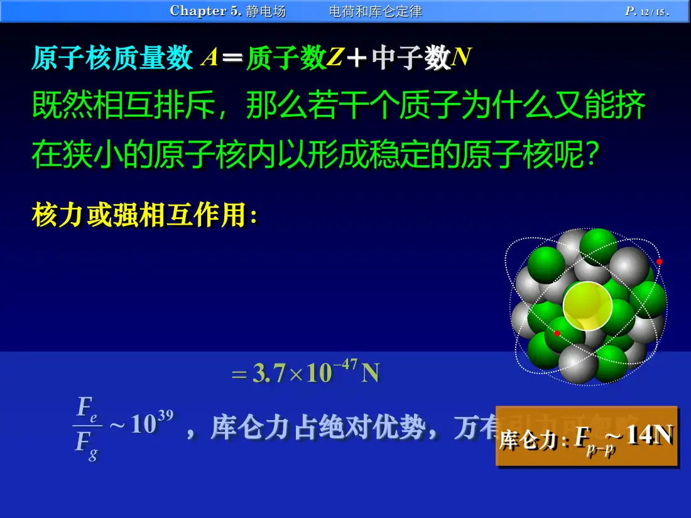

原文：

原子核质量数 A＝质子数Z＋中子数N既然相互排斥，那么若干个质子为什么又能挤在狭小的原子核内以形成稳定的原子核呢？核力或强相互作用：

$$
= 3. 7 \times 1 0 ^ {- 4 7} \mathrm{N}
$$

$\frac { 1 5 } { 1 5 } = \frac { 1 5 } { 1 5 }$ 库仑力占绝对优势，万有 库仑力： $\frac { \overrightarrow { r } } { \overrightarrow { p } - \overrightarrow { p } } - 1 = \overrightarrow { h }$ 原子核质量数 A＝质子数Z＋中子数N既然相互排斥，那么若干个质子为什么又能挤在狭小的原子核内以形成稳定的原子核呢？

Chapter 5. 静电场

者：杨茂田 电荷和库仑定律

P. 12 / 15 .

### 核力或强相互作用：

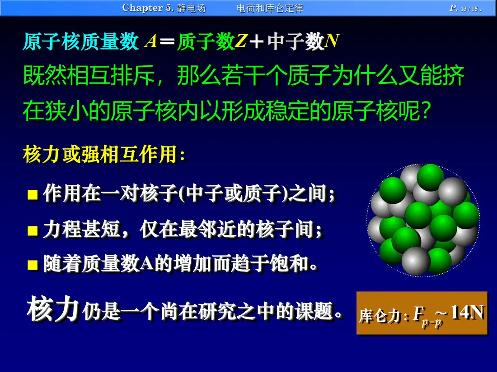

原文：

核力或强相互作用：

■ 作用在一对核子(中子或质子)之间；

■ 力程甚短，仅在最邻近的核子间；

■ 随着质量数A的增加而趋于饱和。

核力仍是一个尚在研究之中的课题。

库仑力： $\frac { \mathbf { \phi } _ { \mathbf { r } } } { \mathbf { \phi } _ { \mathbf { r } } \mathbf { - } \mathbf { \phi } _ { \rho } } \sim \left\| \mathbf { \phi } _ { \mathbf { - } } \mathbf { \phi } _ { \mathbf { r } } \right\| \cdot \left\| \mathbf { \phi } _ { \mathbf { \phi } } \right\|$

Chapter 5. 静电场

者：杨茂田 电荷和库仑定律

P. 13 / 15 .

### 归纳

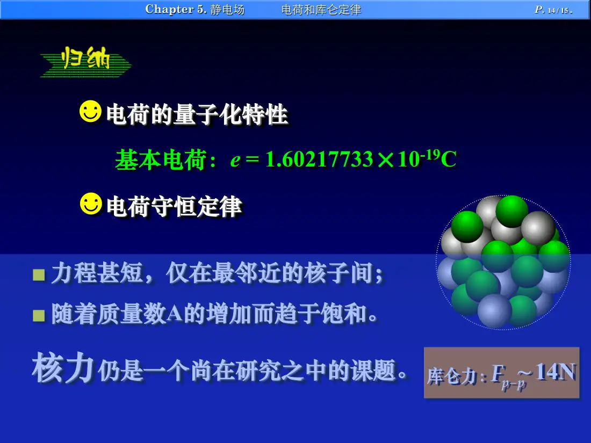

原文：

归纳

☻电荷的量子化特性

基本电荷： $( 2 - 1 ) \times ( 1 2 - 1 ) \times ( 1 4 - 2 ) \times ( 2 - 1 ) \times ( 2 - 1 )$

☻电荷守恒定律

■ 力程甚短，仅在最邻近的核子间；

■ 随着质量数A的增加而趋于饱和。

核力仍是一个尚在研究之中的课题。

库仑力： $\frac { \mathbf { \Delta } \mathbf { F } } { \mathbf { \Delta } _ { i j } } \sim \mathbf { \Delta } \mathbf { \Delta } \mathbf { \Delta } \mathbf { \Delta } \mathbf { \Delta } \mathbf { \Delta }$

Chapter 5. 静电场 者：杨茂田 电荷和库仑定律

P. 14 / 15 .

### 归纳

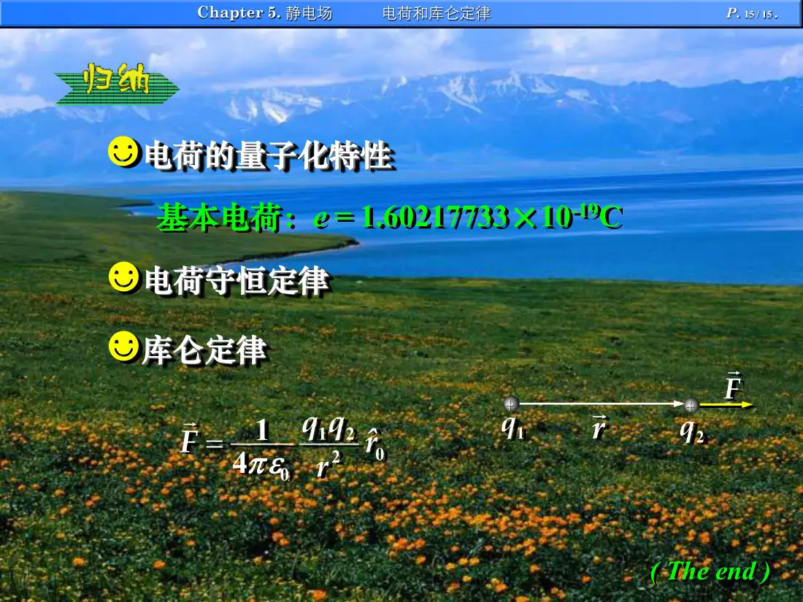

原文：

归纳

☻电荷的量子化特性

基本电荷： $\angle 2 = 1 5 0 ^ { \circ } \angle 1 7 7 3 3 \angle 1 0 ^ { \circ } \angle 1 3 0 ^ { \circ }$

☻电荷守恒定律

☻库仑定律

$$
\vec {F} = \frac {1}{4 \pi \varepsilon_ {0}} \frac {q _ {1} q _ {2}}{r ^ {2}} \hat {r} _ {0}
$$

Chapter 5. 静电场 者：杨茂田 电荷和库仑定律

P. 15 / 15 .
