# 《大学物理》第5章 静电场 §5.2 电场与电场强度（课件）

原件的每一页，下面附识别出的文字。

### § 5.2 电场与电场强度

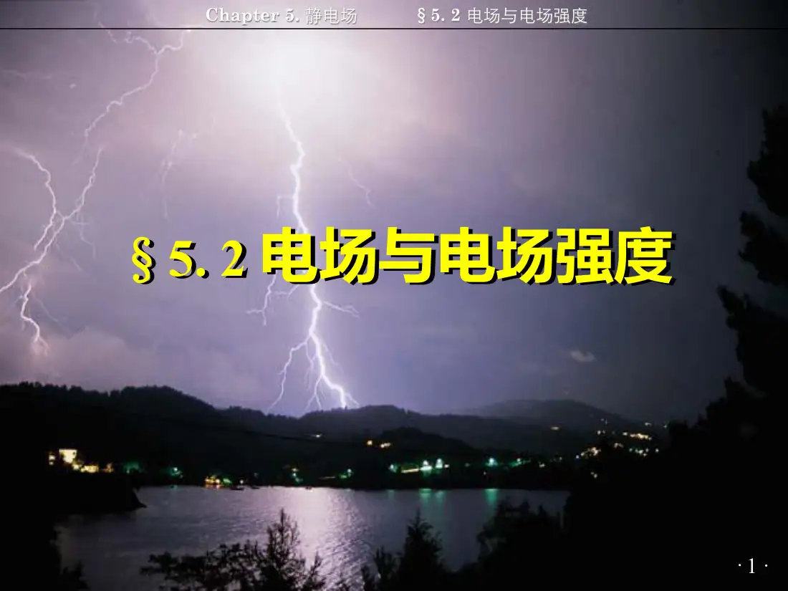

原文：

§ 5.2 电场与电场强度

Chapter 5. 静电场

§ 5.2 电场与电场强度

1

### Chapter 5. 静电场

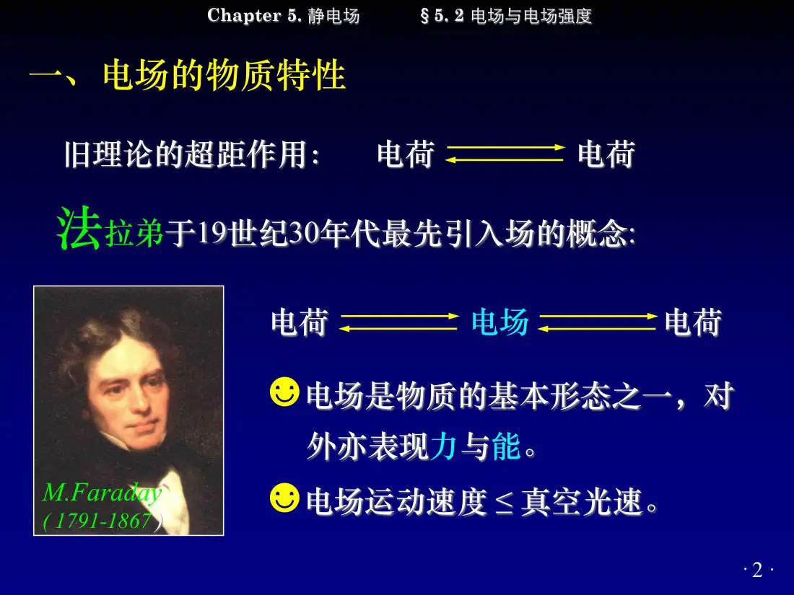

原文：

Chapter 5. 静电场

§ 5.2 电场与电场强度

一、电场的物质特性

旧理论的超距作用：电荷 $\rightleftharpoons$ 电荷

法拉弟于19世纪30年代最先引入场的概念:

电荷 $\xrightarrow{\quad}$ 电场 $\xleftarrow{\quad}$ 电荷

电场是物质的基本形态之一，对外亦表现力与能。

电场运动速度≤真空光速。

2

### 二、电场强度

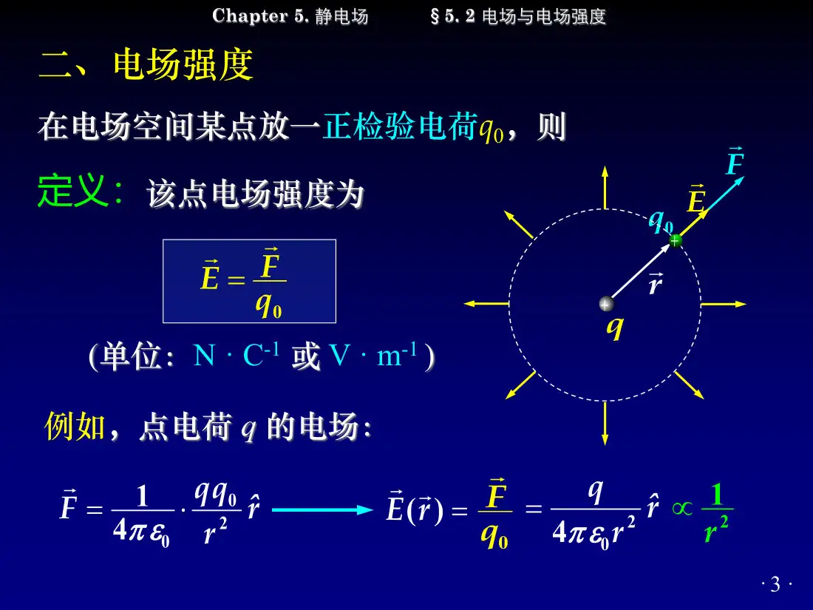

原文：

二、电场强度

在电场空间某点放一正检验电荷 $q_{0}$ ，则

定义：该点电场强度为

$$
\vec {E} = \frac {\vec {F}}{q _ {0}}
$$

(单位: N·C $^{-1}$ 或 V·m $^{-1}$ )

例如，点电荷 q 的电场：

$$
\vec {F} = \frac {1}{4 \pi \varepsilon_ {0}} \cdot \frac {q q _ {0}}{r ^ {2}} \hat {r} \longrightarrow \vec {E} (\vec {r}) = \frac {\vec {F}}{q _ {0}} = \frac {q}{4 \pi \varepsilon_ {0} r ^ {2}} \hat {r} \propto \frac {1}{r ^ {2}}
$$

Chapter 5. 静电场

§ 5.2 电场与电场强度

3

### Chapter 5. 静电场 § 5.2 电场与电场强度

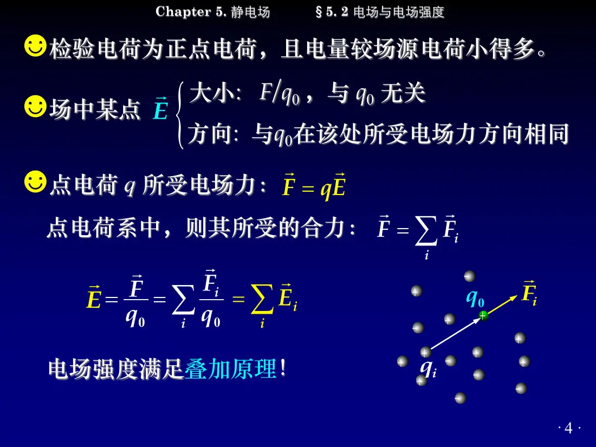

原文：

Chapter 5. 静电场 § 5.2 电场与电场强度

检验电荷为正点电荷，且电量较场源电荷小得多。

场中某点 $\vec{E}$

大小: $F / q_{0}$ , 与 $q_{0}$ 无关

方向: 与 $q_{0}$ 在该处所受电场力方向相同

😊点电荷 q 所受电场力： $\vec{F}=q\vec{E}$

点电荷系中，则其所受的合力： $\vec{F} = \sum \vec{F}_i$

$\vec{E} = \frac{\vec{F}}{q_0} = \sum_i\frac{\vec{F}_i}{q_0} = \sum_i\vec{E}_i$

电场强度满足叠加原理！

4

### Chapter 5. 静电场 § 5.2 电场与电场强度

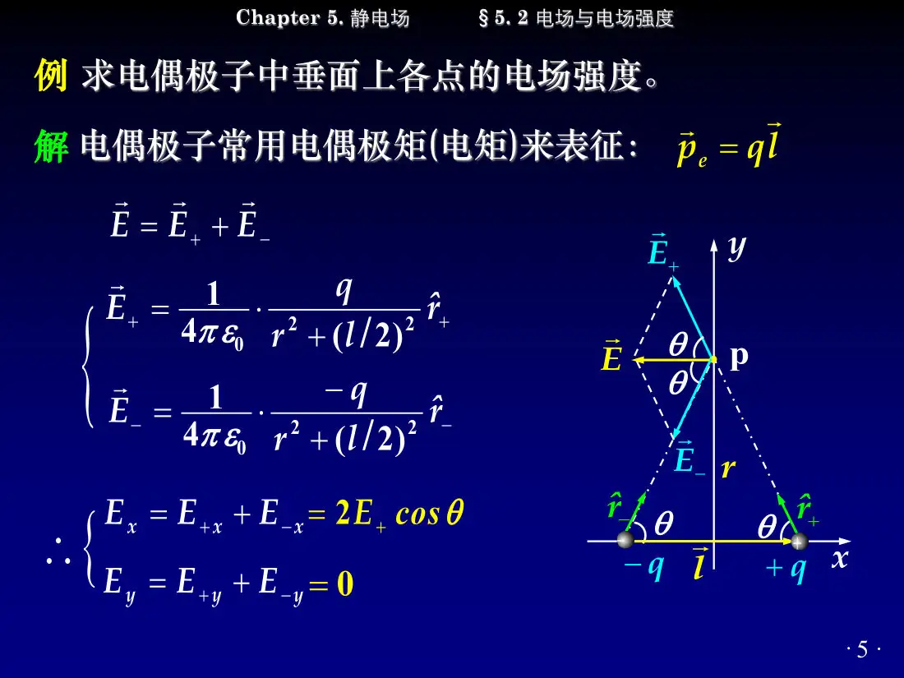

原文：

Chapter 5. 静电场 § 5.2 电场与电场强度

例 求电偶极子中垂面上各点的电场强度。

解 电偶极子常用电偶极矩(电矩)来表征: $\vec{p}_{e} = q\vec{l}$

$$
\vec {E} = \vec {E} _ {+} + \vec {E} _ {-}
$$

$$
\left\{ \begin{array}{l} \vec {E} _ {+} = \frac {1}{4 \pi \varepsilon_ {0}} \cdot \frac {q}{r ^ {2} + (l / 2) ^ {2}} \hat {r} _ {+} \\ \vec {E} _ {-} = \frac {1}{4 \pi \varepsilon_ {0}} \cdot \frac {- q}{r ^ {2} + (l / 2) ^ {2}} \hat {r} _ {-} \end{array} \right.
$$

$$
\therefore \left\{ \begin{array}{l} E _ {x} = E _ {+ x} + E _ {- x} = 2 E _ {+} \cos \theta \\ E _ {y} = E _ {+ y} + E _ {- y} = 0 \end{array} \right.
$$

5

### Chapter 5. 静电场

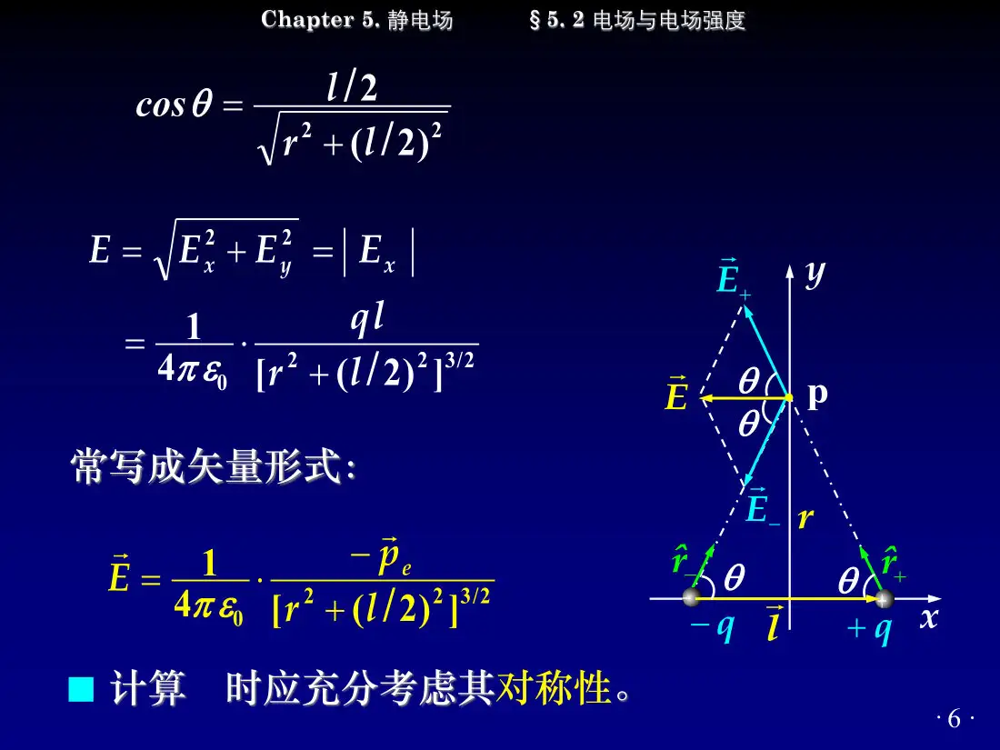

原文：

Chapter 5. 静电场

$$
\cos \theta = \frac {l / 2}{\sqrt {r ^ {2} + (l / 2) ^ {2}}}
$$

$$
\begin{array}{r l} & E = \sqrt {E _ {x} ^ {2} + E _ {y} ^ {2}} = \left| E _ {x} \right| \\ & = \frac {1}{4 \pi \varepsilon_ {0}} \cdot \frac {q l}{[ r ^ {2} + (l / 2) ^ {2} ] ^ {3 / 2}} \end{array}
$$

常写成矢量形式:

$$
\vec {E} = \frac {1}{4 \pi \varepsilon_ {0}} \cdot \frac {- \vec {p} _ {e}}{\left[ r ^ {2} + (l / 2) ^ {2} \right] ^ {3 / 2}}
$$

§ 5.2 电场与电场强度

计算 时应充分考虑其对称性。

6

### Chapter 5. 静电场 § 5.2 电场与电场强度

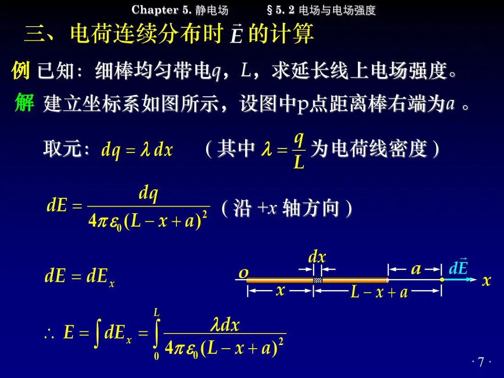

原文：

Chapter 5. 静电场 § 5.2 电场与电场强度

三、电荷连续分布时 $\vec{E}$ 的计算

例 已知：细棒均匀带电 $q$ ， $L$ ，求延长线上电场强度。

解 建立坐标系如图所示，设图中p点距离棒右端为a。

取元: $dq = \lambda dx$ (其中 $\lambda = \frac{q}{L}$ 为电荷线密度)

$dE=\frac{dq}{4\pi\varepsilon_{0}(L-x+a)^{2}}$ （沿 +x 轴方向）

$$
d E = d E _ {x}
$$

$$
\begin{array}{c} \text {   dx   } \\ \text {   o   } \quad \text {   dE   } \\ \text {   x   } \quad \text {   L - x + a   } \end{array}
$$

$$
\therefore E = \int d E _ {x} = \int_ {0} ^ {L} \frac {\lambda d x}{4 \pi \varepsilon_ {0} (L - x + a) ^ {2}}
$$

7

### Chapter 5. 静电场 § 5.2 电场与电场强度

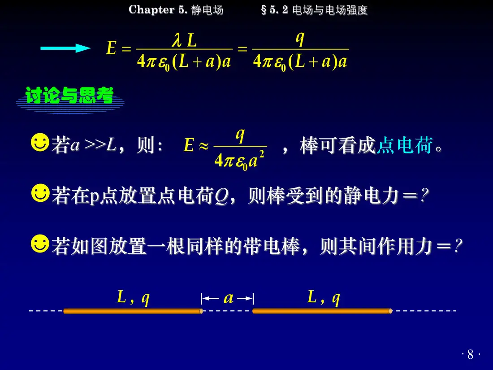

原文：

Chapter 5. 静电场 § 5.2 电场与电场强度

$$
E = \frac {\lambda L}{4 \pi \varepsilon_ {0} (L + a) a} = \frac {q}{4 \pi \varepsilon_ {0} (L + a) a}
$$

讨论与思考

😊若a >>L，则： $E \approx \frac{q}{4\pi\varepsilon_{0}a^{2}}$ ，棒可看成点电荷。

😊若在p点放置点电荷Q，则棒受到的静电力=?

😊若如图放置一根同样的带电棒，则其间作用力＝？

$$
L, q \quad | \leftarrow a \rightarrow | \quad L, q
$$

8

### Chapter 5. 静电场 § 5.2 电场与电场强度

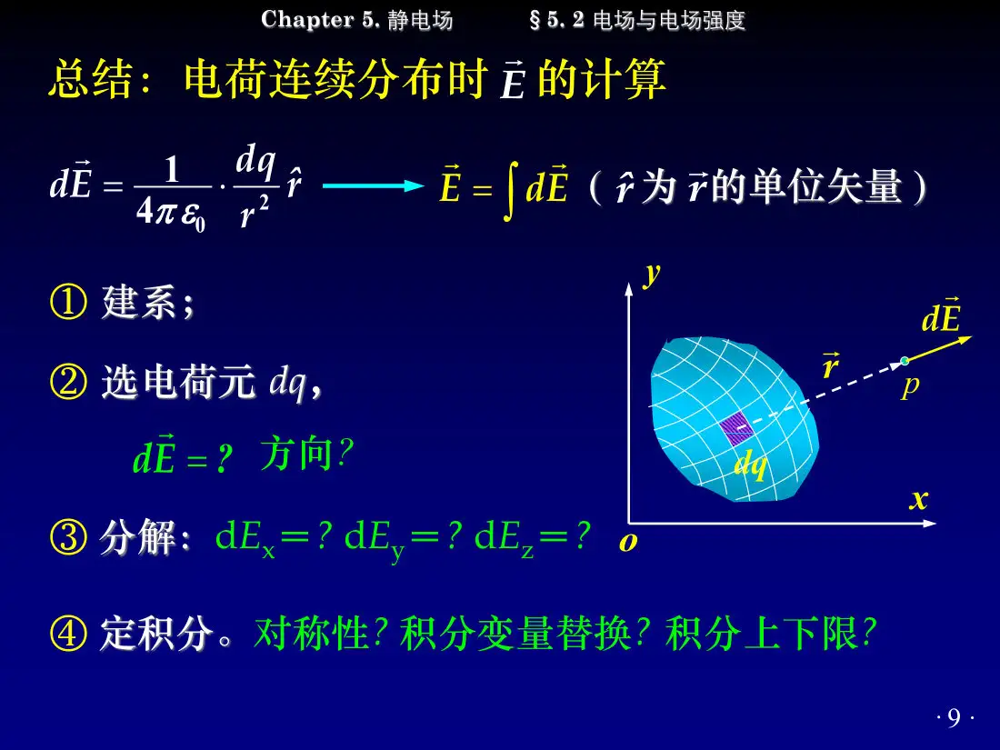

原文：

Chapter 5. 静电场 § 5.2 电场与电场强度

总结：电荷连续分布时 $\vec{E}$ 的计算

$d\vec{E}=\frac{1}{4\pi\varepsilon_{0}}\cdot\frac{dq}{r^{2}}\hat{r}\longrightarrow\vec{E}=\int d\vec{E}$ （ $\hat{r}$ 为 $\vec{r}$ 的单位矢量）

① 建系；

② 选电荷元 dq，

$d\vec{E}=?$ 方向?

③ 分解: $\mathrm{d}E_{\mathrm{x}} = ? \mathrm{d}E_{\mathrm{y}} = ? \mathrm{d}E_{\mathrm{z}} = ?$

④ 定积分。对称性？积分变量替换？积分上下限？

9

### Chapter 5. 静电场 § 5.2 电场与电场强度

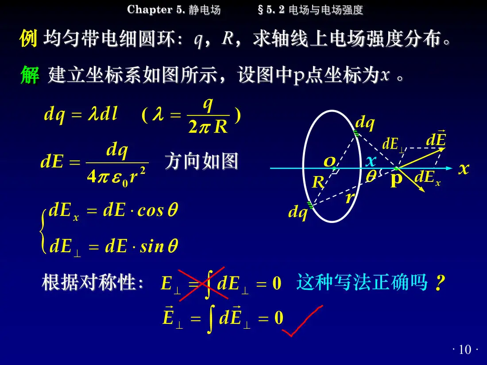

原文：

Chapter 5. 静电场 § 5.2 电场与电场强度

例 均匀带电细圆环： $q$ ， $R$ ，求轴线上电场强度分布。

解 建立坐标系如图所示，设图中p点坐标为x。

$$
d q = \lambda d l \quad (\lambda = \frac {q}{2 \pi R})
$$

$dE=\frac{dq}{4\pi\varepsilon_{0}r^{2}}$ 方向如图

$$
d E _ {x} = d E \cdot \cos \theta
$$

$$
d E _ {\perp} = d E \cdot \sin \theta
$$

根据对称性: $E_{\perp} = \int dE_{\perp} = 0$ 这种写法正确吗? $\vec{E}_{\perp} = \int d\vec{E}_{\perp} = 0$

10

### Chapter 5. 静电场 § 5.2 电场与电场强度

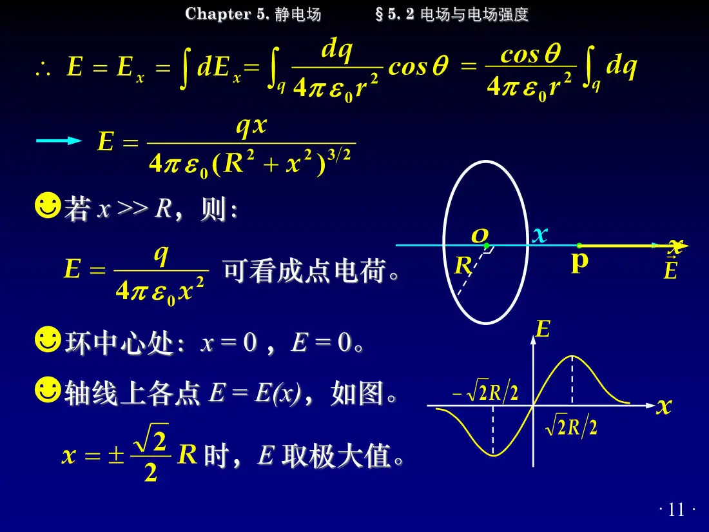

原文：

Chapter 5. 静电场 § 5.2 电场与电场强度

$$
\therefore E = E _ {x} = \int d E _ {x} = \int_ {q} \frac {d q}{4 \pi \varepsilon_ {0} r ^ {2}} \cos \theta = \frac {\cos \theta}{4 \pi \varepsilon_ {0} r ^ {2}} \int_ {q} d q
$$

$$
\longrightarrow E = \frac {q x}{4 \pi \varepsilon_ {0} (R ^ {2} + x ^ {2}) ^ {3 / 2}}
$$

😊若 x >> R，则：

$E = \frac{q}{4\pi\varepsilon_{0}x^{2}}$ 可看成点电荷。

环中心处：x = 0，E = 0。

轴线上各点 $E = E(x)$ ，如图。 $x = \pm \frac{\sqrt{2}}{2} R$ 时，E 取极大值。

11

### 归纳

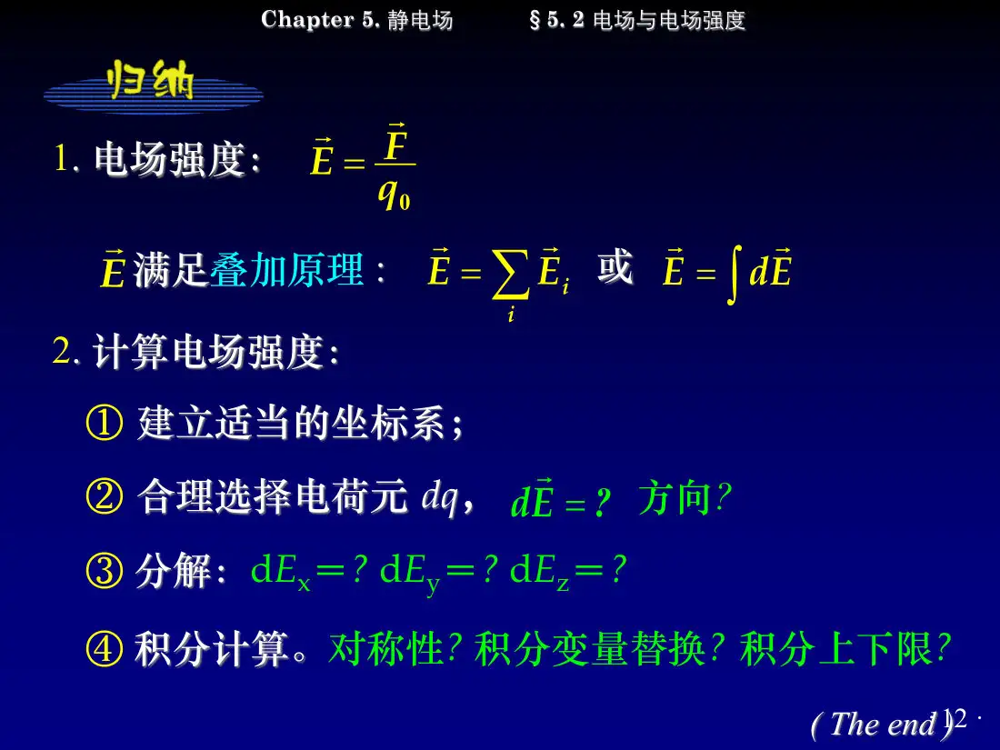

原文：

归纳

1. 电场强度: $\vec{E} = \frac{\vec{F}}{q_{0}}$

$\vec{E}$ 满足叠加原理： $\vec{E} = \sum \vec{E}_i$ 或 $\vec{E} = \int d\vec{E}$

2. 计算电场强度:

① 建立适当的坐标系；

② 合理选择电荷元 dq， $d\vec{E} = ?$ 方向？

③ 分解: $\mathrm{d} E_{\mathrm{x}} = ? \mathrm{d} E_{\mathrm{y}} = ? \mathrm{d} E_{\mathrm{z}} = ?$

④ 积分计算。对称性？积分变量替换？积分上下限？

Chapter 5. 静电场 § 5.2 电场与电场强度

(The end) $^{2}$

### Chapter 5. 静电场 § 5.2 电场与电场强度

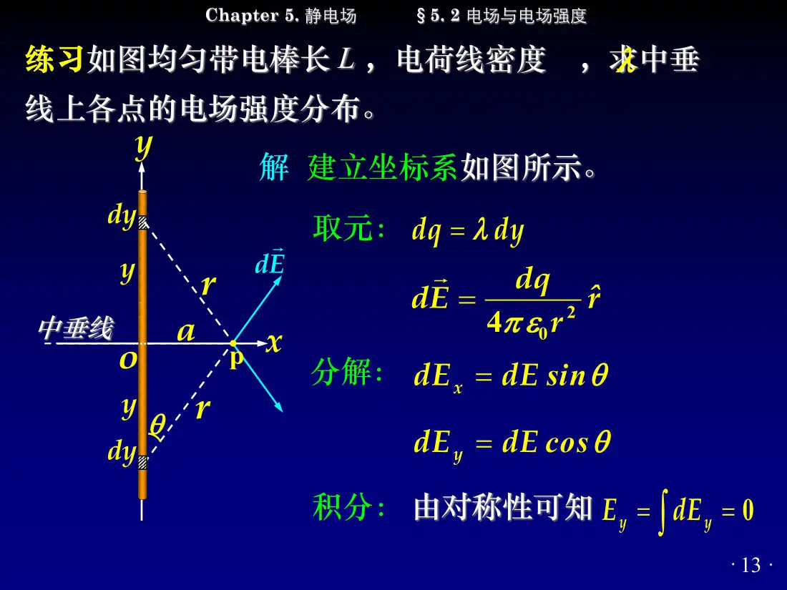

原文：

Chapter 5. 静电场 § 5.2 电场与电场强度

练习如图均匀带电棒长 $L$ ，电荷线密度 ，求中垂线上各点的电场强度分布。

解 建立坐标系如图所示。

取元: $dq = \lambda dy$

$$
d \vec {E} = \frac {d q}{4 \pi \varepsilon_ {0} r ^ {2}} \hat {r}
$$

分解: $dE_{x} = dE \sin \theta$

$$
d E _ {y} = d E \cos \theta
$$

积分：由对称性可知 $E_{y}=\int dE_{y}=0$

13

### Chapter 5. 静电场

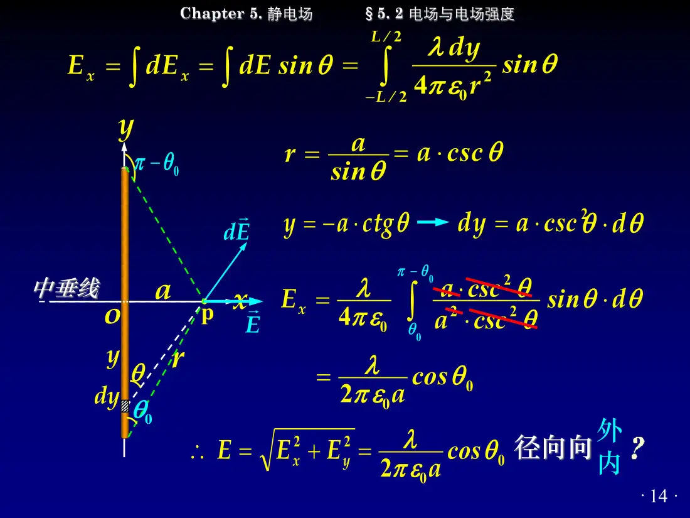

原文：

Chapter 5. 静电场

§ 5.2 电场与电场强度

$$
E _ {x} = \int d E _ {x} = \int d E \sin \theta = \int_ {- L / 2} ^ {L / 2} \frac {\lambda d y}{4 \pi \varepsilon_ {0} r ^ {2}} \sin \theta
$$

$$
r = \frac {a}{\sin \theta} = a \cdot \csc \theta
$$

$$
y = - a \cdot c t g \theta \rightarrow d y = a \cdot c s c ^ {2} \theta \cdot d \theta
$$

中垂线

$$
\begin{array}{r l} {a} & {\xrightarrow [ \mathrm{p} ]{} x _ {\vec {E}}} \\ {r} & {\quad E _ {x} = \frac {\lambda}{4 \pi \varepsilon_ {0}} \int_ {\theta_ {0}} ^ {\pi - \theta_ {0}} \frac {a \cdot \csc^ {2} \theta}{a ^ {2} \cdot \csc^ {2} \theta} \sin \theta \cdot d \theta} \\ & {= \frac {\lambda}{2 \pi \varepsilon_ {0} a} \cos \theta_ {0}} \end{array}
$$

$\therefore E = \sqrt{E_x^2 + E_y^2} = \frac{\lambda}{2\pi\varepsilon_0a}\cos \theta_0$ 径向向内外？

14

### 讨论

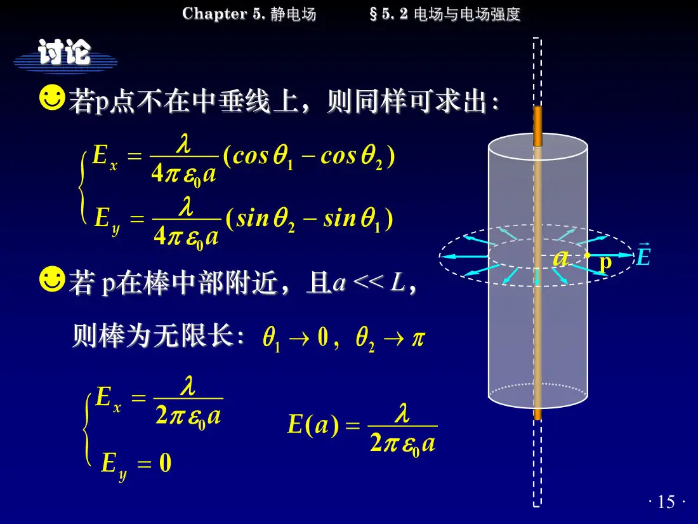

原文：

讨论

😊若p点不在中垂线上，则同样可求出：

$$
\int E _ {x} = \frac {\lambda}{4 \pi \varepsilon_ {0} a} (\cos \theta_ {1} - \cos \theta_ {2})
$$

$$
E _ {y} = \frac {\lambda}{4 \pi \varepsilon_ {0} a} (\sin \theta_ {2} - \sin \theta_ {1})
$$

😊若 p 在棒中部附近，且 a << L，

则棒为无限长: $\theta_{1} \rightarrow 0, \theta_{2} \rightarrow \pi$

$$
\left\{ \begin{array}{l} E _ {x} = \frac {\lambda}{2 \pi \varepsilon_ {0} a} \\ E _ {y} = 0 \end{array} \right.
$$

$$
E (a) = \frac {\lambda}{2 \pi \varepsilon_ {0} a}
$$

Chapter 5. 静电场

§ 5.2 电场与电场强度

15

### Chapter 5. 静电场 § 5.2 电场与电场强度

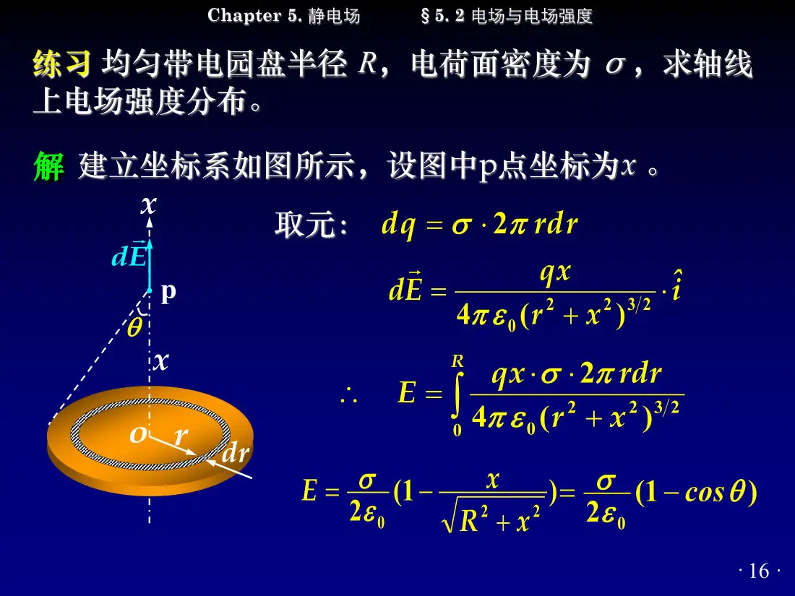

原文：

Chapter 5. 静电场 § 5.2 电场与电场强度

练习均匀带电园盘半径 R，电荷面密度为 $\sigma$ ，求轴线上电场强度分布。

解 建立坐标系如图所示，设图中p点坐标为x。

取元： $dq = \sigma \cdot 2\pi rdr$

$$
d \vec {E} = \frac {q x}{4 \pi \varepsilon_ {0} (r ^ {2} + x ^ {2}) ^ {3 / 2}} \cdot \hat {\boldsymbol {i}}
$$

$$
E = \int_ {0} ^ {R} \frac {q x \cdot \sigma \cdot 2 \pi r d r}{4 \pi \varepsilon_ {0} (r ^ {2} + x ^ {2}) ^ {3 / 2}}
$$

$$
E = \frac {\sigma}{2 \varepsilon_ {0}} (1 - \frac {x}{\sqrt {R ^ {2} + x ^ {2}}}) = \frac {\sigma}{2 \varepsilon_ {0}} (1 - \cos \theta)
$$

16

### Chapter 5. 静电场

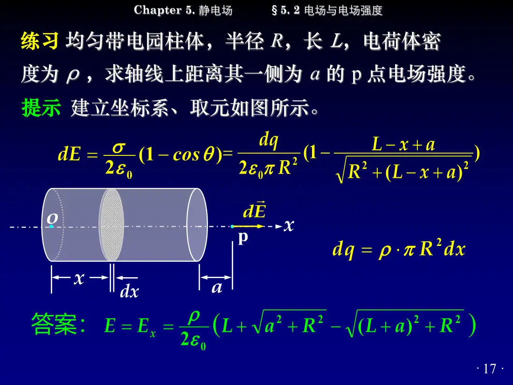

原文：

Chapter 5. 静电场

§ 5.2 电场与电场强度

练习 均匀带电园柱体，半径 R，长 L，电荷体密度为 $\rho$ ，求轴线上距离其一侧为 a 的 p 点电场强度。提示 建立坐标系、取元如图所示。

$$
d E = \frac {\sigma}{2 \varepsilon_ {0}} (1 - \cos \theta) = \frac {d q}{2 \varepsilon_ {0} \pi R ^ {2}} (1 - \frac {L - x + a}{\sqrt {R ^ {2} + (L - x + a) ^ {2}}})
$$

$$
d q = \rho \cdot \pi R ^ {2} d x
$$

答案: $E = E_{x} = \frac{\rho}{2\varepsilon_{0}}\left(L + \sqrt{a^{2} + R^{2}} - \sqrt{(L + a)^{2} + R^{2}}\right)$

17
