# 《大学物理》第5章 静电场 §5.3 电通量 高斯定理（课件）

原件的每一页，下面附识别出的文字。

### § 5.3 电通量 高斯定理

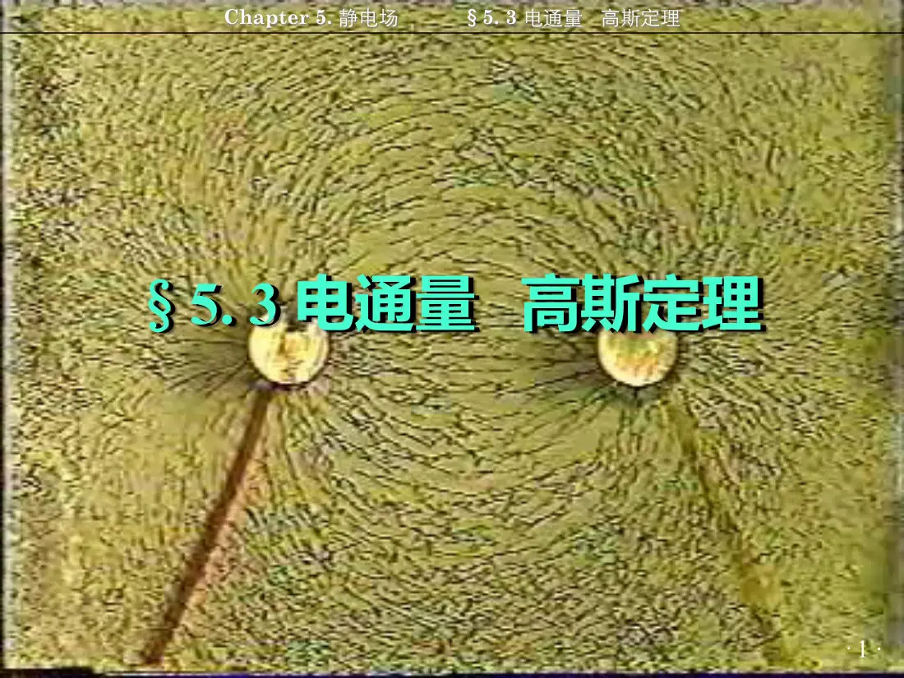

原文：

§ 5.3 电通量 高斯定理

Chapter 5. 静电场 § 5.3 电通量 高斯定理

### 一、电场线模型

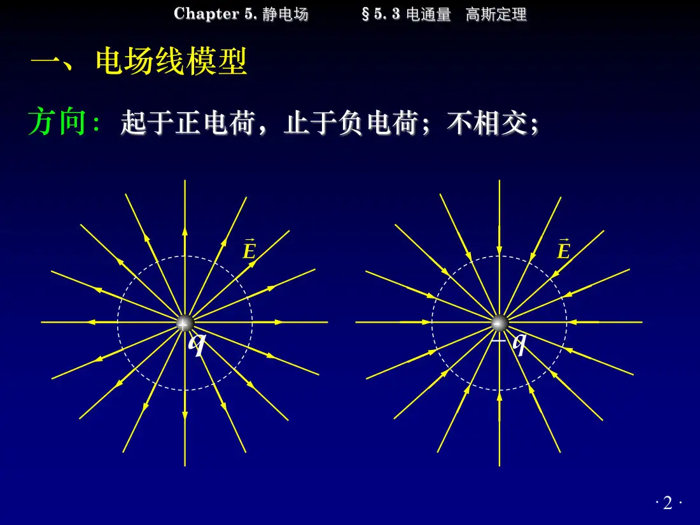

原文：

一、电场线模型

方向：起于正电荷，止于负电荷；不相交；

Chapter 5. 静电场 § 5.3 电通量 高斯定理

2

### 一、电场线模型

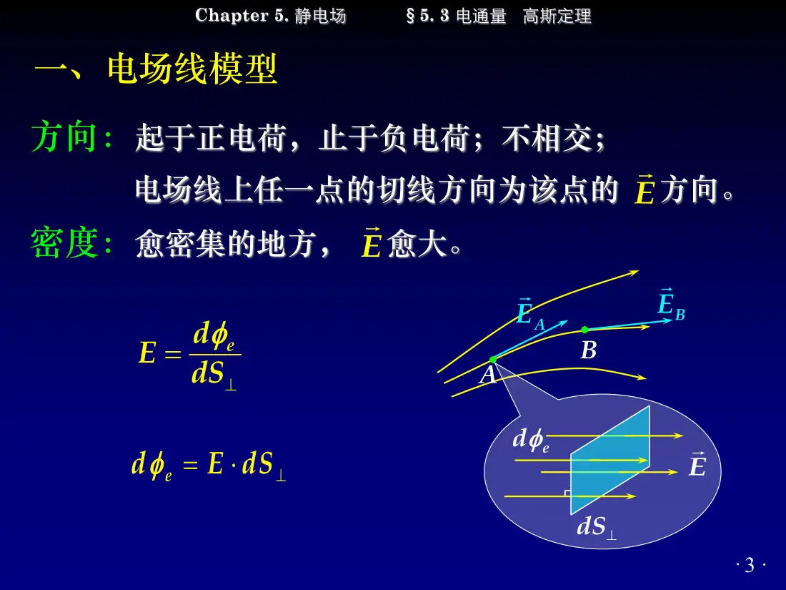

原文：

一、电场线模型

方向：起于正电荷，止于负电荷；不相交；电场线上任一点的切线方向为该点的 $\vec{E}$ 方向。

密度：愈密集的地方， $\vec{E}$ 愈大。

$$
E = \frac {d \phi_ {e}}{d S _ {\perp}}
$$

$$
d \phi_ {e} = E \cdot d S _ {\perp}
$$

Chapter 5. 静电场 § 5.3 电通量 高斯定理

3

### 等量异号电荷

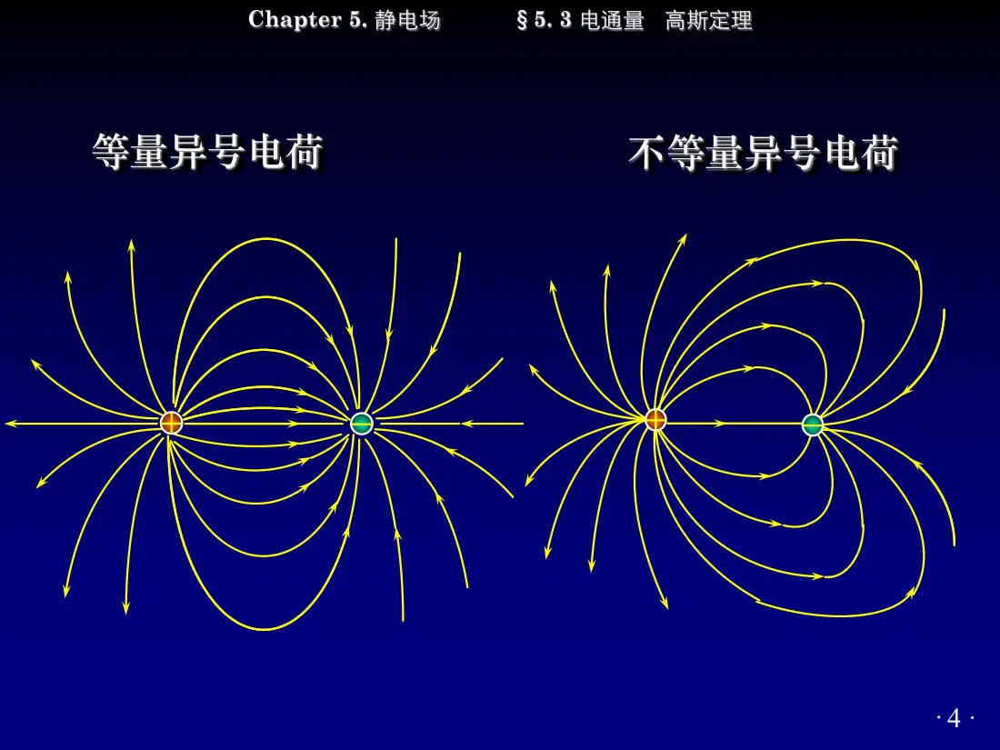

原文：

等量异号电荷

不等量异号电荷

Chapter 5. 静电场 § 5.3 电通量 高斯定理

4

### 等量同号电荷

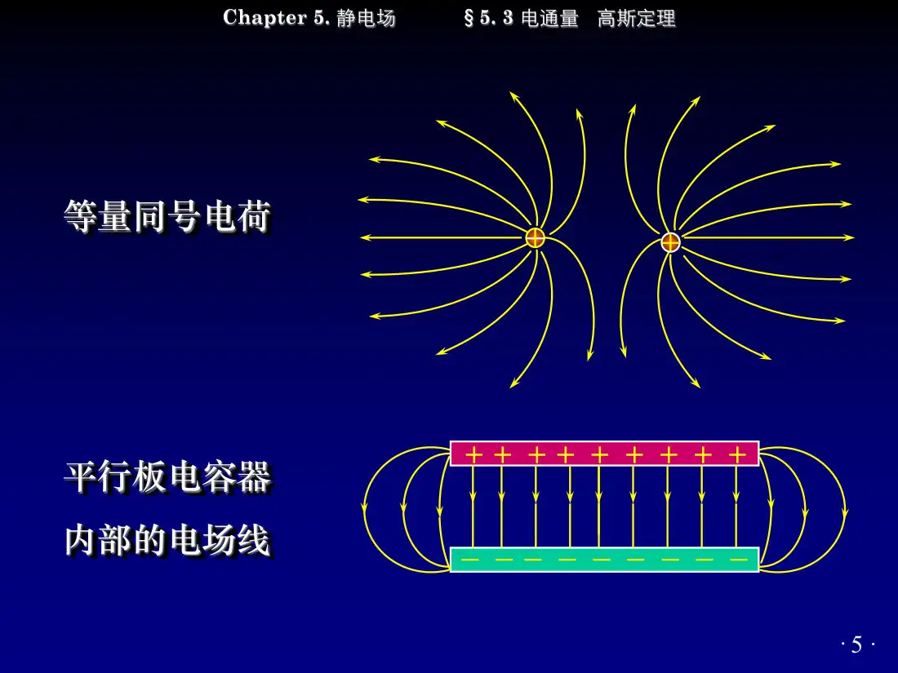

原文：

等量同号电荷

平行板电容器

内部的电场线

Chapter 5. 静电场

§ 5.3 电通量 高斯定理

5

### 二、电通量

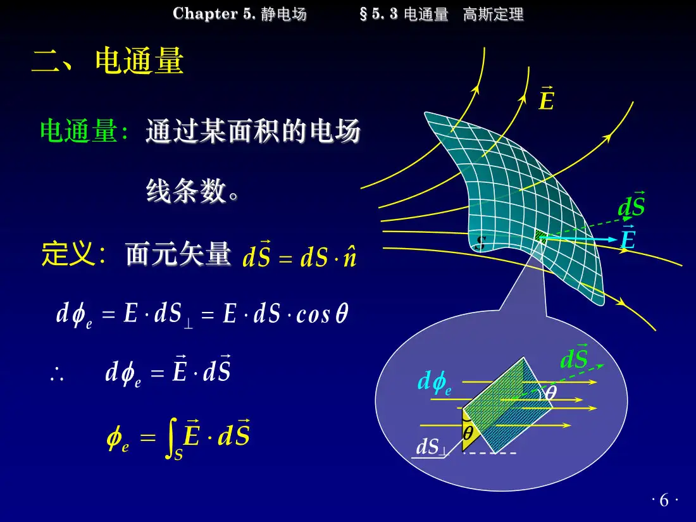

原文：

二、电通量

电通量: 通过某面积的电场线条数。

定义：面元矢量 $d\vec{S}=dS\cdot\hat{n}$

$$
d \phi_ {e} = E \cdot d S _ {\perp} = E \cdot d S \cdot c o s \theta
$$

$$
\therefore d \phi_ {e} = \vec {E} \cdot d \vec {S}
$$

$$
\phi_ {e} = \int_ {S} \vec {E} \cdot d \vec {S}
$$

Chapter 5. 静电场

§ 5.3 电通量 高斯定理

6

### Chapter 5. 静电场

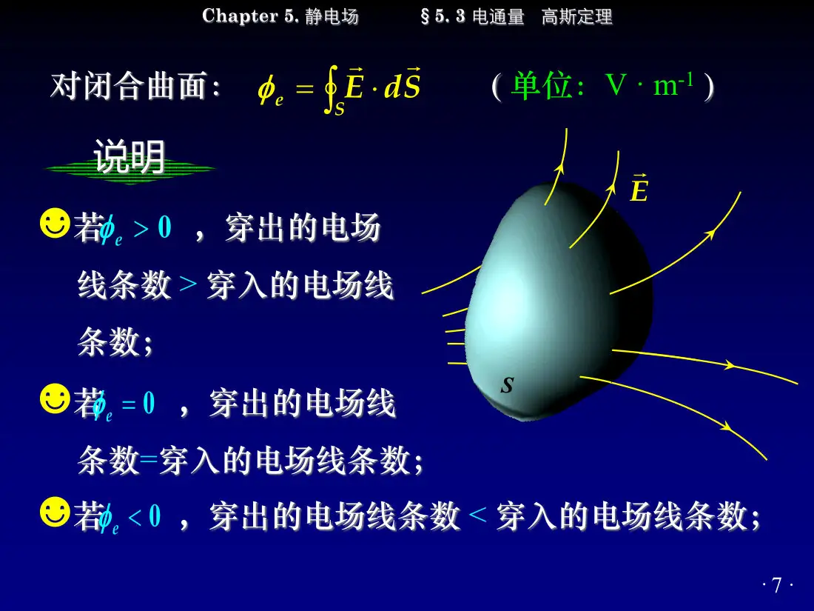

原文：

Chapter 5. 静电场

对闭合曲面:

$$
\phi_ {e} = \oint_ {S} \vec {E} \cdot d \vec {S}
$$

说明

若 $\phi_{e} > 0$ ，穿出的电场线条数 $>$ 穿入的电场线条数；

😊 若 $\phi_{e}=0$ ，穿出的电场线条数=穿入的电场线条数；

§ 5.3 电通量 高斯定理

(单位: V·m $^{-1}$ )

😊 若 $\phi_{e}<0$ ，穿出的电场线条数＜穿入的电场线条数；

7

### Chapter 5. 静电场

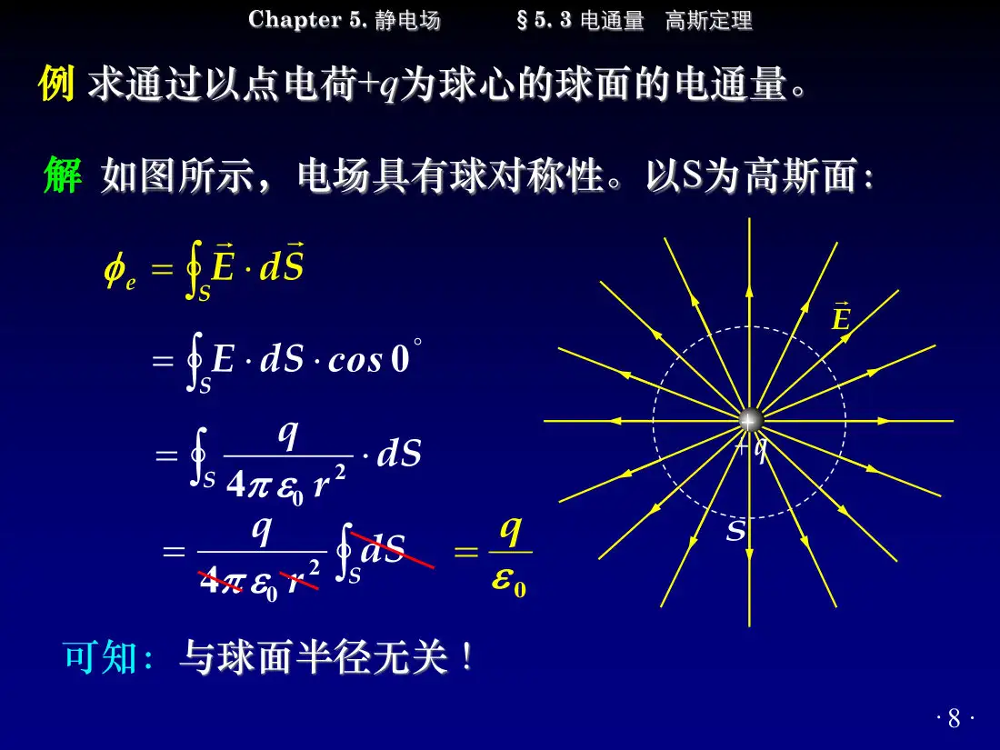

原文：

Chapter 5. 静电场

§ 5.3 电通量 高斯定理

例 求通过以点电荷+q为球心的球面的电通量。

解 如图所示，电场具有球对称性。以S为高斯面：

$$
\begin{array}{r l} \phi_ {e} & = \oint_ {S} \vec {E} \cdot d \vec {S} \\ & = \oint_ {S} E \cdot d S \cdot c o s 0 ^ {\circ} \\ & = \oint_ {S} \frac {q}{4 \pi \varepsilon_ {0} r ^ {2}} \cdot d S \\ & = \frac {q}{4 \pi \varepsilon_ {0} r ^ {2}} \oint_ {S} d S = \frac {q}{\varepsilon_ {0}} \end{array}
$$

可知：与球面半径无关！

8

### 三、高斯定理

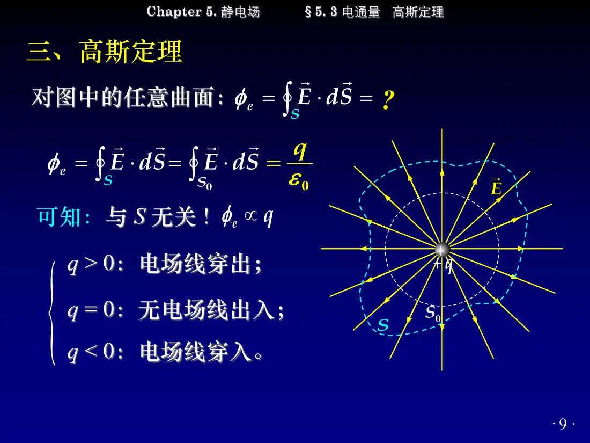

原文：

三、高斯定理

对图中的任意曲面： $\phi_{e} = \oint_{S} \vec{E} \cdot d\vec{S} = ?$

$$
\phi_ {e} = \oint_ {S} \vec {E} \cdot d \vec {S} = \oint_ {S _ {0}} \vec {E} \cdot d \vec {S} = \frac {q}{\varepsilon_ {0}}
$$

可知：与 $S$ 无关！ $\phi_{e} \propto q$

$q > 0$ ：电场线穿出；

$q = 0$ ：无电场线出入；

$q < 0$ ：电场线穿入。

Chapter 5. 静电场 § 5.3 电通量 高斯定理

9

### Chapter 5. 静电场 § 5.3 电通量 高斯定理

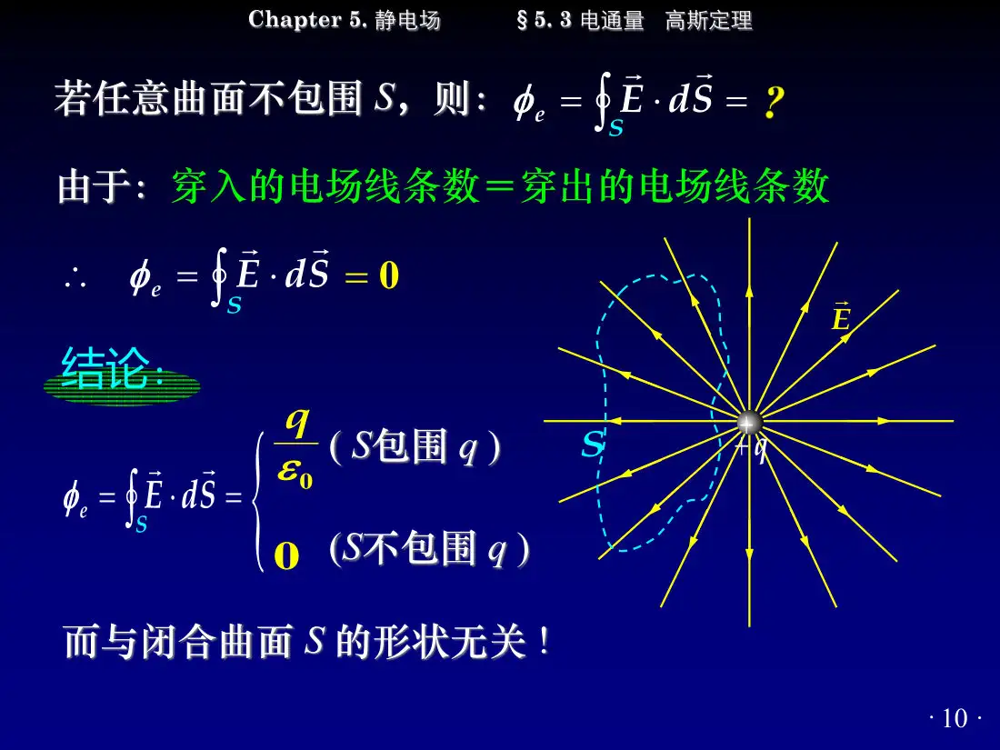

原文：

Chapter 5. 静电场 § 5.3 电通量 高斯定理

若任意曲面不包围 S，则： $\phi_{e}=\oint_{S}\vec{E}\cdot d\vec{S}=$ ?

由于: 穿入的电场线条数 = 穿出的电场线条数

$$
\therefore \quad \phi_ {e} = \oint_ {S} \vec {E} \cdot d \vec {S} = 0
$$

结论:

$\phi_{e} = \oint_{S}\vec{E}\cdot d\vec{S} = \left\{ \begin{array}{ll}\frac{q}{\varepsilon_{0}} (S\text{包围} q)\\ 0 & (S\text{不包围} q) \end{array} \right.$

而与闭合曲面 $S$ 的形状无关！

10

### Chapter 5. 静电场

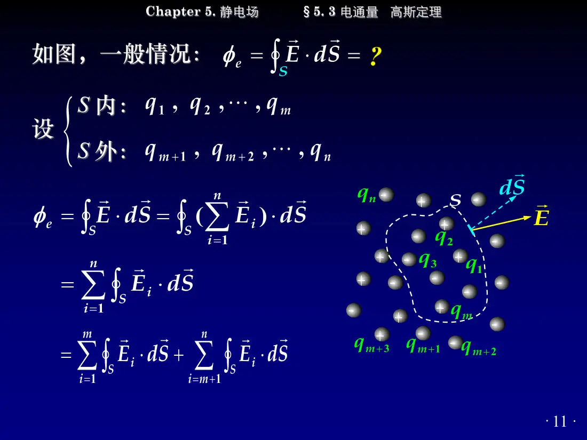

原文：

Chapter 5. 静电场

§ 5.3 电通量 高斯定理

如图，一般情况： $\phi_{e} = \oint_{S} \vec{E} \cdot d\vec{S} = ?$

S 内： $q_{1}, q_{2}, \cdots, q_{m}$

设

S 外: $q_{m+1}$ , $q_{m+2}$ , $\cdots$ , $q_{n}$

$$
\begin{array}{r l} & {\phi_ {e} = \oint_ {S} \vec {E} \cdot d \vec {S} = \oint_ {S} (\sum_ {i = 1} ^ {n} \vec {E} _ {i}) \cdot d \vec {S}} \\ & {\quad = \sum_ {i = 1} ^ {n} \oint_ {S} \vec {E} _ {i} \cdot d \vec {S}} \\ & {\quad = \sum_ {i = 1} ^ {m} \oint_ {S} \vec {E} _ {i} \cdot d \vec {S} + \sum_ {i = m + 1} ^ {n} \oint_ {S} \vec {E} _ {i} \cdot d \vec {S}} \end{array}
$$

$$
\begin{array}{c} q _ {n} \\ \text {   } \\ q _ {2} \\ q _ {3} \\ q _ {1} \\ q _ {m} \\ q _ {m + 3} \\ q _ {m + 1} \\ q _ {m + 2} \end{array} \quad \text {   dS   } \quad \vec {E}
$$

11

### Chapter 5. 静电场

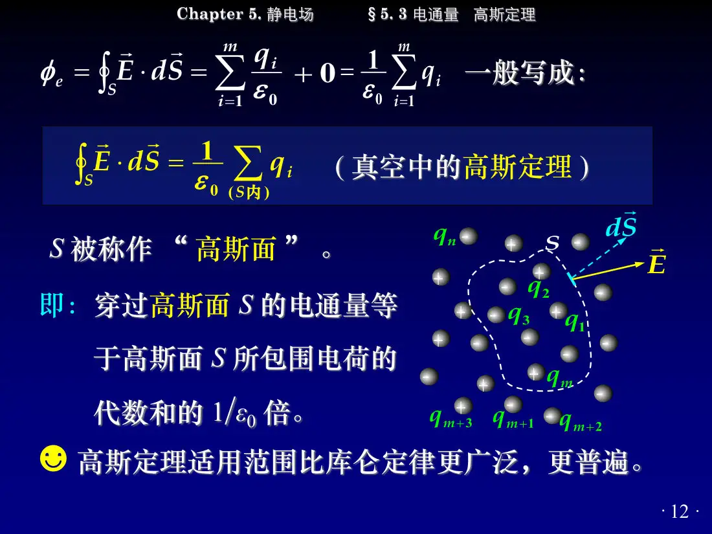

原文：

Chapter 5. 静电场

§ 5.3 电通量 高斯定理

$\phi_{e} = \oint_{S}\vec{E}\cdot d\vec{S} = \sum_{i = 1}^{m}\frac{q_{i}}{\varepsilon_{0}} +0 = \frac{1}{\varepsilon_{0}}\sum_{i = 1}^{m}q_{i}$ 一般写成：

$\oint_{S} \vec{E} \cdot d\vec{S} = \frac{1}{\varepsilon_0} \sum_{(S \text{内})} q_i$ （真空中的高斯定理）

S 被称作 “高斯面”

即：穿过高斯面 S 的电通量等于高斯面 S 所包围电荷的代数和的 $1/\varepsilon_{0}$ 倍。

高斯定理适用范围比库仑定律更广泛，更普遍。

12

### Chapter 5. 静电场

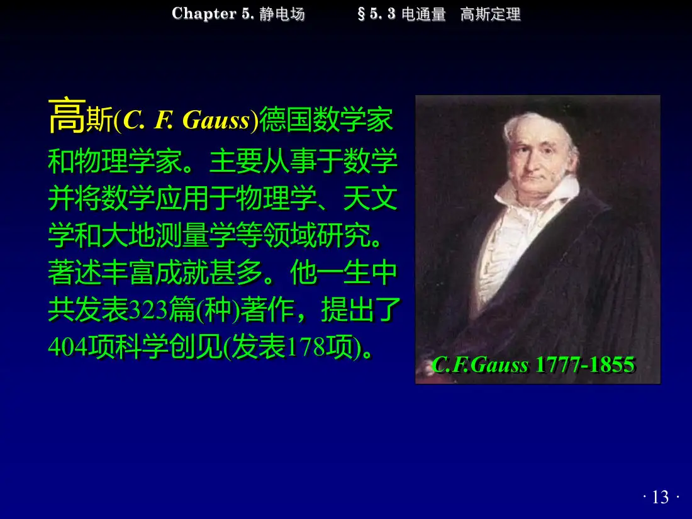

原文：

高斯(C. F. Gauss)德国数学家和物理学家。主要从事于数学并将数学应用于物理学、天文学和大地测量学等领域研究。著述丰富成就甚多。他一生中共发表323篇(种)著作，提出了404项科学创见(发表178项)。

Chapter 5. 静电场

§ 5.3 电通量 高斯定理

13

### Chapter 5. 静电场 § 5.3 电通量 高斯定理

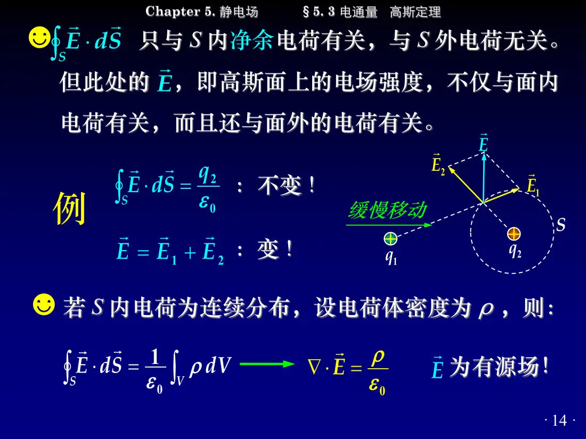

原文：

Chapter 5. 静电场 § 5.3 电通量 高斯定理

$\oint_{S} \vec{E} \cdot d\vec{S}$ 只与 $S$ 内净余电荷有关，与 $S$ 外电荷无关。但此处的 $\vec{E}$ ，即高斯面上的电场强度，不仅与面内电荷有关，而且还与面外的电荷有关。

例

$\oint_{S}\vec{E}\cdot d\vec{S}=\frac{q_{2}}{\varepsilon_{0}}$ : 不变！

$\vec{E} = \vec{E}_1 + \vec{E}_2$ ：变！

缓慢移动

😊 若 S 内电荷为连续分布，设电荷体密度为 $\rho$ ，则：

$\oint_{S} \vec{E} \cdot d\vec{S} = \frac{1}{\varepsilon_0} \int_V \rho dV \longrightarrow \nabla \cdot \vec{E} = \frac{\rho}{\varepsilon_0}$ $\vec{E}$ 为有源场！

14

### Chapter 5. 静电场 § 5.3 电通量 高斯定理

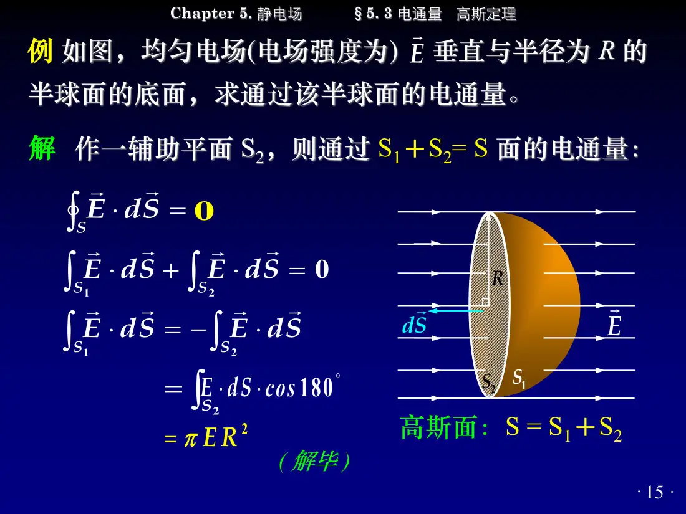

原文：

Chapter 5. 静电场 § 5.3 电通量 高斯定理

例如图，均匀电场(电场强度为) $\vec{E}$ 垂直与半径为 $R$ 的半球面的底面，求通过该半球面的电通量。

解 作一辅助平面 $\mathrm{S}_2$ ，则通过 $\mathrm{S}_1 + \mathrm{S}_2 = \mathrm{S}$ 面的电通量：

$$
\oint_ {S} \vec {E} \cdot d \vec {S} = \mathbf {0}
$$

$$
\int_ {S _ {1}} \vec {E} \cdot d \vec {S} + \int_ {S _ {2}} \vec {E} \cdot d \vec {S} = 0
$$

$$
\begin{array}{r l} \int_ {S _ {1}} \vec {E} \cdot d \vec {S} & = - \int_ {S _ {2}} \vec {E} \cdot d \vec {S} \\ & = \int_ {S _ {2}} E \cdot d S \cdot c o s 1 8 0 ^ {\circ} \\ & = \pi E R ^ {2} \end{array}
$$

(解毕)

高斯面： $S = S_{1} + S_{2}$

15

### 课堂练习 如图，点电荷 q 位于立方体中心，求通过该立方体某一面的电通量。

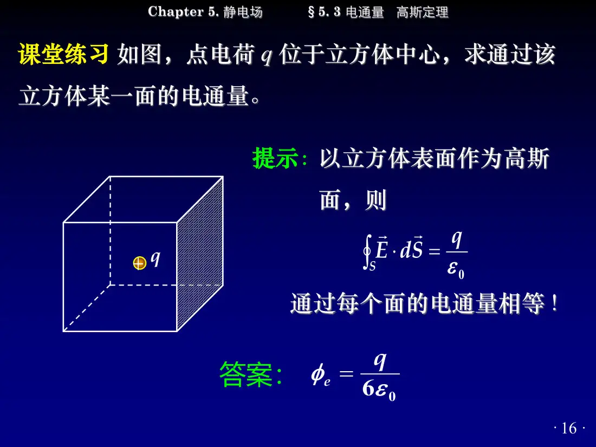

原文：

课堂练习 如图，点电荷 q 位于立方体中心，求通过该立方体某一面的电通量。

提示：以立方体表面作为高斯

面，则

$$
\oint_ {S} \vec {E} \cdot d \vec {S} = \frac {q}{\varepsilon_ {0}}
$$

通过每个面的电通量相等！

答案: $\phi_{e} = \frac{q}{6\varepsilon_{0}}$

Chapter 5. 静电场

§ 5.3 电通量 高斯定理

16

### Chapter 5. 静电场 § 5.3 电通量 高斯定理

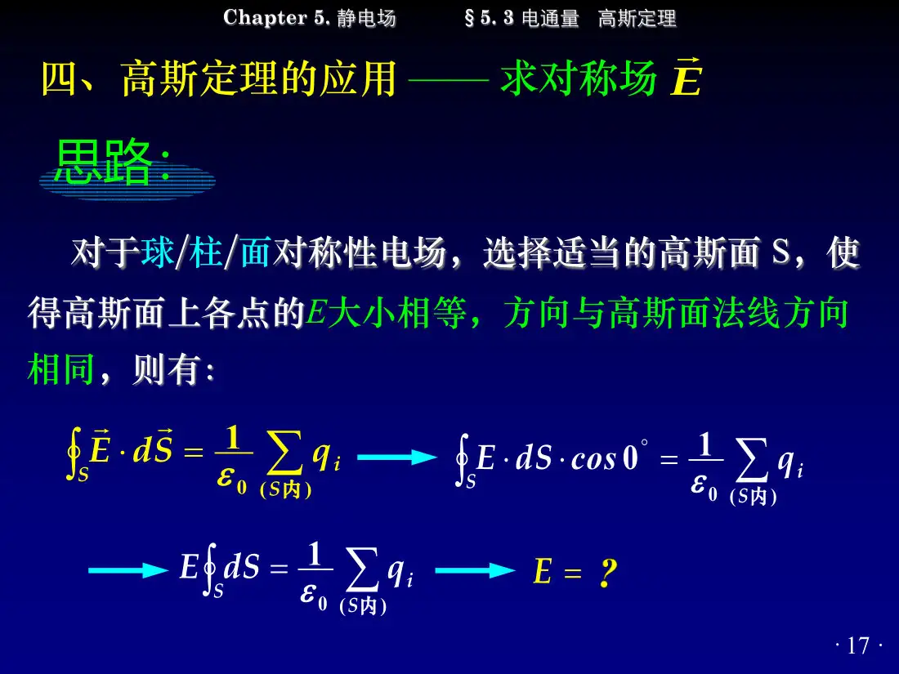

原文：

Chapter 5. 静电场 § 5.3 电通量 高斯定理

四、高斯定理的应用——求对称场 $\vec{E}$

对于球/柱/面对称性电场，选择适当的高斯面 S，使得高斯面上各点的 E 大小相等，方向与高斯面法线方向相同，则有：

$$
\oint_ {S} \vec {E} \cdot d \vec {S} = \frac {1}{\varepsilon_ {0}} \sum_ {(S \text {内})} q _ {i} \longrightarrow \oint_ {S} E \cdot d S \cdot \cos 0 ^ {\circ} = \frac {1}{\varepsilon_ {0}} \sum_ {(S \text {内})} q _ {i}
$$

$$
\longrightarrow E \oint_ {S} d S = \frac {1}{\varepsilon_ {0}} \sum_ {(S \text {内})} q _ {i} \longrightarrow E = ?
$$

17

### Chapter 5. 静电场 § 5.3 电通量 高斯定理

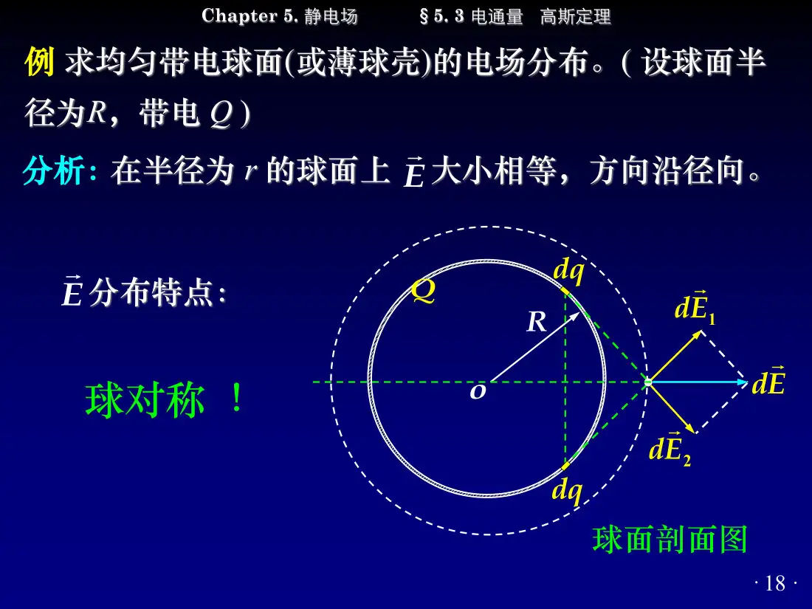

原文：

Chapter 5. 静电场 § 5.3 电通量 高斯定理

例 求均匀带电球面(或薄球壳)的电场分布。(设球面半径为R，带电Q)

分析：在半径为 r 的球面上 $\vec{E}$ 大小相等，方向沿径向。

$\vec{E}$ 分布特点:

球对称！

球面剖面图

18

### Chapter 5. 静电场 § 5.3 电通量 高斯定理

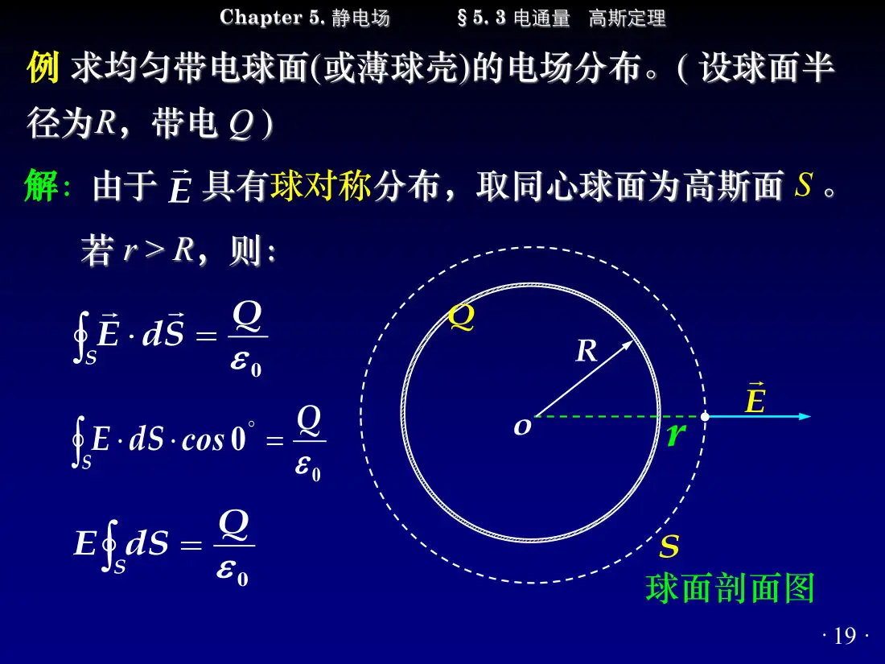

原文：

Chapter 5. 静电场 § 5.3 电通量 高斯定理

例 求均匀带电球面(或薄球壳)的电场分布。(设球面半径为R，带电Q)

解：由于 $\vec{E}$ 具有球对称分布，取同心球面为高斯面 $S$ 。

若 $r > R$ ，则：

$$
\oint_ {S} \vec {E} \cdot d \vec {S} = \frac {Q}{\varepsilon_ {0}}
$$

$$
\oint_ {S} \boldsymbol {E} \cdot d \boldsymbol {S} \cdot \cos 0 ^ {\circ} = \frac {Q}{\varepsilon_ {0}}
$$

$$
E \oint_ {S} d S = \frac {Q}{\varepsilon_ {0}}
$$

球面剖面图

19

### Chapter 5. 静电场

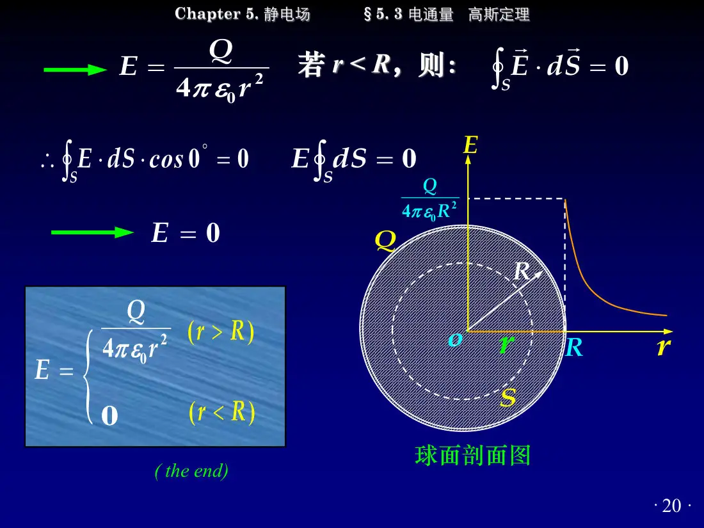

原文：

Chapter 5. 静电场

$$
E = \frac {Q}{4 \pi \varepsilon_ {0} r ^ {2}}
$$

§ 5.3 电通量 高斯定理

若 $r < R$ ，则：

$$
\oint_ {S} \vec {E} \cdot d \vec {S} = 0
$$

$$
\therefore \oint_ {S} E \cdot d S \cdot c o s 0 ^ {\circ} = 0
$$

$$
E \oint_ {S} d S = 0
$$

$$
E = 0
$$

$$
\frac {Q}{4 \pi \varepsilon_ {0} R ^ {2}}
$$

$$
E = \left\{ \begin{array}{l l} \frac {Q}{4 \pi \varepsilon_ {0} r ^ {2}} & (r > R) \\ 0 & (r <   R) \end{array} \right.
$$

( the end)

球面剖面图

20

### Chapter 5. 静电场 § 5.3 电通量 高斯定理

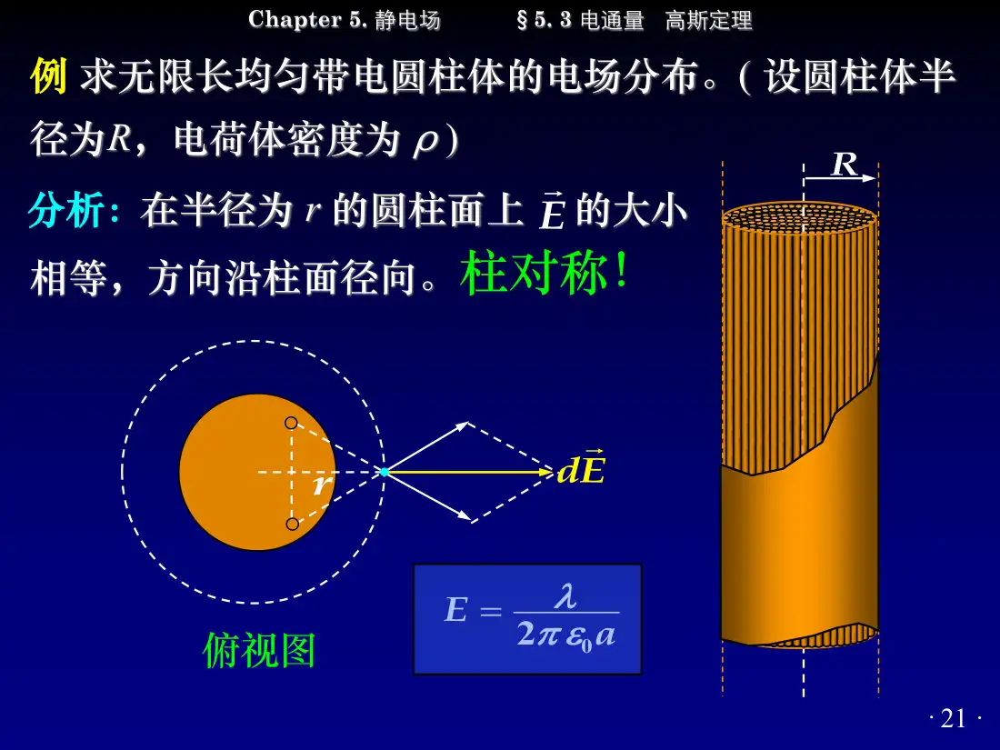

原文：

Chapter 5. 静电场 § 5.3 电通量 高斯定理

例 求无限长均匀带电圆柱体的电场分布。(设圆柱体半径为R，电荷体密度为ρ)

分析: 在半径为 $r$ 的圆柱面上 $\vec{E}$ 的大小相等, 方向沿柱面径向。柱对称!

俯视图

$$
E = \frac {\lambda}{2 \pi \varepsilon_ {0} a}
$$

21

### Chapter 5. 静电场 § 5.3 电通量 高斯定理

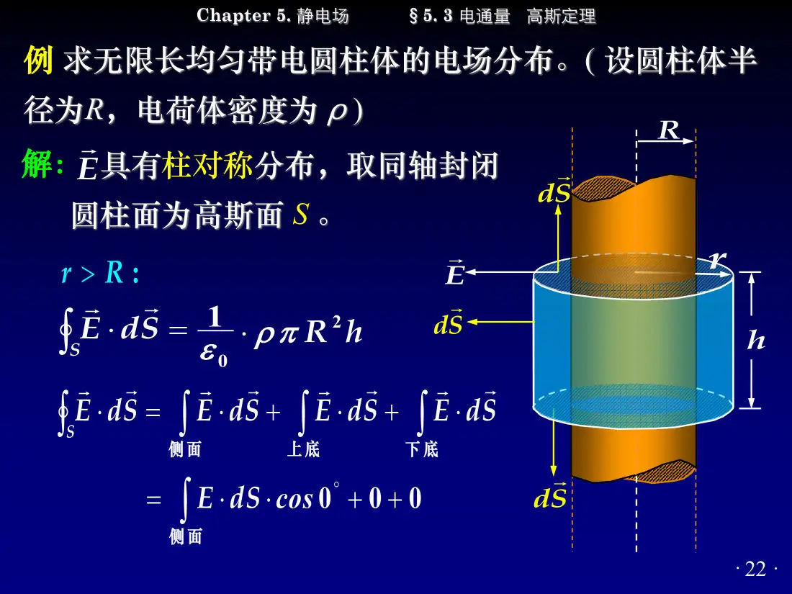

原文：

Chapter 5. 静电场 § 5.3 电通量 高斯定理

例 求无限长均匀带电圆柱体的电场分布。(设圆柱体半径为R，电荷体密度为ρ)

解: $\vec{E}$ 具有柱对称分布, 取同轴封闭圆柱面为高斯面 $S$ 。

$r > R:$

$$
\oint_ {S} \vec {E} \cdot d \vec {S} = \frac {1}{\varepsilon_ {0}} \cdot \rho \pi R ^ {2} h
$$

$$
\begin{array}{r l} \oint_ {S} \vec {E} \cdot d \vec {S} & = \int_ {\text {侧面}} \vec {E} \cdot d \vec {S} + \int_ {\text {上底}} \vec {E} \cdot d \vec {S} + \int_ {\text {下底}} \vec {E} \cdot d \vec {S} \\ & = \int_ {\text {侧面}} E \cdot d S \cdot c o s 0 ^ {\circ} + 0 + 0 \end{array}
$$

22

### Chapter 5. 静电场

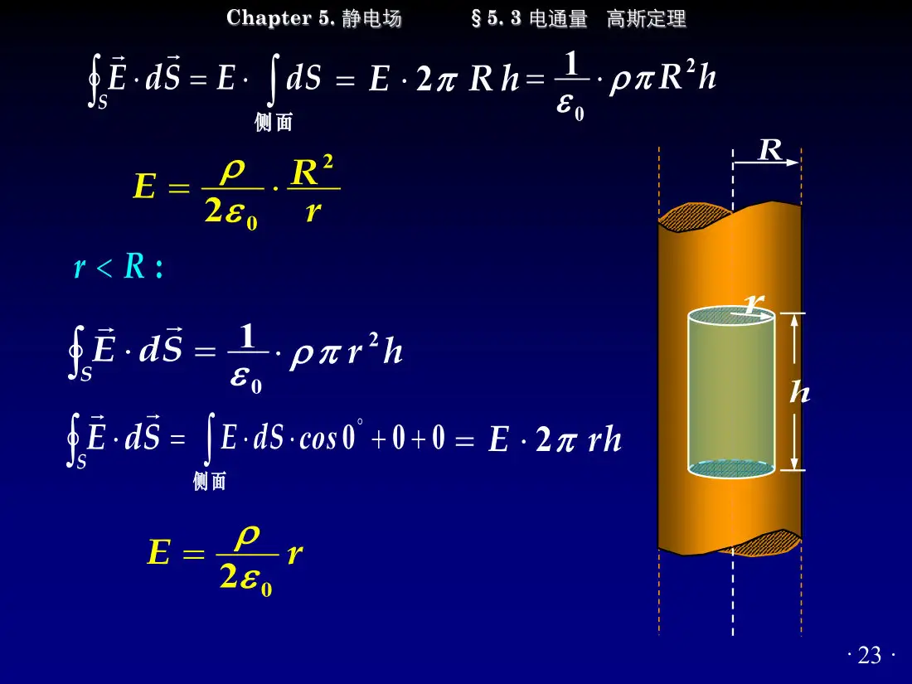

原文：

Chapter 5. 静电场

§ 5.3 电通量 高斯定理

$\oint_{S}\vec{E}\cdot d\vec{S} = E\cdot \int_{\text{侧面}}dS = E\cdot 2\pi Rh = \frac{1}{\varepsilon_0}\cdot \rho \pi R^2 h$

$$
E = \frac {\rho}{2 \varepsilon_ {0}} \cdot \frac {R ^ {2}}{r}
$$

$r < R :$

$$
\oint_ {S} \vec {E} \cdot d \vec {S} = \frac {1}{\varepsilon_ {0}} \cdot \rho \pi r ^ {2} h
$$

$\oint_{S} \vec{E} \cdot d\vec{S} = \int_{\text{侧面}} E \cdot dS \cdot \cos 0^{\circ} + 0 + 0 = E \cdot 2\pi rh$

$$
E = \frac {\rho}{2 \varepsilon_ {0}} r
$$

23

### Chapter 5. 静电场

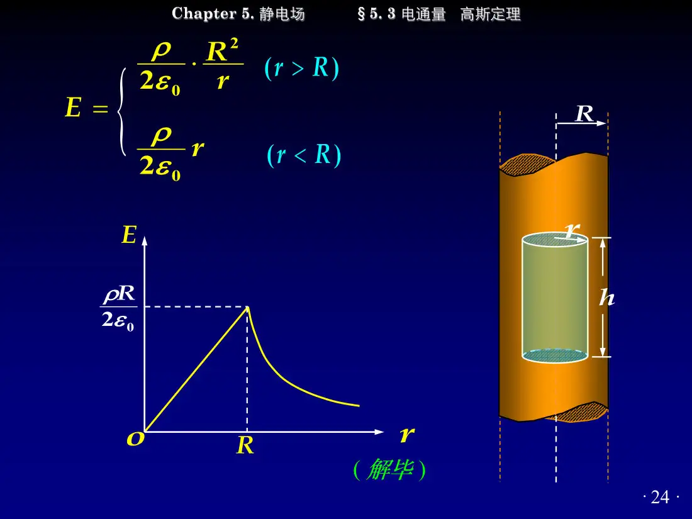

原文：

Chapter 5. 静电场

§ 5.3 电通量 高斯定理

$$
E = \left\{ \begin{array}{l l} \frac {\rho}{2 \varepsilon_ {0}} \cdot \frac {R ^ {2}}{r} & (r > R) \\ \frac {\rho}{2 \varepsilon_ {0}} r & (r <   R) \end{array} \right.
$$

24

### Chapter 5. 静电场 § 5.3 电通量 高斯定理

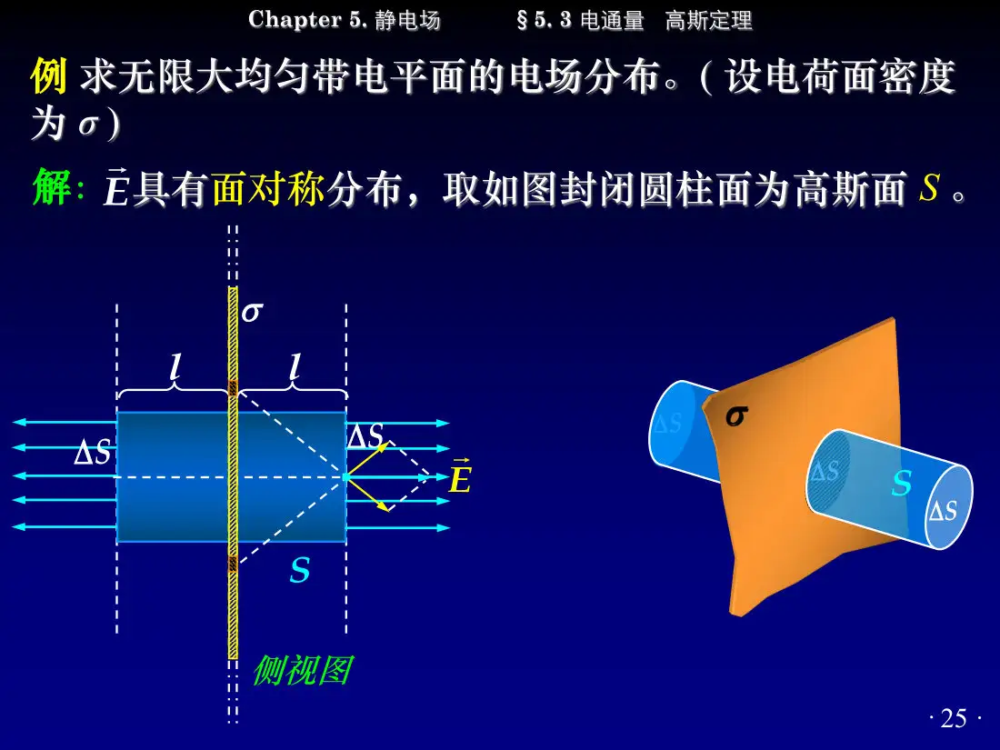

原文：

Chapter 5. 静电场 § 5.3 电通量 高斯定理

例 求无限大均匀带电平面的电场分布。(设电荷面密度为 $\sigma$ )

解： $\vec{E}$ 具有面对称分布，取如图封闭圆柱面为高斯面 $S$ 。

25

### Chapter 5. 静电场 § 5.3 电通量 高斯定理

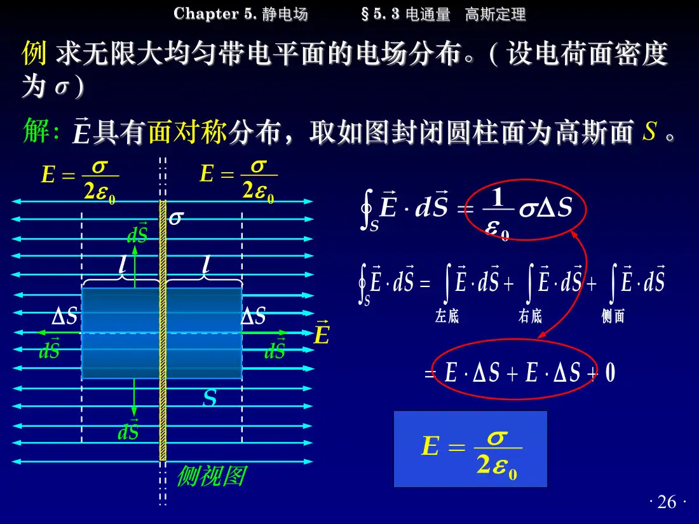

原文：

Chapter 5. 静电场 § 5.3 电通量 高斯定理

例 求无限大均匀带电平面的电场分布。(设电荷面密度为 $\sigma$ )

解： $\vec{E}$ 具有面对称分布，取如图封闭圆柱面为高斯面 $S$ 。

$$
\begin{array}{c c} E = \frac {\sigma}{2 \varepsilon_ {0}} & E = \frac {\sigma}{2 \varepsilon_ {0}} \\ \hline d \vec {S} & \sigma \\ \hline l & l \\ \Delta S & \Delta S \\ d \vec {S} & d \vec {S} \\ \hline d \vec {S} & S \\ \hline \end{array}
$$

$$
\oint_ {S} \vec {E} \cdot d \vec {S} = \frac {1}{\varepsilon_ {0}} \sigma \Delta S
$$

$$
\oint_ {S} \vec {E} \cdot d \vec {S} = \int_ {\text {左底}} \vec {E} \cdot d \vec {S} + \int_ {\text {右底}} \vec {E} \cdot d \vec {S} + \int_ {\text {侧面}} \vec {E} \cdot d \vec {S}
$$

$$
= E \cdot \Delta S + E \cdot \Delta S + 0
$$

$$
E = \frac {\sigma}{2 \varepsilon_ {0}}
$$

26

### (解毕)

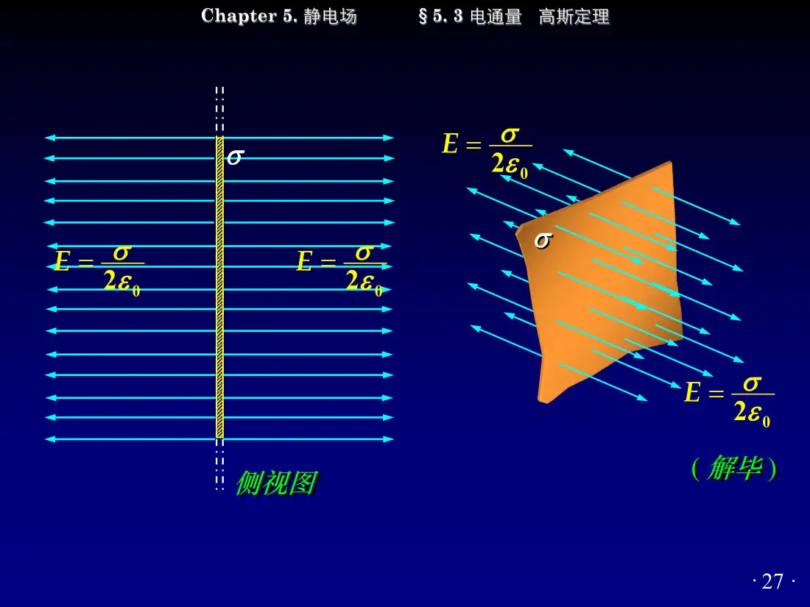

原文：

(解毕)

Chapter 5. 静电场

§ 5.3 电通量 高斯定理

27

### Chapter 5. 静电场

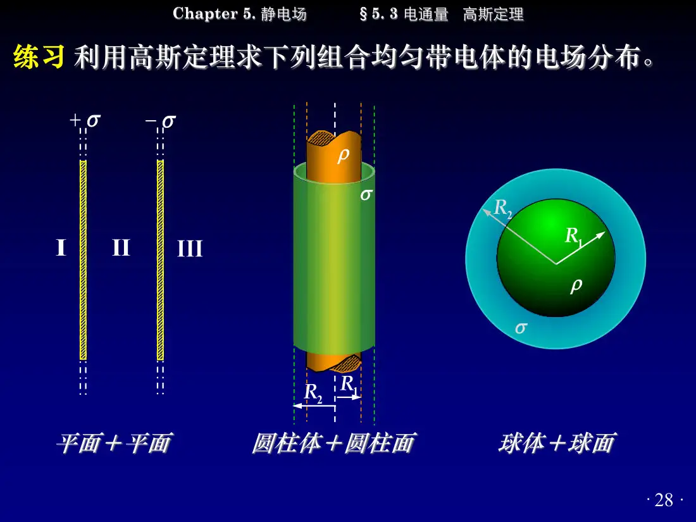

原文：

Chapter 5. 静电场

§ 5.3 电通量 高斯定理

练习 利用高斯定理求下列组合均匀带电体的电场分布。

平面+平面

圆柱体+圆柱面

球体+球面

28

### 归纳：

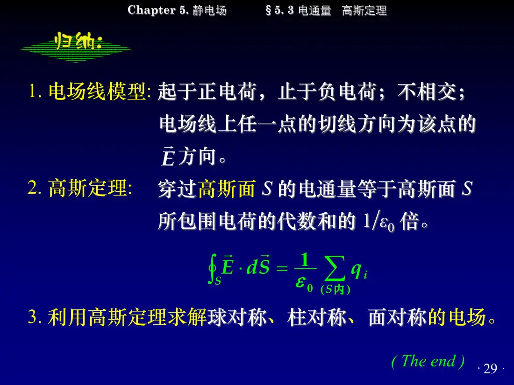

原文：

归纳：

1. 电场线模型: 起于正电荷, 止于负电荷; 不相交; 电场线上任一点的切线方向为该点的 $\vec{E}$ 方向。

2. 高斯定理: 穿过高斯面 S 的电通量等于高斯面 S 所包围电荷的代数和的 $1/\varepsilon_{0}$ 倍。

$$
\oint_ {S} \vec {E} \cdot d \vec {S} = \frac {1}{\varepsilon_ {0}} \sum_ {(S \text {内})} q _ {i}
$$

3. 利用高斯定理求解球对称、柱对称、面对称的电场。

The end

Chapter 5. 静电场 § 5.3 电通量 高斯定理

29
