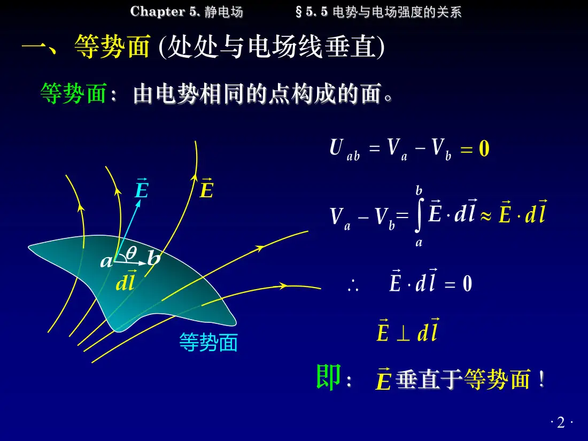
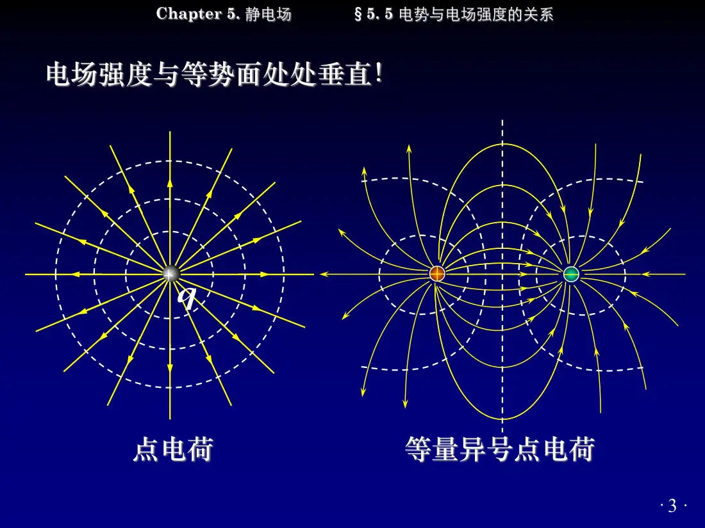
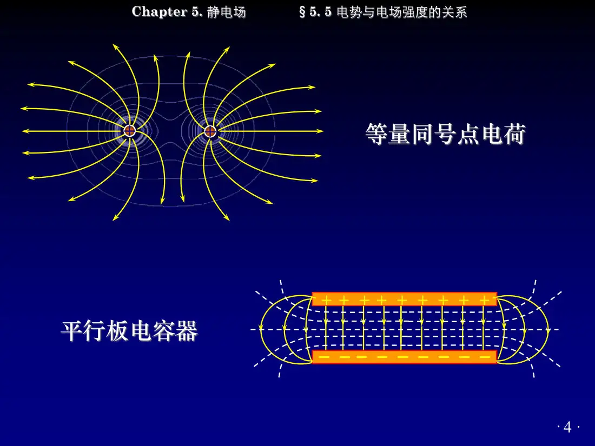
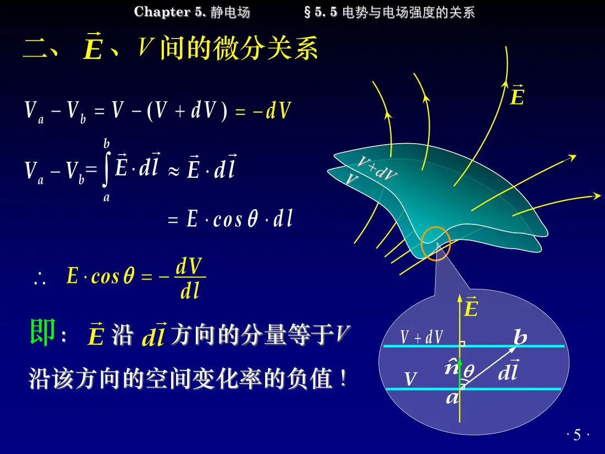
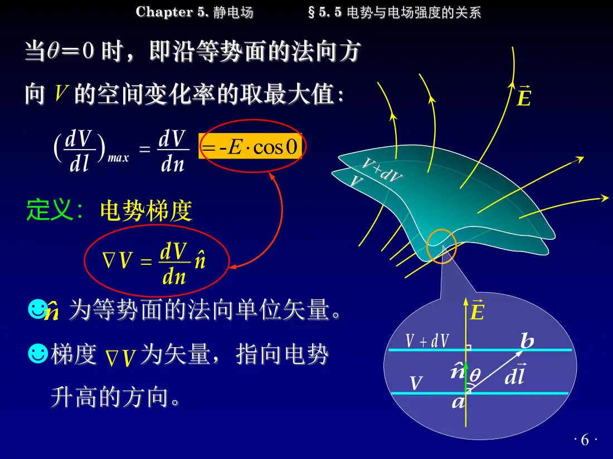
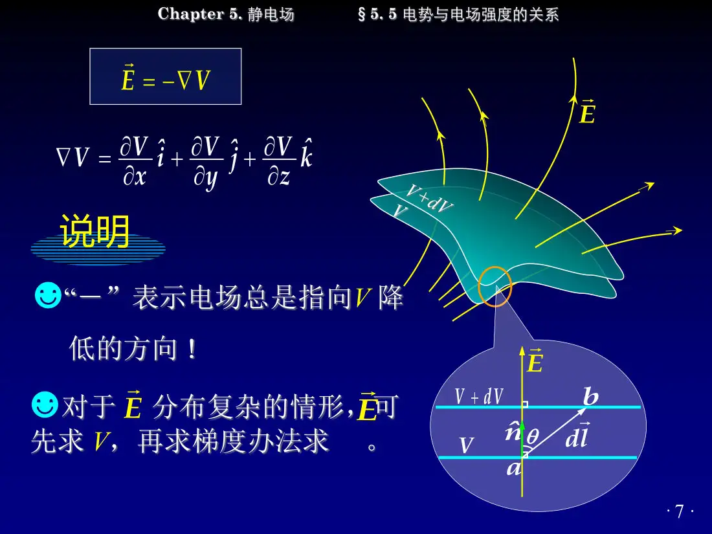
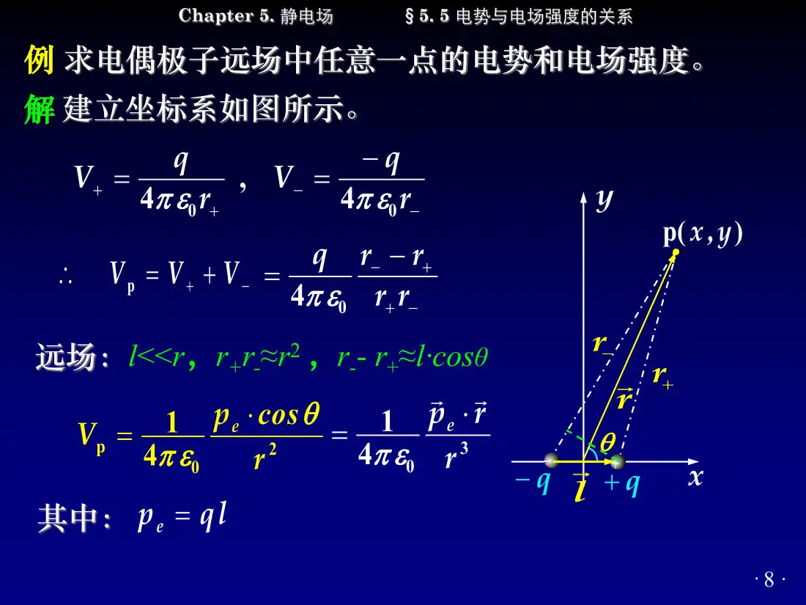
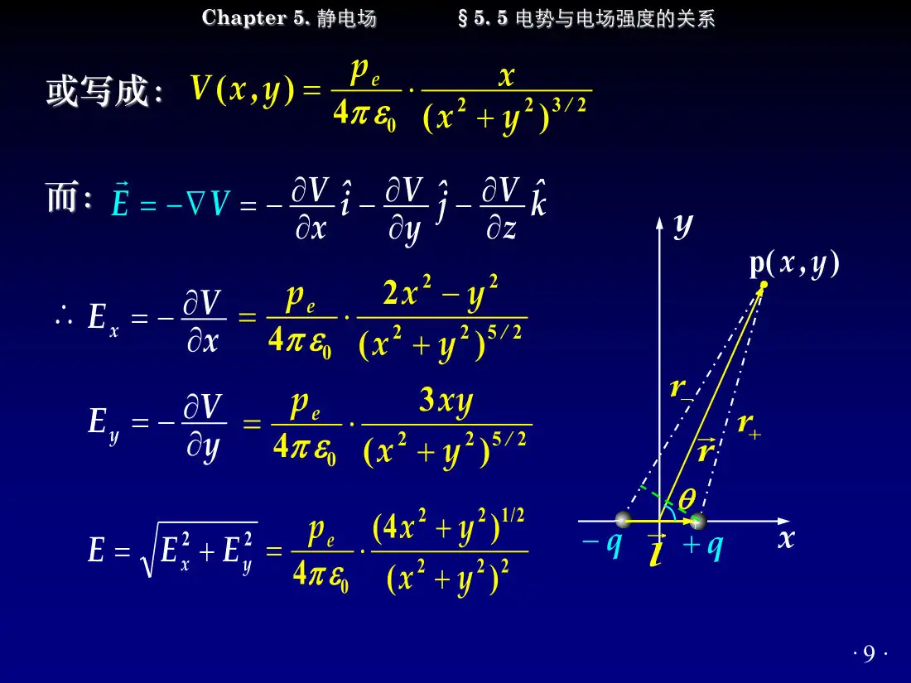
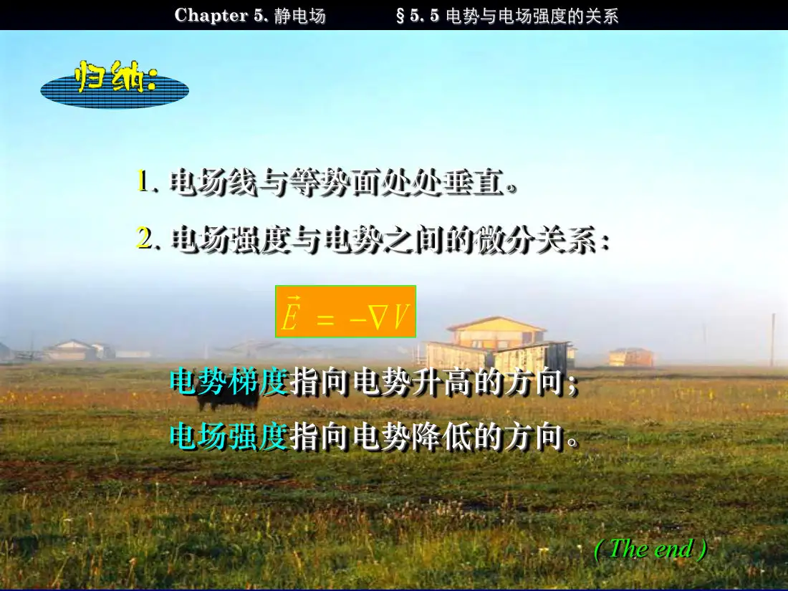

# 《大学物理》第5章 静电场 §5.5 电势与电场强度的关系（课件）

原件的每一页，下面附识别出的文字。

### § 5.5 电势与电场强度的关系

原文：

§ 5.5 电势与电场强度的关系

Chapter 5. 静电场

§ 5.5 电势与电场强度的关系

1

### 一、等势面 (处处与电场线垂直)

原文：

一、等势面 (处处与电场线垂直)

等势面：由电势相同的点构成的面。

等势面

$$
U _ {a b} = V _ {a} - V _ {b} = 0
$$

$$
V _ {a} - V _ {b} = \int_ {a} ^ {b} \vec {E} \cdot d \vec {l} \approx \vec {E} \cdot d \vec {l}
$$

$$
\therefore \vec {E} \cdot d \vec {l} = 0
$$

$\vec{E} \perp d\vec{l}$

即： $\vec{E}$ 垂直于等势面！

Chapter 5. 静电场

§ 5.5 电势与电场强度的关系

2

### 电场强度与等势面处处垂直！

原文：

电场强度与等势面处处垂直！

点电荷

等量异号点电荷

Chapter 5. 静电场

§ 5.5 电势与电场强度的关系

3

### 平行板电容器

原文：

平行板电容器

等量同号点电荷

Chapter 5. 静电场

§ 5.5 电势与电场强度的关系

4

### 二、 $\vec{E}$ 、 $V$ 间的微分关系

原文：

二、 $\vec{E}$ 、 $V$ 间的微分关系

$$
V _ {a} - V _ {b} = V - (V + d V) = - d V
$$

$$
\begin{array}{r l} V _ {a} - V _ {b} = \int_ {a} ^ {b} \vec {E} \cdot d \vec {l} & \approx \vec {E} \cdot d \vec {l} \\ & = E \cdot c o s \theta \cdot d l \end{array}
$$

$$
\therefore E \cdot \cos \theta = - \frac {d V}{d l}
$$

即： $\vec{E}$ 沿 $d\vec{l}$ 方向的分量等于 $V$ 沿该方向的空间变化率的负值！

Chapter 5. 静电场

§ 5.5 电势与电场强度的关系

5

### Chapter 5. 静电场

原文：

Chapter 5. 静电场

§ 5.5 电势与电场强度的关系

当 $\theta = 0$ 时, 即沿等势面的法向方向 $V$ 的空间变化率的取最大值:

$$
\left(\frac {d V}{d l}\right) _ {\max} = \frac {d V}{d n} = - E \cdot \cos 0
$$

定义：电势梯度

$$
\nabla V = \frac {d V}{d n} \hat {n}
$$

😊n 为等势面的法向单位矢量。

梯度 $\nabla V$ 为矢量，指向电势升高的方向。

6

### Chapter 5. 静电场

原文：

Chapter 5. 静电场

$$
\vec {E} = - \nabla V
$$

$$
\nabla V = \frac {\partial V}{\partial x} \hat {\textbf {\textit {i}}} + \frac {\partial V}{\partial y} \hat {\textbf {\textit {j}}} + \frac {\partial V}{\partial z} \hat {k}
$$

说明

“一”表示电场总是指向 $V$ 降低的方向！

对于 $\vec{E}$ 分布复杂的情形, $\vec{E}$ 可先求 V，再求梯度办法求。

§ 5.5 电势与电场强度的关系

7

### Chapter 5. 静电场 § 5.5 电势与电场强度的关系

原文：

Chapter 5. 静电场 § 5.5 电势与电场强度的关系

例 求电偶极子远场中任意一点的电势和电场强度。解 建立坐标系如图所示。

$$
V _ {+} = \frac {q}{4 \pi \varepsilon_ {0} r _ {+}}, V _ {-} = \frac {- q}{4 \pi \varepsilon_ {0} r _ {-}}
$$

$$
\therefore V _ {\mathrm{p}} = V _ {+} + V _ {-} = \frac {q}{4 \pi \varepsilon_ {0}} \frac {r _ {-} - r _ {+}}{r _ {+} r _ {-}}
$$

远场： $l<<r,\ r_{+}r_{-}\approx r^{2},\ r_{-}r_{+}\approx l\cdot cos\theta$

$$
V _ {\mathrm{p}} = \frac {1}{4 \pi \varepsilon_ {0}} \frac {p _ {e} \cdot c o s \theta}{r ^ {2}} = \frac {1}{4 \pi \varepsilon_ {0}} \frac {\vec {p} _ {e} \cdot \vec {r}}{r ^ {3}}
$$

其中： $p_{e}=ql$

8

### Chapter 5. 静电场

原文：

Chapter 5. 静电场

§ 5.5 电势与电场强度的关系

或写成： $V(x,y)=\frac{p_{e}}{4\pi\varepsilon_{0}}\cdot\frac{x}{(x^{2}+y^{2})^{3/2}}$

而： $\vec{E} = -\nabla V = -\frac{\partial V}{\partial x}\hat{i} -\frac{\partial V}{\partial y}\hat{j} -\frac{\partial V}{\partial z}\hat{k}$

$$
\therefore E _ {x} = - \frac {\partial V}{\partial x} = \frac {p _ {e}}{4 \pi \varepsilon_ {0}} \cdot \frac {2 x ^ {2} - y ^ {2}}{\left(x ^ {2} + y ^ {2}\right) ^ {5 / 2}}
$$

$$
E _ {y} = - \frac {\partial V}{\partial y} = \frac {p _ {e}}{4 \pi \varepsilon_ {0}} \cdot \frac {3 x y}{(x ^ {2} + y ^ {2}) ^ {5 / 2}}
$$

$$
E = \sqrt {E _ {x} ^ {2} + E _ {y} ^ {2}} = \frac {p _ {e}}{4 \pi \varepsilon_ {0}} \cdot \frac {(4 x ^ {2} + y ^ {2}) ^ {1 / 2}}{(x ^ {2} + y ^ {2}) ^ {2}}
$$

9

### 归纳：

原文：

归纳：

1. 电场线与等势面处处垂直。

2. 电场强度与电势之间的微分关系：

$$
\vec {E} = - \nabla V
$$

电势梯度指向电势升高的方向；  
电场强度指向电势降低的方向。

Chapter 5. 静电场

§ 5.5 电势与电场强度的关系
