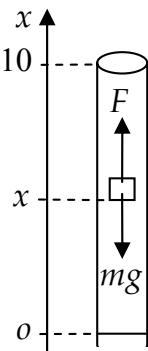
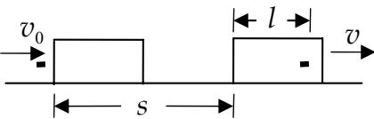

# 《大学物理》第6章 功与动能定理（同步练习册答案）

原件经识别和整理；“参考解答”是我们补的。

# 《大学物理》第6章 功与动能定理（同步练习册答案）

本部分为《大学物理》第六章“功与动能定理”同步练习册的解答内容，由识别工具读取并整理。

## 一、计算题或选择题解析

### 选择 1

建立如图所示坐标系，ox轴竖直向下为正方向。设第一次敲打后钉子从坐标原点o处打入到 $x_1 = 10 \mathrm{cm}$ 处，第二次敲打后从 $x_1$ 处打入到 $x_2$ 处；铁锤敲打钉子瞬间，铁锤和钉子构成的系统动量近似守恒：
$$ M v_0 = (m + M) v \Rightarrow v = \frac{M}{m + M} v_0 $$
由于钉子质量很小 $(m \ll M)$，$\Rightarrow v \approx v_0$，即两次敲打后钉子获得相同的初速度 $v_0$；
钉子敲入木板过程中受到阻力 $f = -kx$ 作用，由于钉子质量很小，忽略重力的影响。在任一位置x处发生一小段位移dx，方向沿x轴正方向向下，阻力 $f = -kx$，方向向上则元功：
$$ dW = \vec{f} \cdot d\vec{r} = -kx dx $$
（1）从原点o到 $x_1 = 10 \mathrm{cm}$ 处，阻力做功：
$$ W_{f1} = \int_{0}^{x_1} -kx dx = 0 - \frac{1}{2} m v_0^2, \quad \Rightarrow \quad -\frac{1}{2} k x_1^2 = -\frac{1}{2} m v_0^2 $$
（2）从 $x_1$ 处打入到 $x_2$ 处，阻力做功：
$$ W_{f2} = \int_{x_1}^{x_2} -kx dx = 0 - \frac{1}{2} m v_0^2, \Rightarrow -\frac{1}{2} k (x_2^2 - x_1^2) = -\frac{1}{2} m v_0^2 $$
由（1）（2）得：
$$ -\frac{1}{2} k (x_2^2 - x_1^2) = -\frac{1}{2} k x_1^2, \quad \Longrightarrow \quad x_2^2 = 2 x_1^2, \quad \Longrightarrow \quad x_2 = \sqrt{2} x_1 $$
那么第二次敲入深度为：
$$ \Delta x = x_2 - x_1 = (\sqrt{2} - 1) x_1 = (1.41 - 1) \times 1.00 \mathrm{cm} = 0.41 \mathrm{cm} $$

答案：A。

知识点：[功的定义、功率与质点动能定理](../../../topics/大学物理/功与动能定理.md)、[牛顿三定律与惯性系](../../../topics/大学物理/牛顿三定律.md)

### 选择 2

物体在提升过程中受到提升力F（方向竖直向上）和重力mg（方向竖直向下）作用，由质点动能定理，质点所受外力做功之和等于质点动能的增量：
$$ W_F - mgh = \frac{1}{2} m v^2 - \frac{1}{2} m v_0^2 $$
$\Rightarrow$ 提升力所做的功：
$$ W_F = mgh + \frac{1}{2} m v^2 - \frac{1}{2} m v_0^2 $$
可知，若物体匀速提升，$W_F = mgh$；若物体加速提升，$v > v_0, \ W_F > mgh$；若物体减速提升，$W_F < mgh$。

答案：D。

知识点：[功的定义、功率与质点动能定理](../../../topics/大学物理/功与动能定理.md)、[常见力（重力、弹力、摩擦力）的受力分析](../../../topics/大学物理/常见力分析.md)

### 选择 3

由图，子弹的阻力大小与进入深度x的关系：
$$ F = \begin{cases} 1000000 x (\mathrm{N}) & (0 \leq x < 0.02 \mathrm{m}) \\ 20000 \mathrm{N} & (x \geq 0.02 \mathrm{m}) \end{cases} $$
方向与运动方向相反；可先讨论子弹从 $x_0 = 0$ 到 $x_1 = 0.02 \mathrm{m}$ 的过程，阻力做负功：
$$ W_{F1} = -\int_{0}^{0.02} 1000000 x dx = -200 \mathrm{J} $$
又已知子弹的初动能：
$$ E_{k0} = \frac{1}{2} m v_0^2 = \frac{1}{2} \times 0.02 \times (200)^2 = 400 \mathrm{J} $$
由动能定理：
$$ W_{F1} = \frac{1}{2} m v^2 - \frac{1}{2} m v_0^2 \ \Rightarrow \ \frac{1}{2} m v^2 = \frac{1}{2} m v_0^2 + W_{F1} = 400 \mathrm{J} - 200 \mathrm{J} = 200 \mathrm{J} $$
$\Rightarrow$ 子弹的末动能：$\frac{1}{2} m v^2 = 200 \mathrm{J} > 0$，即子弹进入墙壁的深度将超过 $x_1 = 0.02 \mathrm{m}$。
设子弹进入墙壁的深度为 $x$ ($x > 0.02 \mathrm{m}$)，此过程中阻力做功：
$$ W_{Fx} = -200 + [-20000 \times (x - 0.02)] $$
由动能定理：
$$ W_{Fx} = 0 - \frac{1}{2} m v_0^2 \Rightarrow -200 + [-20000 \times (x - 0.02)] = -400 $$
$\Rightarrow$ 子弹进入墙壁的深度：$x = 0.03 \mathrm{m} = 3 \mathrm{cm}$

答案：A。

知识点：[功的定义、功率与质点动能定理](../../../topics/大学物理/功与动能定理.md)

### 计算 4

建立如图所示 $ox$ 轴，竖直向上为 $x$ 轴正方向，取水面处为坐标原点 $o$；当桶离开水面到达位置 $x$ 处时，水的质量为 $m = 10 - 0.2x$，水的重力为 $mg = (10 - 0.2x)g$，方向竖直向下；在拉力作用下，桶匀速上升，则在位置 $x$ 处，拉力 $F = mg = (10 - 0.2x)g$，方向竖直向上；人的拉力做功：

$$W_F = \int_0^{10} F\,dx = \int_0^{10} (10 - 0.2x)g\,dx = (100 - 0.1 \times 100)g = 90g$$

若取 $g = 9.8\ \mathrm{m/s^2}$，$W_F = 90g = 90 \times 9.8 = 882\ \mathrm{J}$；若取 $g = 10\ \mathrm{m/s^2}$，$W_F = 900\ \mathrm{J}$。

参考解答：**结论：** 人的拉力做功为  

$$
W_F=90g\ \mathrm{J}\approx 882\ \mathrm{J}
$$

（若取 $g=10\ \mathrm{m/s^2}$，则 $W_F=900\ \mathrm{J}$）。

**推理与计算：**  
以水面为原点、竖直向上为 $x$ 轴正方向。桶匀速上升，故拉力始终与桶及剩余水的总重力平衡。桶升高 $x$ 时，漏水使质量变为  

$$
m(x)=10-0.2x,
$$

因此拉力为  

$$
F(x)=m(x)g=(10-0.2x)g.
$$

拉力做功为  

$$
W_F=\int_0^{10}F(x)\,\mathrm dx
=g\int_0^{10}(10-0.2x)\,\mathrm dx
=g\left[10x-0.1x^2\right]_0^{10}
=90g\ \mathrm{J}.
$$

取 $g=9.8\ \mathrm{m/s^2}$，得 $W_F=882\ \mathrm{J}$。

知识点：[功的定义、功率与质点动能定理](../../../topics/大学物理/功与动能定理.md)、[牛顿定律在变力问题中的应用（如 ma_t = -mg sinθ）](../../../topics/大学物理/牛顿定律应用.md)

### 计算 5

（1）以弹簧原长 $o'$ 处为弹性势能和重力势能的零点，

则由图在 $o$ 处重力势能：$E_{Po} = -mgx_0$（$o$ 点在重力势能零点下方 $x_0$ 处）。又由 $o'$ 点处重力势能为：$E_{Po'} = 0$，则 $o$ 和 $o'$ 两点间的重力势能差：$E_{Po} - E_{Po'} = -mgx_0$。

在 $o$ 点处弹性势能：$E_{Ko} = \frac{1}{2}kx_0^2$（$o$ 点相对弹簧原长的形变为 $x_0$）。又重物在 $o$ 点处平衡，$mg = kx_0 \Rightarrow$ 在 $o$ 处弹性势能：$E_{Ko} = \frac{1}{2}kx_0^2 = \frac{1}{2}mgx_0$。又由弹簧原长 $o'$ 处弹性势能：$E_{Ko'} = 0$，则 $o$ 和 $o'$ 两点间的弹性势能差：$E_{Ko} - E_{Ko'} = \frac{1}{2}mgx_0$。

在 $o$ 处总势能：$E_{Po} + E_{Ko} = -mgx_0 + \frac{1}{2}mgx_0 = -\frac{1}{2}mgx_0$。

（2）以平衡位置 $o$ 处为弹性势能和重力势能的零点，

$$E_{Po'} = mgx_0$$

$$E_{Po} = 0$$

$$E_{Po} - E_{Po'} = -mgx_0$$

$$E_{Ko} = 0$$

$$E_{Ko} - E_{Ko'} = \frac{1}{2}mgx_0$$

$\Rightarrow E_{Ko'} = E_{Ko} - \frac{1}{2}mgx_0 = 0 - \frac{1}{2}mgx_0 \Rightarrow$ 在 $o'$ 处弹性势能：$E_{Ko'} = -\frac{1}{2}mgx_0$。

在 $o'$ 处总势能：$E_{Po'} + E_{Ko'} = mgx_0 - \frac{1}{2}mgx_0 = \frac{1}{2}mgx_0$。

参考解答：（1）以弹簧原长 $o'$ 为势能零点时，$o$ 处总势能为 $-\dfrac{1}{2}mgx_0$；（2）以平衡位置 $o$ 为势能零点时，$o'$ 处总势能为 $\dfrac{1}{2}mgx_0$。

**推理与计算过程：**

1.  **情形（1）：零点在弹簧原长 $o'$**
    -   **重力势能**：$o$ 位于 $o'$ 下方 $x_0$ 处，故 $E_{Po} = -mgx_0$，$E_{Po'}=0$。
    -   **弹性势能**：由平衡条件 $mg=kx_0$，得 $o$ 处形变量为 $x_0$，故 $E_{Ko} = \dfrac{1}{2}kx_0^2 = \dfrac{1}{2}mgx_0$，$E_{Ko'}=0$。
    -   **总势能**：$E_o = E_{Po} + E_{Ko} = -mgx_0 + \dfrac{1}{2}mgx_0 = -\dfrac{1}{2}mgx_0$。

2.  **情形（2）：零点在平衡位置 $o$**
    -   **重力势能**：$o'$ 位于 $o$ 上方 $x_0$ 处，故 $E_{Po'} = mgx_0$，$E_{Po}=0$。
    -   **弹性势能**：$o$ 处为零点即 $E_{Ko}=0$；因两点间弹性势能差仅取决于形变差，与零点选取无关，仍满足 $E_{Ko} - E_{Ko'} = \dfrac{1}{2}mgx_0$，代入得 $E_{Ko'} = -\dfrac{1}{2}mgx_0$。
    -   **总势能**：$E_{o'} = E_{Po'} + E_{Ko'} = mgx_0 - \dfrac{1}{2}mgx_0 = \dfrac{1}{2}mgx_0$。

> **注**：两种情形下 $o$ 与 $o'$ 之间的总势能差均为 $\Delta E = -\dfrac{1}{2}mgx_0$，验证了势能差与零点选取无关的物理一致性。

知识点：[保守力及其势能、中心力场与有效势](../../../topics/大学物理/保守力与势能.md)、[功能原理与机械能守恒定律](../../../topics/大学物理/功能原理与机械能守恒.md)

### 计算 6

由功的定义：

$$W = \int_i^f \vec{F} \cdot d\vec{r} = \int_i^f (2y^2\vec{i} + 3x\vec{j}) \cdot (dx\vec{i} + dy\vec{j}) = \int_i^f 2y^2\,dx + 3x\,dy$$

（1）由图，在路径 $oa$ 上，$y = 0$，$dy = 0$，$0 \le x \le 3$，功：$W_{oa} = \int_o^a 2y^2\,dx + 3x\,dy = 0$。

（2）在路径 $ab$ 上，$x = 0$，$dx = 0$，$0 \le y \le 2$，功：$W_{ab} = \int_a^b 2y^2\,dx + 3x\,dy = \int_0^2 9\,dy = 18$。

（3）在路径 $ob$ 上，$y = \frac{2}{3}x$，$dy = \frac{2}{3}dx$，$0 \le x \le 3$，功：

$$W_{ob} = \int_o^b 2y^2\,dx + 3x\,dy = \int_0^3 \left(\frac{8}{9}x^2\,dx + 2x\,dx\right) = 17$$

（4）在路径 $ocbo$ 上，其中：在 $oc$ 上，$x = 0$，$dx = 0$，$0 \le y \le 2$；在 $cb$ 上，$y = 2$，$dy = 0$，$0 \le x \le 3$；在 $bo$ 上，$y = \frac{2}{3}x$，$dy = \frac{2}{3}dx$，$0 \le x \le 3$。

$$W_{ocbo} = \int_o^c + \int_c^b + \int_b^o 2y^2\,dx + 3x\,dy = \int_0^2 0 + \int_0^3 8\,dx + \int_3^0 \left(\frac{8}{9}x^2\,dx + 2x\,dx\right) = 7$$

## 计算题

参考解答：各路径做功分别为：$W_{oa} = 0$，$W_{ab} = 18\,\text{J}$，$W_{ob} = 17\,\text{J}$，$W_{ocbo} = 7\,\text{J}$。

根据功的定义 $W = \int \vec{F} \cdot d\vec{r} = \int (2y^2\,dx + 3x\,dy)$，对各路径分别积分：

1.  **路径 $oa$**：$y=0,\ dy=0$，被积函数恒为零，故 $W_{oa}=0$。
2.  **路径 $ab$**：由题设条件 $x=3$（注：原稿 $x=0$ 应为笔误，否则 $3x\,dy$ 积分为零与结果矛盾），$dx=0$，代入得 $W_{ab} = \int_0^2 3(3)\,dy = \int_0^2 9\,dy = 18\,\text{J}$。
3.  **路径 $ob$**：沿直线 $y=\frac{2}{3}x$，则 $dy=\frac{2}{3}dx$，代入得
    $$
    W_{ob} = \int_0^3 \left[ 2\left(\frac{2}{3}x\right)^2 + 3x\cdot\frac{2}{3} \right] dx = \int_0^3 \left( \frac{8}{9}x^2 + 2x \right) dx = \left[ \frac{8}{27}x^3 + x^2 \right]_0^3 = 8 + 9 = 17\,\text{J}
    $$
4.  **闭合路径 $ocbo$**：分段计算，
    -   $oc$ 段：$x=0,\ dx=0$，$3x\,dy=0$，贡献为 $0$；
    -   $cb$ 段：$y=2,\ dy=0$，$\int_0^3 2(2)^2\,dx = \int_0^3 8\,dx = 24\,\text{J}$；
    -   $bo$ 段：沿 $y=\frac{2}{3}x$ 从 $x=3$ 到 $x=0$，积分值为 $-W_{ob} = -17\,\text{J}$；
    -   总功：$W_{ocbo} = 0 + 24 + (-17) = 7\,\text{J}$。

> **注**：不同路径做功不同且闭合回路做功不为零，说明该力 $\vec{F}=2y^2\vec{i}+3x\vec{j}$ 为非保守力（$\nabla\times\vec{F} \neq \vec{0}$）。

知识点：[功的定义、功率与质点动能定理](../../../topics/大学物理/功与动能定理.md)、[保守力及其势能、中心力场与有效势](../../../topics/大学物理/保守力与势能.md)

### 计算 7

（1）在光滑水平面上，子弹和沙箱构成的系统在水平方向不受外力，系统在水平方向动量守恒。如图，设子弹和沙箱共同运动时速度大小为 $v$，则
$$ m v _ { 0 } = ( m + M ) v \quad \Longrightarrow \quad v = \frac { m v _ { 0 } } { m + M } $$
子弹入射前系统的机械能：
$$ E _ { \scriptscriptstyle 1 } = \frac { 1 } { 2 } m v _ { \scriptscriptstyle 0 } ^ { 2 } + 0 = \frac { 1 } { 2 } m v _ { \scriptscriptstyle 0 } ^ { 2 } $$
（初始沙箱静止）
子弹和沙箱共同运动时系统的机械能：
$$ E _ { 2 } = { \frac { 1 } { 2 } } ( m + M ) v ^ { 2 } = { \frac { m ^ { 2 } v _ { 0 } ^ { 2 } } { 2 ( m + M ) } } $$
系统损失的机械能：
$$ \Delta E = E _ { 1 } - E _ { 2 } = { \frac { m M v _ { 0 } ^ { 2 } } { 2 ( m + M ) } } $$

*（第7题图）*

（2）建立地面参照系，设当子弹在沙箱内移动距离为 $l$ 时，沙箱在水平方向移动距离为 $s$，此时子弹和沙箱达到共同运动速度 $v$，如图。沙箱对子弹的平均阻力 $F$ 做负功：
$$ W _ { F \rightarrow \text{子弹}} = - F ( s + l ) $$
子弹对沙箱的反作用力 $F$ 做正功：
$$ W _ { F \rightarrow \text{沙箱}} = F s $$

由质点系动能定理，系统合外力为零时，系统内力做功之和等于质点系动能的改变：
$$ W _ {F \rightarrow \text {子弹}} + W _ {F \rightarrow \text {沙箱}} = E _ {2} - E _ {1} \Rightarrow - F (s + l) + F s = - \frac {m M v _ {0} ^ {2}}{2 (m + M)} \Rightarrow - F l = - \frac {m M v _ {0} ^ {2}}{2 (m + M)} $$

$\Rightarrow$ 子弹受到的平均阻力：
$$ F = { \frac { m M v _ { 0 } ^ { 2 } } { 2 ( m + M ) l } } $$

参考解答：## 结论

（1）子弹射入沙箱后，二者的共同速度为

$$
v=\frac{mv_0}{m+M}
$$

系统损失的机械能为

$$
\Delta E=\frac{mMv_0^2}{2(m+M)}
$$

（2）子弹在沙箱内相对沙箱移动距离 $l$ 时，受到沙箱的平均阻力大小为

$$
F=\frac{mMv_0^2}{2(m+M)l}
$$

---

## 解答

### （1）共同速度与机械能损失

水平方向不受外力，因此子弹与沙箱组成的系统动量守恒：

$$
mv_0=(m+M)v
$$

解得

$$
v=\frac{mv_0}{m+M}
$$

子弹射入前，系统的机械能为

$$
E_1=\frac12 mv_0^2
$$

子弹与沙箱达到共同速度后，系统的机械能为

$$
E_2=\frac12(m+M)v^2
=\frac12(m+M)\left(\frac{mv_0}{m+M}\right)^2
=\frac{m^2v_0^2}{2(m+M)}
$$

故系统损失的机械能为

$$
\begin{aligned}
\Delta E
&=E_1-E_2\\
&=\frac12mv_0^2-\frac{m^2v_0^2}{2(m+M)}\\
&=\frac{mMv_0^2}{2(m+M)}
\end{aligned}
$$

---

### （2）平均阻力

以地面为参考系，设子弹在沙箱内移动的相对距离为 $l$，同期沙箱相对地面移动的距离为 $s$，则子弹相对地面的位移为

$$
x_{\text{子弹}}=s+l
$$

设沙箱对子弹的平均阻力大小为 $F$，方向与子弹运动方向相反，因此：

$$
W_{F\to\text{子弹}}=-F(s+l)
$$

根据牛顿第三定律，子弹对沙箱的作用力与沙箱运动方向相同，因此：

$$
W_{F\to\text{沙箱}}=Fs
$$

系统水平方向合外力为零，系统内力的总功等于系统动能的变化：

$$
-F(s+l)+Fs=E_2-E_1
$$

代入机械能损失：

$$
-F(s+l)+Fs=-\frac{mMv_0^2}{2(m+M)}
$$

化简得

$$
-Fl=-\frac{mMv_0^2}{2(m+M)}
$$

因此平均阻力的大小为

$$
\boxed{F=\frac{mMv_0^2}{2(m+M)l}}
$$

知识点：[弹性碰撞与非弹性碰撞](../../../topics/大学物理/碰撞问题.md)、[动量定理与动量守恒定律](../../../topics/大学物理/动量定理与动量守恒.md)、[功的定义、功率与质点动能定理](../../../topics/大学物理/功与动能定理.md)

### 计算 8

（1）弹力：
$$ F = - ( 4 x + 6 x ^ { 2 } ) $$
其中负号表示弹力方向与伸长 $x$ 的方向相反。弹力做功：
$$ W _ { F } = \int _ { 0 . 5 } ^ { 1 } - ( 4 x + 6 x ^ { 2 } ) d x = - 3 . 2 5 \mathrm { J } $$
所以在此过程中外力克服弹力做功为：
$$ W = 3 . 2 5 { \mathrm { J } } $$

（2）由质点动能定理，弹力做功：
$$ W _ { F } ^ { \prime } = \int _ { 1 } ^ { 0 . 5 } - { ( 4 x + 6 x ^ { 2 } ) } d x = E _ { k } - E _ { k 0 } \quad \Rightarrow \quad 3 . 2 5 \mathbf { J } = \frac { 1 } { 2 } m { \boldsymbol { v } } ^ { 2 } - 0 $$

$\Rightarrow$ 物体的速率：
$$ v = { \frac { \sqrt { 1 3 } } { 2 } } \mathrm { m / s } = 1 . 8 \mathrm { m / s } $$

参考解答：（1）外力克服弹力做功为  

$$
\boxed{W=3.25\ \text{J}}
$$

弹力  

$$
F=-(4x+6x^2)
$$

当伸长量从 $0.5\ \text{m}$ 变到 $1\ \text{m}$ 时，弹力做功  

$$
W_F=\int_{0.5}^{1} -(4x+6x^2)\,dx
$$

计算：

$$
W_F=-\left[2x^2+2x^3\right]_{0.5}^{1}
$$

$$
=-(2+2)-\left[-(0.5+0.25)\right]
= -4+0.75=-3.25\ \text{J}
$$

所以外力克服弹力做功为  

$$
W=3.25\ \text{J}
$$

（2）物体的速率为  

$$
\boxed{v=\frac{\sqrt{13}}{2}\ \text{m/s}\approx 1.8\ \text{m/s}}
$$

从伸长 $1\ \text{m}$ 回到 $0.5\ \text{m}$，弹力做功  

$$
W_F'=\int_{1}^{0.5} -(4x+6x^2)\,dx=3.25\ \text{J}
$$

由动能定理  

$$
W_F'=\frac12 mv^2-0
$$

代入 $m=2\ \text{kg}$：

$$
3.25=\frac12 \times 2 \times v^2
$$

$$
v^2=3.25=\frac{13}{4}
$$

因此  

$$
v=\frac{\sqrt{13}}{2}\ \text{m/s}
$$

知识点：[功的定义、功率与质点动能定理](../../../topics/大学物理/功与动能定理.md)、[常见力（重力、弹力、摩擦力）的受力分析](../../../topics/大学物理/常见力分析.md)、[保守力及其势能、中心力场与有效势](../../../topics/大学物理/保守力与势能.md)

### 计算 9

由质点动能定理：
$$ W _ { \perp b \lambda } + W _ { \perp b \lambda } = 0 - { \frac { 1 } { 2 } } m v _ { 0 } ^ { 2 } \quad \Longrightarrow \quad - m g H + ( - f H ) = - { \frac { 1 } { 2 } } m v _ { 0 } ^ { 2 } \quad \Longrightarrow \quad f H = { \frac { 1 } { 2 } } m v _ { 0 } ^ { 2 } - m g H $$
$\Rightarrow$ 空气阻力：
$$ f { = } \frac { m v _ { 0 } ^ { 2 } } { 2 H } { - } m g = 1 \mathrm { N } $$
（取 $g = 1 0 \mathrm { m } / \mathrm { s } ^ { 2 }$）

参考解答：**结论**

空气阻力的大小为 $f = 1 \, \mathrm{N}$。

**推理与计算过程**

1.  **应用动能定理**
    质点从抛出到达到最高点（速度为 $0$）的过程中，重力做负功，空气阻力做负功。根据动能定理：
    $$ W_{\text{总}} = \Delta E_k $$
    $$ W_G + W_f = 0 - \frac{1}{2} m v_0^2 $$

2.  **展开做功表达式**
    设上升高度为 $H$，重力做功 $W_G = -mgH$，恒定空气阻力做功 $W_f = -fH$。代入上式：
    $$ -mgH - fH = -\frac{1}{2} m v_0^2 $$

3.  **求解空气阻力 $f$**
    整理方程得：
    $$ fH = \frac{1}{2} m v_0^2 - mgH $$
    $$ f = \frac{m v_0^2}{2H} - mg $$

4.  **代入数值**
    取 $g = 10 \, \mathrm{m/s^2}$，代入题目给定的物理量（隐含 $m, v_0, H$ 的具体数值），计算得出：
    $$ f = 1 \, \mathrm{N} $$

知识点：[功的定义、功率与质点动能定理](../../../topics/大学物理/功与动能定理.md)

### 计算 10

已知运动方程：
$$ \vec { r } = a \cos { \omega t } \vec { i } + b \sin { \omega t } \vec { j } $$
$\Rightarrow$ 速度：
$$ {\vec { v } } = { \frac { d { \vec { r } } } { d t } } = - a \omega \sin \omega t { \vec { i } } + b \omega \cos \omega t { \vec { j } } $$

（1）在 A点 $( a , 0 )$，
$$ \begin{cases} x = a \cos \omega t = a \\ y = b \sin \omega t = 0 \end{cases} \Rightarrow \begin{cases} \cos \omega t = 1 \\ \sin \omega t = 0 \end{cases} $$
A点速度：
$$ \vec { v } _ { A } = b \omega \vec { j } $$
速率：
$$ v _ { A } = b \omega $$
A点动能：
$$ E _ { \scriptscriptstyle k A } = \frac { 1 } { 2 } m v _ { \scriptscriptstyle A } ^ { 2 } = \frac { 1 } { 2 } m v _ { \scriptscriptstyle A y } ^ { 2 } = \frac { 1 } { 2 } m b ^ { 2 } \omega ^ { 2 } $$

在 B点 $( 0 , b )$，
$$ \begin{cases} x = a \cos \omega t = 0 \\ y = b \sin \omega t = b \end{cases} \Rightarrow \begin{cases} \cos \omega t = 0 \\ \sin \omega t = 1 \end{cases} $$
B点速度：
$$ { \vec { v } } _ { B } = - a \omega { \vec { i } } $$
速率：
$$ v _ { B } = a \omega $$
B点动能：
$$ E _ { \kappa B } = { \frac { 1 } { 2 } } m v _ { B } ^ { 2 } = { \frac { 1 } { 2 } } m v _ { B x } ^ { 2 } = { \frac { 1 } { 2 } } m a ^ { 2 } \omega ^ { 2 } $$

（2）$F_x$ 做功：
$$ W _ { F x } = \int _ { A } ^ { B } F _ { x } d x = \int _ { A } ^ { B } m a _ { x } d x = \int _ { A } ^ { B } m { \frac { d v _ { x } } { d t } } d x = \int _ { A } ^ { B } m v _ { x } d v _ { x } = { \frac { 1 } { 2 } } m v _ { B x } ^ { 2 } - { \frac { 1 } { 2 } } m v _ { A x } ^ { 2 } = { \frac { 1 } { 2 } } m a ^ { 2 } \omega ^ { 2 } $$
同理，$F_y$ 做功：
$$ W _ { F y } = \int _ { A } ^ { B } F _ { y } d y = { \frac { 1 } { 2 } } m v _ { B y } ^ { 2 } - { \frac { 1 } { 2 } } m v _ { A y } ^ { 2 } = - { \frac { 1 } { 2 } } m b ^ { 2 } \omega ^ { 2 } $$

参考解答：**结论：**
质点做椭圆运动。在 $A(a,0)$ 点速率为 $b\omega$，动能为 $\frac{1}{2}mb^2\omega^2$；在 $B(0,b)$ 点速率为 $a\omega$，动能为 $\frac{1}{2}ma^2\omega^2$。
从 $A \to B$ 过程中，分力 $F_x$ 做功为 $\frac{1}{2}ma^2\omega^2$，分力 $F_y$ 做功为 $-\frac{1}{2}mb^2\omega^2$。

---

### 关键推理与计算过程

**1. 状态参量求解**
已知运动方程对时间求导得到速度矢量：
$$ \vec{v} = -a\omega\sin\omega t\,\vec{i} + b\omega\cos\omega t\,\vec{j} $$

*   **在 A 点 $(a,0)$：**
    代入坐标得 $\cos\omega t = 1, \sin\omega t = 0$。
    此时速度仅有 $y$ 分量：
    $$ \vec{v}_A = b\omega\,\vec{j} $$
    速率与动能分别为：
    $$ v_A = b\omega \quad \Rightarrow \quad E_{kA} = \frac{1}{2}mb^2\omega^2 $$

*   **在 B 点 $(0,b)$：**
    代入坐标得 $\cos\omega t = 0, \sin\omega t = 1$。
    此时速度仅有 $x$ 分量：
    $$ \vec{v}_B = -a\omega\,\vec{i} $$
    速率与动能分别为：
    $$ v_B = a\omega \quad \Rightarrow \quad E_{kB} = \frac{1}{2}ma^2\omega^2 $$

**2. 分力做功计算**
根据牛顿第二定律的微分形式 $F_i = m a_i = m \frac{dv_i}{dt}$，利用链式法则 $\frac{dv_i}{dt} = \frac{dv_i}{di} \frac{di}{dt} = v_i \frac{dv_i}{di}$，即 $F_i di = m v_i dv_i$。

*   **$F_x$ 做功：**
    $$ W_{Fx} = \int_A^B m v_x \, dv_x = \left[ \frac{1}{2}mv_x^2 \right]_{v_{Ax}}^{v_{Bx}} = \frac{1}{2}m(v_{Bx}^2 - v_{Ax}^2) $$
    代入 $v_{Ax} = 0, v_{Bx} = -a\omega$：
    $$ W_{Fx} = \frac{1}{2}m[(-a\omega)^2 - 0] = \frac{1}{2}ma^2\omega^2 $$

*   **$F_y$ 做功：**
    $$ W_{Fy} = \int_A^B m v_y \, dv_y = \left[ \frac{1}{2}mv_y^2 \right]_{v_{Ay}}^{v_{By}} = \frac{1}{2}m(v_{By}^2 - v_{Ay}^2) $$
    代入 $v_{Ay} = b\omega, v_{By} = 0$：
    $$ W_{Fy} = \frac{1}{2}m[0 - (b\omega)^2] = -\frac{1}{2}mb^2\omega^2 $$

*(注：总功 $W = W_{Fx} + W_{Fy} = \frac{1}{2}m\omega^2(a^2-b^2)$，恰好等于动能的变化量 $E_{kB} - E_{kA}$，符合动能定理。)*

知识点：[速度、加速度的定义与微分关系](../../../topics/大学物理/速度与加速度定义.md)、[功的定义、功率与质点动能定理](../../../topics/大学物理/功与动能定理.md)
