# 《大学物理》第6章 静电场中的导体与电介质 6-1 静电场中的导体（课件）

原件的每一页，下面附识别出的文字。

### 6-1 静电场中的导体

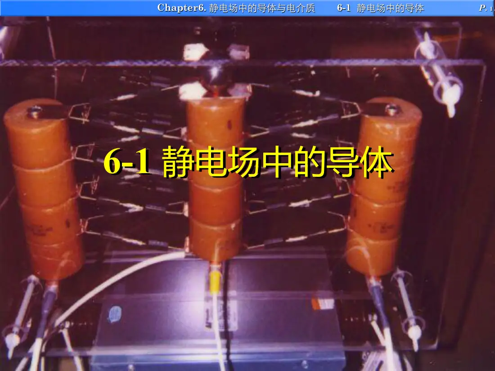

原文：

6-1 静电场中的导体

P.

Chapter6. 静电场中的导体与电介质

6-1 静电场中的导体

### 一、导体的静电平衡

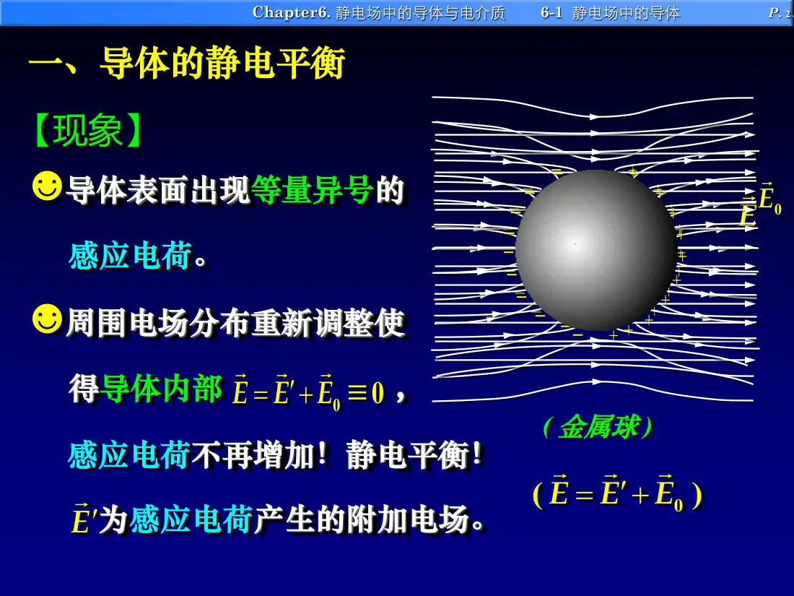

原文：

一、导体的静电平衡

【现象】

导体表面出现等量异号的感应电荷。

周围电场分布重新调整使

得导体内部 $\vec{E}=\vec{E}^{\prime}+\vec{E}_{0}\equiv0$

感应电荷不再增加！静电平衡！

$\vec{E}^{\prime}$ 为感应电荷产生的附加电场。

(金属球)

$(\vec{E} = \vec{E}' + \vec{E}_0)$

Chapter6. 静电场中的导体与电介质 6-1 静电场中的导体

P. 2

### 导体上的感应电荷代数和=0

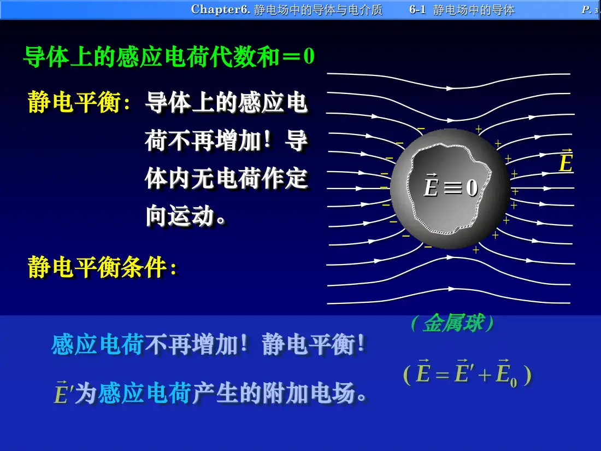

原文：

导体上的感应电荷代数和=0

静电平衡：导体上的感应电荷不再增加！导体内无电荷作定向运动。

静电平衡条件：

感应电荷不再增加！静电平衡！

$\vec{E}^{\prime}$ 为感应电荷产生的附加电场。

(金属球)

$$
(\vec {E} = \vec {E} ^ {\prime} + \vec {E} _ {0})
$$

Chapter6. 静电场中的导体与电介质

6-1 静电场中的导体

P. 3

### 导体上的感应电荷代数和=0

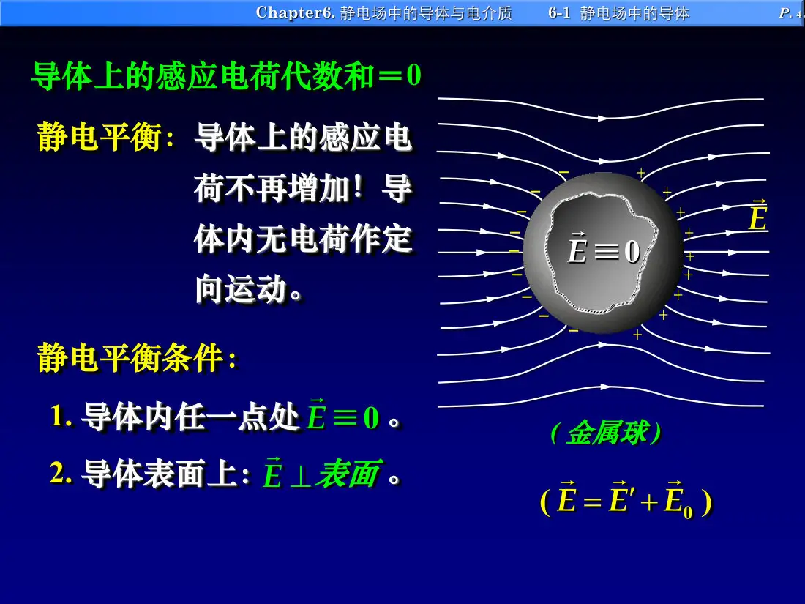

原文：

导体上的感应电荷代数和=0

静电平衡：导体上的感应电荷不再增加！导体内无电荷作定向运动。

静电平衡条件：

1. 导体内任一点处 $\vec{E} \equiv 0$ 。

2. 导体表面上: $\vec{E} \perp$ 表面。

(金属球)

$$
(\vec {E} = \vec {E} ^ {\prime} + \vec {E} _ {0})
$$

Chapter6. 静电场中的导体与电介质

6-1 静电场中的导体

P. 4

### 二、静电平衡特点

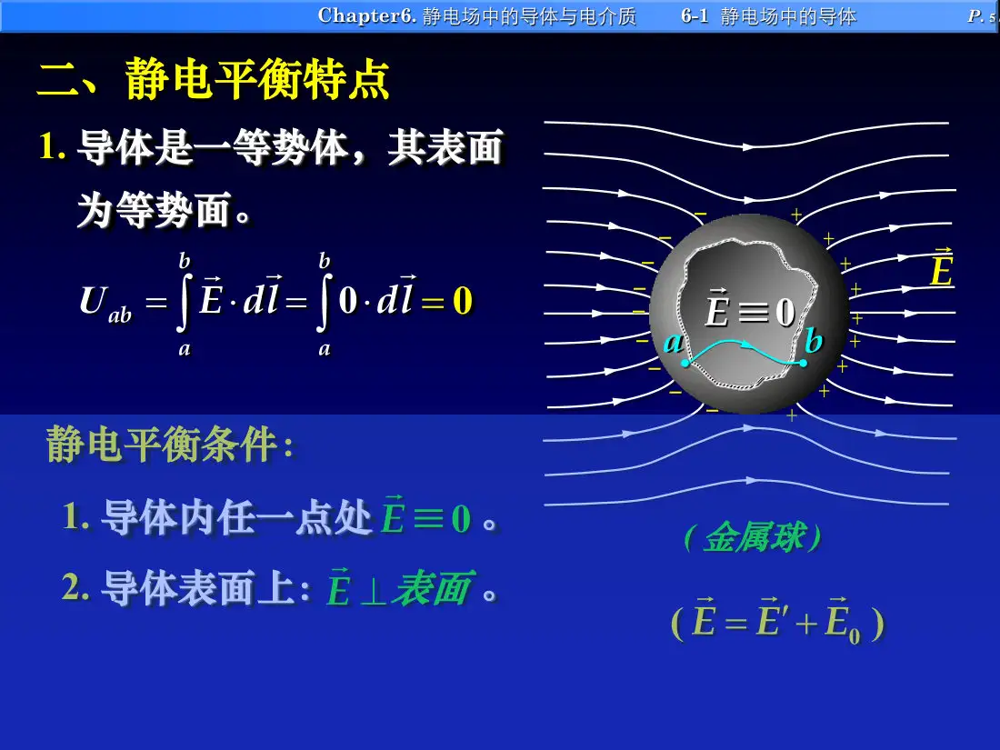

原文：

二、静电平衡特点

1. 导体是一等势体，其表面为等势面。

$$
U _ {a b} = \int_ {a} ^ {b} \vec {E} \cdot d \vec {l} = \int_ {a} ^ {b} 0 \cdot d \vec {l} = 0
$$

静电平衡条件：

1. 导体内任一点处 $\vec{E} \equiv 0$ 。

2. 导体表面上: $\vec{E} \perp$ 表面。

(金属球)

$$
(\vec {E} = \vec {E} ^ {\prime} + \vec {E} _ {0})
$$

Chapter6. 静电场中的导体与电介质

6-1 静电场中的导体

P. 5

### 二、静电平衡特点

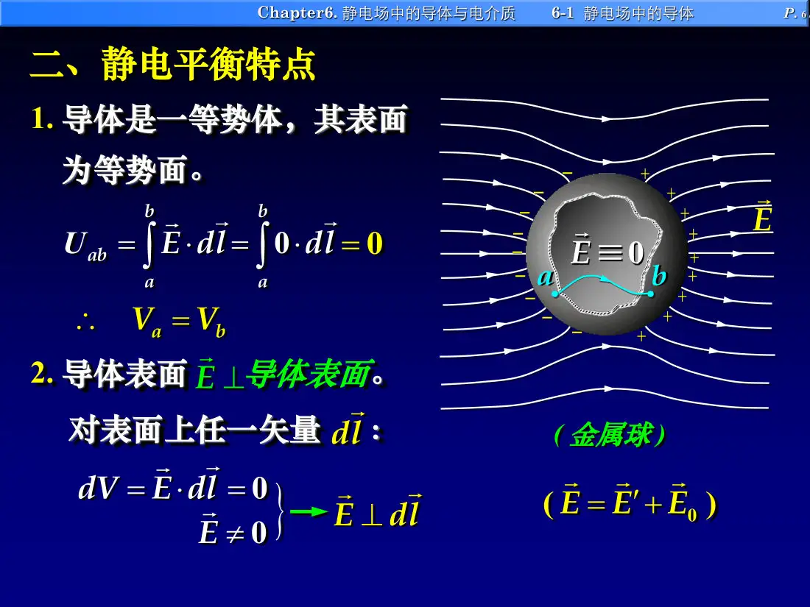

原文：

二、静电平衡特点

1. 导体是一等势体，其表面为等势面。

$$
\begin{array}{l} U _ {a b} = \int_ {a} ^ {b} \vec {E} \cdot d \vec {l} = \int_ {a} ^ {b} 0 \cdot d \vec {l} = 0 \\ \therefore V _ {a} = V _ {b} \end{array}
$$

2. 导体表面 $\vec{E} \perp$ 导体表面。
对表面上任一矢量 $d\vec{l}$ :

$$
\left.\begin{array}{c}d V = \vec {E} \cdot d \vec {l} = 0\\\vec {E} \neq 0\end{array}\right\}\rightarrow \vec {E} \perp d \vec {l}
$$

(金属球)

$(\vec{E} = \vec{E}' + \vec{E}_0)$

Chapter6. 静电场中的导体与电介质

6-1 静电场中的导体

P. 6

### 3. 导体内无净余电荷，净余电荷只能分布在导体的外表面。

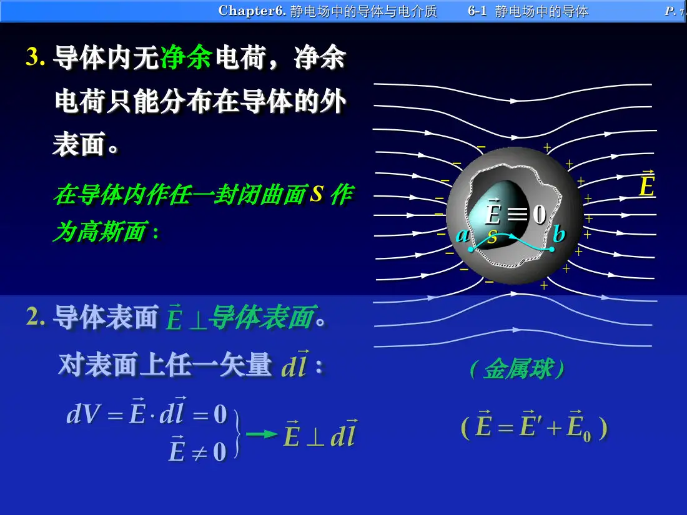

原文：

3. 导体内无净余电荷，净余电荷只能分布在导体的外表面。

在导体内作任一封闭曲面 S 作为高斯面：

2. 导体表面 $\vec{E} \perp$ 导体表面。

对表面上任一矢量 $d\vec{l}$ :

$$
\left.\begin{array}{c}d V = \vec {E} \cdot d \vec {l} = 0\\\vec {E} \neq 0\end{array}\right\}\rightarrow \vec {E} \perp d \vec {l}
$$

(金属球)

$$
(\vec {E} = \vec {E} ^ {\prime} + \vec {E} _ {0})
$$

Chapter6. 静电场中的导体与电介质

6-1 静电场中的导体

P. 7

### 3. 导体内无净余电荷，净余电荷只能分布在导体的外表面。

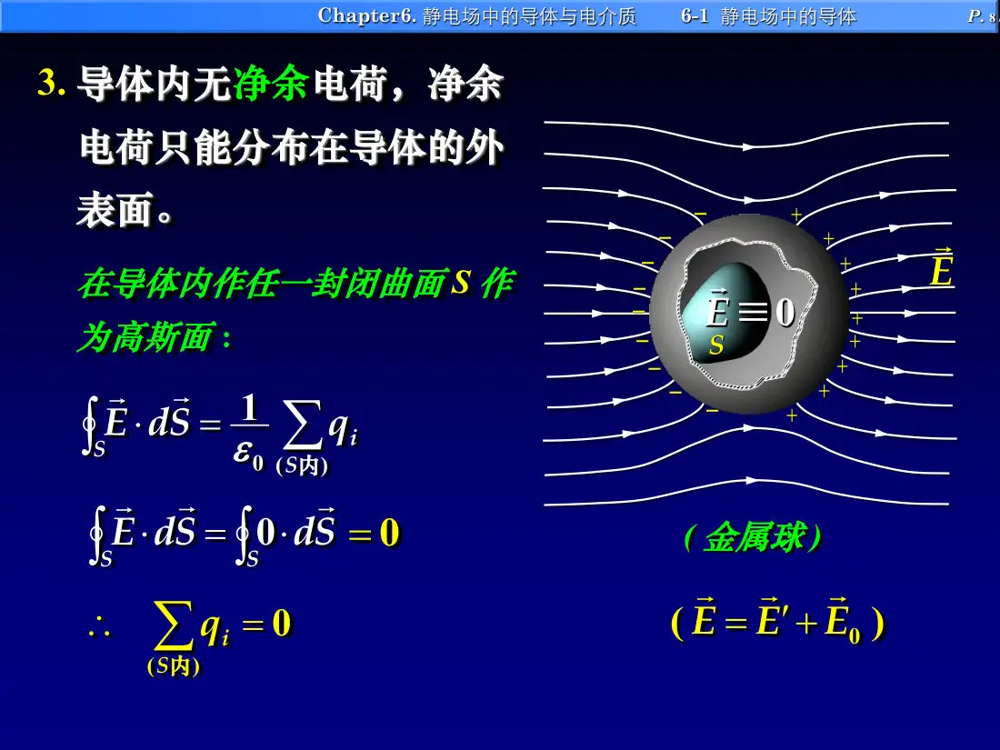

原文：

3. 导体内无净余电荷，净余电荷只能分布在导体的外表面。

在导体内作任一封闭曲面 S 作为高斯面：

$$
\oint_ {S} \vec {E} \cdot d \vec {S} = \frac {1}{\varepsilon_ {0}} \sum_ {(S \text {内})} q _ {i}
$$

$$
\oint_ {S} \vec {E} \cdot d \vec {S} = \oint_ {S} \mathbf {0} \cdot d \vec {S} = \mathbf {0}
$$

$$
\therefore \quad \sum_ {(S \text {内})} q _ {i} = 0
$$

$$
(\vec {E} = \vec {E} ^ {\prime} + \vec {E} _ {0})
$$

Chapter6. 静电场中的导体与电介质

6-1 静电场中的导体

P. 8

### 课堂练习 一不带电的空腔导体，试分析电荷分布。

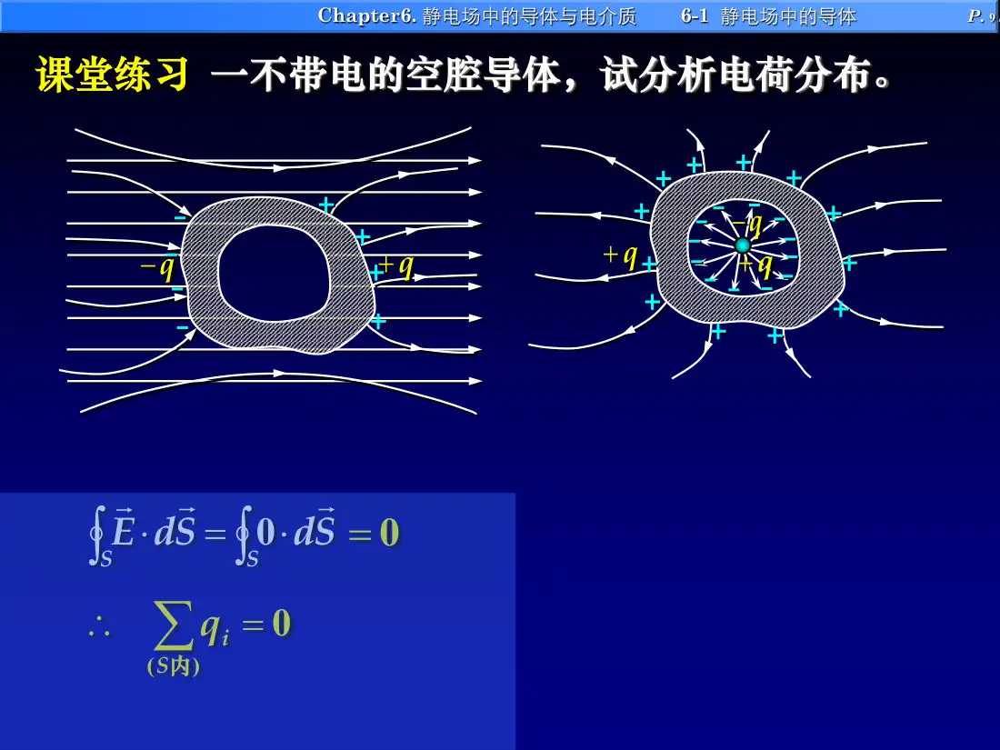

原文：

课堂练习 一不带电的空腔导体，试分析电荷分布。

$$
\oint_ {S} \vec {E} \cdot d \vec {S} = \oint_ {S} \mathbf {0} \cdot d \vec {S} = \mathbf {0}
$$

$$
\therefore \sum_ {(S \text {内})} q _ {i} = 0
$$

Chapter6. 静电场中的导体与电介质

6-1 静电场中的导体

P. 9

### 课堂练习 一不带电的空腔导体，试分析电荷分布。

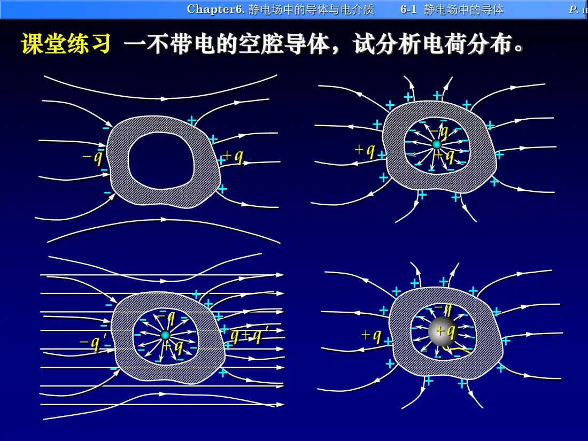

原文：

课堂练习 一不带电的空腔导体，试分析电荷分布。

Chapter6. 静电场中的导体与电介质 6-1 静电场中的导体

P. 10

### 插播录像：

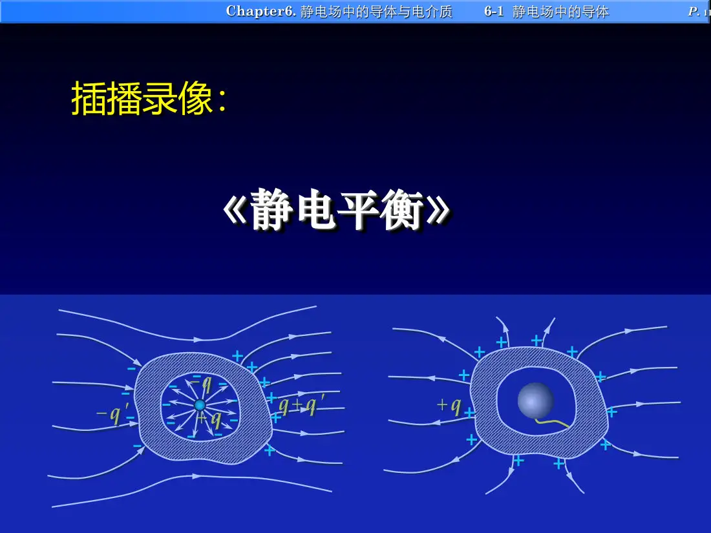

原文：

插播录像：

《静电平衡》

Chapter6. 静电场中的导体与电介质 6-1 静电场中的导体

P. 1

### 1'42" Chapter6. 静电场中的导体与电介质 6-1 静电场中的导体

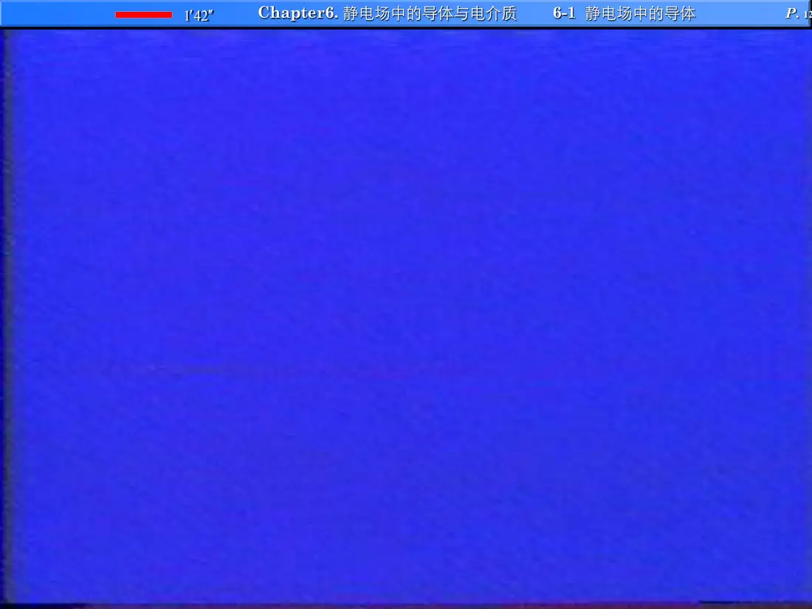

原文：

1'42" Chapter6. 静电场中的导体与电介质 6-1 静电场中的导体

P. 12

### 三、导体表面的电场强度

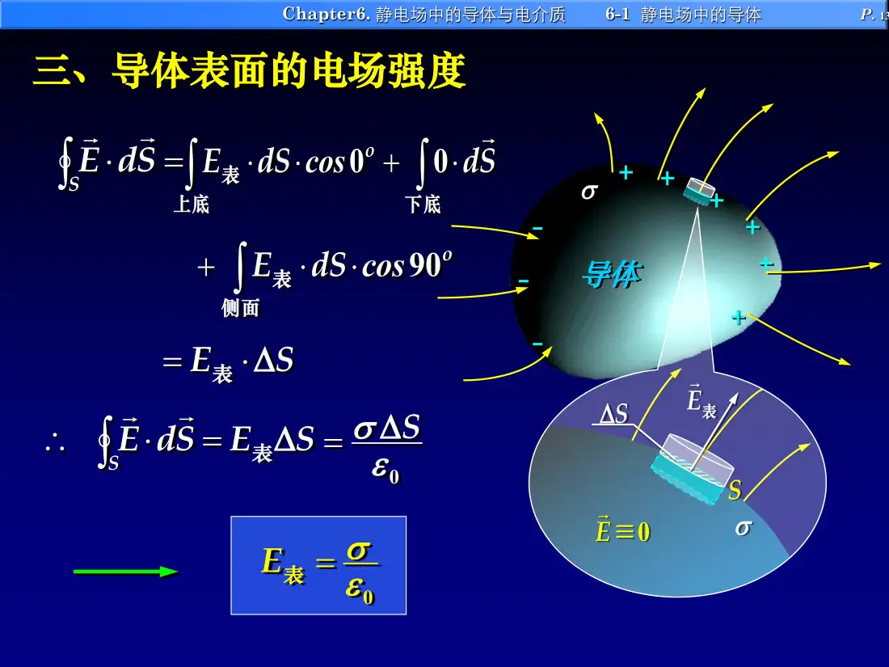

原文：

三、导体表面的电场强度

$$
\begin{array}{r l} \oint_ {S} \vec {E} \cdot d \vec {S} & = \int_ {\text {上底}} E _ {\text {表}} \cdot d S \cdot \cos 0 ^ {\circ} + \int_ {\text {下底}} 0 \cdot d \vec {S} \\ & + \int_ {\text {侧面}} E _ {\text {表}} \cdot d S \cdot \cos 9 0 ^ {\circ} \\ & = E _ {\text {表}} \cdot \Delta S \end{array}
$$

∴ $\oint_{S}\vec{E}\cdot d\vec{S}=E_{表}\Delta S=\frac{\sigma\Delta S}{\varepsilon_{0}}$

$$
E _ {\text {表}} = \frac {\sigma}{\varepsilon_ {0}}
$$

Chapter6. 静电场中的导体与电介质

6-1 静电场中的导体

P. 13

### $$

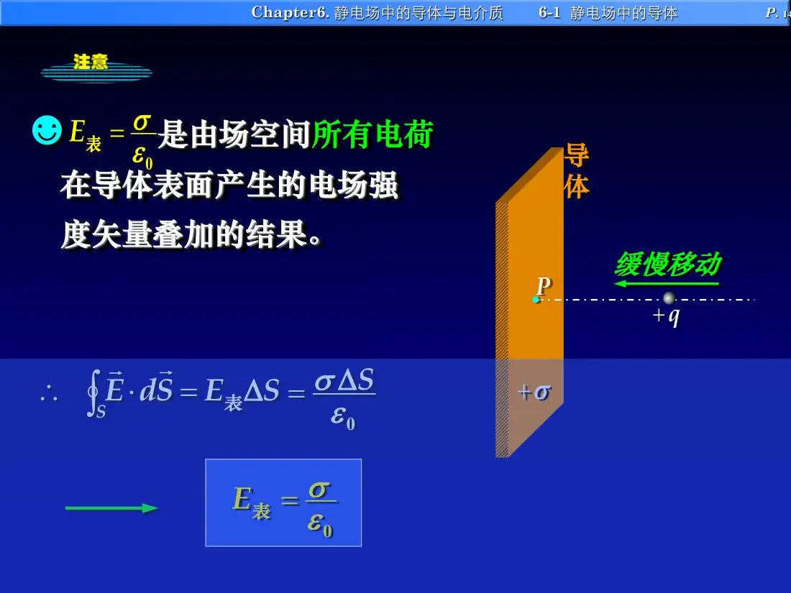

原文：

$E_{表}=\frac{\sigma}{\varepsilon_{0}}$ 是由场空间所有电荷在导体表面产生的电场强度矢量叠加的结果。

$$
\therefore \quad \oint_ {S} \vec {E} \cdot d \vec {S} = E _ {\text {表}} \Delta S = \frac {\sigma \Delta S}{\varepsilon_ {0}}
$$

导体

$$
E _ {\text {表}} = \frac {\sigma}{\varepsilon_ {0}}
$$

缓慢移动

+σ

Chapter6. 静电场中的导体与电介质

6-1 静电场中的导体

P. 14

### $$

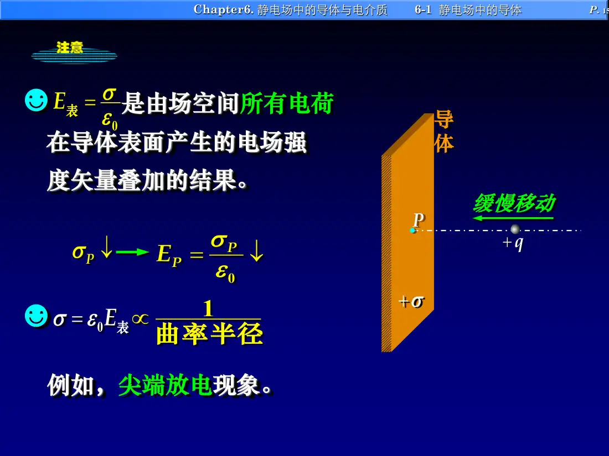

原文：

$E_{表}=\frac{\sigma}{\varepsilon_{0}}$ 是由场空间所有电荷在导体表面产生的电场强度矢量叠加的结果。

$$
\sigma_ {P} \downarrow \longrightarrow E _ {P} = \frac {\sigma_ {P}}{\varepsilon_ {0}} \downarrow
$$

$\sigma=\varepsilon_{0}E_{表}\propto\frac{1}{曲率半径}$ 例如，尖端放电现象。

导体

缓慢移动

+σ

Chapter6. 静电场中的导体与电介质

6-1 静电场中的导体

P. 15

### 四、静电屏蔽

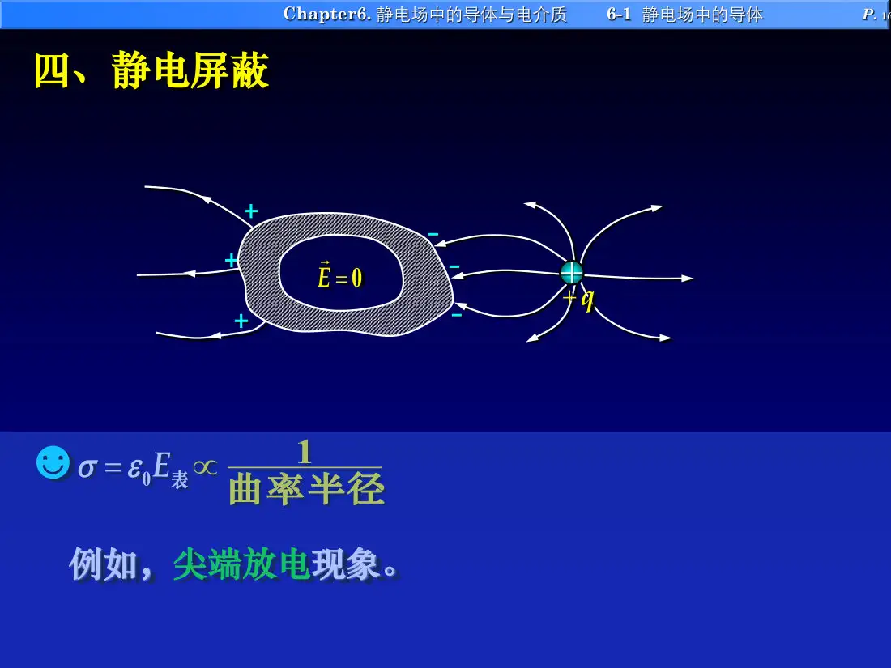

原文：

四、静电屏蔽

$\sigma=\varepsilon_{0}E_{表}\propto\frac{1}{曲率半径}$

例如，尖端放电现象。

Chapter6. 静电场中的导体与电介质

6-1 静电场中的导体

P. 16

### 四、静电屏蔽

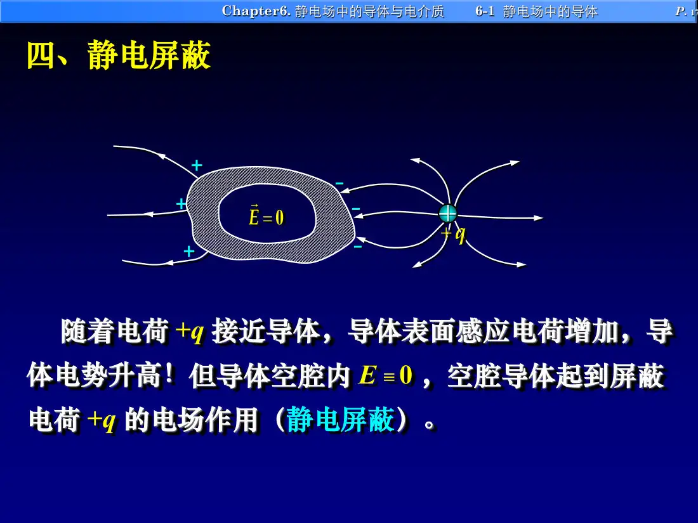

原文：

四、静电屏蔽

随着电荷 +q 接近导体，导体表面感应电荷增加，导体电势升高！但导体空腔内 $E \equiv 0$ ，空腔导体起到屏蔽电荷 +q 的电场作用（静电屏蔽）。

Chapter6. 静电场中的导体与电介质

6-1 静电场中的导体

P. 17

### 插播录像：

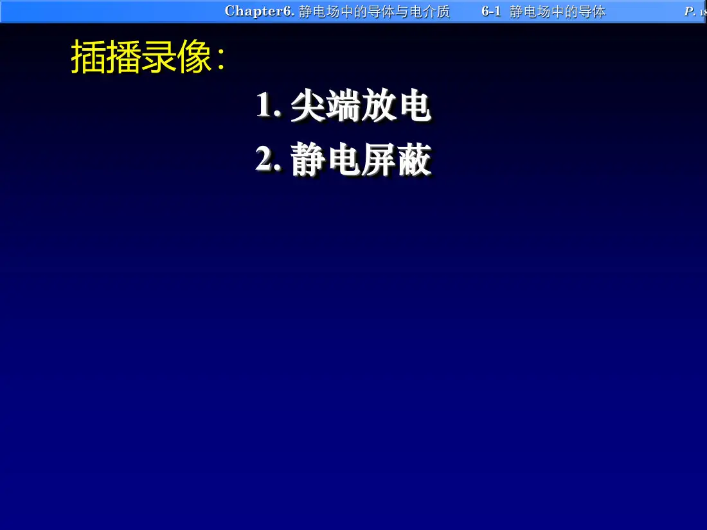

原文：

插播录像：

1. 尖端放电

2. 静电屏蔽

Chapter6. 静电场中的导体与电介质

6-1 静电场中的导体

P. 18

### 尖端放

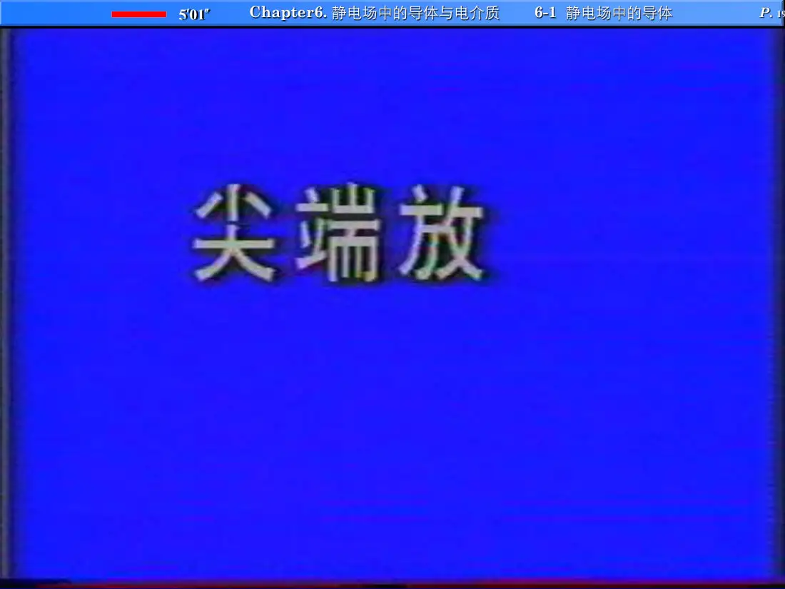

原文：

尖端放

Chapter6. 静电场中的导体与电介质 6-1 静电场中的导体

P. 19

### 静电屏

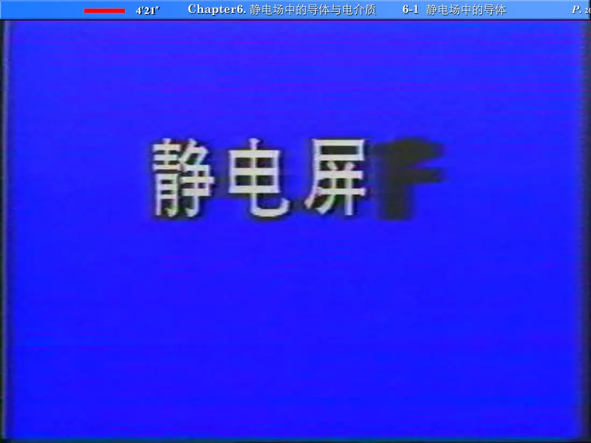

原文：

静电屏

Chapter6. 静电场中的导体与电介质 6-1 静电场中的导体

P. 20

### 五、有导体存在时 E、q、V 的分布计算 ★★★

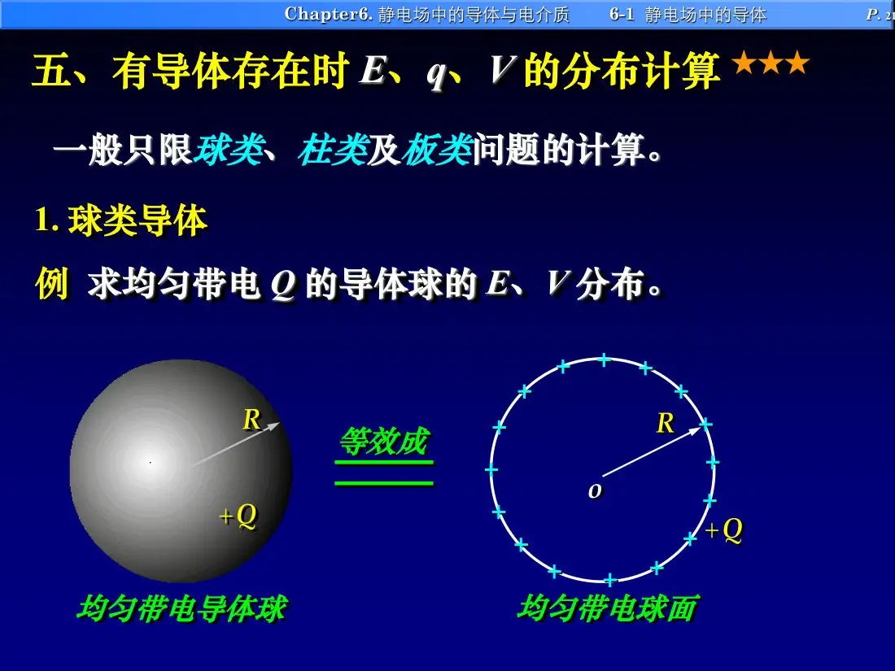

原文：

五、有导体存在时 E、q、V 的分布计算 ★★★

一般只限球类、柱类及板类问题的计算。

1. 球类导体

例 求均匀带电 Q 的导体球的 E、V 分布。

等效成

均匀带电球面

Chapter6. 静电场中的导体与电介质

6-1 静电场中的导体

P. 21

### 例 求均匀带电 Q 的导体球的 E、V 分布。

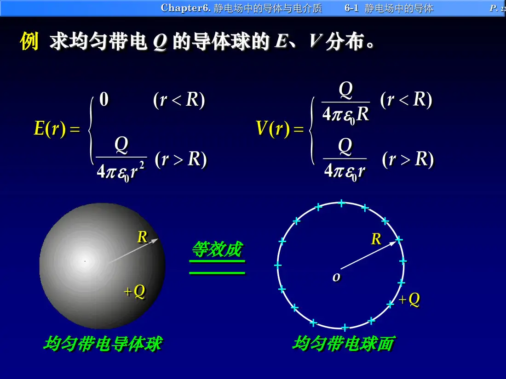

原文：

例 求均匀带电 Q 的导体球的 E、V 分布。

$$
E (r) = \left\{ \begin{array}{l l} 0 & (r <   R) \\ \frac {Q}{4 \pi \varepsilon_ {0} r ^ {2}} & (r > R) \end{array} \right.
$$

等效成

$$
V (r) = \left\{ \begin{array}{l l} \frac {Q}{4 \pi \varepsilon_ {0} R} & (r <   R) \\ \frac {Q}{4 \pi \varepsilon_ {0} r} & (r > R) \end{array} \right.
$$

均匀带电导体球

均匀带电球面

Chapter6. 静电场中的导体与电介质

6-1 静电场中的导体

P. 22

### $$

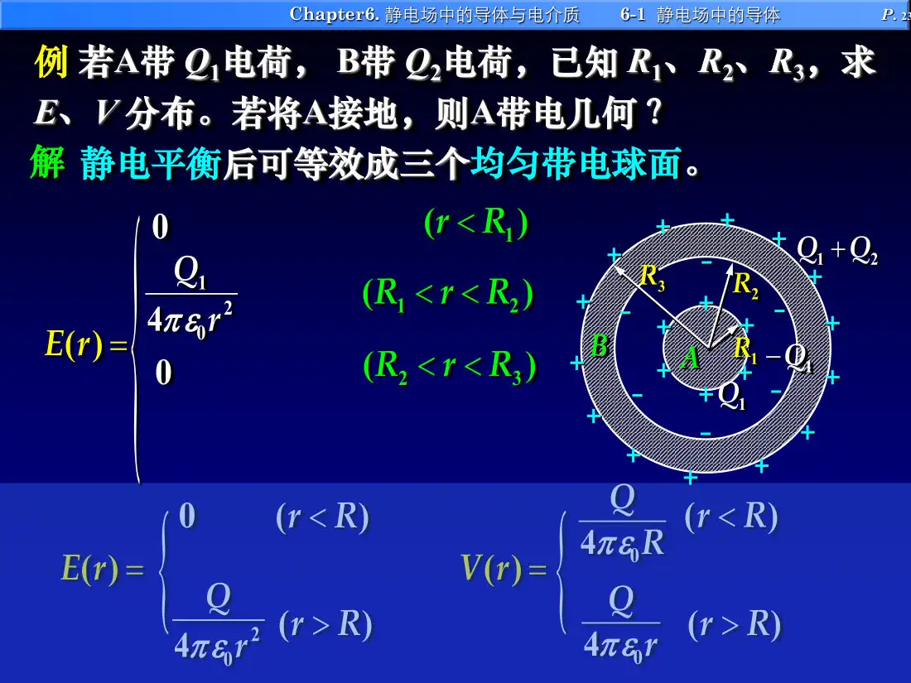

原文：

例 若A带 $Q_{1}$ 电荷，B带 $Q_{2}$ 电荷，已知 $R_{1} 、 R_{2} 、 R_{3}$ ，求 E、V 分布。若将A接地，则A带电几何？解 静电平衡后可等效成三个均匀带电球面。

$$
E (r) = \left\{ \begin{array}{l} 0 \\ \frac {Q _ {1}}{4 \pi \varepsilon_ {0} r ^ {2}} \\ 0 \end{array} \right.
$$

$$
\begin{array}{c} (r <   R _ {1}) \\ (R _ {1} <   r <   R _ {2}) \\ (R _ {2} <   r <   R _ {3}) \end{array}
$$

$$
E (r) = \left\{ \begin{array}{l l} 0 & (r <   R) \\ \frac {Q}{4 \pi \varepsilon_ {0} r ^ {2}} & (r > R) \end{array} \right.
$$

$$
V (r) = \left\{ \begin{array}{l l} \frac {Q}{4 \pi \varepsilon_ {0} R} & (r <   R) \\ \frac {Q}{4 \pi \varepsilon_ {0} r} & (r > R) \end{array} \right.
$$

Chapter6. 静电场中的导体与电介质 6-1 静电场中的导体

P. 23

### $$

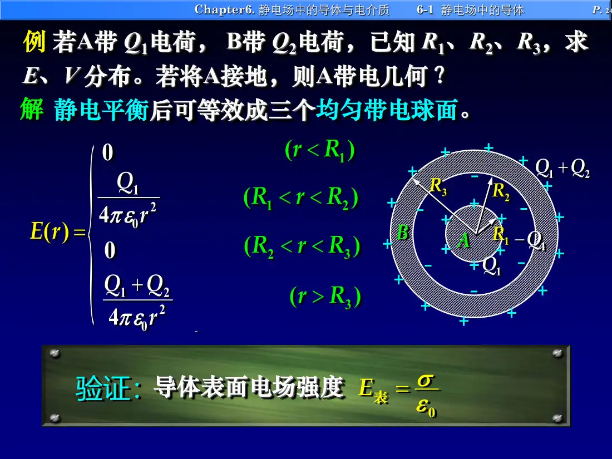

原文：

例 若A带 $Q_{1}$ 电荷，B带 $Q_{2}$ 电荷，已知 $R_{1} 、 R_{2} 、 R_{3}$ ，求 E、V 分布。若将A接地，则A带电几何？解 静电平衡后可等效成三个均匀带电球面。

$$
E (r) = \left\{ \begin{array}{l} 0 \\ \frac {Q _ {1}}{4 \pi \varepsilon_ {0} r ^ {2}} \\ 0 \\ \frac {Q _ {1} + Q _ {2}}{4 \pi \varepsilon_ {0} r ^ {2}} \end{array} \right.
$$

$$
\begin{array}{c} (r <   R _ {1}) \\ (R _ {1} <   r <   R _ {2}) \\ (R _ {2} <   r <   R _ {3}) \\ (r > R _ {3}) \end{array}
$$

验证: 导体表面电场强度 $E_{表}=\frac{\sigma}{\varepsilon_{0}}$

Chapter6. 静电场中的导体与电介质

6-1 静电场中的导体

P. 24

### 利用叠加原理同样可求出电势分布：

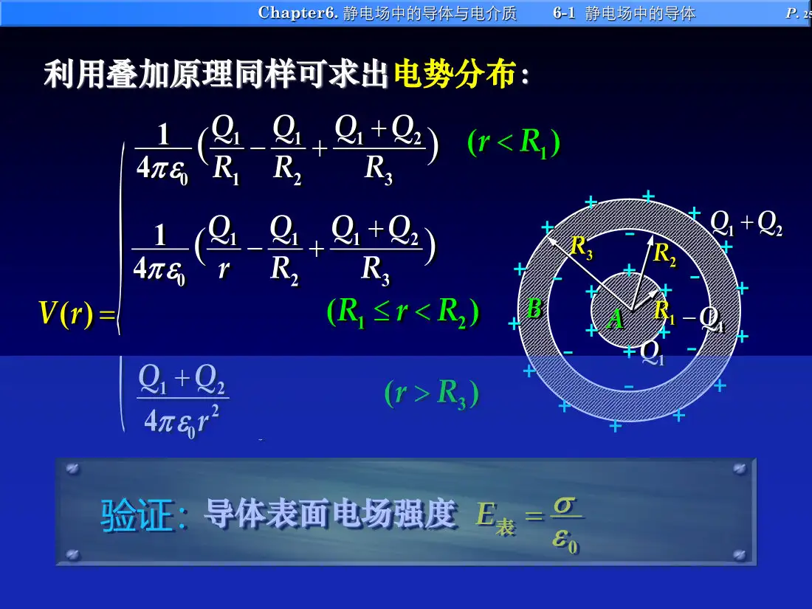

原文：

利用叠加原理同样可求出电势分布：

$$
\left\{ \begin{array}{l} \frac {1}{4 \pi \varepsilon_ {0}} \left(\frac {Q _ {1}}{R _ {1}} - \frac {Q _ {1}}{R _ {2}} + \frac {Q _ {1} + Q _ {2}}{R _ {3}}\right) \\ \frac {1}{4 \pi \varepsilon_ {0}} \left(\frac {Q _ {1}}{r} - \frac {Q _ {1}}{R _ {2}} + \frac {Q _ {1} + Q _ {2}}{R _ {3}}\right) \end{array} \right. (R _ {1} \leq r <   R _ {2})
$$

$$
V (r) = 1
$$

$$
\frac {Q _ {1} + Q _ {2}}{4 \pi \varepsilon_ {0} r ^ {2}}
$$

$$
(r > R _ {3})
$$

验证: 导体表面电场强度 $E_{表}=\frac{\sigma}{\varepsilon_{0}}$

Chapter6. 静电场中的导体与电介质

6-1 静电场中的导体

P. 25

### 利用叠加原理同样可求出电势分布：

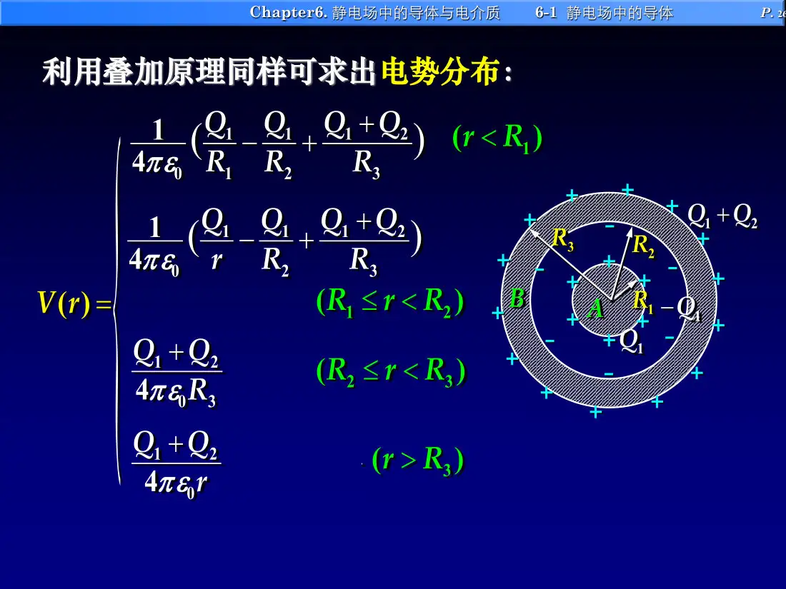

原文：

利用叠加原理同样可求出电势分布：

$V(r)$

$$
\left\{ \begin{array}{l l} \frac {1}{4 \pi \varepsilon_ {0}} \left(\frac {Q _ {1}}{R _ {1}} - \frac {Q _ {1}}{R _ {2}} + \frac {Q _ {1} + Q _ {2}}{R _ {3}}\right) & (r <   R _ {1}) \\ \frac {1}{4 \pi \varepsilon_ {0}} \left(\frac {Q _ {1}}{r} - \frac {Q _ {1}}{R _ {2}} + \frac {Q _ {1} + Q _ {2}}{R _ {3}}\right) & (R _ {1} \leq r <   R _ {2}) \\ \frac {Q _ {1} + Q _ {2}}{4 \pi \varepsilon_ {0} R _ {3}} & (R _ {2} \leq r <   R _ {3}) \\ \frac {Q _ {1} + Q _ {2}}{4 \pi \varepsilon_ {0} r} & (r > R _ {3}) \end{array} \right.
$$

Chapter6. 静电场中的导体与电介质

6-1 静电场中的导体

P. 26

### $$

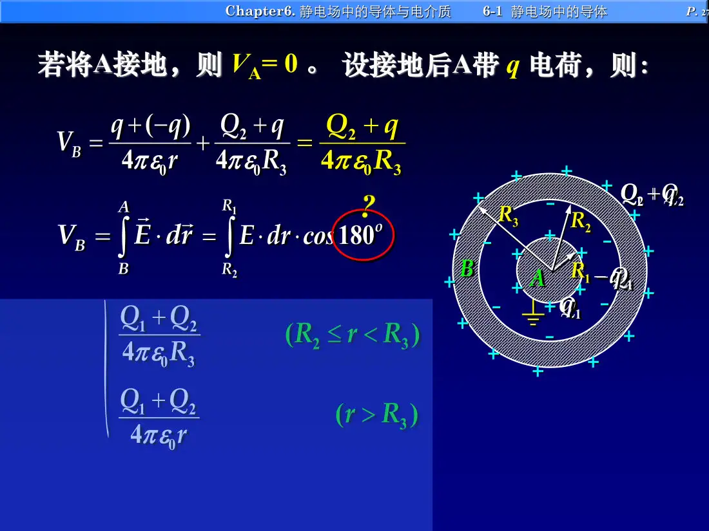

原文：

若将A接地，则 $V_{\mathrm{A}} = 0$ 。设接地后A带 $q$ 电荷，则：

$$
V _ {B} = \frac {q + (- q)}{4 \pi \varepsilon_ {0} r} + \frac {Q _ {2} + q}{4 \pi \varepsilon_ {0} R _ {3}} = \frac {Q _ {2} + q}{4 \pi \varepsilon_ {0} R _ {3}}
$$

$$
V _ {B} = \int_ {B} ^ {A} \vec {E} \cdot d \vec {r} = \int_ {R _ {2}} ^ {R _ {1}} E \cdot d r \cdot \cos 1 8 0 ^ {\circ}
$$

$$
\frac {Q _ {1} + Q _ {2}}{4 \pi \varepsilon_ {0} R _ {3}}
$$

$$
(R _ {2} \leq r <   R _ {3})
$$

$$
\frac {Q _ {1} + Q _ {2}}{4 \pi \varepsilon_ {0} r}
$$

$$
(r > R _ {3})
$$

Chapter6. 静电场中的导体与电介质

6-1 静电场中的导体

P. 27

### $$

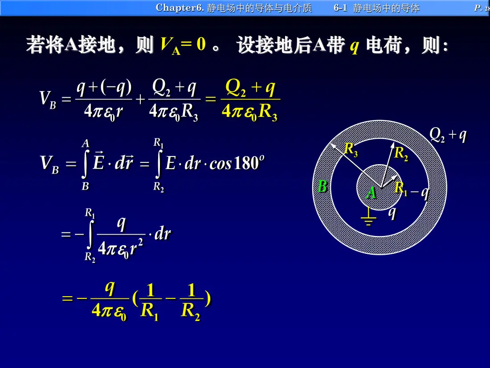

原文：

若将A接地，则 $V_{\mathrm{A}} = 0$ 。设接地后A带 $q$ 电荷，则：

$$
V _ {B} = \frac {q + (- q)}{4 \pi \varepsilon_ {0} r} + \frac {Q _ {2} + q}{4 \pi \varepsilon_ {0} R _ {3}} = \frac {Q _ {2} + q}{4 \pi \varepsilon_ {0} R _ {3}}
$$

$$
\begin{array}{r l} V _ {B} & = \int_ {B} ^ {A} \vec {E} \cdot d \vec {r} = \int_ {R _ {2}} ^ {R _ {1}} E \cdot d r \cdot \cos 1 8 0 ^ {\circ} \\ & = - \int_ {R _ {2}} ^ {R _ {1}} \frac {q}{4 \pi \varepsilon_ {0} r ^ {2}} \cdot d r \\ & = - \frac {q}{4 \pi \varepsilon_ {0}} (\frac {1}{R _ {1}} - \frac {1}{R _ {2}}) \end{array}
$$

Chapter6. 静电场中的导体与电介质

6-1 静电场中的导体

P. 28

### $$

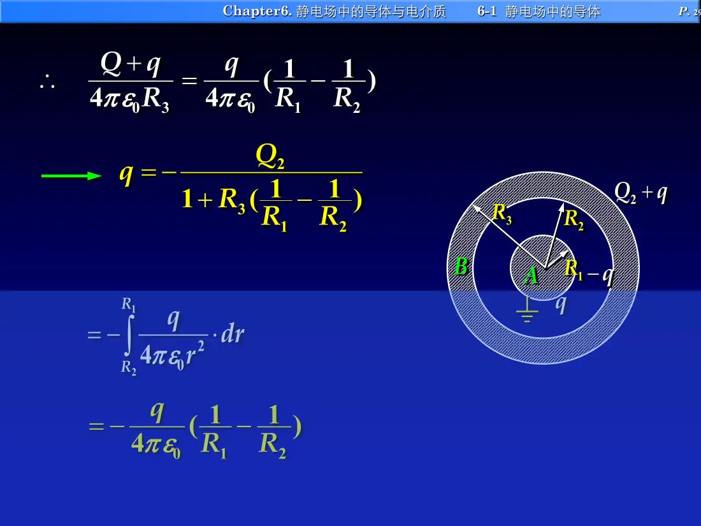

原文：

$$
\therefore \quad \frac {Q + q}{4 \pi \varepsilon_ {0} R _ {3}} = \frac {q}{4 \pi \varepsilon_ {0}} (\frac {1}{R _ {1}} - \frac {1}{R _ {2}})
$$

$$
q = - \frac {Q _ {2}}{1 + R _ {3} (\frac {1}{R _ {1}} - \frac {1}{R _ {2}})}
$$

$$
\begin{array}{l} = - \int_ {R _ {2}} ^ {R _ {1}} \frac {q}{4 \pi \varepsilon_ {0} r ^ {2}} \cdot d r \\ = - \frac {q}{4 \pi \varepsilon_ {0}} (\frac {1}{R _ {1}} - \frac {1}{R _ {2}}) \end{array}
$$

Chapter6. 静电场中的导体与电介质

6-1 静电场中的导体

P. 29

### $$

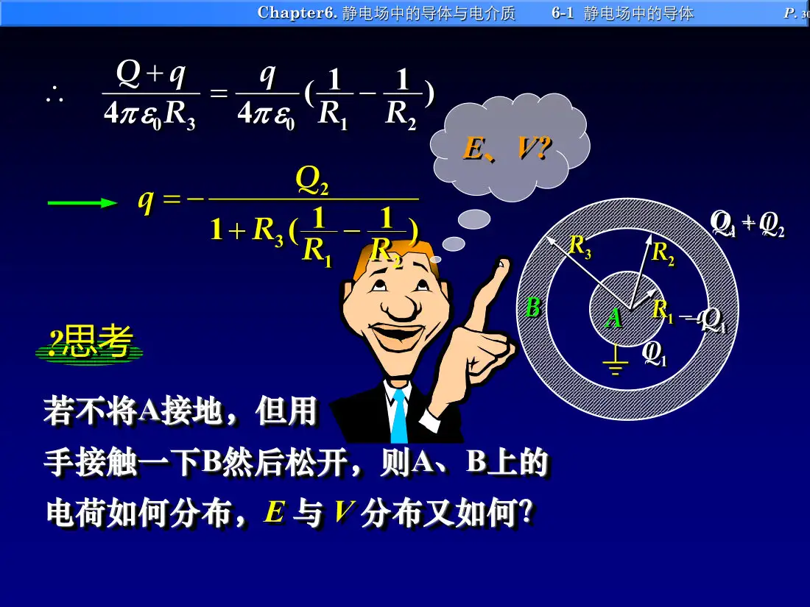

原文：

$$
\frac {Q + q}{4 \pi \varepsilon_ {0} R _ {3}} = \frac {q}{4 \pi \varepsilon_ {0}} \left(\frac {1}{R _ {1}} - \frac {1}{R _ {2}}\right)
$$

?思考

$$
\mathcal {Q} _ {1} + \mathcal {Q} _ {2}
$$

若不将A接地，但用手接触一下B然后松开，则A、B上的电荷如何分布，E与V分布又如何？

Chapter6. 静电场中的导体与电介质 6-1 静电场中的导体

P. 30

### 课堂练习已知：金属球原不带电，R、L、点电荷电量为q，求金属球的电势。

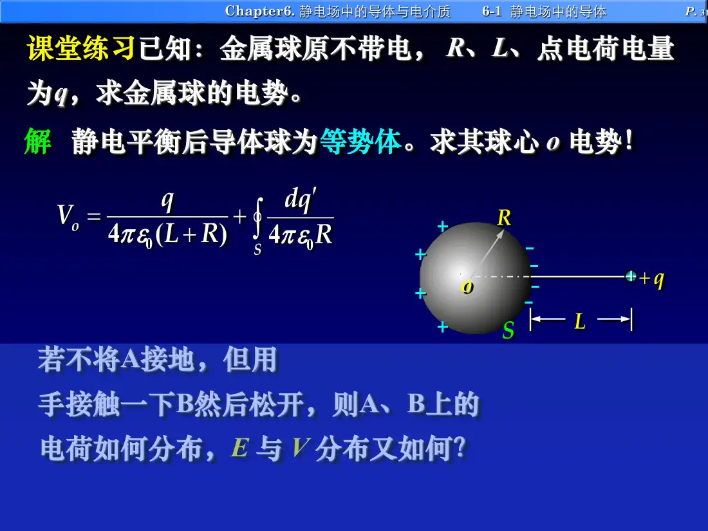

原文：

课堂练习已知：金属球原不带电，R、L、点电荷电量为q，求金属球的电势。

解 静电平衡后导体球为等势体。求其球心 o 电势!

$$
V _ {o} = \frac {q}{4 \pi \varepsilon_ {0} (L + R)} + \oint_ {S} \frac {d q ^ {\prime}}{4 \pi \varepsilon_ {0} R}
$$

若不将A接地，但用手接触一下B然后松开，则A、B上的电荷如何分布，E与V分布又如何？

Chapter6. 静电场中的导体与电介质

6-1 静电场中的导体

P. 31

### 课堂练习已知：金属球原不带电，R、L、点电荷电量为q，求金属球的电势。

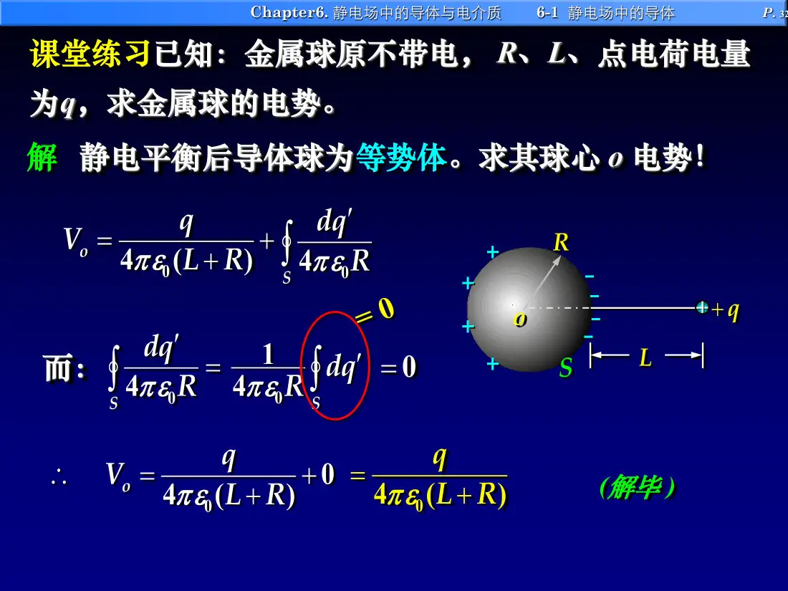

原文：

课堂练习已知：金属球原不带电，R、L、点电荷电量为q，求金属球的电势。

解 静电平衡后导体球为等势体。求其球心 o 电势!

$$
V _ {o} = \frac {q}{4 \pi \varepsilon_ {0} (L + R)} + \oint_ {S} \frac {d q ^ {\prime}}{4 \pi \varepsilon_ {0} R}
$$

而： $\oint_{S}\frac{dq'}{4\pi\varepsilon_{0}R}=\frac{1}{4\pi\varepsilon_{0}R}\oint_{S}dq'=0$

$$
V _ {o} = \frac {q}{4 \pi \varepsilon_ {0} (L + R)} + 0 = \frac {q}{4 \pi \varepsilon_ {0} (L + R)}
$$

(解毕)

Chapter6. 静电场中的导体与电介质 6-1 静电场中的导体

P. 32

### 提示 接地后导体电势为零，则:

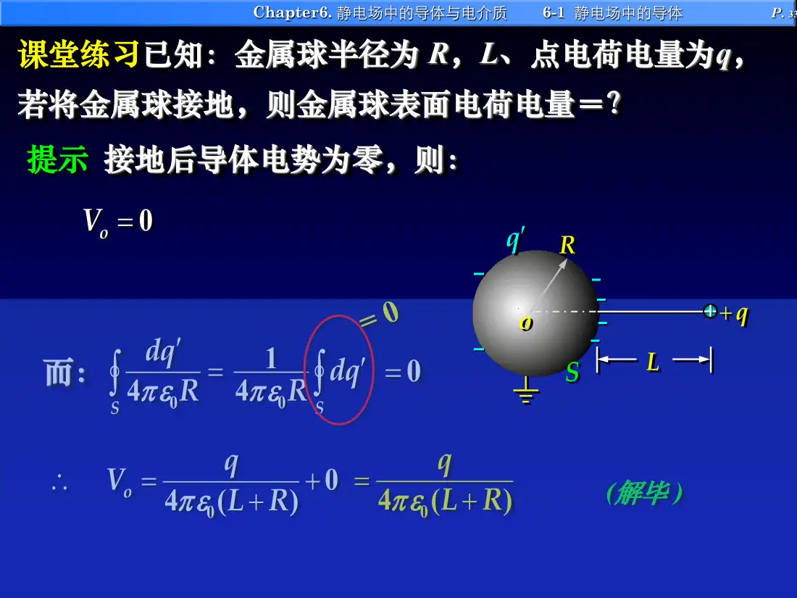

原文：

课堂练习已知：金属球半径为 R，L、点电荷电量为 q，若将金属球接地，则金属球表面电荷电量 = ?

提示 接地后导体电势为零，则:

$$
V _ {o} = 0
$$

而：

$$
\therefore V _ {o} = \frac {q}{4 \pi \varepsilon_ {0} (L + R)} + 0 = \frac {q}{4 \pi \varepsilon_ {0} (L + R)}
$$

(解毕)

Chapter6. 静电场中的导体与电介质

6-1 静电场中的导体

P. 33

### 课堂练习已知：金属球半径为 R，L、点电荷电量为 q，

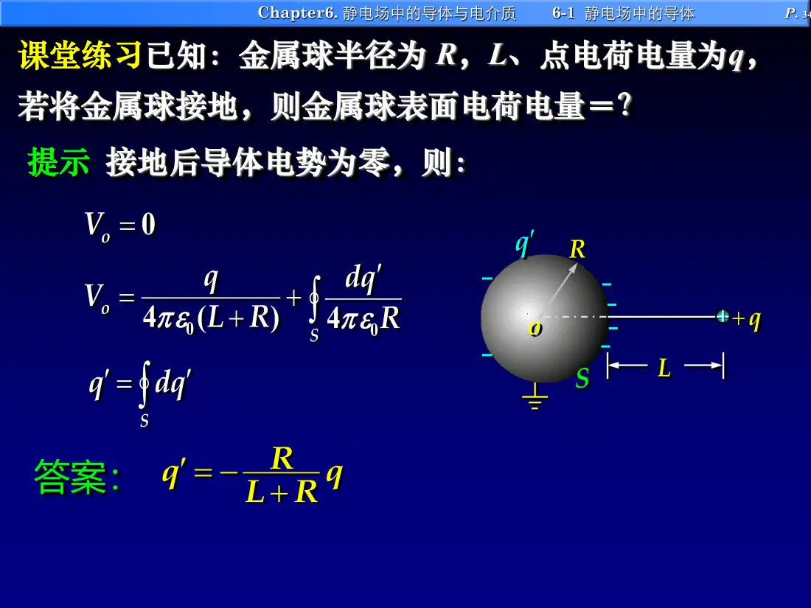

原文：

课堂练习已知：金属球半径为 R，L、点电荷电量为 q，

若将金属球接地，则金属球表面电荷电量 $=$ ？

提示 接地后导体电势为零，则:

$$
\begin{array}{l} V _ {o} = 0 \\ V _ {o} = \frac {q}{4 \pi \varepsilon_ {0} (L + R)} + \oint_ {S} \frac {d q ^ {\prime}}{4 \pi \varepsilon_ {0} R} \\ q ^ {\prime} = \oint_ {S} d q ^ {\prime} \end{array}
$$

答案: $q' = -\frac{R}{L + R} q$

Chapter6. 静电场中的导体与电介质

6-1 静电场中的导体

P. 34

### 2. 板类导体

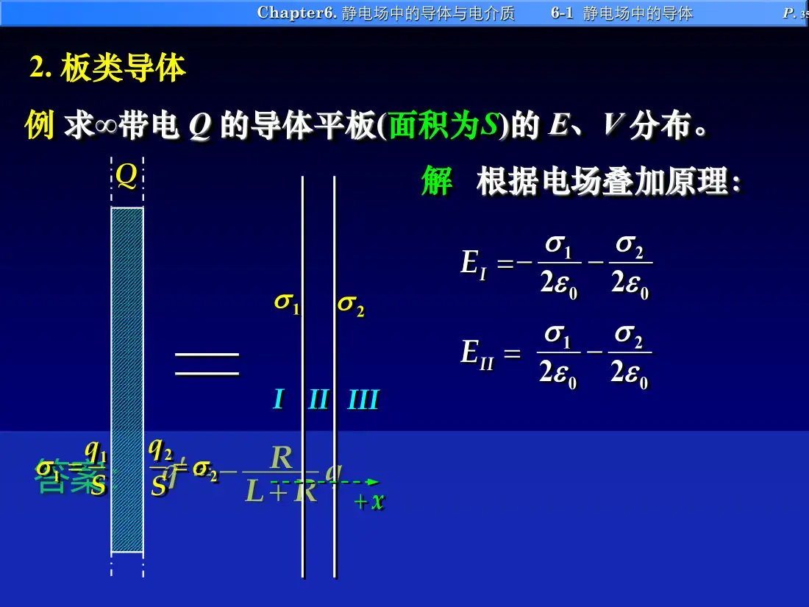

原文：

2. 板类导体

例 求∞带电 Q 的导体平板(面积为 S)的 E、V 分布。

$$
\begin{array}{c} Q \\ = \sigma_ {1} \\ \text {答} _ {\text {I}} \text {答} _ {\text {II}} \text {答} _ {\text {III}} \\ \frac {q _ {2}}{S} f ^ {\prime} \sigma_ {2} - \frac {R}{L + R} q _ {+ x} \end{array}
$$

解 根据电场叠加原理:

$$
E _ {I} = - \frac {\sigma_ {1}}{2 \varepsilon_ {0}} - \frac {\sigma_ {2}}{2 \varepsilon_ {0}}
$$

$$
E _ {I I} = \frac {\sigma_ {1}}{2 \varepsilon_ {0}} - \frac {\sigma_ {2}}{2 \varepsilon_ {0}}
$$

Chapter6. 静电场中的导体与电介质

6-1 静电场中的导体

P. 35

### 2. 板类导体

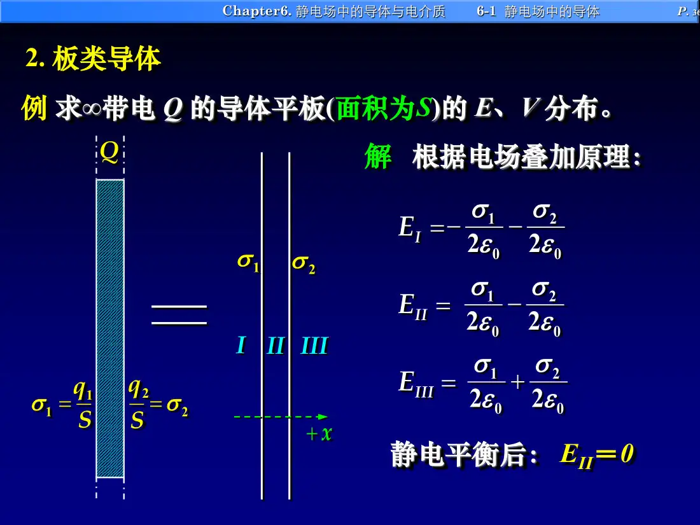

原文：

2. 板类导体

例 求∞带电 Q 的导体平板(面积为 S)的 E、V 分布。

$$
\begin{array}{c} Q \\ = \\ \sigma_ {1} = \frac {q _ {1}}{S} \\ \frac {q _ {2}}{S} = \sigma_ {2} \end{array} \quad \begin{array}{c} \sigma_ {1} \\ I \\ + x \end{array} \quad \begin{array}{c} \sigma_ {2} \\ I I \\ I I I \end{array}
$$

解 根据电场叠加原理:

$$
E _ {I} = - \frac {\sigma_ {1}}{2 \varepsilon_ {0}} - \frac {\sigma_ {2}}{2 \varepsilon_ {0}}
$$

$$
E _ {I I} = \frac {\sigma_ {1}}{2 \varepsilon_ {0}} - \frac {\sigma_ {2}}{2 \varepsilon_ {0}}
$$

$$
E _ {I I I} = \frac {\sigma_ {1}}{2 \varepsilon_ {0}} + \frac {\sigma_ {2}}{2 \varepsilon_ {0}}
$$

静电平衡后: $E_{II} = 0$

Chapter6. 静电场中的导体与电介质

6-1 静电场中的导体

P. 36

### $$

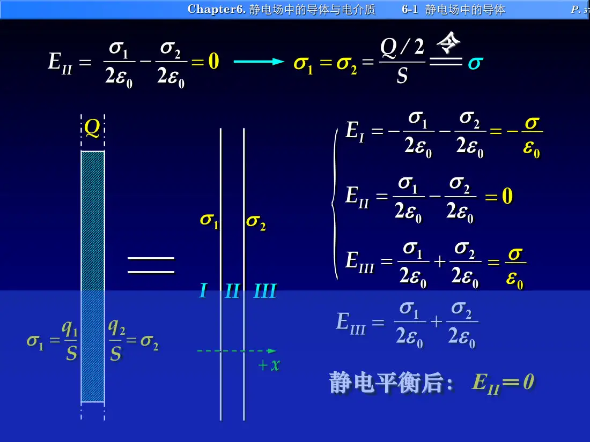

原文：

$$
E _ {I I} = \frac {\sigma_ {1}}{2 \varepsilon_ {0}} - \frac {\sigma_ {2}}{2 \varepsilon_ {0}} = 0 \longrightarrow \sigma_ {1} = \sigma_ {2} = \frac {Q / 2}{S} \stackrel {\text {令}} {=} \sigma
$$

$$
\begin{array}{c} Q \\ = \\ \sigma_ {1} = \frac {q _ {1}}{S} \\ \frac {q _ {2}}{S} = \sigma_ {2} \end{array} \quad \begin{array}{c} \sigma_ {1} \\ I \\ + x \end{array} \quad \begin{array}{c} \sigma_ {2} \\ I I \\ I I I \end{array}
$$

$$
E _ {I} = - \frac {\sigma_ {1}}{2 \varepsilon_ {0}} - \frac {\sigma_ {2}}{2 \varepsilon_ {0}} = - \frac {\sigma}{\varepsilon_ {0}}
$$

$$
E _ {I I} = \frac {\sigma_ {1}}{2 \varepsilon_ {0}} - \frac {\sigma_ {2}}{2 \varepsilon_ {0}} = 0
$$

$$
E _ {I I I} = \frac {\sigma_ {1}}{2 \varepsilon_ {0}} + \frac {\sigma_ {2}}{2 \varepsilon_ {0}} = \frac {\sigma}{\varepsilon_ {0}}
$$

$$
E _ {I I I} = \frac {\sigma_ {1}}{2 \varepsilon_ {0}} + \frac {\sigma_ {2}}{2 \varepsilon_ {0}}
$$

静电平衡后: $E_{II} = 0$

Chapter6. 静电场中的导体与电介质

6-1 静电场中的导体

P. 37

### $$

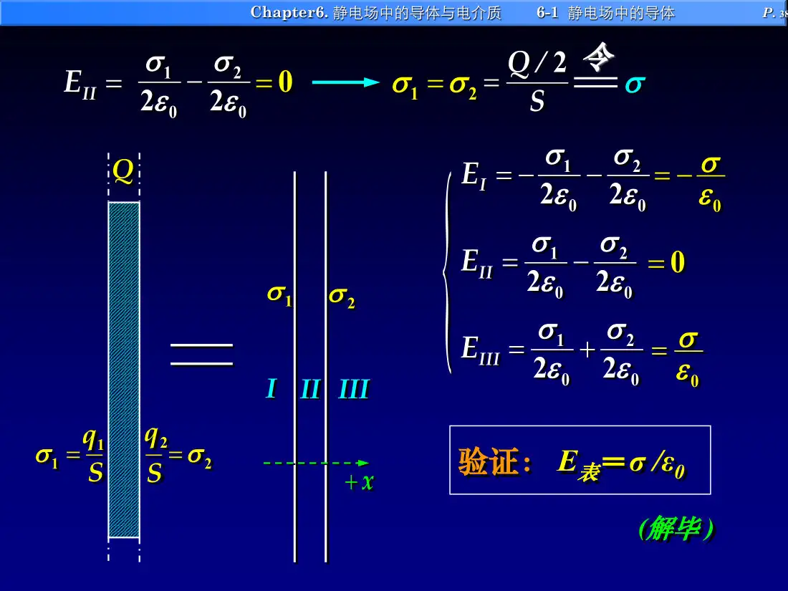

原文：

$$
E _ {I I} = \frac {\sigma_ {1}}{2 \varepsilon_ {0}} - \frac {\sigma_ {2}}{2 \varepsilon_ {0}} = 0 \longrightarrow \sigma_ {1} = \sigma_ {2} = \frac {Q / 2}{S} \stackrel {\text {令}} {=} \sigma
$$

$$
\begin{array}{c} Q \\ = \sigma_ {1} \\ \sigma_ {1} = \frac {q _ {1}}{S} \\ \frac {q _ {2}}{S} = \sigma_ {2} \end{array} \quad \begin{array}{c} \sigma_ {1} \\ I \\ + x \end{array} \quad \begin{array}{c} \sigma_ {2} \\ I I \\ I I I \end{array}
$$

$$
E _ {I} = - \frac {\sigma_ {1}}{2 \varepsilon_ {0}} - \frac {\sigma_ {2}}{2 \varepsilon_ {0}} = - \frac {\sigma}{\varepsilon_ {0}}
$$

$$
E _ {I I} = \frac {\sigma_ {1}}{2 \varepsilon_ {0}} - \frac {\sigma_ {2}}{2 \varepsilon_ {0}} = 0
$$

$$
E _ {I I I} = \frac {\sigma_ {1}}{2 \varepsilon_ {0}} + \frac {\sigma_ {2}}{2 \varepsilon_ {0}} = \frac {\sigma}{\varepsilon_ {0}}
$$

验证: $E_{\text{表}} = \sigma / \varepsilon_0$

(解毕)

Chapter6. 静电场中的导体与电介质

6-1 静电场中的导体

P. 38

### 提示：作一封闭圆柱面 S，则

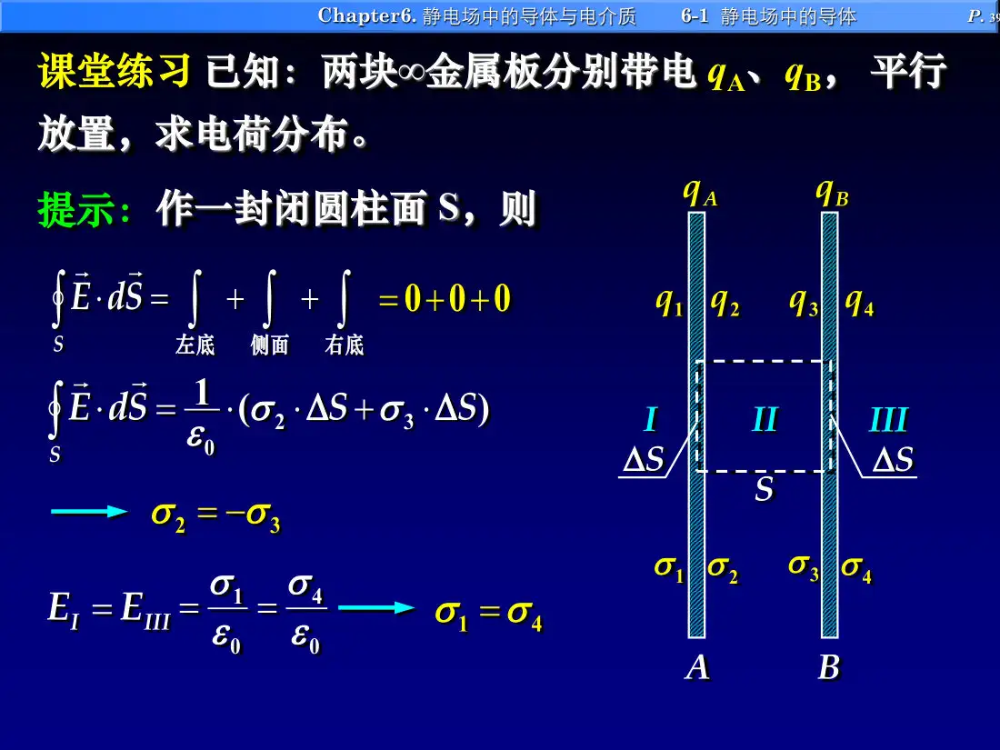

原文：

课堂练习 已知：两块∞金属板分别带电 $q_{\mathrm{A}}$ 、 $q_{\mathrm{B}}$ ，平行放置，求电荷分布。

提示：作一封闭圆柱面 S，则

$$
\oint_ {S} \vec {E} \cdot d \vec {S} = \int_ {\text {左底}} + \int_ {\text {侧面}} + \int_ {\text {右底}} = 0 + 0 + 0
$$

$$
\oint_ {S} \vec {E} \cdot d \vec {S} = \frac {1}{\varepsilon_ {0}} \cdot (\sigma_ {2} \cdot \Delta S + \sigma_ {3} \cdot \Delta S)
$$

→ $\sigma_{2} = -\sigma_{3}$

$$
E _ {I} = E _ {I I I} = \frac {\sigma_ {1}}{\varepsilon_ {0}} = \frac {\sigma_ {4}}{\varepsilon_ {0}} \longrightarrow \sigma_ {1} = \sigma_ {4}
$$

Chapter6. 静电场中的导体与电介质

6-1 静电场中的导体

P. 39

### $$

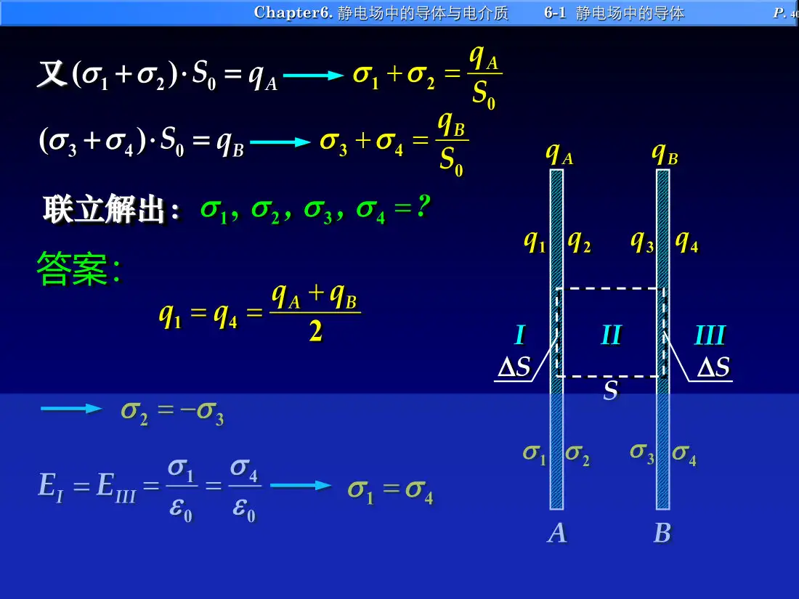

原文：

$$
\text {又} (\sigma_ {1} + \sigma_ {2}) \cdot S _ {0} = q _ {A} \longrightarrow \sigma_ {1} + \sigma_ {2} = \frac {q _ {A}}{S _ {0}}
$$

$$
(\sigma_ {3} + \sigma_ {4}) \cdot S _ {0} = q _ {B} \longrightarrow \sigma_ {3} + \sigma_ {4} = \frac {q _ {B}}{S _ {0}}
$$

联立解出： $\sigma_{1}, \sigma_{2}, \sigma_{3}, \sigma_{4} = ?$

答案:

$$
q _ {1} = q _ {4} = \frac {q _ {A} + q _ {B}}{2}
$$

→ $\sigma_{2} = -\sigma_{3}$

$$
E _ {I} = E _ {I I I} = \frac {\sigma_ {1}}{\varepsilon_ {0}} = \frac {\sigma_ {4}}{\varepsilon_ {0}} \longrightarrow \sigma_ {1} = \sigma_ {4}
$$

Chapter6. 静电场中的导体与电介质

6-1 静电场中的导体

P. 40

### $$

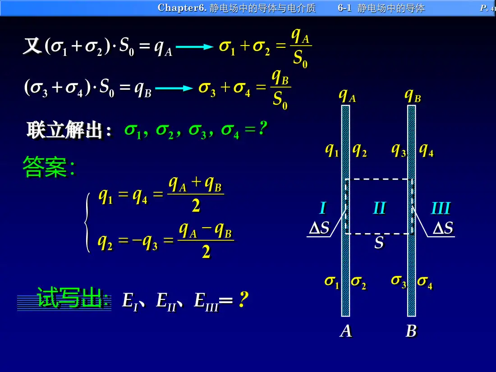

原文：

$$
\text {又} \left(\sigma_ {1} + \sigma_ {2}\right) \cdot S _ {0} = q _ {A} \longrightarrow \sigma_ {1} + \sigma_ {2} = \frac {q _ {A}}{S _ {0}}
$$

$$
(\sigma_ {3} + \sigma_ {4}) \cdot S _ {0} = q _ {B} \longrightarrow \sigma_ {3} + \sigma_ {4} = \frac {q _ {B}}{S _ {0}}
$$

联立解出： $\sigma_{1}, \sigma_{2}, \sigma_{3}, \sigma_{4} = ?$

答案:

$$
\left\{ \begin{array}{l} q _ {1} = q _ {4} = \frac {q _ {A} + q _ {B}}{2} \\ q _ {2} = - q _ {3} = \frac {q _ {A} - q _ {B}}{2} \end{array} \right.
$$

试写出: $E_{I}$ 、 $E_{II}$ 、 $E_{III}=$ ?

Chapter6. 静电场中的导体与电介质

6-1 静电场中的导体

P. 41

### 可以证明: 对任意多块平行放置的带电金属板, 其电荷分布与两块情形分布类同!

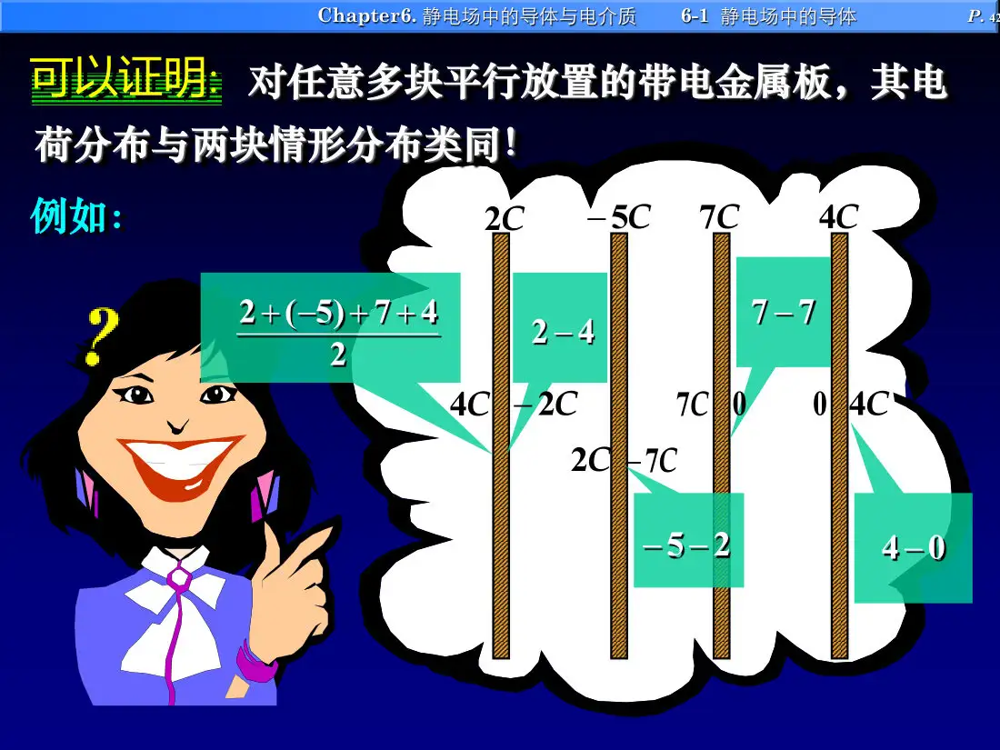

原文：

可以证明: 对任意多块平行放置的带电金属板, 其电荷分布与两块情形分布类同!

Chapter6. 静电场中的导体与电介质 6-1 静电场中的导体

P. 42

### $$

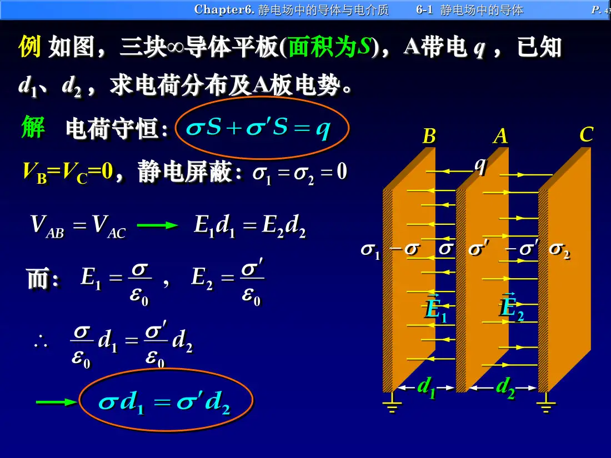

原文：

例如图, 三块 $\infty$ 导体平板(面积为 $S$ ), A带电 $q$ , 已知 $d_{1} 、 d_{2}$ , 求电荷分布及A板电势。

解 电荷守恒: $\sigma S + \sigma^{\prime}S = q$ $V_{\mathrm{B}} = V_{\mathrm{C}} = 0$ , 静电屏蔽: $\sigma_{1} = \sigma_{2} = 0$

$$
V _ {A B} = V _ {A C} \longrightarrow E _ {1} d _ {1} = E _ {2} d _ {2}
$$

而： $E_{1}=\frac{\sigma}{\varepsilon_{0}}$ ， $E_{2}=\frac{\sigma^{\prime}}{\varepsilon_{0}}$

$$
\therefore \quad \frac {\sigma}{\varepsilon_ {0}} d _ {1} = \frac {\sigma^ {\prime}}{\varepsilon_ {0}} d _ {2}
$$

$$
\sigma d _ {1} = \sigma^ {\prime} d _ {2}
$$

Chapter6. 静电场中的导体与电介质 6-1 静电场中的导体

P. 43

### $$

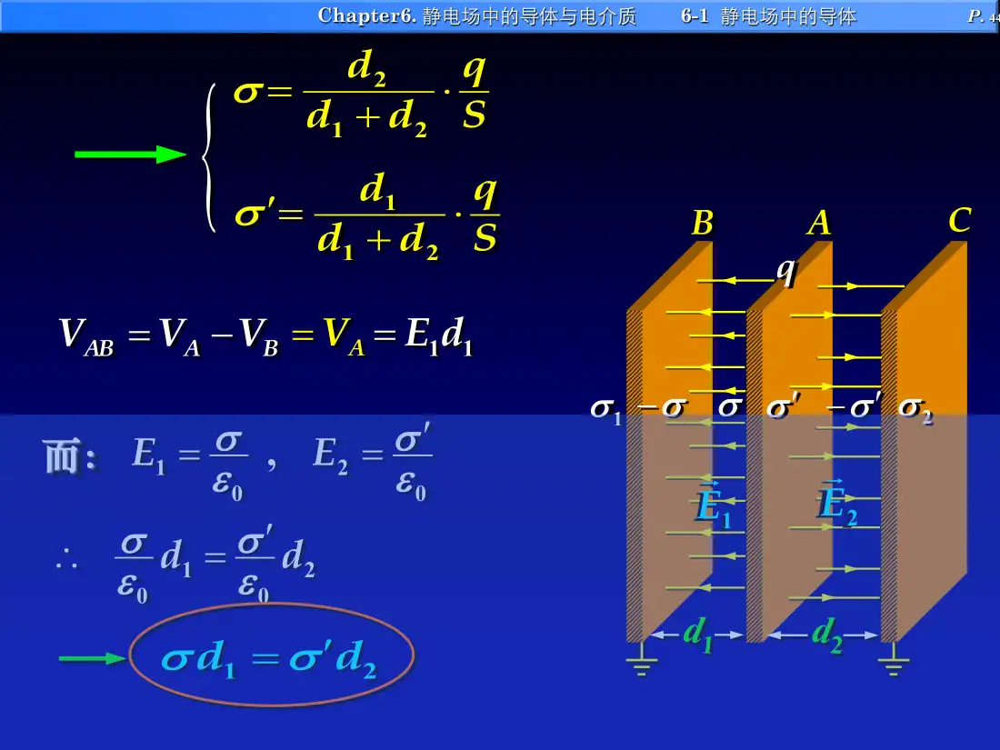

原文：

$$
\sigma = \frac {d _ {2}}{d _ {1} + d _ {2}} \cdot \frac {q}{S}
$$

$$
\sigma^ {\prime} = \frac {d _ {1}}{d _ {1} + d _ {2}} \cdot \frac {q}{S}
$$

$$
V _ {A B} = V _ {A} - V _ {B} = V _ {A} = E _ {1} d _ {1}
$$

而： $E_{1}=\frac{\sigma}{\varepsilon_{0}}$ ， $E_{2}=\frac{\sigma^{\prime}}{\varepsilon_{0}}$

$$
\therefore \quad \frac {\sigma}{\varepsilon_ {0}} d _ {1} = \frac {\sigma^ {\prime}}{\varepsilon_ {0}} d _ {2}
$$

$$
\sigma d _ {1} = \sigma^ {\prime} d _ {2}
$$

B A C
σ₁ - σ σ σ' - σ' σ₂
E₁ E₂
d₁ d₂

Chapter6. 静电场中的导体与电介质 6-1 静电场中的导体

P. 44

### $$

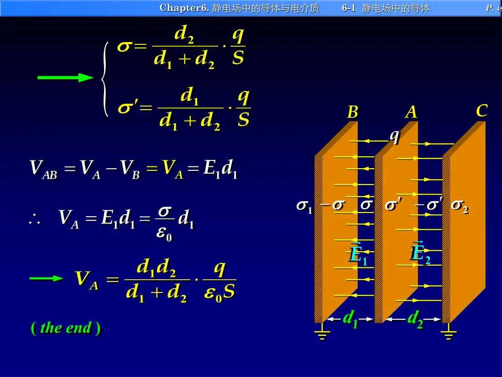

原文：

$$
\sigma = \frac {d _ {2}}{d _ {1} + d _ {2}} \cdot \frac {q}{S}
$$

$$
\sigma^ {\prime} = \frac {d _ {1}}{d _ {1} + d _ {2}} \cdot \frac {q}{S}
$$

$$
V _ {A B} = V _ {A} - V _ {B} = V _ {A} = E _ {1} d _ {1}
$$

$$
\therefore V _ {A} = E _ {1} d _ {1} = \frac {\sigma}{\varepsilon_ {0}} d _ {1}
$$

$$
\longrightarrow V _ {A} = \frac {d _ {1} d _ {2}}{d _ {1} + d _ {2}} \cdot \frac {q}{\varepsilon_ {0} S}
$$

( the end )

B A C
q
σ₁ - σ σ σ' - σ' σ₂
Ė₁ Ė₂
d₁ d₂

Chapter6. 静电场中的导体与电介质

6-1 静电场中的导体

P. 45

### 3. 柱类导体（自学）

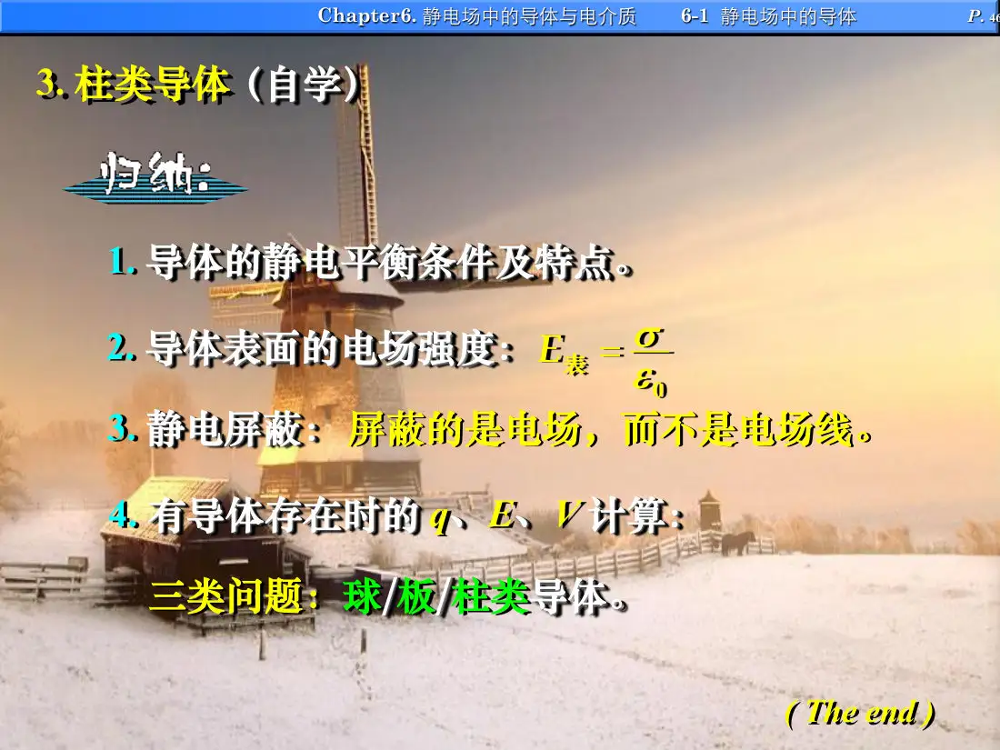

原文：

3. 柱类导体（自学）

归纳

1. 导体的静电平衡条件及特点。

2. 导体表面的电场强度: $E_{\text {表}} = \frac{\sigma}{\varepsilon_0}$

3. 静电屏蔽：屏蔽的是电场，而不是电场线。

4. 有导体存在时的 $q$ 、 $E$ 、 $V$ 计算:

三类问题：球/板/柱类导体。

Chapter6. 静电场中的导体与电介质

6-1 静电场中的导体

P. 46

(The end)
