# 《大学物理》第6章 静电场中的导体与电介质 6-2 静电场中的电介质（课件）

原件的每一页，下面附识别出的文字。

### 6-2 静电场中的电介质

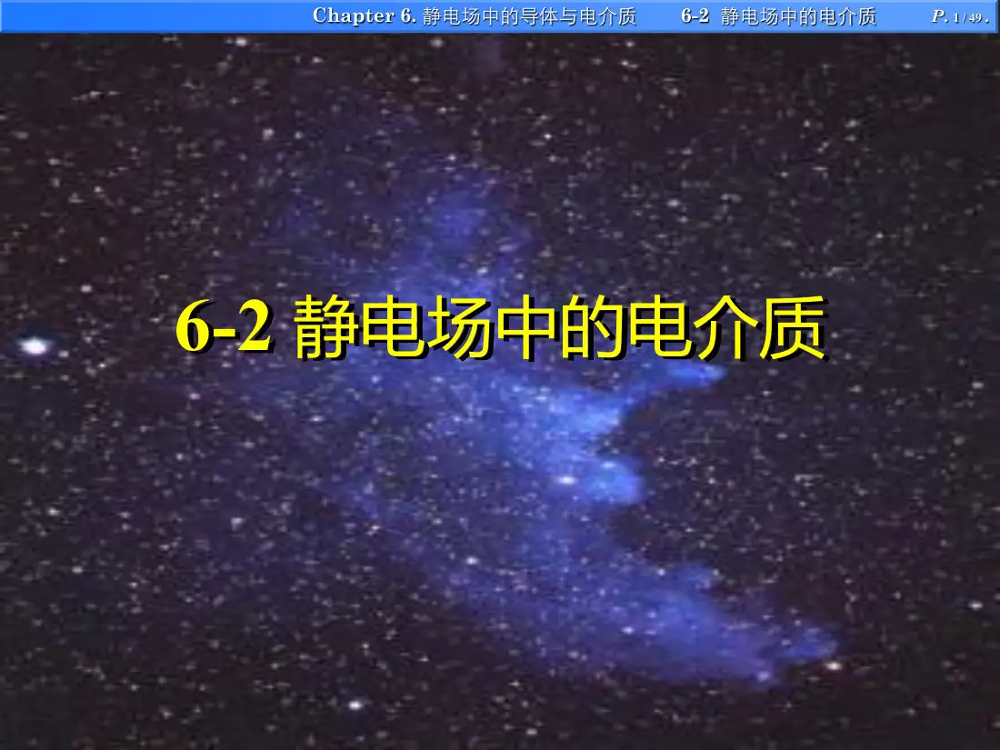

原文：

6-2 静电场中的电介质

Chapter 6. 静电场中的导体与电介质 6-2 静电场中的电介质

P. 1/49.

### 电介质即绝缘体，其内无自由电子。

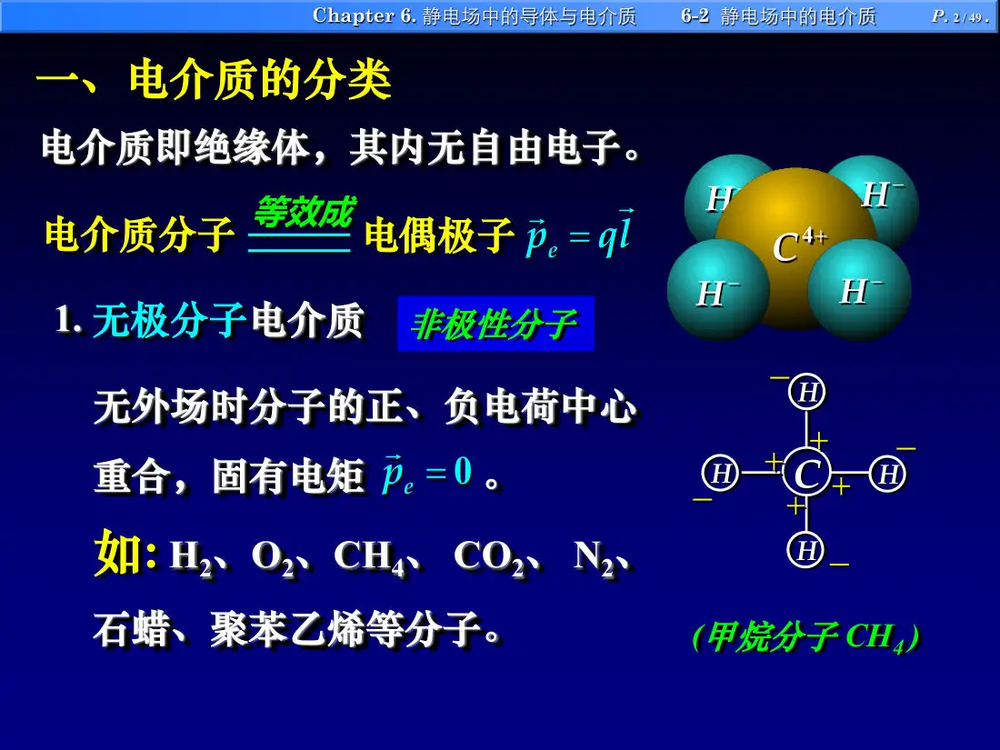

原文：

电介质即绝缘体，其内无自由电子。

电介质分子 等效成 电偶极子 $\vec{p}_{e} = q\vec{l}$

1. 无极分子电介质 非极性分子

无外场时分子的正、负电荷中心重合，固有电矩 $\vec{p}_e = 0$ 。

如: $H_{2}$ 、 $O_{2}$ 、 $CH_{4}$ 、 $CO_{2}$ 、 $N_{2}$

石蜡、聚苯乙烯等分子。

(甲烷分子 $CH_{4}$ )

Chapter 6. 静电场中的导体与电介质

6-2 静电场中的电介质

P. 2 / 49.

### 无外场时分子的正、负电荷中心重合，固有电矩 $\vec{p}_{e}=0$ 。

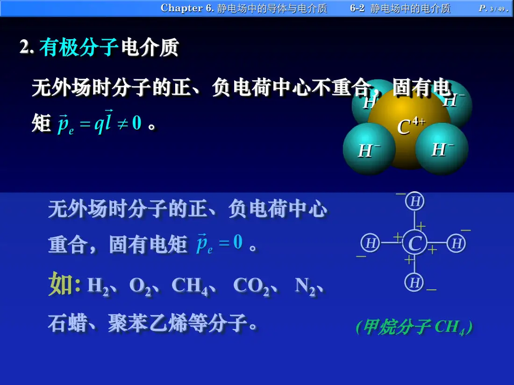

原文：

无外场时分子的正、负电荷中心不重合，固有电矩 $\vec{p}_{e}=q\vec{l}\neq0$ 。

无外场时分子的正、负电荷中心重合，固有电矩 $\vec{p}_{e}=0$ 。
如: $H_{2}$ 、 $O_{2}$ 、 $CH_{4}$ 、 $CO_{2}$ 、 $N_{2}$ 、石蜡、聚苯乙烯等分子。

(甲烷分子 $CH_{4}$ )

Chapter 6. 静电场中的导体与电介质

6-2 静电场中的电介质

P. 3 / 49.

### 2. 有极分子电介质

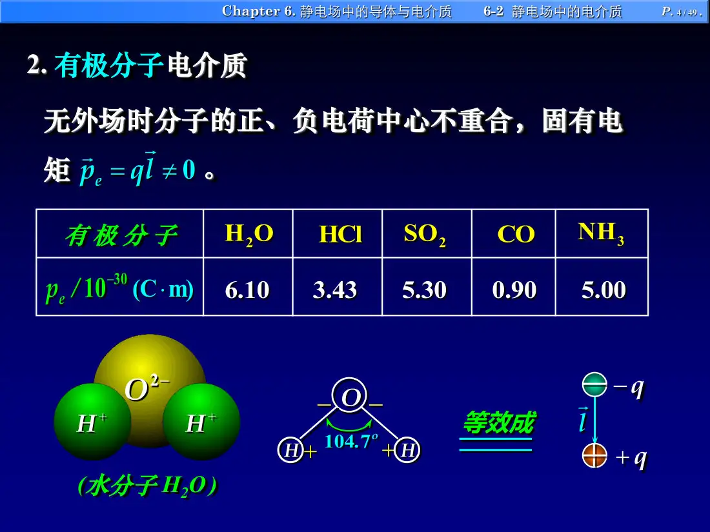

原文：

2. 有极分子电介质

无外场时分子的正、负电荷中心不重合，固有电矩 $\vec{p}_{e}=q\vec{l}\neq0$ 。

<table><tr><td>有极分子</td><td> $H_2O$ </td><td>HCl</td><td> $SO_2$ </td><td>CO</td><td> $NH_3$ </td></tr><tr><td> $p_e/10^{-30}(C·m)$ </td><td>6.10</td><td>3.43</td><td>5.30</td><td>0.90</td><td>5.00</td></tr></table>

H $^{+}$

(水分子 $H_{2}O$ )

$^{104.7^{\circ}}$ 等效成

Chapter 6. 静电场中的导体与电介质

6-2 静电场中的电介质

P. 4/49.

### 二、电介质的极化

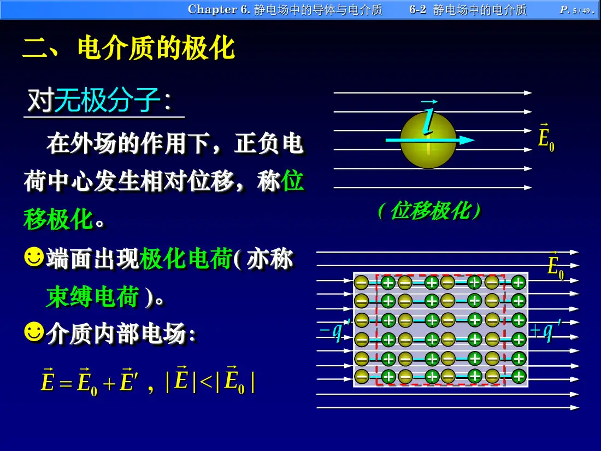

原文：

二、电介质的极化

对无极分子：

在外场的作用下，正负电荷中心发生相对位移，称位移极化。

端面出现极化电荷(亦称束缚电荷)。

😊介质内部电场：

$$
\vec {E} = \vec {E} _ {0} + \vec {E} ^ {\prime}, | \vec {E} | <   | \vec {E} _ {0} |
$$

Chapter 6. 静电场中的导体与电介质 6-2 静电场中的电介质

P. 5/49.

### 端面出现极化电荷(亦称束缚电荷)。

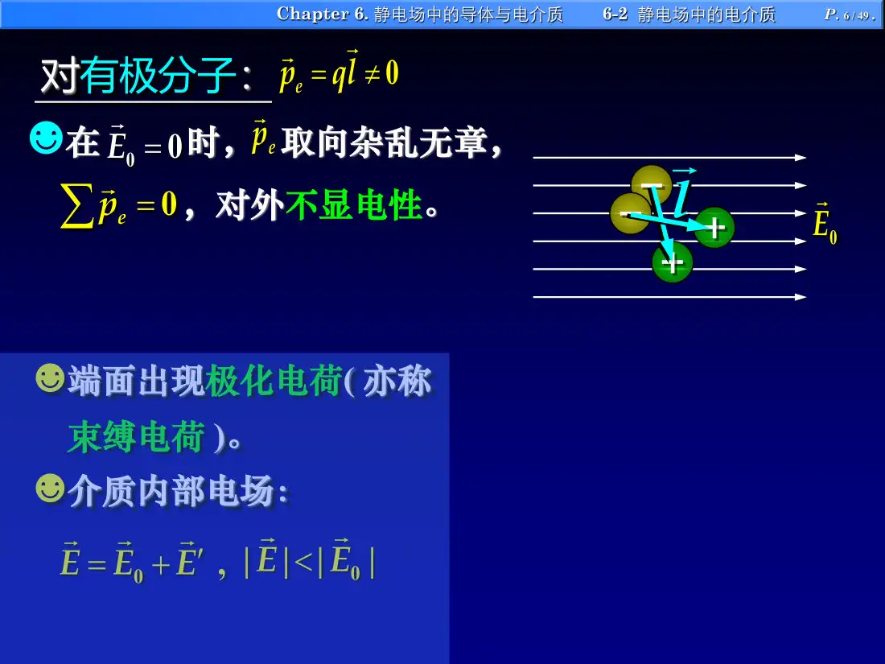

原文：

对有极分子： $\vec{p}_e = q\vec{l} \neq 0$ 在 $\vec{E}_0 = 0$ 时， $\vec{p}_e$ 取向杂乱无章， $\sum \vec{p}_e = 0$ ，对外不显电性。

端面出现极化电荷(亦称束缚电荷)。

介质内部电场：

$\vec{E} = \vec{E}_0 + \vec{E}'$ , $|\vec{E}| < |\vec{E}_0|$

Chapter 6. 静电场中的导体与电介质

6-2 静电场中的电介质

P. 6/49.

### 对有极分子： $\vec{p}_e = q\vec{l} \neq 0$

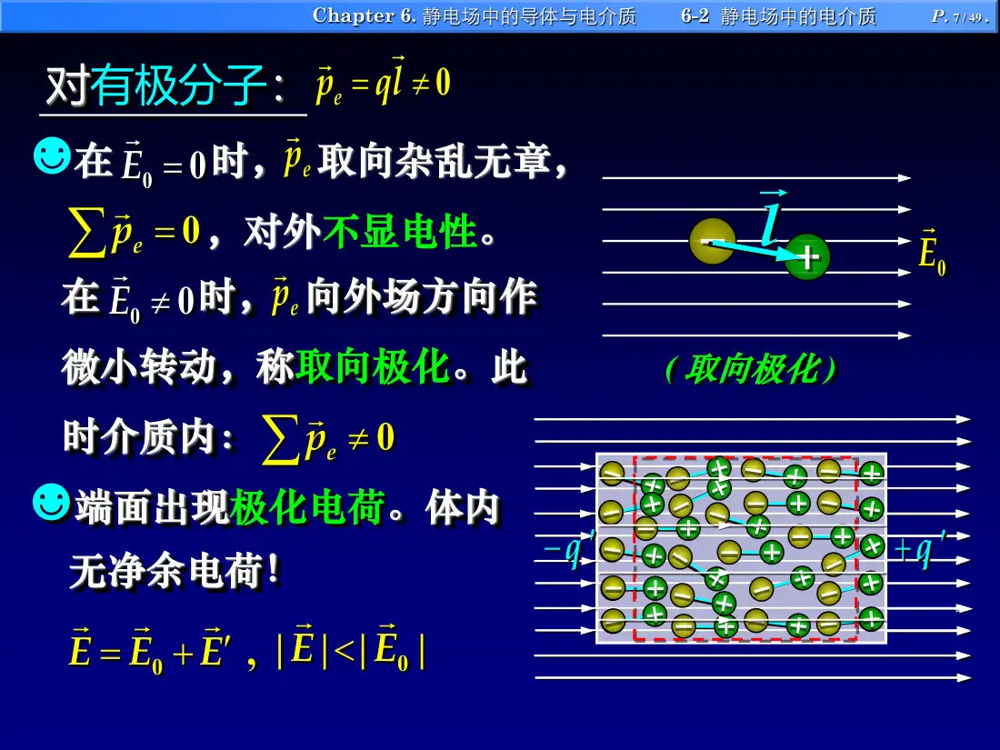

原文：

对有极分子： $\vec{p}_e = q\vec{l} \neq 0$

在 $\vec{E}_{0}=0$ 时， $\vec{p}_{e}$ 取向杂乱无章， $\sum\vec{p}_{e}=0$ ，对外不显电性。在 $\vec{E}_{0}\neq0$ 时， $\vec{p}_{e}$ 向外场方向作微小转动，称取向极化。此时介质内： $\sum\vec{p}_{e}\neq0$

端面出现极化电荷。体内无净余电荷！ $\vec{E} = \vec{E}_{0} + \vec{E}'$ ， $|\vec{E}| < |\vec{E}_{0}|$

Chapter 6. 静电场中的导体与电介质

6-2 静电场中的电介质

P. 7/49.

### 相同之处

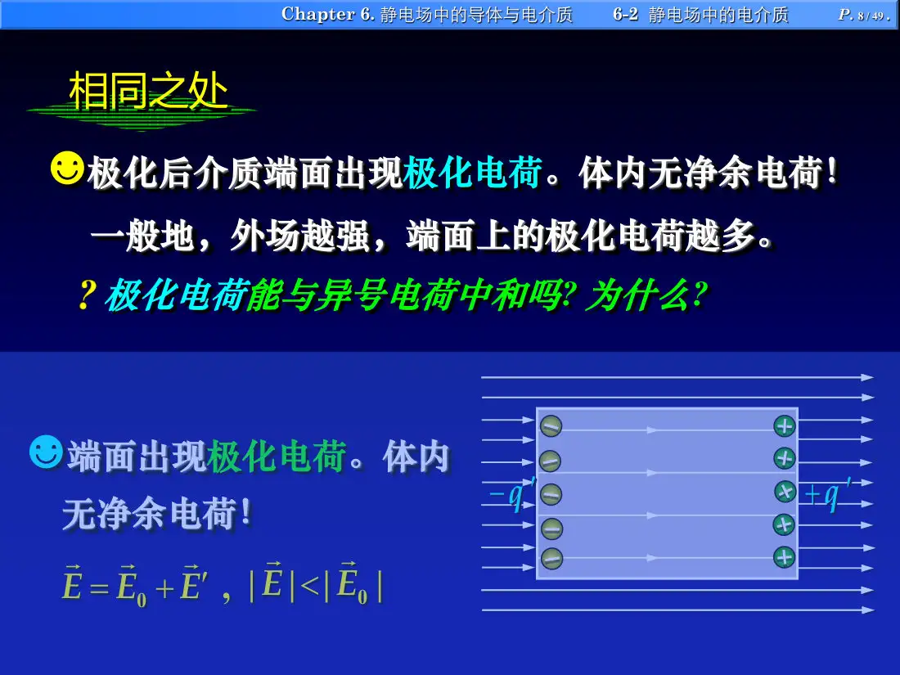

原文：

相同之处

极化后介质端面出现极化电荷。体内无净余电荷！一般地，外场越强，端面上的极化电荷越多。

?极化电荷能与异号电荷中和吗?为什么?

端面出现极化电荷。体内无净余电荷！

$\vec{E} = \vec{E}_0 + \vec{E}'$ , $|\vec{E}| < |\vec{E}_0|$

Chapter 6. 静电场中的导体与电介质

6-2 静电场中的电介质

P. 8/49.

### 相同之处

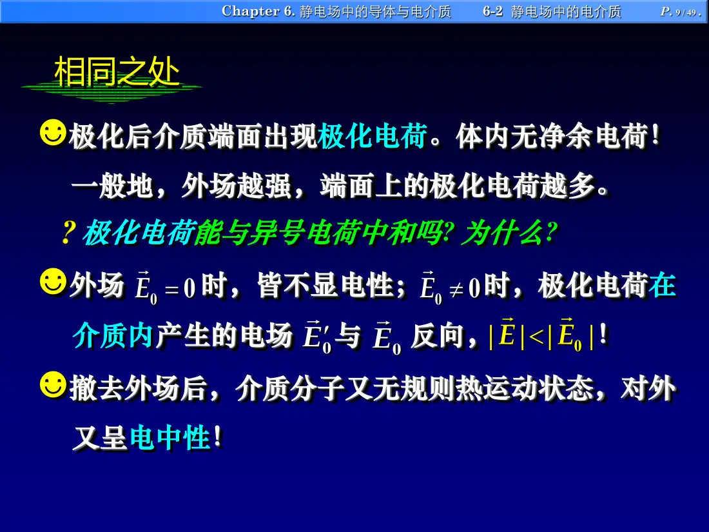

原文：

相同之处

极化后介质端面出现极化电荷。体内无净余电荷！一般地，外场越强，端面上的极化电荷越多。

?极化电荷能与异号电荷中和吗?为什么?

外场 $\vec{E}_0 = 0$ 时，皆不显电性； $\vec{E}_0 \neq 0$ 时，极化电荷在介质内产生的电场 $\vec{E}_0'$ 与 $\vec{E}_0$ 反向， $|\vec{E}| < |\vec{E}_0|$ !

撤去外场后，介质分子又无规则热运动状态，对外又呈电中性！

Chapter 6. 静电场中的导体与电介质

6-2 静电场中的电介质

P. 9/49.

### 电介质的极化

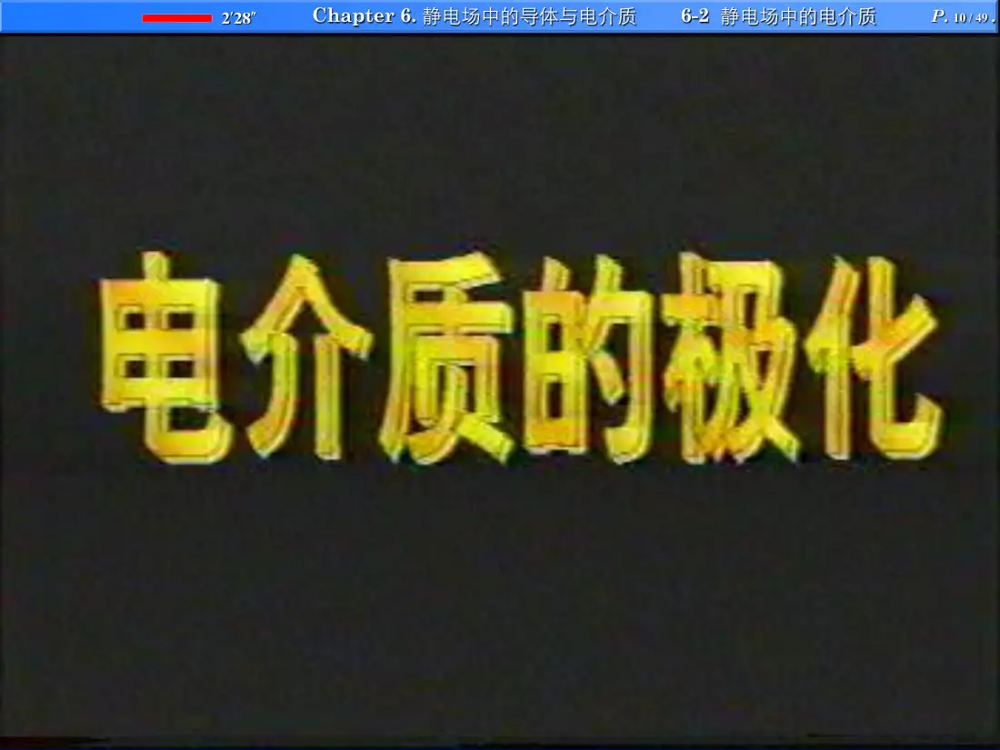

原文：

电介质的极化

Chapter 6. 静电场中的导体与电介质 6-2 静电场中的电介质 P. $10 / 49$ .

### 三、电介质的击穿

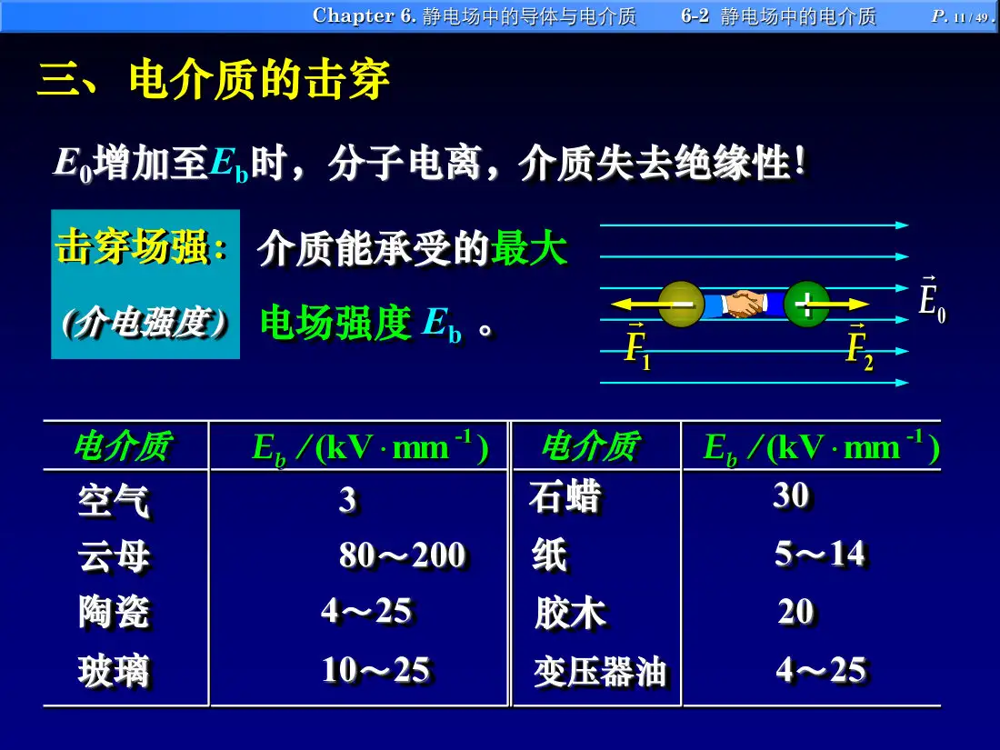

原文：

三、电介质的击穿

$E_{0}$ 增加至 $E_{b}$ 时，分子电离，介质失去绝缘性！

击穿场强：介质能承受的最大

$$
E _ {\mathrm{b}}
$$

<table><tr><td>电介质</td><td> $E_b/(kV·mm^{-1})$ </td><td>电介质</td><td> $E_b/(kV·mm^{-1})$ </td></tr><tr><td>空气</td><td>3</td><td>石蜡</td><td>30</td></tr><tr><td>云母</td><td>80~200</td><td>纸</td><td>5~14</td></tr><tr><td>陶瓷</td><td>4~25</td><td>胶木</td><td>20</td></tr><tr><td>玻璃</td><td>10~25</td><td>变压器油</td><td>4~25</td></tr></table>

Chapter 6. 静电场中的导体与电介质 6-2 静电场中的电介质 P. $11 / 49$ .

### 四、电极化强度

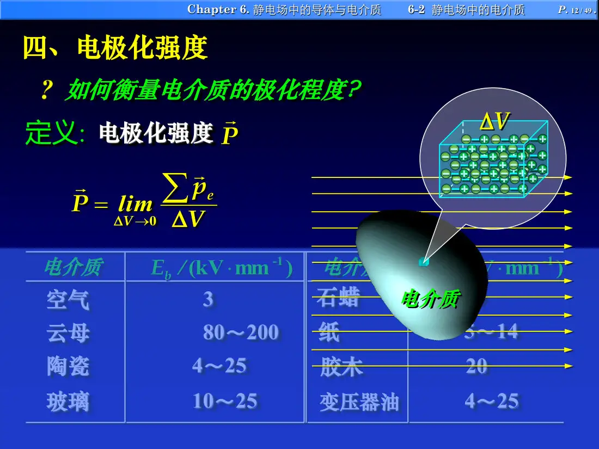

原文：

四、电极化强度

？如何衡量电介质的极化程度？

定义: 电极化强度 $\vec{P}$

$$
\vec {P} = \lim _ {\Delta V \rightarrow 0} \frac {\sum \vec {p} _ {e}}{\Delta V}
$$

电介质

电介

• mm

空气

3

石蜡电介质

云母

80\~200

陶瓷

纸

5\~14

4\~25

胶木

20

玻璃

10\~25

变压器油

4\~25

Chapter 6. 静电场中的导体与电介质

6-2 静电场中的电介质

P. 12 / 49 .

### 四、电极化强度

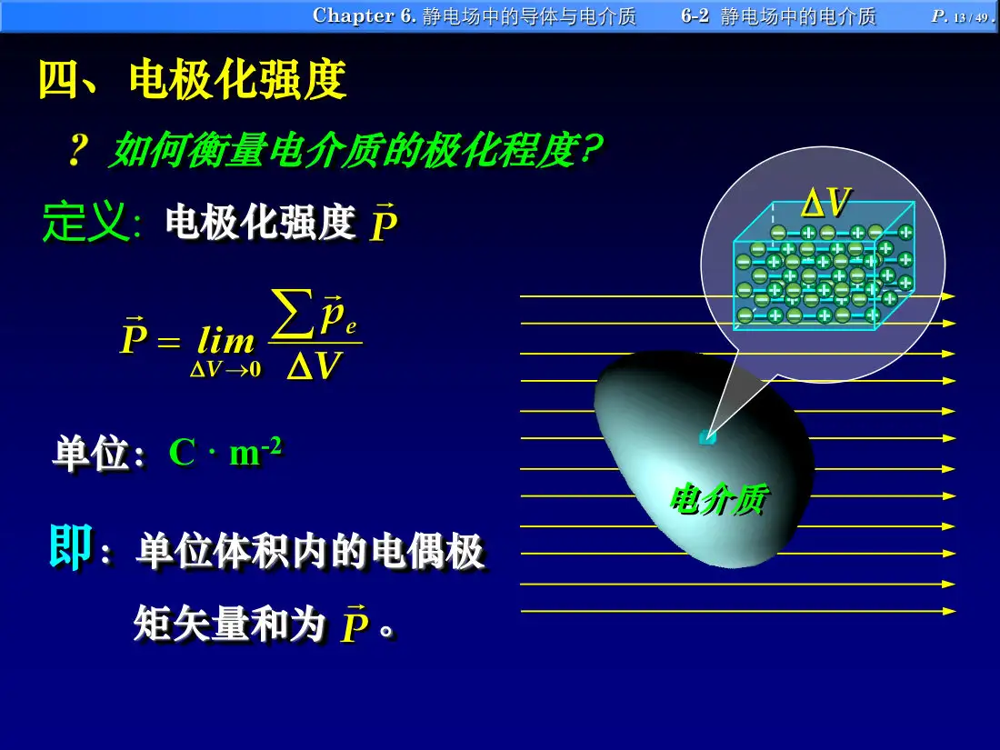

原文：

四、电极化强度

？如何衡量电介质的极化程度？

定义: 电极化强度 $\vec{P}$

$$
\vec {P} = \lim _ {\Delta V \rightarrow 0} \frac {\sum \vec {p} _ {e}}{\Delta V}
$$

单位: $\mathrm{C} \cdot \mathrm{m}^{-2}$

即: 单位体积内的电偶极矩矢量和为 $\vec{P}$ 。

Chapter 6. 静电场中的导体与电介质

6-2 静电场中的电介质

P. 13 / 49 .

### $$

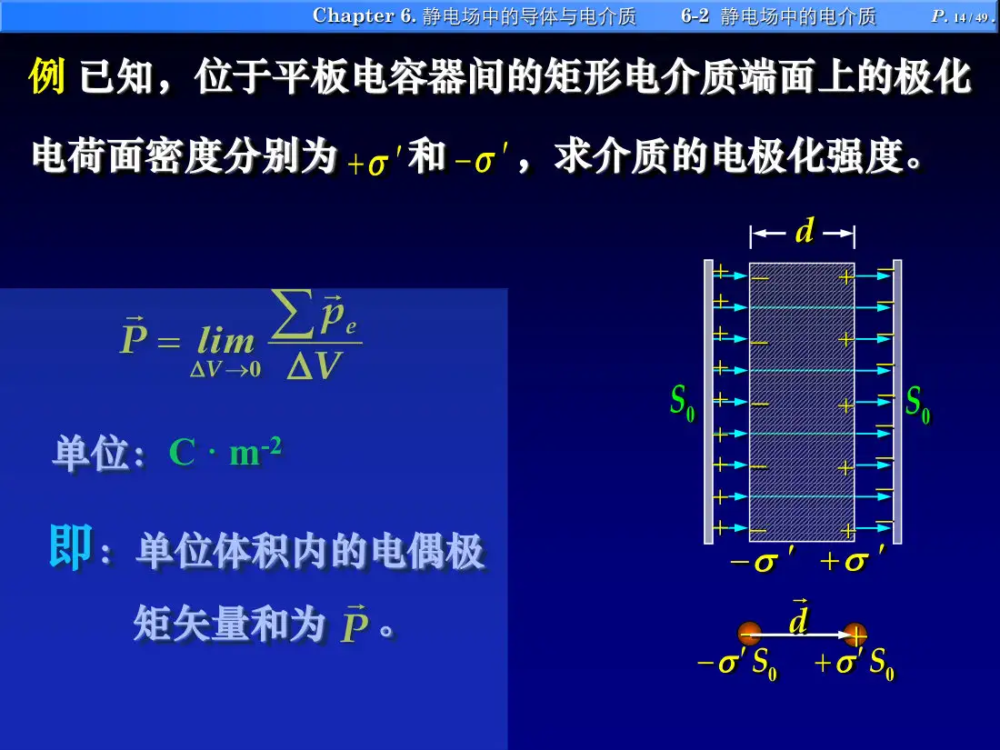

原文：

例 已知，位于平板电容器间的矩形电介质端面上的极化电荷面密度分别为 $+\sigma'$ 和 $-\sigma'$ ，求介质的电极化强度。

$$
\vec {P} = \lim _ {\Delta V \rightarrow 0} \frac {\sum \vec {p} _ {e}}{\Delta V}
$$

单位: $\mathrm{C} \cdot \mathrm{m}^{-2}$

即: 单位体积内的电偶极矩矢量和为 $\vec{P}$ 。

Chapter 6. 静电场中的导体与电介质

6-2 静电场中的电介质

P. 14/49.

### 解 该矩形介质可认为是均匀极化!

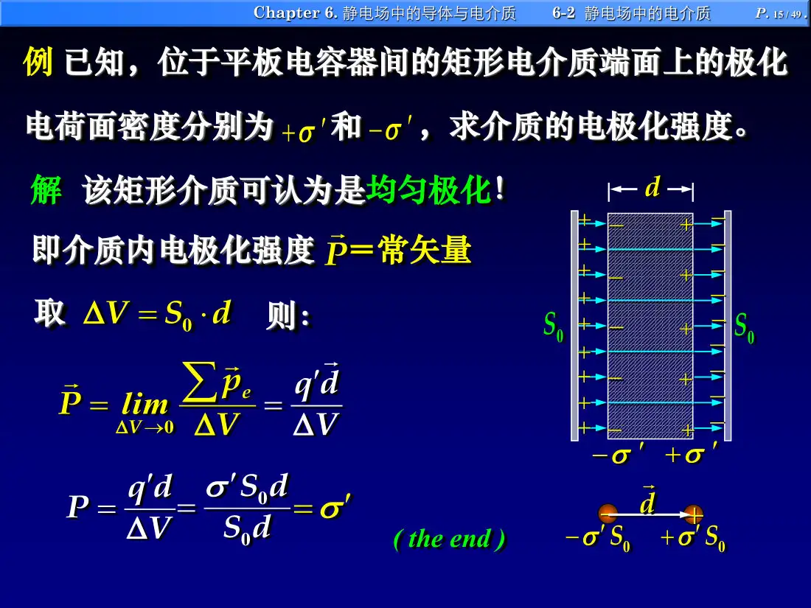

原文：

例 已知，位于平板电容器间的矩形电介质端面上的极化电荷面密度分别为 $+\sigma'$ 和 $-\sigma'$ ，求介质的电极化强度。

解 该矩形介质可认为是均匀极化!

即介质内电极化强度 $\vec{p}$ = 常矢量

取 $\Delta V = S_{0} \cdot d$ 则:

$$
\vec {P} = \lim _ {\Delta V \rightarrow 0} \frac {\sum \vec {p} _ {e}}{\Delta V} = \frac {q ^ {\prime} \vec {d}}{\Delta V}
$$

$$
P = \frac {q ^ {\prime} d}{\Delta V} = \frac {\sigma^ {\prime} S _ {0} d}{S _ {0} d} = \sigma^ {\prime}
$$

(the end)

Chapter 6. 静电场中的导体与电介质

6-2 静电场中的电介质

P. 15/49.

### ( $\vec{e}_{n}$ 为介质表面的外法向单位矢量)

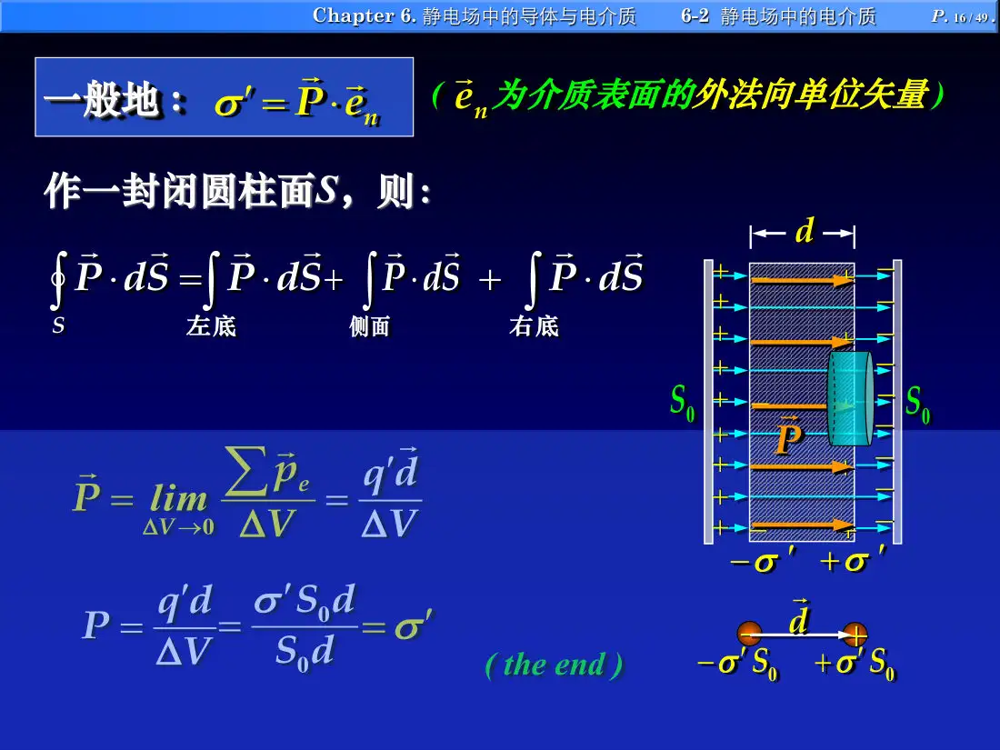

原文：

一般地： $\sigma^{\prime}=\vec{P}\cdot\vec{e}_{n}$

( $\vec{e}_{n}$ 为介质表面的外法向单位矢量)

作一封闭圆柱面 $S$ ，则：

$$
\oint \vec {P} \cdot d \vec {S} = \int \vec {P} \cdot d \vec {S} + \int \vec {P} \cdot d \vec {S} + \int \vec {P} \cdot d \vec {S}
$$

左底

侧面

右底

$$
\vec {P} = \lim _ {\Delta V \rightarrow 0} \frac {\sum \vec {p} _ {e}}{\Delta V} = \frac {q ^ {\prime} \vec {d}}{\Delta V}
$$

$$
P = \frac {q ^ {\prime} d}{\Delta V} = \frac {\sigma^ {\prime} S _ {0} d}{S _ {0} d} = \sigma^ {\prime}
$$

(the end)

$$
- \sigma^ {\prime} S _ {0} + \sigma^ {\prime} S _ {0}
$$

Chapter 6. 静电场中的导体与电介质

6-2 静电场中的电介质

P. 16/49.

### ( $\vec{e}_{n}$ 为介质表面的外法向单位矢量)

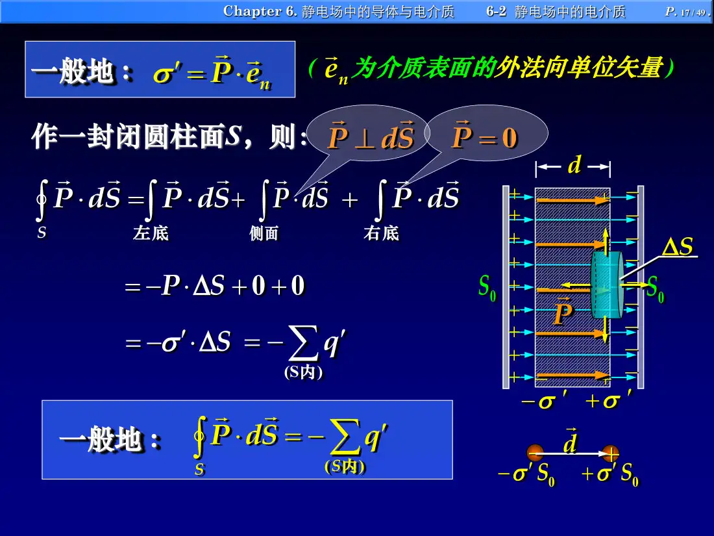

原文：

一般地： $\sigma^{\prime}=\vec{P}\cdot\vec{e}_{n}$

( $\vec{e}_{n}$ 为介质表面的外法向单位矢量)

作一封闭圆柱面S，则： $\vec{P} \perp d\vec{S}$ $\vec{P} = 0$

$\oint \vec{P} \cdot d\vec{S} = \int \vec{P} \cdot d\vec{S} + \int \vec{P} \cdot d\vec{S} + \int \vec{P} \cdot d\vec{S}$

左底

侧面

右底

$$
\begin{array}{r l} & = - P \cdot \Delta S + 0 + 0 \\ & = - \sigma^ {\prime} \cdot \Delta S = - \sum_ {(\mathrm{S内})} q ^ {\prime} \end{array}
$$

一般地： $\oint_{S} \vec{P} \cdot d\vec{S} = -\sum_{(S \text{内})} q'$

Chapter 6. 静电场中的导体与电介质

6-2 静电场中的电介质

P. 17 / 49 .

### 五、 $\vec{P}$ 与 $\vec{E}$ 的关系

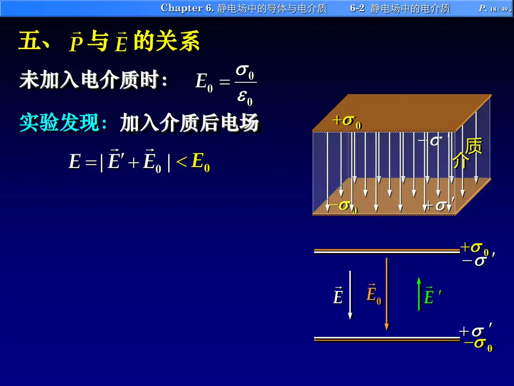

原文：

五、 $\vec{P}$ 与 $\vec{E}$ 的关系

未加入电介质时： $E_{0}=\frac{\sigma_{0}}{\varepsilon_{0}}$ 实验发现：加入介质后电场 $E=|\vec{E}'+\vec{E}_{0}|<E_{0}$

Chapter 6. 静电场中的导体与电介质

6-2 静电场中的电介质

P. 18 / 49 .

### 五、 $\vec{P}$ 与 $\vec{E}$ 的关系

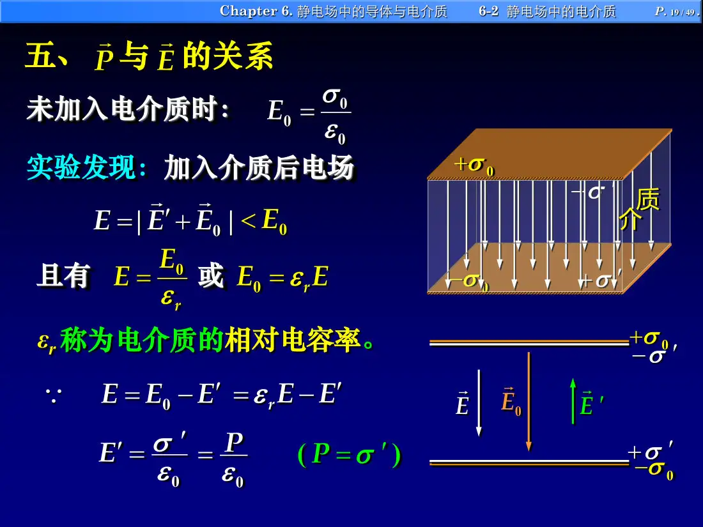

原文：

五、 $\vec{P}$ 与 $\vec{E}$ 的关系

未加入电介质时: $E_{0} = \frac{\sigma_{0}}{\varepsilon_{0}}$

实验发现：加入介质后电场

$$
E = | \vec {E} ^ {\prime} + \vec {E} _ {0} | <   E _ {0}
$$

且有 $E=\frac{E_{0}}{\varepsilon_{r}}$ 或 $E_{0}=\varepsilon_{r}E$

$\varepsilon_{r}$ 称为电介质的相对电容率。

$\because E = E_0 - E' = \varepsilon_r E - E'$

$$
E ^ {\prime} = \frac {\sigma^ {\prime}}{\varepsilon_ {0}} = \frac {P}{\varepsilon_ {0}}
$$

Chapter 6. 静电场中的导体与电介质

6-2 静电场中的电介质

P. 19/49.

### $$

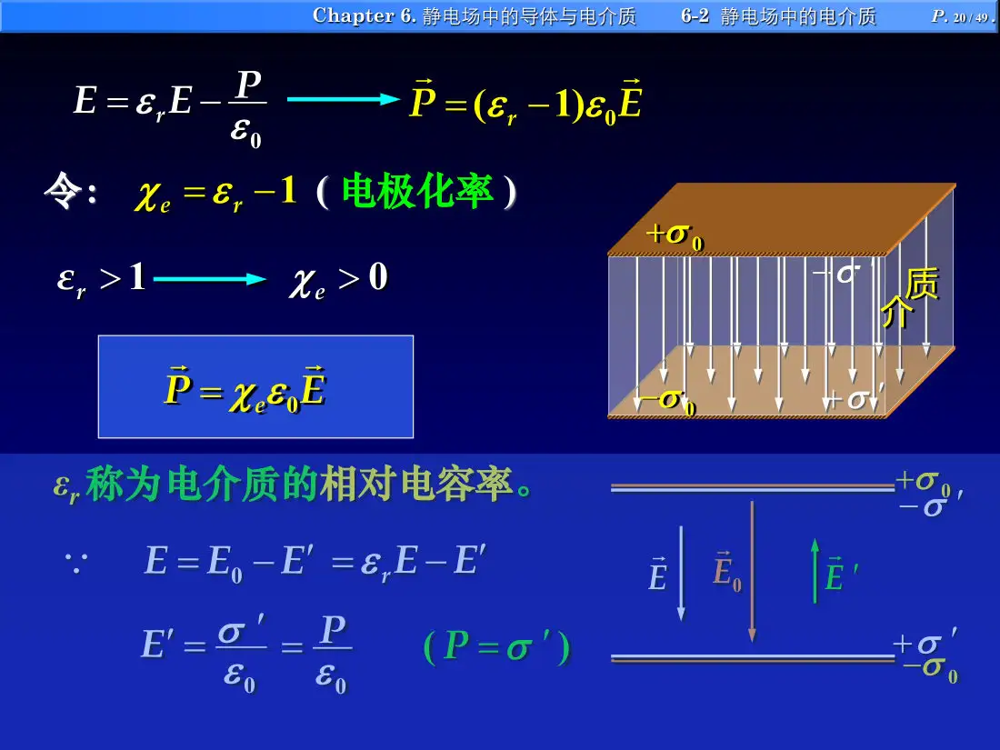

原文：

$$
E = \varepsilon_ {r} E - \frac {P}{\varepsilon_ {0}} \longrightarrow \vec {P} = (\varepsilon_ {r} - 1) \varepsilon_ {0} \vec {E}
$$

令: $\chi_{e} = \varepsilon_{r} - 1$ (电极化率)

$$
\varepsilon_ {r} > 1 \longrightarrow \chi_ {e} > 0
$$

$$
\vec {P} = \chi_ {e} \varepsilon_ {0} \vec {E}
$$

$\varepsilon_{r}$ 称为电介质的相对电容率。

$$
E = E _ {0} - E ^ {\prime} = \varepsilon_ {r} E - E ^ {\prime}
$$

$$
E ^ {\prime} = \frac {\sigma^ {\prime}}{\varepsilon_ {0}} = \frac {P}{\varepsilon_ {0}} \qquad (P = \sigma^ {\prime})
$$

Chapter 6. 静电场中的导体与电介质

6-2 静电场中的电介质

P. 20 / 49 .

### $$

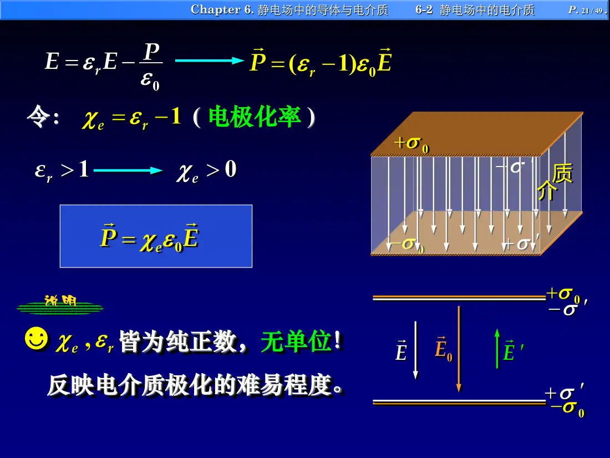

原文：

$$
E = \varepsilon_ {r} E - \frac {P}{\varepsilon_ {0}} \longrightarrow \vec {P} = (\varepsilon_ {r} - 1) \varepsilon_ {0} \vec {E}
$$

令: $\chi_{e} = \varepsilon_{r} - 1$ (电极化率)

$$
\varepsilon_ {r} > 1 \longrightarrow \chi_ {e} > 0
$$

$$
\vec {P} = \chi_ {e} \varepsilon_ {0} \vec {E}
$$

说明

$\chi_{e}, \varepsilon_{r}$ 皆为纯正数，无单位！反映电介质极化的难易程度。

Chapter 6. 静电场中的导体与电介质

6-2 静电场中的电介质

P. 21 / 49.

### 😊 $\vec{P}$ 只在电介质内分布，真空中 $P = 0$ 。

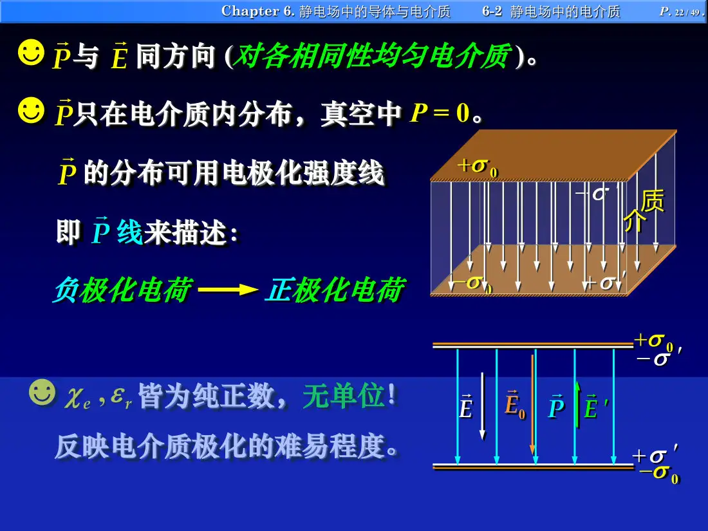

原文：

😊 $\vec{P}$ 与 $\vec{E}$ 同方向 (对各相同性均匀电介质)。

😊 $\vec{P}$ 只在电介质内分布，真空中 $P = 0$ 。

$\vec{P}$ 的分布可用电极化强度线

即 $\vec{P}$ 线来描述:

负极化电荷 $\rightarrow$ 正极化电荷

$\chi_{e}, \varepsilon_{r}$ 皆为纯正数，无单位！反映电介质极化的难易程度。

Chapter 6. 静电场中的导体与电介质

6-2 静电场中的电介质

P. 22 / 49.

### 😊 $\vec{P}$ 只在电介质内分布，真空中 $P = 0$ 。

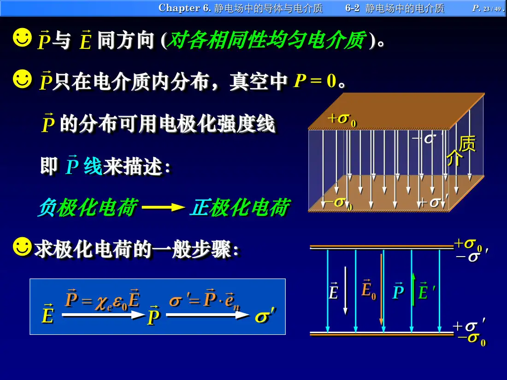

原文：

😊 $\vec{P}$ 与 $\vec{E}$ 同方向 (对各相同性均匀电介质)。

😊 $\vec{P}$ 只在电介质内分布，真空中 $P = 0$ 。

$\vec{P}$ 的分布可用电极化强度线

即 $\vec{P}$ 线来描述:

负极化电荷 → 正极化电荷

求极化电荷的一般步骤：

$$
\vec {E} \xrightarrow {\vec {P} = \chi_ {e} \varepsilon_ {0} \vec {E}} \vec {p} \xrightarrow {\sigma^ {\prime} = \vec {P} \cdot \vec {e} _ {n}} \sigma^ {\prime}
$$

Chapter 6. 静电场中的导体与电介质

6-2 静电场中的电介质

P. 23 / 49.

### 解 设介质中的场强为 $\vec{E}$ ，则：

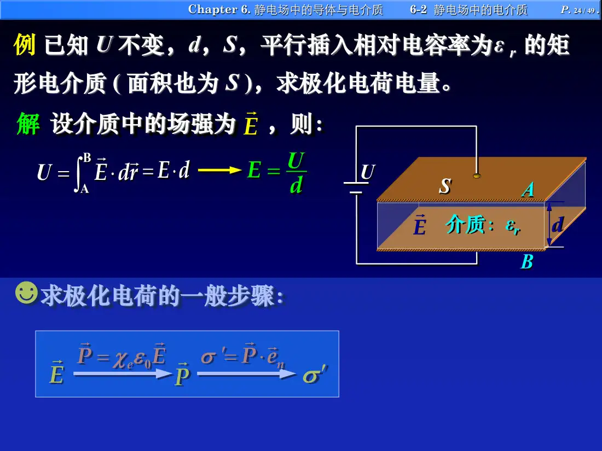

原文：

例 已知 U 不变，d，S，平行插入相对电容率为 $\varepsilon_{r}$ 的矩形电介质（面积也为 S），求极化电荷电量。

解 设介质中的场强为 $\vec{E}$ ，则：

$$
U = \int_ {\mathrm{A}} ^ {\mathrm{B}} \vec {E} \cdot d \vec {r} = E \cdot d \longrightarrow E = \frac {U}{d}
$$

求极化电荷的一般步骤：

$$
\vec {E} \xrightarrow {\vec {P} = \chi_ {e} \varepsilon_ {0} \vec {E}} \vec {p} \xrightarrow {\sigma^ {\prime} = \vec {P} \cdot \vec {e} _ {n}} \sigma^ {\prime}
$$

B

Chapter 6. 静电场中的导体与电介质

6-2 静电场中的电介质

P. 24 / 49 .

### 解 设介质中的场强为 $\vec{E}$ , 则:

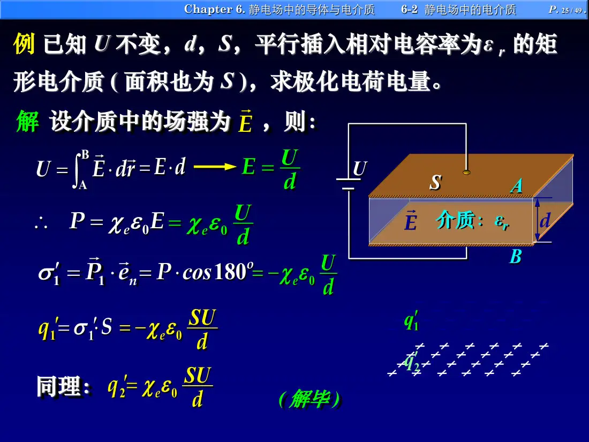

原文：

例 已知 U 不变，d，S，平行插入相对电容率为 $\varepsilon_{r}$ 的矩形电介质（面积也为 S），求极化电荷电量。

解 设介质中的场强为 $\vec{E}$ , 则:

$$
U = \int_ {\mathrm{A}} ^ {\mathrm{B}} \vec {E} \cdot d \vec {r} = E \cdot d \longrightarrow E = \frac {U}{d}
$$

$$
\therefore P = \chi_ {e} \varepsilon_ {0} E = \chi_ {e} \varepsilon_ {0} \frac {U}{d}
$$

$\vec{E}$ 介质: $\varepsilon_{r}$

$$
\sigma_ {1} ^ {\prime} = \vec {P} _ {1} \cdot \vec {e} _ {n} = P \cdot c o s 1 8 0 ^ {o} = - \chi_ {e} \varepsilon_ {0} \frac {U}{d}
$$

$$
q _ {1} ^ {\prime} = \sigma_ {1} ^ {\prime} \cdot S = - \chi_ {e} \varepsilon_ {0} \frac {S U}{d}
$$

同理: $q_{2}^{\prime} = \chi_{e}\varepsilon_{0}\frac{SU}{d}$

(解毕)

Chapter 6. 静电场中的导体与电介质

6-2 静电场中的电介质

P. 25 / 49 .

### 总结

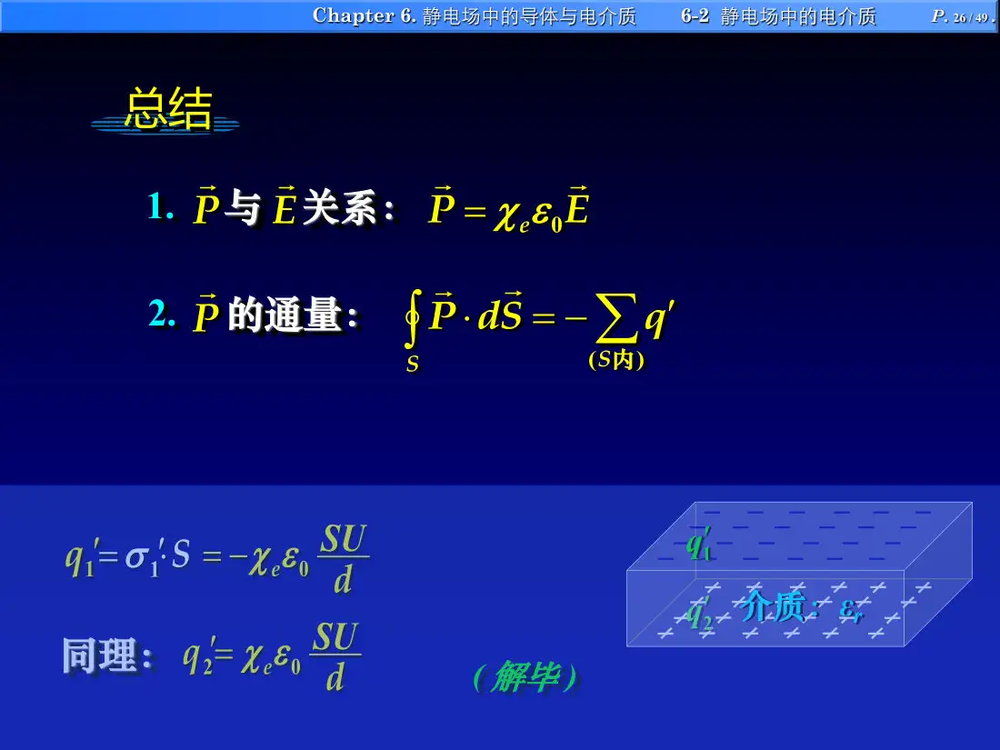

原文：

总结

1. $\vec{P}$ 与 $\vec{E}$ 关系: $\vec{P} = \chi_e\varepsilon_0\vec{E}$

2. $\vec{P}$ 的通量: $\oint_{S} \vec{P} \cdot d\vec{S} = -\sum_{(S \text{内})} q'$

$$
q _ {1} ^ {\prime} = \sigma_ {1} ^ {\prime} \cdot S = - \chi_ {e} \varepsilon_ {0} \frac {S U}{d}
$$

同理: $q_{2}^{\prime} = \chi_ {e} \varepsilon_ {0} \frac {S U}{d}$

$q_{2}$ 介质： $\varepsilon_{r}$

Chapter 6. 静电场中的导体与电介质

6-2 静电场中的电介质

P. 26 / 49

### 总结

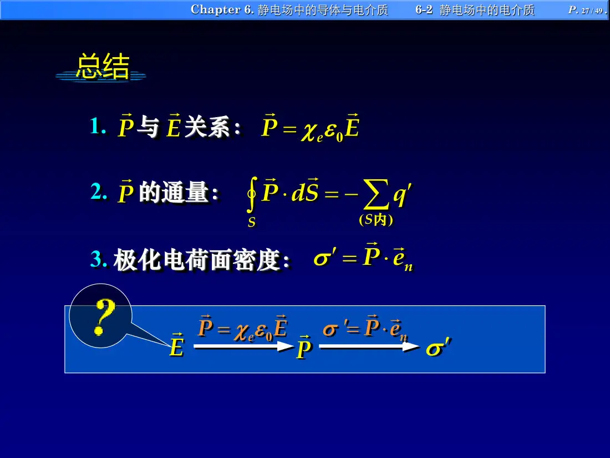

原文：

总结

1. $\vec{P}$ 与 $\vec{E}$ 关系: $\vec{P} = \chi_e\varepsilon_0\vec{E}$

2. $\vec{P}$ 的通量: $\oint_{S} \vec{P} \cdot d\vec{S} = -\sum_{(S \text{内})} q'$

3. 极化电荷面密度: $\sigma' = \vec{P} \cdot \vec{e}_n$

$\vec{E} \xrightarrow{\vec{P} = \chi_e \varepsilon_0 \vec{E}} \vec{P} \xrightarrow{\sigma' = \vec{P} \cdot \vec{e}_n} \sigma'$

Chapter 6. 静电场中的导体与电介质

静电场中的电介质

P. 27 / 49

### 五、 $\vec{D}$ 的高斯定理

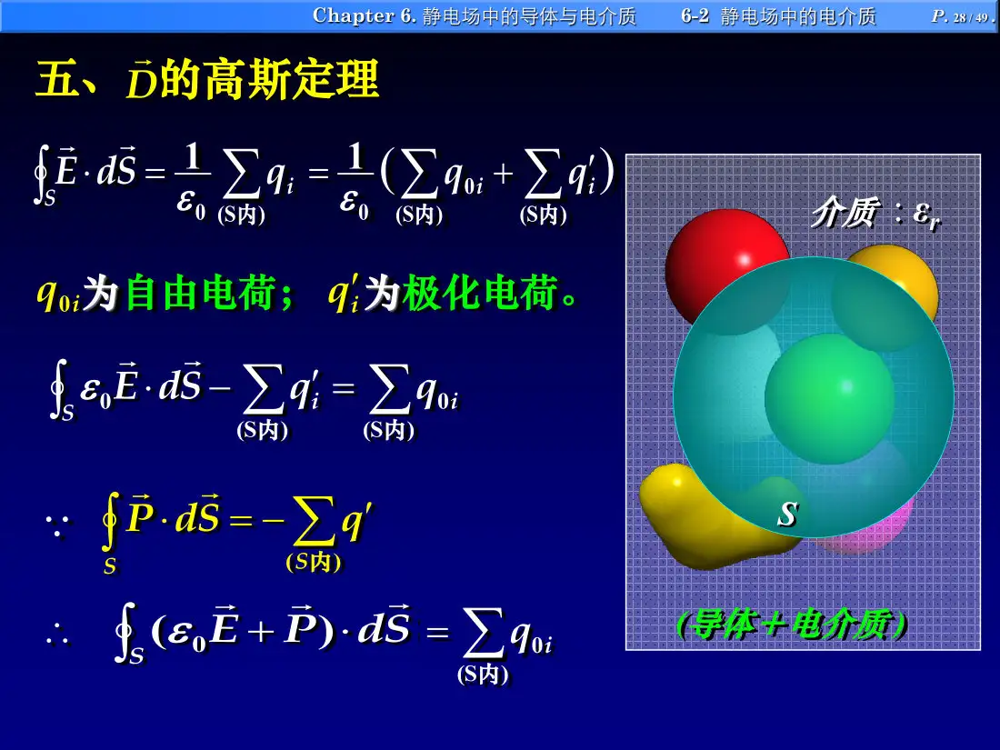

原文：

五、 $\vec{D}$ 的高斯定理

$$
\oint_ {S} \vec {E} \cdot d \vec {S} = \frac {1}{\varepsilon_ {0}} \sum_ {\text {(S内)}} q _ {i} = \frac {1}{\varepsilon_ {0}} \left(\sum_ {\text {(S内)}} q _ {0 i} + \sum_ {\text {(S内)}} q _ {i} ^ {\prime}\right)
$$

$q_{0i}$ 为自由电荷； $q_{i}^{\prime}$ 为极化电荷。

$$
\oint_ {S} \varepsilon_ {0} \vec {E} \cdot d \vec {S} - \sum_ {\text {(S内)}} q _ {i} ^ {\prime} = \sum_ {\text {(S内)}} q _ {0 i}
$$

$$
\therefore \oint_ {S} \vec {P} \cdot d \vec {S} = - \sum_ {(S \text {内})} q ^ {\prime}
$$

$$
\therefore \quad \oint_ {S} (\varepsilon_ {0} \vec {E} + \vec {P}) \cdot d \vec {S} = \sum_ {\text {(S内)}} q _ {0 i}
$$

Chapter 6. 静电场中的导体与电介质

6-2 静电场中的电介质

P. 28 / 49 .

### $$

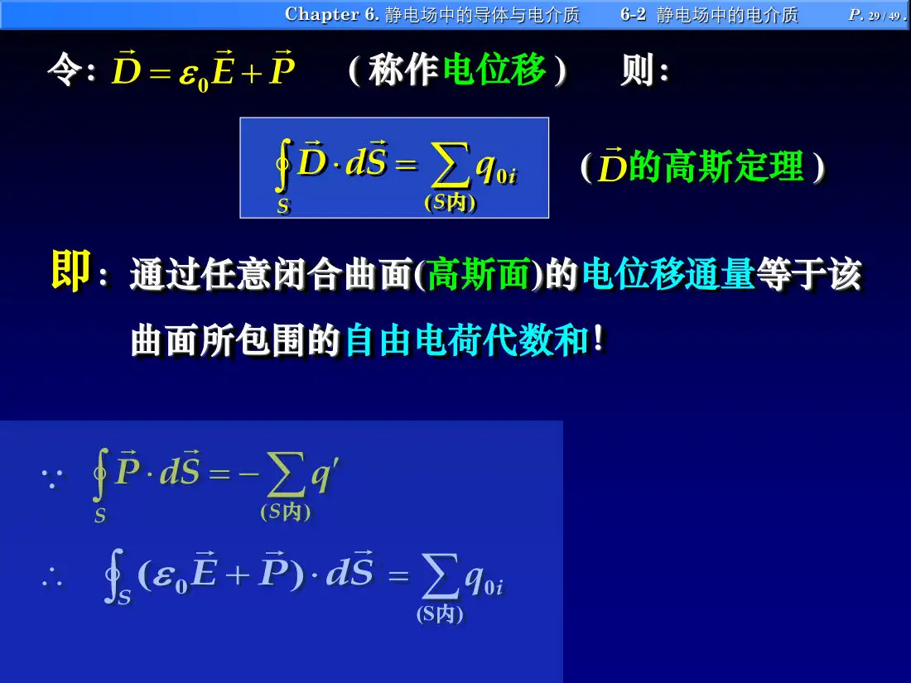

原文：

令: $\vec{D} = \varepsilon_{0}\vec{E} +\vec{P}$ (称作电位移) 则:

$$
\oint_ {S} \vec {D} \cdot d \vec {S} = \sum_ {(S \text {内})} q _ {0 i}
$$

( $\vec{D}$ 的高斯定理)

即：通过任意闭合曲面(高斯面)的电位移通量等于该曲面所包围的自由电荷代数和！

$$
\therefore \oint_ {S} \vec {P} \cdot d \vec {S} = - \sum_ {(S \text {内})} q ^ {\prime}
$$

$$
\therefore \quad \oint_ {S} (\varepsilon_ {0} \vec {E} + \vec {P}) \cdot d \vec {S} = \sum_ {\text {(S内)}} q _ {0 i}
$$

Chapter 6. 静电场中的导体与电介质

6-2 静电场中的电介质

P. 29 / 49 .

### $$

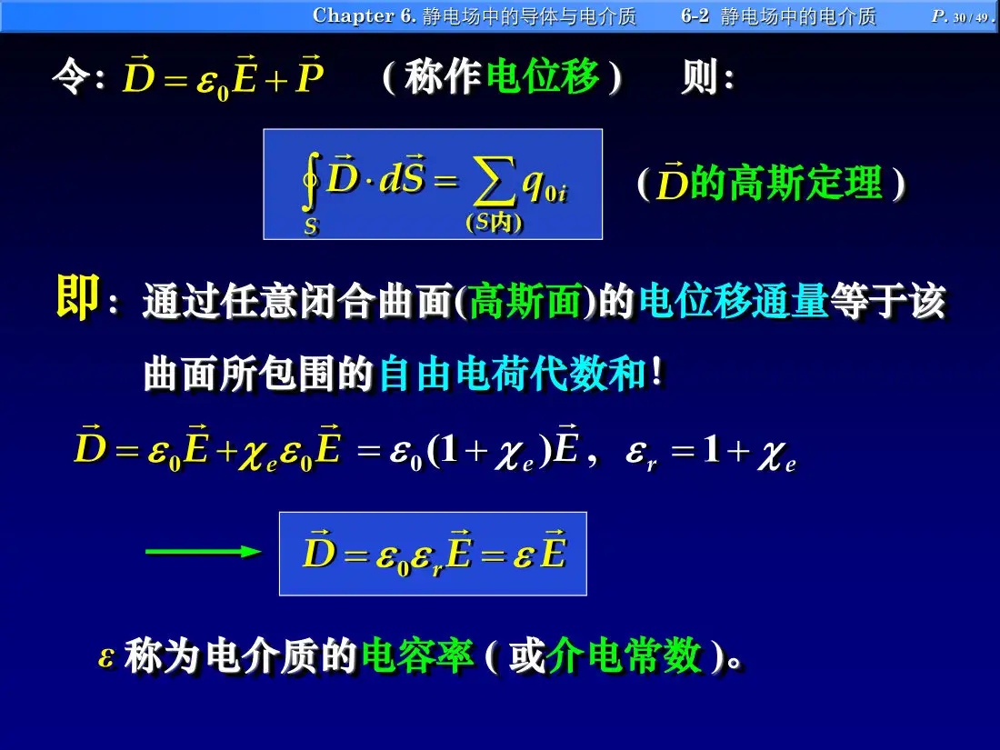

原文：

令: $\vec{D} = \varepsilon_{0}\vec{E} +\vec{P}$ (称作电位移) 则:

$$
\oint_ {S} \vec {D} \cdot d \vec {S} = \sum_ {(S \text {内})} q _ {0 i}
$$

( $\vec{D}$ 的高斯定理)

即：通过任意闭合曲面(高斯面)的电位移通量等于该曲面所包围的自由电荷代数和！

$$
\vec {D} = \varepsilon_ {0} \vec {E} + \chi_ {e} \varepsilon_ {0} \vec {E} = \varepsilon_ {0} (1 + \chi_ {e}) \vec {E}, \varepsilon_ {r} = 1 + \chi_ {e}
$$

$$
\vec {D} = \varepsilon_ {0} \varepsilon_ {r} \vec {E} = \varepsilon \vec {E}
$$

ε 称为电介质的电容率（或介电常数）。

Chapter 6. 静电场中的导体与电介质

6-2 静电场中的电介质

P. 30 / 49 .

### 电位移 $\vec{D}$ 只是辅助量，无实际物理意义。

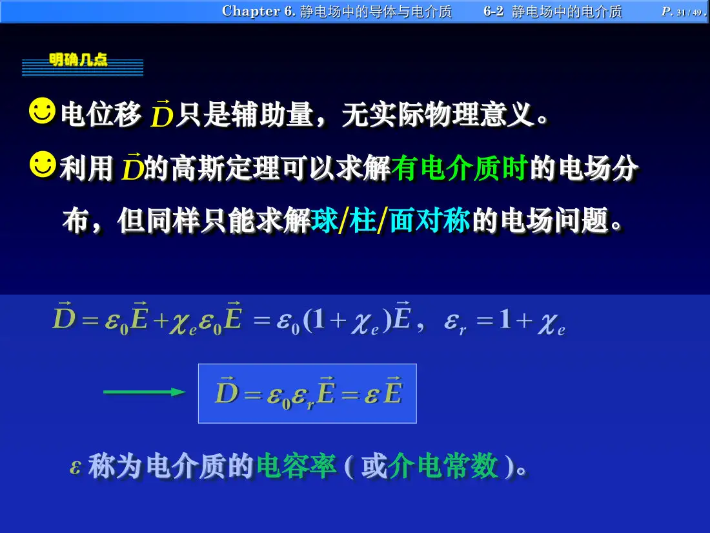

原文：

电位移 $\vec{D}$ 只是辅助量，无实际物理意义。

利用 $\vec{D}$ 的高斯定理可以求解有电介质时的电场分布，但同样只能求解球/柱/面对称的电场问题。

$$
\vec {D} = \varepsilon_ {0} \vec {E} + \chi_ {e} \varepsilon_ {0} \vec {E} = \varepsilon_ {0} (1 + \chi_ {e}) \vec {E}, \varepsilon_ {r} = 1 + \chi_ {e}
$$

$$
\vec {D} = \varepsilon_ {0} \varepsilon_ {r} \vec {E} = \varepsilon \vec {E}
$$

ε 称为电介质的电容率（或介电常数）。

Chapter 6. 静电场中的导体与电介质

6-2 静电场中的电介质

P. 31 / 49 .

### 明确几点

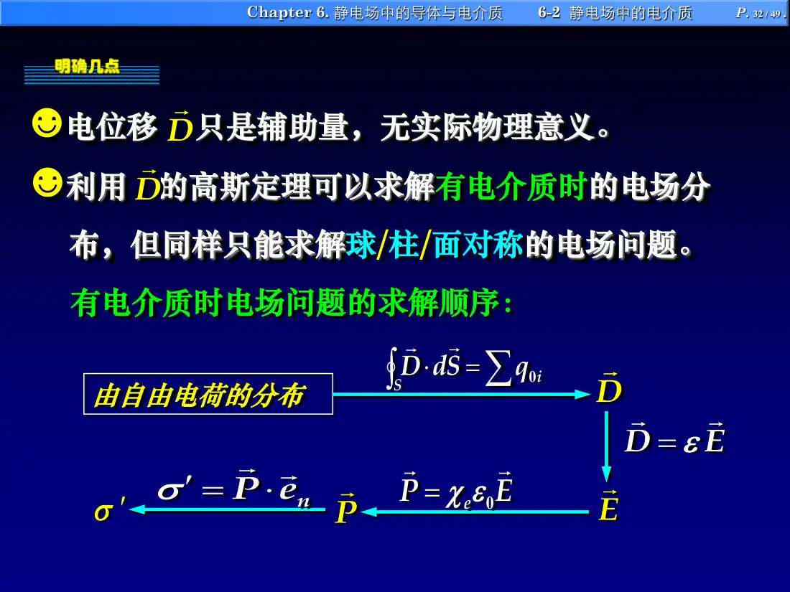

原文：

明确几点

电位移 $\vec{D}$ 只是辅助量，无实际物理意义。

利用 $\vec{D}$ 的高斯定理可以求解有电介质时的电场分布，但同样只能求解球/柱/面对称的电场问题。

有电介质时电场问题的求解顺序：

由自由电荷的分布

$$
\oint_ {S} \vec {D} \cdot d \vec {S} = \sum q _ {0 i}
$$

$$
\vec {D} = \varepsilon \vec {E}
$$

$$
\sigma^ {\prime} = \vec {P} \cdot \vec {e} _ {n} \quad \vec {P} \leftarrow \vec {P} = \chi_ {e} \varepsilon_ {0} \vec {E}
$$

Chapter 6. 静电场中的导体与电介质

6-2 静电场中的电介质

P. 32 / 49

### (1)电场分布；(2)金属球V；(3)r=R₂面上的极化电荷。

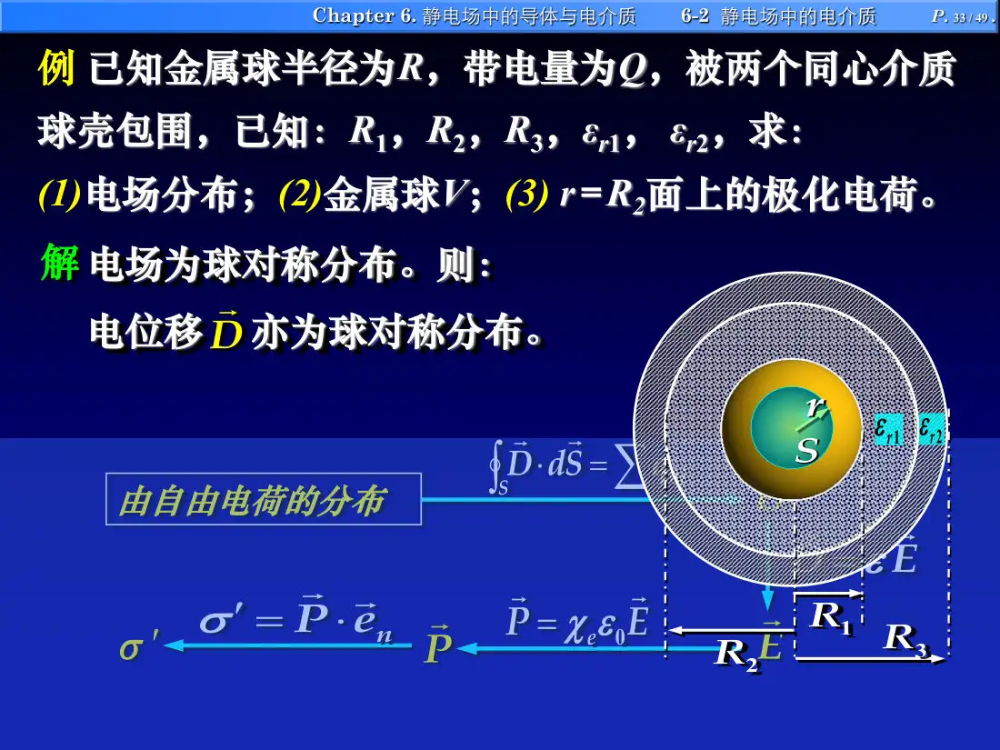

原文：

例 已知金属球半径为R，带电量为Q，被两个同心介质球壳包围，已知： $R_{1}$ ， $R_{2}$ ， $R_{3}$ ， $\varepsilon_{r1}$ ， $\varepsilon_{r2}$ ，求：
(1)电场分布；(2)金属球V；(3)r=R₂面上的极化电荷。
解 电场为球对称分布。则：
电位移 $\vec{D}$ 亦为球对称分布。

由自由电荷的分布

$$
\oint_ {S} \vec {D} \cdot d \vec {S} =
$$

$$
\sigma^ {\prime} \xleftarrow {\sigma^ {\prime} = \vec {P} \cdot \vec {e} _ {n}} \vec {P} \xleftarrow {\vec {P} = \chi_ {e} \varepsilon_ {0} \vec {E}} \overleftarrow {R _ {2} E} \overrightarrow {R _ {1}} R _ {3}
$$

Chapter 6. 静电场中的导体与电介质

6-2 静电场中的电介质

### (1)电场分布；(2)金属球V；(3)r=R₂面上的极化电荷。

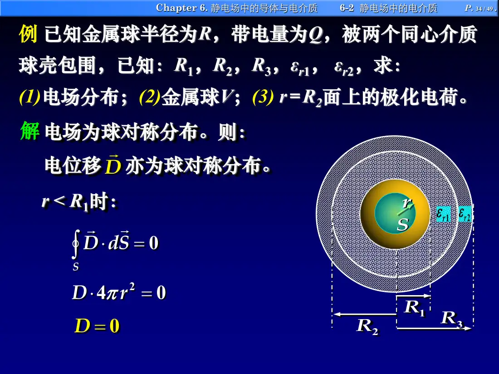

原文：

例 已知金属球半径为R，带电量为Q，被两个同心介质球壳包围，已知： $R_{1}$ ， $R_{2}$ ， $R_{3}$ ， $\varepsilon_{r1}$ ， $\varepsilon_{r2}$ ，求：
(1)电场分布；(2)金属球V；(3)r=R₂面上的极化电荷。
解 电场为球对称分布。则：
电位移 $\vec{D}$ 亦为球对称分布。

$r < R_{1}$ 时:

$\oint_{S} \vec{D} \cdot d \vec{S} = 0$

$$
D \cdot 4 \pi r ^ {2} = 0
$$

$$
D = 0
$$

Chapter 6. 静电场中的导体与电介质

6-2 静电场中的电介质

### $r > R_{1}$ 时：

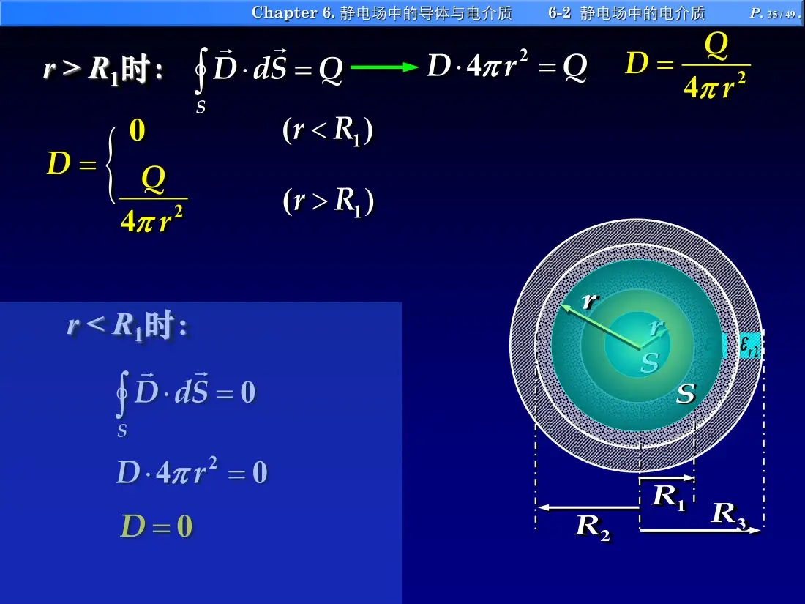

原文：

$r > R_{1}$ 时：

$$
\oint_ {S} \vec {D} \cdot d \vec {S} = Q \longrightarrow D \cdot 4 \pi r ^ {2} = Q \quad D = \frac {Q}{4 \pi r ^ {2}}
$$

$$
D = \left\{ \begin{array}{c} 0 \\ \frac {Q}{4 \pi r ^ {2}} \end{array} \right.
$$

$r < R_{1}$ 时：

$$
\oint_ {S} \vec {D} \cdot d \vec {S} = 0
$$

$$
D \cdot 4 \pi r ^ {2} = 0
$$

$$
D = 0
$$

$$
(r <   R _ {1})
$$

$$
(r > R _ {1})
$$

Chapter 6. 静电场中的导体与电介质

6-2 静电场中的电介质

P. 35 / 49 .

### $r > R_{1}$ 时：

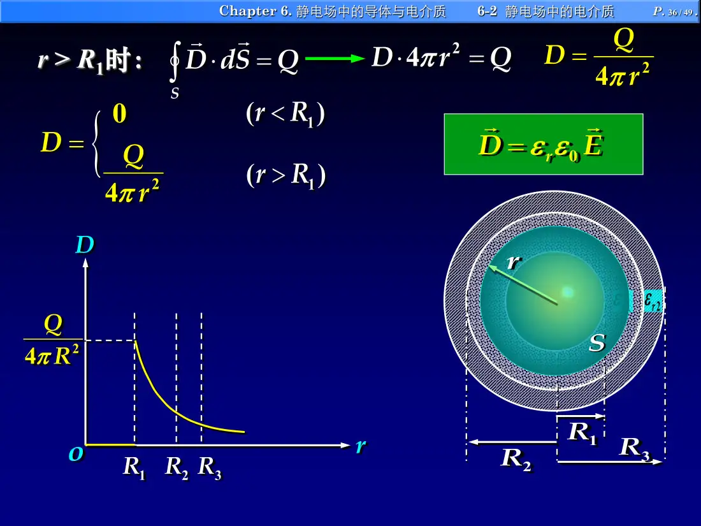

原文：

$r > R_{1}$ 时：

$$
\oint_ {S} \vec {D} \cdot d \vec {S} = Q \longrightarrow D \cdot 4 \pi r ^ {2} = Q \quad D = \frac {Q}{4 \pi r ^ {2}}
$$

$$
D = \left\{ \begin{array}{c} 0 \\ \frac {Q}{4 \pi r ^ {2}} \end{array} \right.
$$

$$
(r <   R _ {1})
$$

$$
(r > R _ {1})
$$

$$
\vec {D} = \varepsilon_ {r} \varepsilon_ {0} \vec {E}
$$

Chapter 6. 静电场中的导体与电介质

6-2 静电场中的电介质

P. 36 / 49 .

### $$

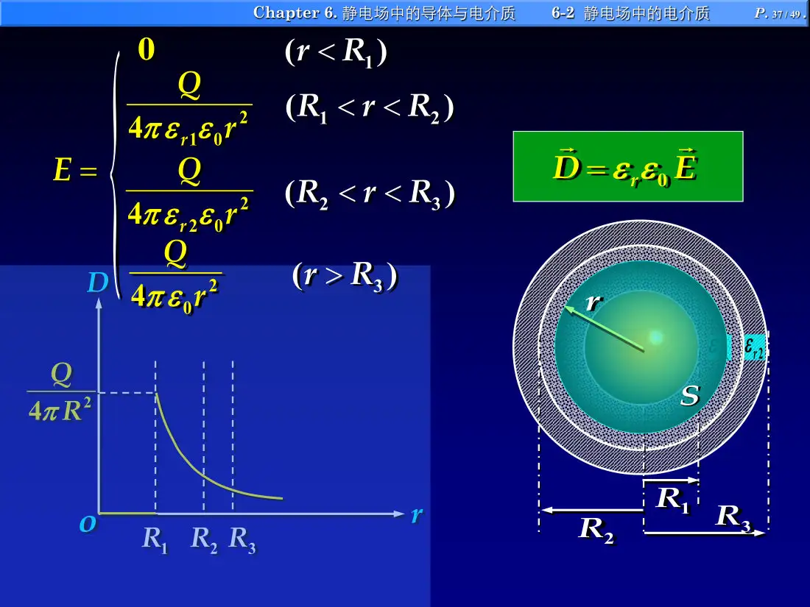

原文：

$$
E =
$$

$$
\left( \begin{array}{c} 0 \\ \frac {Q}{4 \pi \varepsilon_ {r 1} \varepsilon_ {0} r ^ {2}} \\ \frac {Q}{4 \pi \varepsilon_ {r 2} \varepsilon_ {0} r ^ {2}} \\ \frac {Q}{4 \pi \varepsilon_ {0} r ^ {2}} \end{array} \right)
$$

$$
(r <   R _ {1})
$$

$$
(R _ {1} <   r <   R _ {2})
$$

$$
(R _ {2} <   r <   R _ {3})
$$

$$
(r > R _ {3})
$$

$\vec{D} = \varepsilon_{r}\varepsilon_{0}\vec{E}$

Chapter 6. 静电场中的导体与电介质

6-2 静电场中的电介质

P. 37 / 49 .

### $$

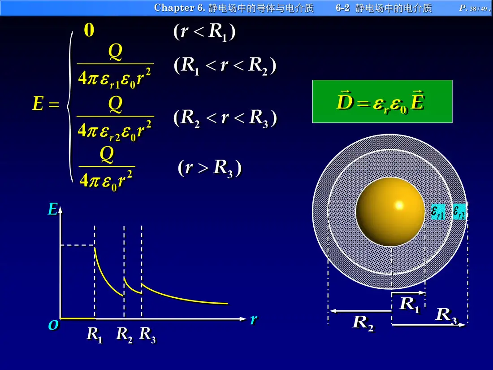

原文：

$$
(r <   R _ {1})
$$

$$
E =
$$

$$
\left\{ \begin{array}{c} 0 \\ \frac {Q}{4 \pi \varepsilon_ {r 1} \varepsilon_ {0} r ^ {2}} \\ \frac {Q}{4 \pi \varepsilon_ {r 2} \varepsilon_ {0} r ^ {2}} \\ \frac {Q}{4 \pi \varepsilon_ {0} r ^ {2}} \end{array} \right.
$$

$$
(R _ {1} <   r <   R _ {2})
$$

$$
(R _ {2} <   r <   R _ {3})
$$

$$
(r > R _ {3})
$$

$\vec{D} = \varepsilon_{r}\varepsilon_{0}\vec{E}$

Chapter 6. 静电场中的导体与电介质

6-2 静电场中的电介质

P. 38 / 49 .

### $$

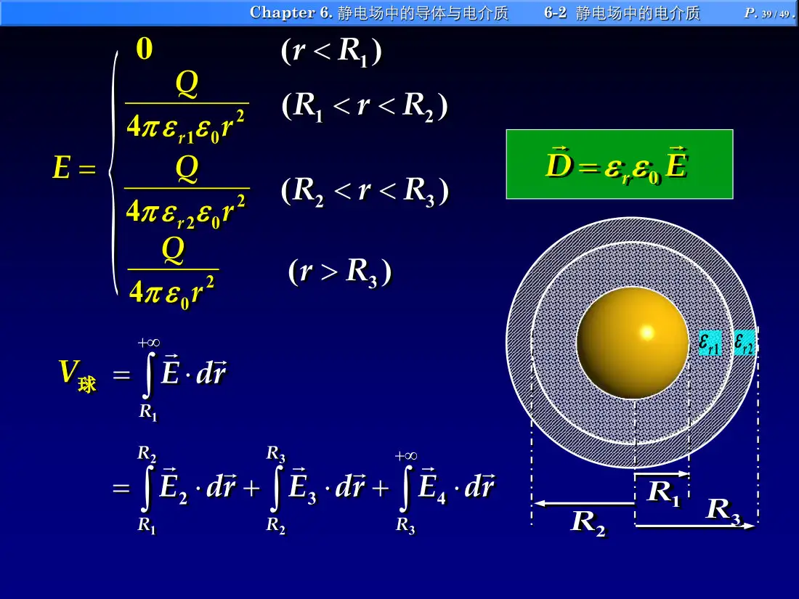

原文：

$$
E = \left\{ \begin{array}{l l} 0 & (r <   R _ {1}) \\ \frac {Q}{4 \pi \varepsilon_ {r 1} \varepsilon_ {0} r ^ {2}} & (R _ {1} <   r <   R _ {2}) \\ \frac {Q}{4 \pi \varepsilon_ {r 2} \varepsilon_ {0} r ^ {2}} & (R _ {2} <   r <   R _ {3}) \\ \frac {Q}{4 \pi \varepsilon_ {0} r ^ {2}} & (r > R _ {3}) \end{array} \right.
$$

$$
\begin{array}{r l} V _ {\text {球}} & = \int_ {R _ {1}} ^ {+ \infty} \vec {E} \cdot d \vec {r} \\ & = \int_ {R _ {1}} ^ {R _ {2}} \vec {E} _ {2} \cdot d \vec {r} + \int_ {R _ {2}} ^ {R _ {3}} \vec {E} _ {3} \cdot d \vec {r} + \int_ {R _ {3}} ^ {+ \infty} \vec {E} _ {4} \cdot d \vec {r} \end{array}
$$

$\vec{D} = \varepsilon_r\varepsilon_0\vec{E}$

Chapter 6. 静电场中的导体与电介质

6-2 静电场中的电介质

P. 39 / 49 .

### $$

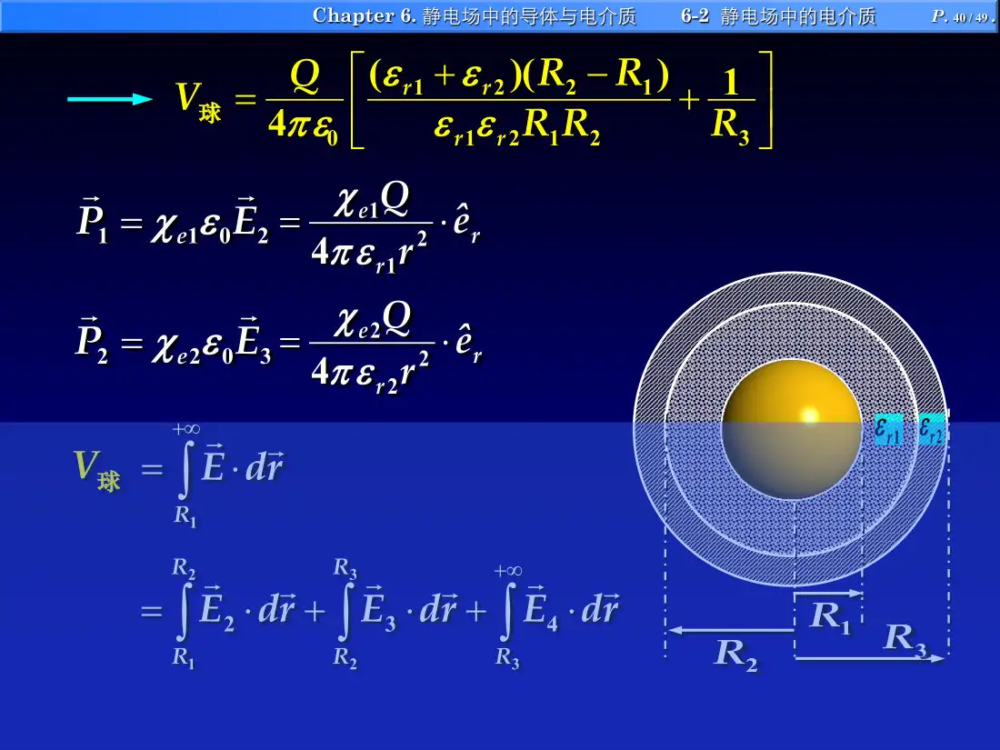

原文：

$$
V _ {\text {球}} = \frac {Q}{4 \pi \varepsilon_ {0}} \left[ \frac {\left(\varepsilon_ {r 1} + \varepsilon_ {r 2}\right) \left(R _ {2} - R _ {1}\right)}{\varepsilon_ {r 1} \varepsilon_ {r 2} R _ {1} R _ {2}} + \frac {1}{R _ {3}} \right]
$$

$$
\vec {P} _ {1} = \chi_ {e 1} \varepsilon_ {0} \vec {E} _ {2} = \frac {\chi_ {e 1} Q}{4 \pi \varepsilon_ {r 1} r ^ {2}} \cdot \hat {e} _ {r}
$$

$$
\vec {P} _ {2} = \chi_ {e 2} \varepsilon_ {0} \vec {E} _ {3} = \frac {\chi_ {e 2} Q}{4 \pi \varepsilon_ {r 2} r ^ {2}} \cdot \hat {e} _ {r}
$$

$$
\begin{array}{r l} V _ {\text {球}} & = \int_ {R _ {1}} ^ {+ \infty} \vec {E} \cdot d \vec {r} \\ & = \int_ {R _ {1}} ^ {R _ {2}} \vec {E} _ {2} \cdot d \vec {r} + \int_ {R _ {2}} ^ {R _ {3}} \vec {E} _ {3} \cdot d \vec {r} + \int_ {R _ {3}} ^ {+ \infty} \vec {E} _ {4} \cdot d \vec {r} \end{array}
$$

Chapter 6. 静电场中的导体与电介质 6-2 静电场中的电介质

P. 40 / 49 .

### $$

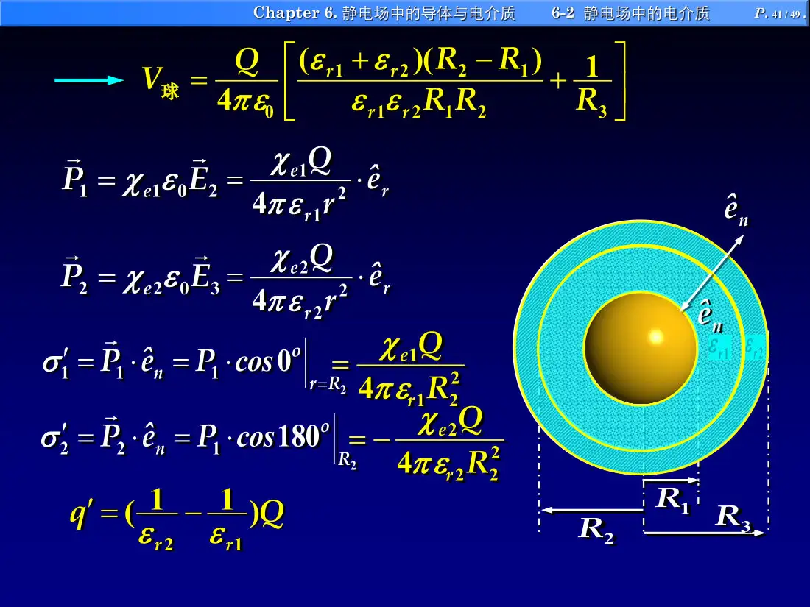

原文：

$$
V _ {\text {球}} = \frac {Q}{4 \pi \varepsilon_ {0}} \left[ \frac {\left(\varepsilon_ {r 1} + \varepsilon_ {r 2}\right) \left(R _ {2} - R _ {1}\right)}{\varepsilon_ {r 1} \varepsilon_ {r 2} R _ {1} R _ {2}} + \frac {1}{R _ {3}} \right]
$$

$$
\vec {P} _ {1} = \chi_ {e 1} \varepsilon_ {0} \vec {E} _ {2} = \frac {\chi_ {e 1} Q}{4 \pi \varepsilon_ {r 1} r ^ {2}} \cdot \hat {e} _ {r}
$$

$$
\vec {P} _ {2} = \chi_ {e 2} \varepsilon_ {0} \vec {E} _ {3} = \frac {\chi_ {e 2} Q}{4 \pi \varepsilon_ {r 2} r ^ {2}} \cdot \hat {e} _ {r}
$$

$$
\sigma_ {1} ^ {\prime} = \vec {P} _ {1} \cdot \hat {e} _ {n} = P _ {1} \cdot c o s 0 ^ {o} \Big | _ {r = R _ {2}} = \frac {\chi_ {e 1} Q}{4 \pi \varepsilon_ {r 1} R _ {2} ^ {2}}
$$

$$
\sigma_ {2} ^ {\prime} = \vec {P} _ {2} \cdot \hat {e} _ {n} = P _ {1} \cdot \cos 1 8 0 ^ {o} \Big | _ {R _ {2}} = - \frac {\chi_ {e 2} Q}{4 \pi \varepsilon_ {r 2} R _ {2} ^ {2}}
$$

$$
q ^ {\prime} = \left(\frac {1}{\varepsilon_ {r 2}} - \frac {1}{\varepsilon_ {r 1}}\right) Q
$$

Chapter 6. 静电场中的导体与电介质

6-2 静电场中的电介质

P. 41 / 49.

### 课堂练习 如图判断两介质中 D、E 是否相等。

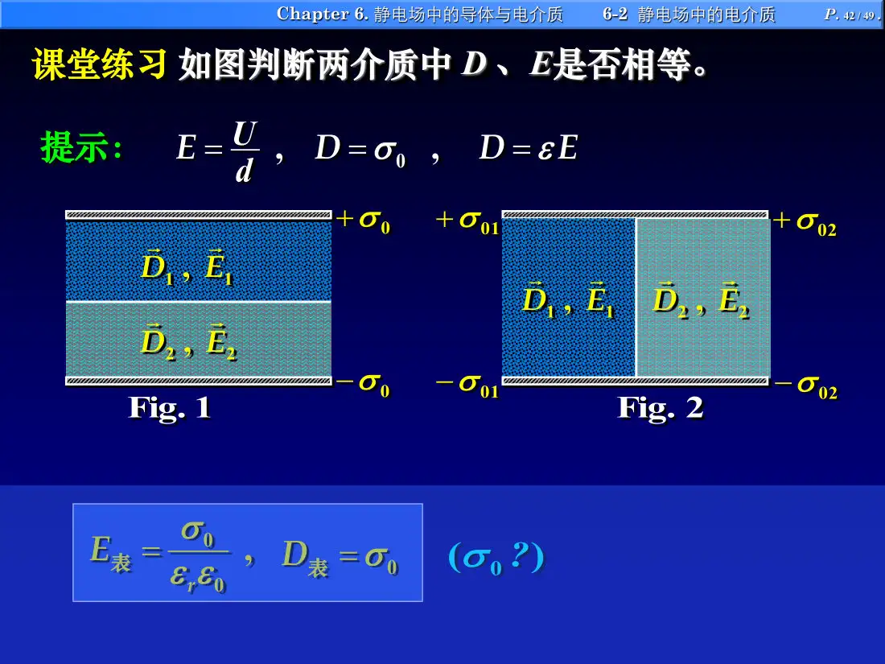

原文：

课堂练习 如图判断两介质中 D、E 是否相等。

提示: $E = \frac{U}{d}$ , $D = \sigma_{0}$ , $D = \varepsilon E$

$$
\vec {D} _ {2}, \vec {E} _ {2}
$$

Fig. 1

Fig. 2

$$
E _ {\text {表}} = \frac {\sigma_ {0}}{\varepsilon_ {r} \varepsilon_ {0}}, D _ {\text {表}} = \sigma_ {0}
$$

$$
(\sigma_ {0}?)
$$

Chapter 6. 静电场中的导体与电介质

6-2 静电场中的电介质

P. 42 / 49.

### 课堂练习 如图判断两介质中 D、E 是否相等。

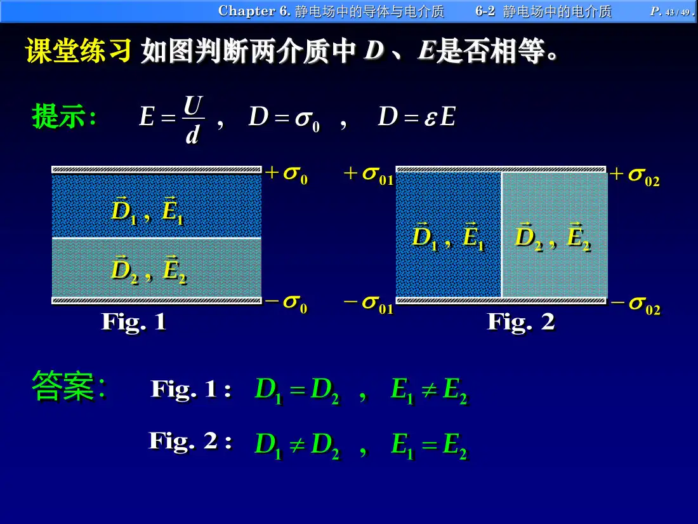

原文：

课堂练习 如图判断两介质中 D、E 是否相等。

提示: $E = \frac{U}{d}$ , $D = \sigma_0$ , $D = \varepsilon E$

Fig. 1

答案: Fig. 1: $D_{1} = D_{2}$ , $E_{1} \neq E_{2}$

Fig. 2: $D_{1} \neq D_{2}$ , $E_{1} = E_{2}$

Chapter 6. 静电场中的导体与电介质

6-2 静电场中的电介质

P. 43 / 49 .

### 归纳:

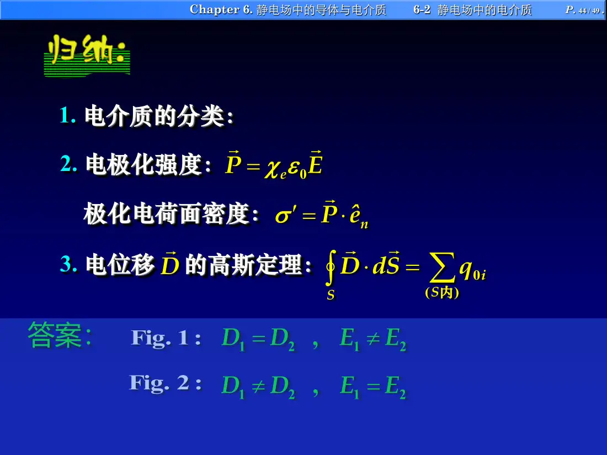

原文：

归纳:

1. 电介质的分类:

2. 电极化强度: $\vec{P} = \chi_{e} \varepsilon_{0} \vec{E}$ 极化电荷面密度: $\sigma' = \vec{P} \cdot \hat{e}_{n}$

3. 电位移 $\vec{D}$ 的高斯定理: $\oint_{S} \vec{D} \cdot d\vec{S} = \sum_{(S \text{内})} q_{0i}$

答案: Fig. 1: $D_{1} = D_{2}$ , $E_{1} \neq E_{2}$

Fig. 2: $D_{1} \neq D_{2}$ , $E_{1} = E_{2}$

Chapter 6. 静电场中的导体与电介质

6-2 静电场中的电介质

P. 44 / 49.

### 归纳：

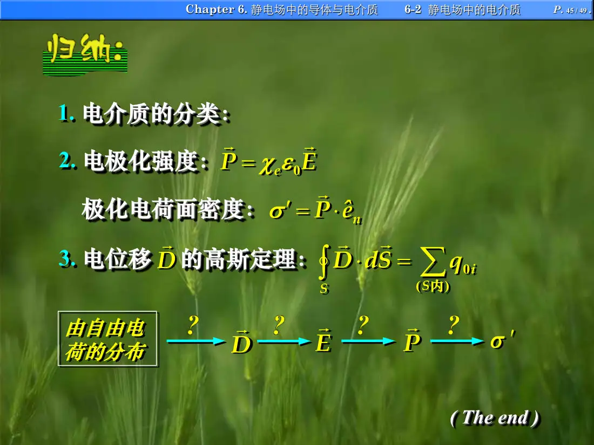

原文：

归纳：

1. 电介质的分类:

2. 电极化强度: $\vec{P} = \chi_{e} \varepsilon_{0} \vec{E}$ 极化电荷面密度: $\sigma' = \vec{P} \cdot \hat{e}_{n}$

3. 电位移 $\vec{D}$ 的高斯定理: $\oint_{S} \vec{D} \cdot d\vec{S} = \sum_{(S \text{内})} q_{0i}$

由自由电荷的分布 $\xrightarrow{?}\vec{D}\xrightarrow{?}\vec{E}\xrightarrow{?}\vec{P}\xrightarrow{?}\sigma^{\prime}$

Chapter 6. 静电场中的导体与电介质

6-2 静电场中的电介质

P. 45 / 49 .
