# 《大学物理》第6章 静电场中的导体与电介质 6-4 静电场能量与能量密度（课件）

原件的每一页，下面附识别出的文字。

### 6- 4 静电场能量与能量密度

原文：

6- 4 静电场能量与能量密度

P. 1/12.

Chapter 6. 静电场中的导体与电介质 6-4 静电场能量与能量密度

旋涡星云

### 一、静电场能量密度及能量

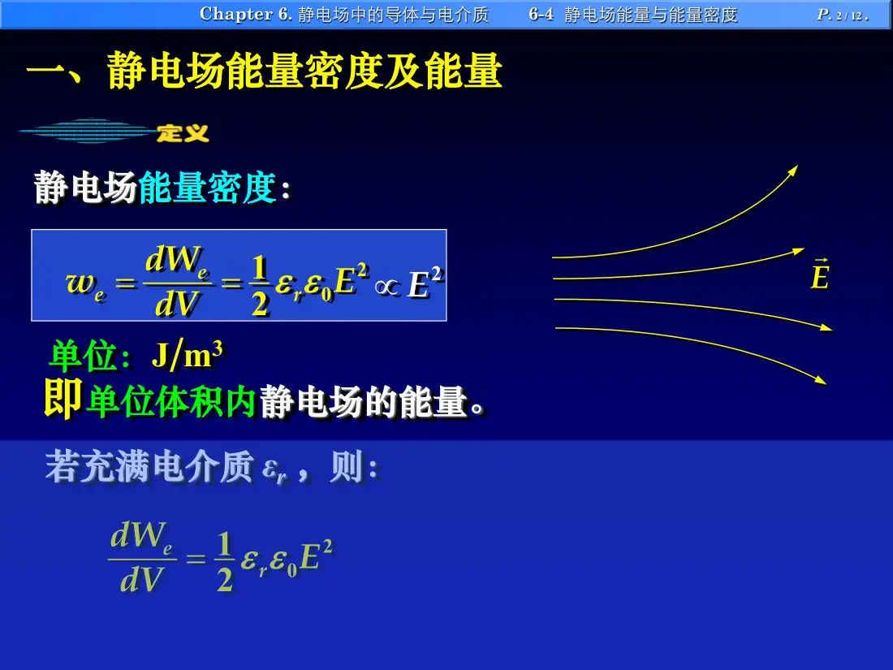

原文：

一、静电场能量密度及能量

定义

静电场能量密度:

$$
w _ {e} = \frac {d W _ {e}}{d V} = \frac {1}{2} \varepsilon_ {r} \varepsilon_ {0} E ^ {2} \propto E ^ {2}
$$

单位： $\mathrm{J} / \mathrm{m}^{3}$ 即单位体积内静电场的能量。

若充满电介质 $\varepsilon_{r}$ ，则：

$$
\frac {d W _ {e}}{d V} = \frac {1}{2} \varepsilon_ {r} \varepsilon_ {0} E ^ {2}
$$

Chapter 6. 静电场中的导体与电介质

6-4 静电场能量与能量密度

P. 2/12.

### 静电场能量密度:

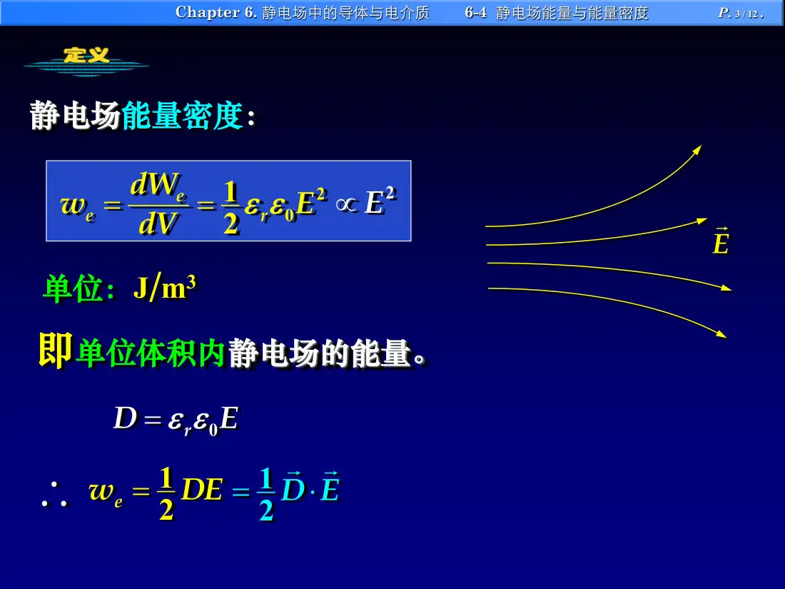

原文：

静电场能量密度:

$$
w _ {e} = \frac {d W _ {e}}{d V} = \frac {1}{2} \varepsilon_ {r} \varepsilon_ {0} E ^ {2} \propto E ^ {2}
$$

单位: $\mathrm{J} / \mathrm{m}^{3}$

即单位体积内静电场的能量。

$$
D = \varepsilon_ {r} \varepsilon_ {0} E
$$

∴ $w_{e}=\frac{1}{2}DE=\frac{1}{2}\vec{D}\cdot\vec{E}$

Chapter 6. 静电场中的导体与电介质 6-4 静电场能量与能量密度

P. 3/12.

### 在静电场中，体积 $dV$ 内的静电场能量为：

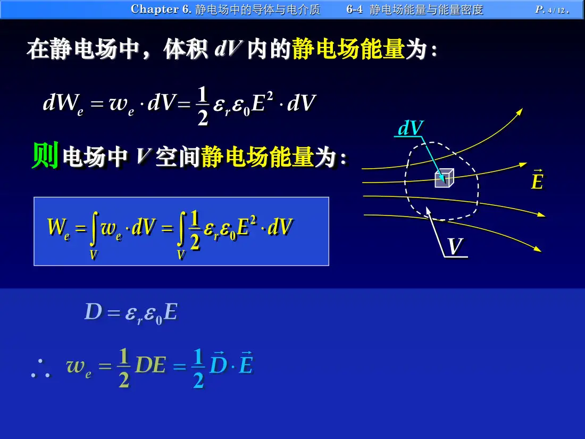

原文：

在静电场中，体积 $dV$ 内的静电场能量为：

$$
d W _ {e} = w _ {e} \cdot d V = \frac {1}{2} \varepsilon_ {r} \varepsilon_ {0} E ^ {2} \cdot d V
$$

则电场中 V 空间静电场能量为:

$$
W _ {e} = \int_ {V} w _ {e} \cdot d V = \int_ {V} \frac {1}{2} \varepsilon_ {r} \varepsilon_ {0} E ^ {2} \cdot d V
$$

$$
D = \varepsilon_ {r} \varepsilon_ {0} E
$$

$$
\therefore w _ {e} = \frac {1}{2} D E = \frac {1}{2} \vec {D} \cdot \vec {E}
$$

Chapter 6. 静电场中的导体与电介质

6-4 静电场能量与能量密度

P. 4/12.

### 在静电场中，体积 $dV$ 内的静电场能量为：

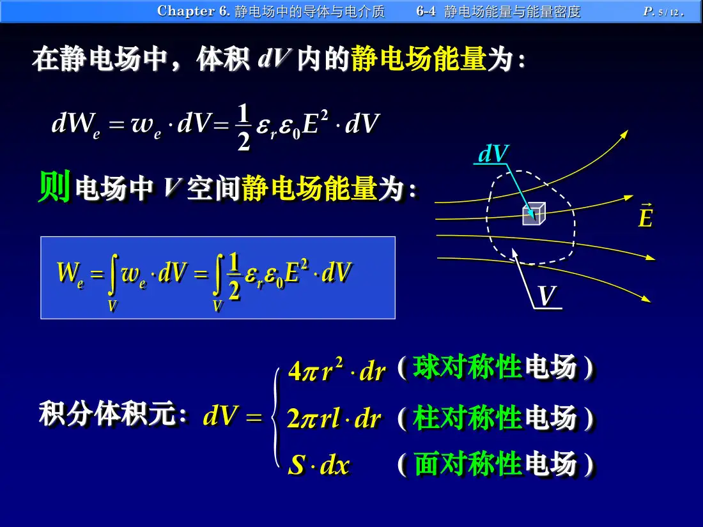

原文：

在静电场中，体积 $dV$ 内的静电场能量为：

$$
d W _ {e} = w _ {e} \cdot d V = \frac {1}{2} \varepsilon_ {r} \varepsilon_ {0} E ^ {2} \cdot d V
$$

则电场中 V 空间静电场能量为:

$$
W _ {e} = \int_ {V} w _ {e} \cdot d V = \int_ {V} \frac {1}{2} \varepsilon_ {r} \varepsilon_ {0} E ^ {2} \cdot d V
$$

积分体积元： $dV = \left\{ \begin{array}{ll}4\pi r^2\cdot dr & (\text{球对称性电场})\\ 2\pi rl\cdot dr & (\text{柱对称性电场})\\ S\cdot dx & (\text{面对称性电场}) \end{array} \right.$

Chapter 6. 静电场中的导体与电介质

6-4 静电场能量与能量密度

P. 5/12.

### 二、电容器的能量

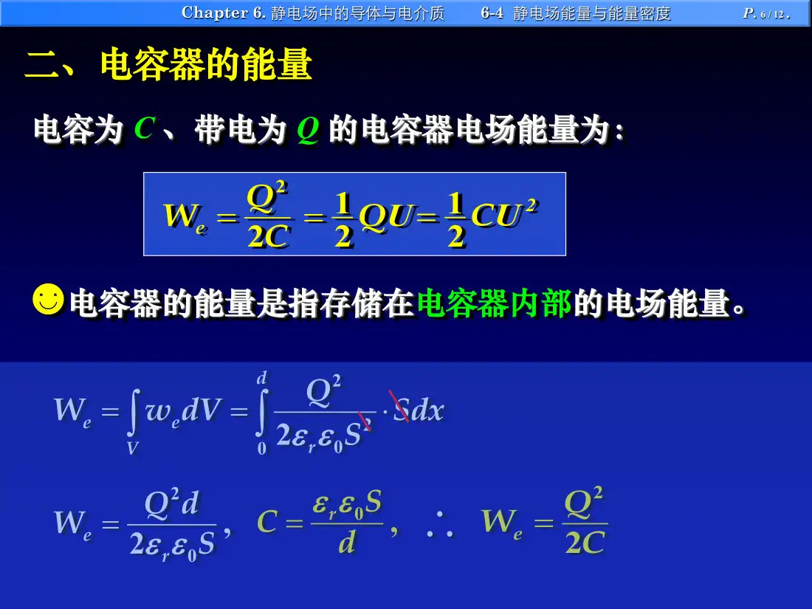

原文：

二、电容器的能量

电容为 C 、带电为 Q 的电容器电场能量为:

$$
W _ {e} = \frac {Q ^ {2}}{2 C} = \frac {1}{2} Q U = \frac {1}{2} C U ^ {2}
$$

电容器的能量是指存储在电容器内部的电场能量。

$$
W _ {e} = \int_ {V} w _ {e} d V = \int_ {0} ^ {d} \frac {Q ^ {2}}{2 \varepsilon_ {r} \varepsilon_ {0} S ^ {2}} \cdot S d x
$$

$$
W _ {e} = \frac {Q ^ {2} d}{2 \varepsilon_ {r} \varepsilon_ {0} S}, C = \frac {\varepsilon_ {r} \varepsilon_ {0} S}{d}, \therefore W _ {e} = \frac {Q ^ {2}}{2 C}
$$

Chapter 6. 静电场中的导体与电介质 6-4 静电场能量与能量密度

P. 6/12.

### 二、电容器的能量

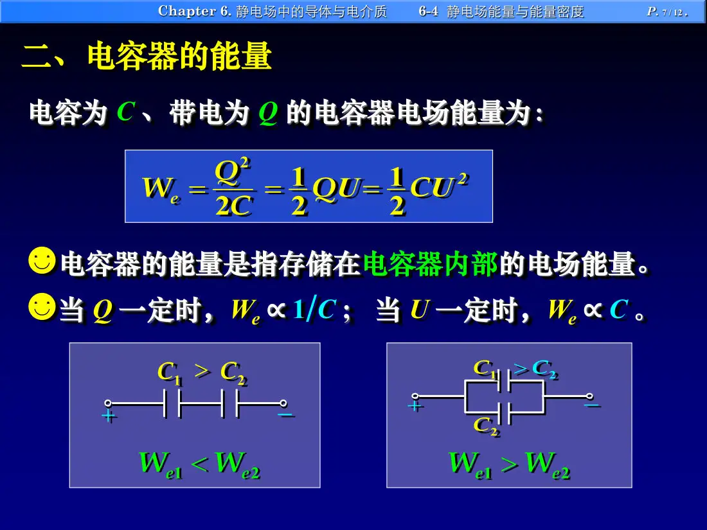

原文：

二、电容器的能量

电容为 C 、带电为 Q 的电容器电场能量为:

$W_{e} = \frac{Q^{2}}{2C} = \frac{1}{2} QU = \frac{1}{2} CU^{2}$

电容器的能量是指存储在电容器内部的电场能量。

当 Q 一定时， $W_{e} \propto 1/C$ ；当 U 一定时， $W_{e} \propto C$ 。

$$
\begin{array}{c} C _ {1} > C _ {2} \\ W _ {e 1} <   W _ {e 2} \end{array}
$$

Chapter 6. 静电场中的导体与电介质 6-4 静电场能量与能量密度

P. 7/12.

### 解 柱型电容器单位长度电容:

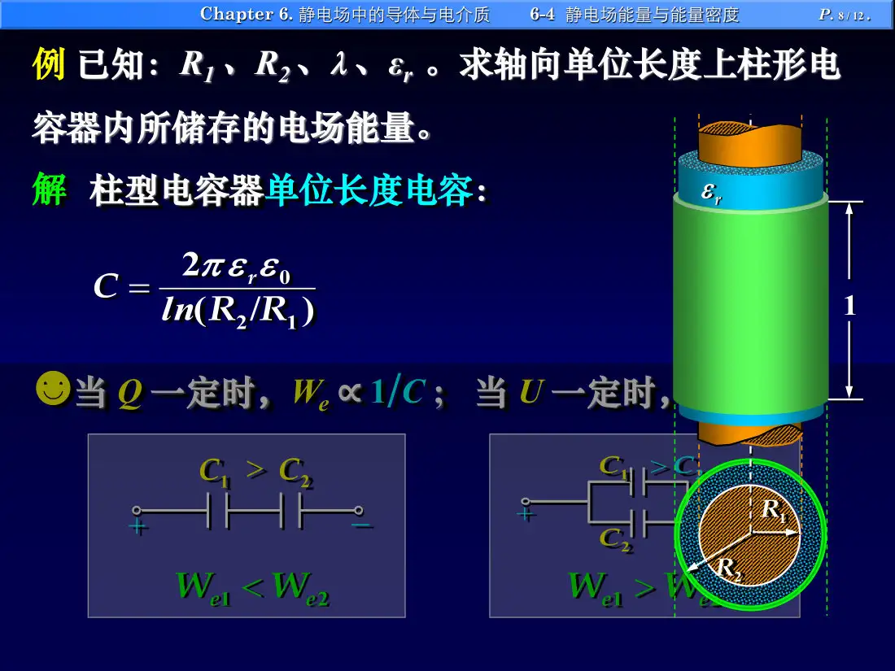

原文：

例 已知: $R_{1} 、 R_{2} 、 \lambda 、 \varepsilon_{r}$ 。求轴向单位长度上柱形电容器内所储存的电场能量。

解 柱型电容器单位长度电容:

$$
C = \frac {2 \pi \varepsilon_ {r} \varepsilon_ {0}}{\ln (R _ {2} / R _ {1})}
$$

当 Q 一定时， $W_{e} \propto 1/C$ ; 当 U 一定时，

$$
\begin{array}{c} C _ {1} > C _ {2} \\ W _ {e 1} <   W _ {e 2} \end{array}
$$

Chapter 6. 静电场中的导体与电介质

6-4 静电场能量与能量密度

### 解 柱型电容器单位长度电容:

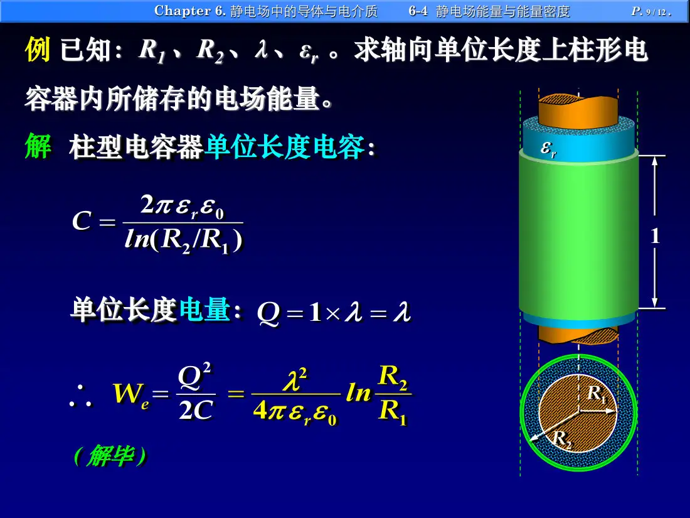

原文：

例 已知: $R_{1} 、 R_{2} 、 \lambda 、 \varepsilon_{r}$ 。求轴向单位长度上柱形电容器内所储存的电场能量。

解 柱型电容器单位长度电容:

$$
C = \frac {2 \pi \varepsilon_ {r} \varepsilon_ {0}}{\ln (R _ {2} / R _ {1})}
$$

单位长度电量: $Q = 1 \times \lambda = \lambda$

$$
\therefore W _ {e} = \frac {Q ^ {2}}{2 C} = \frac {\lambda^ {2}}{4 \pi \varepsilon_ {r} \varepsilon_ {0}} \ln \frac {R _ {2}}{R _ {1}}
$$

(解毕)

Chapter 6. 静电场中的导体与电介质

6-4 静电场能量与能量密度

P. 9/12.

### 提示: 外力功=电容器能量的增量!

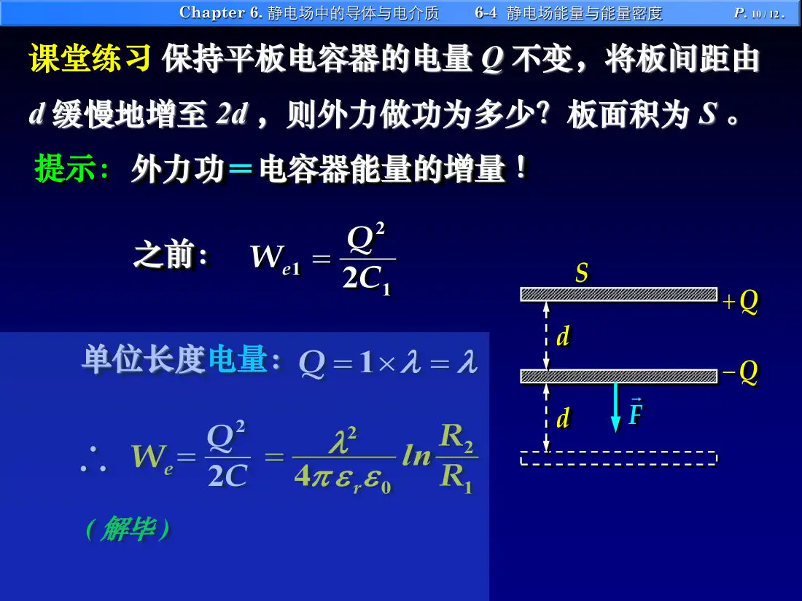

原文：

课堂练习 保持平板电容器的电量 Q 不变，将板间距由 d 缓慢地增至 2d，则外力做功为多少？板面积为 S。

提示: 外力功=电容器能量的增量!

之前： $W_{e1}=\frac{Q^{2}}{2C_{1}}$

单位长度电量: $Q = 1 \times \lambda = \lambda$

$$
\therefore W _ {e} = \frac {Q ^ {2}}{2 C} = \frac {\lambda^ {2}}{4 \pi \varepsilon_ {r} \varepsilon_ {0}} \ln \frac {R _ {2}}{R _ {1}}
$$

(解毕)

P. 10 / 12.

Chapter 6. 静电场中的导体与电介质

6-4 静电场能量与能量密度

### 提示：外力功 $=$ 电容器能量的增量！

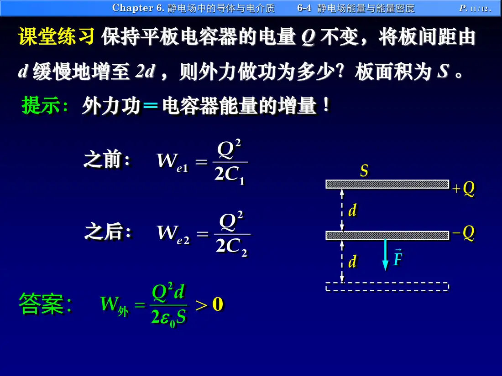

原文：

课堂练习 保持平板电容器的电量 Q 不变，将板间距由 d 缓慢地增至 2d，则外力做功为多少？板面积为 S。

提示：外力功 $=$ 电容器能量的增量！

之前: $W_{e1} = \frac{Q^2}{2C_1}$

之后: $W_{e2} = \frac{Q^2}{2C_2}$

答案: $W_{\text{外}} = \frac{Q^2 d}{2\varepsilon_0 S} > 0$

P. 11/12.

Chapter 6. 静电场中的导体与电介质

6-4 静电场能量与能量密度

### 归纳

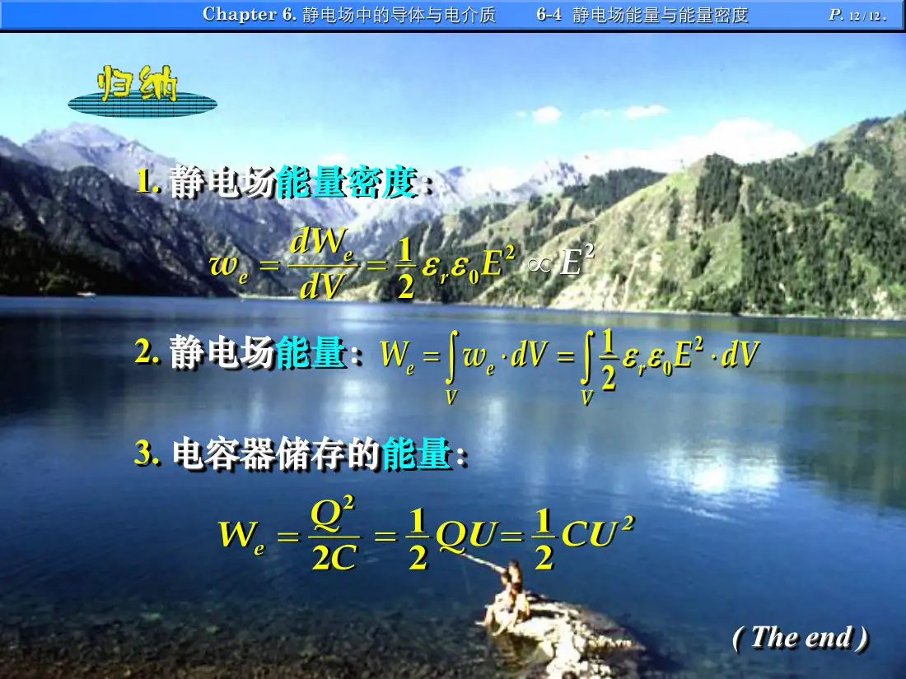

原文：

归纳

1. 静电场能量密度:

$$
w _ {e} = \frac {d W _ {e}}{d V} = \frac {1}{2} \varepsilon_ {r} \varepsilon_ {0} E ^ {2} \propto E ^ {2}
$$

2. 静电场能量: $W_{e} = \int_ {V} w_{e} \cdot d V = \int_ {V} \frac {1}{2} \varepsilon_{r} \varepsilon_{0} E^{2} \cdot d V$

3. 电容器储存的能量：

$$
W _ {e} = \frac {Q ^ {2}}{2 C} = \frac {1}{2} Q U = \frac {1}{2} C U ^ {2}
$$

Chapter 6. 静电场中的导体与电介质 6-4 静电场能量与能量密度

P. 12 / 12.

(The end)
