# 《大学物理》第6章 静电场中的导体与电介质 §6.1 静电场中的导体（课件）

原件的每一页，下面附识别出的文字。

### § 6.1 静电场中的导体

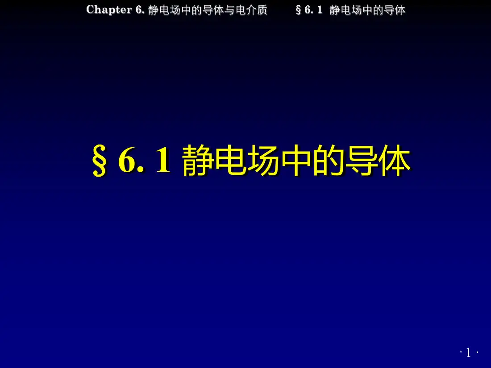

原文：

§ 6.1 静电场中的导体

Chapter 6. 静电场中的导体与电介质 § 6.1 静电场中的导体

1

### 一、导体的静电平衡

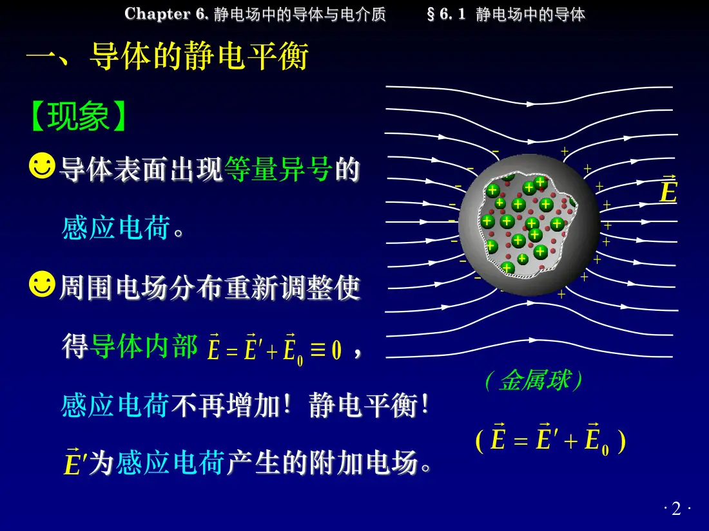

原文：

一、导体的静电平衡

【现象】

导体表面出现等量异号的感应电荷。

周围电场分布重新调整使

得导体内部 $\vec{E} = \vec{E}' + \vec{E}_0\equiv 0$

感应电荷不再增加！静电平衡！

$\vec{E}^{\prime}$ 为感应电荷产生的附加电场。

金属球)

$$
(\vec {E} = \vec {E} ^ {\prime} + \vec {E} _ {0})
$$

Chapter 6. 静电场中的导体与电介质 § 6.1 静电场中的导体

2

### 导体上的感应电荷代数和=0

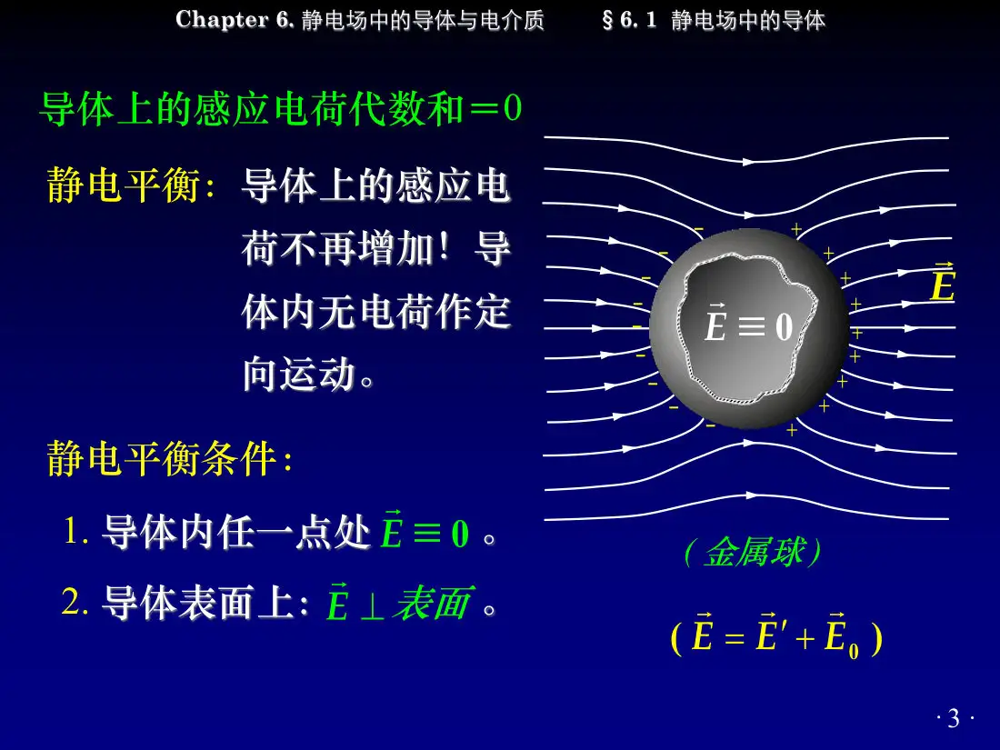

原文：

导体上的感应电荷代数和=0

静电平衡：导体上的感应电荷不再增加！导体内无电荷作定向运动。

静电平衡条件:

1. 导体内任一点处 $\vec{E} \equiv 0$ 。

2. 导体表面上: $\vec{E} \perp$ 表面。

金属球)

$(\vec{E} = \vec{E}' + \vec{E}_0)$

Chapter 6. 静电场中的导体与电介质 § 6.1 静电场中的导体

3

### 二、静电平衡特点

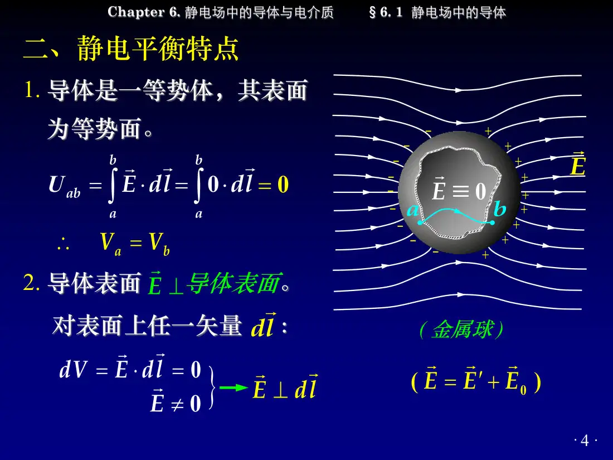

原文：

二、静电平衡特点

1. 导体是一等势体，其表面为等势面。

$$
\begin{array}{l} U _ {a b} = \int_ {a} ^ {b} \vec {E} \cdot d \vec {l} = \int_ {a} ^ {b} 0 \cdot d \vec {l} = 0 \\ \therefore V _ {a} = V _ {b} \end{array}
$$

2. 导体表面 $\vec{E} \perp$ 导体表面。
对表面上任一矢量 $d\vec{l}$ :

$$
d V = \vec {E} \cdot d \vec {l} = 0   \left.\begin{array}{c}\vec {E} \perp d \vec {l}\\\vec {E} \neq 0\end{array}\right\}\rightarrow \vec {E} \perp d \vec {l}
$$

(金属球)

$(\vec{E} = \vec{E}' + \vec{E}_0)$

Chapter 6. 静电场中的导体与电介质 § 6.1 静电场中的导体

4

### 3. 导体内无净余电荷，净余电荷只能分布在导体的外表面。

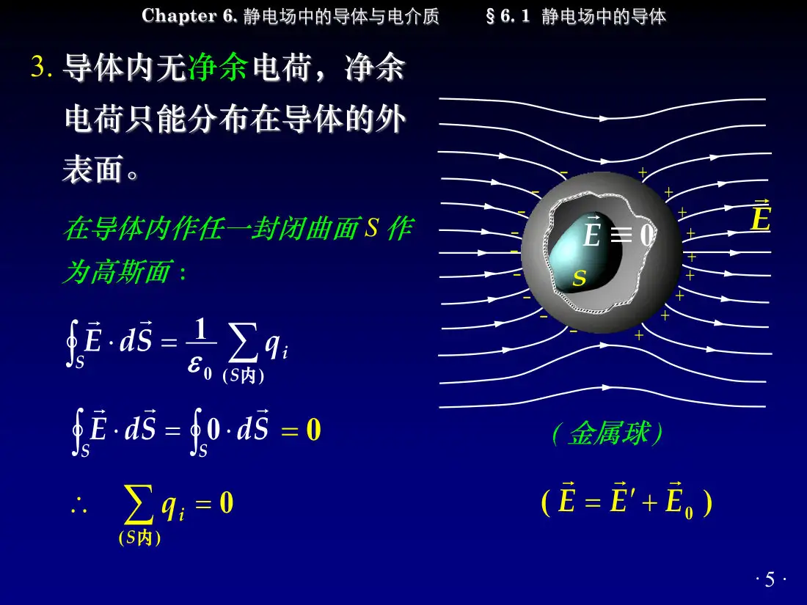

原文：

3. 导体内无净余电荷，净余电荷只能分布在导体的外表面。

在导体内作任一封闭曲面 S 作为高斯面：

$$
\oint_ {S} \vec {E} \cdot d \vec {S} = \frac {1}{\varepsilon_ {0}} \sum_ {(S \text {内})} q _ {i}
$$

$$
\oint_ {S} \vec {E} \cdot d \vec {S} = \oint_ {S} \mathbf {0} \cdot d \vec {S} = \mathbf {0}
$$

$$
\therefore \quad \sum_ {(S \text {内})} q _ {i} = 0
$$

(金属球)

$$
(\vec {E} = \vec {E} ^ {\prime} + \vec {E} _ {0})
$$

Chapter 6. 静电场中的导体与电介质 § 6.1 静电场中的导体

5

### Chapter 6. 静电场中的导体与电介质 § 6.1 静电场中的导体

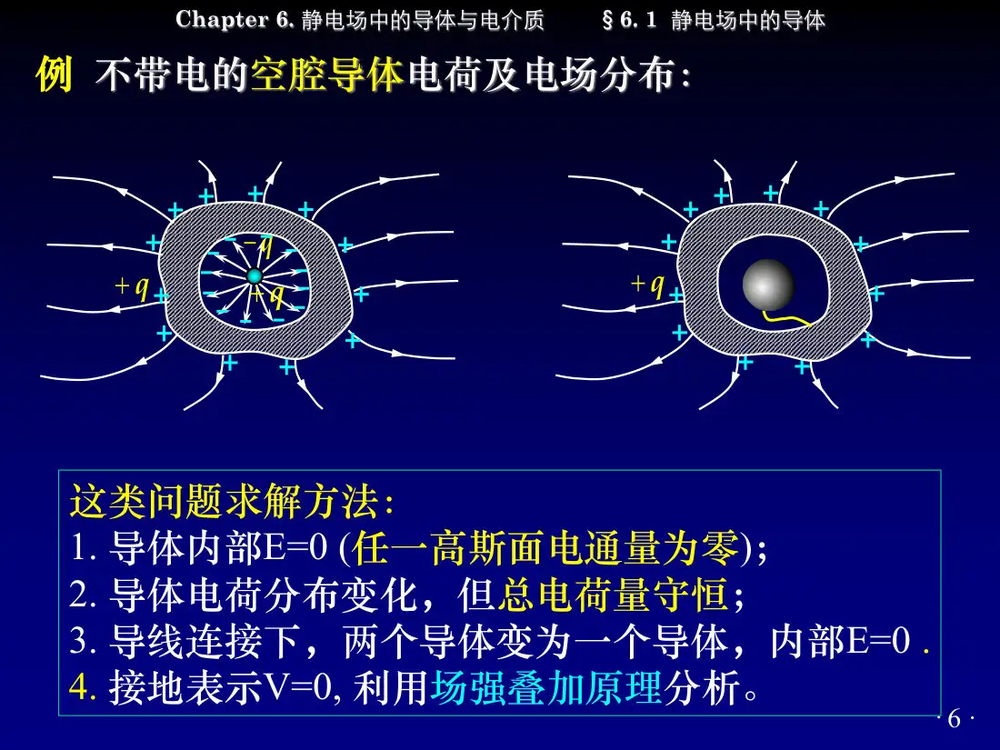

原文：

Chapter 6. 静电场中的导体与电介质 § 6.1 静电场中的导体

例 不带电的空腔导体电荷及电场分布:

这类问题求解方法:

1. 导体内部E=0 (任一高斯面电通量为零);

2. 导体电荷分布变化，但总电荷量守恒；

3. 导线连接下，两个导体变为一个导体，内部 $\mathrm{E} = 0$

4. 接地表示V=0, 利用场强叠加原理分析。

6

### Chapter 6. 静电场中的导体与电介质 § 6.1 静电场中的导体

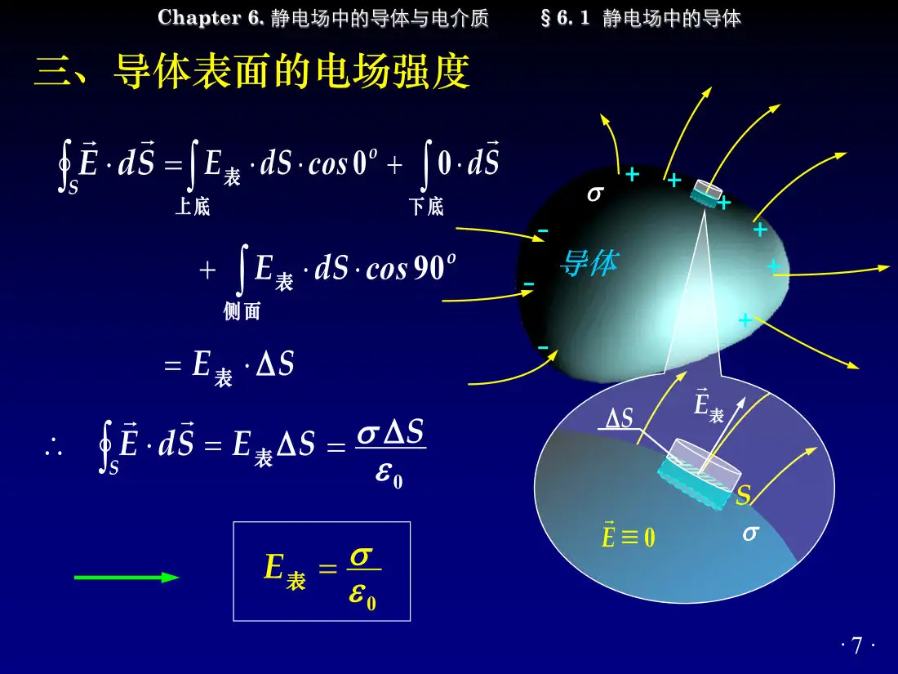

原文：

Chapter 6. 静电场中的导体与电介质 § 6.1 静电场中的导体

三、导体表面的电场强度

$$
\begin{array}{r l} \oint_ {S} \vec {E} \cdot d \vec {S} & = \int_ {\text {上底}} E _ {\text {表}} \cdot d S \cdot \cos 0 ^ {o} + \int_ {\text {下底}} 0 \cdot d \vec {S} \\ & + \int_ {\text {侧面}} E _ {\text {表}} \cdot d S \cdot \cos 9 0 ^ {o} \\ & = E _ {\text {表}} \cdot \Delta S \end{array}
$$

∴ $\oint_{S}\vec{E}\cdot d\vec{S}=E_{表}\Delta S=\frac{\sigma\Delta S}{\varepsilon_{0}}$

$$
E _ {\mathrm{表}} = \frac {\sigma}{\varepsilon_ {0}}
$$

7

### 注意

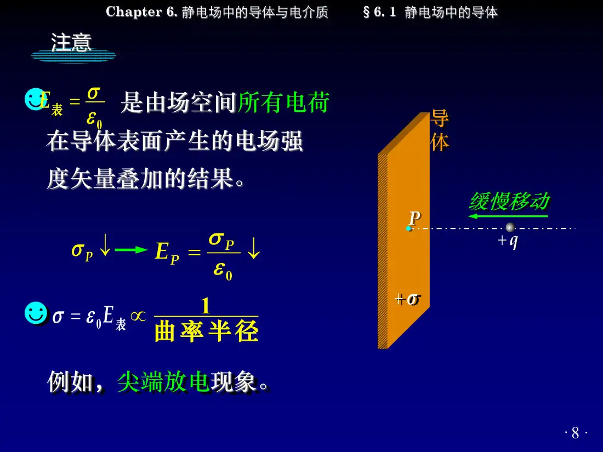

原文：

注意

$E_{表}=\frac{\sigma}{\varepsilon_{0}}$ 是由场空间所有电荷在导体表面产生的电场强度矢量叠加的结果。

$$
\sigma_ {P} \downarrow \longrightarrow E _ {P} = \frac {\sigma_ {P}}{\varepsilon_ {0}} \downarrow
$$

$$
\text {   } \sigma = \varepsilon_ {0} E _ {\text { 表 }} \propto \frac {1}{\text {   曲率半径   }}
$$

例如，尖端放电现象。

缓慢移动

+σ

Chapter 6. 静电场中的导体与电介质

§ 6.1 静电场中的导体

8

### 四、静电屏蔽

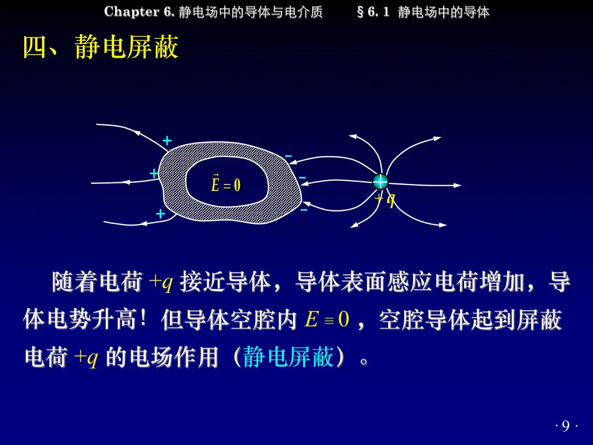

原文：

四、静电屏蔽

随着电荷 +q 接近导体，导体表面感应电荷增加，导体电势升高！但导体空腔内 $E \equiv 0$ ，空腔导体起到屏蔽电荷 +q 的电场作用（静电屏蔽）。

Chapter 6. 静电场中的导体与电介质 § 6.1 静电场中的导体

9

### 无论 +q 处在腔内何位置，导体空腔外的电荷分布及电场分布皆不变！

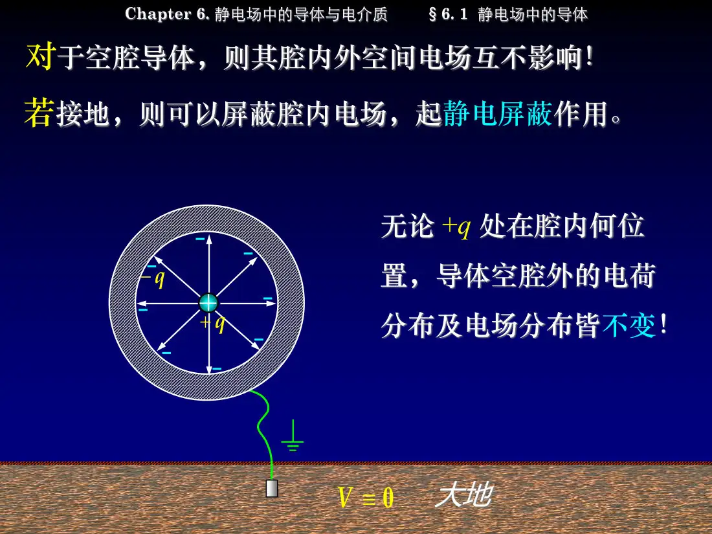

原文：

Chapter 6. 静电场中的导体与电介质 § 6.1 静电场中的导体对于空腔导体，则其腔内外空间电场互不影响！若接地，则可以屏蔽腔内电场，起静电屏蔽作用。

无论 +q 处在腔内何位置，导体空腔外的电荷分布及电场分布皆不变！

### Chapter 6. 静电场中的导体与电介质 § 6.1 静电场中的导体

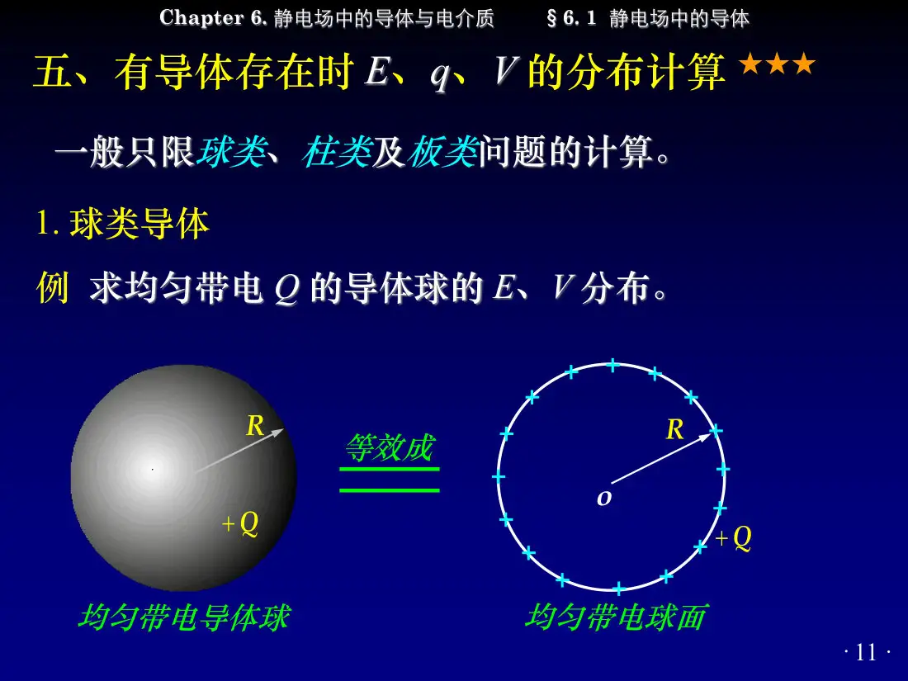

原文：

Chapter 6. 静电场中的导体与电介质 § 6.1 静电场中的导体

五、有导体存在时 E、q、V 的分布计算 ★★★

一般只限球类、柱类及板类问题的计算。

1. 球类导体

例 求均匀带电 Q 的导体球的 E、V 分布。

等效成

均匀带电导体球

11

### Chapter 6. 静电场中的导体与电介质 § 6.1 静电场中的导体

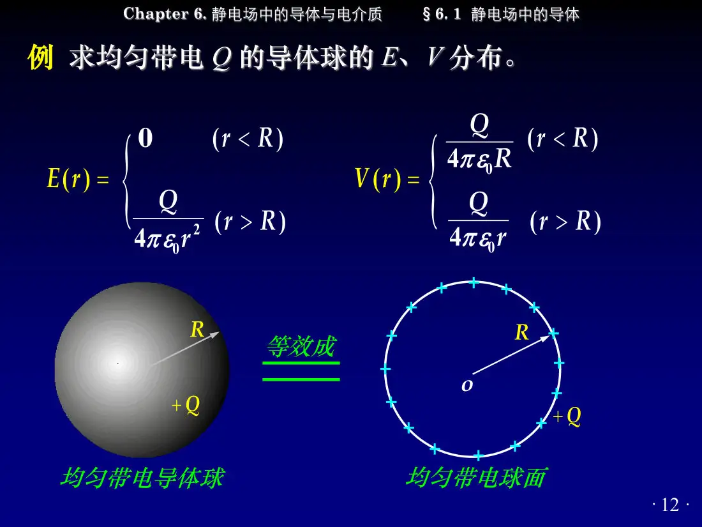

原文：

Chapter 6. 静电场中的导体与电介质 § 6.1 静电场中的导体

例 求均匀带电 Q 的导体球的 E、V 分布。

$$
E (r) = \left\{ \begin{array}{l l} 0 & (r <   R) \\ \frac {Q}{4 \pi \varepsilon_ {0} r ^ {2}} & (r > R) \end{array} \right.
$$

等效成

$$
V (r) = \left\{ \begin{array}{l l} \frac {Q}{4 \pi \varepsilon_ {0} R} & (r <   R) \\ \frac {Q}{4 \pi \varepsilon_ {0} r} & (r > R) \end{array} \right.
$$

均匀带电球面

均匀带电导体球

12

### Chapter 6. 静电场中的导体与电介质 § 6.1 静电场中的导体

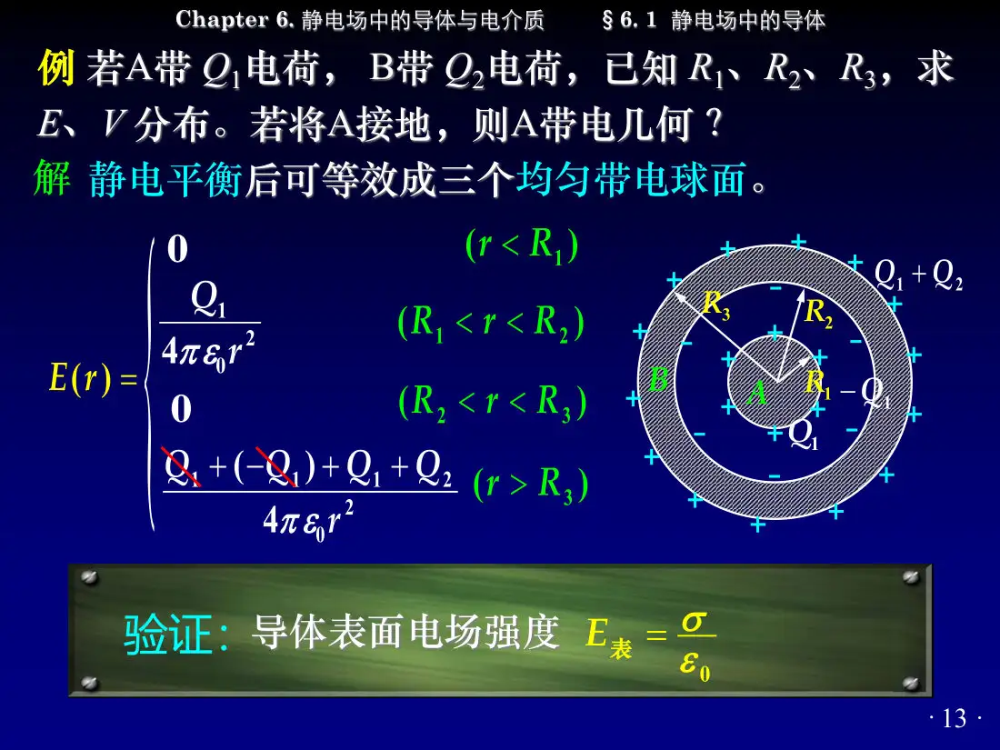

原文：

Chapter 6. 静电场中的导体与电介质 § 6.1 静电场中的导体

例 若A带 $Q_{1}$ 电荷，B带 $Q_{2}$ 电荷，已知 $R_{1} 、 R_{2} 、 R_{3}$ ，求 E、V 分布。若将A接地，则A带电几何？解 静电平衡后可等效成三个均匀带电球面。

$$
E (r) = \left\{ \begin{array}{l l} 0 & (r <   R _ {1}) \\ \frac {Q _ {1}}{4 \pi \varepsilon_ {0} r ^ {2}} & (R _ {1} <   r <   R _ {2}) \\ 0 & (R _ {2} <   r <   R _ {3}) \\ \frac {Q _ {1} + (- Q _ {1}) + Q _ {1} + Q _ {2}}{4 \pi \varepsilon_ {0} r ^ {2}} & (r > R _ {3}) \end{array} \right.
$$

验证: 导体表面电场强度 $E_{\text {表}} = \frac{\sigma}{\varepsilon_ {0}}$

13

### Chapter 6. 静电场中的导体与电介质

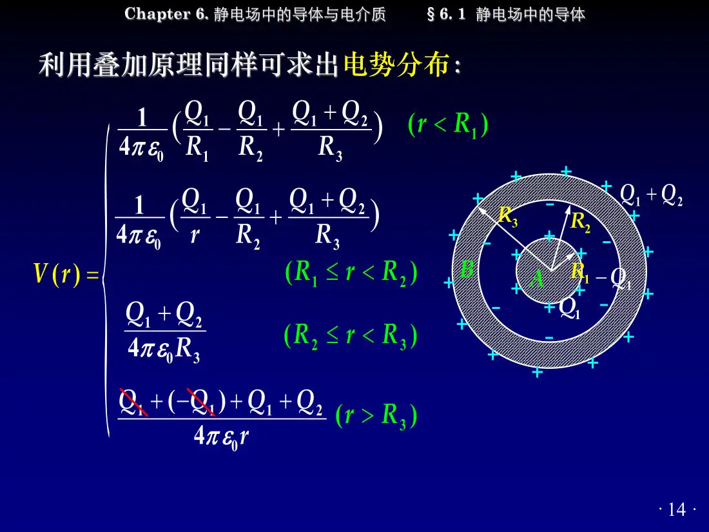

原文：

Chapter 6. 静电场中的导体与电介质

§ 6.1 静电场中的导体

利用叠加原理同样可求出电势分布：

$$
V (r) = \left\{ \begin{array}{l l} \frac {1}{4 \pi \varepsilon_ {0}} \left(\frac {Q _ {1}}{R _ {1}} - \frac {Q _ {1}}{R _ {2}} + \frac {Q _ {1} + Q _ {2}}{R _ {3}}\right) & (r <   R _ {1}) \\ \frac {1}{4 \pi \varepsilon_ {0}} \left(\frac {Q _ {1}}{r} - \frac {Q _ {1}}{R _ {2}} + \frac {Q _ {1} + Q _ {2}}{R _ {3}}\right) & (R _ {1} \leq r <   R _ {2}) \\ \frac {Q _ {1} + Q _ {2}}{4 \pi \varepsilon_ {0} R _ {3}} & (R _ {2} \leq r <   R _ {3}) \\ \frac {Q _ {1} + (- Q _ {1}) + Q _ {1} + Q _ {2}}{4 \pi \varepsilon_ {0} r} & (r > R _ {3}) \end{array} \right.
$$

14

### Chapter 6. 静电场中的导体与电介质 § 6.1 静电场中的导体

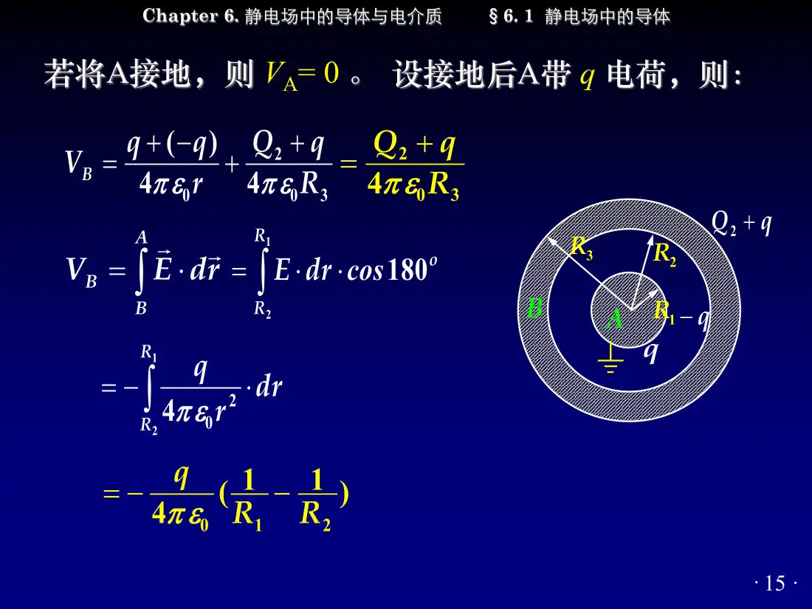

原文：

Chapter 6. 静电场中的导体与电介质 § 6.1 静电场中的导体

若将A接地，则 $V_{\mathrm{A}} = 0$ 。设接地后A带 $q$ 电荷，则：

$$
V _ {B} = \frac {q + (- q)}{4 \pi \varepsilon_ {0} r} + \frac {Q _ {2} + q}{4 \pi \varepsilon_ {0} R _ {3}} = \frac {Q _ {2} + q}{4 \pi \varepsilon_ {0} R _ {3}}
$$

$$
\begin{array}{l} V _ {B} = \int_ {B} ^ {A} \vec {E} \cdot d \vec {r} = \int_ {R _ {2}} ^ {R _ {1}} E \cdot d r \cdot c o s 1 8 0 ^ {\circ} \\ = - \int_ {R _ {2}} ^ {R _ {1}} \frac {q}{4 \pi \varepsilon_ {0} r ^ {2}} \cdot d r \\ = - \frac {q}{4 \pi \varepsilon_ {0}} (\frac {1}{R _ {1}} - \frac {1}{R _ {2}}) \end{array}
$$

15

### Chapter 6. 静电场中的导体与电介质

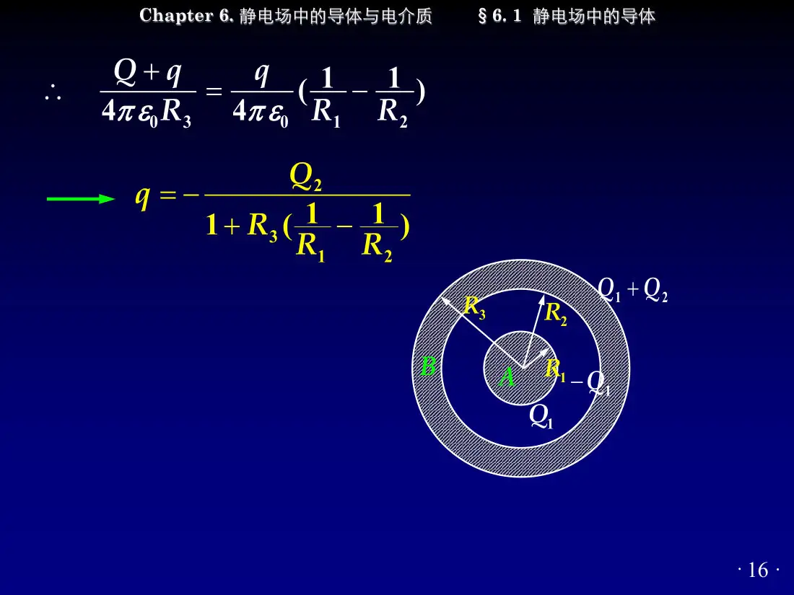

原文：

Chapter 6. 静电场中的导体与电介质

§ 6.1 静电场中的导体

$$
\therefore \quad \frac {Q + q}{4 \pi \varepsilon_ {0} R _ {3}} = \frac {q}{4 \pi \varepsilon_ {0}} (\frac {1}{R _ {1}} - \frac {1}{R _ {2}})
$$

$$
q = - \frac {Q _ {2}}{1 + R _ {3} (\frac {1}{R _ {1}} - \frac {1}{R _ {2}})}
$$

16

### 2. 板类导体

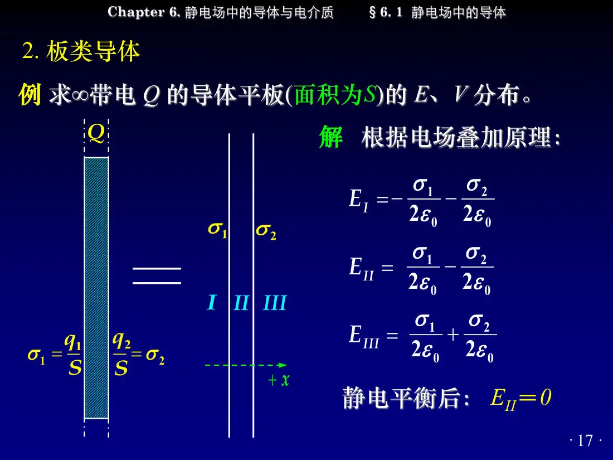

原文：

2. 板类导体

例 求∞带电 Q 的导体平板(面积为 S)的 E、V 分布。

$$
\sigma_ {1} = \frac {q _ {1}}{S} \quad \frac {q _ {2}}{S} = \sigma_ {2} \quad \begin{array}{c c c} & \sigma_ {1} & \sigma_ {2} \\ & I & I I & I I I \\ & & + x \end{array}
$$

解 根据电场叠加原理:

$$
E _ {I} = - \frac {\sigma_ {1}}{2 \varepsilon_ {0}} - \frac {\sigma_ {2}}{2 \varepsilon_ {0}}
$$

$$
E _ {I I} = \frac {\sigma_ {1}}{2 \varepsilon_ {0}} - \frac {\sigma_ {2}}{2 \varepsilon_ {0}}
$$

$$
E _ {I I I} = \frac {\sigma_ {1}}{2 \varepsilon_ {0}} + \frac {\sigma_ {2}}{2 \varepsilon_ {0}}
$$

静电平衡后： $E_{II}=0$

Chapter 6. 静电场中的导体与电介质

§ 6.1 静电场中的导体

17

### Chapter 6. 静电场中的导体与电介质 § 6.1 静电场中的导体

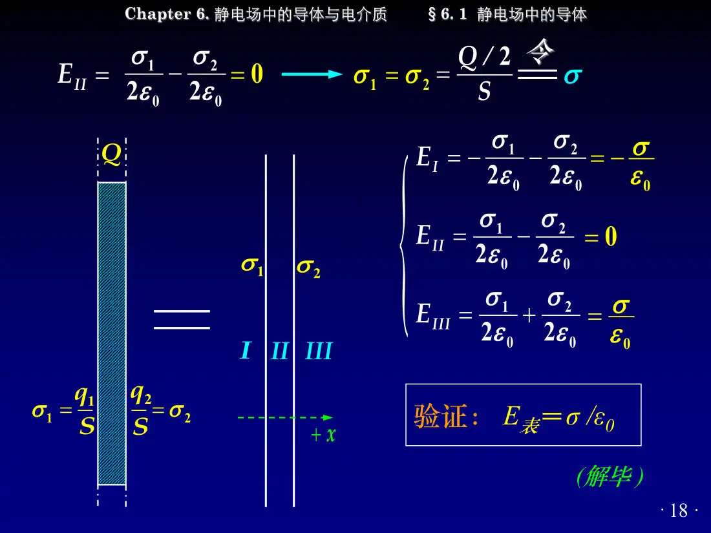

原文：

Chapter 6. 静电场中的导体与电介质 § 6.1 静电场中的导体

$$
E _ {I I} = \frac {\sigma_ {1}}{2 \varepsilon_ {0}} - \frac {\sigma_ {2}}{2 \varepsilon_ {0}} = 0 \longrightarrow \sigma_ {1} = \sigma_ {2} = \frac {Q / 2}{S} \stackrel {\text {令}} {=} \sigma
$$

$$
\begin{array}{c c} \text {Q} & = \\ \sigma_ {1} = \frac {q _ {1}}{S} & \frac {q _ {2}}{S} = \sigma_ {2} \end{array} \quad \begin{array}{c c c} \sigma_ {1} & \sigma_ {2} \\ I & I I & I I I \\ \hline + x \end{array}
$$

$$
E _ {I} = - \frac {\sigma_ {1}}{2 \varepsilon_ {0}} - \frac {\sigma_ {2}}{2 \varepsilon_ {0}} = - \frac {\sigma}{\varepsilon_ {0}}
$$

$$
E _ {I I} = \frac {\sigma_ {1}}{2 \varepsilon_ {0}} - \frac {\sigma_ {2}}{2 \varepsilon_ {0}} = 0
$$

$$
E _ {I I I} = \frac {\sigma_ {1}}{2 \varepsilon_ {0}} + \frac {\sigma_ {2}}{2 \varepsilon_ {0}} = \frac {\sigma}{\varepsilon_ {0}}
$$

验证: $E_{\text {表}} = \sigma / \varepsilon_0$

(解毕)

18

### Chapter 6. 静电场中的导体与电介质 § 6.1 静电场中的导体

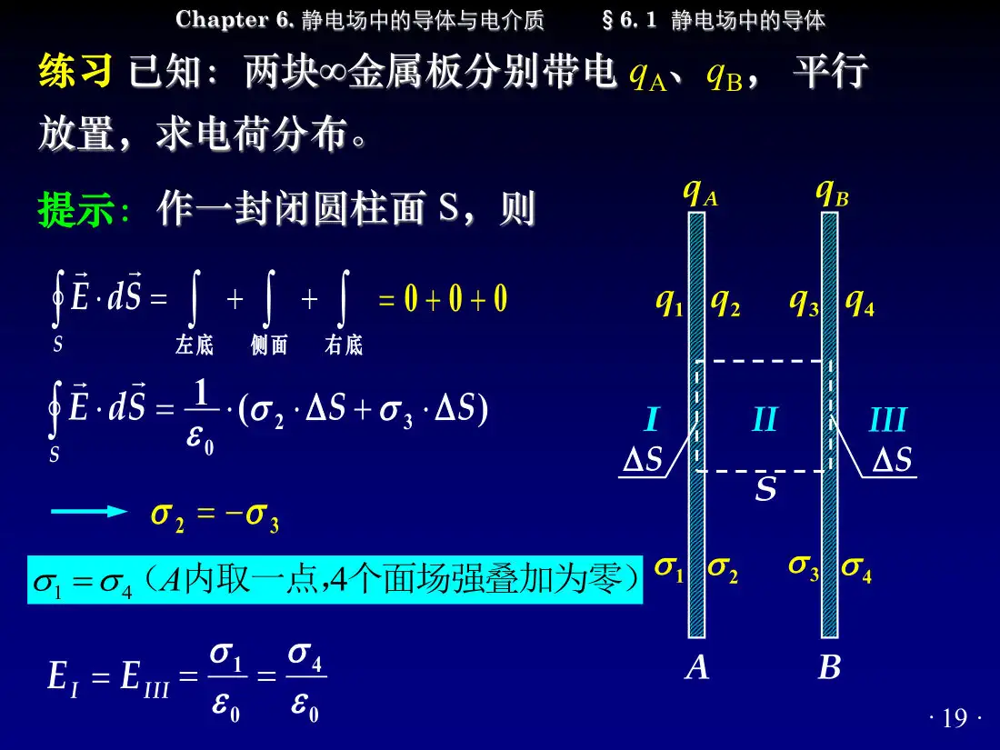

原文：

Chapter 6. 静电场中的导体与电介质 § 6.1 静电场中的导体

练习 已知：两块∞金属板分别带电 $q_{\mathrm{A}}$ 、 $q_{\mathrm{B}}$ ，平行放置，求电荷分布。

提示：作一封闭圆柱面 S，则

$$
\oint_ {S} \vec {E} \cdot d \vec {S} = \int_ {\text {左底}} + \int_ {\text {侧面}} + \int_ {\text {右底}} = 0 + 0 + 0
$$

$$
\oint_ {S} \vec {E} \cdot d \vec {S} = \frac {1}{\varepsilon_ {0}} \cdot (\sigma_ {2} \cdot \Delta S + \sigma_ {3} \cdot \Delta S)
$$

$$
\sigma_ {2} = - \sigma_ {3}
$$

$\sigma_{1} = \sigma_{4}$ （ $A$ 内取一点，4个面场强叠加为零）

$$
E _ {I} = E _ {I I I} = \frac {\sigma_ {1}}{\varepsilon_ {0}} = \frac {\sigma_ {4}}{\varepsilon_ {0}}
$$

19

### Chapter 6. 静电场中的导体与电介质 § 6.1 静电场中的导体

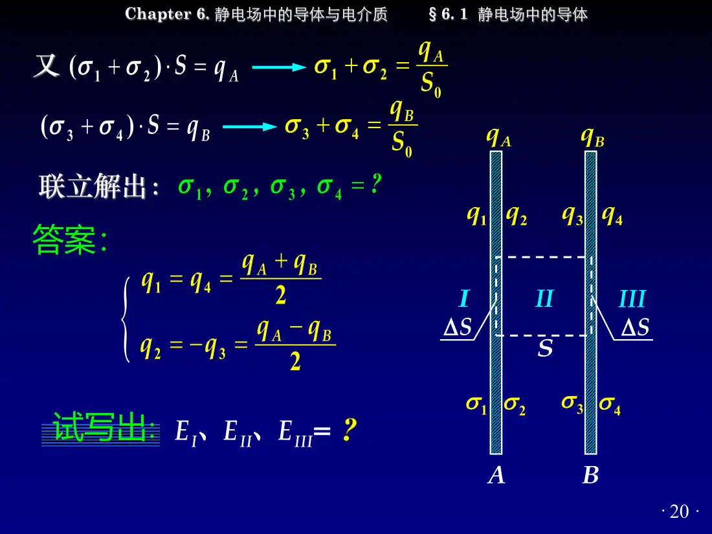

原文：

Chapter 6. 静电场中的导体与电介质 § 6.1 静电场中的导体

$$
\text {又} \left(\sigma_ {1} + \sigma_ {2}\right) \cdot S = q _ {A} \longrightarrow \sigma_ {1} + \sigma_ {2} = \frac {q _ {A}}{S _ {0}}
$$

$$
(\sigma_ {3} + \sigma_ {4}) \cdot S = q _ {B} \longrightarrow \sigma_ {3} + \sigma_ {4} = \frac {q _ {B}}{S _ {0}}
$$

联立解出： $\sigma_{1}, \sigma_{2}, \sigma_{3}, \sigma_{4} = ?$

答案:

$$
\left\{ \begin{array}{l} q _ {1} = q _ {4} = \frac {q _ {A} + q _ {B}}{2} \\ q _ {2} = - q _ {3} = \frac {q _ {A} - q _ {B}}{2} \end{array} \right.
$$

试写出: $E_{I}$ 、 $E_{II}$ 、 $E_{III}=$ ?

20

### $$

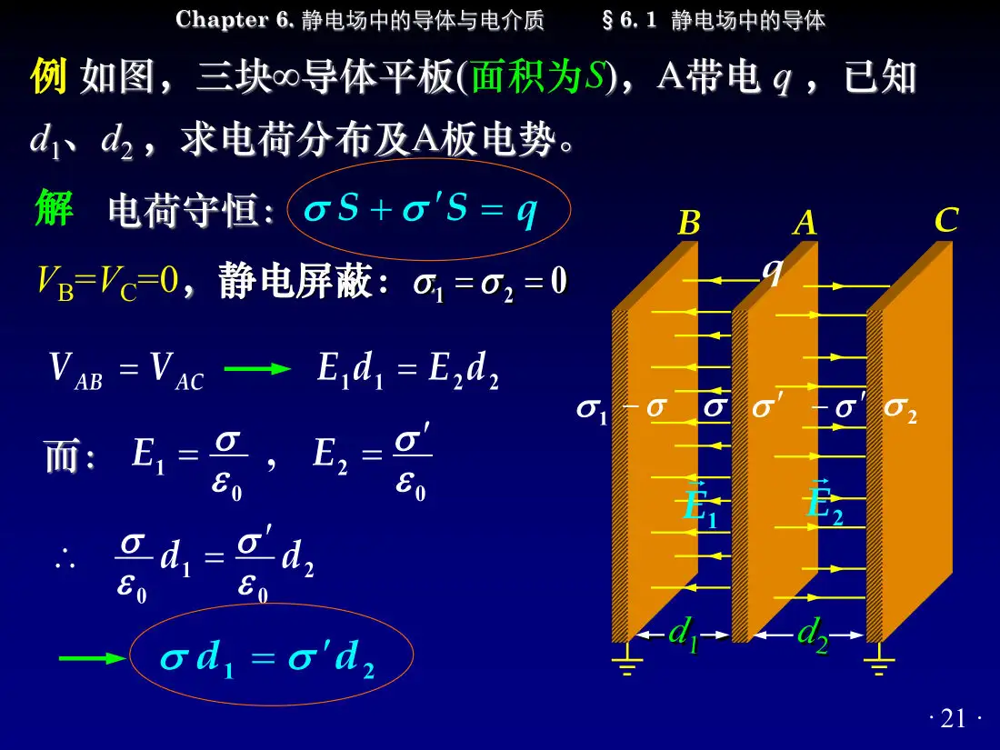

原文：

Chapter 6. 静电场中的导体与电介质 § 6.1 静电场中的导体例如图，三块∞导体平板(面积为S)，A带电q，已知 $d_{1}$ 、 $d_{2}$ ，求电荷分布及A板电势。

$$
\sigma S + \sigma^ {\prime} S = q
$$

$$
V _ {\mathrm{B}} = V _ {\mathrm{C}} = 0
$$

$$
\sigma_ {1} = \sigma_ {2} = 0
$$

$$
V _ {A B} = V _ {A C} \longrightarrow E _ {1} d _ {1} = E _ {2} d _ {2}
$$

而： $E_{1}=\frac{\sigma}{\varepsilon_{0}}$ ， $E_{2}=\frac{\sigma^{\prime}}{\varepsilon_{0}}$

$$
\therefore \quad \frac {\sigma}{\varepsilon_ {0}} d _ {1} = \frac {\sigma^ {\prime}}{\varepsilon_ {0}} d _ {2}
$$

$$
\sigma d _ {1} = \sigma^ {\prime} d _ {2}
$$

21

### Chapter 6. 静电场中的导体与电介质 § 6.1 静电场中的导体

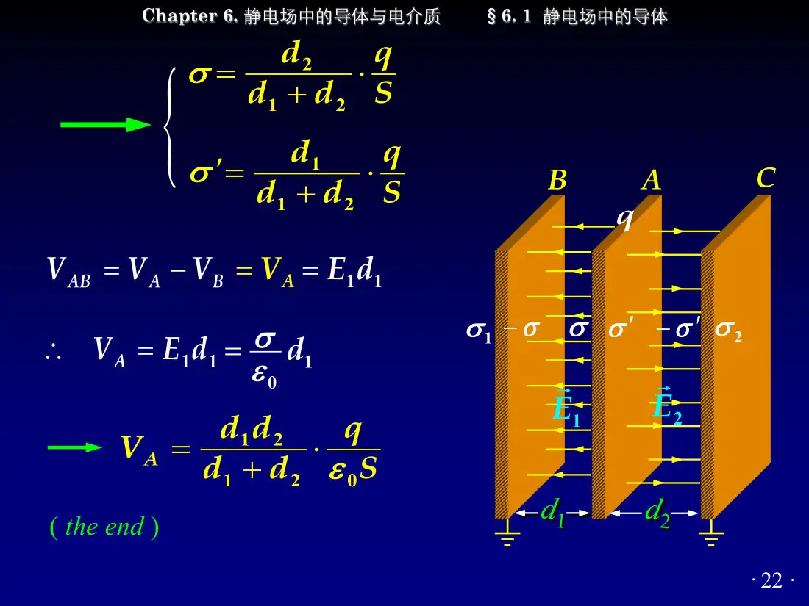

原文：

Chapter 6. 静电场中的导体与电介质 § 6.1 静电场中的导体

$$
\sigma = \frac {d _ {2}}{d _ {1} + d _ {2}} \cdot \frac {q}{S}
$$

$$
\sigma^ {\prime} = \frac {d _ {1}}{d _ {1} + d _ {2}} \cdot \frac {q}{S}
$$

$$
V _ {A B} = V _ {A} - V _ {B} = V _ {A} = E _ {1} d _ {1}
$$

$$
\therefore V _ {A} = E _ {1} d _ {1} = \frac {\sigma}{\varepsilon_ {0}} d _ {1}
$$

$$
V _ {A} = \frac {d _ {1} d _ {2}}{d _ {1} + d _ {2}} \cdot \frac {q}{\varepsilon_ {0} S}
$$

( the end )

22

### 静电场导体问题求解方法:

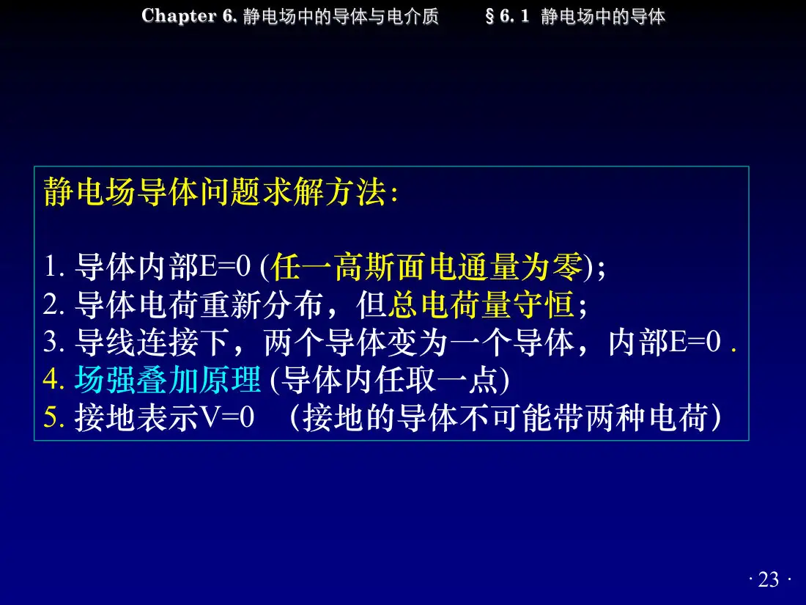

原文：

静电场导体问题求解方法:

1. 导体内部E=0 (任一高斯面电通量为零);

2. 导体电荷重新分布，但总电荷量守恒；

3. 导线连接下，两个导体变为一个导体，内部 $\mathrm{E} = 0$

4. 场强叠加原理 (导体内任取一点)

5. 接地表示V=0 （接地的导体不可能带两种电荷）

Chapter 6. 静电场中的导体与电介质 § 6.1 静电场中的导体

23

### 3. 柱类导体（自学）

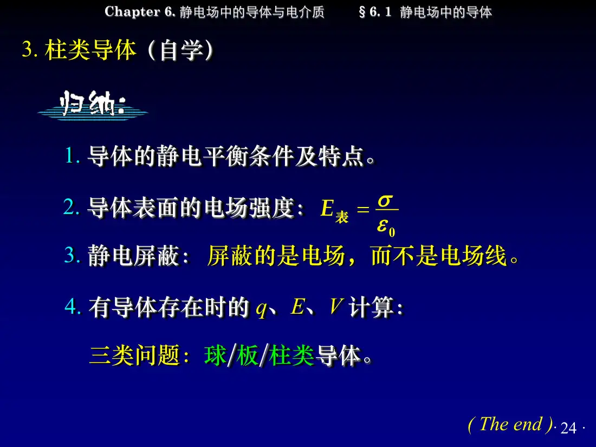

原文：

3. 柱类导体（自学）

归纳：

1. 导体的静电平衡条件及特点。

2. 导体表面的电场强度: $E_{\text {表}} = \frac{\sigma}{\varepsilon_0}$

3. 静电屏蔽：屏蔽的是电场，而不是电场线。

4. 有导体存在时的 q、E、V 计算:

三类问题：球/板/柱类导体。

Chapter 6. 静电场中的导体与电介质 § 6.1 静电场中的导体

(The end)

24

### Chapter 6. 静电场中的导体与电介质 § 6.1 静电场中的导体

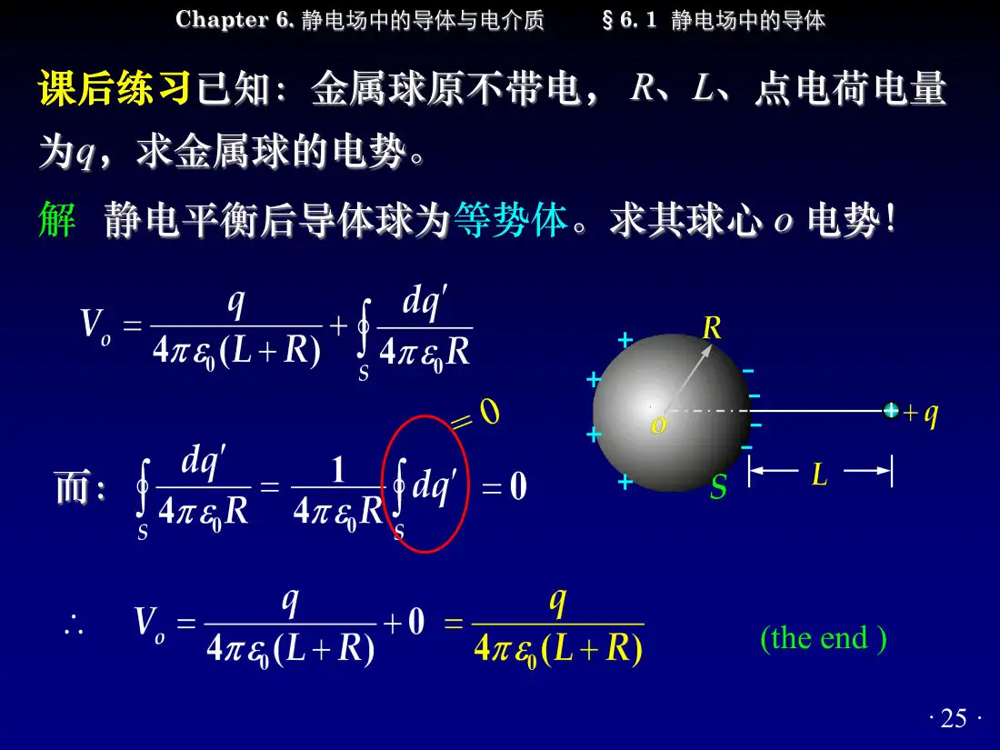

原文：

Chapter 6. 静电场中的导体与电介质 § 6.1 静电场中的导体

课后练习已知：金属球原不带电，R、L、点电荷电量为q，求金属球的电势。

解 静电平衡后导体球为等势体。求其球心 o 电势!

$$
V _ {o} = \frac {q}{4 \pi \varepsilon_ {0} (L + R)} + \oint_ {S} \frac {d q ^ {\prime}}{4 \pi \varepsilon_ {0} R}
$$

而： $\oint_{S}\frac{dq^{\prime}}{4\pi\varepsilon_{0}R}=\frac{1}{4\pi\varepsilon_{0}R}\oint_{S}dq^{\prime}=0$

$$
\therefore V _ {o} = \frac {q}{4 \pi \varepsilon_ {0} (L + R)} + 0 = \frac {q}{4 \pi \varepsilon_ {0} (L + R)}
$$

(the end)

25

### Chapter 6. 静电场中的导体与电介质 § 6.1 静电场中的导体

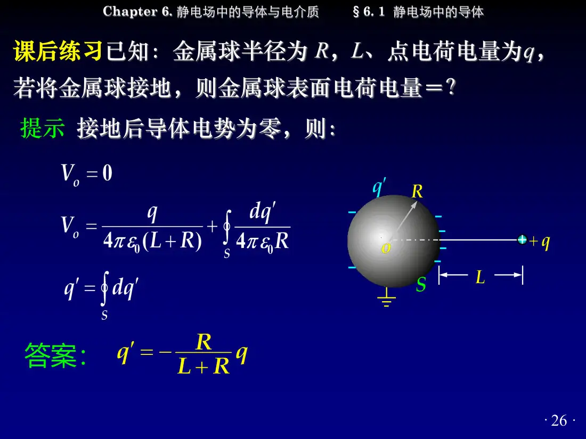

原文：

Chapter 6. 静电场中的导体与电介质 § 6.1 静电场中的导体

课后练习已知：金属球半径为 R，L、点电荷电量为 q，若将金属球接地，则金属球表面电荷电量 = ?

提示 接地后导体电势为零，则：

$$
V _ {o} = 0
$$

$$
V _ {o} = \frac {q}{4 \pi \varepsilon_ {0} (L + R)} + \oint_ {S} \frac {d q ^ {\prime}}{4 \pi \varepsilon_ {0} R}
$$

$$
q ^ {\prime} = \oint_ {S} d q ^ {\prime}
$$

$$
\begin{array}{c} q ^ {\prime} \quad R \\ o \quad + q \\ S \quad L \end{array}
$$

答案: $q' = -\frac{R}{L + R} q$

26
