# 《大学物理》第6章 静电场中的导体与电介质 §6.3 电容 电容器（课件）

原件的每一页，下面附识别出的文字。

### § 6.3 电容 电容器

原文：

§ 6.3 电容 电容器

Chapter 6. 静电场中的导体与电介质 § 6.3 电容 电容器

### Chapter 6. 静电场中的导体与电介质 § 6.3 电容 电容器

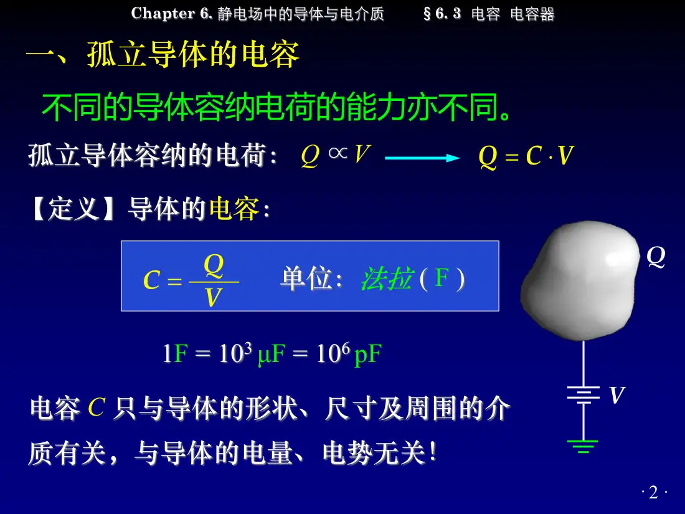

原文：

Chapter 6. 静电场中的导体与电介质 § 6.3 电容 电容器

一、孤立导体的电容

不同的导体容纳电荷的能力亦不同。
孤立导体容纳的电荷： $Q \propto V \longrightarrow Q = C \cdot V$

【定义】导体的电容：

$C=\frac{Q}{V}$ 单位：法拉(F)

$$
1 \mathrm{F} = 1 0 ^ {3} \mu \mathrm{F} = 1 0 ^ {6} \mathrm{pF}
$$

电容 C 只与导体的形状、尺寸及周围的介质有关，与导体的电量、电势无关！

2

### Chapter 6. 静电场中的导体与电介质 § 6.3 电容 电容器

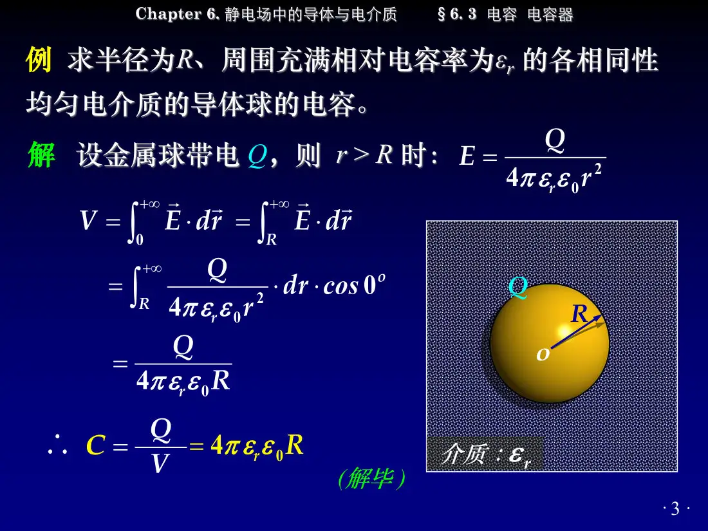

原文：

Chapter 6. 静电场中的导体与电介质 § 6.3 电容 电容器

例 求半径为R、周围充满相对电容率为 $\varepsilon_{r}$ 的各相同性均匀电介质的导体球的电容。

解 设金属球带电 Q，则 r > R 时： $E = \frac{Q}{4\pi\varepsilon_{r}\varepsilon_{0}r^{2}}$

$$
\begin{array}{r l} & V = \int_ {0} ^ {+ \infty} \vec {E} \cdot d \vec {r} = \int_ {R} ^ {+ \infty} \vec {E} \cdot d \vec {r} \\ & = \int_ {R} ^ {+ \infty} \frac {Q}{4 \pi \varepsilon_ {r} \varepsilon_ {0} r ^ {2}} \cdot d r \cdot c o s 0 ^ {o} \\ & = \frac {Q}{4 \pi \varepsilon_ {r} \varepsilon_ {0} R} \end{array}
$$

$$
\therefore C = \frac {Q}{V} = 4 \pi \varepsilon_ {r} \varepsilon_ {0} R
$$

(解毕)

3

### Chapter 6. 静电场中的导体与电介质 § 6.3 电容 电容器

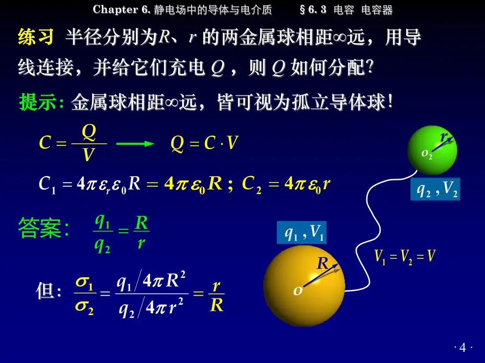

原文：

Chapter 6. 静电场中的导体与电介质 § 6.3 电容 电容器

练习 半径分别为R、r的两金属球相距∞远，用导线连接，并给它们充电Q，则Q如何分配？提示：金属球相距∞远，皆可视为孤立导体球！

$$
C = \frac {Q}{V} \longrightarrow Q = C \cdot V
$$

$$
C _ {1} = 4 \pi \varepsilon_ {r} \varepsilon_ {0} R = 4 \pi \varepsilon_ {0} R; C _ {2} = 4 \pi \varepsilon_ {0} r
$$

$$
q _ {2}, V _ {2}
$$

答案: $\frac{q_{1}}{q_{2}} = \frac{R}{r}$

$$
q _ {1}, V _ {1}
$$

$$
V _ {1} = V _ {2} = V
$$

$$
\text {但:} \frac {\sigma_ {1}}{\sigma_ {2}} = \frac {q _ {1} / 4 \pi R ^ {2}}{q _ {2} / 4 \pi r ^ {2}} = \frac {r}{R}
$$

4

### Chapter 6. 静电场中的导体与电介质 § 6.3 电容 电容器

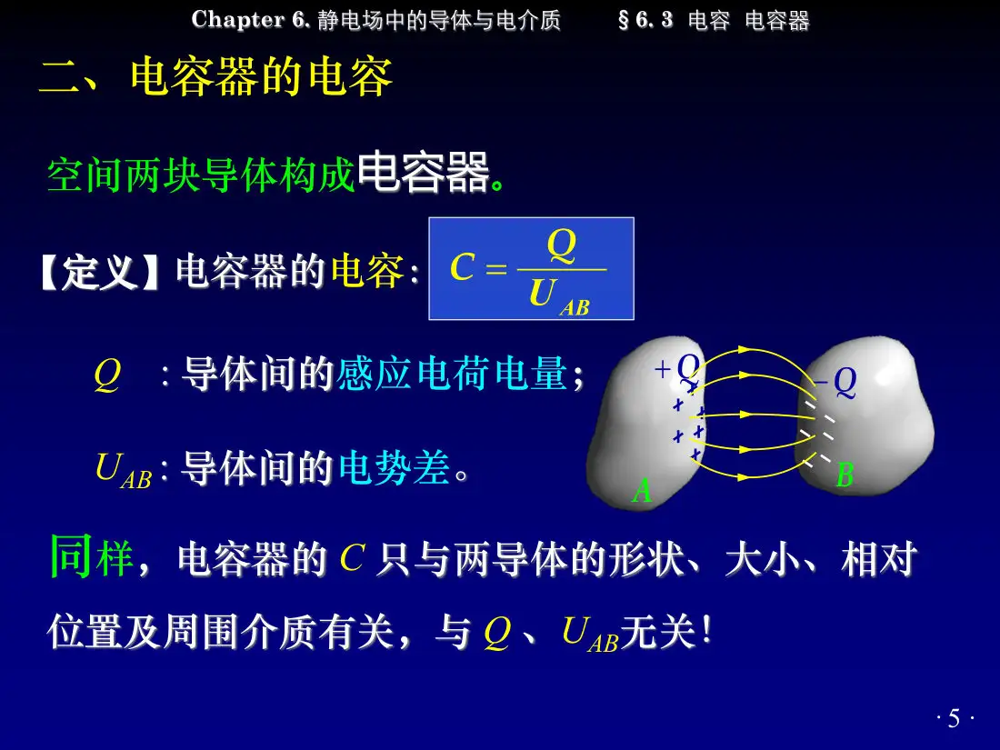

原文：

Chapter 6. 静电场中的导体与电介质 § 6.3 电容 电容器

二、电容器的电容

空间两块导体构成电容器。

【定义】电容器的电容: $C = \frac{Q}{U_{AB}}$

Q : 导体间的感应电荷电量;

$U_{AB}$ : 导体间的电势差。

同样，电容器的 C 只与两导体的形状、大小、相对位置及周围介质有关，与 Q 、 $U_{AB}$ 无关！

5

### 1. 平行板电容器

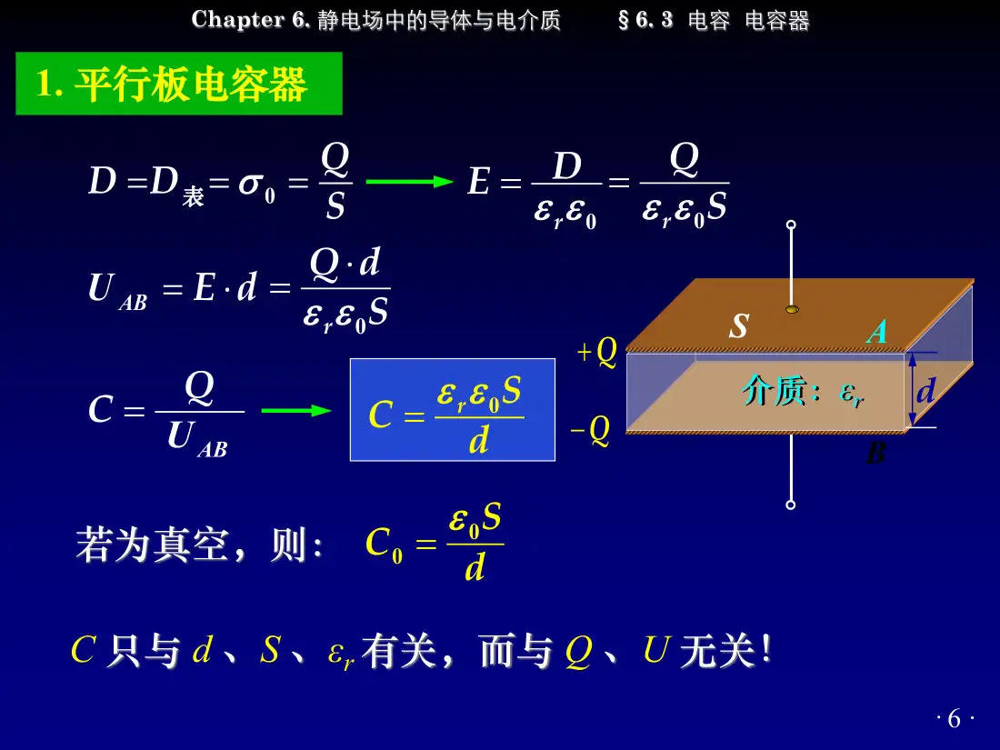

原文：

1. 平行板电容器

$$
D = D _ {\text {表}} = \sigma_ {0} = \frac {Q}{S} \longrightarrow E = \frac {D}{\varepsilon_ {r} \varepsilon_ {0}} = \frac {Q}{\varepsilon_ {r} \varepsilon_ {0} S}
$$

$$
U _ {A B} = E \cdot d = \frac {Q \cdot d}{\varepsilon_ {r} \varepsilon_ {0} S}
$$

$$
C = \frac {Q}{U _ {A B}} \longrightarrow C = \frac {\varepsilon_ {r} \varepsilon_ {0} S}{d}
$$

介质： $\varepsilon_{r}$

若为真空，则： $C_{0}=\frac{\varepsilon_{0}S}{d}$

C 只与 d、S、 $\varepsilon_{r}$ 有关，而与 Q、U 无关！

Chapter 6. 静电场中的导体与电介质 § 6.3 电容 电容器

6

### Chapter 6. 静电场中的导体与电介质 § 6.3 电容 电容器

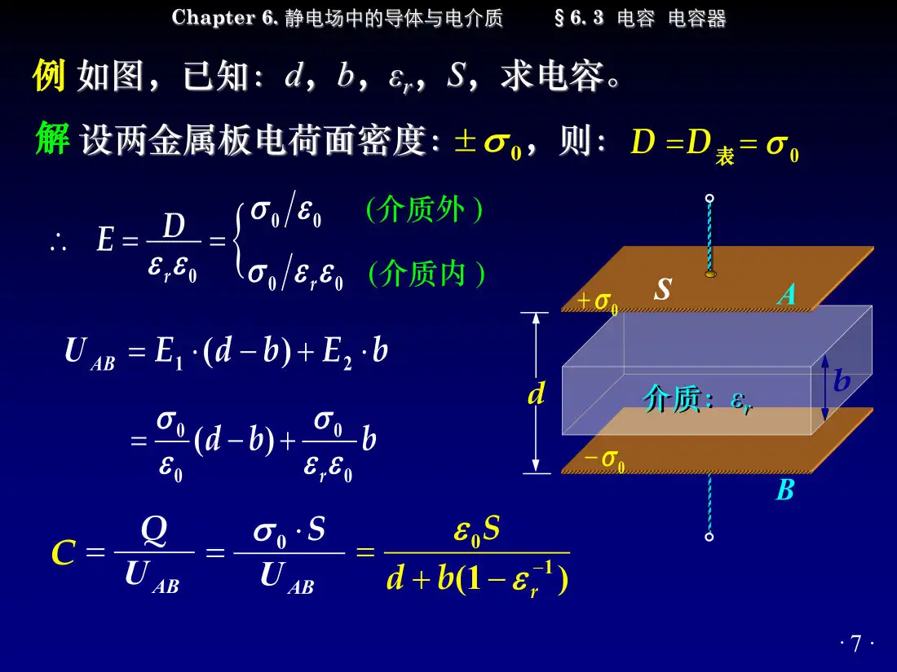

原文：

Chapter 6. 静电场中的导体与电介质 § 6.3 电容 电容器

例如图，已知：d，b， $\varepsilon_{r}$ ，S，求电容。

解 设两金属板电荷面密度: $\pm \sigma_{0}$ , 则: $D = D_{\text {表}} = \sigma_{0}$

$$
\therefore E = \frac {D}{\varepsilon_ {r} \varepsilon_ {0}} = \left\{ \begin{array}{l} \sigma_ {0} / \varepsilon_ {0} \\ \sigma_ {0} / \varepsilon_ {r} \varepsilon_ {0} \end{array} \right.
$$

(介质外)

(介质内)

$$
\begin{array}{r l} U _ {A B} & = E _ {1} \cdot (d - b) + E _ {2} \cdot b \\ & = \frac {\sigma_ {0}}{\varepsilon_ {0}} (d - b) + \frac {\sigma_ {0}}{\varepsilon_ {r} \varepsilon_ {0}} b \end{array}
$$

介质： $\varepsilon_{r}$

$$
C = \frac {Q}{U _ {A B}} = \frac {\sigma_ {0} \cdot S}{U _ {A B}} = \frac {\varepsilon_ {0} S}{d + b (1 - \varepsilon_ {r} ^ {- 1})}
$$

7

### 2. 球形电容器

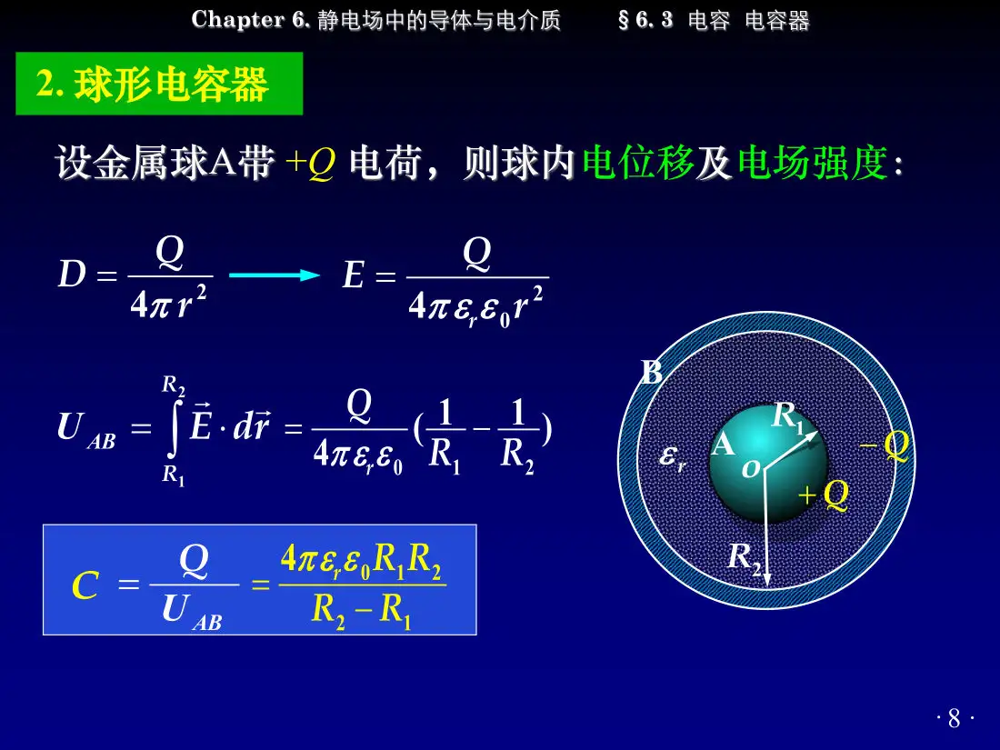

原文：

2. 球形电容器

设金属球A带 +Q 电荷，则球内电位移及电场强度：

$$
D = \frac {Q}{4 \pi r ^ {2}} \longrightarrow E = \frac {Q}{4 \pi \varepsilon_ {r} \varepsilon_ {0} r ^ {2}}
$$

$$
U _ {A B} = \int_ {R _ {1}} ^ {R _ {2}} \vec {E} \cdot d \vec {r} = \frac {Q}{4 \pi \varepsilon_ {r} \varepsilon_ {0}} (\frac {1}{R _ {1}} - \frac {1}{R _ {2}})
$$

$$
C = \frac {Q}{U _ {A B}} = \frac {4 \pi \varepsilon_ {r} \varepsilon_ {0} R _ {1} R _ {2}}{R _ {2} - R _ {1}}
$$

Chapter 6. 静电场中的导体与电介质 § 6.3 电容 电容器

8

### 3. 柱形电容器

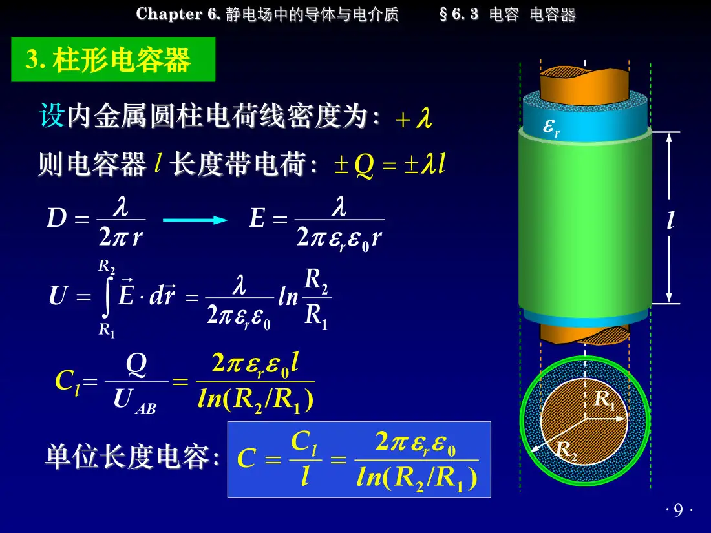

原文：

3. 柱形电容器

设内金属圆柱电荷线密度为：+λ

则电容器 $l$ 长度带电荷： $\pm Q = \pm \lambda l$

$$
D = \frac {\lambda}{2 \pi r} \longrightarrow E = \frac {\lambda}{2 \pi \varepsilon_ {r} \varepsilon_ {0} r}
$$

$$
U = \int_ {R _ {1}} ^ {R _ {2}} \vec {E} \cdot d \vec {r} = \frac {\lambda}{2 \pi \varepsilon_ {r} \varepsilon_ {0}} l n \frac {R _ {2}}{R _ {1}}
$$

$$
C _ {l} = \frac {Q}{U _ {A B}} = \frac {2 \pi \varepsilon_ {r} \varepsilon_ {0} l}{\ln (R _ {2} / R _ {1})}
$$

单位长度电容: $C=\frac{C_{1}}{l}=\frac{2\pi\varepsilon_{r}\varepsilon_{0}}{\ln(R_{2}/R_{1})}$

Chapter 6. 静电场中的导体与电介质 § 6.3 电容 电容器

9

### 三、电容器组

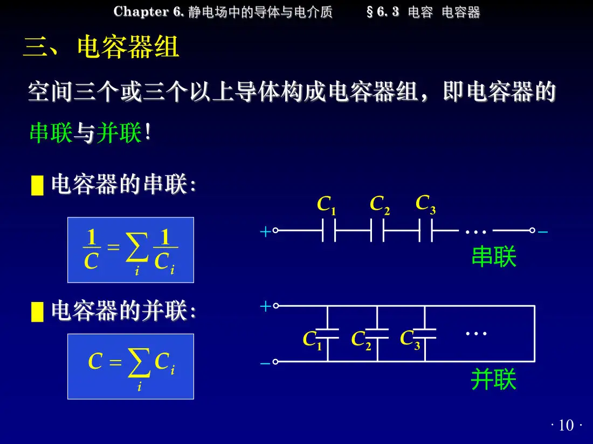

原文：

三、电容器组

空间三个或三个以上导体构成电容器组，即电容器的串联与并联！

电容器的串联：

$$
\frac {1}{C} = \sum_ {i} \frac {1}{C _ {i}}
$$

串联

电容器的并联：

$$
C = \sum_ {i} C _ {i}
$$

并联

Chapter 6. 静电场中的导体与电介质 § 6.3 电容 电容器

10

### Chapter 6. 静电场中的导体与电介质 § 6.3 电容 电容器

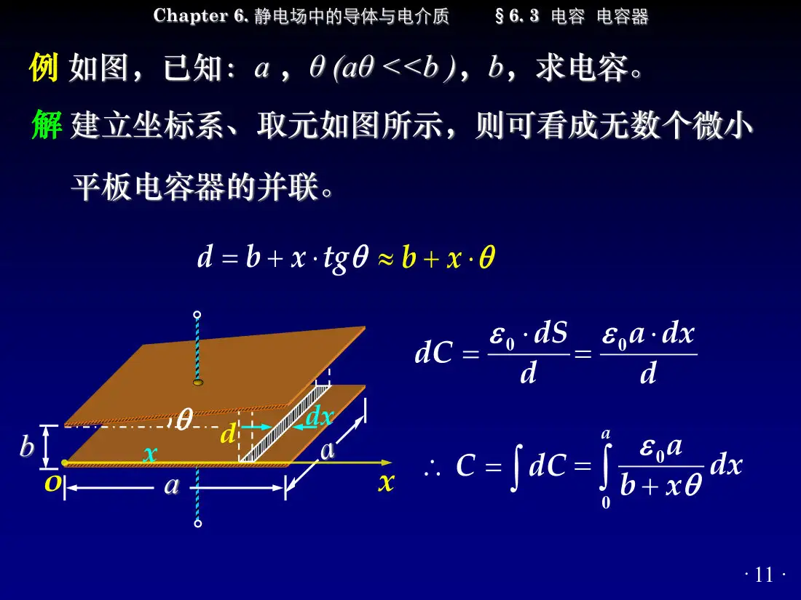

原文：

Chapter 6. 静电场中的导体与电介质 § 6.3 电容 电容器

例如图，已知：a， $\theta(a\theta<<b)$ ，b，求电容。
解建立坐标系、取元如图所示，则可看成无数个微小平板电容器的并联。

$$
d = b + x \cdot t g \theta \approx b + x \cdot \theta
$$

$$
d C = \frac {\varepsilon_ {0} \cdot d S}{d} = \frac {\varepsilon_ {0} a \cdot d x}{d}
$$

$$
\therefore C = \int d C = \int_ {0} ^ {a} \frac {\varepsilon_ {0} a}{b + x \theta} d x
$$

11

### Chapter 6. 静电场中的导体与电介质 § 6.3 电容 电容器

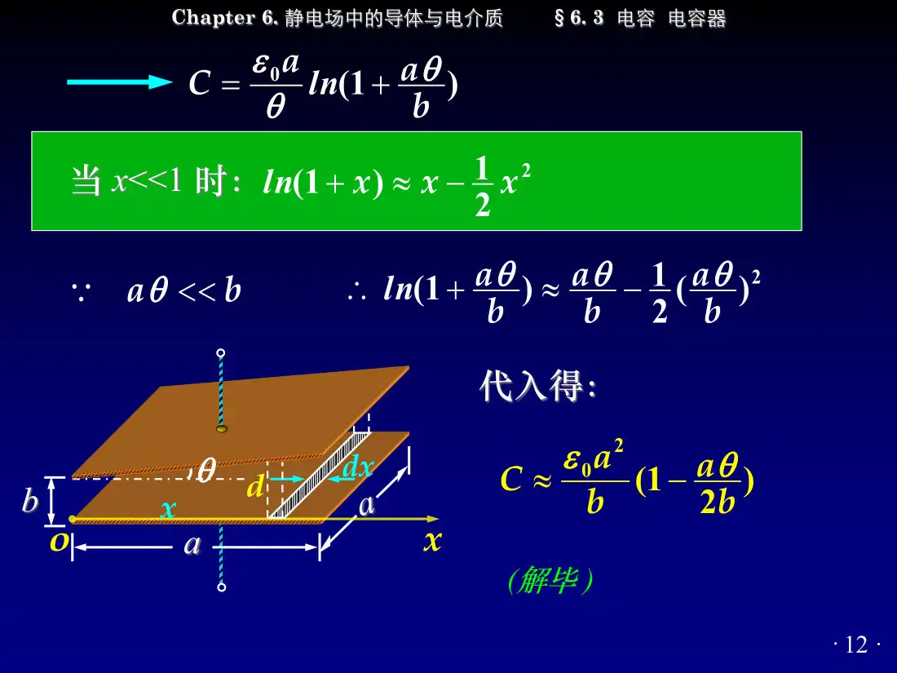

原文：

Chapter 6. 静电场中的导体与电介质 § 6.3 电容 电容器

$$
C = \frac {\varepsilon_ {0} a}{\theta} \ln (1 + \frac {a \theta}{b})
$$

当 $x < 1$ 时： $ln(1 + x) \approx x - \frac{1}{2} x^2$

$$
\because a \theta <   <   b
$$

$$
\therefore \ln (1 + \frac {a \theta}{b}) \approx \frac {a \theta}{b} - \frac {1}{2} (\frac {a \theta}{b}) ^ {2}
$$

代入得:

$$
C \approx \frac {\varepsilon_ {0} a ^ {2}}{b} (1 - \frac {a \theta}{2 b})
$$

(解毕)

12

### 归纳

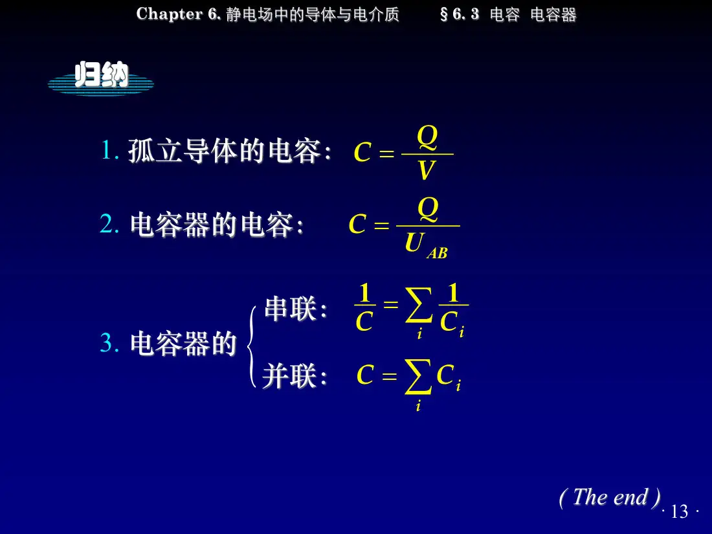

原文：

归纳

1. 孤立导体的电容: $C = \frac{Q}{V}$

2. 电容器的电容: $C = \frac{Q}{U_{AB}}$

3. 电容器的 $\left\{ \begin{array}{l} \text {串联: } \frac{1}{C} = \sum_{i} \frac{1}{C_{i}} \\ \text {并联: } C = \sum_{i} C_{i} \end{array} \right.$

Chapter 6. 静电场中的导体与电介质 § 6.3 电容 电容器

(The end)

13
