# 《大学物理》第6章 静电场中的导体与电介质 §6.4 静电场能量与能量密度（课件）

原件的每一页，下面附识别出的文字。

### § 6.4 静电场能量与能量密度

原文：

§ 6.4 静电场能量与能量密度

Chapter 6. 静电场中的导体与电介质 § 6.4 静电场能量与能量密度

1

### Chapter 6. 静电场中的导体与电介质 § 6.4 静电场能量与能量密度

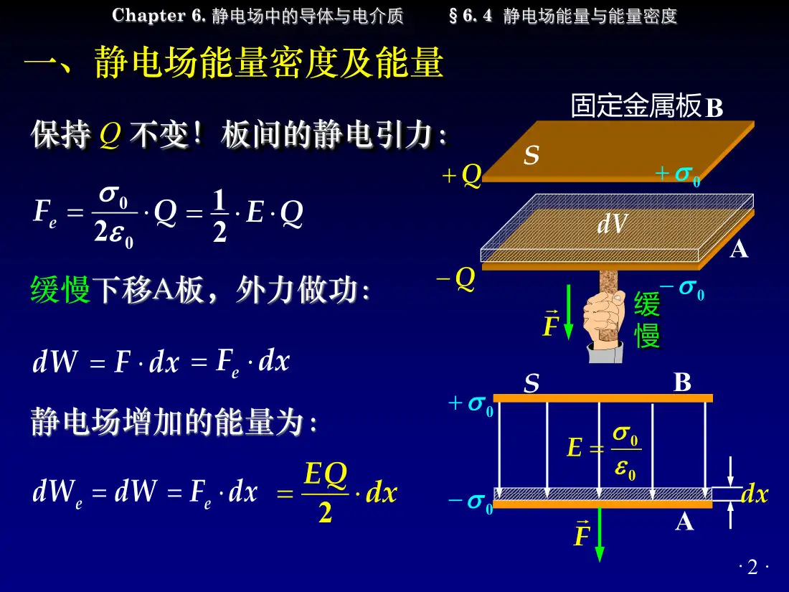

原文：

Chapter 6. 静电场中的导体与电介质 § 6.4 静电场能量与能量密度

一、静电场能量密度及能量

保持 Q 不变！板间的静电引力：

$$
F _ {e} = \frac {\sigma_ {0}}{2 \varepsilon_ {0}} \cdot Q = \frac {1}{2} \cdot E \cdot Q
$$

缓慢下移A板，外力做功：

$$
d W = F \cdot d x = F _ {e} \cdot d x
$$

静电场增加的能量为：

$$
d W _ {e} = d W = F _ {e} \cdot d x = \frac {E Q}{2} \cdot d x
$$

固定金属板B

2

### Chapter 6. 静电场中的导体与电介质 § 6.4 静电场能量与能量密度

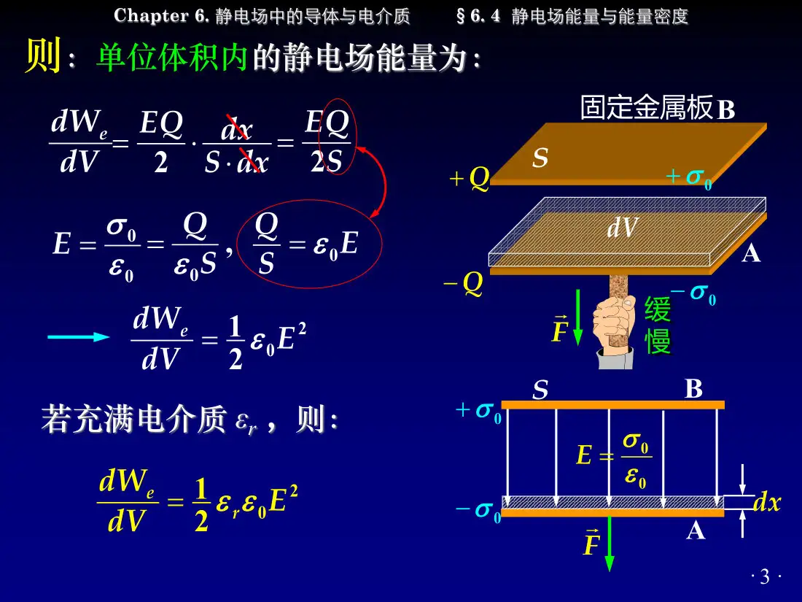

原文：

Chapter 6. 静电场中的导体与电介质 § 6.4 静电场能量与能量密度

则：单位体积内的静电场能量为：

$$
\frac {d W _ {e}}{d V} = \frac {E Q}{2} \cdot \frac {d x}{S \cdot d x} = \frac {E Q}{2 S}
$$

$$
E = \frac {\sigma_ {0}}{\varepsilon_ {0}} = \frac {Q}{\varepsilon_ {0} S}, \quad \frac {Q}{S} = \varepsilon_ {0} E
$$

$$
\longrightarrow \frac {d W _ {e}}{d V} = \frac {1}{2} \varepsilon_ {0} E ^ {2}
$$

若充满电介质 $\varepsilon_{r}$ ，则：

$$
\frac {d W _ {e}}{d V} = \frac {1}{2} \varepsilon_ {r} \varepsilon_ {0} E ^ {2}
$$

固定金属板B

3

### 静电场能量密度:

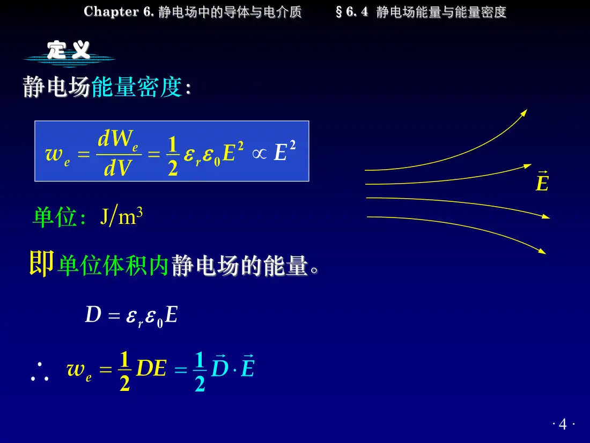

原文：

静电场能量密度:

$$
w _ {e} = \frac {d W _ {e}}{d V} = \frac {1}{2} \varepsilon_ {r} \varepsilon_ {0} E ^ {2} \propto E ^ {2}
$$

单位： $\mathrm{J} / \mathrm{m}^{3}$

即单位体积内静电场的能量。

$$
D = \varepsilon_ {r} \varepsilon_ {0} E
$$

$$
\therefore w _ {e} = \frac {1}{2} D E = \frac {1}{2} \vec {D} \cdot \vec {E}
$$

Chapter 6. 静电场中的导体与电介质 § 6.4 静电场能量与能量密度

4

### Chapter 6. 静电场中的导体与电介质 § 6.4 静电场能量与能量密度

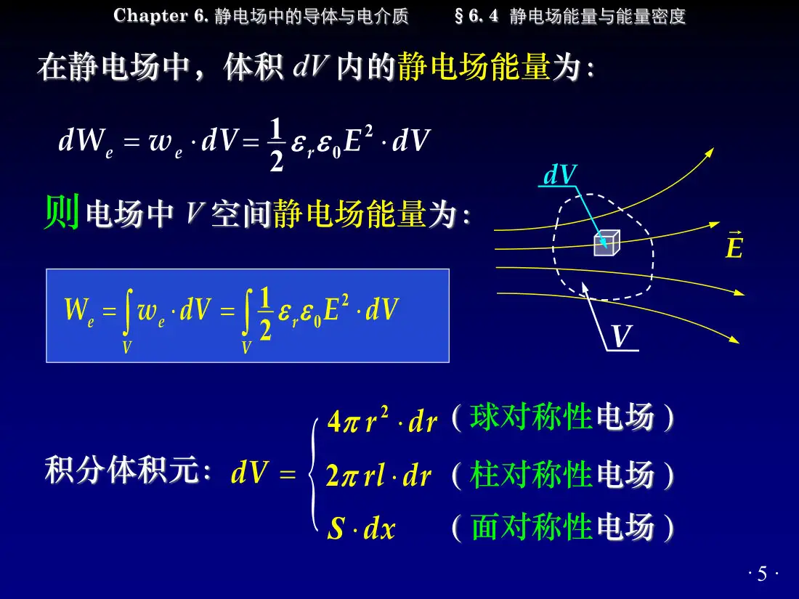

原文：

Chapter 6. 静电场中的导体与电介质 § 6.4 静电场能量与能量密度

在静电场中，体积 $dV$ 内的静电场能量为：

$$
d W _ {e} = w _ {e} \cdot d V = \frac {1}{2} \varepsilon_ {r} \varepsilon_ {0} E ^ {2} \cdot d V
$$

则电场中 V 空间静电场能量为:

$$
W _ {e} = \int_ {V} w _ {e} \cdot d V = \int_ {V} \frac {1}{2} \varepsilon_ {r} \varepsilon_ {0} E ^ {2} \cdot d V
$$

$4\pi r^{2} \cdot dr$ （球对称性电场）

积分体积元： $dV = \left\{2\pi rl\cdot dr\right.$ （柱对称性电场）

$S \cdot dx$ （面对称性电场）

5

### Chapter 6. 静电场中的导体与电介质 § 6.4 静电场能量与能量密度

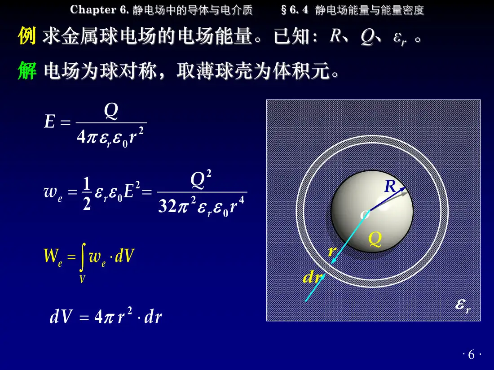

原文：

Chapter 6. 静电场中的导体与电介质 § 6.4 静电场能量与能量密度
例 求金属球电场的电场能量。已知：R、Q、 $\varepsilon_{r}$ 。
解 电场为球对称，取薄球壳为体积元。

$$
E = \frac {Q}{4 \pi \varepsilon_ {r} \varepsilon_ {0} r ^ {2}}
$$

$$
w _ {e} = \frac {1}{2} \varepsilon_ {r} \varepsilon_ {0} E ^ {2} = \frac {Q ^ {2}}{3 2 \pi^ {2} \varepsilon_ {r} \varepsilon_ {0} r ^ {4}}
$$

$$
W _ {e} = \int_ {V} w _ {e} \cdot d V
$$

$$
d V = 4 \pi r ^ {2} \cdot d r
$$

6

### Chapter 6. 静电场中的导体与电介质 § 6.4 静电场能量与能量密度

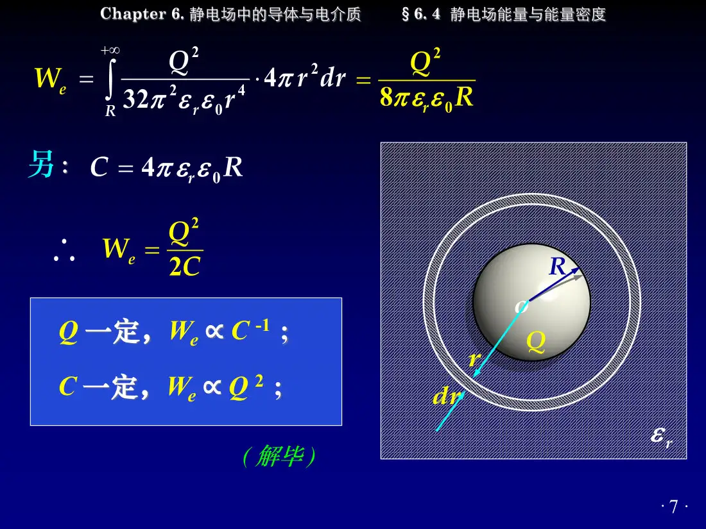

原文：

Chapter 6. 静电场中的导体与电介质 § 6.4 静电场能量与能量密度

$$
W _ {e} = \int_ {R} ^ {+ \infty} \frac {Q ^ {2}}{3 2 \pi^ {2} \varepsilon_ {r} \varepsilon_ {0} r ^ {4}} \cdot 4 \pi r ^ {2} d r = \frac {Q ^ {2}}{8 \pi \varepsilon_ {r} \varepsilon_ {0} R}
$$

另： $C = 4\pi \varepsilon_r\varepsilon_0R$

∴ $W_{e}=\frac{Q^{2}}{2C}$

$Q$ 一定， $W_{e}\propto C^{-1}$ ； $C$ 一定， $W_{e}\propto Q^{2}$ ；

(解毕)

7

### Chapter 6. 静电场中的导体与电介质 § 6.4 静电场能量与能量密度

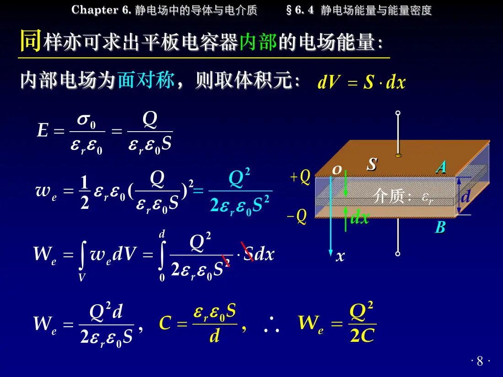

原文：

Chapter 6. 静电场中的导体与电介质 § 6.4 静电场能量与能量密度

同样亦可求出平板电容器内部的电场能量：

内部电场为面对称，则取体积元： $dV = S \cdot dx$

$$
E = \frac {\sigma_ {0}}{\varepsilon_ {r} \varepsilon_ {0}} = \frac {Q}{\varepsilon_ {r} \varepsilon_ {0} S}
$$

$$
w _ {e} = \frac {1}{2} \varepsilon_ {r} \varepsilon_ {0} (\frac {Q}{\varepsilon_ {r} \varepsilon_ {0} S}) ^ {2} = \frac {Q ^ {2}}{2 \varepsilon_ {r} \varepsilon_ {0} S ^ {2}}
$$

$$
W _ {e} = \int_ {V} w _ {e} d V = \int_ {0} ^ {d} \frac {Q ^ {2}}{2 \varepsilon_ {r} \varepsilon_ {0} S ^ {2}} \cdot S d x
$$

$$
W _ {e} = \frac {Q ^ {2} d}{2 \varepsilon_ {r} \varepsilon_ {0} S}, C = \frac {\varepsilon_ {r} \varepsilon_ {0} S}{d}, \therefore W _ {e} = \frac {Q ^ {2}}{2 C}
$$

8

### 二、电容器的能量

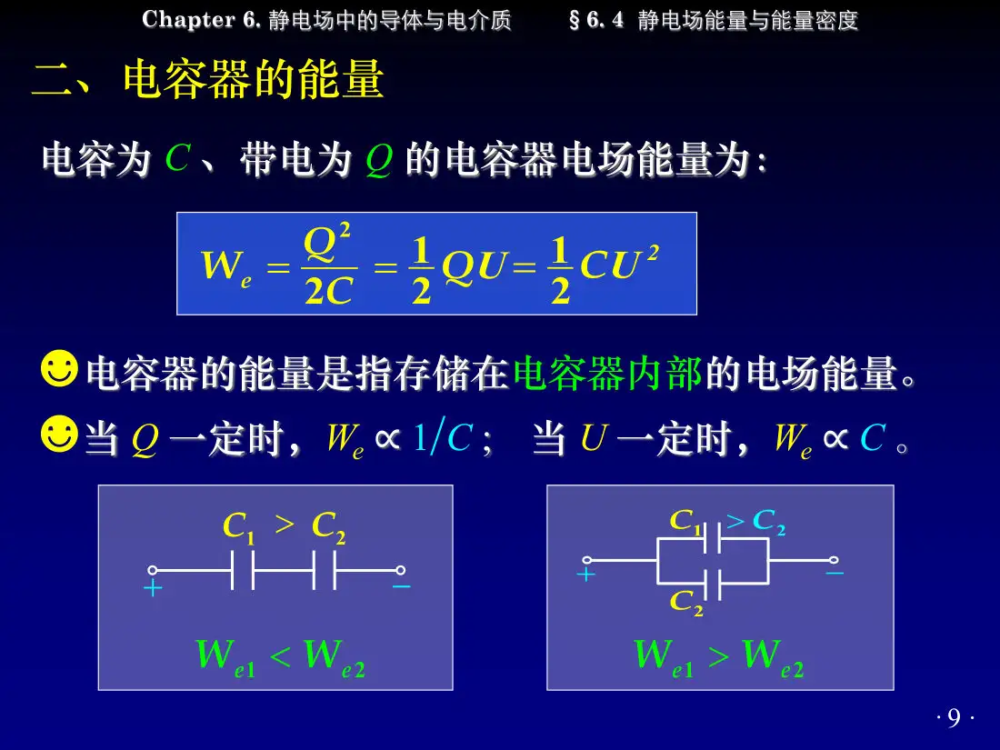

原文：

二、电容器的能量

电容为 C 、带电为 Q 的电容器电场能量为:

$$
W _ {e} = \frac {Q ^ {2}}{2 C} = \frac {1}{2} Q U = \frac {1}{2} C U ^ {2}
$$

电容器的能量是指存储在电容器内部的电场能量。

当 Q 一定时， $W_{e} \propto 1/C$ ；当 U 一定时， $W_{e} \propto C$ 。

$$
\begin{array}{c} C _ {1} > C _ {2} \\ W _ {e 1} <   W _ {e 2} \end{array}
$$

$$
W _ {e 1} > W _ {e 2}
$$

Chapter 6. 静电场中的导体与电介质 § 6.4 静电场能量与能量密度

9

### 解 柱型电容器单位长度电容:

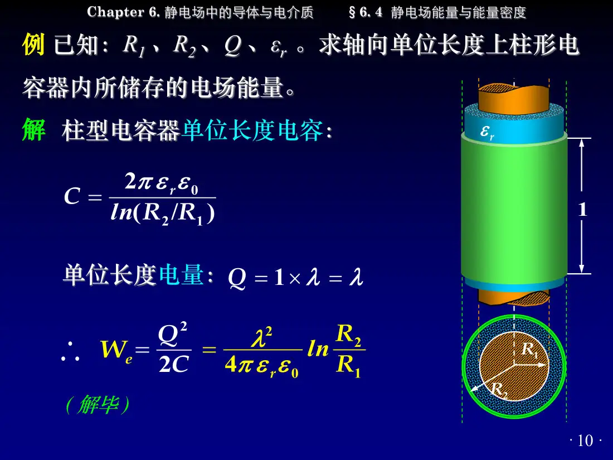

原文：

例 已知: $R_{1} 、 R_{2} 、 Q 、 \varepsilon_{r}$ 。求轴向单位长度上柱形电容器内所储存的电场能量。

解 柱型电容器单位长度电容:

$$
C = \frac {2 \pi \varepsilon_ {r} \varepsilon_ {0}}{\ln (R _ {2} / R _ {1})}
$$

单位长度电量: $Q = 1 \times \lambda = \lambda$

$$
\therefore W _ {e} = \frac {Q ^ {2}}{2 C} = \frac {\lambda^ {2}}{4 \pi \varepsilon_ {r} \varepsilon_ {0}} \ln \frac {R _ {2}}{R _ {1}}
$$

(解毕)

10

### Chapter 6. 静电场中的导体与电介质 § 6.4 静电场能量与能量密度

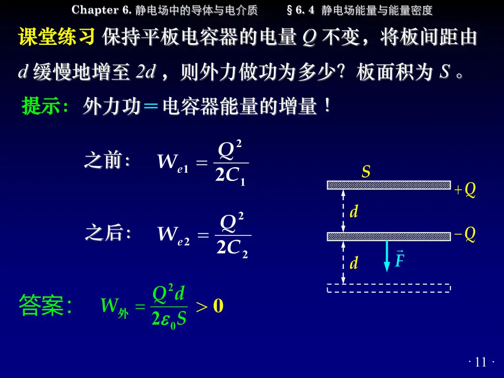

原文：

Chapter 6. 静电场中的导体与电介质 § 6.4 静电场能量与能量密度

课堂练习 保持平板电容器的电量 Q 不变，将板间距由

d 缓慢地增至 2d，则外力做功为多少？板面积为 S。

提示：外力功 $=$ 电容器能量的增量！

之前： $W_{e1}=\frac{Q^{2}}{2C_{1}}$

之后： $W_{e2}=\frac{Q^{2}}{2C_{2}}$

答案: $W_{\text {外}} = \frac{Q^2d}{2\varepsilon_0S} > 0$

11

### 归纳

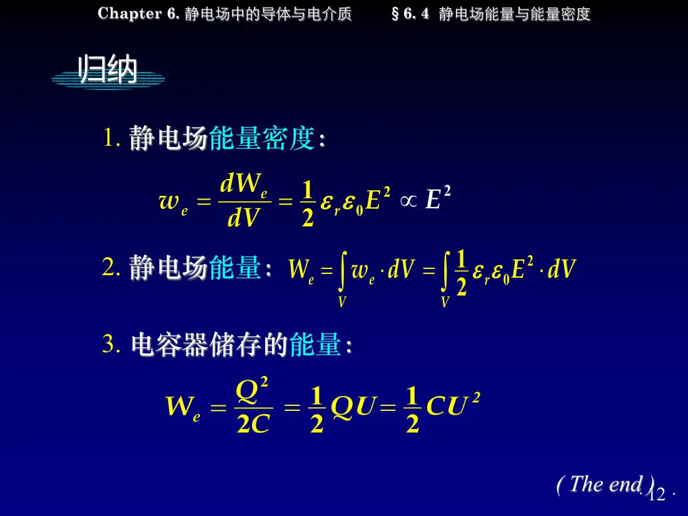

原文：

归纳

1. 静电场能量密度:

$$
w _ {e} = \frac {d W _ {e}}{d V} = \frac {1}{2} \varepsilon_ {r} \varepsilon_ {0} E ^ {2} \propto E ^ {2}
$$

2. 静电场能量: $W_{e} = \int_ {V} w_{e} \cdot d V = \int_ {V} \frac {1}{2} \varepsilon_{r} \varepsilon_{0} E^{2} \cdot d V$

3. 电容器储存的能量：

$$
W _ {e} = \frac {Q ^ {2}}{2 C} = \frac {1}{2} Q U = \frac {1}{2} C U ^ {2}
$$

Chapter 6. 静电场中的导体与电介质

§ 6.4 静电场能量与能量密度

(The end.) $_{2}$

### Chapter 6. 静电场中的导体与电介质 § 6.4 静电场能量与能量密度

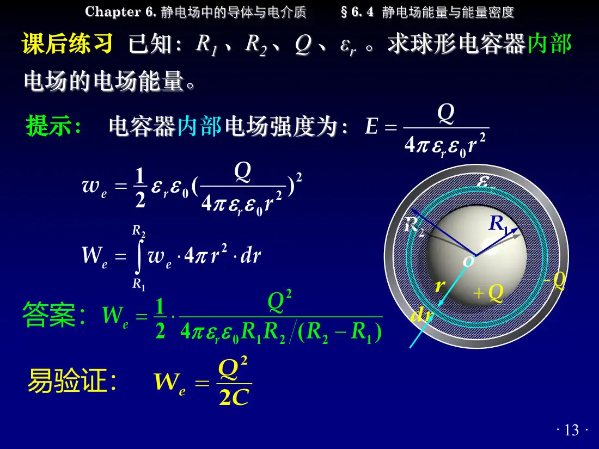

原文：

Chapter 6. 静电场中的导体与电介质 § 6.4 静电场能量与能量密度

课后练习 已知： $R_{1}$ 、 $R_{2}$ 、 $Q$ 、 $\varepsilon_{r}$ 。求球形电容器内部电场的电场能量。

提示: 电容器内部电场强度为: $E = \frac{Q}{4 \pi \varepsilon_{r} \varepsilon_{0} r^{2}}$

$$
w _ {e} = \frac {1}{2} \varepsilon_ {r} \varepsilon_ {0} (\frac {Q}{4 \pi \varepsilon_ {r} \varepsilon_ {0} r ^ {2}}) ^ {2}
$$

$$
W _ {e} = \int_ {R _ {1}} ^ {R _ {2}} w _ {e} \cdot 4 \pi r ^ {2} \cdot d r
$$

答案: $W_{e} = \frac{1}{2} \cdot \frac{Q^{2}}{4\pi\varepsilon_{r}\varepsilon_{0}R_{1}R_{2}/(R_{2}-R_{1})}$ 易验证: $W_{e} = \frac{Q^{2}}{2C}$

13

### Chapter 6. 静电场中的导体与电介质 § 6.4 静电场能量与能量密度

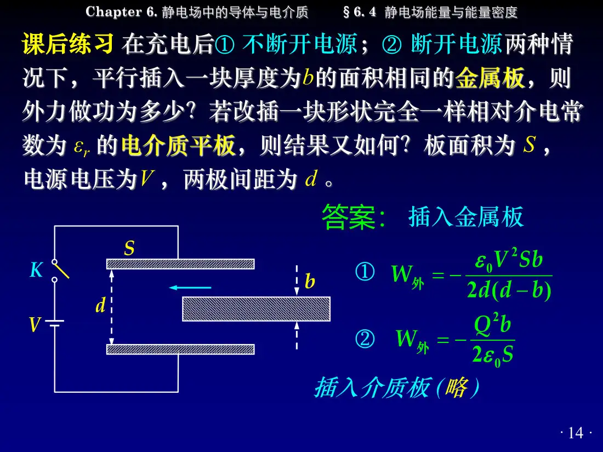

原文：

Chapter 6. 静电场中的导体与电介质 § 6.4 静电场能量与能量密度

课后练习 在充电后① 不断开电源；② 断开电源两种情况下，平行插入一块厚度为 $b$ 的面积相同的金属板，则外力做功为多少？若改插一块形状完全一样相对介电常数为 $\varepsilon_{r}$ 的电介质平板，则结果又如何？板面积为 $S$ ，电源电压为 $V$ ，两极间距为 $d$ 。

答案: 插入金属板

$$
W _ {\text {外}} = - \frac {\varepsilon_ {0} V ^ {2} S b}{2 d (d - b)}
$$

②

$$
W _ {\text {外}} = - \frac {Q ^ {2} b}{2 \varepsilon_ {0} S}
$$

插入介质板(略)

14
