# 《大学物理》第6章 静电场：电势与电场强度的关系（课件）

原件的每一页，下面附识别出的文字。

### 5-6 电势与电场强度的关系

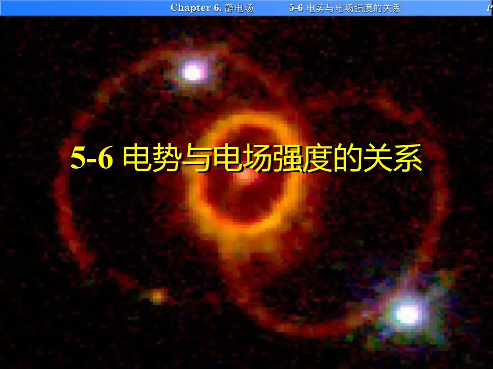

原文：

5-6 电势与电场强度的关系

Chapter 6. 静电场

5-6 电势与电场强度的关系

P

### 一、等势面

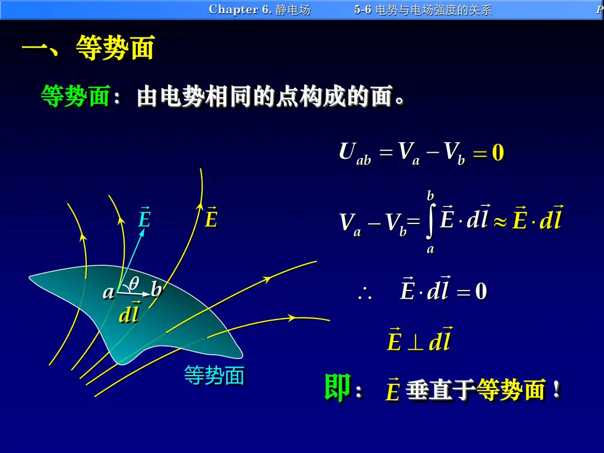

原文：

一、等势面

等势面：由电势相同的点构成的面。

等势面

$$
U _ {a b} = V _ {a} - V _ {b} = 0
$$

$$
V _ {a} - V _ {b} = \int_ {a} ^ {b} \vec {E} \cdot d \vec {l} \approx \vec {E} \cdot d \vec {l}
$$

$$
\therefore \vec {E} \cdot d \vec {l} = 0
$$

$\vec{E} \perp d\vec{l}$

即： $\vec{E}$ 垂直于等势面！

Chapter 6. 静电场

5-6 电势与电场强度的关系

P

### 电场强度与等势面处处垂直！

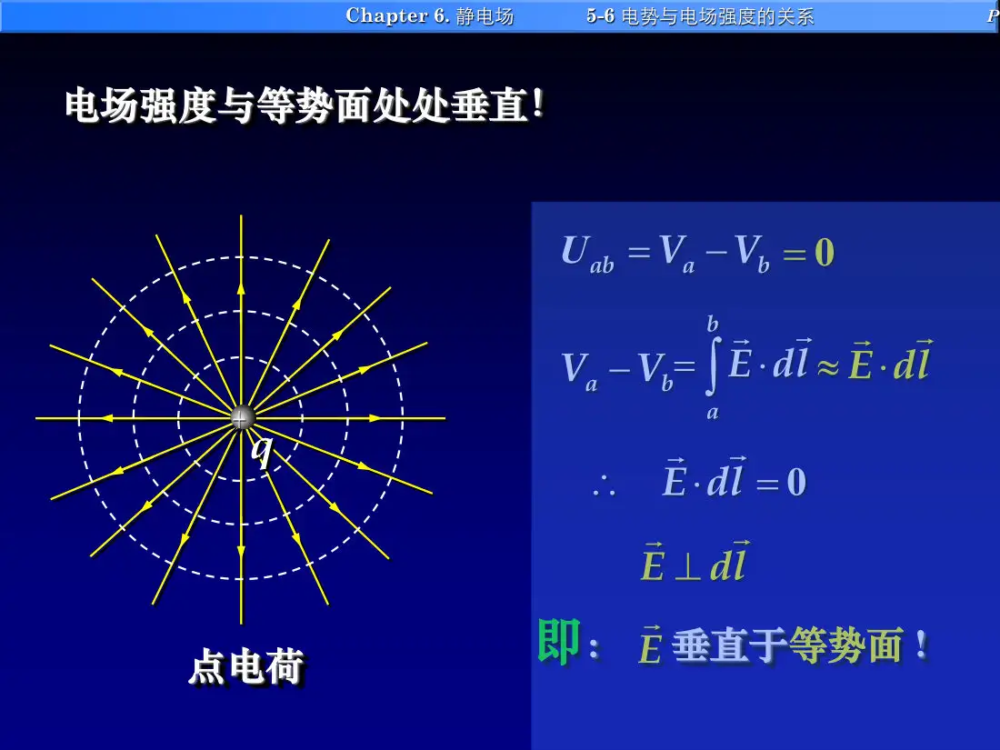

原文：

电场强度与等势面处处垂直！

$$
U _ {a b} = V _ {a} - V _ {b} = 0
$$

$$
V _ {a} - V _ {b} = \int_ {a} ^ {b} \vec {E} \cdot d \vec {l} \approx \vec {E} \cdot d \vec {l}
$$

$$
\therefore \vec {E} \cdot d \vec {l} = 0
$$

$\vec{E} \perp d\vec{l}$

即： $\vec{E}$ 垂直于等势面！

Chapter 6. 静电场

5-6 电势与电场强度的关系

P

### 电场强度与等势面处处垂直！

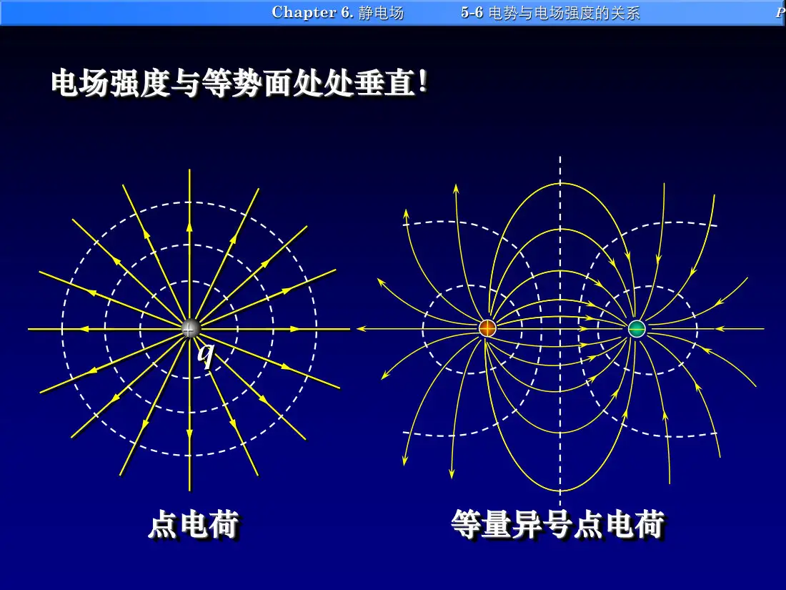

原文：

电场强度与等势面处处垂直！

等量异号点电荷

Chapter 6. 静电场

5-6 电势与电场强度的关系

P

### 二、 $\vec{E}$ 、 $V$ 间的微分关系

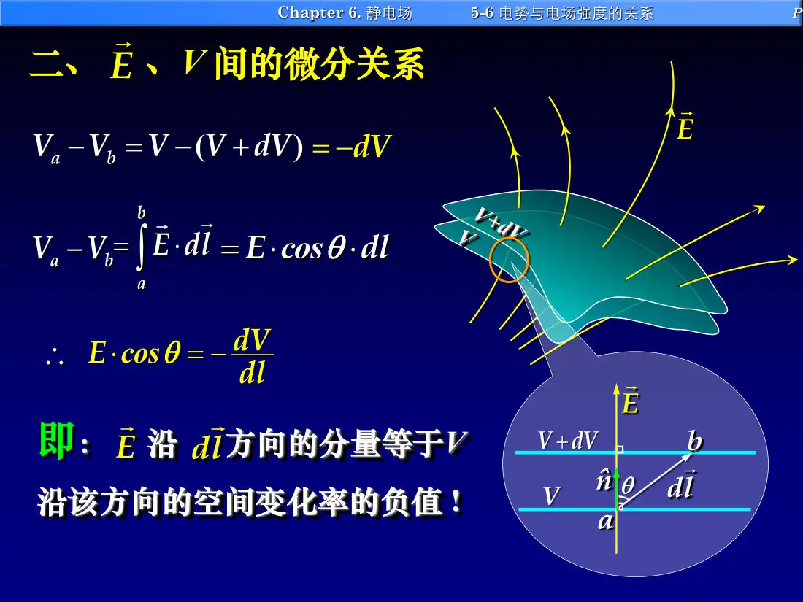

原文：

二、 $\vec{E}$ 、 $V$ 间的微分关系

$$
V _ {a} - V _ {b} = V - (V + d V) = - d V
$$

$$
V _ {a} - V _ {b} = \int_ {a} ^ {b} {\vec {E}} \cdot d {\vec {l}} = E \cdot \cos \theta \cdot d l
$$

$$
\therefore E \cdot \cos \theta = - \frac {d V}{d l}
$$

即： $\vec{E}$ 沿 $d\vec{l}$ 方向的分量等于 $V$ 沿该方向的空间变化率的负值！

Chapter 6. 静电场

5-6 电势与电场强度的关系

P

### $$

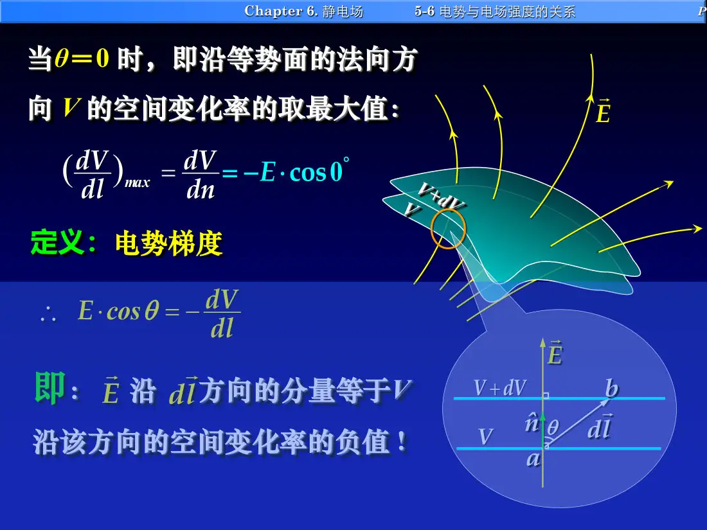

原文：

当 $\theta = 0$ 时, 即沿等势面的法向方向 $V$ 的空间变化率的取最大值:

$$
\left(\frac {d V}{d l}\right) _ {\max} = \frac {d V}{d n} = - E \cdot \cos 0 ^ {\circ}
$$

定义：电势梯度

$$
\therefore E \cdot \cos \theta = - \frac {d V}{d l}
$$

即: $\vec{E}$ 沿 $d\vec{l}$ 方向的分量等于 $V$

沿该方向的空间变化率的负值！

Chapter 6. 静电场

5-6 电势与电场强度的关系

P

### $$

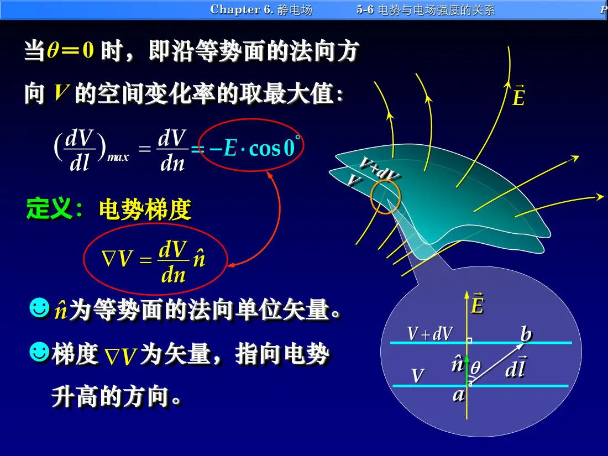

原文：

当 $\theta = 0$ 时, 即沿等势面的法向方向 $V$ 的空间变化率的取最大值:

$$
\left(\frac {d V}{d l}\right) _ {\max} = \frac {d V}{d n} = - E \cdot \cos 0 ^ {\circ}
$$

定义：电势梯度

$$
\nabla V = \frac {d V}{d n} \hat {n}
$$

😊 $\hat{n}$ 为等势面的法向单位矢量。

梯度 $\nabla V$ 为矢量，指向电势升高的方向。

Chapter 6. 静电场

5-6 电势与电场强度的关系

P

### $$

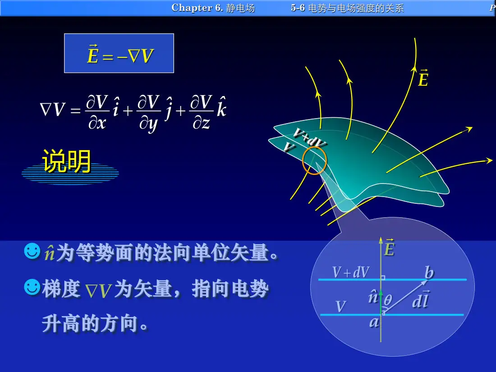

原文：

$$
\vec {E} = - \nabla V
$$

$$
\nabla V = \frac {\partial V}{\partial x} \hat {\textbf {i}} + \frac {\partial V}{\partial y} \hat {\textbf {j}} + \frac {\partial V}{\partial z} \hat {k}
$$

说明

😊 $\hat{n}$ 为等势面的法向单位矢量。

梯度 $\nabla V$ 为矢量，指向电势升高的方向。

Chapter 6. 静电场

5-6 电势与电场强度的关系

P

### $$

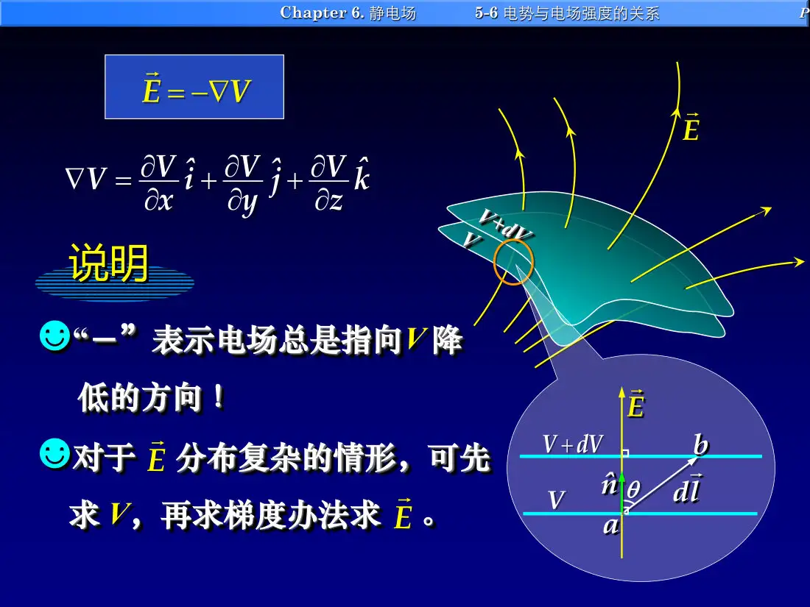

原文：

$$
\vec {E} = - \nabla V
$$

$$
\nabla V = \frac {\partial V}{\partial x} \hat {\textbf {i}} + \frac {\partial V}{\partial y} \hat {\textbf {j}} + \frac {\partial V}{\partial z} \hat {k}
$$

说明

“一”表示电场总是指向 $V$ 降低的方向！

对于 $\vec{E}$ 分布复杂的情形，可先求 V，再求梯度办法求 $\vec{E}$ 。

Chapter 6. 静电场

5-6 电势与电场强度的关系

P

### 归纳：

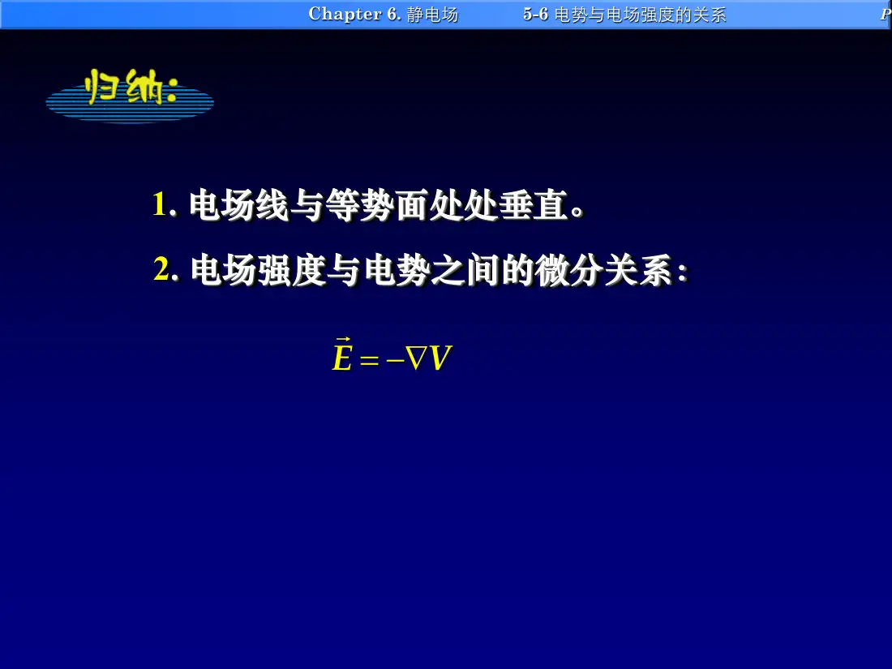

原文：

归纳：

1. 电场线与等势面处处垂直。

2. 电场强度与电势之间的微分关系：

$\vec{E} = -\nabla V$

Chapter 6. 静电场

5-6 电势与电场强度的关系

P

### 1. 电场线与等势面处处垂直。

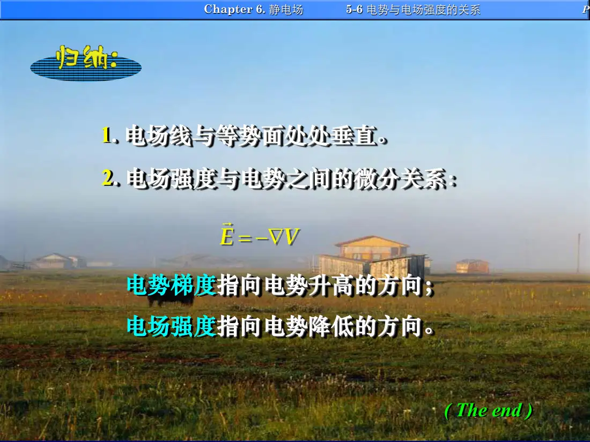

原文：

1. 电场线与等势面处处垂直。

2. 电场强度与电势之间的微分关系：

$\vec{E} = -\nabla V$

电势梯度指向电势升高的方向；  
电场强度指向电势降低的方向。

Chapter 6. 静电场

5-6 电势与电场强度的关系

P

### 高压带

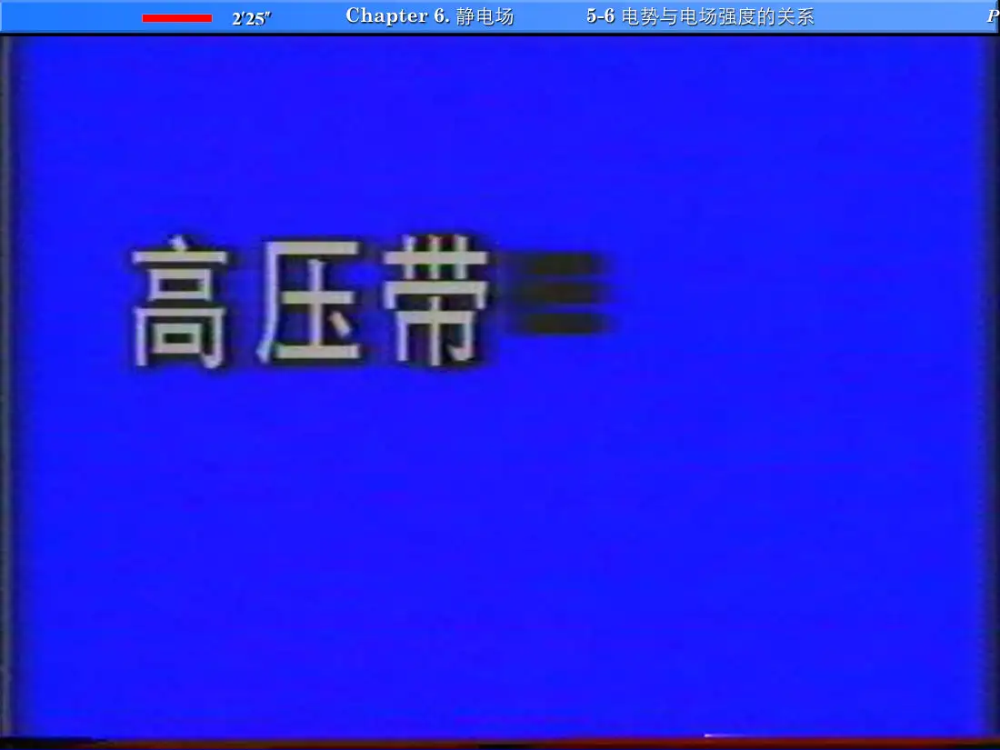

原文：

高压带

Chapter 6. 静电场

5-6 电势与电场强度的关系

### Chapter 6. 静电场

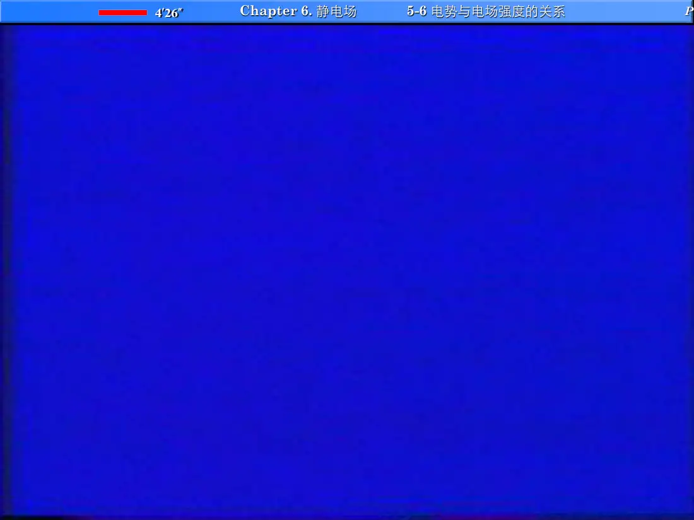

原文：

Chapter 6. 静电场

5-6 电势与电场强度的关系

P
