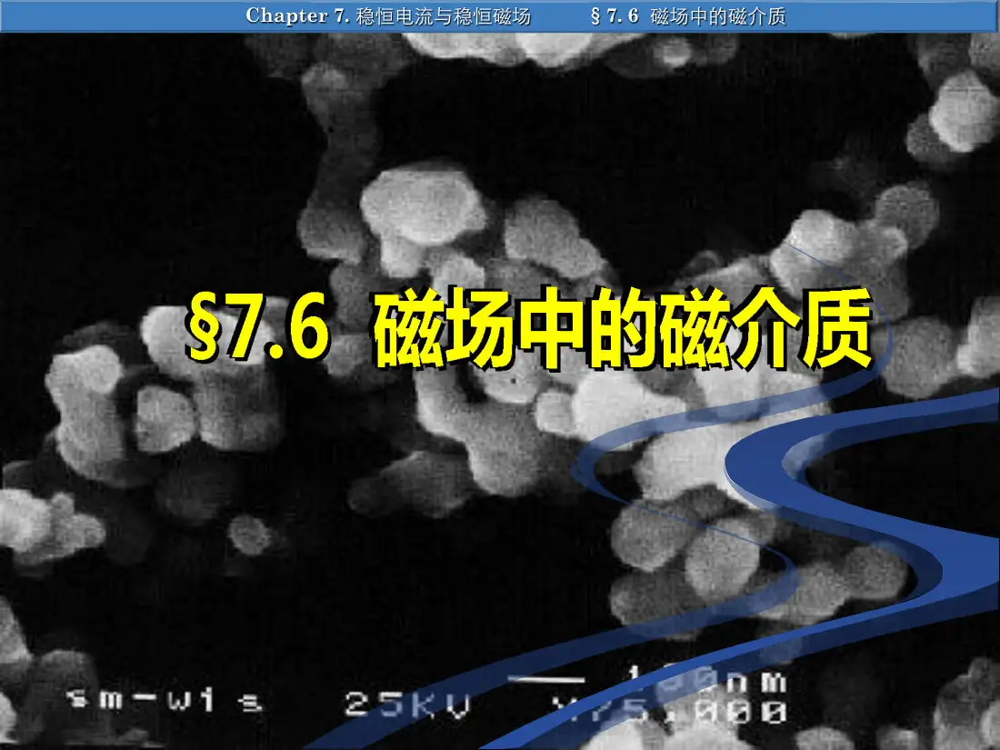
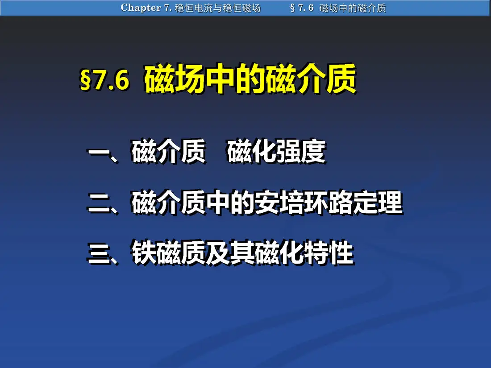

# 《大学物理》第7章 §7.6 磁场中的磁介质（课件）

原件的每一页，下面附识别出的文字。

### §7.6 磁场中的磁介质

原文：

§7.6 磁场中的磁介质

sm-wis

25KV

Chapter 7. 稳恒电流与稳恒磁场

§ 7.6 磁场中的磁介质

### §7.6 磁场中的磁介质

原文：

§7.6 磁场中的磁介质
一、磁介质 磁化强度
二、磁介质中的安培环路定理
三、铁磁质及其磁化特性

Chapter 7. 稳恒电流与稳恒磁场

§ 7.6 磁场中的磁介质
