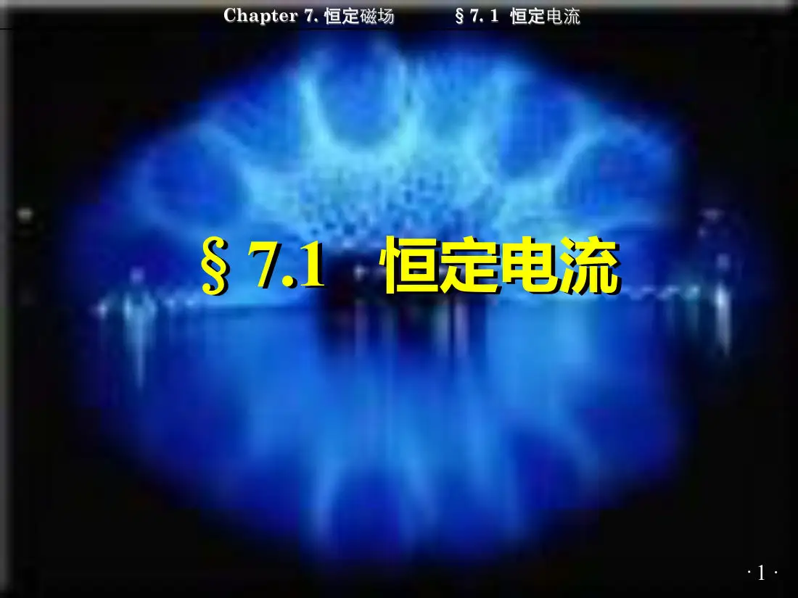
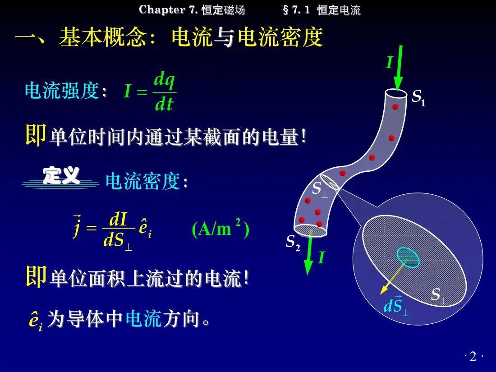
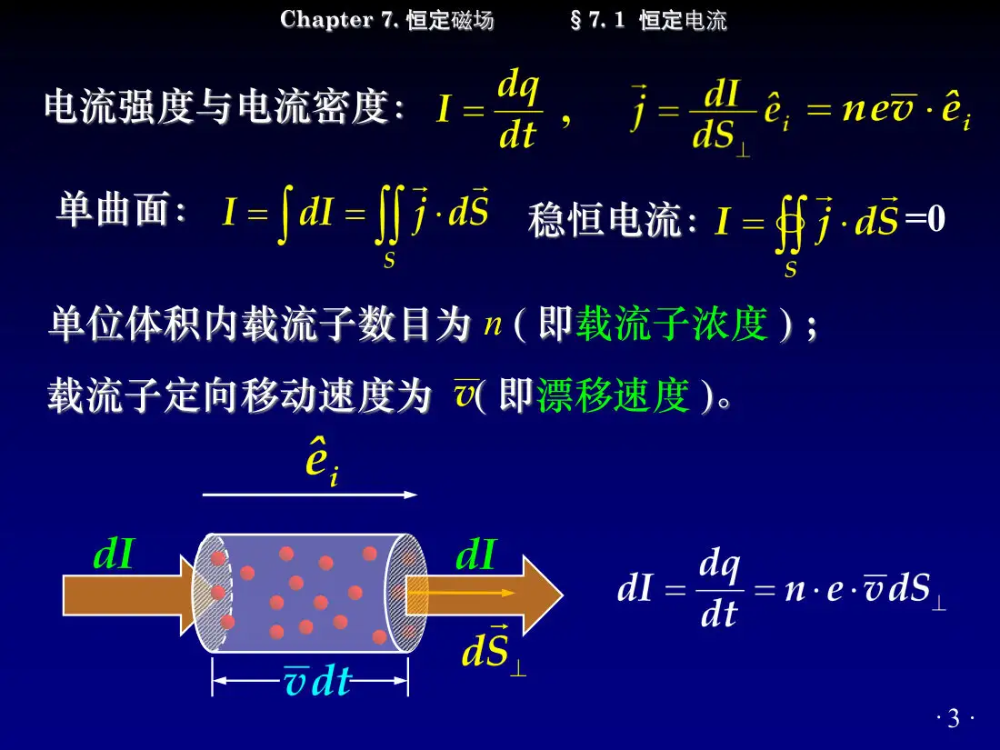
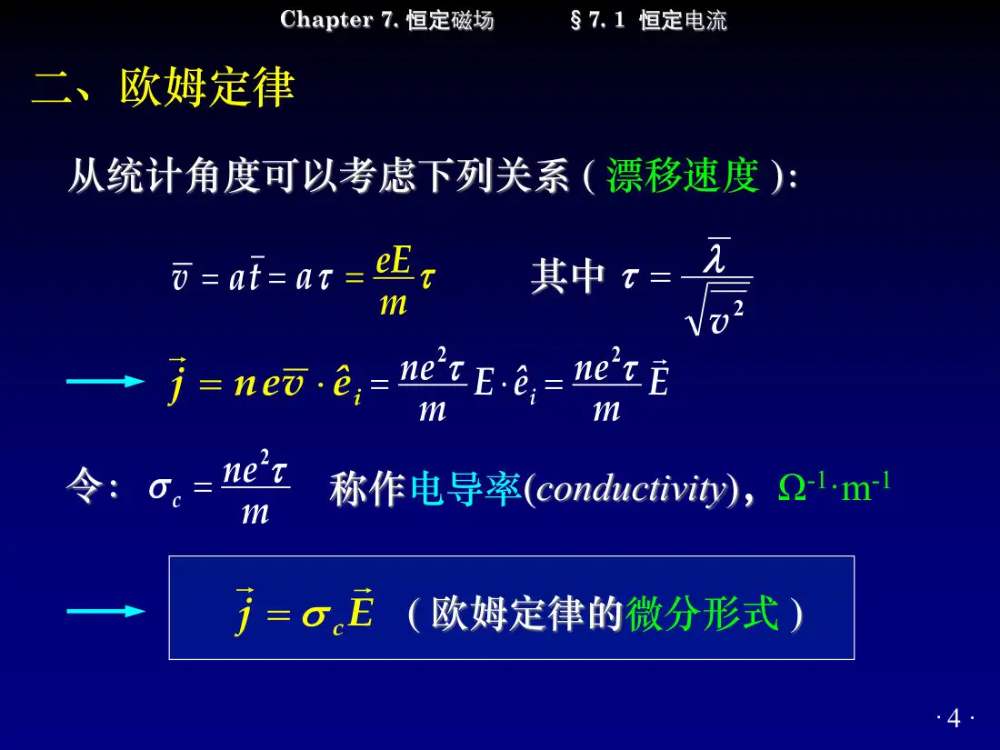
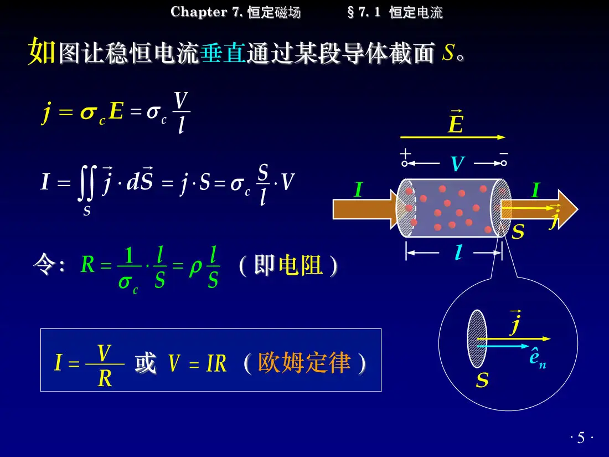
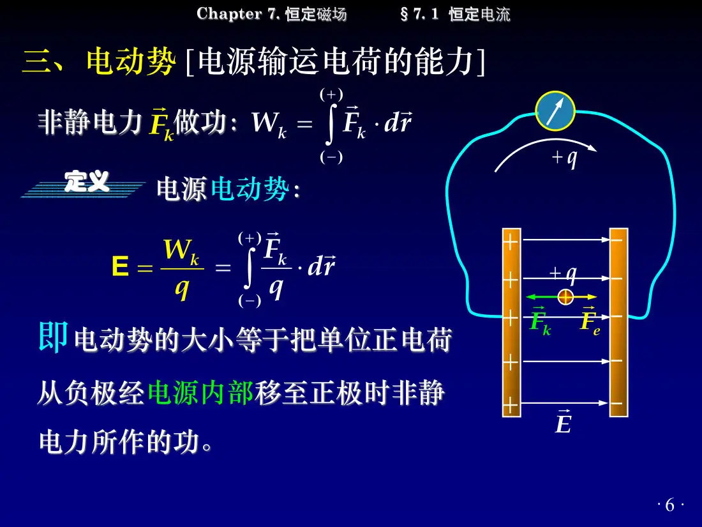
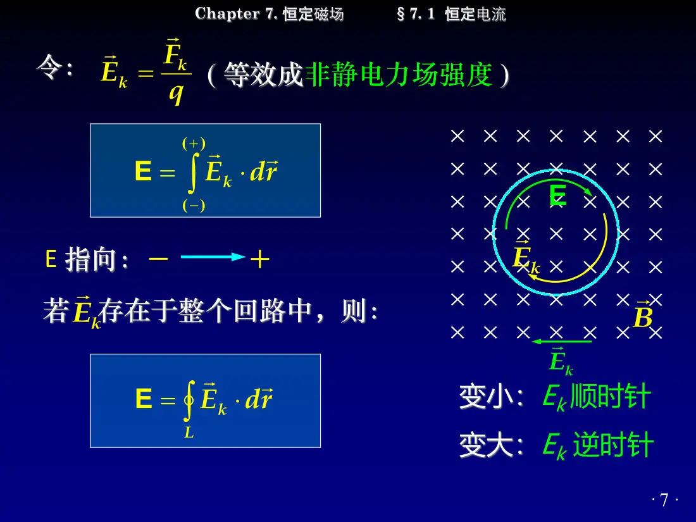
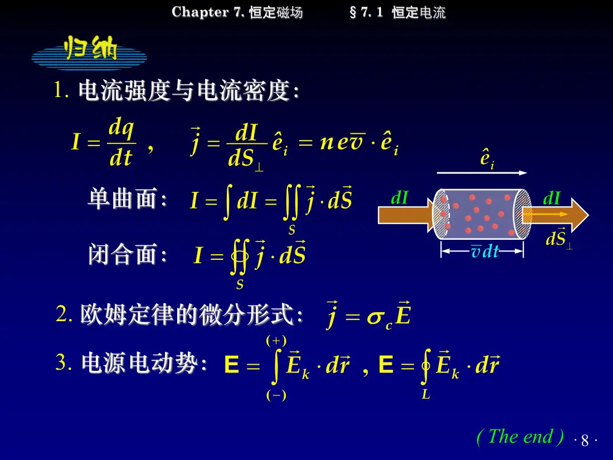

# 《大学物理》第7章 恒定磁场 §7.1 恒定电流（课件）

原件的每一页，下面附识别出的文字。

### § 7.1 恒定电流

原文：

§ 7.1 恒定电流

Chapter 7. 恒定磁场

§ 7.1 恒定电流

1

### 一、基本概念：电流与电流密度

原文：

一、基本概念：电流与电流密度

电流强度: $I = \frac{dq}{dt}$

即单位时间内通过某截面的电量!

定义 电流密度：

$$
\vec {j} = \frac {d I}{d S _ {\perp}} \hat {e} _ {i} \quad \left(\mathrm{A} / \mathrm{m} ^ {2}\right)
$$

即单位面积上流过的电流!

$\hat{e}_i$ 为导体中电流方向。

Chapter 7. 恒定磁场 § 7.1 恒定电流

2

### Chapter 7. 恒定磁场 § 7.1 恒定电流

原文：

Chapter 7. 恒定磁场 § 7.1 恒定电流

电流强度与电流密度: $I = \frac{dq}{dt}$ , $\vec{j} = \frac{dI}{dS_{\perp}}\hat{e}_i = ne\overline{v} \cdot \hat{e}_i$ 单曲面: $I = \int dI = \iint_S \vec{j} \cdot d\vec{S}$ 稳恒电流: $I = \iint_S \vec{j} \cdot d\vec{S} = 0$ 单位体积内载流子数目为 $n$ (即载流子浓度); 载流子定向移动速度为 $\overline{v}$ (即漂移速度)。

$$
d I = \frac {d q}{d t} = n \cdot e \cdot \overline {{v}} d S _ {\perp}
$$

3

### 二、欧姆定律

原文：

二、欧姆定律

从统计角度可以考虑下列关系（漂移速度）：

$$
\overline {{v}} = a \overline {{t}} = a \tau = \frac {e E}{m} \tau
$$

其中 $\tau = \frac{\overline{\lambda}}{\sqrt{v^2}}$

$$
\longrightarrow \vec {j} = n e \overline {{v}} \cdot \hat {\boldsymbol {e}} _ {i} = \frac {n e ^ {2} \tau}{m} E \cdot \hat {\boldsymbol {e}} _ {i} = \frac {n e ^ {2} \tau}{m} \vec {E}
$$

令： $\sigma_{c} = \frac{ne^{2}\tau}{m}$ 称作电导率(conductivity)， $\Omega^{-1} \cdot m^{-1}$

$\vec{j}=\sigma_{c}\vec{E}$ （欧姆定律的微分形式）

Chapter 7. 恒定磁场

§ 7.1 恒定电流

4

### Chapter 7. 恒定磁场 § 7.1 恒定电流

原文：

Chapter 7. 恒定磁场 § 7.1 恒定电流

如图让稳恒电流垂直通过某段导体截面 S。

$$
j = \sigma_ {c} E = \sigma_ {c} \frac {V}{l}
$$

$$
I = \iint_ {S} {\vec {j}} \cdot d {\vec {S}} = j \cdot S = \sigma_ {c} \frac {S}{l} \cdot V
$$

令： $R=\frac{1}{\sigma_{c}}\cdot\frac{l}{S}=\rho\frac{l}{S}$ （即电阻）

$I=\frac{V}{R}$ 或 V=IR （欧姆定律）

5

### Chapter 7. 恒定磁场

原文：

Chapter 7. 恒定磁场

三、电动势 [电源输运电荷的能力]

非静电力 $\vec{F}_k$ 做功： $W_k = \int_{(-)}^{(+)}\vec{F}_k\cdot d\vec{r}$

定义 电源电动势：

$E = \frac{W_k}{q} = \int_{(-)}^{(+)} \frac{\vec{F}_k}{q} \cdot d\vec{r}$ 即电动势的大小等于把单位正电荷从负极经电源内部移至正极时非静电力所作的功。

§ 7.1 恒定电流

6

### Chapter 7. 恒定磁场

原文：

Chapter 7. 恒定磁场

§ 7.1 恒定电流

令: $\vec{E}_k = \frac{\vec{F}_k}{q}$ (等效成非静电力场强度)

$$
\mathbf {E} = \int_ {(-)} ^ {(+)} \vec {E} _ {k} \cdot d \vec {r}
$$

E 指向：- → +

$$
\vec {E} _ {k}
$$

$$
\times \times \times \times \times \times \times
$$

若 $\vec{E}_k$ 存在于整个回路中，则：

$$
\mathbf {E} = \oint_ {L} \vec {E} _ {k} \cdot d \vec {r}
$$

变小: $E_{k}$ 顺时针

变大: $E_{k}$ 逆时针

7

### 归纳

原文：

归纳

1. 电流强度与电流密度:

$I = \frac{dq}{dt}$ , $\vec{j} = \frac{dI}{dS_{\perp}}\hat{e}_i = ne\overline{v}\cdot \hat{e}_i$

单曲面： $I=\int dI=\iint\vec{j}\cdot d\vec{S}$

闭合面: $I = \iint_{S} \vec{j} \cdot d\vec{S}$

2. 欧姆定律的微分形式: $\vec{j} = \sigma_{c}\vec{E}$

3. 电源电动势: $\mathbf{E} = \int_{(-)}^{(+)}\vec{E}_k\cdot d\vec{r}$ , $\mathbf{E} = \oint_{L}\vec{E}_k\cdot d\vec{r}$

Chapter 7. 恒定磁场 § 7.1 恒定电流

(The end)

8
