# 《大学物理》第7章 恒定磁场 §7.6.2 磁介质中的安培环路定理（课件）

原件的每一页，下面附识别出的文字。

### § 7.6 磁介质中的安培环路定理

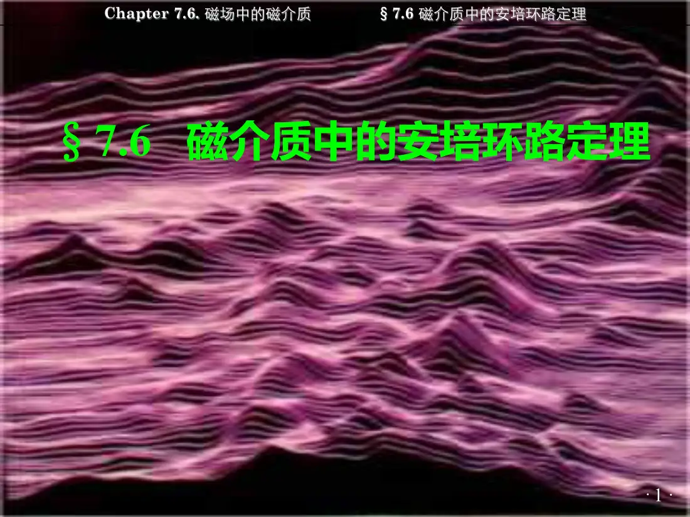

原文：

§ 7.6 磁介质中的安培环路定理

Chapter 7.6. 磁场中的磁介质

§ 7.6 磁介质中的安培环路定理

### 一、磁场强度H的安培环路定理

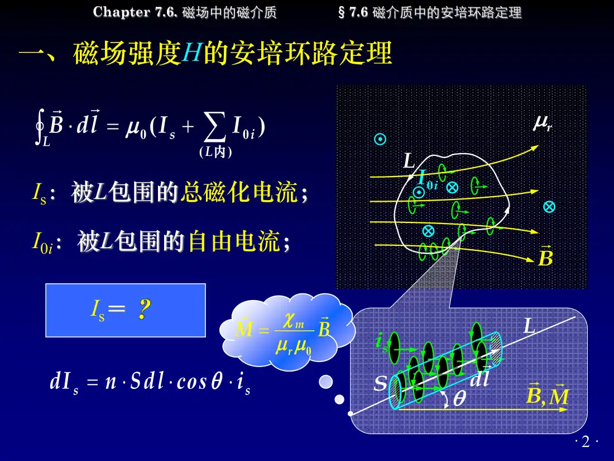

原文：

一、磁场强度H的安培环路定理

$\oint_{L}\vec{B}\cdot d\vec{l} = \mu_{0}(I_{s} + \sum_{(L\text{内})}I_{0i})$

$I_{s}$ ：被L包围的总磁化电流；

$I_{0i}$ ：被L包围的自由电流；

$$
I _ {\mathrm{s}} = ?
$$

$$
\vec {M} = \frac {\chi_ {m}}{\mu_ {r} \mu_ {0}} \vec {B}
$$

$$
d I _ {s} = n \cdot S d l \cdot c o s \theta \cdot i _ {s}
$$

Chapter 7.6. 磁场中的磁介质

§ 7.6 磁介质中的安培环路定理

2

### Chapter 7.6. 磁场中的磁介质

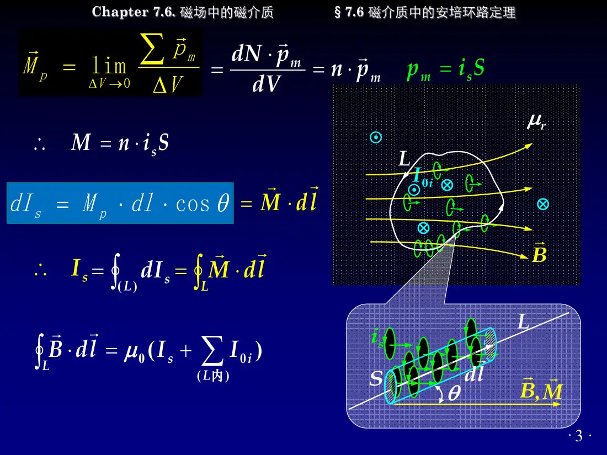

原文：

Chapter 7.6. 磁场中的磁介质

$$
\vec {M} _ {p} = \lim _ {\Delta V \rightarrow 0} \frac {\sum \vec {p} _ {m}}{\Delta V} = \frac {d N \cdot \vec {p} _ {m}}{d V} = n \cdot \vec {p} _ {m} \quad p _ {m} = i _ {s} S
$$

$$
\therefore M = n \cdot i _ {s} S
$$

$$
d I _ {s} = M _ {p} \cdot d l \cdot \cos \theta = \vec {M} \cdot d \vec {l}
$$

$$
\therefore I _ {s} = \oint_ {(L)} d I _ {s} = \oint_ {L} \vec {M} \cdot d \vec {l}
$$

$$
\oint_ {L} \vec {B} \cdot d \vec {l} = \mu_ {0} (I _ {s} + \sum_ {(L \text {内})} I _ {0 i})
$$

§ 7.6 磁介质中的安培环路定理

3

### Chapter 7.6. 磁场中的磁介质

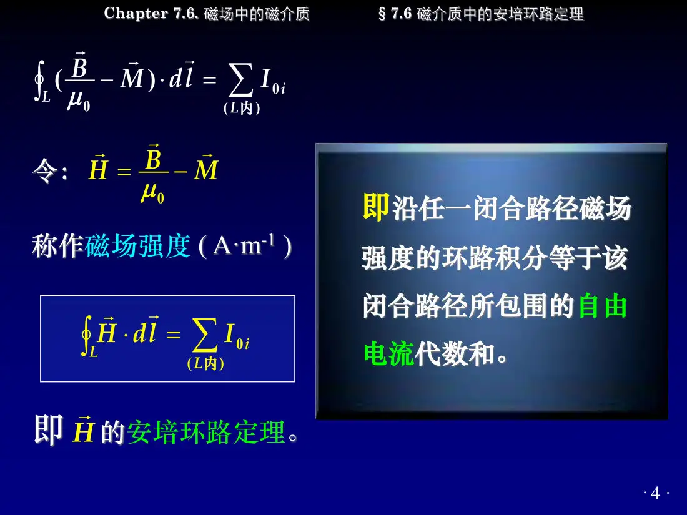

原文：

Chapter 7.6. 磁场中的磁介质

$$
\oint_ {L} \left(\frac {\vec {B}}{\mu_ {0}} - \vec {M}\right) \cdot d \vec {l} = \sum_ {(L \text {内})} I _ {0 i}
$$

令： $\vec{H} = \frac{\vec{B}}{\mu_0} - \vec{M}$

称作磁场强度 (A·m $^{-1}$ )

$$
\oint_ {L} \vec {H} \cdot d \vec {l} = \sum_ {(L \text {内})} I _ {0 i}
$$

即 $\vec{H}$ 的安培环路定理。

§ 7.6 磁介质中的安培环路定理

即沿任一闭合路径磁场强度的环路积分等于该闭合路径所包围的自由电流代数和。

4

### Chapter 7.6. 磁场中的磁介质

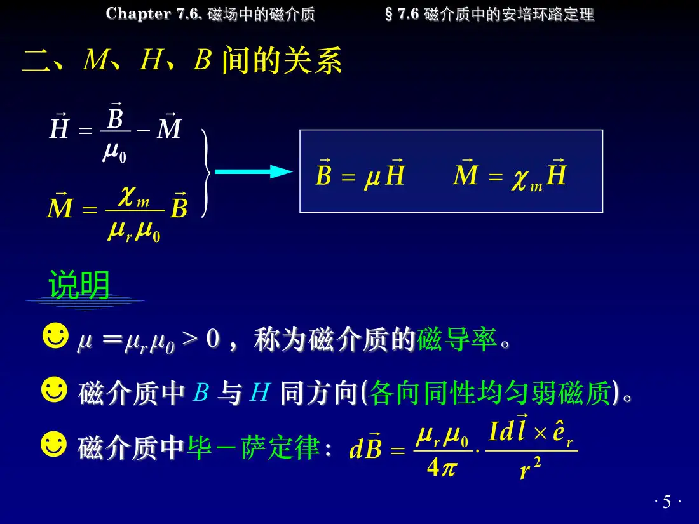

原文：

Chapter 7.6. 磁场中的磁介质

§ 7.6 磁介质中的安培环路定理

二、M、H、B 间的关系

$$
\vec {H} = \frac {\vec {B}}{\mu_ {0}} - \vec {M}
$$

$$
\vec {B} = \mu \vec {H}
$$

$$
\vec {M} = \chi_ {m} \vec {H}
$$

$$
\vec {M} = \frac {\chi_ {m}}{\mu_ {r} \mu_ {0}} \vec {B}
$$

说明

😊 $\mu = \mu_{r} \mu_{0} > 0$ ，称为磁介质的磁导率。

😊 磁介质中 B 与 H 同方向(各向同性均匀弱磁质)。

😊 磁介质中毕－萨定律： $d\vec{B}=\frac{\mu_{r}\mu_{0}}{4\pi}\cdot\frac{Id\vec{l}\times\hat{e}_{r}}{r^{2}}$

5

### Chapter 7.6. 磁场中的磁介质

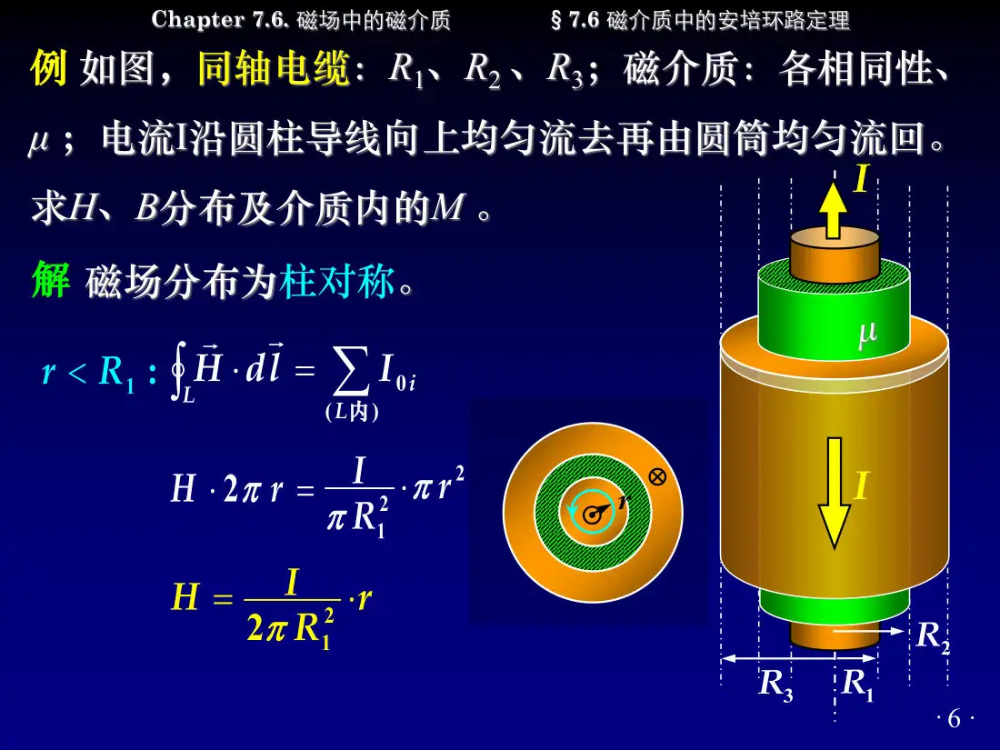

原文：

Chapter 7.6. 磁场中的磁介质

§ 7.6 磁介质中的安培环路定理

例如图，同轴电缆： $R_{1}$ 、 $R_{2}$ 、 $R_{3}$ ；磁介质：各相同性、 $\mu$ ；电流I沿圆柱导线向上均匀流去再由圆筒均匀流回。

解 磁场分布为柱对称。

$$
r <   R _ {1}: \oint_ {L} \vec {H} \cdot d \vec {l} = \sum_ {(L \text {内})} I _ {0 i}
$$

$$
H \cdot 2 \pi r = \frac {I}{\pi R _ {1} ^ {2}} \cdot \pi r ^ {2}
$$

$$
H = \frac {I}{2 \pi R _ {1} ^ {2}} \cdot r
$$

6

### Chapter 7.6. 磁场中的磁介质

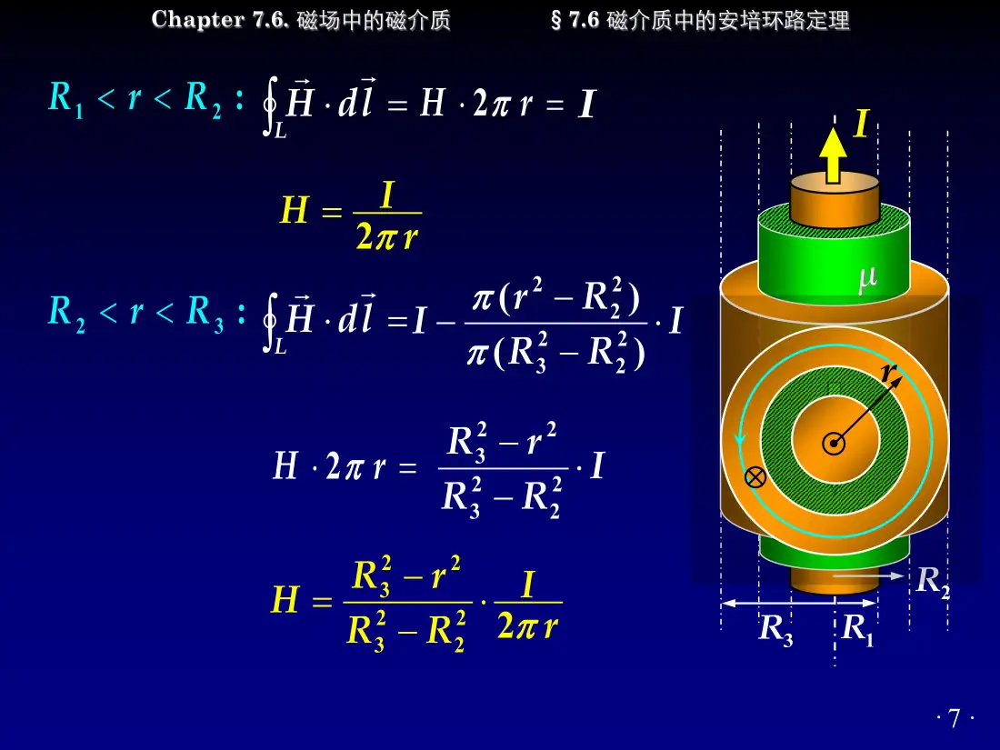

原文：

Chapter 7.6. 磁场中的磁介质

§ 7.6 磁介质中的安培环路定理

$$
R _ {1} <   r <   R _ {2}: \oint_ {L} \vec {H} \cdot d \vec {l} = H \cdot 2 \pi r = I
$$

$$
H = \frac {I}{2 \pi r}
$$

$$
R _ {2} <   r <   R _ {3}: \oint_ {L} \vec {H} \cdot d \vec {l} = I - \frac {\pi \left(r ^ {2} - R _ {2} ^ {2}\right)}{\pi \left(R _ {3} ^ {2} - R _ {2} ^ {2}\right)} \cdot I
$$

$$
H \cdot 2 \pi r = \frac {R _ {3} ^ {2} - r ^ {2}}{R _ {3} ^ {2} - R _ {2} ^ {2}} \cdot I
$$

$$
H = \frac {R _ {3} ^ {2} - r ^ {2}}{R _ {3} ^ {2} - R _ {2} ^ {2}} \cdot \frac {I}{2 \pi r}
$$

7

### Chapter 7.6. 磁场中的磁介质

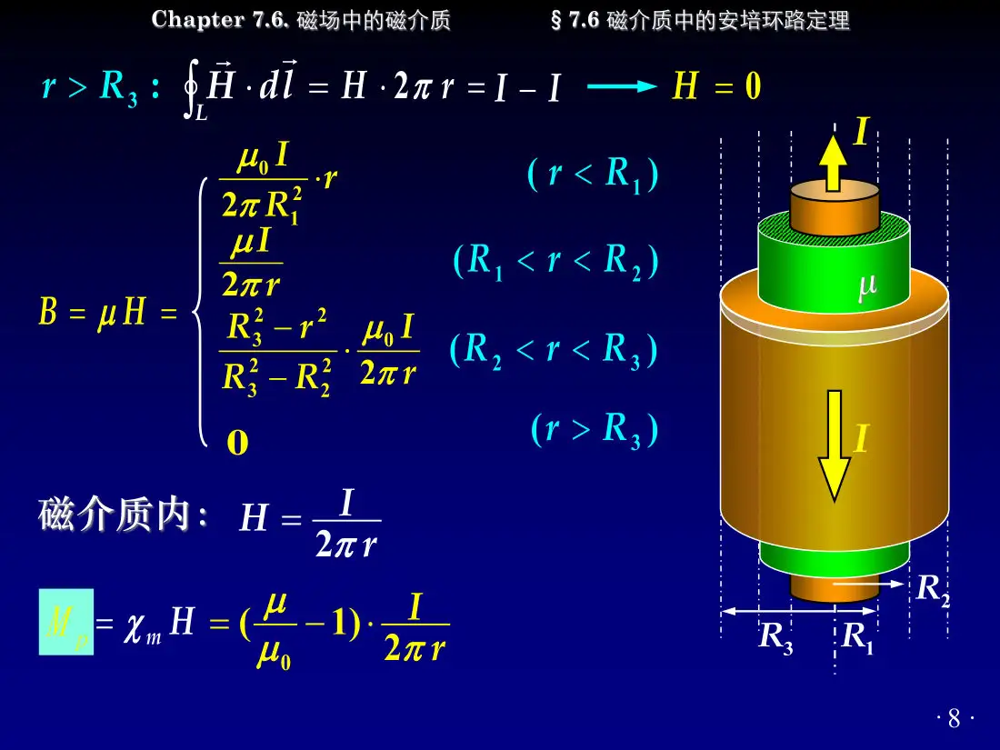

原文：

Chapter 7.6. 磁场中的磁介质

§ 7.6 磁介质中的安培环路定理

$$
r > R _ {3}: \oint_ {L} \vec {H} \cdot d \vec {l} = H \cdot 2 \pi r = I - I \longrightarrow H = 0
$$

$$
B = \mu H = \left\{ \begin{array}{l l} \frac {\mu_ {0} I}{2 \pi R _ {1} ^ {2}} \cdot r & (r <   R _ {1}) \\ \frac {\mu I}{2 \pi r} & (R _ {1} <   r <   R _ {2}) \\ \frac {R _ {3} ^ {2} - r ^ {2}}{R _ {3} ^ {2} - R _ {2} ^ {2}} \cdot \frac {\mu_ {0} I}{2 \pi r} & (R _ {2} <   r <   R _ {3}) \\ 0 & (r > R _ {3}) \end{array} \right.
$$

磁介质内： $H=\frac{I}{2\pi r}$

$$
M _ {p} = \chi_ {m} H = (\frac {\mu}{\mu_ {0}} - 1) \cdot \frac {I}{2 \pi r}
$$

8

### Chapter 7.6. 磁场中的磁介质

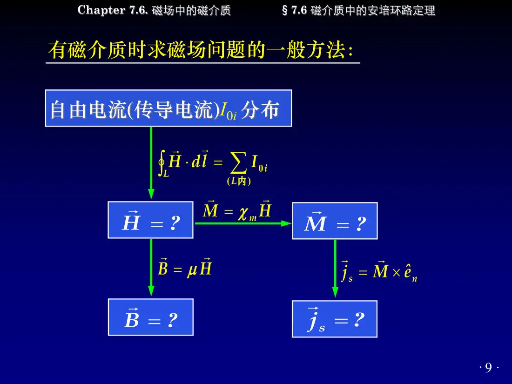

原文：

Chapter 7.6. 磁场中的磁介质

有磁介质时求磁场问题的一般方法:

自由电流(传导电流) $I_{0i}$ 分布

$$
\oint_ {L} \vec {H} \cdot d \vec {l} = \sum_ {(L \text {内})} I _ {0 i}
$$

$$
\vec {H} = ?
$$

$$
\vec {M} = \chi_ {m} \vec {H}
$$

$$
\vec {M} = ?
$$

$$
\vec {B} = \mu \vec {H}
$$

$$
\vec {j} _ {s} = \vec {M} \times \hat {e} _ {n}
$$

$$
\vec {B} = ?
$$

$$
\vec {j} _ {s} = ?
$$

§ 7.6 磁介质中的安培环路定理

9

### 归纳

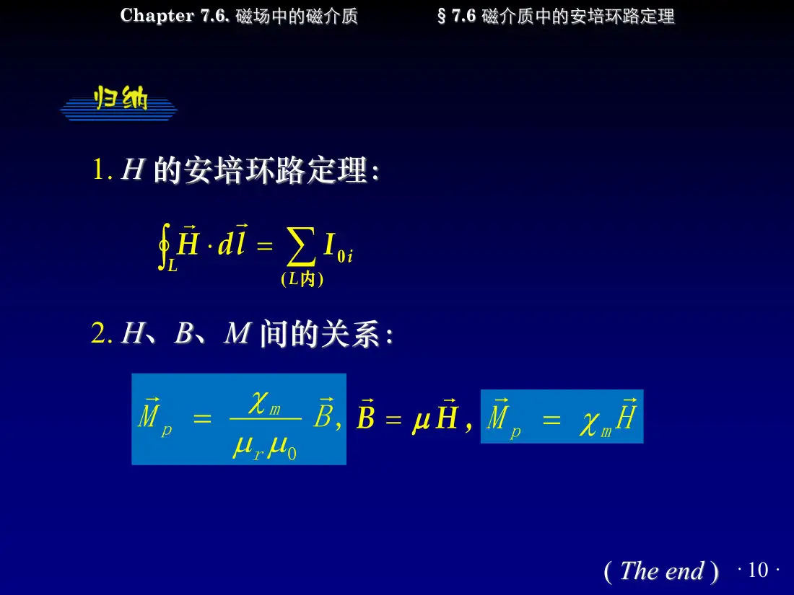

原文：

归纳

1. $H$ 的安培环路定理:

$\oint_{L}\vec{H}\cdot d\vec{l} = \sum_{(L\text{内})}I_{0i}$

2. H、B、M 间的关系:

$$
\vec {M} _ {p} = \frac {\chi_ {m}}{\mu_ {r} \mu_ {0}} \vec {B}, \vec {B} = \mu \vec {H}, \vec {M} _ {p} = \chi_ {m} \vec {H}
$$

Chapter 7.6. 磁场中的磁介质

§ 7.6 磁介质中的安培环路定理

( The end )

10

### Chapter 7.6. 磁场中的磁介质

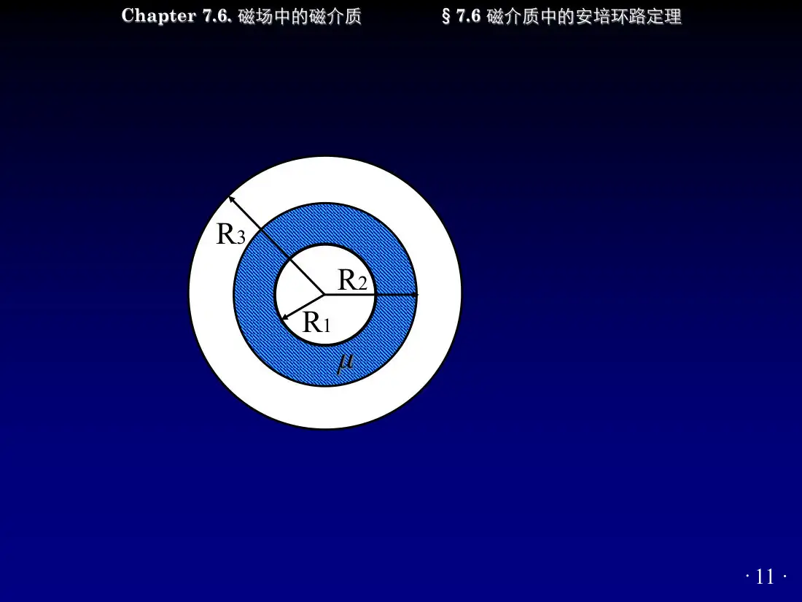

原文：

Chapter 7.6. 磁场中的磁介质

§ 7.6 磁介质中的安培环路定理

11
