# 《大学物理》第7章 恒定磁场中的磁介质与磁化强度（课件）

原件的每一页，下面附识别出的文字。

### .6 磁介质 磁化强度

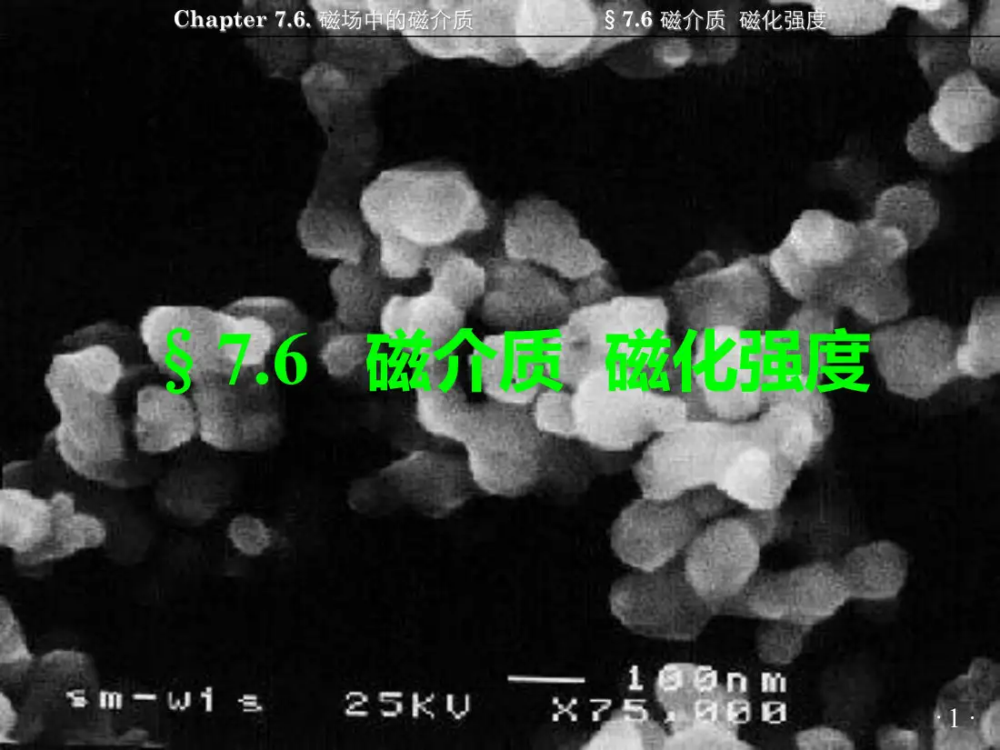

原文：

.6 磁介质 磁化强度

sm-wis

25KV

1

Chapter 7.6. 磁场中的磁介质

§ 7.6 磁介质 磁化强度

### 一、物质的分子磁矩

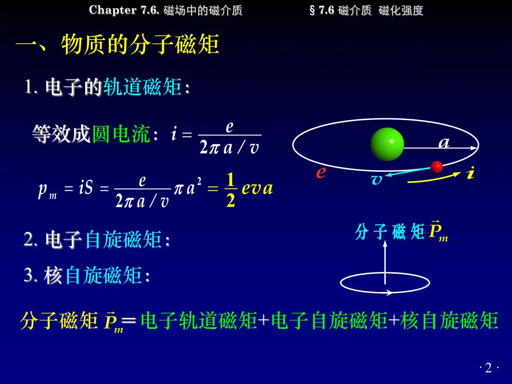

原文：

一、物质的分子磁矩

1. 电子的轨道磁矩：

等效成圆电流： $i=\frac{e}{2\pi a/v}$

$$
p _ {m} = i S = \frac {e}{2 \pi a / v} \pi a ^ {2} = \frac {1}{2} e v a
$$

2. 电子自旋磁矩：

3. 核自旋磁矩：

分子磁矩 $\vec{P}_{m}$

分子磁矩 $\vec{P}_{m}$ = 电子轨道磁矩 + 电子自旋磁矩 + 核自旋磁矩

Chapter 7.6. 磁场中的磁介质

§ 7.6 磁介质 磁化强度

2

### Chapter 7.6. 磁场中的磁介质

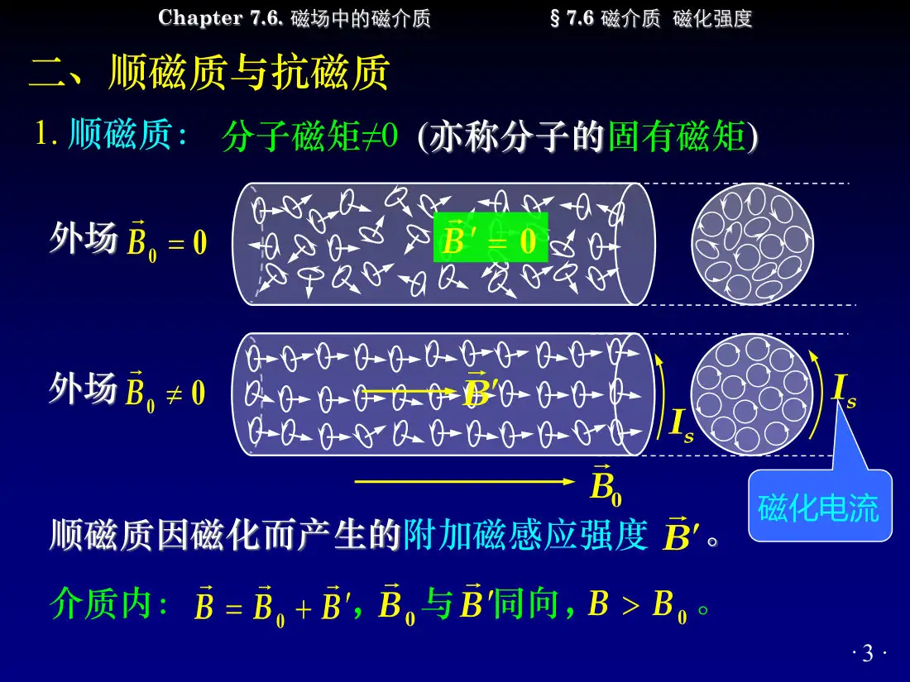

原文：

Chapter 7.6. 磁场中的磁介质

§ 7.6 磁介质 磁化强度

二、顺磁质与抗磁质

1. 顺磁质：分子磁矩≠0（亦称分子的固有磁矩）

外场 $\vec{B}_0 = 0$

外场 $\vec{B}_0\neq 0$

$$
\vec {B} ^ {\prime} = 0
$$

$$
\left( \begin{array}{c c c c c c c c c} \vec {0} & 0 & 0 & 0 & 0 & 0 & 0 & 0 & 0 \\ 0 & 0 & 0 & 0 & 0 & 0 & \overrightarrow {B ^ {\prime}} & 0 & 0 \\ 0 & 0 & 0 & 0 & 0 & 0 & 0 & 0 & 0 \end{array} \right)
$$

顺磁质因磁化而产生的附加磁感应强度 $\vec{B}^{\prime}$ 。

磁化电流

介质内： $\vec{B} = \vec{B}_0 + \vec{B}'$ ， $\vec{B}_0$ 与 $\vec{B}'$ 同向， $B > B_0$ 。

3

### Chapter 7.6. 磁场中的磁介质

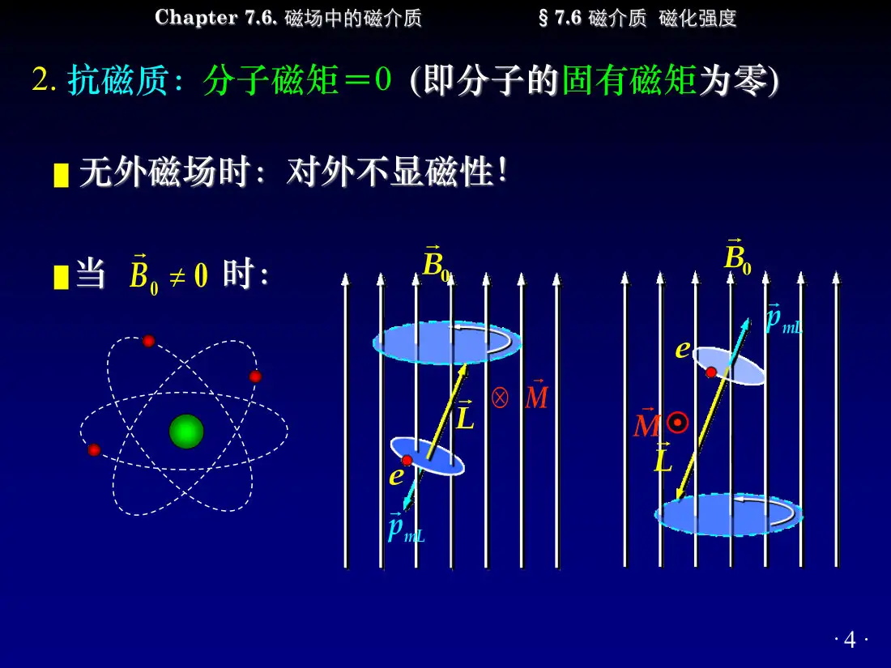

原文：

Chapter 7.6. 磁场中的磁介质

§ 7.6 磁介质 磁化强度

2. 抗磁质：分子磁矩 = 0 （即分子的固有磁矩为零）

■ 无外磁场时：对外不显磁性！

当 $\vec{B}_0 \neq 0$ 时： $\vec{B}_0$ 时， $\vec{B}_0 = \vec{B}_0$ 时， $\vec{B}_0 = \vec{p}_{mL}$ 时， $\vec{B}_0 = \vec{p}_{mL}$ 时， $\vec{B}_0 = \vec{e}$ 时， $\vec{M} \odot \vec{L}$ 时， $\vec{e} = \vec{p}_{mL}$ 时， $\vec{L} \otimes \vec{M}$ 时， $\vec{L} = \vec{e}$ 时， $\vec{L} = \vec{e}$ 时， $\vec{L} = \vec{e}$ 时， $\vec{L} = \vec{e}$ 时， $\vec{L} = \vec{e}$ 时， $\vec{L} = \vec{e}$ 时， $\vec{L} = \vec{e}$ 与 $|\vec{B}_0| = |\vec{B}_0| = |\vec{B}_0|$ ，且在物体上有一条带圆圈的球体，每个球体位于一个绿色球体。

4

### 2. 抗磁质: 分子磁矩 = 0 (即分子的固有磁矩为零)

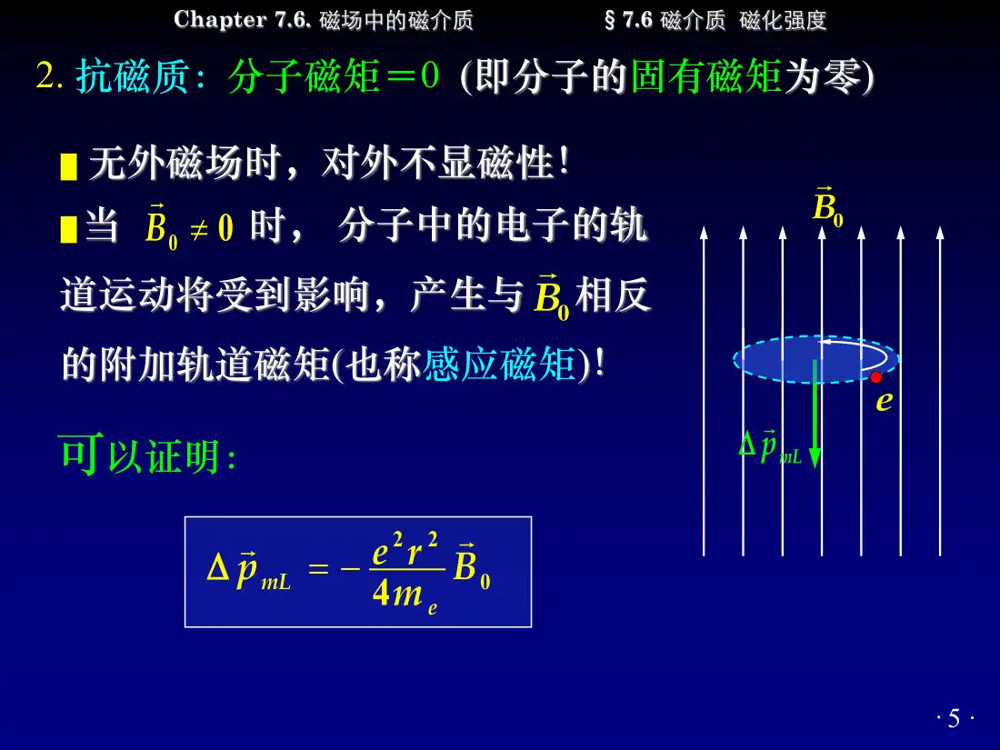

原文：

2. 抗磁质: 分子磁矩 = 0 (即分子的固有磁矩为零)

■无外磁场时，对外不显磁性！  
■当 $\vec{B}_0 \neq 0$ 时，分子中的电子的轨道运动将受到影响，产生与 $\vec{B}_0$ 相反的附加轨道磁矩(也称感应磁矩)!

可以证明:

$$
\Delta \vec {p} _ {m L} = - \frac {e ^ {2} r ^ {2}}{4 m _ {e}} \vec {B} _ {0}
$$

Chapter 7.6. 磁场中的磁介质

§ 7.6 磁介质 磁化强度

5

### $\vec{B}'$

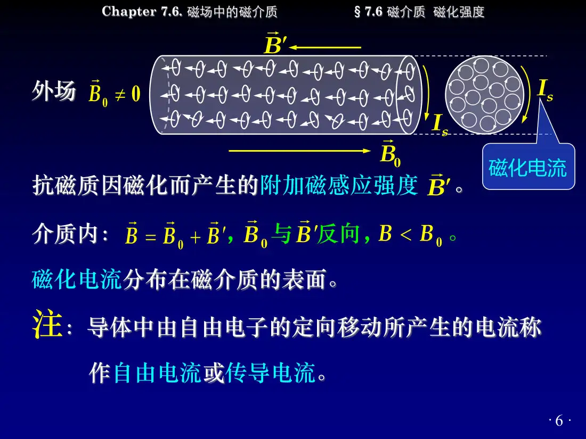

原文：

$\vec{B}'$

外场 $\vec{B}_0\neq 0$

$$
\begin{array}{c} \left( \begin{array}{c c c c c c c c c c c c c c c} \theta & \theta & \theta & \theta & \theta & \theta & \theta & \theta & \theta & \theta & \theta \\ \hline \theta & \theta & \theta & \theta & \theta & \theta & \theta & \theta & \theta & \theta & \theta \\ \hline \theta & \theta & \theta & \theta & \theta & \theta & \theta & \theta & \theta & \theta & \theta \\ \hline \theta & \theta & \theta & \theta & \theta & \theta & \theta & \theta & \theta & 0 & 0 \\ \hline \end{array} \right) \\ \hline \overrightarrow {B _ {0}} \end{array}
$$

磁化电流

抗磁质因磁化而产生的附加磁感应强度 $\vec{B}^{\prime}$ 。

介质内： $\vec{B} = \vec{B}_0 + \vec{B}'$ ， $\vec{B}_0$ 与 $\vec{B}'$ 反向， $B < B_0$ 。

磁化电流分布在磁介质的表面。

注：导体中由自由电子的定向移动所产生的电流称

作自由电流或传导电流。

Chapter 7.6. 磁场中的磁介质

§ 7.6 磁介质 磁化强度

6

### 二、磁化强度

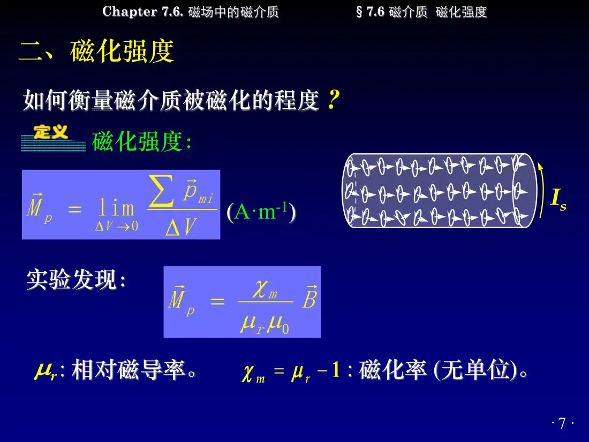

原文：

二、磁化强度

如何衡量磁介质被磁化的程度？

定义 磁化强度:

$$
\vec {M} _ {p} = \lim _ {\Delta V \rightarrow 0} \frac {\sum \vec {p} _ {m i}}{\Delta V} (\mathrm{A} \cdot \mathrm{m} ^ {- 1})
$$

$$
I _ {s}
$$

实验发现:

$$
\vec {M} _ {p} = \frac {\chi_ {m}}{\mu_ {r} \mu_ {0}} \vec {B}
$$

$\mu_{r}$ : 相对磁导率。 $\chi_{m} = \mu_{r} - 1$ : 磁化率 (无单位)。

Chapter 7.6. 磁场中的磁介质

§ 7.6 磁介质 磁化强度

7

### 顺磁质： $\mu_{r}>1,\chi_{m}>0$ ；M与B同向。

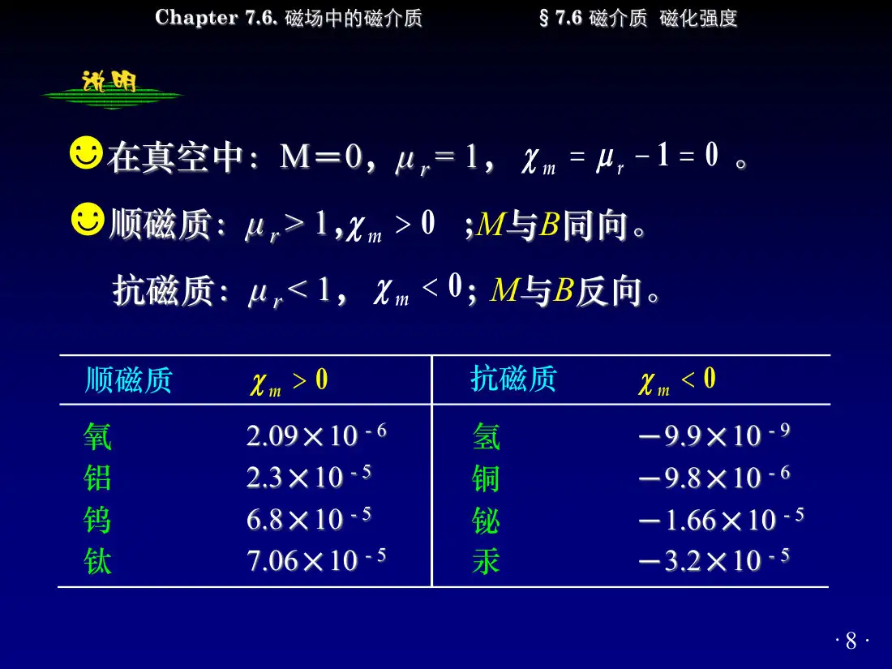

原文：

在真空中：M=0， $\mu_{r}=1$ ， $\chi_{m}=\mu_{r}-1=0$ 。

顺磁质： $\mu_{r}>1,\chi_{m}>0$ ；M与B同向。

抗磁质： $\mu_{r}<1,\quad\chi_{m}<0;M$ 与B反向。

<table><tr><td>顺磁质</td><td> $\chi_m > 0$ </td><td>抗磁质</td><td> $\chi_m < 0$ </td></tr><tr><td>氧</td><td> $2.09 \times 10^{-6}$ </td><td>氢</td><td> $-9.9 \times 10^{-9}$ </td></tr><tr><td>铝</td><td> $2.3 \times 10^{-5}$ </td><td>铜</td><td> $-9.8 \times 10^{-6}$ </td></tr><tr><td>钨</td><td> $6.8 \times 10^{-5}$ </td><td>铋</td><td> $-1.66 \times 10^{-5}$ </td></tr><tr><td>钛</td><td> $7.06 \times 10^{-5}$ </td><td>汞</td><td> $-3.2 \times 10^{-5}$ </td></tr></table>

Chapter 7.6. 磁场中的磁介质

§ 7.6 磁介质 磁化强度

8

### 三、磁化强度与磁化电流间的关系

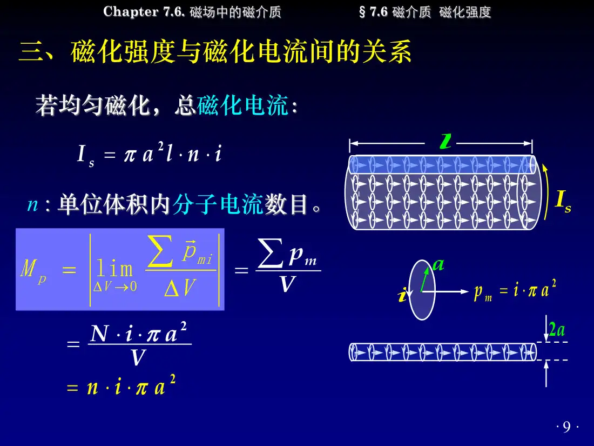

原文：

三、磁化强度与磁化电流间的关系

若均匀磁化，总磁化电流：

$$
I _ {s} = \pi a ^ {2} l \cdot n \cdot i
$$

n : 单位体积内分子电流数目。

$$
\begin{array}{r l}M _ {p}&= \left| \lim _ {\Delta V \rightarrow 0} \frac {\sum \vec {p} _ {m i}}{\Delta V} \right| = \frac {\sum p _ {m}}{V}\\&= \frac {N \cdot i \cdot \pi a ^ {2}}{V}\\&= n \cdot i \cdot \pi a ^ {2}\end{array}
$$

$$
i \xrightarrow {a} p _ {m} = i \cdot \pi a ^ {2}
$$

G→G→G→G→G→G→G→G→G→G→G→G

Chapter 7.6. 磁场中的磁介质

§ 7.6 磁介质 磁化强度

9

### $$

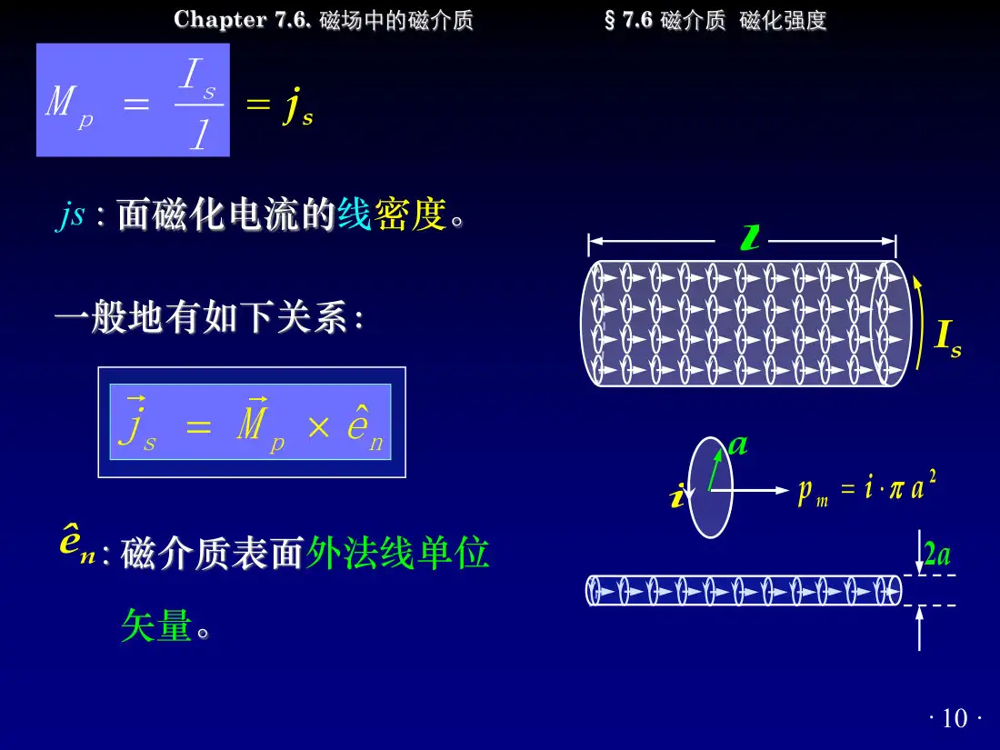

原文：

$$
M _ {p} = \frac {I _ {s}}{l} = j _ {s}
$$

js：面磁化电流的线密度。

一般地有如下关系：

$$
\vec {j} _ {s} = \vec {M} _ {p} \times \hat {e} _ {n}
$$

$\hat{e}_{n}$ : 磁介质表面外法线单位矢量。

$$
i \xrightarrow {a} p _ {m} = i \cdot \pi a ^ {2}
$$

$\rightarrow$ $\rightarrow$ $\rightarrow$ $\rightarrow$ $\rightarrow$ $\rightarrow$ $\rightarrow$ $\rightarrow$ $\rightarrow$ $\rightarrow$ $\rightarrow$ $\rightarrow$

Chapter 7.6. 磁场中的磁介质

§ 7.6 磁介质 磁化强度

10

### 试判断：顺磁质中的磁化电流方向。

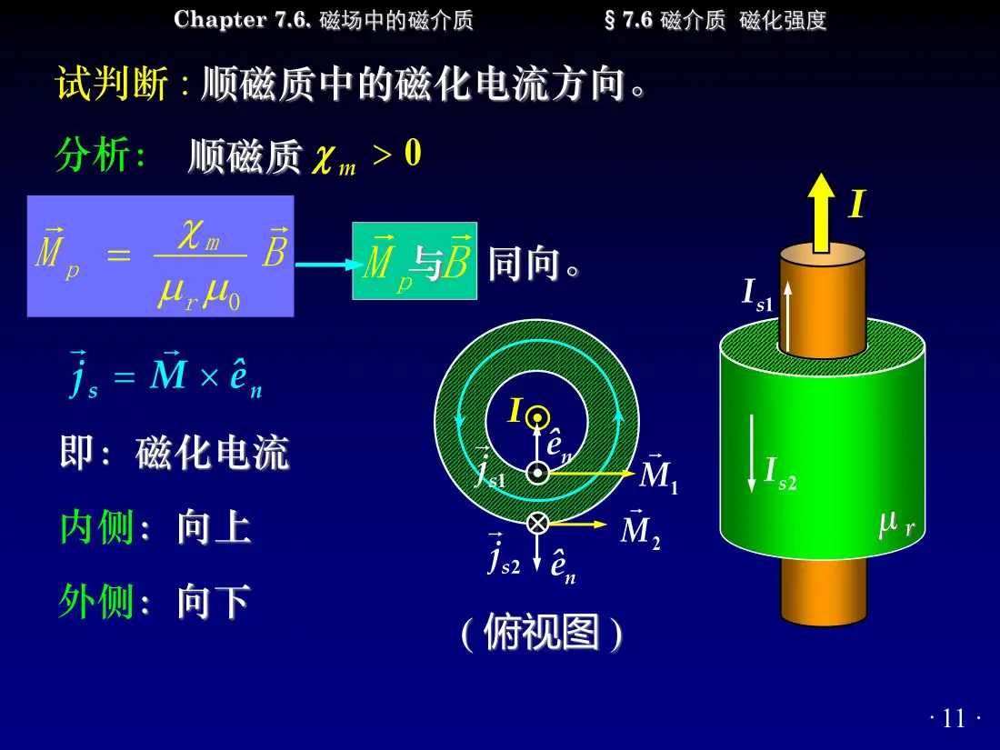

原文：

试判断：顺磁质中的磁化电流方向。

分析：顺磁质 $\chi_{m} > 0$

$\vec{M}_{p} = \frac{\chi_{m}}{\mu_{r}\mu_{0}}\vec{B}\longrightarrow \vec{M}_{p}$ 与 $\vec{B}$ 同向。

$$
\vec {j} _ {s} = \vec {M} \times \hat {e} _ {n}
$$

即：磁化电流

内侧：向上

外侧：向下

Chapter 7.6. 磁场中的磁介质

§ 7.6 磁介质 磁化强度

11

### 1. 磁介质:

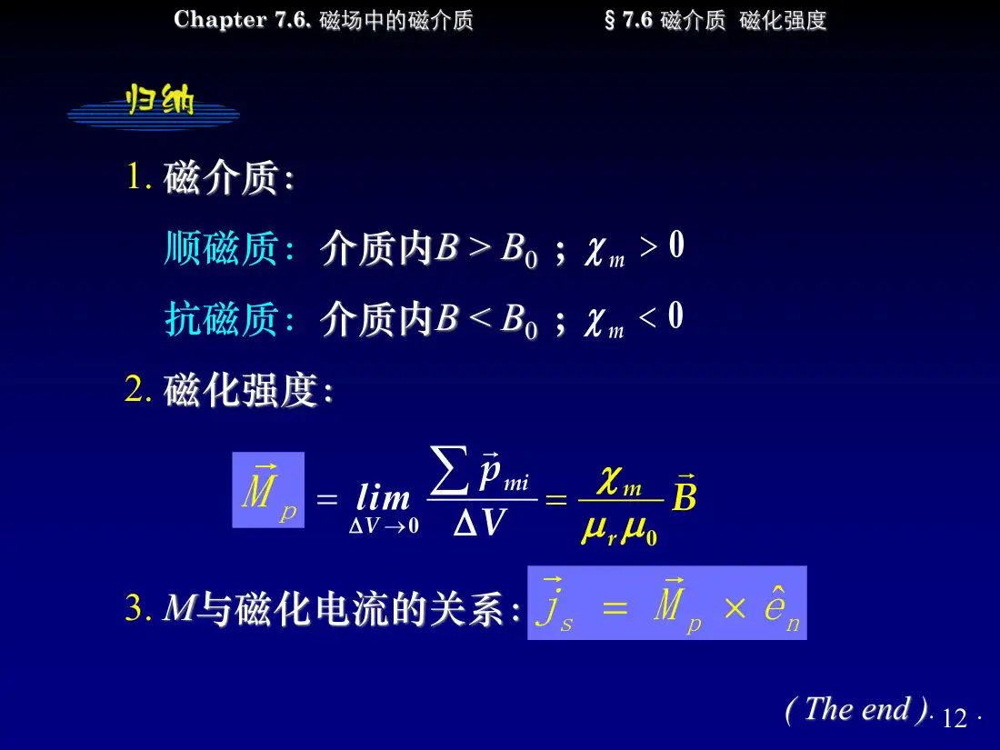

原文：

1. 磁介质:

顺磁质：介质内 $B>B_{0}$ ； $\chi_{m}>0$

抗磁质：介质内 $B < B_{0}$ ； $\chi_{m} < 0$

2. 磁化强度:

$$
\vec {M} _ {p} = \lim _ {\Delta V \rightarrow 0} \frac {\sum \vec {p} _ {m i}}{\Delta V} = \frac {\chi_ {m}}{\mu_ {r} \mu_ {0}} \vec {B}
$$

3. M与磁化电流的关系: $\vec{j}_{s} = \vec{M}_{p} \times \hat{e}_{n}$

Chapter 7.6. 磁场中的磁介质

§ 7.6 磁介质 磁化强度

(The end)

12
