# 《大学物理》第7章 恒定磁场（课件）

原件的每一页，下面附识别出的文字。

### §7.4 洛沦兹力

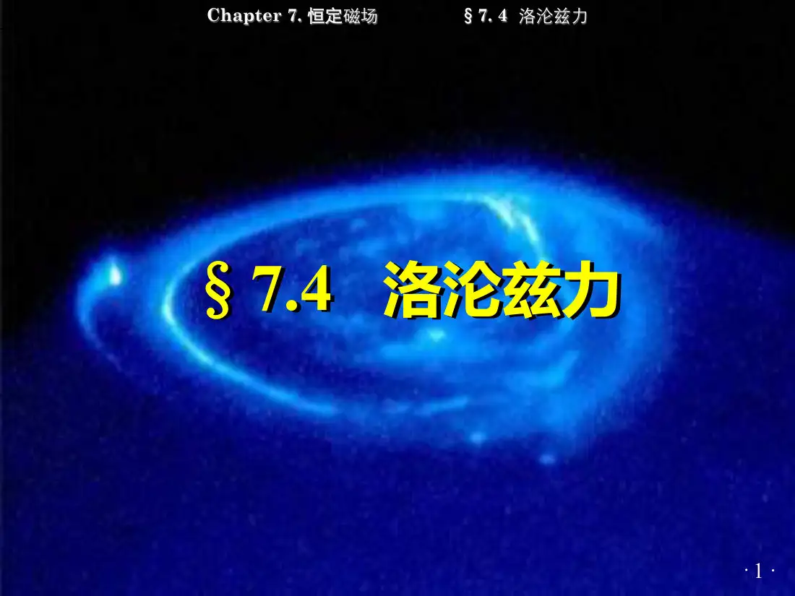

原文：

§7.4 洛沦兹力

Chapter 7. 恒定磁场

§7. 4 洛沦兹力

1

### Chapter 7. 恒定磁场

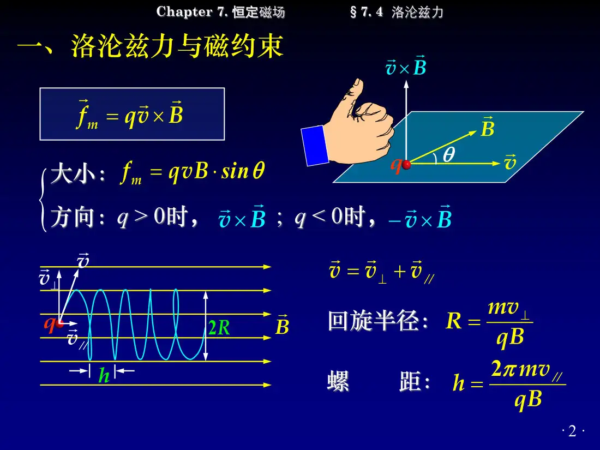

原文：

Chapter 7. 恒定磁场

一、洛沦兹力与磁约束

$$
\vec {f} _ {m} = q \vec {v} \times \vec {B}
$$

大小： $1 2 = ( 1 0 0 0 0 0 0 0 0 0 0 0 0 0 0 0 0 0 0 0 0 0 0 0 0 0 0 0 0 0 0 0 0 0 0 0 0 0 0 0 0 0 0 0 0 0 0 0 0 0 0 0 0 0 0 0 0 0 0 0$

方向： $y = 0$ 时， $\frac { 5 } { ( 6 ) } \times \frac { 5 } { ( 6 ) } =$ ; $y = -$ 时， $- \sqrt { ( 0 ) ^ { 2 } } = \sqrt { 3 }$

$$
\vec {v} = \vec {v} _ {\perp} + \vec {v} _ {/ /}
$$

B 回旋半径： $\vert \overrightarrow { a } \vert = \frac { \vert \overrightarrow { a } / / \overrightarrow { b } \vert } { \vert \overrightarrow { a } / / \overrightarrow { b } \vert }$

螺

距：

$$
h = \frac {2 \pi m v _ {\parallel}}{q B}
$$

§7. 4 洛沦兹力

· 2

### §7. 4 洛沦兹力

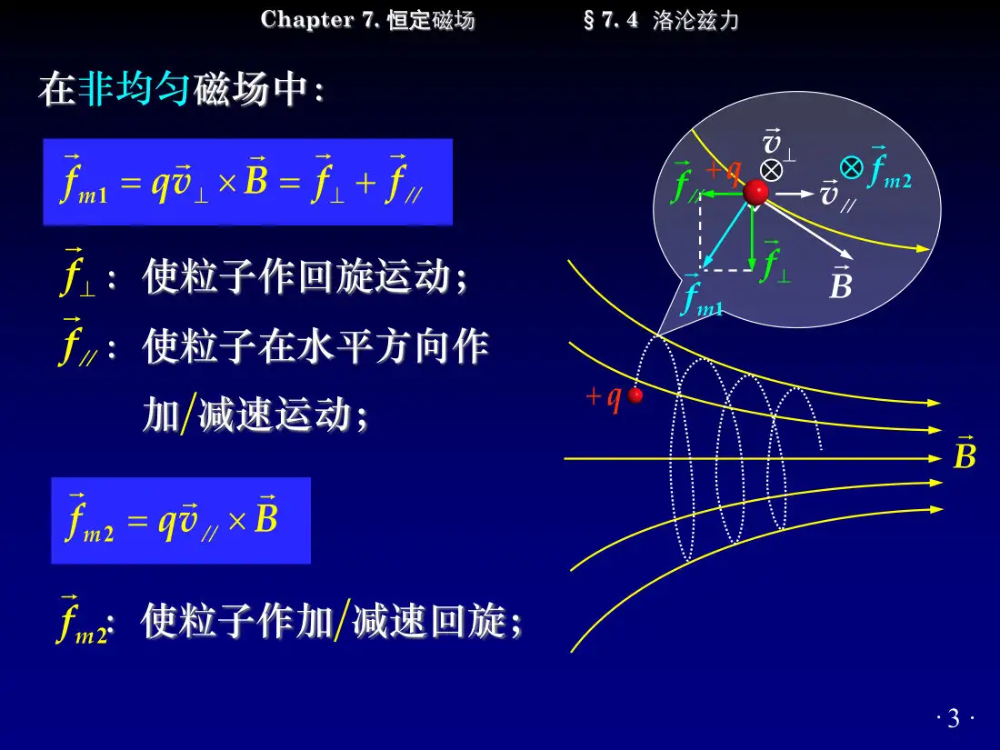

原文：

§7. 4 洛沦兹力

在非均匀磁场中：

$$
\vec {f} _ {m 1} = q \vec {v} _ {\perp} \times \vec {B} = \vec {f} _ {\perp} + \vec {f} _ {/ /}
$$

$\frac { 3 } { 4 } \times \frac { 1 } { 2 } = \frac { 3 } { 2 }$ ：使粒子作回旋运动；

：使粒子在水平方向作加/减速运动；

$$
\vec {f} _ {m 2} = q \vec {v} _ {/ /} \times \vec {B}
$$

$1 1 0 0 \div m \cdots 0$ 使粒子作加/减速回旋；

Chapter 7. 恒定磁场

· 3

### Chapter 7. 恒定磁场

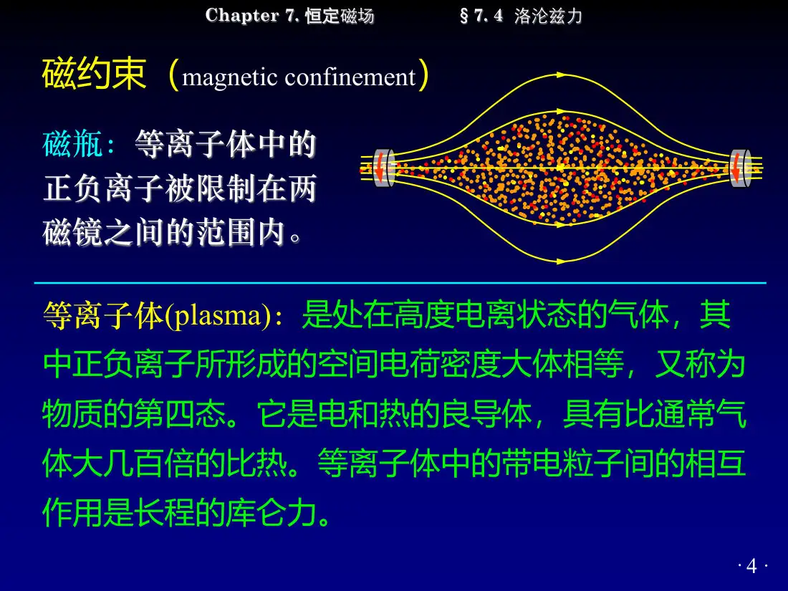

原文：

Chapter 7. 恒定磁场

磁约束 （magnetic confinement）

磁瓶：等离子体中的正负离子被限制在两磁镜之间的范围内。

§7. 4 洛沦兹力

等离子体(plasma)：是处在高度电离状态的气体，其中正负离子所形成的空间电荷密度大体相等，又称为物质的第四态。它是电和热的良导体，具有比通常气体大几百倍的比热。等离子体中的带电粒子间的相互作用是长程的库仑力。

· 4

### Chapter 7. 恒定磁场

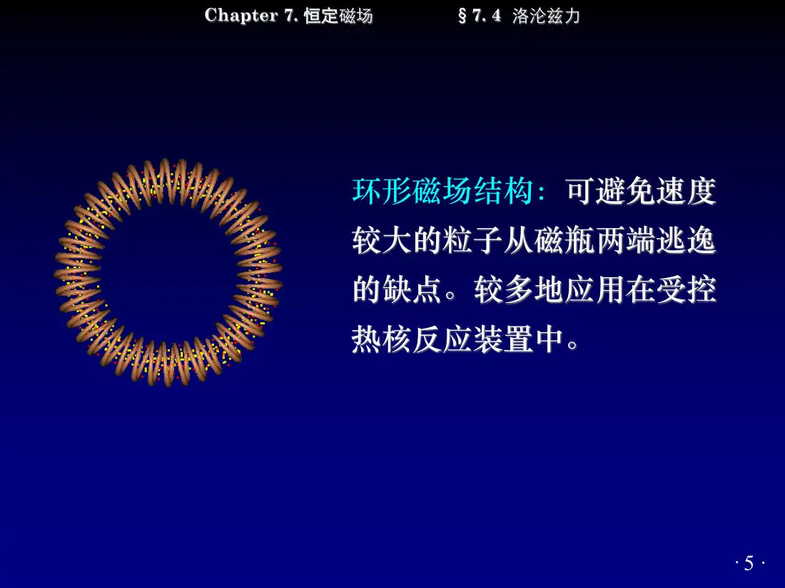

原文：

环形磁场结构：可避免速度较大的粒子从磁瓶两端逃逸的缺点。较多地应用在受控热核反应装置中。

Chapter 7. 恒定磁场

§7. 4 洛沦兹力

5

### 地磁场的范艾仑辐射带（Van Allen belts）

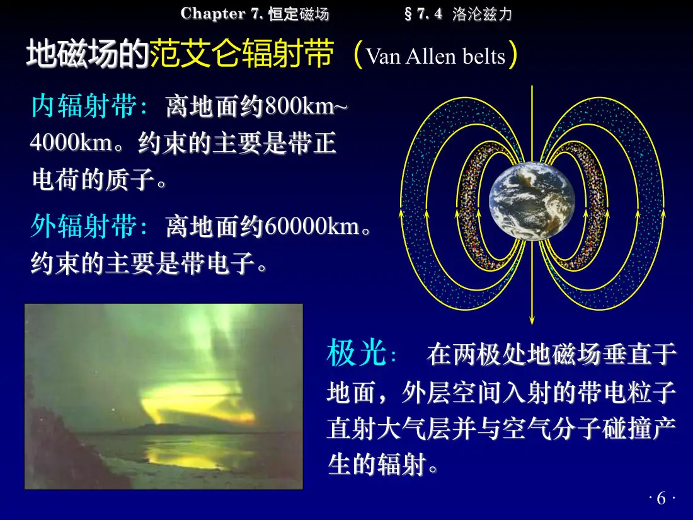

原文：

地磁场的范艾仑辐射带（Van Allen belts）

内辐射带：离地面约800km\~4000km。约束的主要是带正电荷的质子。

外辐射带：离地面约60000km。约束的主要是带电子。

极光： 在两极处地磁场垂直于地面，外层空间入射的带电粒子直射大气层并与空气分子碰撞产生的辐射。

Chapter 7. 恒定磁场

§7. 4 洛沦兹力

6

### Chapter 7. 恒定磁场

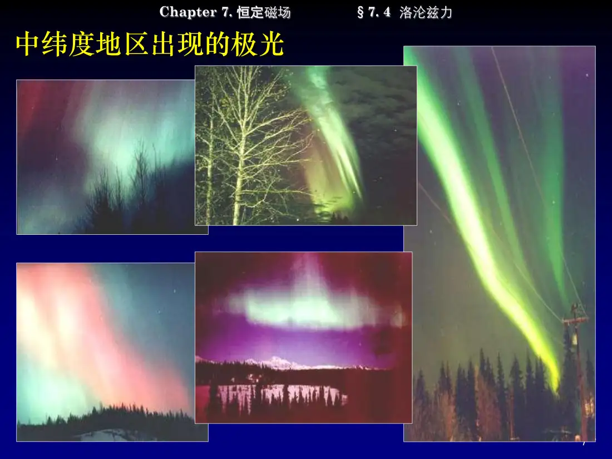

原文：

Chapter 7. 恒定磁场

中纬度地区出现的极光

§7. 4 洛沦兹力

### Chapter 7. 恒定磁场

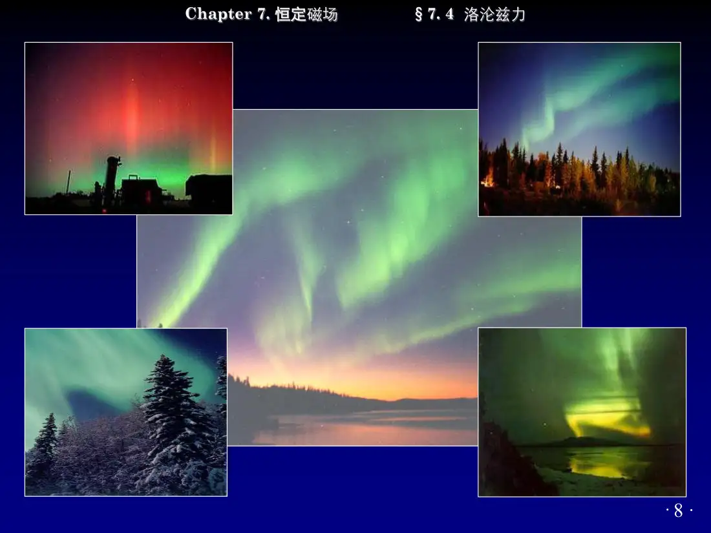

原文：

Chapter 7. 恒定磁场

§7. 4 洛沦兹力

8

### Chapter 7. 恒定磁场

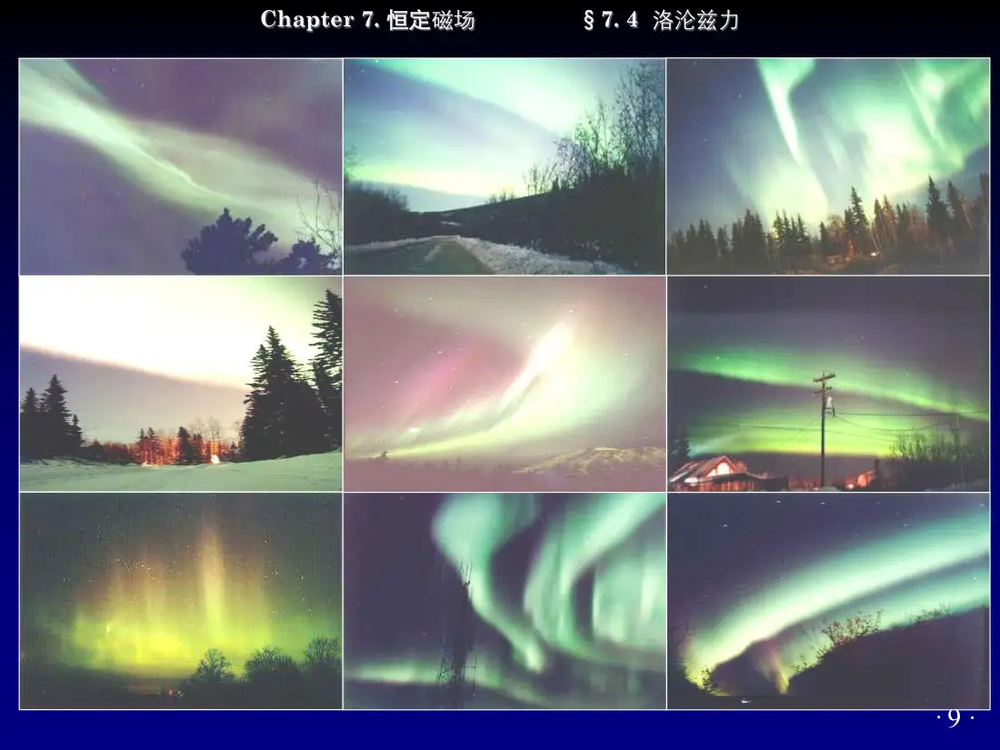

原文：

9

Chapter 7. 恒定磁场

§7. 4 洛沦兹力

### Chapter 7. 恒定磁场

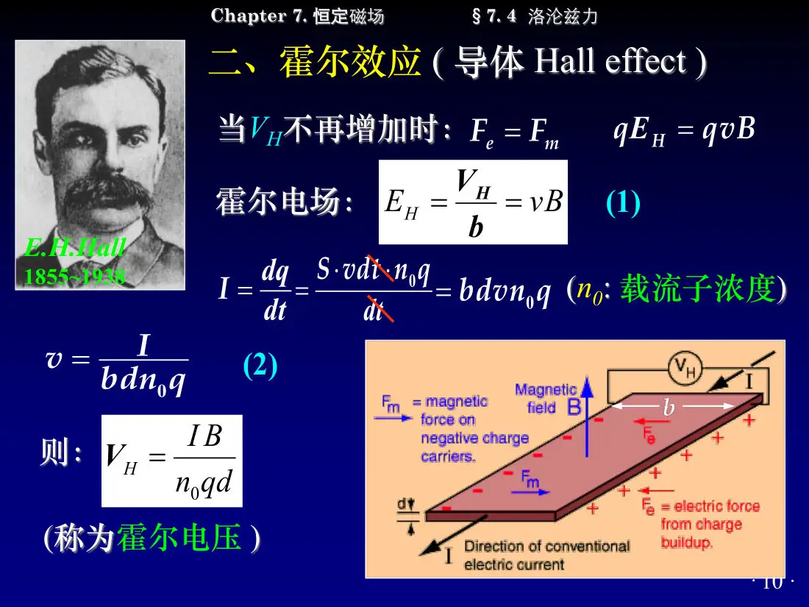

原文：

Chapter 7. 恒定磁场

§7. 4 洛沦兹力

二、霍尔效应 ( 导体 Hall effect )

当 $1 4 5 - 1 = 1 4$ 不再增加时： $1 \frac { 3 } { 4 } = 1 \frac { 3 } { 4 }$

霍尔电场： $E _ { H } = \frac { V _ { H } } { b } = \nu B$

$$
q E _ {H} = q v B\tag{1}
$$

$\frac { 1 1 } { 1 1 } = \frac { 1 1 } { 1 1 } = \frac { 1 1 } { 1 1 } = \frac { 1 1 } { 1 1 } = \frac { 1 1 } { 1 1 } = \frac { 1 1 } { 1 1 }$ $\textcircled { 1 } \textcircled { 1 }$ 载流子浓度)

$$
v = \frac {I}{b d n _ {0} q}\tag{2}
$$

则： $V _ { _ H } = { \frac { I B } { n _ { 0 } q d } }$

(称为霍尔电压 )

10

### 量子霍尔效应 ( quantized Hall effect )

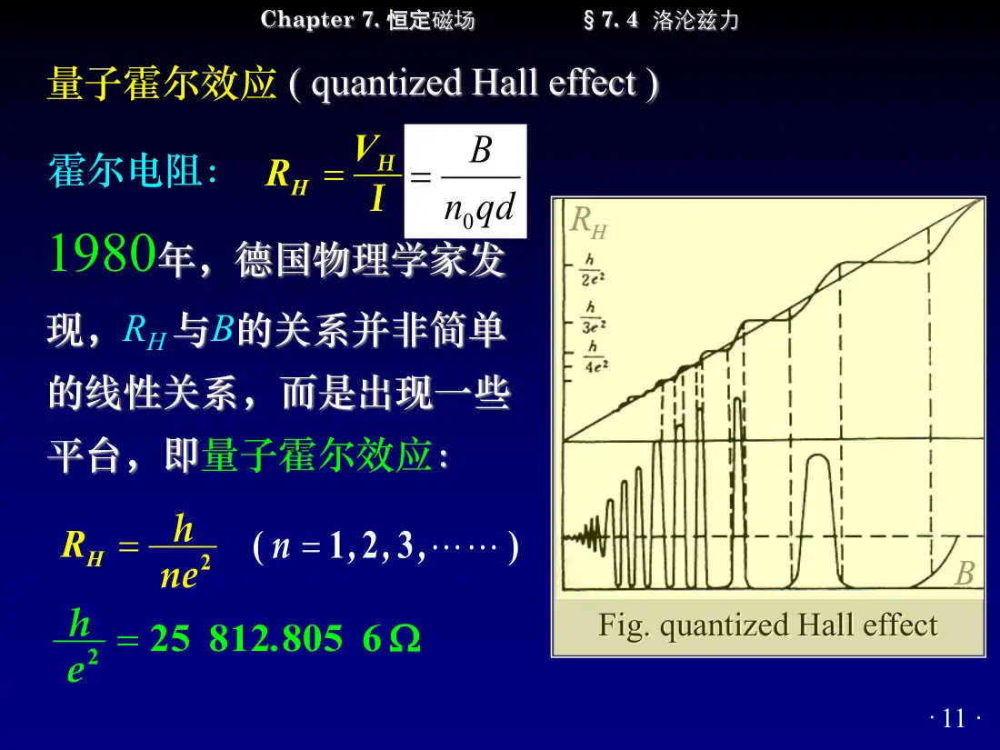

原文：

量子霍尔效应 ( quantized Hall effect )

霍尔电阻： $\textcircled { 1 } m = \frac { 1 } { 1 1 } = \frac { B } { n _ { 0 } q d }$ $1 0 \%$ 年，德国物理学家发现， $\textcircled { 1 } \textcircled { 2 }$ 与B的关系并非简单的线性关系，而是出现一些平台，即量子霍尔效应：

$$
R _ {H} = \frac {h}{n e ^ {2}} (n = 1, 2, 3, \dots \dots)
$$

$$
\frac {h}{e ^ {2}} = 2 5 8 1 2. 8 0 5 6 \Omega
$$

Chapter 7. 恒定磁场

§7. 4 洛沦兹力

· 11

### 半导体 Hall effect

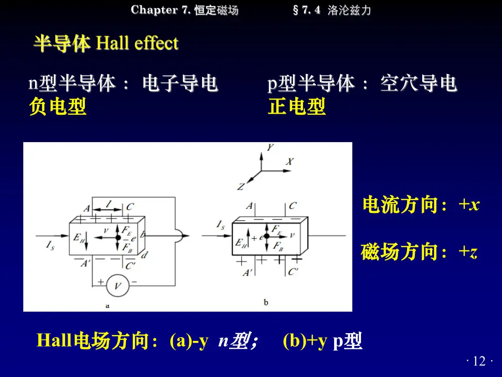

原文：

半导体 Hall effect

n型半导体 ：电子导电负电型

p型半导体 ：空穴导电正电型

电流方向：+x

磁场方向：+z

Hall电场方向：(a)-y n型； (b)+y p型

Chapter 7. 恒定磁场

§7. 4 洛沦兹力

12

### Chapter 7. 恒定磁场

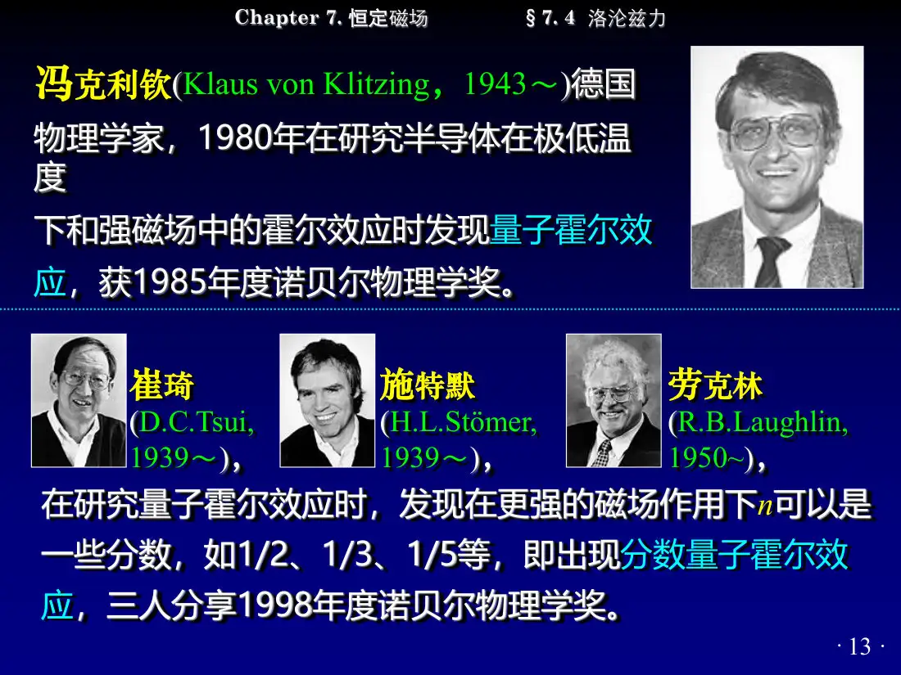

原文：

Chapter 7. 恒定磁场

§7. 4 洛沦兹力

冯克利钦(Klaus von Klitzing，1943～)德国物理学家，1980年在研究半导体在极低温度

下和强磁场中的霍尔效应时发现量子霍尔效应，获1985年度诺贝尔物理学奖。

崔琦(D.C.Tsui,1939～)，施特默(H.L.Stömer,1939～)，

劳克林(R.B.Laughlin,1950\~)，

在研究量子霍尔效应时，发现在更强的磁场作用下n可以是一些分数，如1/2、1/3、1/5等，即出现分数量子霍尔效应，三人分享1998年度诺贝尔物理学奖。

· 13

### 三、磁偏转效应的应用

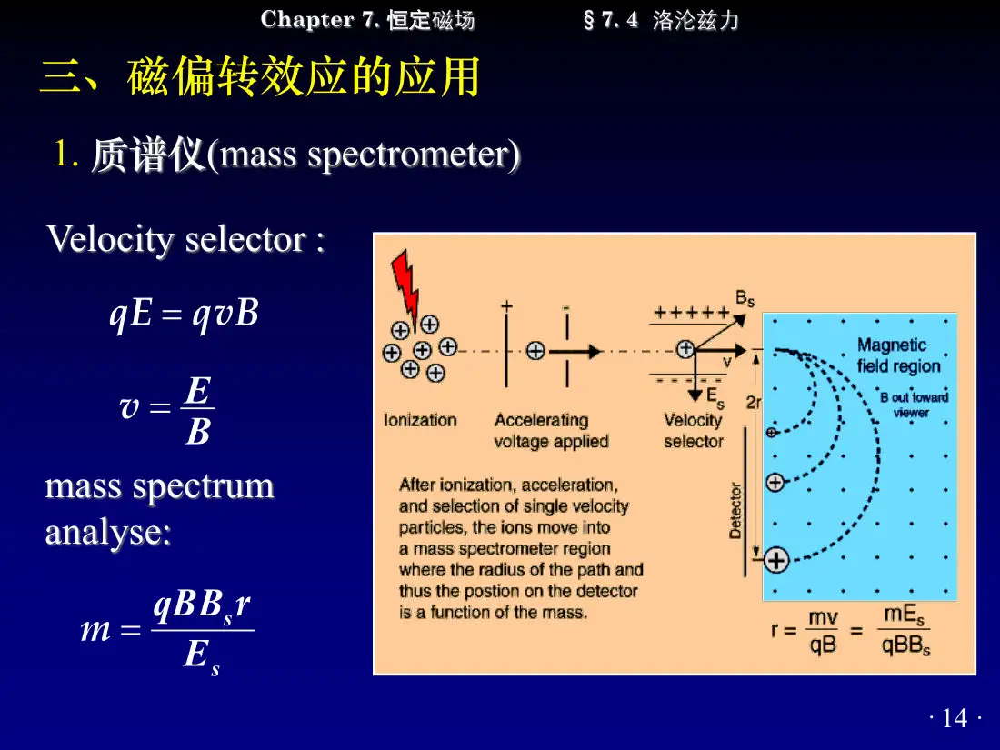

原文：

三、磁偏转效应的应用

1. 质谱仪(mass spectrometer)

Velocity selector :

$$
q E = q v B
$$

$$
v = \frac {E}{B}
$$

lonization

Accelerating voltage applied

mass spectrum analyse:

Velocity selector

$$
m = \frac {q B B _ {\mathrm{s}} r}{E _ {\mathrm{s}}}
$$

After ionization, acceleration, and selection of single velocity particles, the ions move into a mass spectrometer region where the radius of the path and thus the postion on the detector is a function of the mass.

Chapter 7. 恒定磁场

§7. 4 洛沦兹力

14

### 2. 回旋加速器(cyclotron)

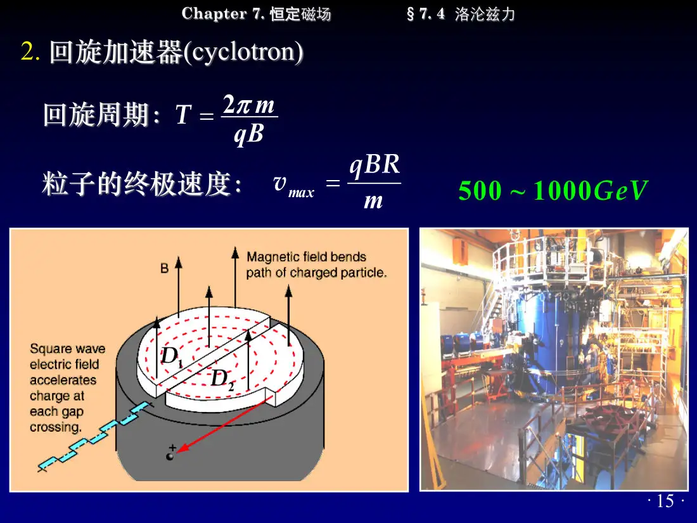

原文：

2. 回旋加速器(cyclotron)

回旋周期： $1 1 0 = \frac { 1 7 7 1 1 } { 7 7 3 }$

粒子的终极速度： $( 0 ) m ^ { 2 } = \frac { ( 1 0 ) } { 1 1 }$

500 \~ 1000GeV

Chapter 7. 恒定磁场

§7. 4 洛沦兹力

15

### Chapter 7. 恒定磁场

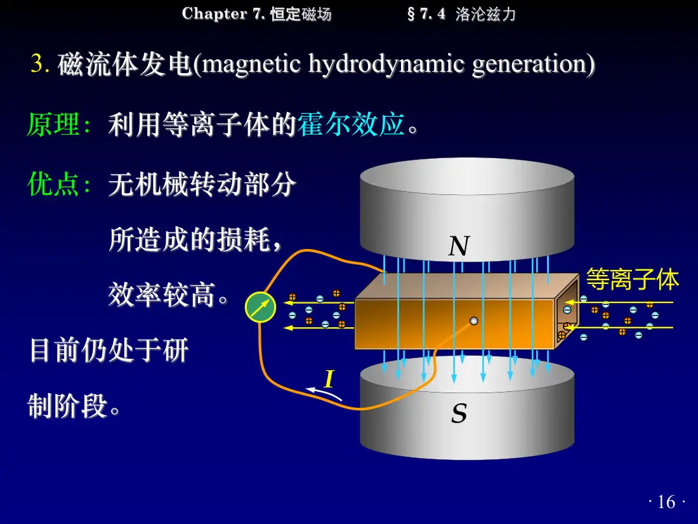

原文：

Chapter 7. 恒定磁场

§7. 4 洛沦兹力

3. 磁流体发电(magnetic hydrodynamic generation)

原理：利用等离子体的霍尔效应。

优点：无机械转动部分

所造成的损耗，

效率较高。

目前仍处于研制阶段。

等离子体

16

### 归纳

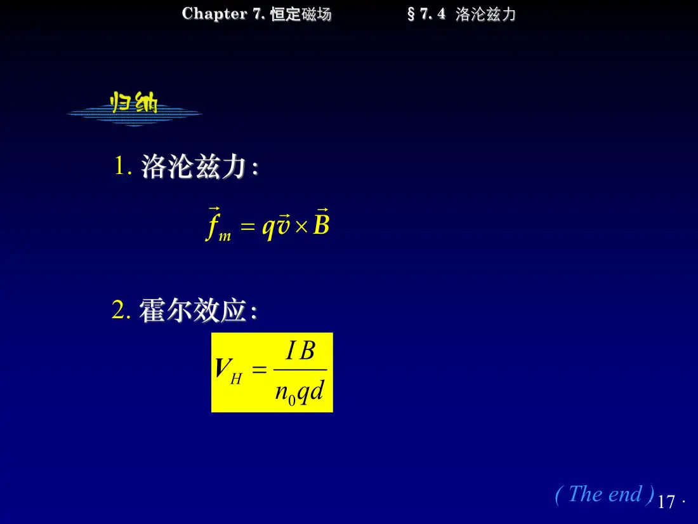

原文：

归纳

1. 洛沦兹力：

$$
\vec {f} _ {m} = q \vec {v} \times \vec {B}
$$

2. 霍尔效应：

$$
V _ {H} = \frac {I B}{n _ {0} q d}
$$

Chapter 7. 恒定磁场

§7. 4 洛沦兹力

( The end

17
