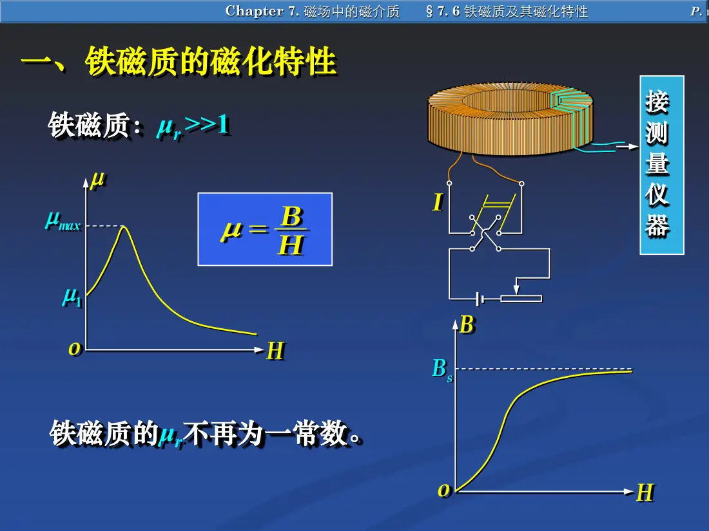
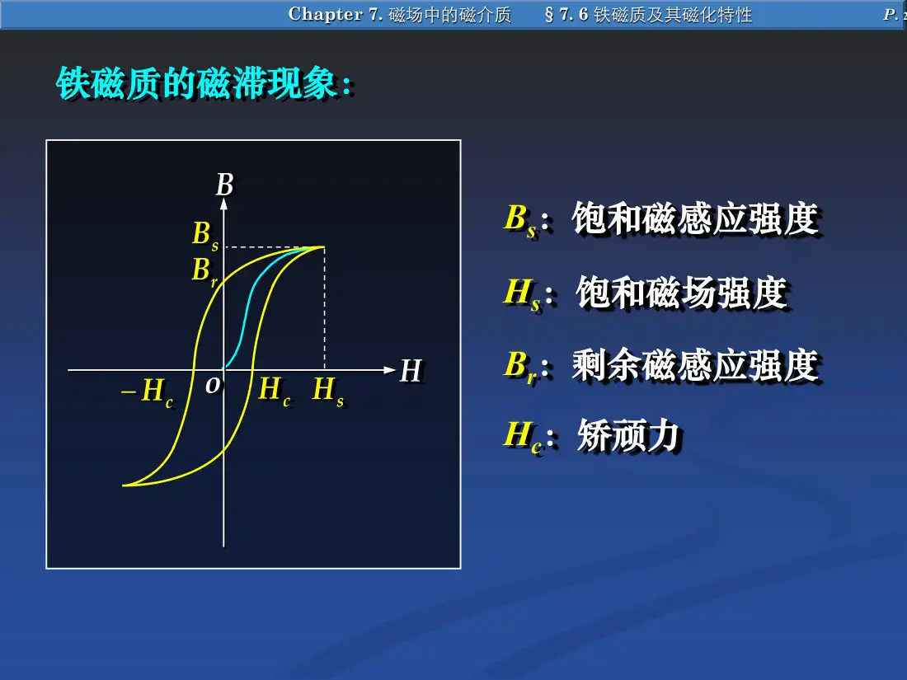
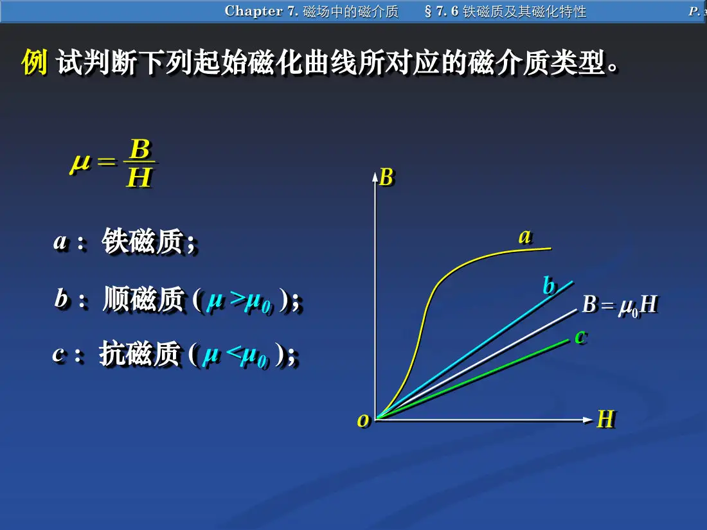
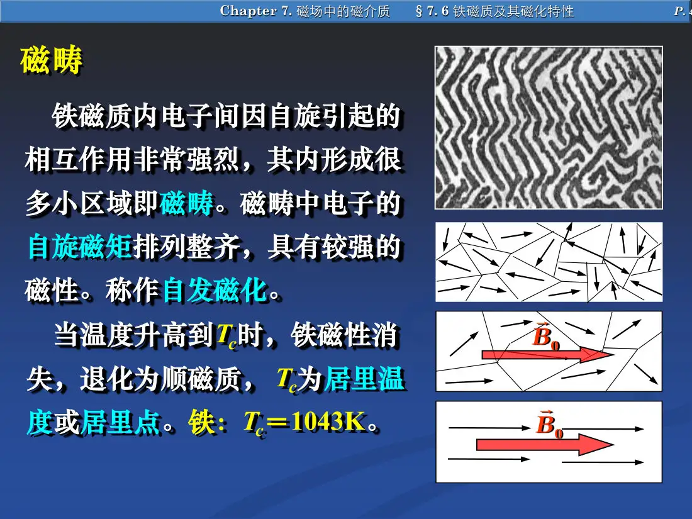

# 《大学物理》第7章 磁场中的磁介质 §7.6 铁磁质及其磁化特性（课件）

原件的每一页，下面附识别出的文字。

### 铁磁质的磁化特性

原文：

铁磁质的磁化特性

铁磁质： $1 4 x = 2 1$

铁磁质的 $l _ { 1 } ^ { \prime \prime }$ 不再为一常数。

接
测
量
仪
器

Chapter 7. 磁场中的磁介质作者：杨茂田 §7. 6 铁磁质及其磁化特性

P.

### 铁磁质的磁滞现象：

原文：

铁磁质的磁滞现象：

$1 3 . 5 \times 1 0 = 1 8 . 5 6 ( m ^ { 3 } )$ 饱和磁感应强度

$1 \frac { \overline { { \prime } } } { \overline { { \prime } } } \int \frac { 1 } { \overline { { \prime } } }$ 饱和磁场强度

$| \vec { p } _ { r } | _ { 0 }$ 剩余磁感应强度

$\boxed { \pmb { \bar { \mu } } } \pmb { \zeta } \boxed { \pmb { \mathrm { ~ \hat { \mu } ~ } } } .$ 矫顽力

Chapter 7. 磁场中的磁介质作者：杨茂田 §7. 6 铁磁质及其磁化特性

P.

### 例 试判断下列起始磁化曲线所对应的磁介质类型。

原文：

例 试判断下列起始磁化曲线所对应的磁介质类型。

$$
\mu = \frac {B}{H}
$$

a ：铁磁质；

b ：顺磁质 $( ( \mu ^ { - } \lambda \mu _ { 0 } ) )$

c ：抗磁质 $( ( \mu ^ { \prime \prime } \nmid \mu ) ) ^ { 2 }$

Chapter 7. 磁场中的磁介质 作者：杨茂田

§7. 6 铁磁质及其磁化特性

P.

### 磁畴

原文：

磁畴

铁磁质内电子间因自旋引起的相互作用非常强烈，其内形成很多小区域即磁畴。磁畴中电子的自旋磁矩排列整齐，具有较强的磁性。称作自发磁化。

当温度升高到Tc时，铁磁性消失，退化为顺磁质， Tc为居里温度或居里点。铁： $1 1 \div 1 1 1 = 1 1 1 1 \cdots 1 9$

Chapter 7. 磁场中的磁介质 作者：杨茂田

§7. 6 铁磁质及其磁化特性

P.
