# 《大学物理》第7章 稳恒电流与稳恒磁场 §7.1 稳恒电流（课件）

原件的每一页，下面附识别出的文字。

### §7.1 稳恒电流

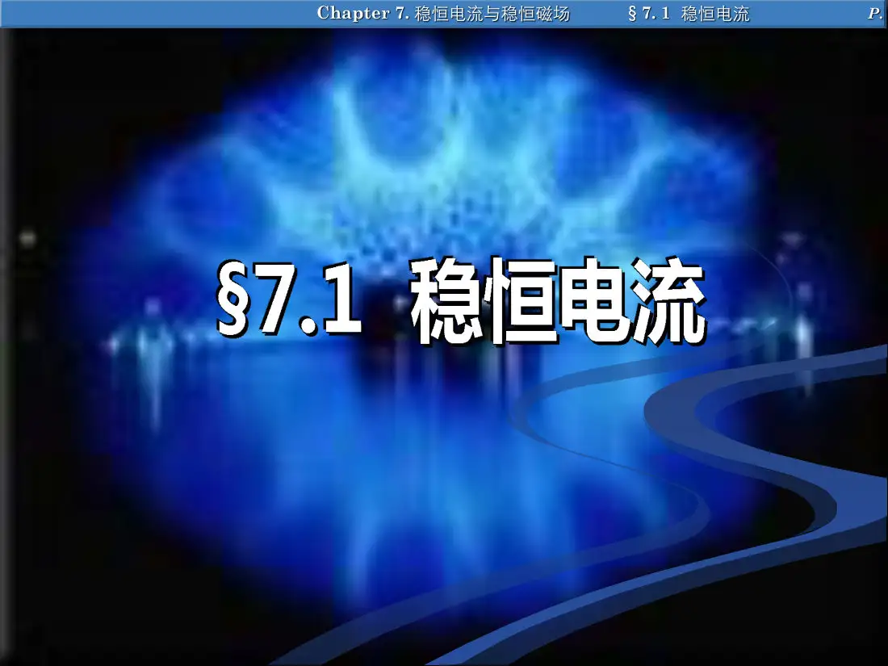

原文：

§7.1 稳恒电流

Chapter 7. 稳恒电流与稳恒磁场

§ 7.1 稳恒电流

P.

### 一、电流强度与电流密度

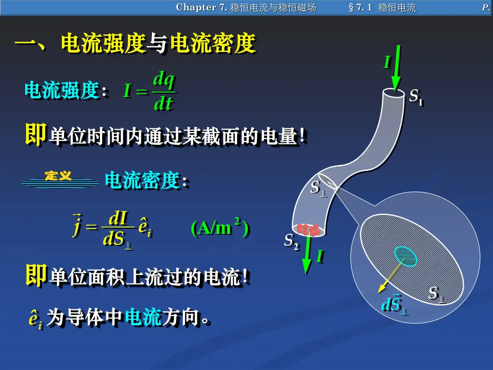

原文：

一、电流强度与电流密度

电流强度: $I = \frac{dq}{dt}$

即 单位时间内通过某截面的电量!

定义 电流密度：

$$
\vec {j} = \frac {d I}{d S _ {\perp}} \hat {e} _ {i}
$$

$$
(\mathrm{A} / \mathrm{m} ^ {2})
$$

即单位面积上流过的电流！

$\hat{e}_i$ 为导体中电流方向。

Chapter 7. 稳恒电流与稳恒磁场

§ 7.1 稳恒电流

P.

### $$

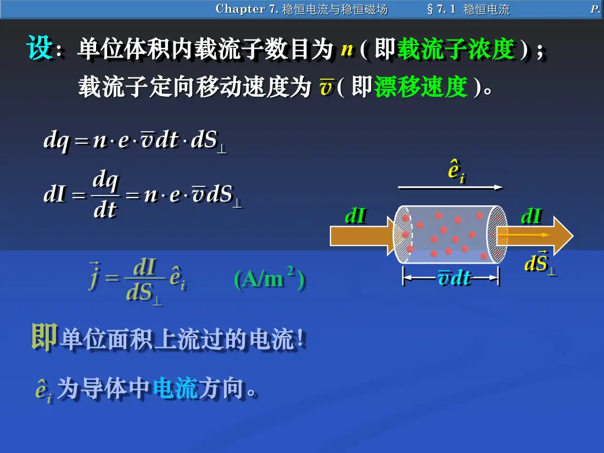

原文：

设: 单位体积内载流子数目为 $n$ (即载流子浓度); 载流子定向移动速度为 $\overline{v}$ (即漂移速度)。

$$
d q = n \cdot e \cdot \bar {v} d t \cdot d S _ {\perp}
$$

$$
d I = \frac {d q}{d t} = n \cdot e \cdot \overline {{v}} d S _ {\perp}
$$

$$
\vec {j} = \frac {d I}{d S _ {\perp}} \hat {e} _ {i}
$$

$$
(\mathrm{A} / \mathrm{m} ^ {2})
$$

即单位面积上流过的电流！

$\hat{e}_i$ 为导体中电流方向。

Chapter 7. 稳恒电流与稳恒磁场

§ 7.1 稳恒电流

P.

### $$

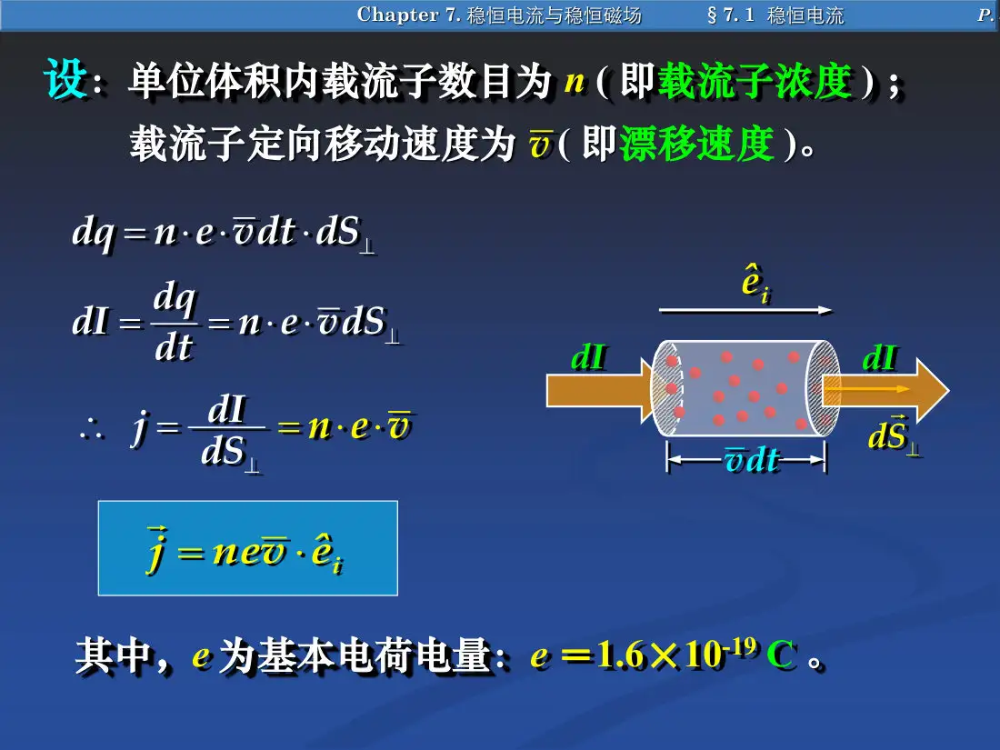

原文：

设: 单位体积内载流子数目为 $n$ (即载流子浓度); 载流子定向移动速度为 $\overline{v}$ (即漂移速度)。

$$
d q = n \cdot e \cdot \bar {v} d t \cdot d S _ {\perp}
$$

$$
d I = \frac {d q}{d t} = n \cdot e \cdot \overline {{v}} d S _ {\perp}
$$

$$
\therefore j = \frac {d I}{d S _ {\perp}} = n \cdot e \cdot \overline {{v}}
$$

$$
\vec {j} = n e \overline {{v}} \cdot \hat {e} _ {i}
$$

其中，e 为基本电荷电量： $e=1.6\times10^{-19}$ C。

Chapter 7. 稳恒电流与稳恒磁场

§ 7.1 稳恒电流

P.

### 常用 $j$ 线来描述电流密度的分布!

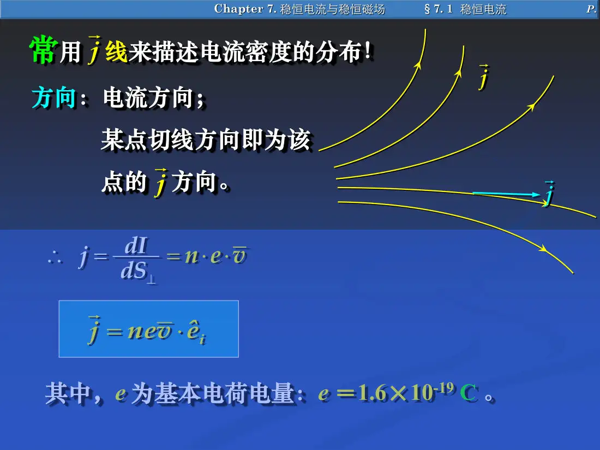

原文：

常用 $j$ 线来描述电流密度的分布!

方向：电流方向；某点切线方向即为该点的 $\vec{j}$ 方向。

$$
\therefore j = \frac {d I}{d S _ {\perp}} = n \cdot e \cdot \overline {{v}}
$$

$$
\vec {j} = n e \overline {{v}} \cdot \hat {e} _ {i}
$$

其中，e 为基本电荷电量： $e=1.6\times10^{-19}$ C。

Chapter 7. 稳恒电流与稳恒磁场

§ 7.1 稳恒电流

P.

### 常用 $j$ 线来描述电流密度的分布!

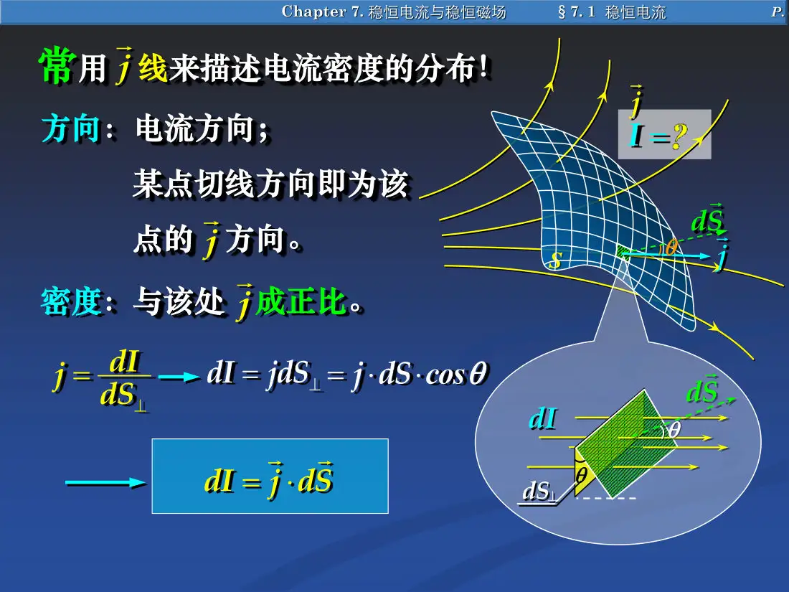

原文：

常用 $j$ 线来描述电流密度的分布!

方向：电流方向；

某点切线方向即为该点的 $\vec{j}$ 方向。

密度：与该处 j 成正比。

$$
j = \frac {d I}{d S _ {\perp}} \longrightarrow d I = j d S _ {\perp} = j \cdot d S \cdot \cos \theta
$$

$$
d \boldsymbol {I} = \vec {\boldsymbol {j}} \cdot d \vec {S}
$$

Chapter 7. 稳恒电流与稳恒磁场

§ 7.1 稳恒电流

P.

### 通过某一闭合曲面 S 的电流:

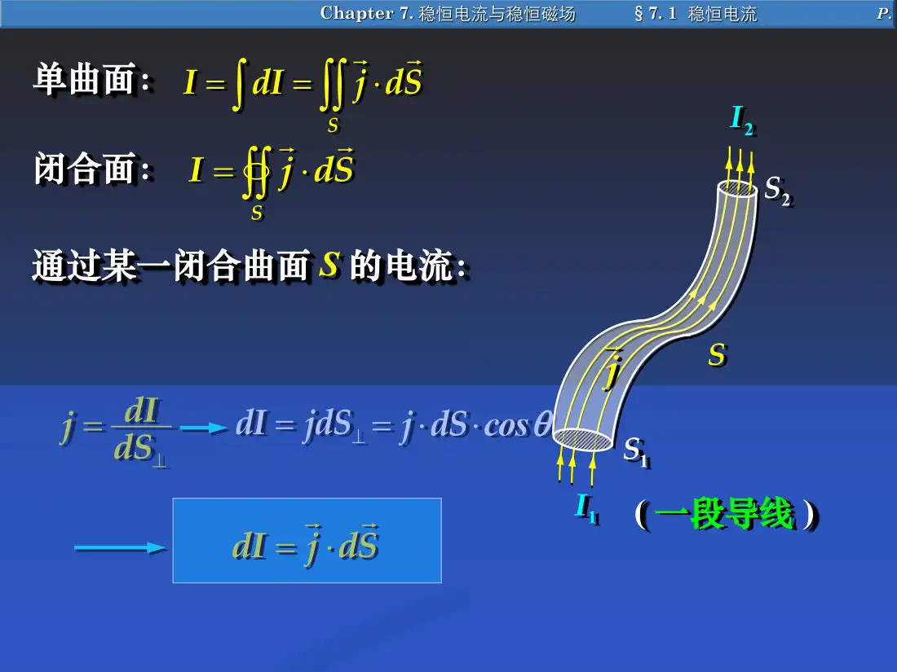

原文：

单曲面: $I = \int d I = \iint_{S} \vec{j} \cdot d \vec{S}$

闭合面: $I = \iint_{S} \vec{j} \cdot d\vec{S}$

通过某一闭合曲面 S 的电流:

$j=\frac{dI}{dS_{\perp}}\rightarrow dI=jdS_{\perp}=j\cdot dS\cdot cos\theta$

$$
d I = \vec {j} \cdot d \vec {S}
$$

$I_{1}$ (一段导线)

Chapter 7. 稳恒电流与稳恒磁场

§ 7.1 稳恒电流

P.

### 通过某一闭合曲面 S 的电流:

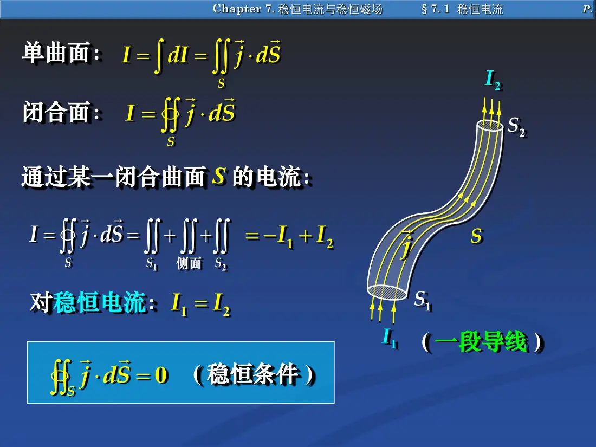

原文：

单曲面: $I = \int d I = \iint_{S} \vec{j} \cdot d \vec{S}$

闭合面: $I = \iint_{S} \vec{j} \cdot d\vec{S}$

通过某一闭合曲面 S 的电流:

$$
I = \oiint_ {S} \vec {j} \cdot d \vec {S} = \iint_ {S _ {1}} + \iint_ {\text {侧面}} + \iint_ {S _ {2}} = - I _ {1} + I _ {2}
$$

对稳恒电流： $I_{1}=I_{2}$

$\iint_{S}\vec{j}\cdot d\vec{S}=0$ （稳恒条件）

Chapter 7. 稳恒电流与稳恒磁场

§ 7.1 稳恒电流

P.

### 二、电动势

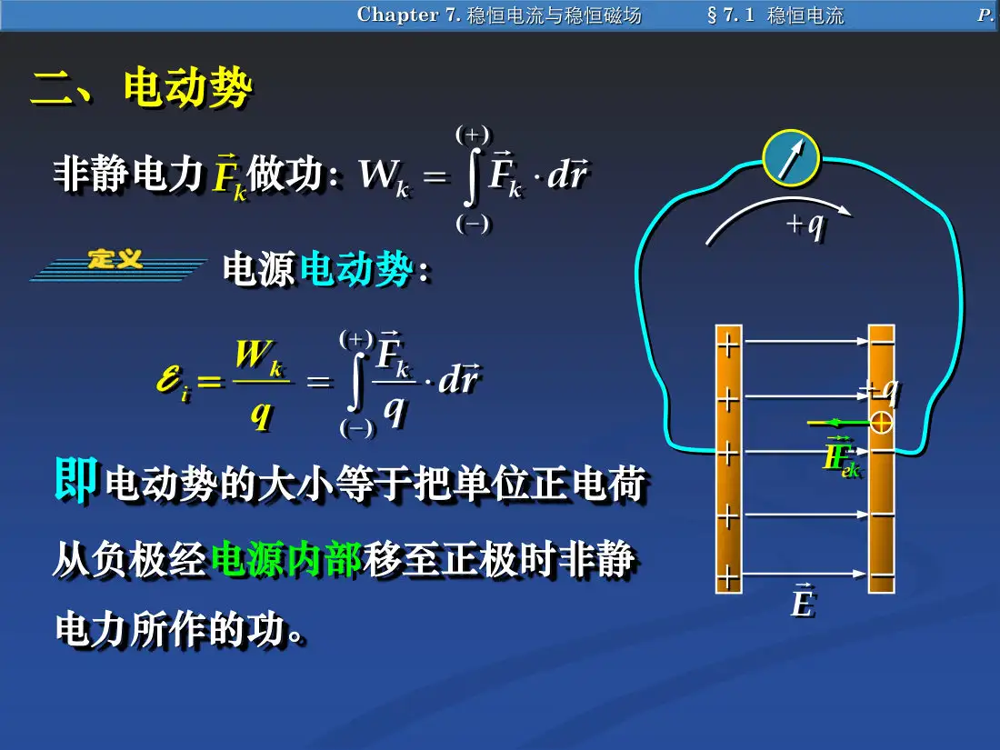

原文：

二、电动势

非静电力 $\vec{F}_k$ 做功: $W_k = \int_{(-)}^{(+)}\vec{F}_k\cdot d\vec{r}$ 定义 电源电动势:

$\varepsilon_{i} = \frac{W_{k}}{q} = \int_{(-)}^{(+)} \frac{\vec{F}_{k}}{q} \cdot d\vec{r}$ 即电动势的大小等于把单位正电荷从负极经电源内部移至正极时非静电力所作的功。

Chapter 7. 稳恒电流与稳恒磁场

§ 7.1 稳恒电流

P.

### $$

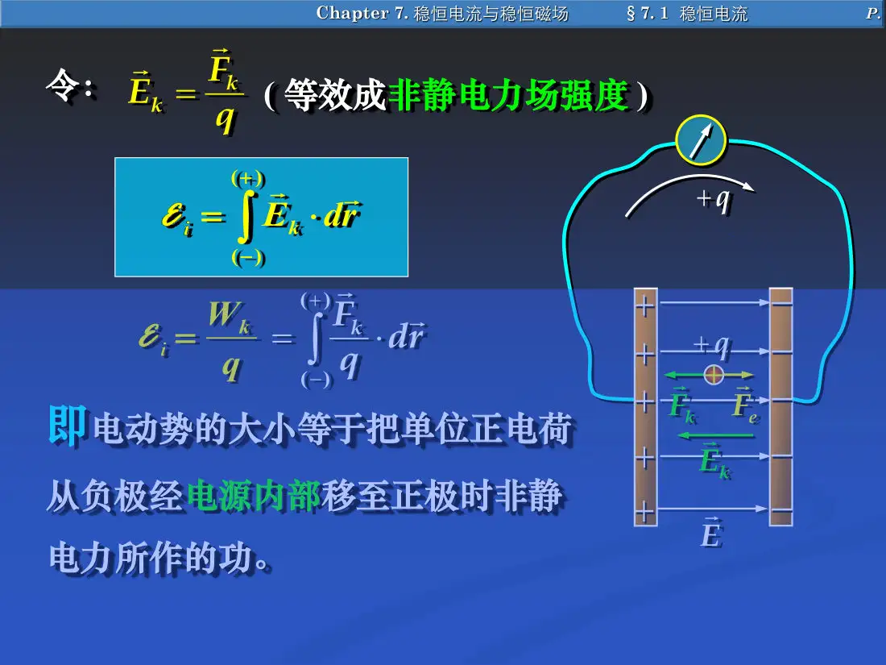

原文：

令: $\vec{E}_{k} = \frac{\vec{F}_{k}}{q}$ (等效成非静电力场强度)

$$
\mathcal {E} _ {i} = \int_ {(-)} ^ {(+)} \vec {E} _ {k} \cdot d \vec {r}
$$

$$
\mathcal {E} _ {i} = \frac {W _ {k}}{q} = \int_ {(-)} ^ {(+)} \frac {\vec {F} _ {k}}{q} \cdot d \vec {r}
$$

即电动势的大小等于把单位正电荷从负极经电源内部移至正极时非静电力所作的功。

Chapter 7. 稳恒电流与稳恒磁场

§ 7.1 稳恒电流

P.

### $$

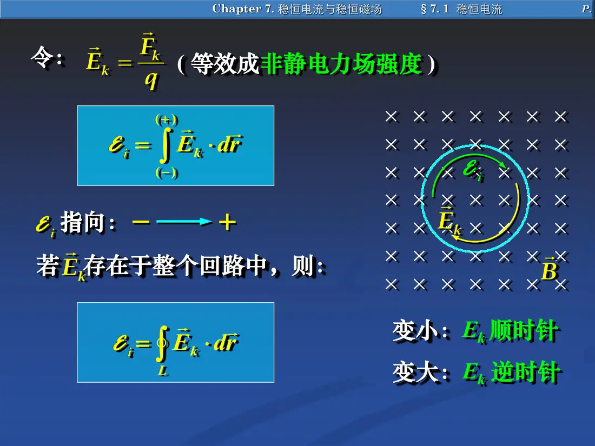

原文：

令: $\vec{E}_{k} = \frac{\vec{F}_{k}}{q}$ (等效成非静电力场强度)

$$
\mathcal {E} _ {i} = \int_ {(-)} ^ {(+)} \vec {E} _ {k} \cdot d \vec {r}
$$

$\varepsilon_{i}$ 指向: $-\longrightarrow +$ 若 $\vec{E}_{k}$ 存在于整个回路中, 则:

$$
\mathcal {E} _ {i} = \oint_ {L} \vec {E} _ {k} \cdot d \vec {r}
$$

$$
\times \times \times \times \times \times \times
$$

$$
\times \times \times \times \times \times \times
$$

$$
\times \times^ {\prime} \times \times \times) \times \times
$$

$$
\times \times \times \times \times \times \times \times
$$

变小： $E_{k}$ 顺时针

变大: $E_{k}$ 逆时针

Chapter 7. 稳恒电流与稳恒磁场

§ 7.1 稳恒电流

P.

### 归纳

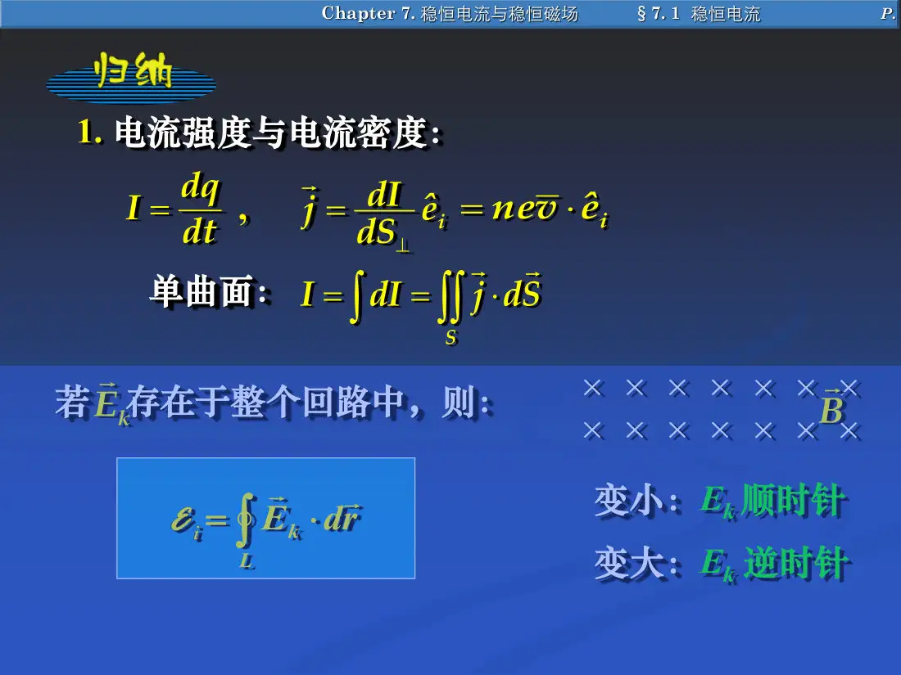

原文：

归纳

1. 电流强度与电流密度:

$$
I = \frac {d q}{d t}, \quad \vec {j} = \frac {d I}{d S _ {\perp}} \hat {e} _ {i} = n e \overline {{v}} \cdot \hat {e} _ {i}
$$

单曲面: $I = \int d I = \iint_{S} \vec{j} \cdot d \vec{S}$

若 $\vec{E}_k$ 存在于整个回路中, 则:

$$
\vec {B}
$$

$$
\mathcal {E} _ {i} = \oint_ {L} \vec {E} _ {k} \cdot d \vec {r}
$$

变小： $E_{k}$ 顺时针

变大: $E_{k}$ 逆时针

Chapter 7. 稳恒电流与稳恒磁场

§ 7.1 稳恒电流

P.

### 归纳

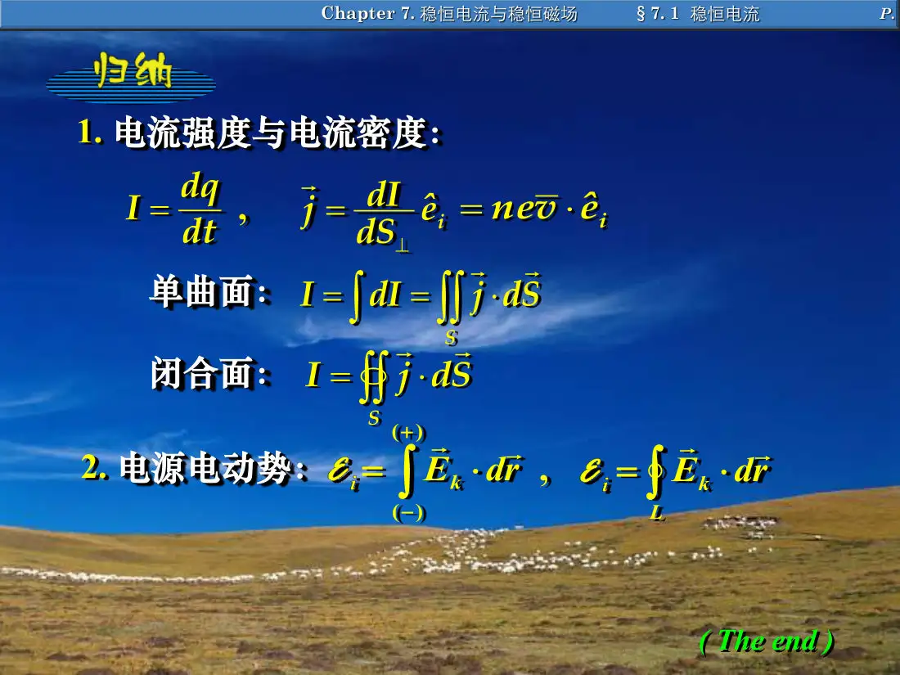

原文：

归纳

1. 电流强度与电流密度:

$I = \frac{dq}{dt}$ , $\vec{j} = \frac{dI}{dS_{\perp}}\hat{e}_i = ne\overline{v}\cdot \hat{e}_i$

单曲面: $I = \int dI = \iint \vec{j} \cdot d\vec{S}$

闭合面: $I = \iint \vec{j} \cdot d\vec{S}$

2. 电源电动势: $\mathcal{E}_i = \int_{(-)}^{\infty} \vec{E}_k \cdot d\vec{r}$ , $\mathcal{E}_i = \oint_L \vec{E}_k \cdot d\vec{r}$

Chapter 7. 稳恒电流与稳恒磁场

§ 7.1 稳恒电流

P.

( The end )

### 8'28"

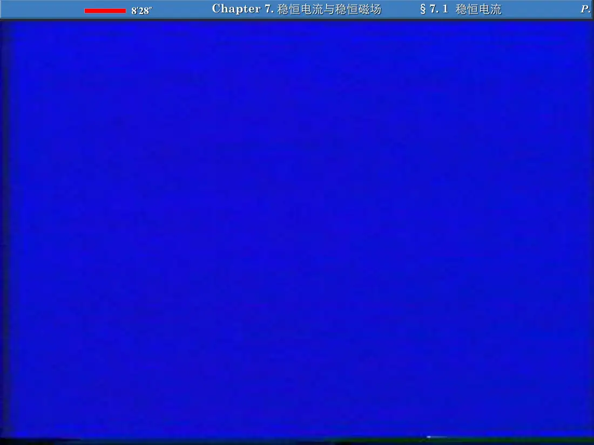

原文：

8'28"

Chapter 7. 稳恒电流与稳恒磁场

§ 7.1 稳恒电流

P.
