# 《大学物理》第7章 稳恒电流与稳恒磁场 §7.2 磁场的描述 毕奥-萨伐尔定律 运动电荷的磁场（课件）

原件的每一页，下面附识别出的文字。

### §7.2 磁场的描述 毕奥-萨伐尔定律 运动电荷的磁场

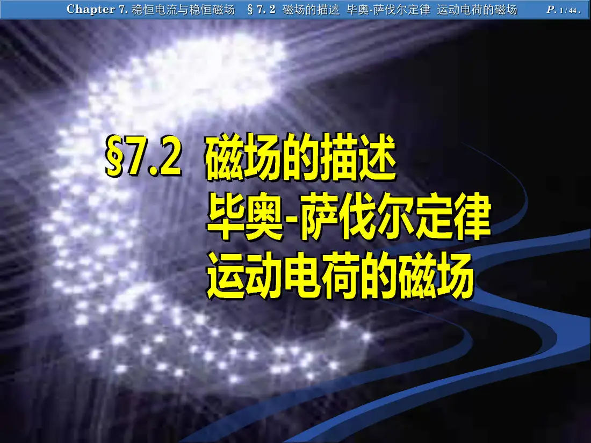

原文：

§7.2 磁场的描述 毕奥-萨伐尔定律 运动电荷的磁场

Chapter 7. 稳恒电流与稳恒磁场 § 7.2 磁场的描述 毕奥-萨伐尔定律 运动电荷的磁场

P. 1 / 44.

### 一、基本磁现象

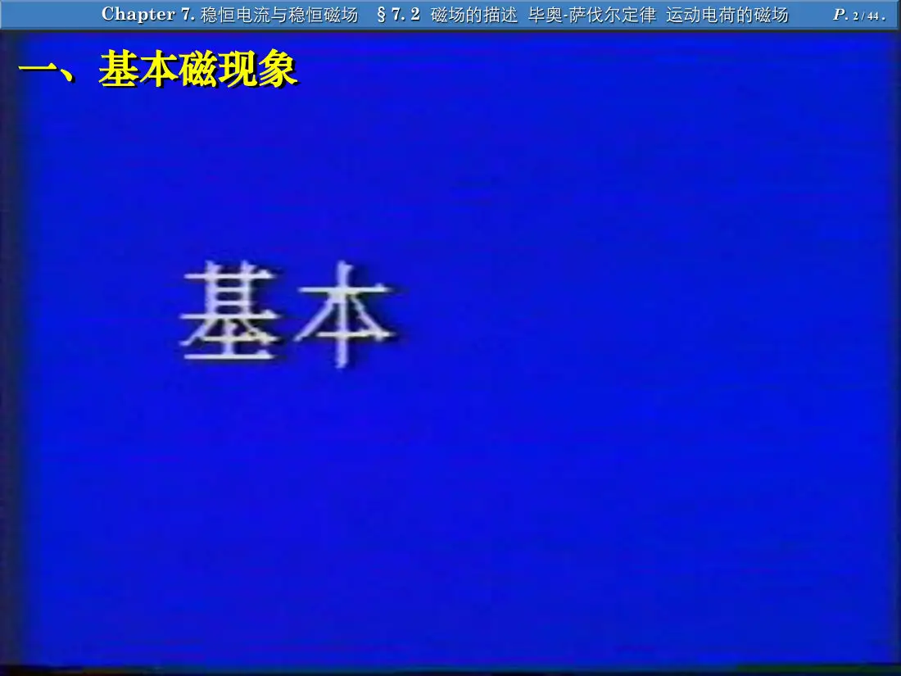

原文：

一、基本磁现象
基本

Chapter 7. 稳恒电流与稳恒磁场 § 7.2 磁场的描述 毕奥-萨伐尔定律 运动电荷的磁场 P. 2/44.

### 二、磁感应强度

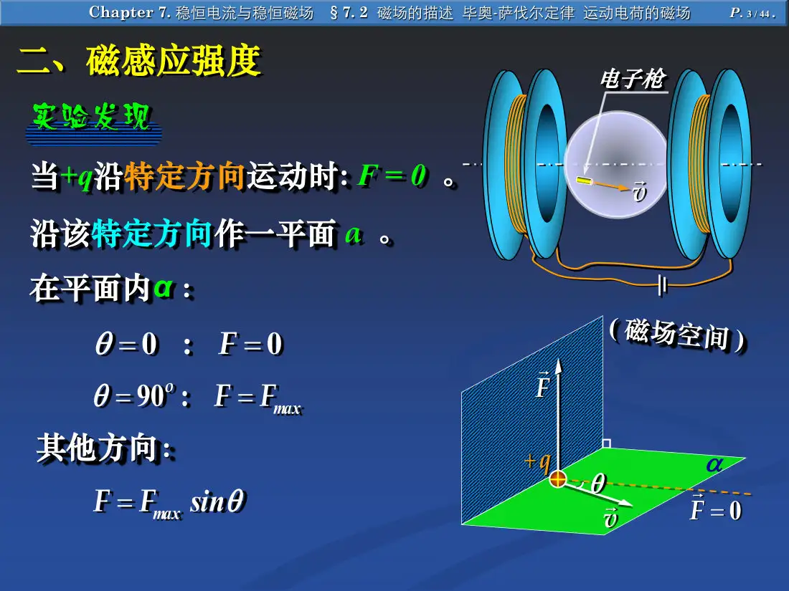

原文：

二、磁感应强度

实验发现

当+q沿特定方向运动时: F = 0 。沿该特定方向作一平面 a 。在平面内 a :

$$
\theta = 0 \quad : \quad F = 0
$$

$$
\theta = 9 0 ^ {o}: \quad F = F _ {\max}
$$

其他方向：

$$
F = F _ {m a x} \sin \theta
$$

(磁场空间)

P. 3 / 44.

Chapter 7. 稳恒电流与稳恒磁场 § 7.2 磁场的描述 毕奥-萨伐尔定律 运动电荷的磁场

### 定义 磁感应强度 $\vec{B}$ :

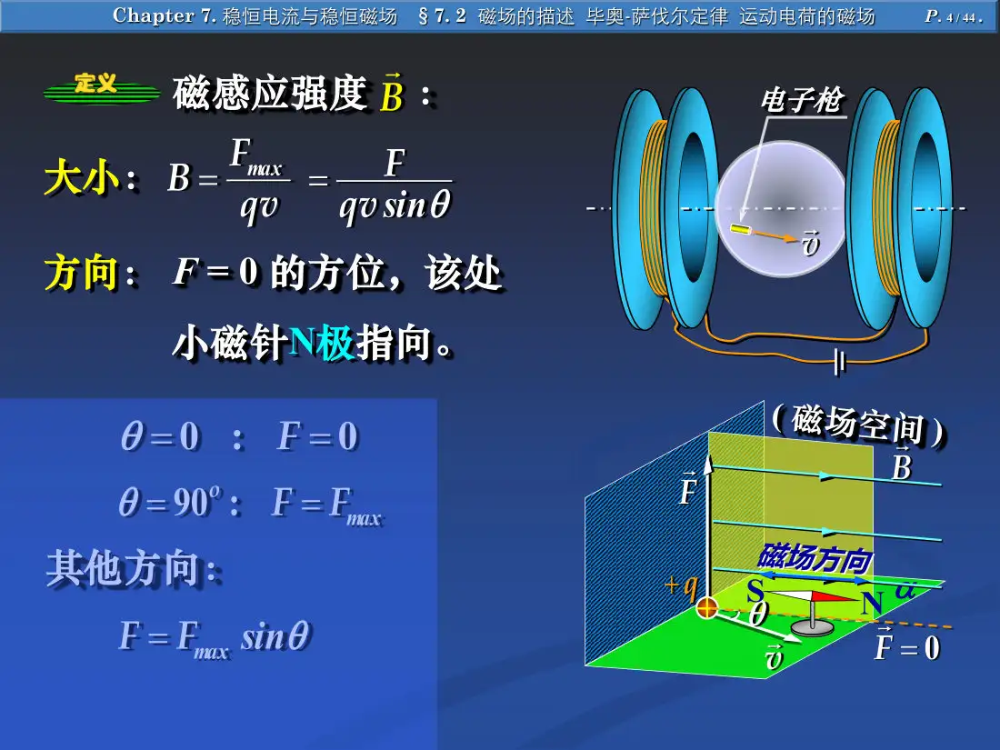

原文：

定义 磁感应强度 $\vec{B}$ :

大小： $B=\frac{F_{max}}{qv}=\frac{F}{qv\sin\theta}$

方向： $F = 0$ 的方位，该处小磁针N极指向。

$$
\theta = 0 \quad : \quad F = 0
$$

$$
\theta = 9 0 ^ {o}: \quad F = F _ {\max}
$$

其他方向：

$$
F = F _ {\max} \sin \theta
$$

Chapter 7. 稳恒电流与稳恒磁场 § 7.2 磁场的描述 毕奥-萨伐尔定律 运动电荷的磁场

### 定义 磁感应强度 $\vec{B}$ :

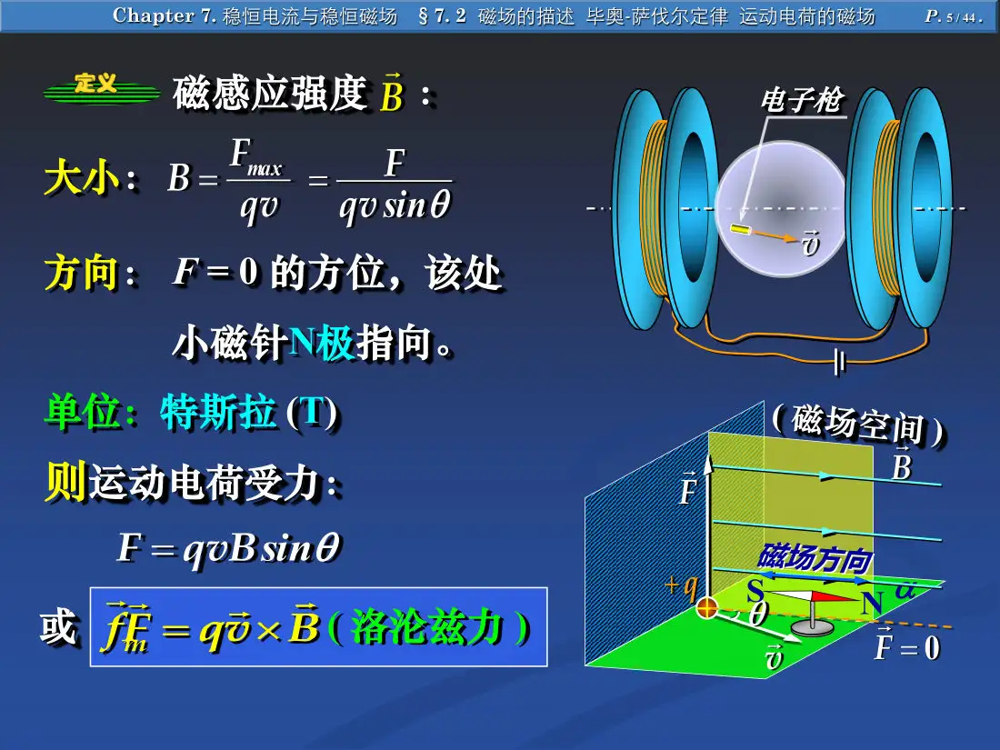

原文：

定义 磁感应强度 $\vec{B}$ :

大小： $B=\frac{F_{max}}{qv}=\frac{F}{qv\sin\theta}$

方向： $F = 0$ 的方位，该处小磁针N极指向。

单位：特斯拉(T)

则运动电荷受力：

$$
F = q v B \sin \theta
$$

或 $\vec{f}\vec{E}=q\vec{o}\times\vec{B}$ (洛沦兹力)

Chapter 7. 稳恒电流与稳恒磁场 § 7.2 磁场的描述 毕奥-萨伐尔定律 运动电荷的磁场

### 三、磁感线( $\vec{B}$ 线)及磁通量

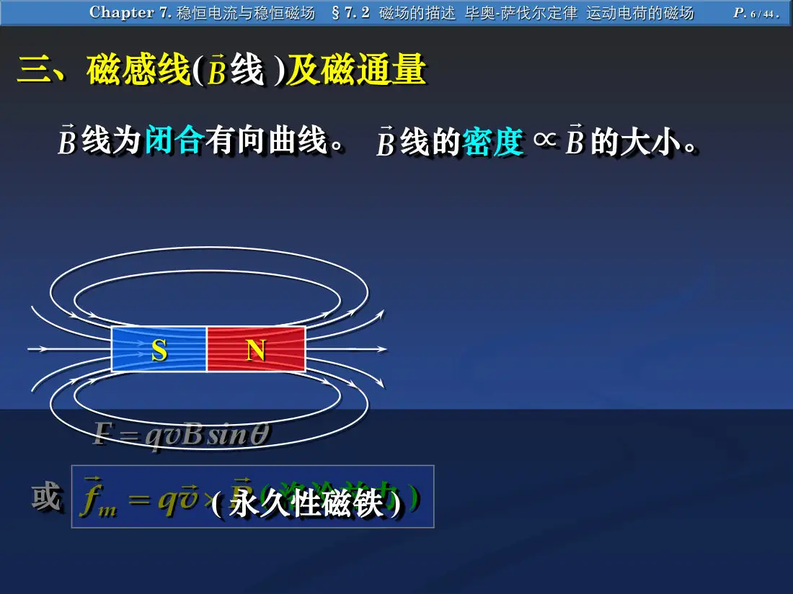

原文：

三、磁感线( $\vec{B}$ 线)及磁通量

$\vec{B}$ 线为闭合有向曲线。 $\vec{B}$ 线的密度 $\propto \vec{B}$ 的大小。

或 $\vec{f}_{m}=q\vec{o}$ (永久性磁铁)

Chapter 7. 稳恒电流与稳恒磁场 § 7.2 磁场的描述 毕奥-萨伐尔定律 运动电荷的磁场

P. 6/44.

### 三、磁感线( $\vec{B}$ 线)及磁通量

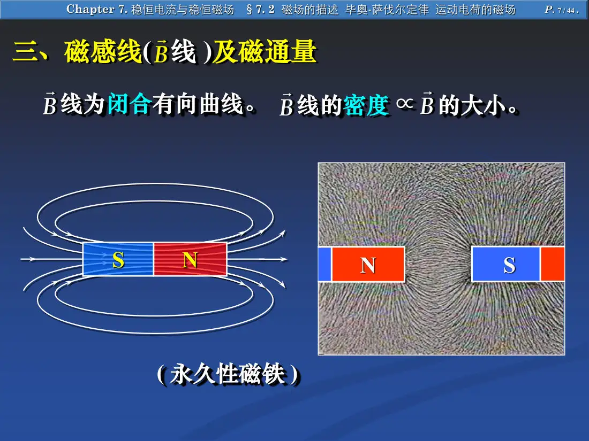

原文：

三、磁感线( $\vec{B}$ 线)及磁通量

$\vec{B}$ 线为闭合有向曲线。 $\vec{B}$ 线的密度 $\propto \vec{B}$ 的大小。

Chapter 7. 稳恒电流与稳恒磁场 § 7.2 磁场的描述 毕奥-萨伐尔定律 运动电荷的磁场

P. 7/44.

### (载流螺线管)

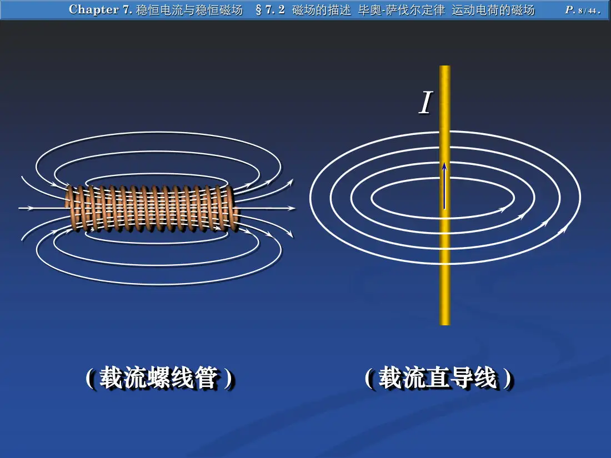

原文：

(载流螺线管)

(载流直导线)

Chapter 7. 稳恒电流与稳恒磁场 § 7.2 磁场的描述 毕奥-萨伐尔定律 运动电荷的磁场

P. 8/44.

### P. 9/44.

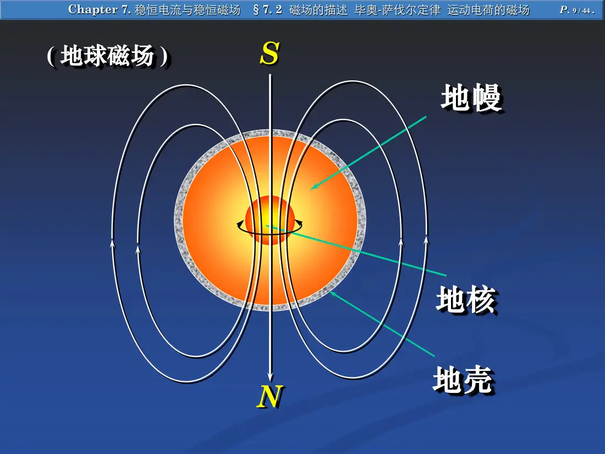

原文：

Chapter 7. 稳恒电流与稳恒磁场 § 7.2 磁场的描述 毕奥-萨伐尔定律 运动电荷的磁场

P. 9/44.

### 磁通量：穿过某曲面的磁感线的条数。

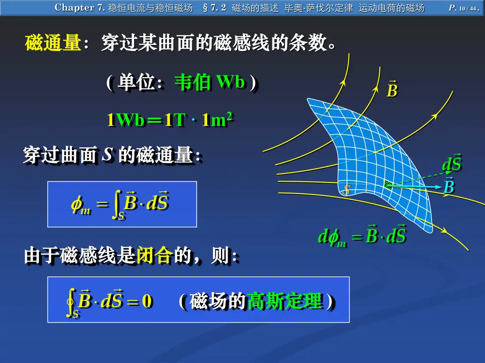

原文：

磁通量：穿过某曲面的磁感线的条数。

(单位: 韦伯 Wb)

$$
1 \mathrm{Wb} = 1 \mathrm{T} \cdot 1 \mathrm{m} ^ {2}
$$

穿过曲面 $S$ 的磁通量:

$$
\phi_ {m} = \int_ {S} \vec {B} \cdot d \vec {S}
$$

由于磁感线是闭合的，则：

$\oint_{S} \vec{B} \cdot d\vec{S} = 0$ （磁场的高斯定理）

Chapter 7. 稳恒电流与稳恒磁场 § 7.2 磁场的描述 毕奥-萨伐尔定律 运动电荷的磁场

P. 10 / 44 .

### 解 选矩形平面的法线方向与 $\vec{B}$ 同向。

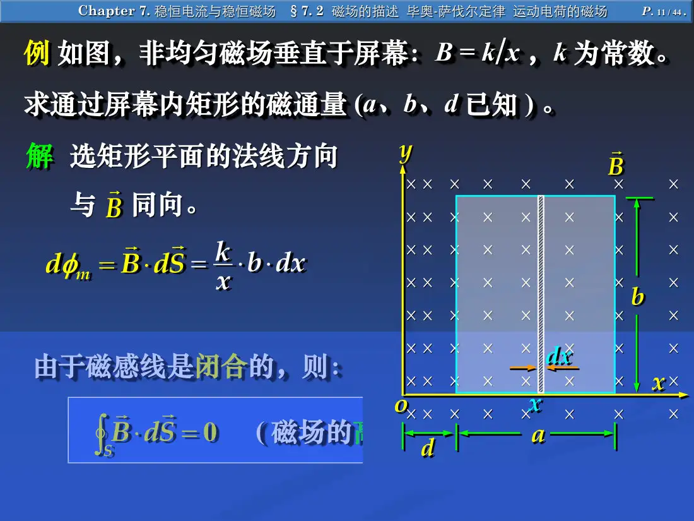

原文：

例如图，非均匀磁场垂直于屏幕： $B = k / x$ ， $k$ 为常数。求通过屏幕内矩形的磁通量 $(a, b, d$ 已知）。

解 选矩形平面的法线方向与 $\vec{B}$ 同向。

$$
d \phi_ {m} = \vec {B} \cdot d \vec {S} = \frac {k}{x} \cdot b \cdot d x
$$

由于磁感线是闭合的，则：

$$
\begin{array}{c} \text { y } \\ \text { x } \end{array} \quad \begin{array}{c} \text { B } \\ \text { d } \\ \text { x } \end{array} \quad \begin{array}{c} \text { b } \\ \text { x } \end{array} \quad \begin{array}{c} \text { d } \\ \text { x } \end{array} \quad \begin{array}{c} \text { d } \\ \text { x } \end{array}
$$

$$
\oint_ {S} \vec {B} \cdot d \vec {S} = 0
$$

(磁场的

Chapter 7. 稳恒电流与稳恒磁场 § 7.2 磁场的描述 毕奥-萨伐尔定律 运动电荷的磁场

### 解 选矩形平面的法线方向与 $\vec{B}$ 同向。

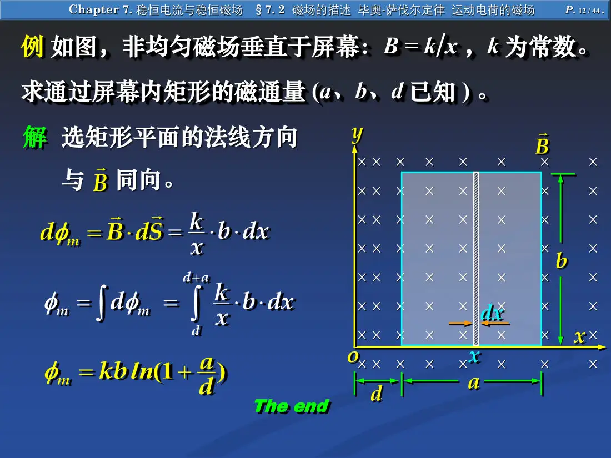

原文：

例如图，非均匀磁场垂直于屏幕： $B = k / x$ ， $k$ 为常数。求通过屏幕内矩形的磁通量 $(a, b, d$ 已知）。

解 选矩形平面的法线方向与 $\vec{B}$ 同向。

$$
d \phi_ {m} = \vec {B} \cdot d \vec {S} = \frac {k}{x} \cdot b \cdot d x
$$

$$
\phi_ {m} = \int d \phi_ {m} = \int_ {d l} ^ {d + a} \frac {k}{x} \cdot b \cdot d x
$$

$$
\phi_ {m} = k b \ln (1 + \frac {a}{d})
$$

$$
\begin{array}{c} \text { y } \\ \text { B } \\ \text { x } \\ \text { d } \\ \text { a } \\ \text { o } \end{array}
$$

Chapter 7. 稳恒电流与稳恒磁场 § 7.2 磁场的描述 毕奥-萨伐尔定律 运动电荷的磁场

The end

### 四、毕奥—萨伐尔定理

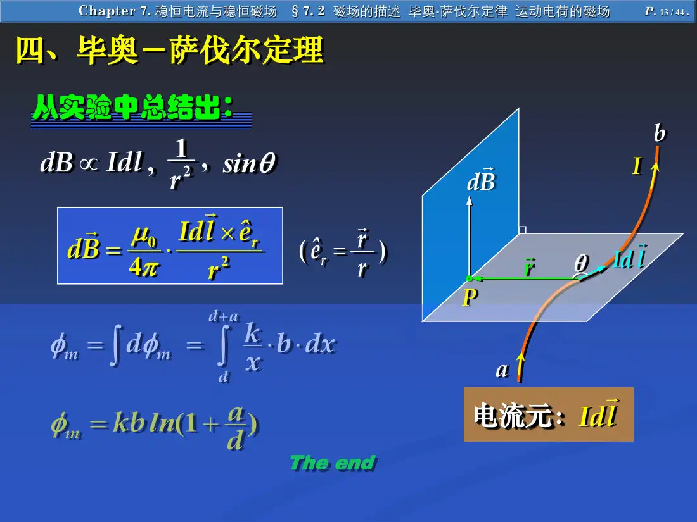

原文：

四、毕奥—萨伐尔定理

从实验中总结出：

$$
d B \propto I d l, \frac {1}{r ^ {2}}, \sin \theta
$$

$$
d \vec {B} = \frac {\mu_ {0}}{4 \pi} \cdot \frac {I d \vec {l} \times \hat {e} _ {r}}{r ^ {2}} \quad (\hat {e} _ {r} = \frac {\vec {r}}{r})
$$

$$
\phi_ {m} = \int d \phi_ {m} = \int_ {d} ^ {d + a} \frac {k}{x} \cdot b \cdot d x
$$

$$
\phi_ {m} = k b \ln (1 + \frac {a}{d})
$$

$$
\text { The   end }
$$

电流元: Idl

Chapter 7. 稳恒电流与稳恒磁场 § 7.2 磁场的描述 毕奥-萨伐尔定律 运动电荷的磁场

### 四、毕奥—萨伐尔定理

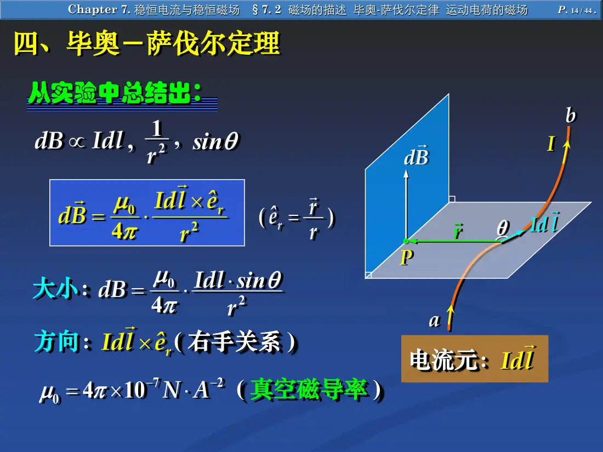

原文：

四、毕奥—萨伐尔定理

从实验中总结出：

dB ∝ Idl, $\frac{1}{r^{2}}$ , sinθ

$$
d \vec {B} = \frac {\mu_ {0}}{4 \pi} \cdot \frac {I d \vec {l} \times \hat {e} _ {r}}{r ^ {2}} \quad (\hat {e} _ {r} = \frac {\vec {r}}{r})
$$

大小: $dB = \frac{\mu_0}{4\pi} \cdot \frac{Idl \cdot \sin \theta}{r^2}$

方向： $Id\vec{l} \times \hat{e}_{r}$ （右手关系）

$\mu_{0}=4\pi\times10^{-7}N\cdot A^{-2}$ （真空磁导率）

电流元: Idl

Chapter 7. 稳恒电流与稳恒磁场 § 7.2 磁场的描述 毕奥-萨伐尔定律 运动电荷的磁场

### $$

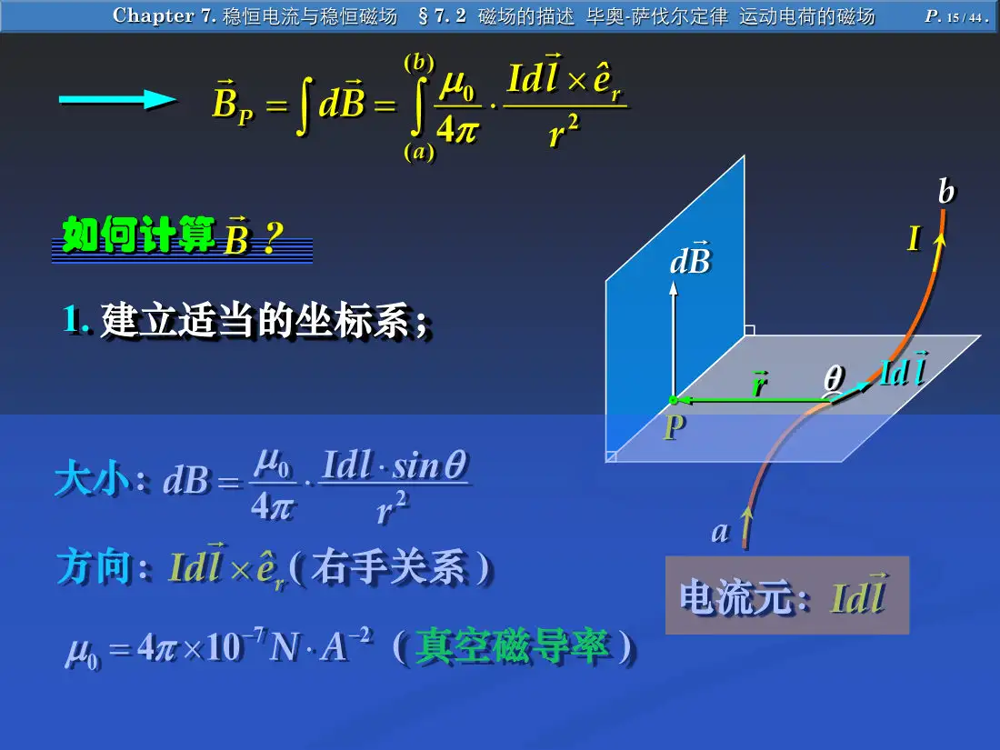

原文：

$$
\vec {B} _ {P} = \int d \vec {B} = \int_ {(a)} ^ {(b)} \frac {\mu_ {0}}{4 \pi} \cdot \frac {I d \vec {l} \times \hat {e} _ {r}}{r ^ {2}}
$$

如何计算 $\vec{B}$ ？

1. 建立适当的坐标系;

大小: $dB = \frac{\mu_0}{4\pi} \cdot \frac{Idl \cdot \sin \theta}{r^2}$

方向: $Id\vec{l} \times \hat{e}_r$ (右手关系)

$\mu_{0}=4\pi\times10^{-7}N\cdot A^{-2}$ （真空磁导率）

电流元: Idl

Chapter 7. 稳恒电流与稳恒磁场 § 7.2 磁场的描述 毕奥-萨伐尔定律 运动电荷的磁场

P. 15 / 44 .

### $$

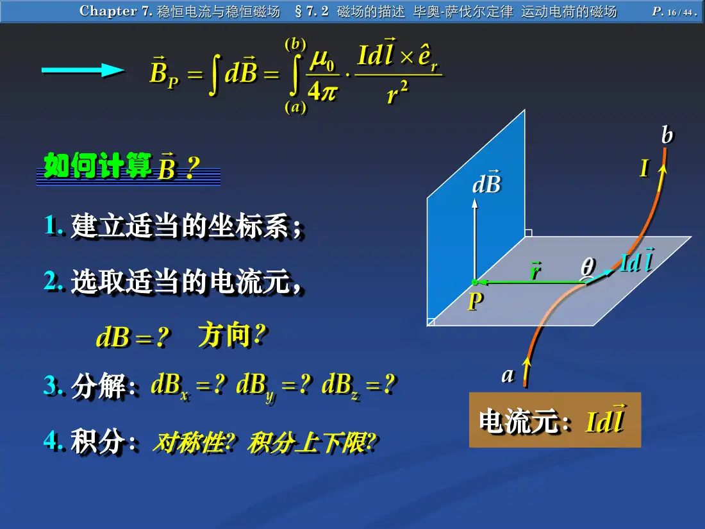

原文：

$$
\vec {B} _ {P} = \int d \vec {B} = \int_ {(a)} ^ {(b)} \frac {\mu_ {0}}{4 \pi} \cdot \frac {I d \vec {l} \times \hat {e} _ {r}}{r ^ {2}}
$$

如何计算 $\vec{B}$ ？

1. 建立适当的坐标系;

2. 选取适当的电流元，

$dB = ?$ 方向?

3. 分解: $dB_{x} = ? dB_{y} = ? dB_{z} = ?$

4. 积分：对称性？积分上下限？

电流元: Idl

Chapter 7. 稳恒电流与稳恒磁场 § 7.2 磁场的描述 毕奥-萨伐尔定律 运动电荷的磁场

P. 16 / 44 .

### 解 建立坐标系如图。取电流元:

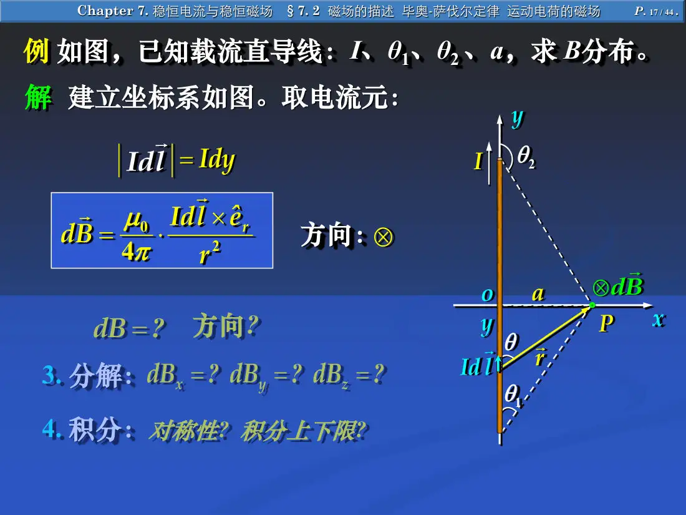

原文：

例如图，已知载流直导线： $I$ 、 $\theta_{1}$ 、 $\theta_{2}$ 、a，求B分布。

解 建立坐标系如图。取电流元:

$$
\left| \vec {I d l} \right| = I d y
$$

$$
d \vec {B} = \frac {\mu_ {0}}{4 \pi} \cdot \frac {I d \vec {l} \times \hat {e} _ {r}}{r ^ {2}}
$$

方向：

$dB = ?$ 方向?

3. 分解: $dB_{x} = ? dB_{y} = ? dB_{z} = ?$

4. 积分：对称性？积分上下限？

P. 17 / 44.

Chapter 7. 稳恒电流与稳恒磁场 § 7.2 磁场的描述 毕奥-萨伐尔定律 运动电荷的磁场

### 解 建立坐标系如图。取电流元:

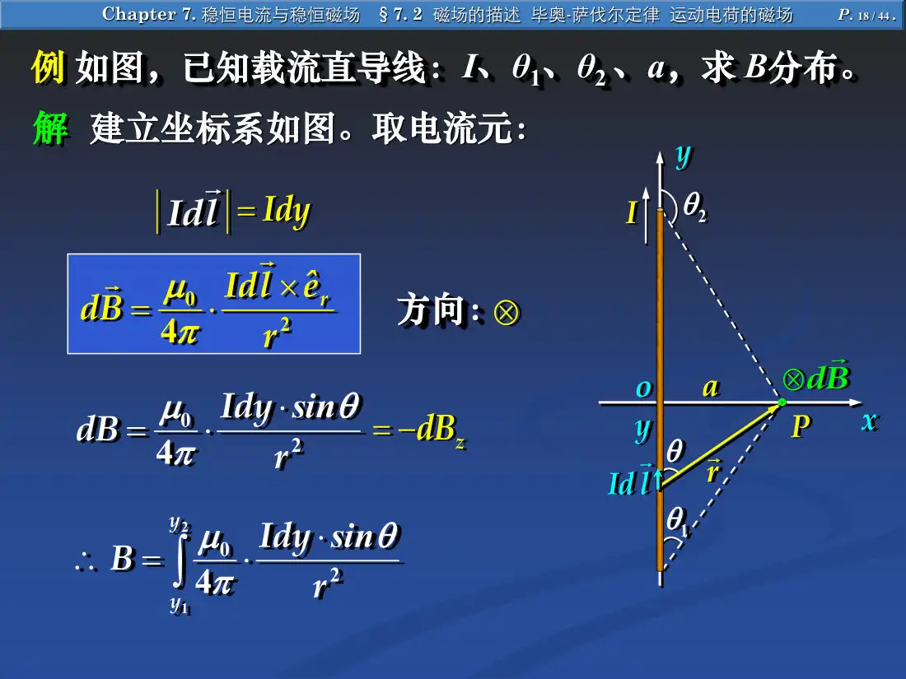

原文：

例如图，已知载流直导线： $I$ 、 $\theta_{1}$ 、 $\theta_{2}$ 、a，求B分布。

解 建立坐标系如图。取电流元:

$$
\left| \vec {I d l} \right| = I d y
$$

$$
d \vec {B} = \frac {\mu_ {0}}{4 \pi} \cdot \frac {I d \vec {l} \times \hat {e} _ {r}}{r ^ {2}}
$$

方向：

$$
d B = \frac {\mu_ {0}}{4 \pi} \cdot \frac {I d y \cdot \sin \theta}{r ^ {2}} = - d B _ {z}
$$

$$
\therefore B = \int_ {y _ {1}} ^ {y _ {2}} \frac {\mu_ {0}}{4 \pi} \cdot \frac {I d y \cdot \sin \theta}{r ^ {2}}
$$

Chapter 7. 稳恒电流与稳恒磁场 § 7.2 磁场的描述 毕奥-萨伐尔定律 运动电荷的磁场

P. 18 / 44.

### $$

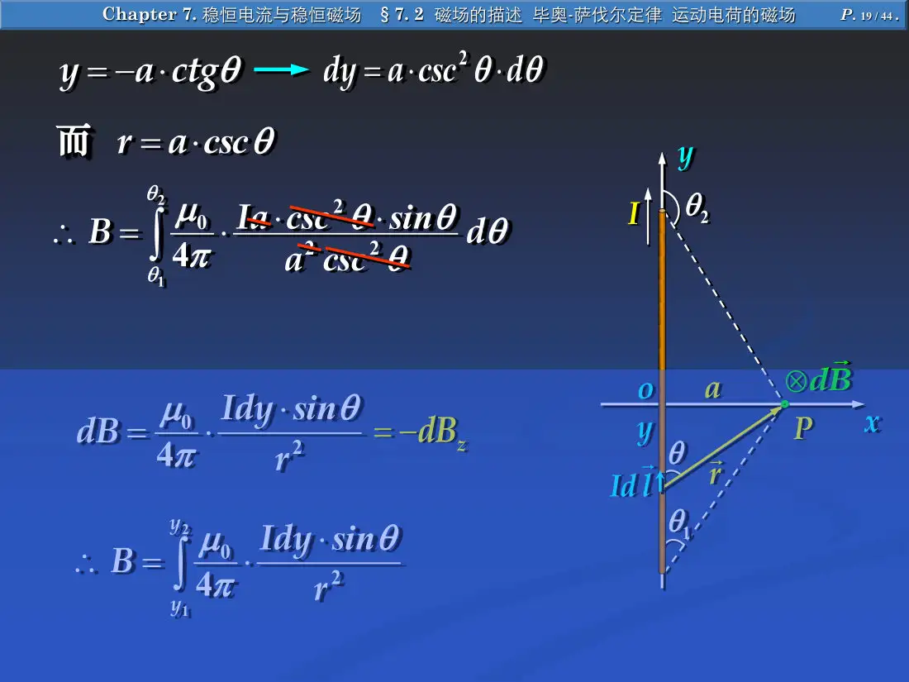

原文：

$$
y = - a \cdot c t g \theta \longrightarrow d y = a \cdot \csc^ {2} \theta \cdot d \theta
$$

而 $r = a \cdot \csc \theta$

$$
\therefore B = \int_ {\theta_ {1}} ^ {\theta_ {2}} \frac {\mu_ {0}}{4 \pi} \cdot \frac {I a \cdot \csc^ {2} \theta \cdot \sin \theta}{a ^ {2} \csc^ {2} \theta} d \theta
$$

$$
d B = \frac {\mu_ {0}}{4 \pi} \cdot \frac {I d y \cdot \sin \theta}{r ^ {2}} = - d B _ {z}
$$

$$
\therefore B = \int_ {y _ {1}} ^ {y _ {2}} \frac {\mu_ {0}}{4 \pi} \cdot \frac {I d y \cdot \sin \theta}{r ^ {2}}
$$

Chapter 7. 稳恒电流与稳恒磁场 § 7.2 磁场的描述 毕奥-萨伐尔定律 运动电荷的磁场

P. 19 / 44 .

### $$

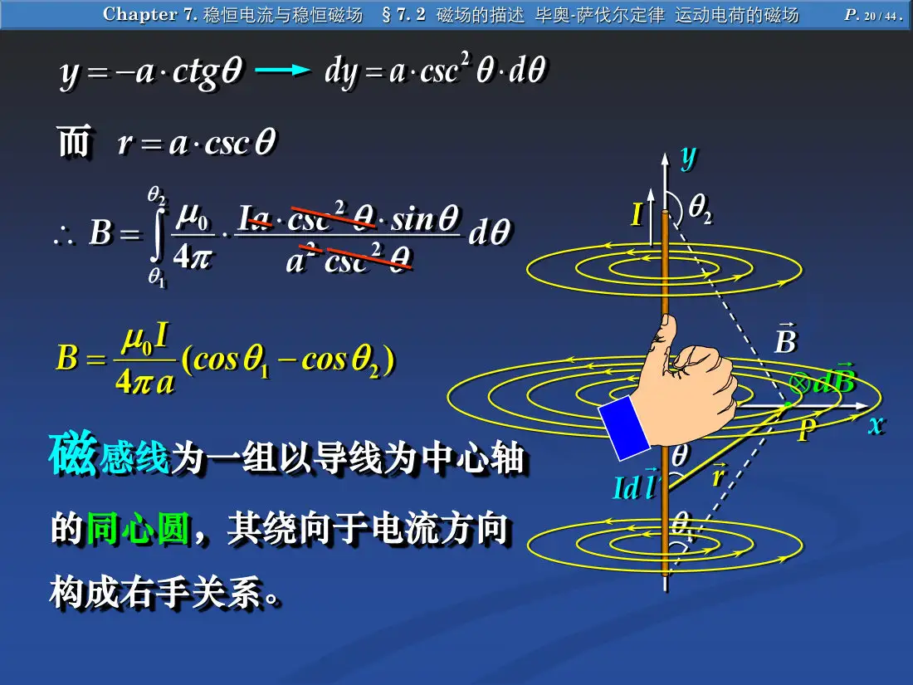

原文：

$$
y = - a \cdot c t g \theta \longrightarrow d y = a \cdot \csc^ {2} \theta \cdot d \theta
$$

而 $r = a \cdot \csc \theta$

$$
\therefore B = \int_ {\theta_ {1}} ^ {\theta_ {2}} \frac {\mu_ {0}}{4 \pi} \cdot \frac {I a \cdot \csc^ {2} \theta \cdot \sin \theta}{a ^ {2} \csc^ {2} \theta} d \theta
$$

$$
B = \frac {\mu_ {0} I}{4 \pi a} (\cos \theta_ {1} - \cos \theta_ {2})
$$

磁感线为一组以导线为中心轴的同心圆，其绕向于电流方向构成右手关系。

Chapter 7. 稳恒电流与稳恒磁场 § 7.2 磁场的描述 毕奥-萨伐尔定律 运动电荷的磁场

P. 20 / 44.

### 😊 中部附近，若 $a \ll L$ ，则称为无限长载流直导线：

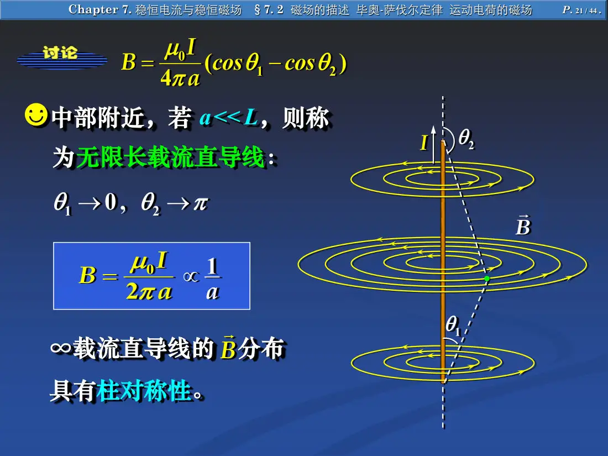

原文：

讨论 $B = \frac{\mu_0I}{4\pi a} (\cos \theta_1 - \cos \theta_2)$

😊 中部附近，若 $a \ll L$ ，则称为无限长载流直导线：

$$
\theta_ {1} \rightarrow 0, \theta_ {2} \rightarrow \pi
$$

$$
B = \frac {\mu_ {0} I}{2 \pi a} \propto \frac {1}{a}
$$

∞载流直导线的 $\vec{B}$ 分布具有柱对称性。

Chapter 7. 稳恒电流与稳恒磁场 § 7.2 磁场的描述 毕奥-萨伐尔定律 运动电荷的磁场

P. 21 / 44.

### 😊端平面上，若 $a \ll L$ ，则称为半无限长载流直导线：

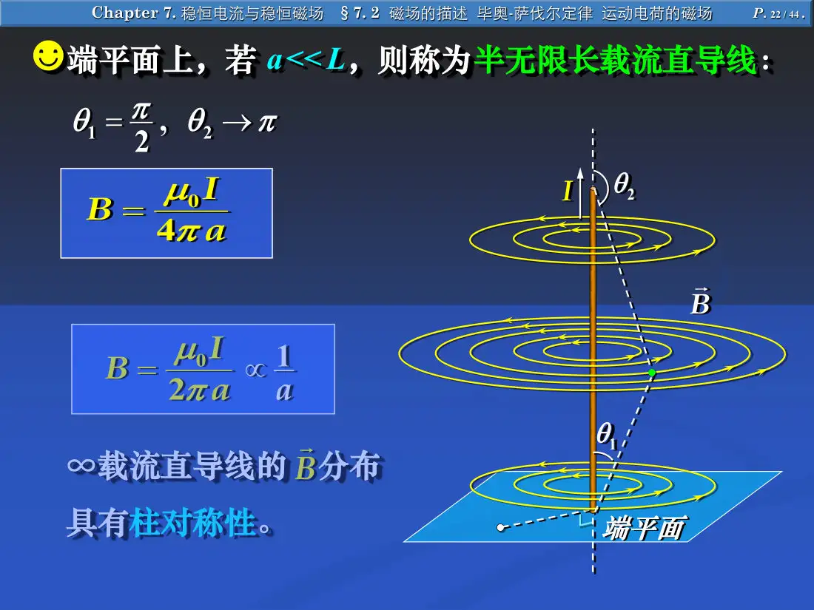

原文：

😊端平面上，若 $a \ll L$ ，则称为半无限长载流直导线：

$$
\theta_ {1} = \frac {\pi}{2}, \theta_ {2} \rightarrow \pi
$$

$$
B = \frac {\mu_ {0} I}{4 \pi a}
$$

$$
B = \frac {\mu_ {0} I}{2 \pi a} \propto \frac {1}{a}
$$

∞载流直导线的 $\vec{B}$ 分布具有柱对称性。

Chapter 7. 稳恒电流与稳恒磁场 § 7.2 磁场的描述 毕奥-萨伐尔定律 运动电荷的磁场

P. 22 / 44.

### 😊端平面上，若 $a \ll L$ ，则称为半无限长载流直导线：

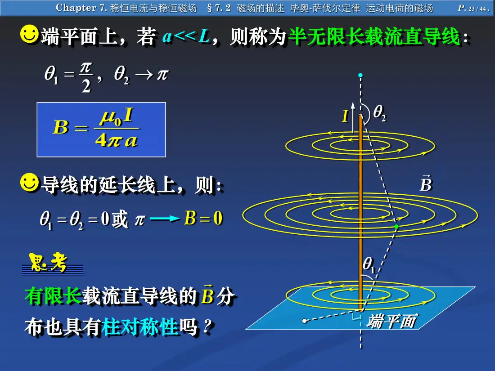

原文：

😊端平面上，若 $a \ll L$ ，则称为半无限长载流直导线：

$$
\theta_ {1} = \frac {\pi}{2}, \theta_ {2} \rightarrow \pi
$$

$$
B = \frac {\mu_ {0} I}{4 \pi a}
$$

导线的延长线上，则：

$\theta_{1} = \theta_{2} = 0$ 或 $\pi \longrightarrow B = 0$

思考

有限长载流直导线的 $\vec{B}$ 分布也具有柱对称性吗？

Chapter 7. 稳恒电流与稳恒磁场 § 7.2 磁场的描述 毕奥-萨伐尔定律 运动电荷的磁场

P. 23 / 44.

### 课堂练习 已知载流圆线圈：I、R，求其轴线上B分布。

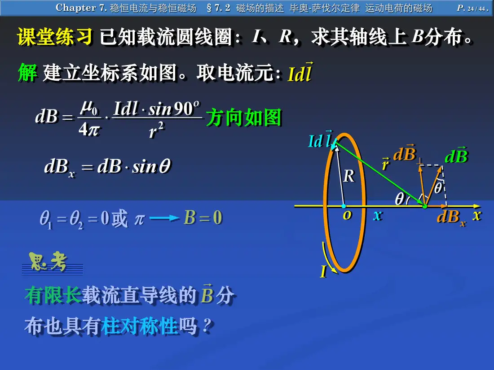

原文：

课堂练习 已知载流圆线圈：I、R，求其轴线上B分布。

解 建立坐标系如图。取电流元: Idl

$dB=\frac{\mu_{0}}{4\pi}\cdot\frac{Idl\cdot sin90^{\circ}}{r^{2}}$ 方向如图

$$
d B _ {x} = d B \cdot \sin \theta
$$

$$
\theta_ {1} = \theta_ {2} = 0 \text {或} \pi \longrightarrow B = 0
$$

思考

有限长载流直导线的 $\vec{B}$ 分

布也具有柱对称性吗？

Chapter 7. 稳恒电流与稳恒磁场 § 7.2 磁场的描述 毕奥-萨伐尔定律 运动电荷的磁场

### 课堂练习 已知载流圆线圈：I、R，求其轴线上B分布。

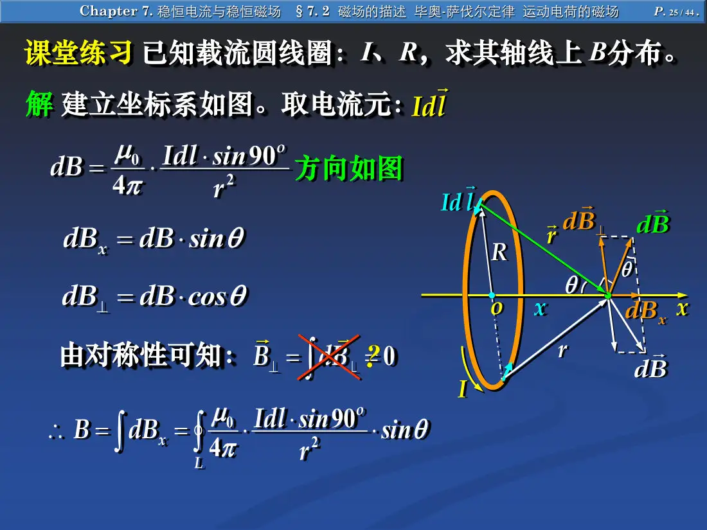

原文：

课堂练习 已知载流圆线圈：I、R，求其轴线上B分布。

解 建立坐标系如图。取电流元: Idl

$dB=\frac{\mu_{0}}{4\pi}\cdot\frac{Idl\cdot sin90^{\circ}}{r^{2}}$ 方向如图

$$
d B _ {x} = d B \cdot \sin \theta
$$

$$
d B _ {\perp} = d B \cdot \cos \theta
$$

由对称性可知： $\vec{B}_{\perp} = \int d\vec{B}_{\perp} = 0$

$$
\therefore B = \int d B _ {x} = \oint_ {L} \frac {\mu_ {0}}{4 \pi} \cdot \frac {I d l \cdot \sin 9 0 ^ {\circ}}{r ^ {2}} \cdot \sin \theta
$$

Chapter 7. 稳恒电流与稳恒磁场 § 7.2 磁场的描述 毕奥-萨伐尔定律 运动电荷的磁场

### $$

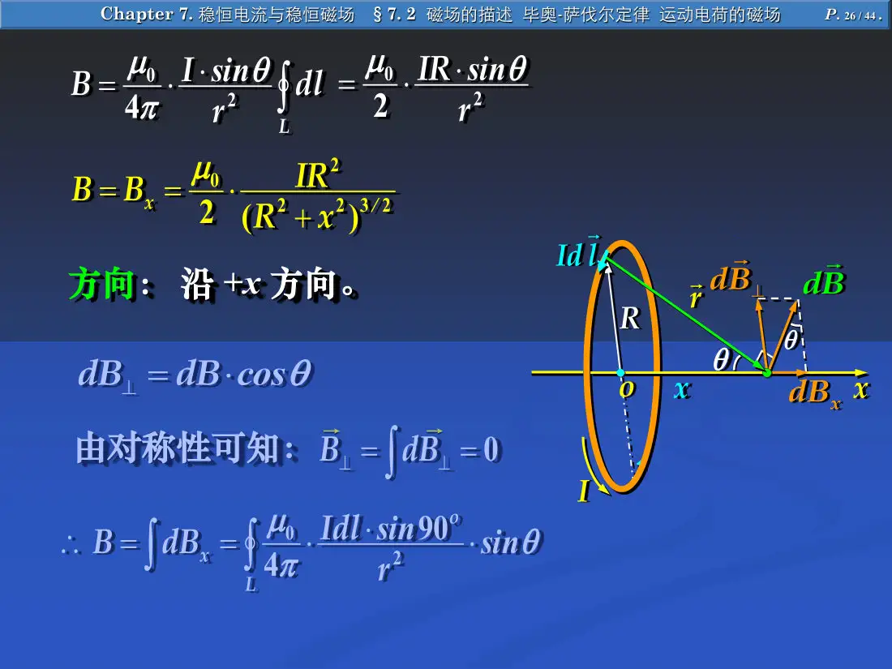

原文：

$$
B = \frac {\mu_ {0}}{4 \pi} \cdot \frac {I \cdot \sin \theta}{r ^ {2}} \oint_ {L} d l = \frac {\mu_ {0}}{2} \cdot \frac {I R \cdot \sin \theta}{r ^ {2}}
$$

$$
B = B _ {x} = \frac {\mu_ {0}}{2} \cdot \frac {I R ^ {2}}{\left(R ^ {2} + x ^ {2}\right) ^ {3 / 2}}
$$

方向：沿 $+x$ 方向。

$$
d B _ {\perp} = d B \cdot \cos \theta
$$

由对称性可知: $\vec{B}_{\perp} = \int d\vec{B}_{\perp} = 0$

$$
\therefore B = \int d B _ {x} = \oint_ {L} \frac {\mu_ {0}}{4 \pi} \cdot \frac {I d l \cdot \sin 9 0 ^ {\circ}}{r ^ {2}} \cdot \sin \theta
$$

Chapter 7. 稳恒电流与稳恒磁场 § 7.2 磁场的描述 毕奥-萨伐尔定律 运动电荷的磁场

P. 26 / 44.

### $$

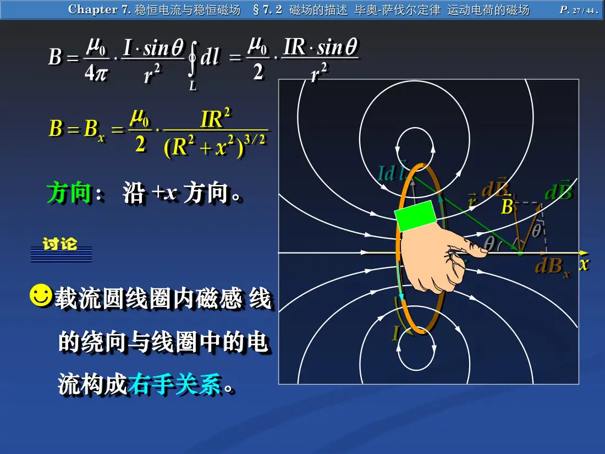

原文：

$$
B = \frac {\mu_ {0}}{4 \pi} \cdot \frac {I \cdot \sin \theta}{r ^ {2}} \oint_ {L} d l = \frac {\mu_ {0}}{2} \cdot \frac {I R \cdot \sin \theta}{r ^ {2}}
$$

$$
B = B _ {x} = \frac {\mu_ {0}}{2} \cdot \frac {I R ^ {2}}{\left(R ^ {2} + x ^ {2}\right) ^ {3 / 2}}
$$

方向：沿 $+x$ 方向。

讨论

载流圆线圈内磁感线的绕向与线圈中的电流构成右手关系。

Chapter 7. 稳恒电流与稳恒磁场 § 7.2 磁场的描述 毕奥-萨伐尔定律 运动电荷的磁场

P. 27 / 44.

### 当 $x \to \pm \infty$ 时， $B = 0$ 。

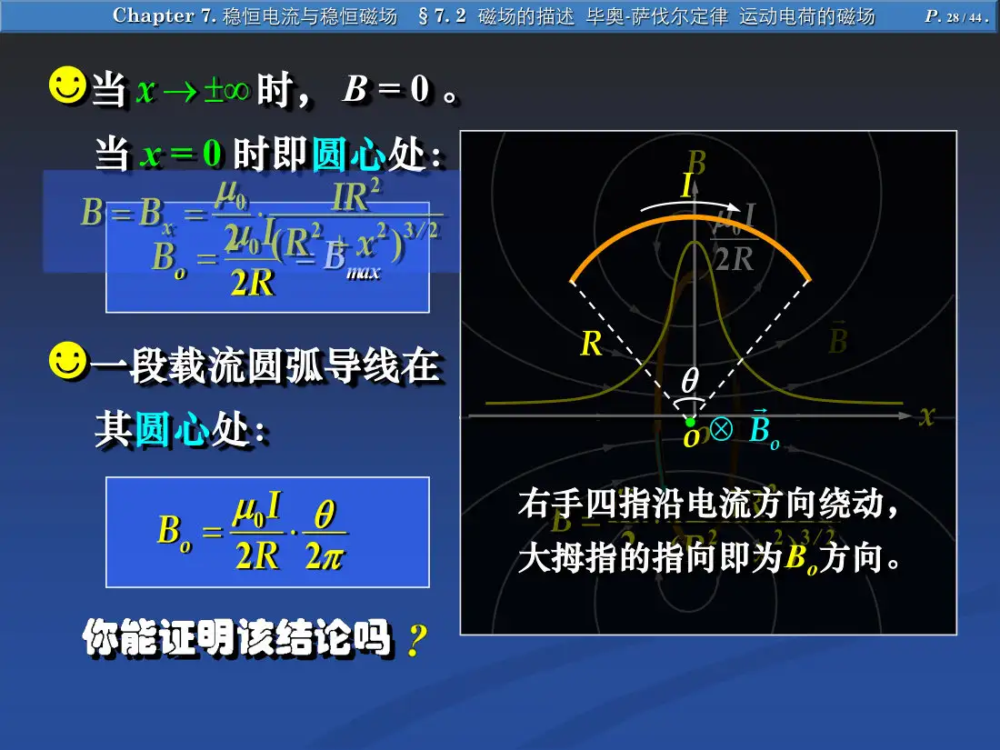

原文：

当 $x \to \pm \infty$ 时， $B = 0$ 。

当 $x = 0$ 时即圆心处:

$$
\begin{array}{c} B = B _ {x} = \frac {\mu_ {0}}{2 \mu_ {0}} \cdot \frac {I R ^ {2}}{2 R (R ^ {2} + x ^ {2}) ^ {3 / 2}} \\ B _ {o} = \frac {2 R}{2 R} \end{array}
$$

一段载流圆弧导线在其圆心处:

$$
B _ {o} = \frac {\mu_ {0} I}{2 R} \cdot \frac {\theta}{2 \pi}
$$

你能证明该结论吗？

右手四指沿电流方向绕动，大拇指的指向即为 $B_{o}$ 方向。

Chapter 7. 稳恒电流与稳恒磁场 § 7.2 磁场的描述 毕奥-萨伐尔定律 运动电荷的磁场

P. 28 / 44 .

### 课堂练习 求下列组合载流导线在 o 处的磁感应强度。

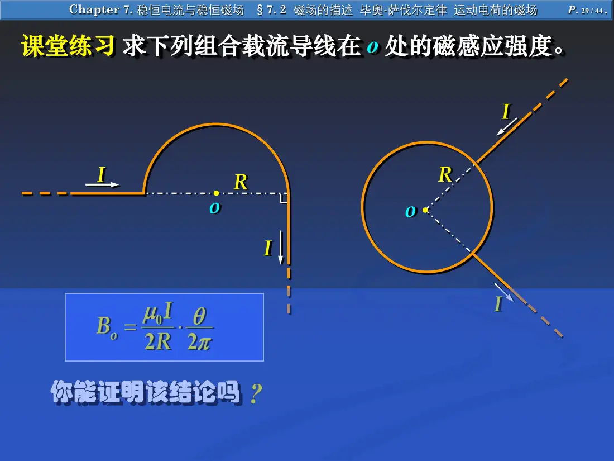

原文：

课堂练习 求下列组合载流导线在 o 处的磁感应强度。

$$
B _ {o} = \frac {\mu_ {0} I}{2 R} \cdot \frac {\theta}{2 \pi}
$$

你能证明该结论吗？

Chapter 7. 稳恒电流与稳恒磁场 § 7.2 磁场的描述 毕奥-萨伐尔定律 运动电荷的磁场

P. 29 / 44 .

### 课堂练习 求下列组合载流导线在 o 处的磁感应强度。

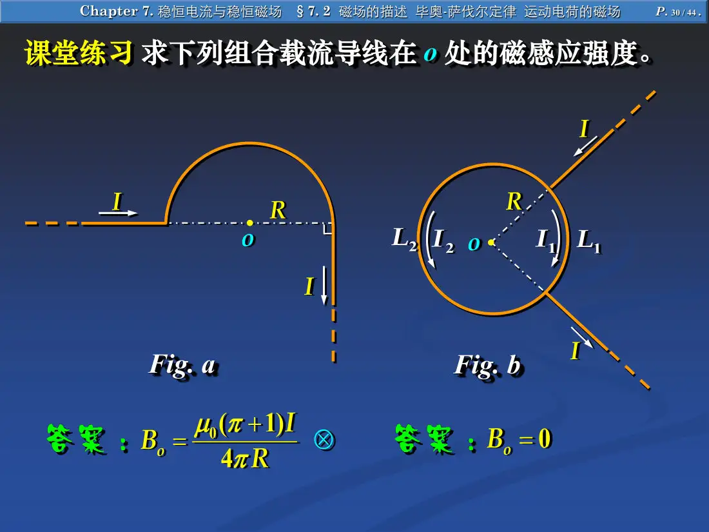

原文：

课堂练习 求下列组合载流导线在 o 处的磁感应强度。

Fig. a

答案： $B_{o}=\frac{\mu_{0}(\pi+1)I}{4\pi R}\otimes$ 答案： $B_{o}=0$

Fig. b

Chapter 7. 稳恒电流与稳恒磁场 § 7.2 磁场的描述 毕奥-萨伐尔定律 运动电荷的磁场

P. 30 / 44.

### 电流线密度: $j_{\lambda} = \frac{I}{a}$

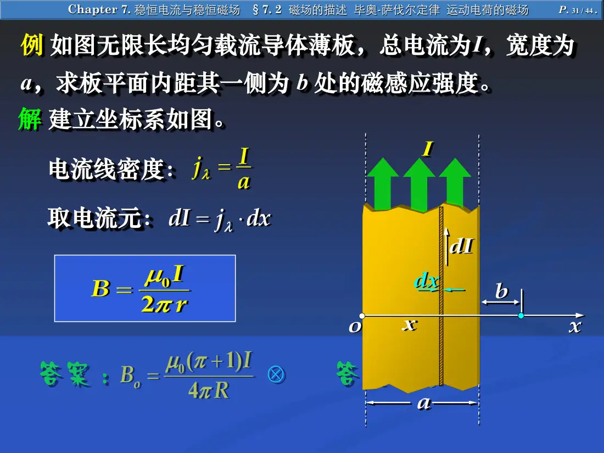

原文：

例如图无限长均匀载流导体薄板，总电流为 $I$ ，宽度为 $a$ ，求板平面内距其一侧为 $b$ 处的磁感应强度。解建立坐标系如图。

电流线密度: $j_{\lambda} = \frac{I}{a}$

取电流元: $dI = j_{\lambda} \cdot dx$

$$
B = \frac {\mu_ {0} I}{2 \pi r}
$$

答案： $B_{o}=\frac{\mu_{0}(\pi+1)I}{4\pi R}$

Chapter 7. 稳恒电流与稳恒磁场 § 7.2 磁场的描述 毕奥-萨伐尔定律 运动电荷的磁场

### 电流线密度: $j_{\lambda} = \frac{I}{a}$

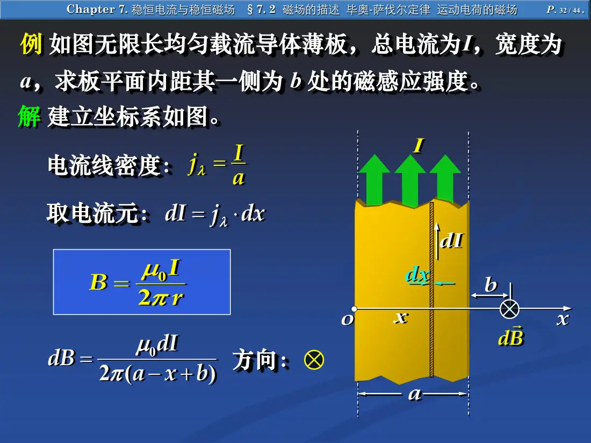

原文：

例如图无限长均匀载流导体薄板，总电流为 $I$ ，宽度为 $a$ ，求板平面内距其一侧为 $b$ 处的磁感应强度。解建立坐标系如图。

电流线密度: $j_{\lambda} = \frac{I}{a}$

取电流元: $dI = j_{\lambda} \cdot dx$

$$
B = \frac {\mu_ {0} I}{2 \pi r}
$$

$dB=\frac{\mu_{0}dI}{2\pi(a-x+b)}$ 方向：⊗

P. 32 / 44.

Chapter 7. 稳恒电流与稳恒磁场 § 7.2 磁场的描述 毕奥-萨伐尔定律 运动电荷的磁场

### $$

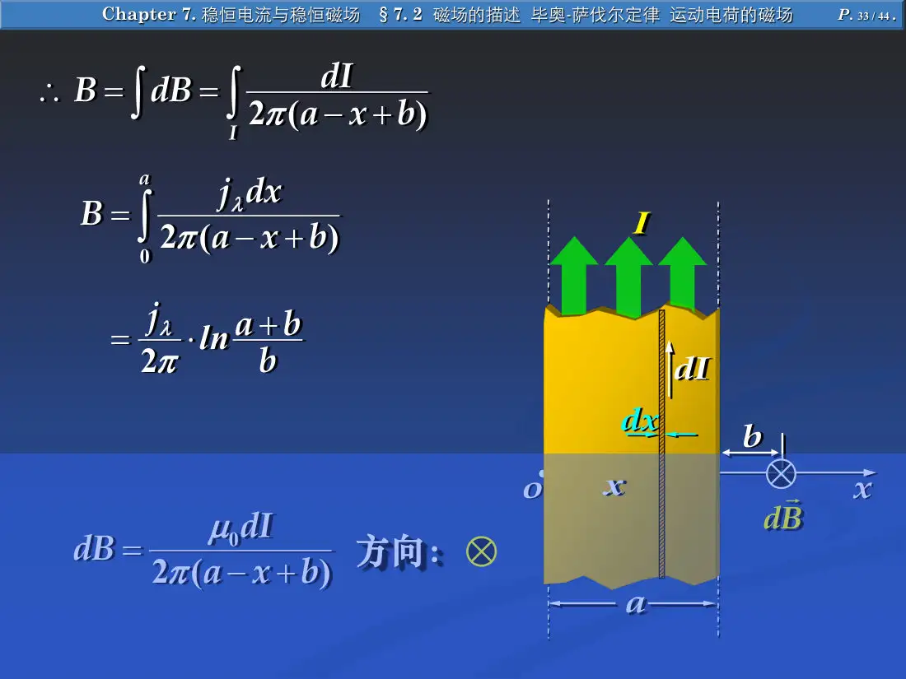

原文：

$$
\therefore B = \int d B = \int_ {I} \frac {d I}{2 \pi (a - x + b)}
$$

$$
\begin{array}{l} B = \int_ {0} ^ {a} \frac {j _ {\lambda} d x}{2 \pi (a - x + b)} \\ = \frac {j _ {\lambda}}{2 \pi} \cdot \ln \frac {a + b}{b} \end{array}
$$

$dB=\frac{\mu_{0}dI}{2\pi(a-x+b)}$ 方向：⊗

Chapter 7. 稳恒电流与稳恒磁场 § 7.2 磁场的描述 毕奥-萨伐尔定律 运动电荷的磁场

P. 33 / 44.

### $$

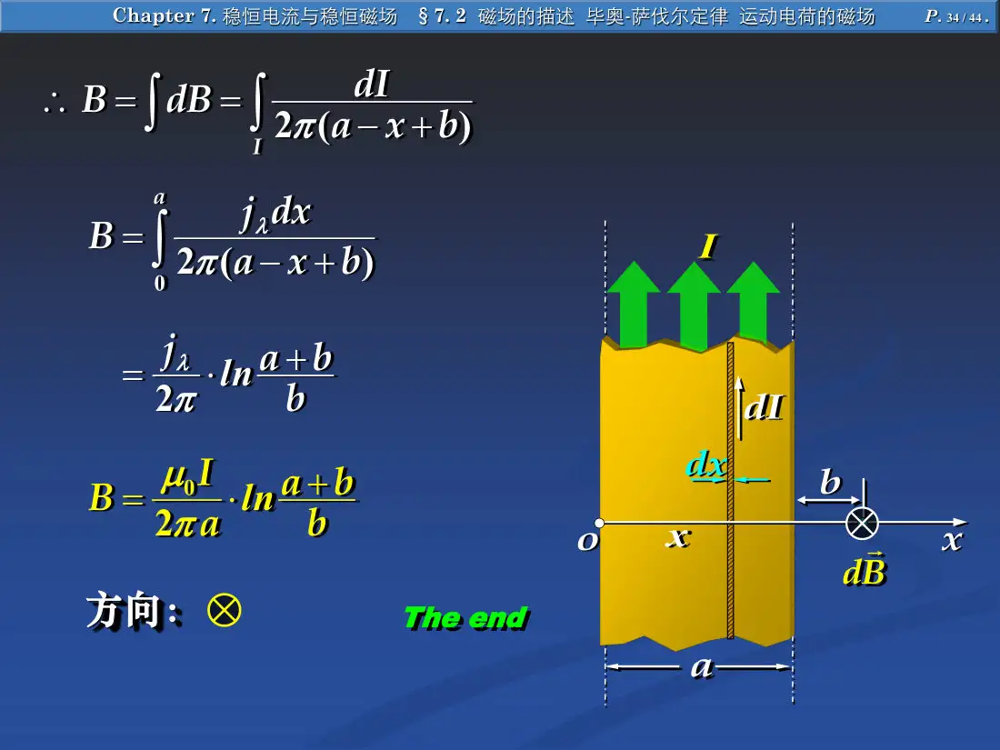

原文：

$$
\therefore B = \int d B = \int_ {I} \frac {d I}{2 \pi (a - x + b)}
$$

$$
\begin{array}{l} B = \int_ {0} ^ {a} \frac {j _ {\lambda} d x}{2 \pi (a - x + b)} \\ = \frac {j _ {\lambda}}{2 \pi} \cdot \ln \frac {a + b}{b} \end{array}
$$

$$
B = \frac {\mu_ {0} I}{2 \pi a} \cdot \ln \frac {a + b}{b}
$$

方向：

The end

Chapter 7. 稳恒电流与稳恒磁场 § 7.2 磁场的描述 毕奥-萨伐尔定律 运动电荷的磁场

P. 34 / 44.

### 五、运动电荷的磁场

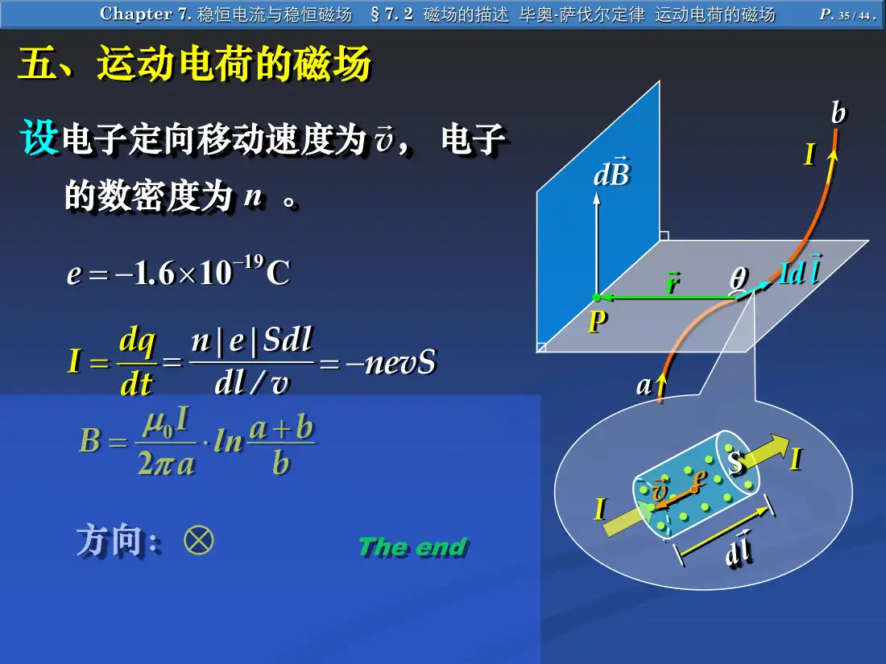

原文：

五、运动电荷的磁场

设电子定向移动速度为 $\vec{v}$ ，电子的数密度为 n 。

$$
e = - 1. 6 \times 1 0 ^ {- 1 9} \mathrm{C}
$$

$$
I = \frac {d q}{d t} = \frac {n | e | S d l}{d l / v} = - n e v S
$$

$$
B = \frac {\mu_ {0} I}{2 \pi a} \cdot \ln \frac {a + b}{b}
$$

方向：

The end

Chapter 7. 稳恒电流与稳恒磁场 § 7.2 磁场的描述 毕奥-萨伐尔定律 运动电荷的磁场

P. 35 / 44 .

### 五、运动电荷的磁场

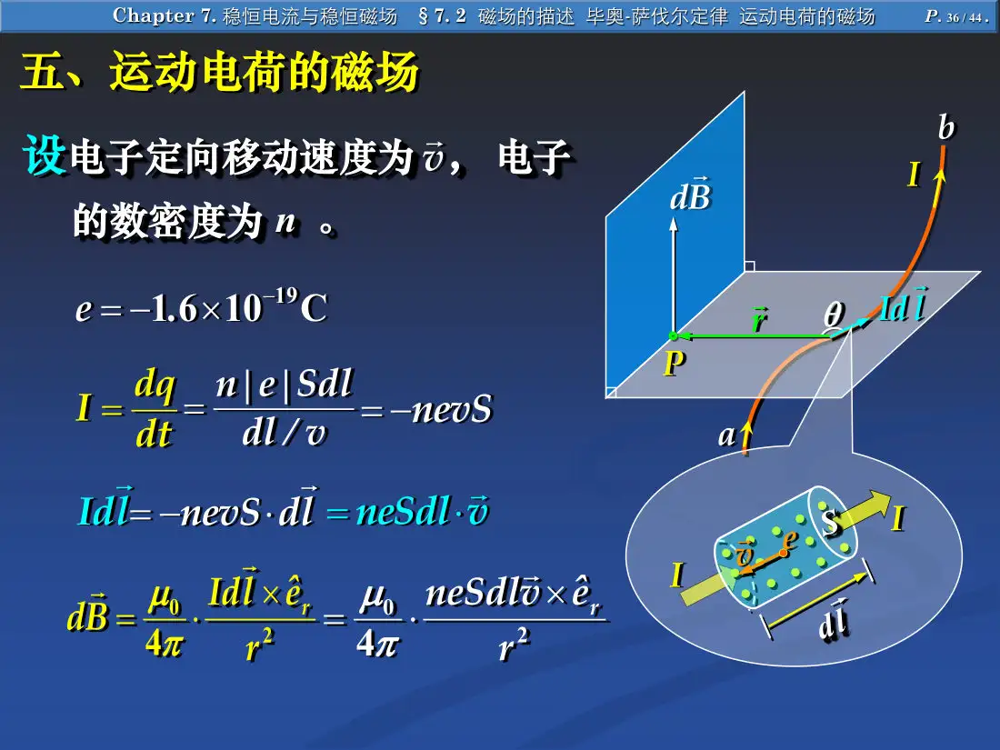

原文：

五、运动电荷的磁场

设电子定向移动速度为 $\vec{v}$ ，电子的数密度为 n 。

$$
e = - 1. 6 \times 1 0 ^ {- 1 9} \mathrm{C}
$$

$$
I = \frac {d q}{d t} = \frac {n | e | S d l}{d l / v} = - n e v S
$$

$$
I d \vec {l} = - n e v S \cdot d \vec {l} = n e S d l \cdot \vec {v}
$$

$$
d \vec {B} = \frac {\mu_ {0}}{4 \pi} \cdot \frac {I d \vec {l} \times \hat {e} _ {r}}{r ^ {2}} = \frac {\mu_ {0}}{4 \pi} \cdot \frac {n e S d l \vec {v} \times \hat {e} _ {r}}{r ^ {2}}
$$

P. 36 / 44 .

Chapter 7. 稳恒电流与稳恒磁场 § 7.2 磁场的描述 毕奥-萨伐尔定律 运动电荷的磁场

### 则每个电子在P点产生的磁感应强度:

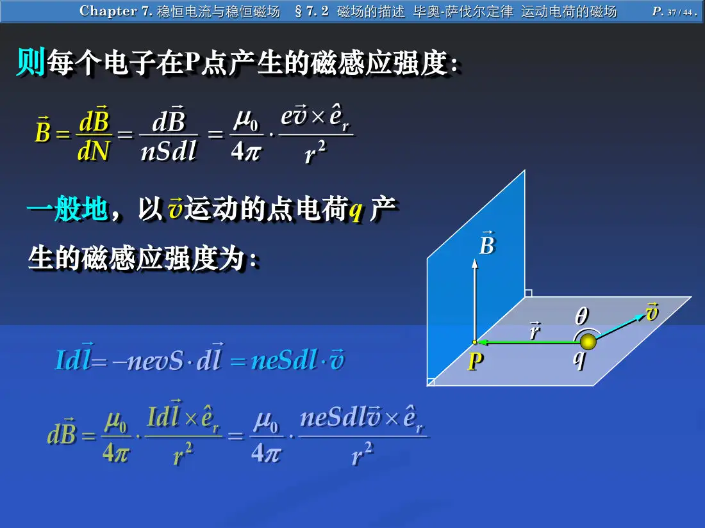

原文：

则每个电子在P点产生的磁感应强度:

$$
\vec {B} = \frac {d \vec {B}}{d N} = \frac {d \vec {B}}{n S d l} = \frac {\mu_ {0}}{4 \pi} \cdot \frac {e \vec {v} \times \hat {e} _ {r}}{r ^ {2}}
$$

一般地，以 $\vec{v}$ 运动的点电荷 $q$ 产生的磁感应强度为：

$$
I d \vec {l} = - n e v S \cdot d \vec {l} = n e S d l \cdot \vec {v}
$$

$$
d \vec {B} = \frac {\mu_ {0}}{4 \pi} \cdot \frac {I d \vec {l} \times \hat {e} _ {r}}{r ^ {2}} = \frac {\mu_ {0}}{4 \pi} \cdot \frac {n e S d l \vec {v} \times \hat {e} _ {r}}{r ^ {2}}
$$

Chapter 7. 稳恒电流与稳恒磁场 § 7.2 磁场的描述 毕奥-萨伐尔定律 运动电荷的磁场

P. 37 / 44.

### 则每个电子在P点产生的磁感应强度:

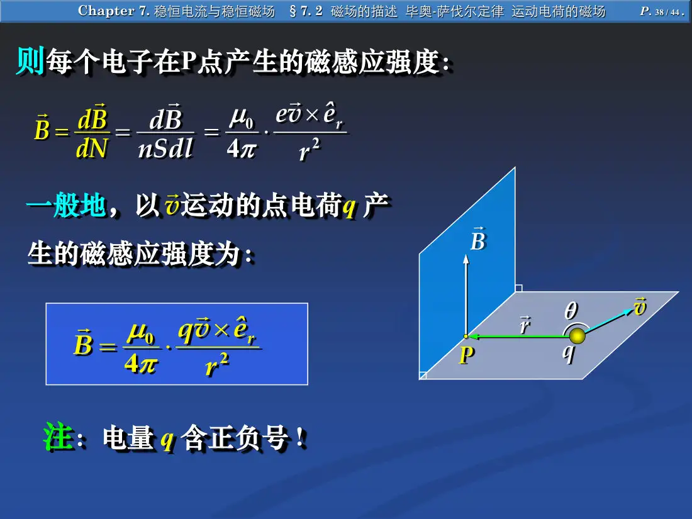

原文：

则每个电子在P点产生的磁感应强度:

$$
\vec {B} = \frac {d \vec {B}}{d N} = \frac {d \vec {B}}{n S d l} = \frac {\mu_ {0}}{4 \pi} \cdot \frac {e \vec {v} \times \hat {e} _ {r}}{r ^ {2}}
$$

一般地，以 $\vec{v}$ 运动的点电荷 $q$ 产生的磁感应强度为：

$$
\vec {B} = \frac {\mu_ {0}}{4 \pi} \cdot \frac {q \vec {v} \times \hat {e} _ {r}}{r ^ {2}}
$$

注：电量 $q$ 含正负号！

Chapter 7. 稳恒电流与稳恒磁场 § 7.2 磁场的描述 毕奥-萨伐尔定律 运动电荷的磁场

P. 38 / 44 .

### 解建立坐标系、取元如图。

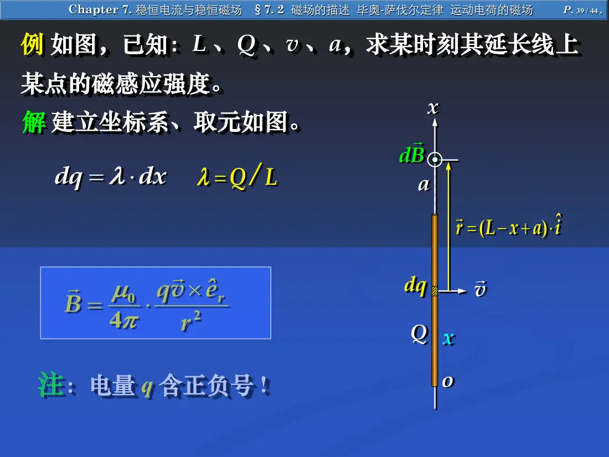

原文：

例如图, 已知: $L 、 Q 、 v 、 a$ , 求某时刻其延长线上某点的磁感应强度。

解建立坐标系、取元如图。

$$
d q = \lambda \cdot d x \quad \lambda = Q / L
$$

$$
\vec {B} = \frac {\mu_ {0}}{4 \pi} \cdot \frac {q \vec {v} \times \hat {e} _ {r}}{r ^ {2}}
$$

注：电量 $q$ 含正负号！

$$
\begin{array}{c} \text { d } \vec {B} \\ a \\ \text { d } q \\ Q \\ o \end{array} \quad \begin{array}{c} \vec {r} = (L - x + a) \cdot \hat {i} \\ \vec {v} \\ x \\ o \end{array}
$$

Chapter 7. 稳恒电流与稳恒磁场 § 7.2 磁场的描述 毕奥-萨伐尔定律 运动电荷的磁场

### 例如图，已知：L、Q、v、a，求某时刻其延长线上某点的磁感应强度。

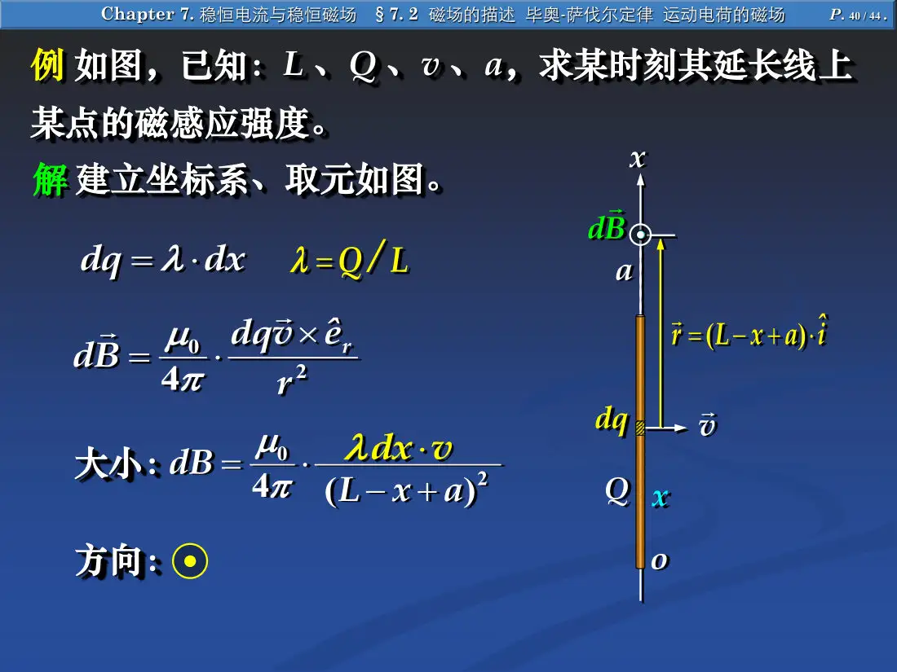

原文：

例如图，已知：L、Q、v、a，求某时刻其延长线上某点的磁感应强度。

解建立坐标系、取元如图。

$$
d q = \lambda \cdot d x \quad \lambda = Q / L
$$

$$
d \vec {B} = \frac {\mu_ {0}}{4 \pi} \cdot \frac {d q \vec {v} \times \hat {e} _ {r}}{r ^ {2}}
$$

$$
\text { 大小: } d B = \frac {\mu_ {0}}{4 \pi} \cdot \frac {\lambda d x \cdot v}{(L - x + a) ^ {2}}
$$

方向：

$$
\begin{array}{c c c} x & \\ d \vec {B} & \\ a & \\ d q & \vec {v} \\ Q & x \\ o & \end{array} \vec {r} = (L - x + a) \cdot \hat {i}
$$

Chapter 7. 稳恒电流与稳恒磁场 § 7.2 磁场的描述 毕奥-萨伐尔定律 运动电荷的磁场

P. 40 / 44.

### $$

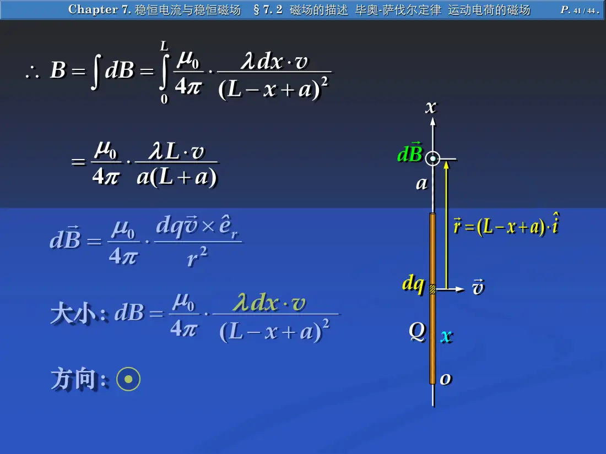

原文：

$$
\begin{array}{r l} & {\therefore B = \int d B = \int_ {0} ^ {L} \frac {\mu_ {0}}{4 \pi} \cdot \frac {\lambda d x \cdot v}{(L - x + a) ^ {2}}} \\ & {\qquad = \frac {\mu_ {0}}{4 \pi} \cdot \frac {\lambda L \cdot v}{a (L + a)}} \end{array}
$$

$$
d \vec {B} = \frac {\mu_ {0}}{4 \pi} \cdot \frac {d q \vec {v} \times \hat {e} _ {r}}{r ^ {2}}
$$

大小: $dB = \frac{\mu_0}{4\pi} \cdot \frac{\lambda dx \cdot v}{(L - x + a)^2}$

$$
\begin{array}{c c} \text {   d   B   } & \\ x & \\ a & \\ \vec {r} = (L - x + a) \cdot \hat {\vec {i}} \\ d q & \\ \vec {v} & \\ Q & x \\ o & \end{array}
$$

方向：

Chapter 7. 稳恒电流与稳恒磁场 § 7.2 磁场的描述 毕奥-萨伐尔定律 运动电荷的磁场

P. 41 / 44.

### $$

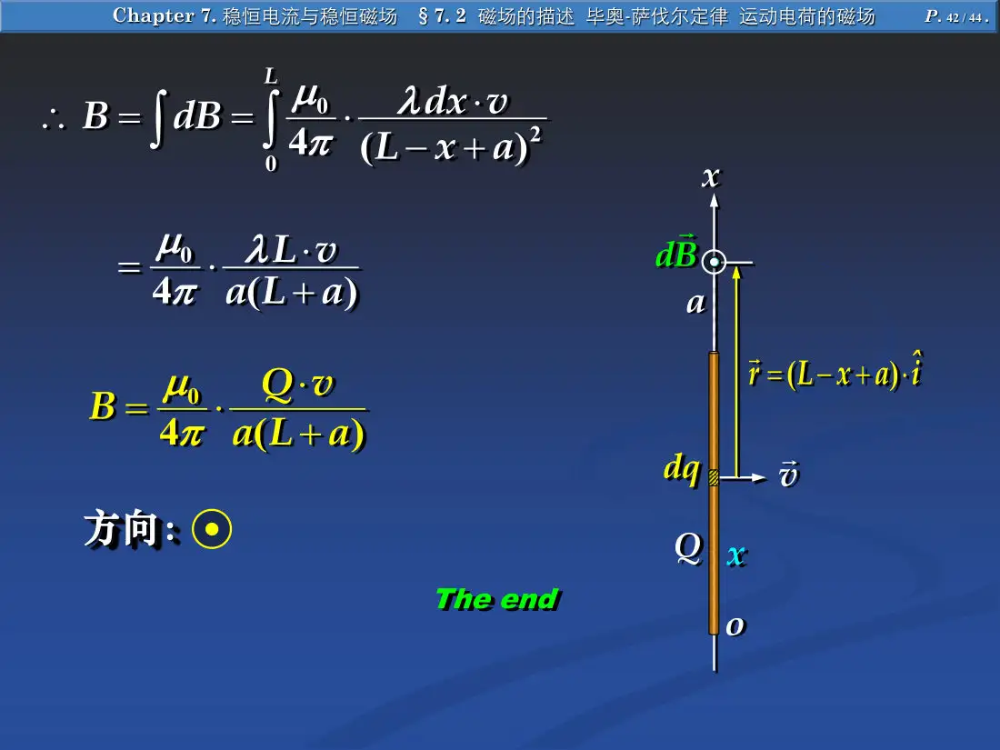

原文：

$$
\therefore B = \int d B = \int_ {0} ^ {L} \frac {\mu_ {0}}{4 \pi} \cdot \frac {\lambda d x \cdot v}{(L - x + a) ^ {2}}
$$

$$
= \frac {\mu_ {0}}{4 \pi} \cdot \frac {\lambda L \cdot v}{a (L + a)}
$$

$$
B = \frac {\mu_ {0}}{4 \pi} \cdot \frac {Q \cdot v}{a (L + a)}
$$

方向：

The end

$$
\begin{array}{c c c} x & \\ d \vec {B} & \\ a & \\ d q & \vec {v} \\ Q & x \\ o & \end{array} \quad \vec {r} = (L - x + a) \cdot \hat {i}
$$

Chapter 7. 稳恒电流与稳恒磁场 § 7.2 磁场的描述 毕奥-萨伐尔定律 运动电荷的磁场

P. 42 / 44.

### 归纳

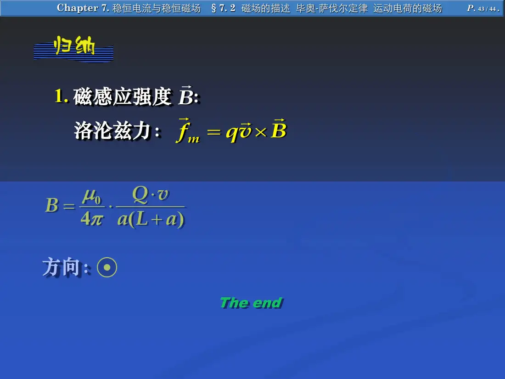

原文：

归纳

1. 磁感应强度 $\vec{B}$ :

洛沦兹力： $\vec{f}_{m}=q\vec{o}\times\vec{B}$

$$
B = \frac {\mu_ {0}}{4 \pi} \cdot \frac {Q \cdot v}{a (L + a)}
$$

方向：

The end

Chapter 7. 稳恒电流与稳恒磁场 § 7.2 磁场的描述 毕奥-萨伐尔定律 运动电荷的磁场

P. 43 / 44 .

### 归纳

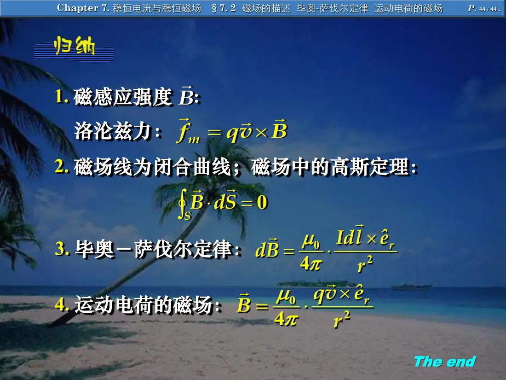

原文：

归纳

1. 磁感应强度 $\vec{B}$ :

洛沦兹力： $\vec{f}_{m} = q \vec{o} \times \vec{B}$

2. 磁场线为闭合曲线；磁场中的高斯定理：

$$
\oint_ {S} \vec {B} \cdot d \vec {S} = 0
$$

3. 毕奥－萨伐尔定律: $d \vec {B} = \frac {\mu _ { 0 }}{4 \pi} \cdot \frac {I d \vec {l} \times \hat {e} _ { r }}{r ^ {2}}$

4. 运动电荷的磁场: $\vec{B} = \frac{\mu_0}{4\pi} \cdot \frac{q\vec{v} \times \hat{e}_r}{r^2}$

Chapter 7. 稳恒电流与稳恒磁场 § 7.2 磁场的描述 毕奥-萨伐尔定律 运动电荷的磁场

P. 44 / 44.

The end
