# 《大学物理》第7章 稳恒电流与稳恒磁场 §7.3 磁场的安培环路定理（课件）

原件的每一页，下面附识别出的文字。

### §7.3 磁场的安培环路定理

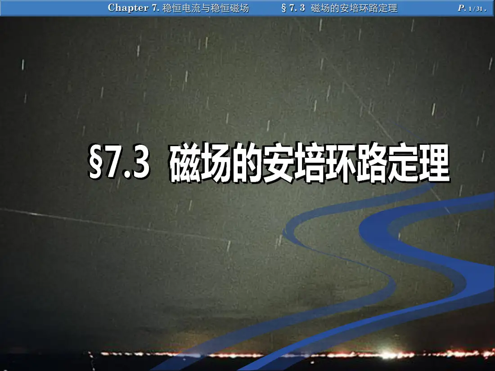

原文：

§7.3 磁场的安培环路定理

Chapter 7. 稳恒电流与稳恒磁场

§ 7.3 磁场的安培环路定理

P. 1/31.

### 一、定理的引入

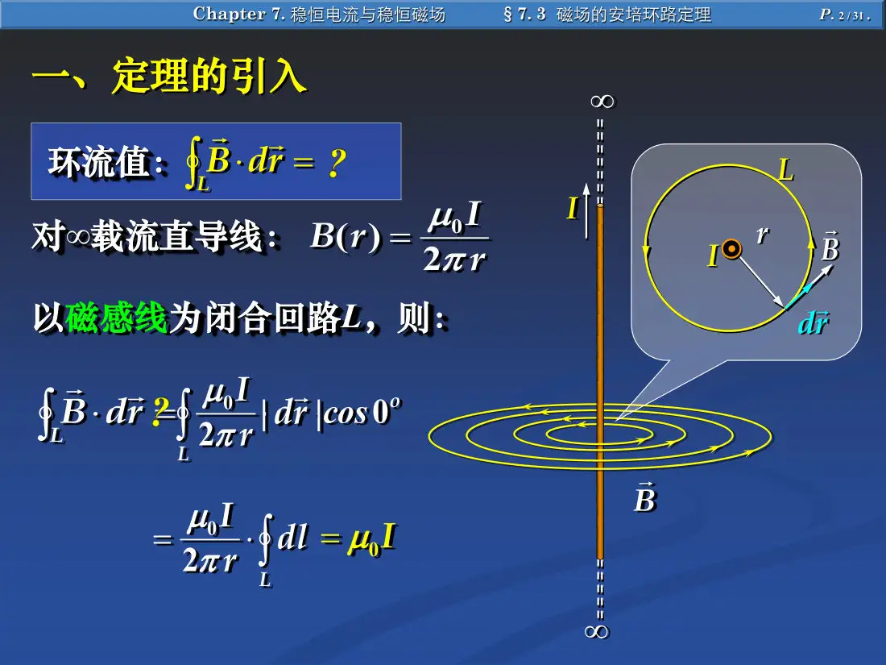

原文：

一、定理的引入

环流值: $\oint_{L} \vec{B} \cdot d\vec{r} = ?$

对∞载流直导线： $B(r)=\frac{\mu_{0}I}{2\pi r}$

以磁感线为闭合回路L，则：

$$
\begin{array}{r l} \oint_ {L} \vec {B} \cdot d \vec {r} & = \oint_ {L} \frac {\mu_ {0} I}{2 \pi r} | d \vec {r} | \cos 0 ^ {\circ} \\ & = \frac {\mu_ {0} I}{2 \pi r} \cdot \oint_ {L} d l = \mu_ {0} I \end{array}
$$

Chapter 7. 稳恒电流与稳恒磁场

§ 7.3 磁场的安培环路定理

P. 2/31.

### 在磁感线平面内作一闭合回路L:

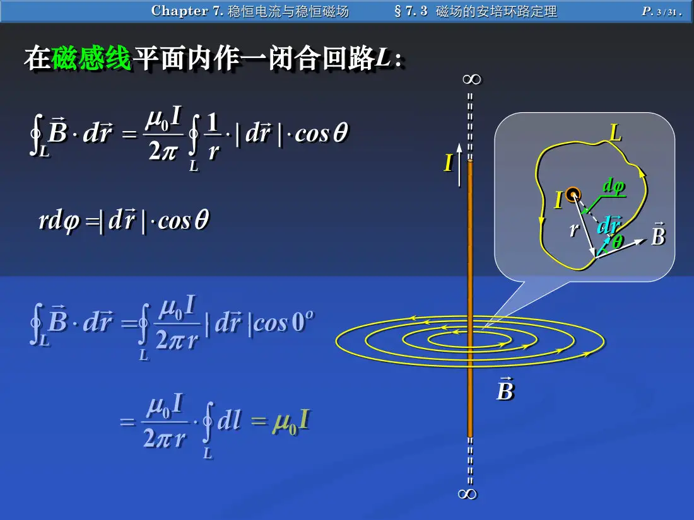

原文：

在磁感线平面内作一闭合回路L:

$$
\oint_ {L} \vec {B} \cdot d \vec {r} = \frac {\mu_ {0} I}{2 \pi} \oint_ {L} \frac {1}{r} \cdot | d \vec {r} | \cdot c o s \theta
$$

$$
r d \varphi = | d \vec {r} | \cdot \cos \theta
$$

$$
\begin{array}{r l} \oint_ {L} \vec {B} \cdot d \vec {r} & = \oint_ {L} \frac {\mu_ {0} I}{2 \pi r} | d \vec {r} | \cos 0 ^ {\circ} \\ & = \frac {\mu_ {0} I}{2 \pi r} \cdot \oint_ {L} d l = \mu_ {0} I \end{array}
$$

B

Chapter 7. 稳恒电流与稳恒磁场

§ 7.3 磁场的安培环路定理

P. 3/31.

### 在磁感线平面内作一闭合回路L:

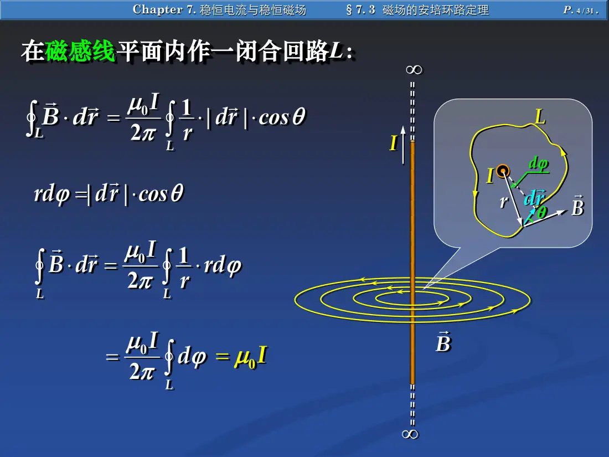

原文：

在磁感线平面内作一闭合回路L:

$$
\oint_ {L} \vec {B} \cdot d \vec {r} = \frac {\mu_ {0} I}{2 \pi} \oint_ {L} \frac {1}{r} \cdot | d \vec {r} | \cdot c o s \theta
$$

$$
r d \varphi = | d \vec {r} | \cdot \cos \theta
$$

$$
\begin{array}{r} \oint_ {L} \vec {B} \cdot d \vec {r} = \frac {\mu_ {0} I}{2 \pi} \oint_ {L} \frac {1}{r} \cdot r d \varphi \\ = \frac {\mu_ {0} I}{2 \pi} \oint_ {L} d \varphi = \mu_ {0} I \end{array}
$$

B

Chapter 7. 稳恒电流与稳恒磁场

§ 7.3 磁场的安培环路定理

P. 4/31.

### 对任意闭合回路L，由于：

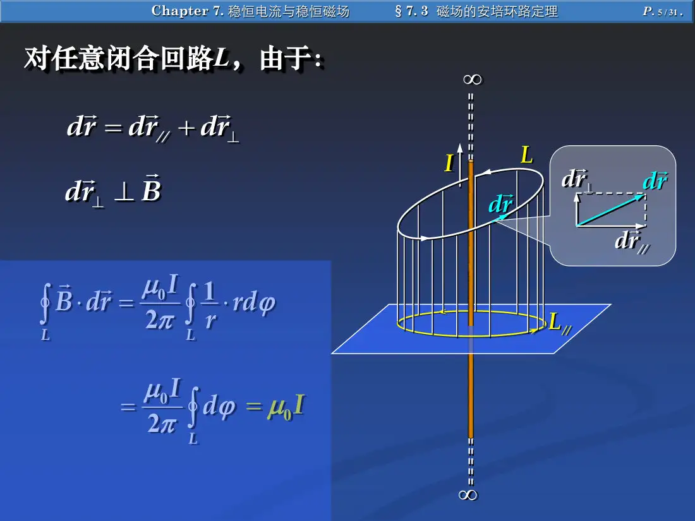

原文：

对任意闭合回路L，由于：

$$
d \vec {r} = d \vec {r} _ {\parallel} + d \vec {r} _ {\perp}
$$

$$
d \vec {r} _ {\perp} \perp \vec {B}
$$

$$
\begin{array}{r l} & {\oint_ {L} \vec {B} \cdot d \vec {r} = \frac {\mu_ {0} I}{2 \pi} \oint_ {L} \frac {1}{r} \cdot r d \varphi} \\ & {\qquad = \frac {\mu_ {0} I}{2 \pi} \oint_ {L} d \varphi = \mu_ {0} I} \end{array}
$$

Chapter 7. 稳恒电流与稳恒磁场

§ 7.3 磁场的安培环路定理

P. 5/31.

### 对任意闭合回路 $L$ ，由于：

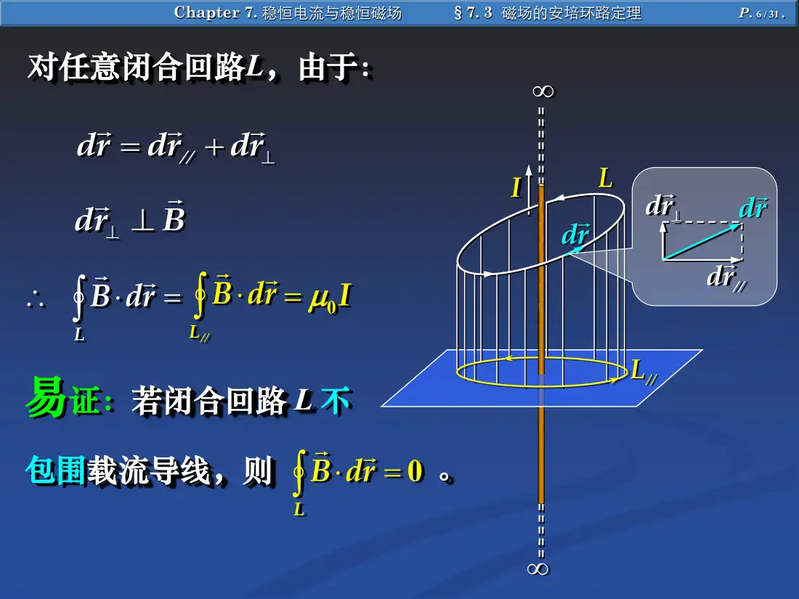

原文：

对任意闭合回路 $L$ ，由于：

$$
d \vec {r} = d \vec {r} _ {\parallel} + d \vec {r} _ {\perp}
$$

$$
d \vec {r} _ {\perp} \perp \vec {B}
$$

∴ $\oint_{L}\vec{B}\cdot d\vec{r}=\oint_{L_{//}}\vec{B}\cdot d\vec{r}=\mu_{0}I$

易证: 若闭合回路 $L$ 不
包围载流导线, 则 $\oint_{L} \vec{B} \cdot d\vec{r} = 0$ 。

Chapter 7. 稳恒电流与稳恒磁场

§ 7.3 磁场的安培环路定理

P. 6/31.

### 结论：对闭合回路 $L$ ，环流

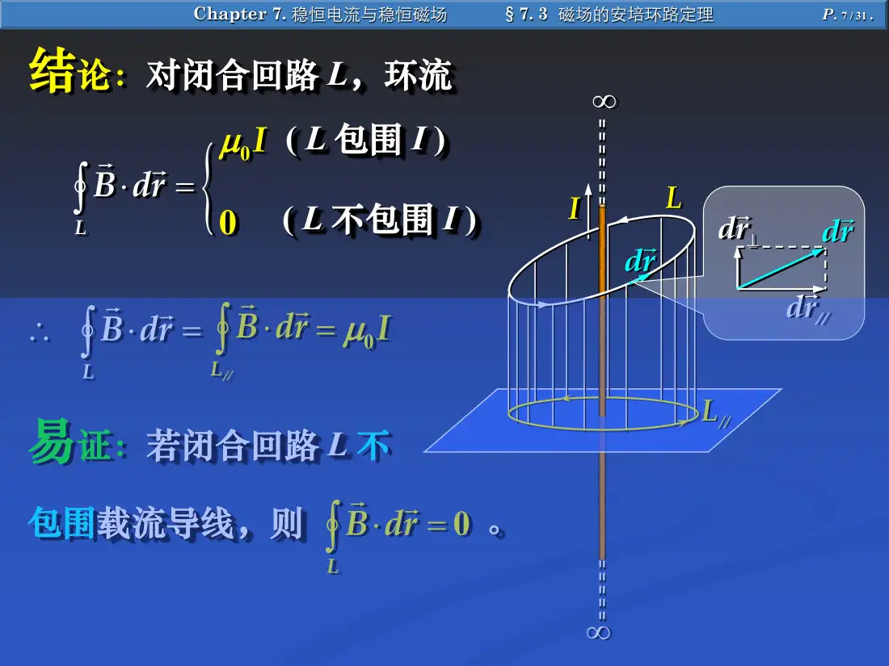

原文：

结论：对闭合回路 $L$ ，环流

$\oint_{L}\vec{B}\cdot d\vec{r} = \left\{ \begin{array}{ll}\mu_{0}I & (L\text{包围} I)\\ 0 & (L\text{不包围} I) \end{array} \right.$

$\therefore \oint_{L} \vec{B} \cdot d\vec{r} = \oint_{L_{//}} \vec{B} \cdot d\vec{r} = \mu_0 I$

易证: 若闭合回路 $L$ 不

包围载流导线，则 $\oint \vec{B} \cdot d\vec{r} = 0$ 。

Chapter 7. 稳恒电流与稳恒磁场

§ 7.3 磁场的安培环路定理

P. 7/31.

### 结论：对闭合回路 $L$ ，环流

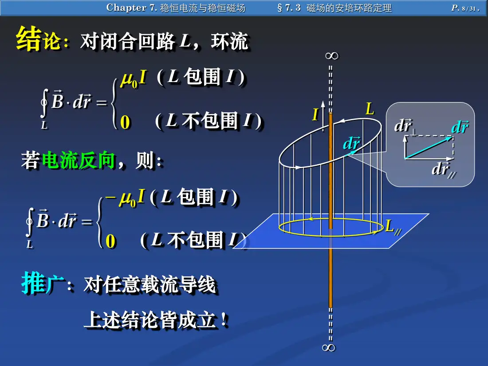

原文：

结论：对闭合回路 $L$ ，环流

$\oint_{L} \vec{B} \cdot d\vec{r} = \left\{ \begin{array}{l} \mu_0 I (L \text{包围 } I) \\ 0 (L \text{不包围 } I) \end{array} \right.$ 若电流反向，则：

$\oint_{L}\vec{B}\cdot d\vec{r}=\left\{\begin{array}{l}-\mu_{0}I(L\text{包围}I)\\0\quad(L\text{不包围}I)\end{array}\right.$

推广：对任意载流导线

上述结论皆成立！

Chapter 7. 稳恒电流与稳恒磁场

§ 7.3 磁场的安培环路定理

P. 8/31.

### 二、安培环路定理

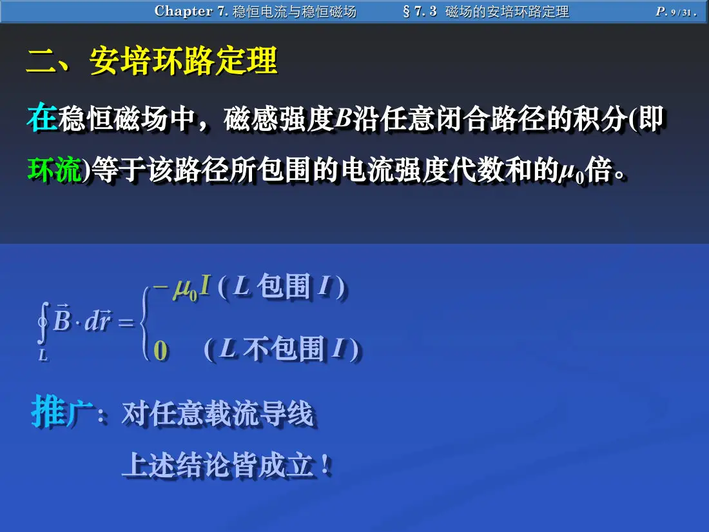

原文：

二、安培环路定理

在稳恒磁场中，磁感强度B沿任意闭合路径的积分(即环流)等于该路径所包围的电流强度代数和的 $\mu_{0}$ 倍。

$\oint_{L}\vec{B}\cdot d\vec{r} = \left\{ \begin{array}{ll} -\mu_{0}I(L\text{包围} I)\\ 0 & (L\text{不包围} I) \end{array} \right.$

推广：对任意载流导线

上述结论皆成立！

Chapter 7. 稳恒电流与稳恒磁场

§ 7.3 磁场的安培环路定理

P. 9/31.

### 二、安培环路定理

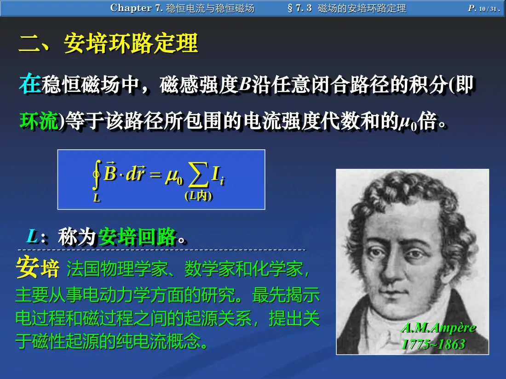

原文：

二、安培环路定理

在稳恒磁场中，磁感强度B沿任意闭合路径的积分(即环流)等于该路径所包围的电流强度代数和的 $\mu_{0}$ 倍。

$$
\oint_ {L} \vec {B} \cdot d \vec {r} = \mu_ {0} \sum_ {(L \text {内})} I _ {i}
$$

L: 称为安培回路。

安培 法国物理学家、数学家和化学家，主要从事电动力学方面的研究。最先揭示电过程和磁过程之间的起源关系，提出关于磁性起源的纯电流概念。

Chapter 7. 稳恒电流与稳恒磁场

§ 7.3 磁场的安培环路定理

P. 10 / 31.

### 二、安培环路定理

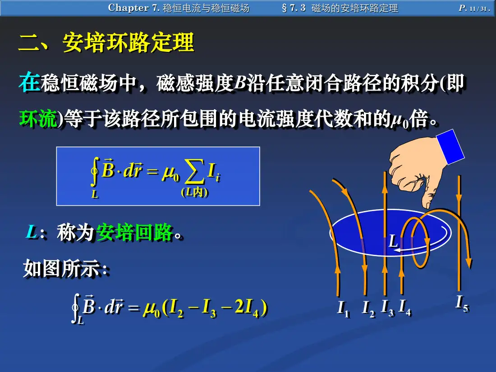

原文：

二、安培环路定理

在稳恒磁场中，磁感强度B沿任意闭合路径的积分(即环流)等于该路径所包围的电流强度代数和的 $\mu_{0}$ 倍。

$$
\oint_ {L} \vec {B} \cdot d \vec {r} = \mu_ {0} \sum_ {(L \text {内})} I _ {i}
$$

L: 称为安培回路。

如图所示:

$$
\oint_ {L} \vec {B} \cdot d \vec {r} = \mu_ {0} (I _ {2} - I _ {3} - 2 I _ {4})
$$

Chapter 7. 稳恒电流与稳恒磁场

§ 7.3 磁场的安培环路定理

P. 11/31.

### 注意

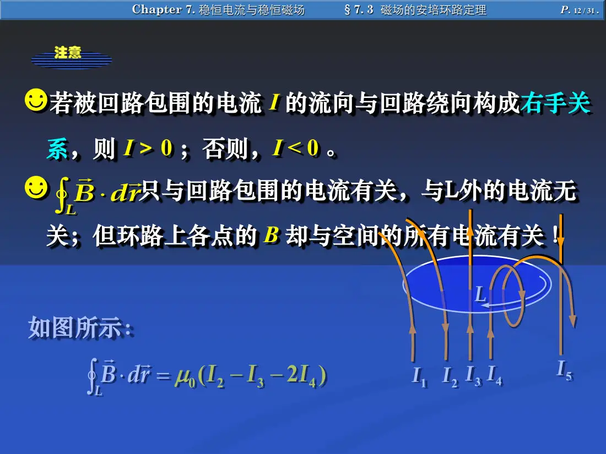

原文：

注意

😊若被回路包围的电流 I 的流向与回路绕向构成右手关系，则 I > 0；否则，I < 0。

😊 ∫ $_{L}$ B · d r 只与回路包围的电流有关，与 L 外的电流无关；但环路上各点的 B 却与空间的所有电流有关！

如图所示:

$$
\oint_ {L} \vec {B} \cdot d \vec {r} = \mu_ {0} (I _ {2} - I _ {3} - 2 I _ {4})
$$

Chapter 7. 稳恒电流与稳恒磁场

§ 7.3 磁场的安培环路定理

P. 12 / 31.

### 注意

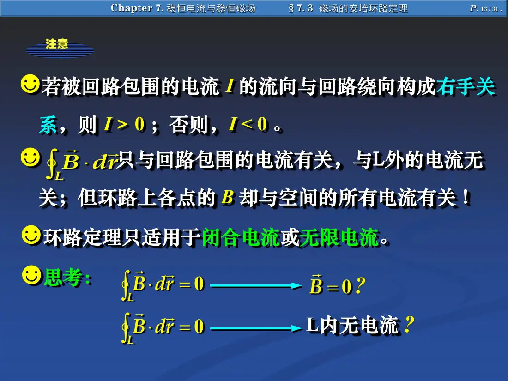

原文：

注意

😊若被回路包围的电流 I 的流向与回路绕向构成右手关系，则 I > 0；否则，I < 0。

😊 ∫ $_{L}$ B · d r 只与回路包围的电流有关，与 L 外的电流无关；但环路上各点的 B 却与空间的所有电流有关！

环路定理只适用于闭合电流或无限电流。

思考:

$$
\oint_ {L} \vec {B} \cdot d \vec {r} = 0 \longrightarrow \vec {B} = 0?
$$

$\oint_{L} \vec{B} \cdot d\vec{r} = 0$ → L内无电流？

Chapter 7. 稳恒电流与稳恒磁场

§ 7.3 磁场的安培环路定理

P. 13 / 31.

### 三、安培环路定理的应用

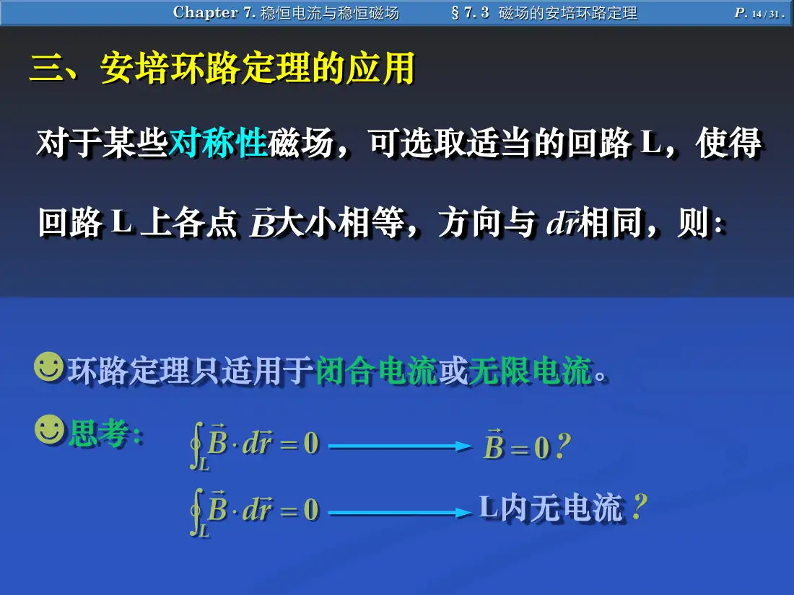

原文：

三、安培环路定理的应用

对于某些对称性磁场，可选取适当的回路L，使得

回路 L 上各点 $\vec{B}$ 大小相等，方向与 $d\vec{r}$ 相同，则：

环路定理只适用于闭合电流或无限电流。

思考：

$$
\oint_ {L} \vec {B} \cdot d \vec {r} = 0 \longrightarrow \vec {B} = 0?
$$

$\oint_{L}\vec{B}\cdot d\vec{r}=0\xrightarrow{\quad}L内无电流?$

P. 14/31.

Chapter 7. 稳恒电流与稳恒磁场

§ 7.3 磁场的安培环路定理

### 三、安培环路定理的应用

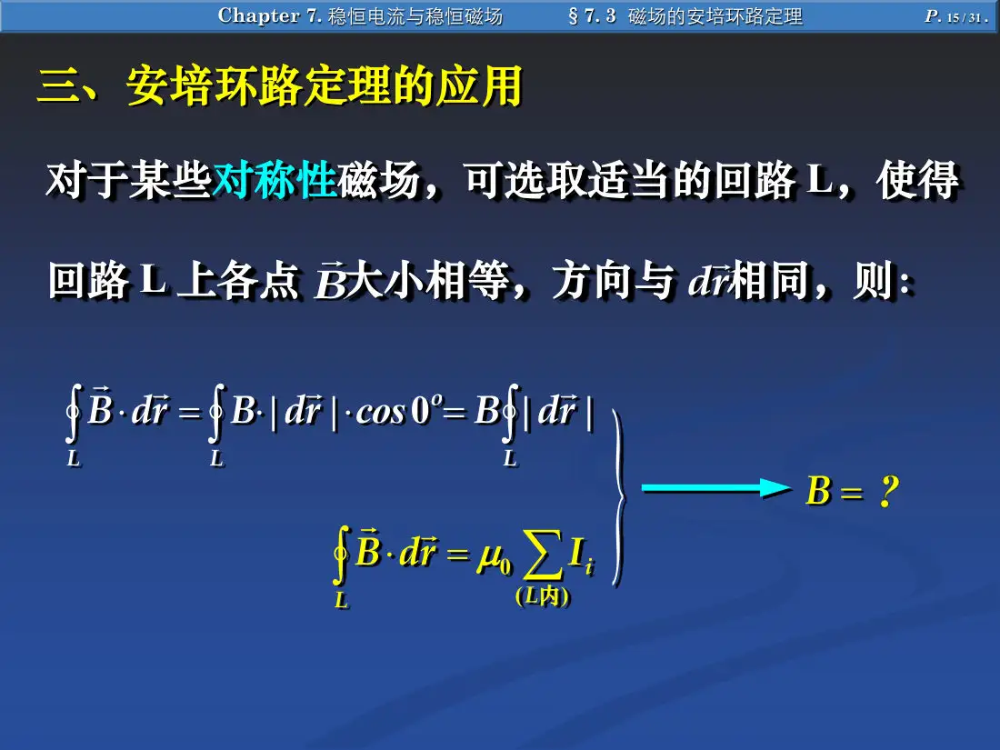

原文：

三、安培环路定理的应用

对于某些对称性磁场，可选取适当的回路L，使得

回路 L 上各点 $\vec{B}$ 大小相等，方向与 $d\vec{r}$ 相同，则：

$$
\left. \begin{array}{l} \oint_ {L} \vec {B} \cdot d \vec {r} = \oint_ {L} B \cdot | d \vec {r} | \cdot \cos 0 ^ {\circ} = B \oint_ {L} | d \vec {r} | \\ \oint_ {L} \vec {B} \cdot d \vec {r} = \mu_ {0} \sum_ {(L \text {内})} I _ {i} \end{array} \right\} \longrightarrow B = ?
$$

Chapter 7. 稳恒电流与稳恒磁场

§ 7.3 磁场的安培环路定理

P. 15 / 31.

### 分析：将薄圆柱壳等效成无数多个∞载流直导线捆扎而成。

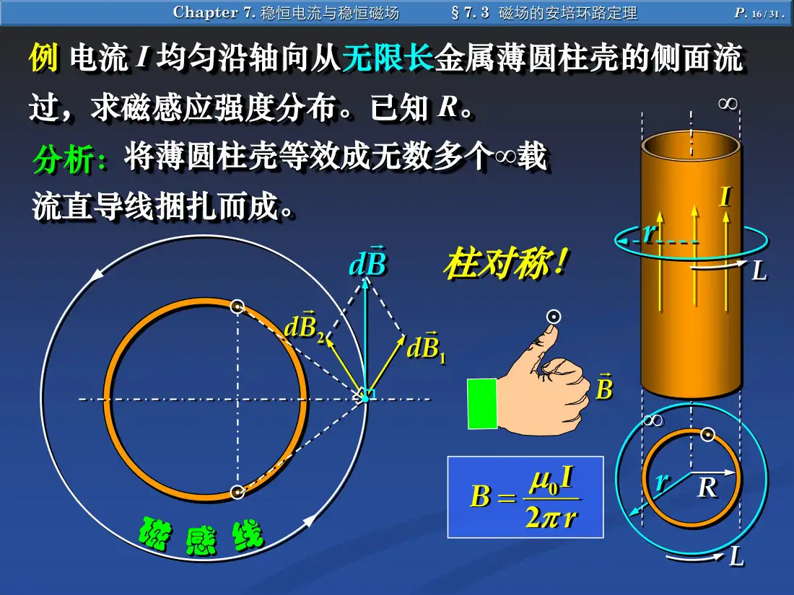

原文：

例 电流 I 均匀沿轴向从无限长金属薄圆柱壳的侧面流过，求磁感应强度分布。已知 R。
分析：将薄圆柱壳等效成无数多个∞载流直导线捆扎而成。

柱对称！

$$
B = \frac {\mu_ {0} I}{2 \pi r}
$$

Chapter 7. 稳恒电流与稳恒磁场

§ 7.3 磁场的安培环路定理

P. 16 / 31.

### 解 B分布为柱对称，作同轴圆形安培回路。

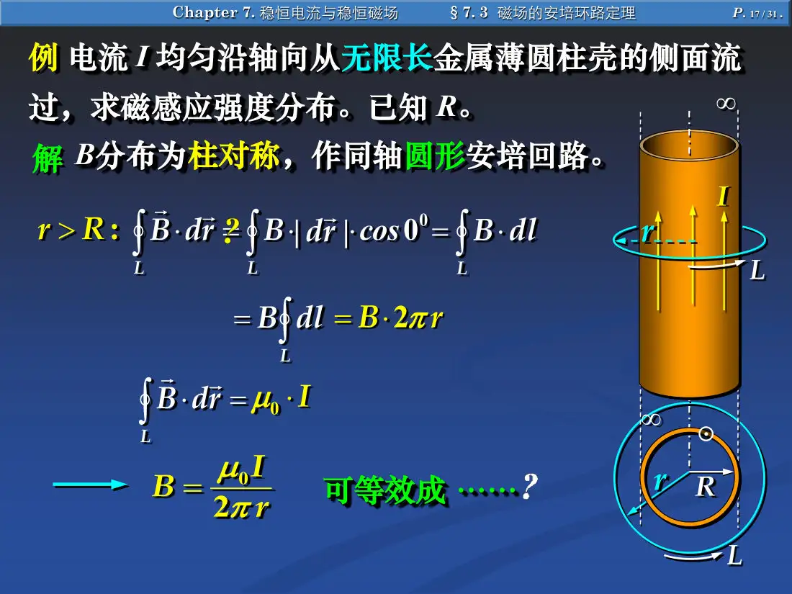

原文：

例 电流 I 均匀沿轴向从无限长金属薄圆柱壳的侧面流过，求磁感应强度分布。已知 R。

解 B分布为柱对称，作同轴圆形安培回路。

$$
\begin{array}{r l} r > R: & \oint_ {L} \vec {B} \cdot d \vec {r} \neq \oint_ {L} B \cdot | d \vec {r} | \cdot c o s 0 ^ {0} = \oint_ {L} B \cdot d l \\ & = B \oint_ {L} d l = B \cdot 2 \pi r \end{array}
$$

$$
\oint_ {L} \vec {B} \cdot d \vec {r} = \mu_ {0} \cdot I
$$

$$
B = \frac {\mu_ {0} I}{2 \pi r}
$$

可等效成 ……?

Chapter 7. 稳恒电流与稳恒磁场

§ 7.3 磁场的安培环路定理

P. 17/31.

### $$

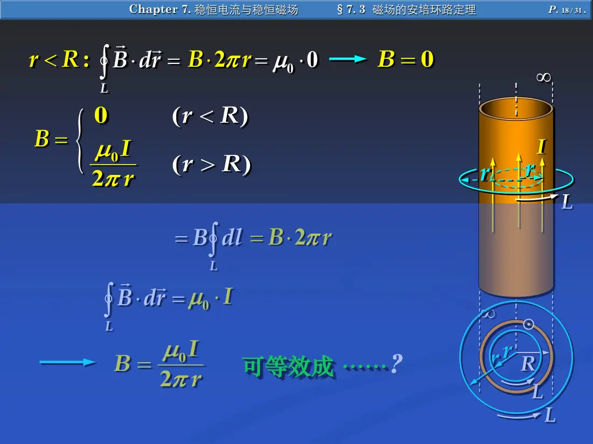

原文：

$$
r <   R: \oint_ {L} \vec {B} \cdot d \vec {r} = B \cdot 2 \pi r = \mu_ {0} \cdot 0 \longrightarrow B = 0
$$

$$
B = \left\{ \begin{array}{l l} 0 & (r <   R) \\ \frac {\mu_ {0} I}{2 \pi r} & (r > R) \end{array} \right.
$$

$$
= B \oint_ {L} d l = B \cdot 2 \pi r
$$

$$
\oint_ {L} \vec {B} \cdot d \vec {r} = \mu_ {0} \cdot I
$$

$$
B = \frac {\mu_ {0} I}{2 \pi r}
$$

可等效成 ……?

Chapter 7. 稳恒电流与稳恒磁场

§ 7.3 磁场的安培环路定理

P. 18/31.

### $$

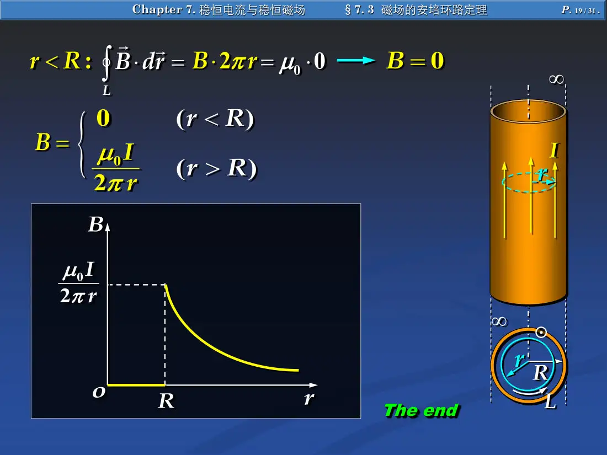

原文：

$$
r <   R: \oint_ {L} \vec {B} \cdot d \vec {r} = B \cdot 2 \pi r = \mu_ {0} \cdot 0 \longrightarrow B = 0
$$

$$
B = \left\{ \begin{array}{l l} 0 & (r <   R) \\ \frac {\mu_ {0} I}{2 \pi r} & (r > R) \end{array} \right.
$$

The end

Chapter 7. 稳恒电流与稳恒磁场

§ 7.3 磁场的安培环路定理

P. 19 / 31 .

### Chapter 7. 稳恒电流与稳恒磁场

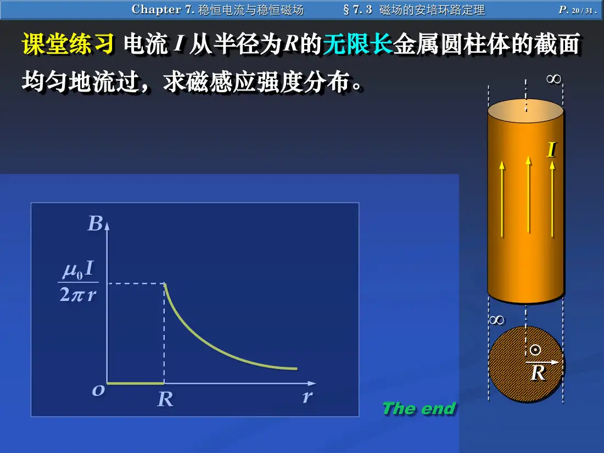

原文：

课堂练习 电流 I 从半径为 R 的无限长金属圆柱体的截面均匀地流过，求磁感应强度分布。

Chapter 7. 稳恒电流与稳恒磁场

§ 7.3 磁场的安培环路定理

P. 20 / 31.

### 提示: 柱内外的 B 分布为柱对称，作同轴圆形安培回路。

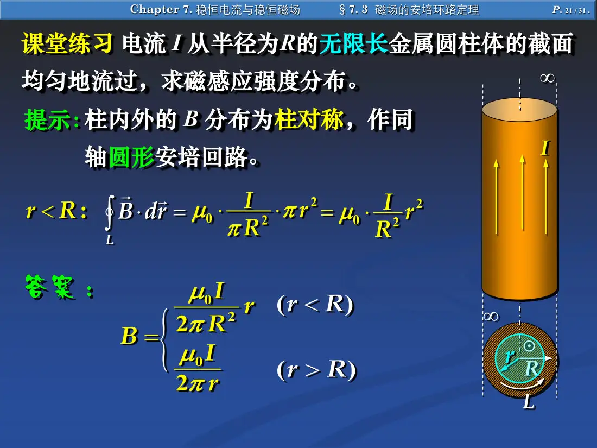

原文：

课堂练习 电流 I 从半径为 R 的无限长金属圆柱体的截面均匀地流过，求磁感应强度分布。

提示: 柱内外的 B 分布为柱对称，作同轴圆形安培回路。

$$
r <   R: \oint_ {L} \vec {B} \cdot d \vec {r} = \mu_ {0} \cdot \frac {I}{\pi R ^ {2}} \cdot \pi r ^ {2} = \mu_ {0} \cdot \frac {I}{R ^ {2}} r ^ {2}
$$

答案：

$$
B = \left\{ \begin{array}{l l} \frac {\mu_ {0} I}{2 \pi R ^ {2}} r & (r <   R) \\ \frac {\mu_ {0} I}{2 \pi r} & (r > R) \end{array} \right.
$$

Chapter 7. 稳恒电流与稳恒磁场

§ 7.3 磁场的安培环路定理

P. 21 / 31.

### $$

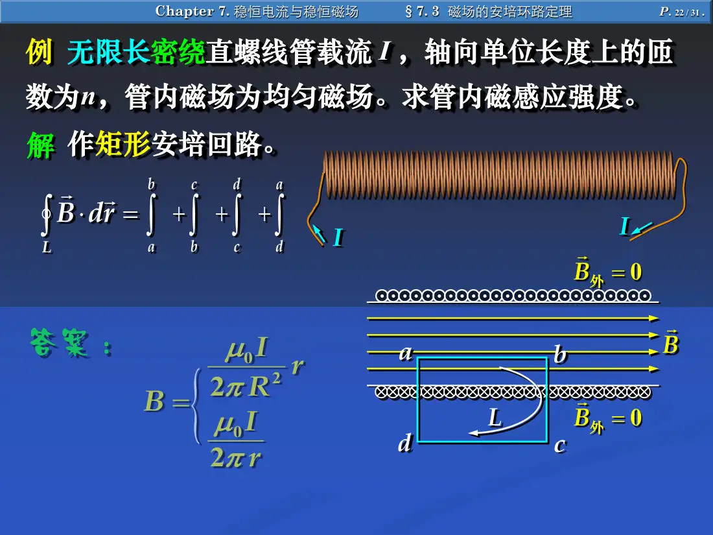

原文：

例 无限长密绕直螺线管载流 $I$ , 轴向单位长度上的匝数为 $n$ , 管内磁场为均匀磁场。求管内磁感应强度。解 作矩形安培回路。

$$
\oint_ {L} \vec {B} \cdot d \vec {r} = \int_ {a} ^ {b} + \int_ {b} ^ {c} + \int_ {c} ^ {d} + \int_ {d} ^ {a}
$$

答案：

$$
B = \left\{ \begin{array}{l} \frac {\mu_ {0} I}{2 \pi R ^ {2}} r \\ \frac {\mu_ {0} I}{2 \pi r} \end{array} \right.
$$

$\vec{B}_{外}=0$

Chapter 7. 稳恒电流与稳恒磁场

§ 7.3 磁场的安培环路定理

P. 22 / 31.

### $$

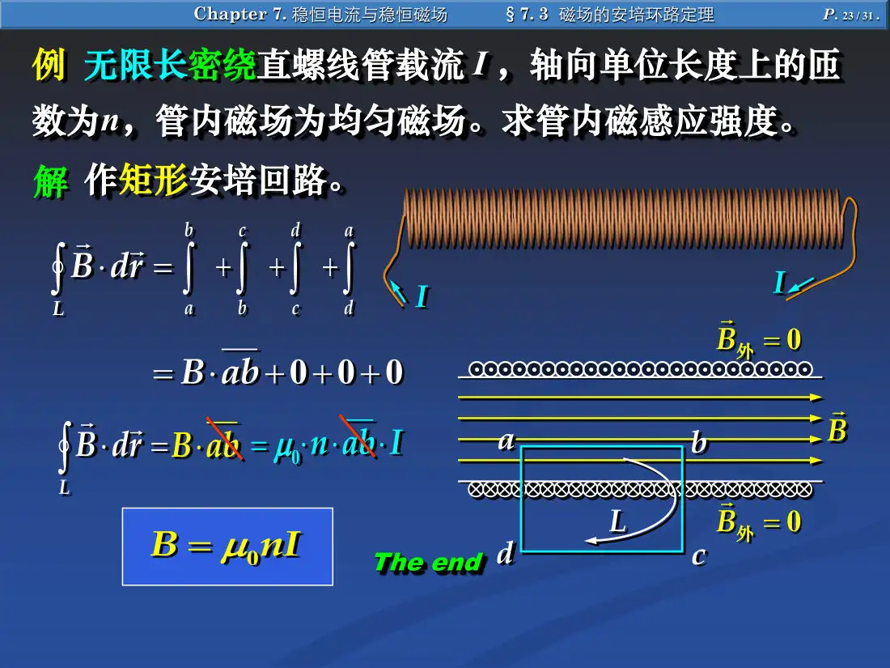

原文：

例 无限长密绕直螺线管载流 $I$ , 轴向单位长度上的匝数为 $n$ , 管内磁场为均匀磁场。求管内磁感应强度。解 作矩形安培回路。

$$
\begin{array}{r l} & {\oint_ {L} \vec {B} \cdot d \vec {r} = \int_ {a} ^ {b} + \int_ {b} ^ {c} + \int_ {c} ^ {d} + \int_ {d} ^ {a}} \\ & {\qquad = B \cdot \overline {{a b}} + 0 + 0 + 0} \end{array}
$$

$$
\oint_ {L} \vec {B} \cdot d \vec {r} = B \cdot \overline {{a b}} = \mu_ {0} \cdot n \cdot \overline {{a b}} \cdot I
$$

$$
B = \mu_ {0} n I
$$

$\vec{B}_{外}=0$

$$
\vec {B} _ {\text {外}} = 0
$$

Chapter 7. 稳恒电流与稳恒磁场

§ 7.3 磁场的安培环路定理

P. 23 / 31.

The end

### 课堂练习 密绕环形螺线管载流 I，总匝数为 N，求管内磁感应强度。

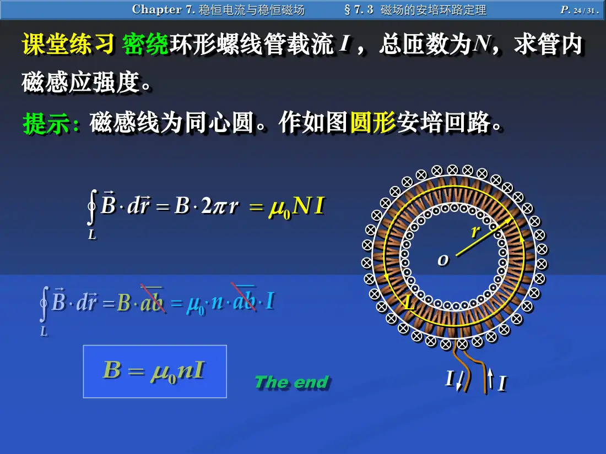

原文：

课堂练习 密绕环形螺线管载流 I，总匝数为 N，求管内磁感应强度。

提示：磁感线为同心圆。作如图圆形安培回路。

$$
\oint_ {L} \vec {B} \cdot d \vec {r} = B \cdot 2 \pi r = \mu_ {0} N I
$$

$$
\oint_ {L} \vec {B} \cdot d \vec {r} = B \cdot \overline {{a b}} = \mu_ {0} \cdot n \cdot \overline {{a b}} \cdot I
$$

$$
B = \mu_ {0} n I
$$

The end

I↓ |↑ I

Chapter 7. 稳恒电流与稳恒磁场

§ 7.3 磁场的安培环路定理

P. 24 / 31.

### 课堂练习 密绕环形螺线管载流 I，总匝数为 N，求管内磁感应强度。

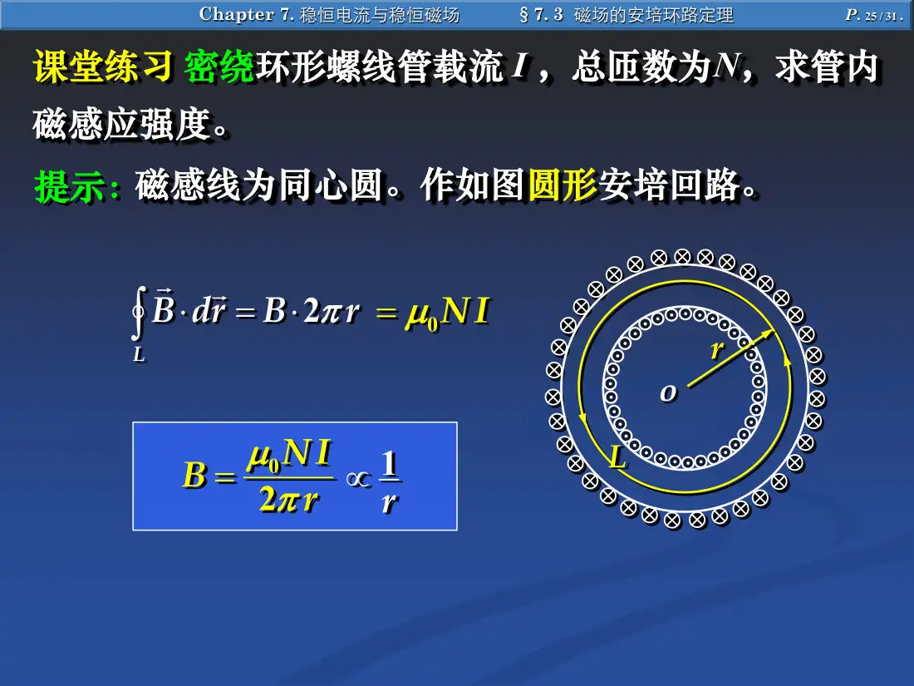

原文：

课堂练习 密绕环形螺线管载流 I，总匝数为 N，求管内磁感应强度。

提示：磁感线为同心圆。作如图圆形安培回路。

$$
\oint_ {L} \vec {B} \cdot d \vec {r} = B \cdot 2 \pi r = \mu_ {0} N I
$$

$$
B = \frac {\mu_ {0} N I}{2 \pi r} \propto \frac {1}{r}
$$

Chapter 7. 稳恒电流与稳恒磁场

§ 7.3 磁场的安培环路定理

P. 25 / 31 .

### 解（电流线密度： $j=\frac{I}{b}$ ）

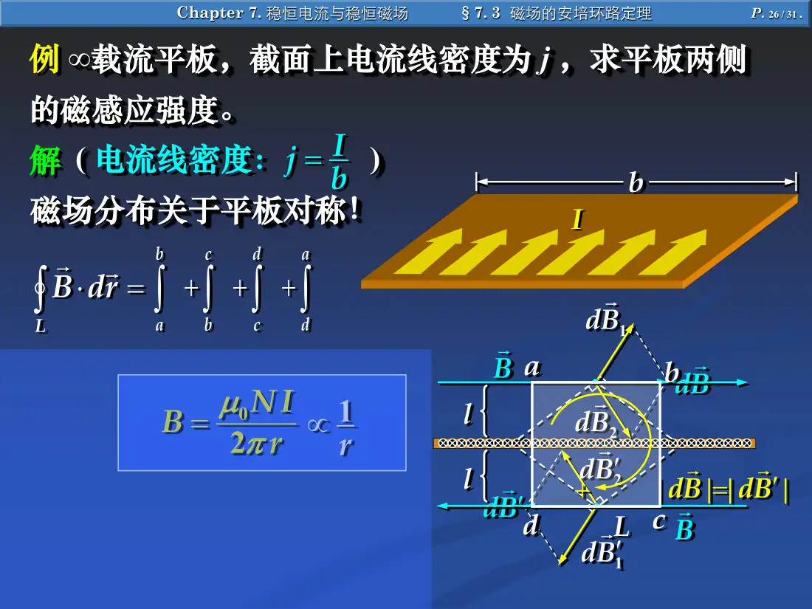

原文：

例 $\infty$ 载流平板，截面上电流线密度为 $j$ ，求平板两侧的磁感应强度。

解（电流线密度： $j=\frac{I}{b}$ ）
磁场分布关于平板对称！

$$
\oint_ {L} \vec {B} \cdot d \vec {r} = \int_ {a} ^ {b} + \int_ {b} ^ {c} + \int_ {c} ^ {d} + \int_ {d} ^ {a}
$$

$$
B = \frac {\mu_ {0} N I}{2 \pi r} \propto \frac {1}{r}
$$

Chapter 7. 稳恒电流与稳恒磁场

§ 7.3 磁场的安培环路定理

P. 26 / 31.

### 解（电流线密度： $j=\frac{I}{b}$ ）

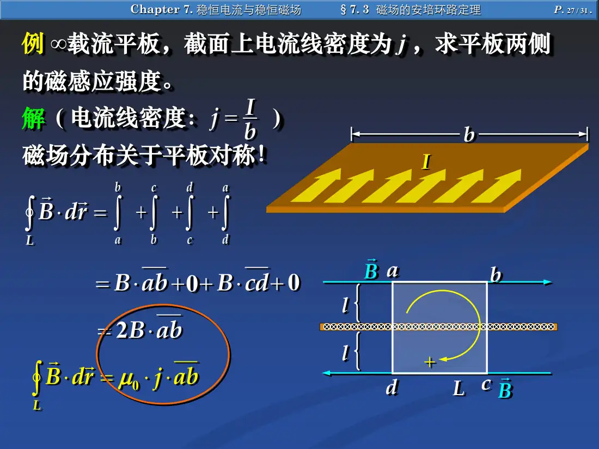

原文：

例 $\infty$ 载流平板，截面上电流线密度为 $j$ ，求平板两侧的磁感应强度。

解（电流线密度： $j=\frac{I}{b}$ ）
磁场分布关于平板对称！

$$
\begin{array}{r l} \oint_ {L} \vec {B} \cdot d \vec {r} & = \int_ {a} ^ {b} + \int_ {b} ^ {c} + \int_ {c} ^ {d} + \int_ {d} ^ {a} \\ & = B \cdot \overline {{a b}} + 0 + B \cdot \overline {{c d}} + 0 \end{array}
$$

$$
\oint_ {L} \vec {B} \cdot d \vec {r} = \mu_ {0} \cdot j \cdot \overline {{a b}}
$$

Chapter 7. 稳恒电流与稳恒磁场

§ 7.3 磁场的安培环路定理

P. 27 / 31.

### $$

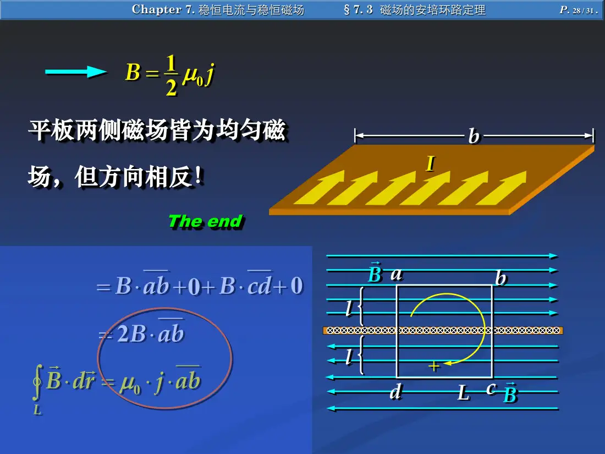

原文：

$$
B = \frac {1}{2} \mu_ {0} j
$$

平板两侧磁场皆为均匀磁场，但方向相反！

The end

$$
= B \cdot \overline {{a b}} + 0 + B \cdot \overline {{c d}} + 0
$$

$$
\equiv 2 B \cdot a b
$$

$$
\oint_ {L} \vec {B} \cdot d \vec {r} = \mu_ {0} \cdot j \cdot \overline {{a b}}
$$

Chapter 7. 稳恒电流与稳恒磁场

§ 7.3 磁场的安培环路定理

P. 28 / 31.

### $$

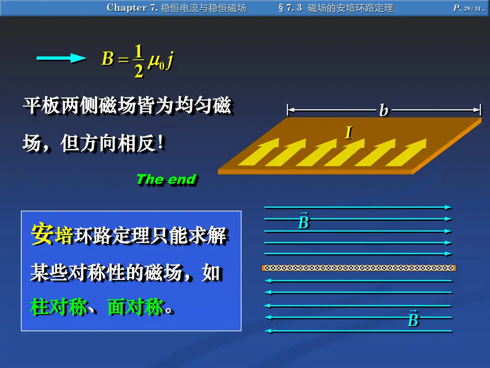

原文：

$$
B = \frac {1}{2} \mu_ {0} j
$$

平板两侧磁场皆为均匀磁场，但方向相反！

The end

安培环路定理只能求解某些对称性的磁场，如柱对称、面对称。

Chapter 7. 稳恒电流与稳恒磁场

§ 7.3 磁场的安培环路定理

P. 29 / 31.

### 归纳

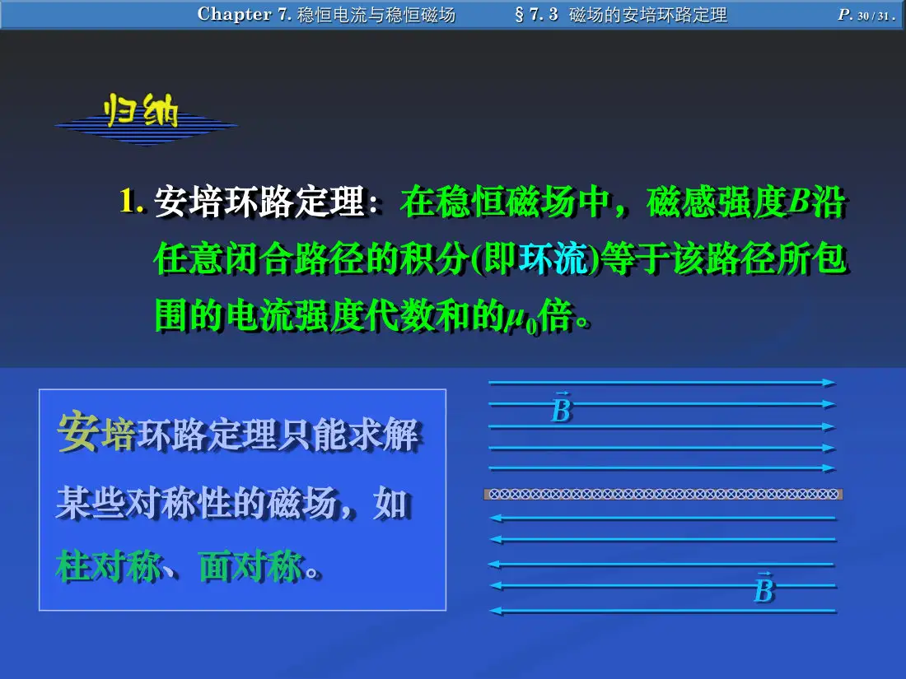

原文：

归纳

1. 安培环路定理：在稳恒磁场中，磁感强度B沿任意闭合路径的积分(即环流)等于该路径所包围的电流强度代数和的 $\mu_{0}$ 倍。

安培环路定理只能求解某些对称性的磁场，如柱对称、面对称。

Chapter 7. 稳恒电流与稳恒磁场

§ 7.3 磁场的安培环路定理

P. 30 / 31.

### 归纳

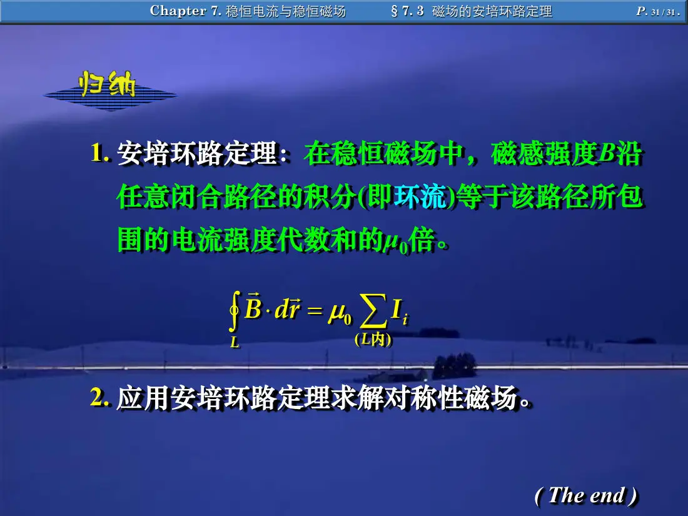

原文：

归纳

1. 安培环路定理：在稳恒磁场中，磁感强度B沿任意闭合路径的积分(即环流)等于该路径所包围的电流强度代数和的 $\mu_{0}$ 倍。

$$
\oint_ {L} \vec {B} \cdot d \vec {r} = \mu_ {0} \sum_ {(L \text {内})} I _ {i}
$$

2. 应用安培环路定理求解对称性磁场。

Chapter 7. 稳恒电流与稳恒磁场

§ 7.3 磁场的安培环路定理

P. 31 / 31 .

(The end)
