# 《大学物理》第7章 稳恒电流与稳恒磁场 §7.4 洛仑兹力（课件）

原件的每一页，下面附识别出的文字。

### §7.4 洛仑兹力

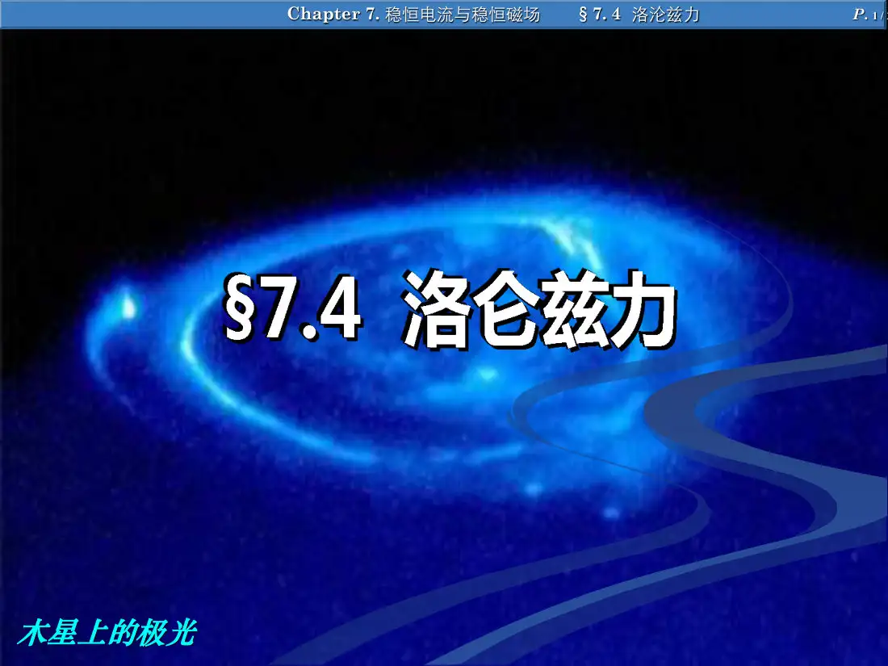

原文：

§7.4 洛仑兹力

Chapter 7. 稳恒电流与稳恒磁场 § 7.4 洛沦兹力

P. 1/

木星上的极光

### 一、洛沦兹力与磁约束

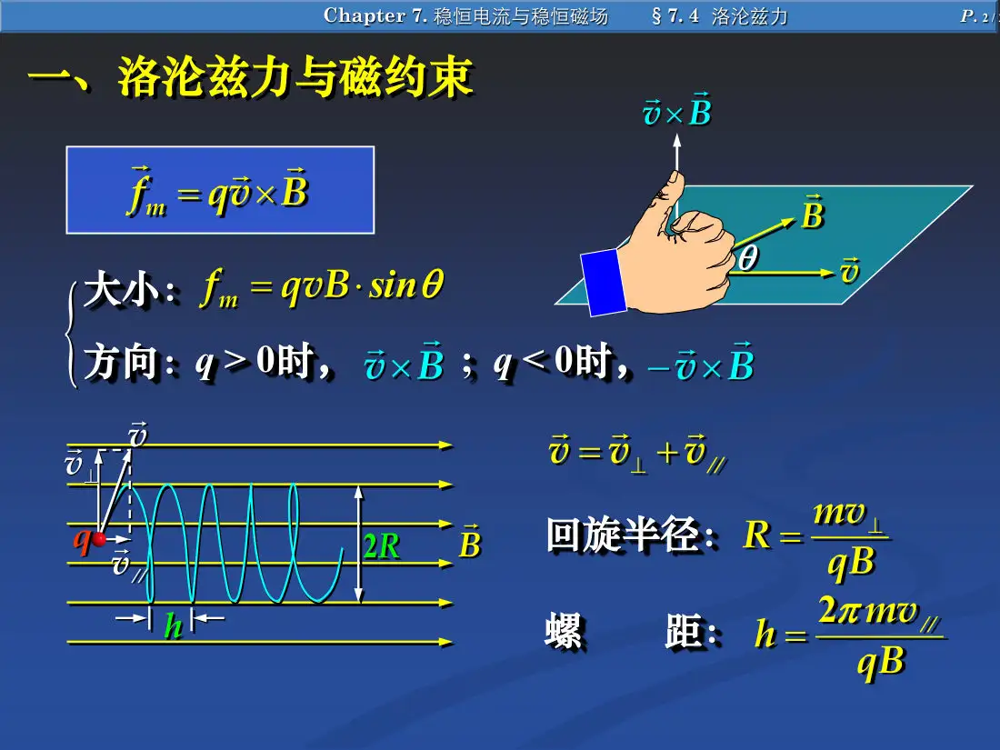

原文：

一、洛沦兹力与磁约束

$$
\vec {f} _ {m} = q \vec {v} \times \vec {B}
$$

大小: $f_{m} = q v B \cdot \sin \theta$

方向： $q > 0$ 时， $\vec{v} \times \vec{B}$ ； $q < 0$ 时， $-\vec{v} \times \vec{B}$

$$
\vec {v} = \vec {v} _ {\perp} + \vec {v} _ {/ /}
$$

回旋半径： $R=\frac{mv_{\perp}}{qB}$ 螺距： $h=\frac{2\pi mv_{\parallel}}{qB}$

Chapter 7. 稳恒电流与稳恒磁场

§ 7.4 洛沦兹力

P. 2/2

### 在非均匀磁场中:

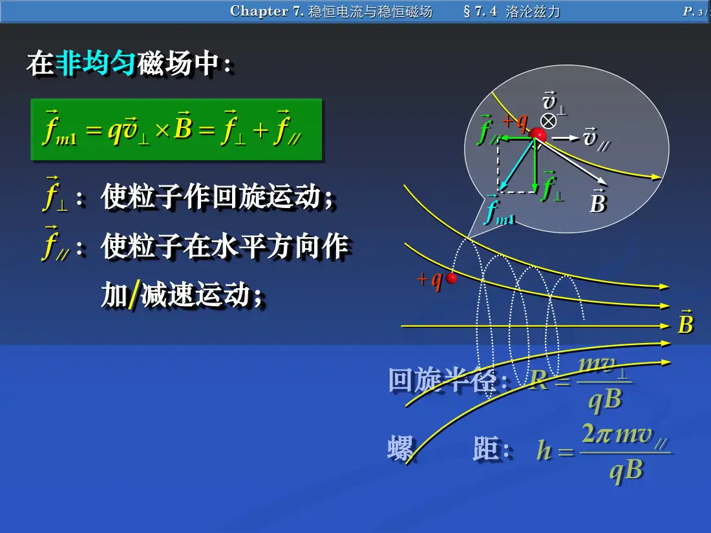

原文：

在非均匀磁场中:

$$
\vec {f} _ {m 1} = q \vec {v} _ {\perp} \times \vec {B} = \vec {f} _ {\perp} + \vec {f} _ {/ /}
$$

$\vec{f}_{\perp}$ ：使粒子作回旋运动；

$\vec{f}_{//}$ ：使粒子在水平方向作加/减速运动；

螺

Chapter 7. 稳恒电流与稳恒磁场

§ 7.4 洛沦兹力

P. 3/2

### 在非均匀磁场中:

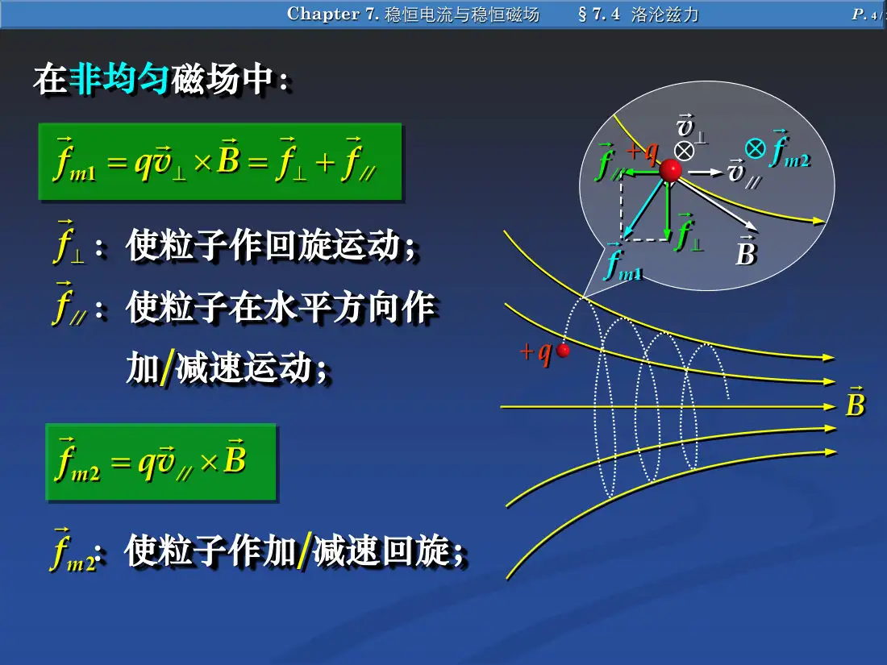

原文：

在非均匀磁场中:

$$
\vec {f} _ {m 1} = q \vec {v} _ {\perp} \times \vec {B} = \vec {f} _ {\perp} + \vec {f} _ {/ /}
$$

$\vec{f}_{\perp}$ ：使粒子作回旋运动；

$\tilde{f}_{//}$ ：使粒子在水平方向作加/减速运动；

$$
\vec {f} _ {m 2} = q \vec {v} _ {/ /} \times \vec {B}
$$

$\vec{f}_{m2}$ : 使粒子作加/减速回旋;

P. 4/2

Chapter 7. 稳恒电流与稳恒磁场

§ 7.4 洛沦兹力

### 磁约束（magnetic confinement）

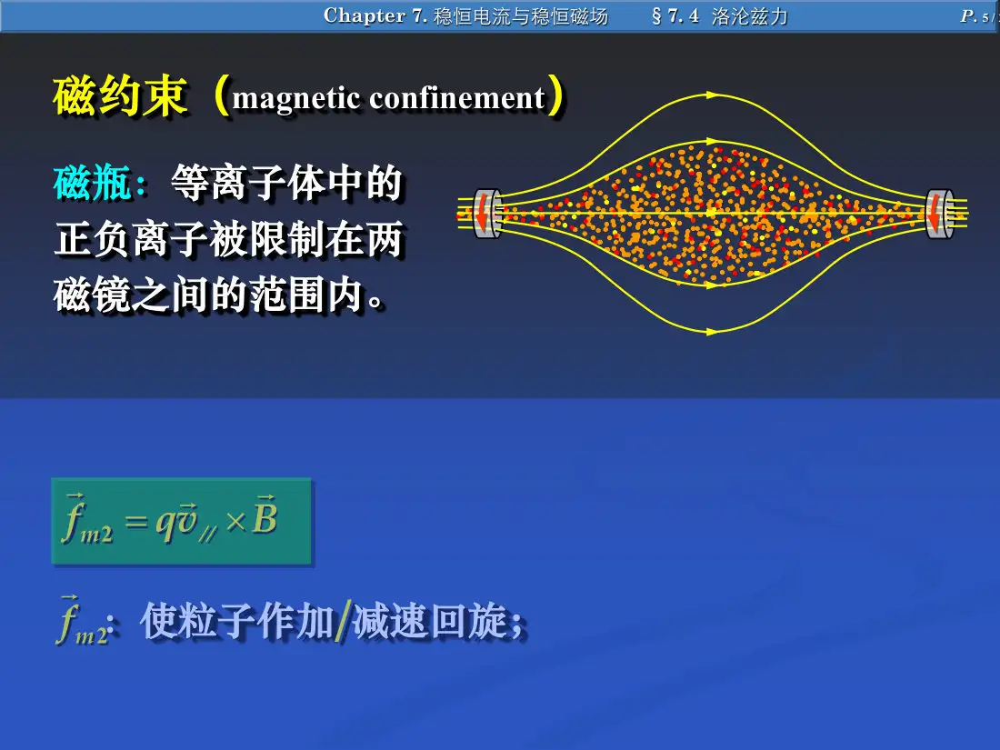

原文：

磁约束（magnetic confinement）

磁瓶：等离子体中的正负离子被限制在两磁镜之间的范围内。

$$
\vec {f} _ {m 2} = q \vec {v} _ {/ /} \times \vec {B}
$$

$\vec{f}_{m2}$ : 使粒子作加/减速回旋;

Chapter 7. 稳恒电流与稳恒磁场

§ 7.4 洛沦兹力

P. 5/2

### 磁约束（magnetic confinement）

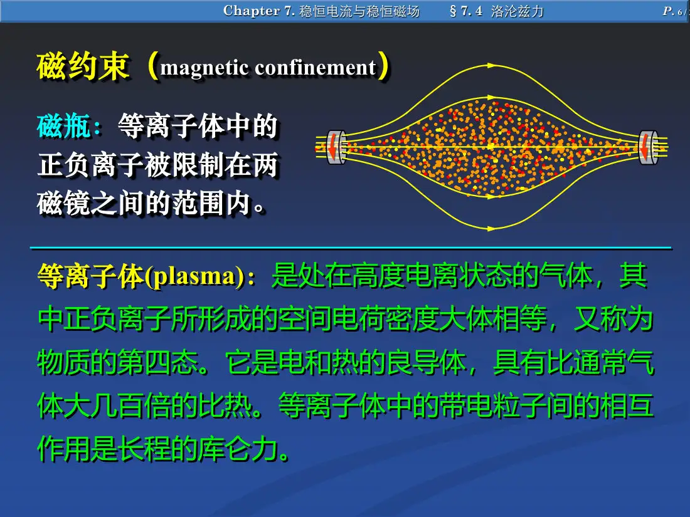

原文：

磁约束（magnetic confinement）

磁瓶：等离子体中的正负离子被限制在两磁镜之间的范围内。

等离子体(plasma): 是处在高度电离状态的气体, 其中正负离子所形成的空间电荷密度大体相等, 又称为物质的第四态。它是电和热的良导体, 具有比通常气体大几百倍的比热。等离子体中的带电粒子间的相互作用是长程的库仑力。

Chapter 7. 稳恒电流与稳恒磁场

§ 7.4 洛沦兹力

P. 6/2

### 磁约束（magnetic confinement）

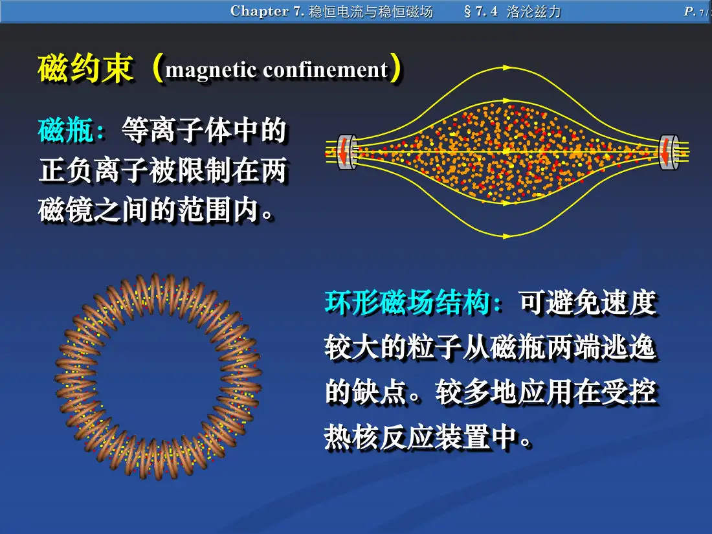

原文：

磁约束（magnetic confinement）

磁瓶：等离子体中的正负离子被限制在两磁镜之间的范围内。

环形磁场结构：可避免速度较大的粒子从磁瓶两端逃逸的缺点。较多地应用在受控热核反应装置中。

Chapter 7. 稳恒电流与稳恒磁场

§ 7.4 洛沦兹力

P. 7/2

### 地磁场的范艾仑辐射带（Van Allen belts）

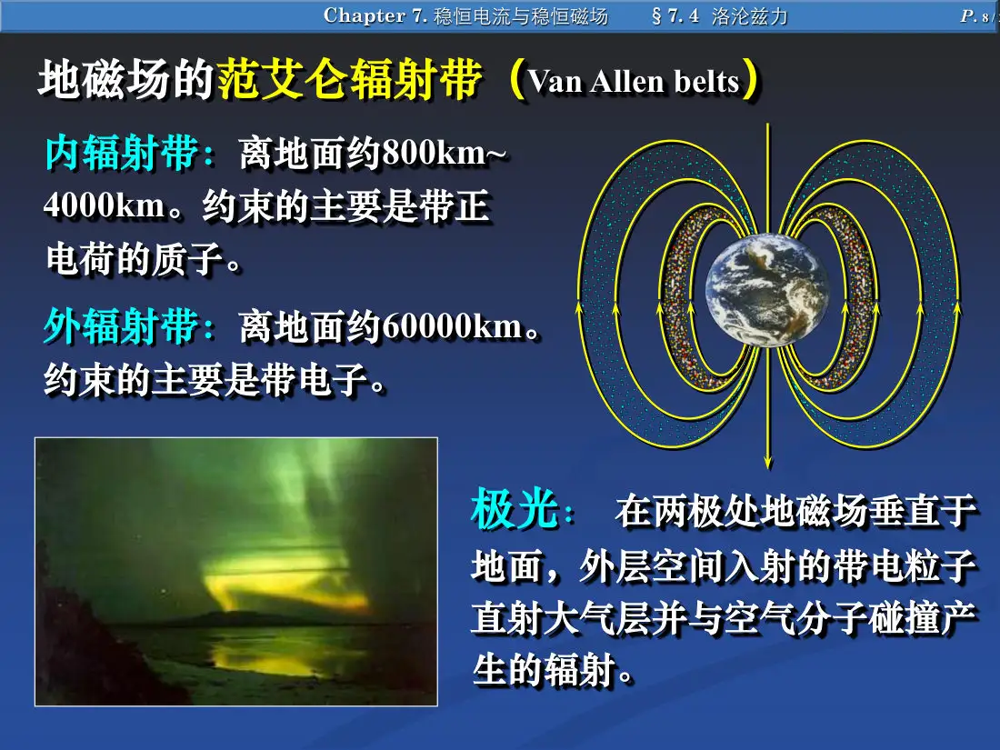

原文：

地磁场的范艾仑辐射带（Van Allen belts）

内辐射带：离地面约800km\~4000km。约束的主要是带正电荷的质子。

外辐射带：离地面约60000km。约束的主要是带电子。

极光：在两极处地磁场垂直于地面，外层空间入射的带电粒子直射大气层并与空气分子碰撞产生的辐射。

Chapter 7. 稳恒电流与稳恒磁场

§ 7.4 洛沦兹力

P. 8/2

### Chapter 7. 稳恒电流与稳恒磁场 § 7.4 洛沦兹力

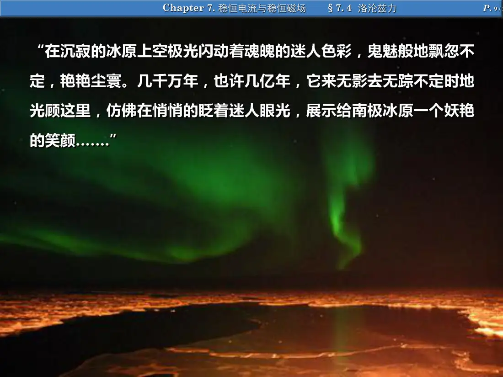

原文：

“在沉寂的冰原上空极光闪动着魂魄的迷人色彩，鬼魅般地飘忽不定，艳艳尘寰。几千万年，也许几亿年，它来无影去无踪不定时地光顾这里，仿佛在悄悄的眨着迷人眼光，展示给南极冰原一个妖艳的笑颜……”

Chapter 7. 稳恒电流与稳恒磁场 § 7.4 洛沦兹力

P. 9/

### 中纬度地区出现的极光

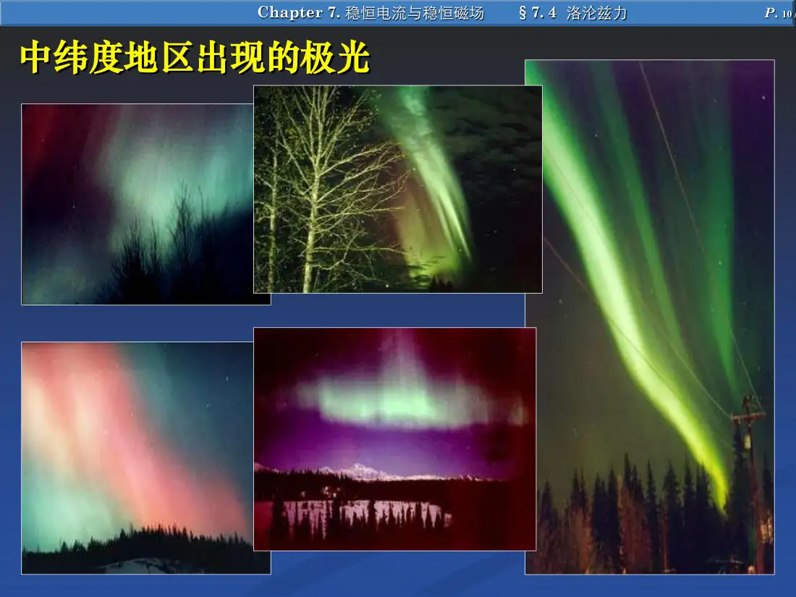

原文：

中纬度地区出现的极光

Chapter 7. 稳恒电流与稳恒磁场 § 7.4 洛沦兹力

P. 10

### Chapter 7. 稳恒电流与稳恒磁场 § 7.4 洛沦兹力

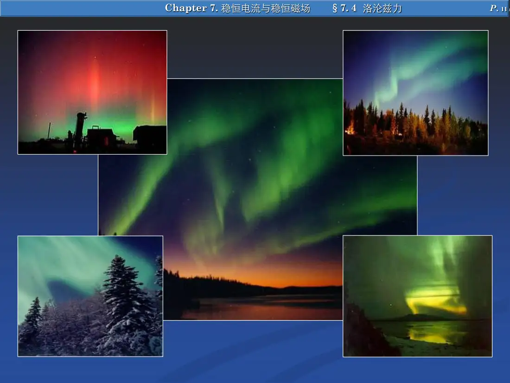

原文：

Chapter 7. 稳恒电流与稳恒磁场 § 7.4 洛沦兹力

P. 11

### Chapter 7. 稳恒电流与稳恒磁场 § 7.4 洛沦兹力

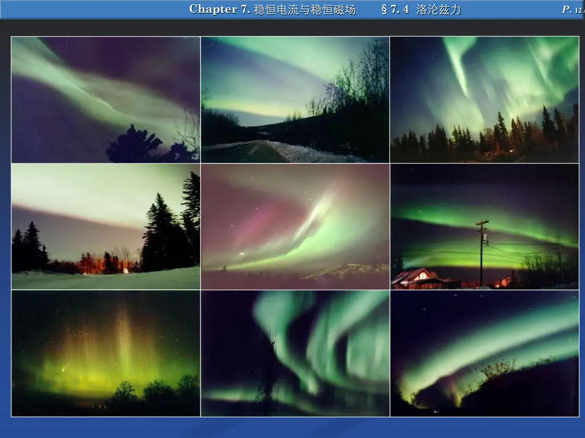

原文：

Chapter 7. 稳恒电流与稳恒磁场 § 7.4 洛沦兹力

P. 12

### 洛仑兹

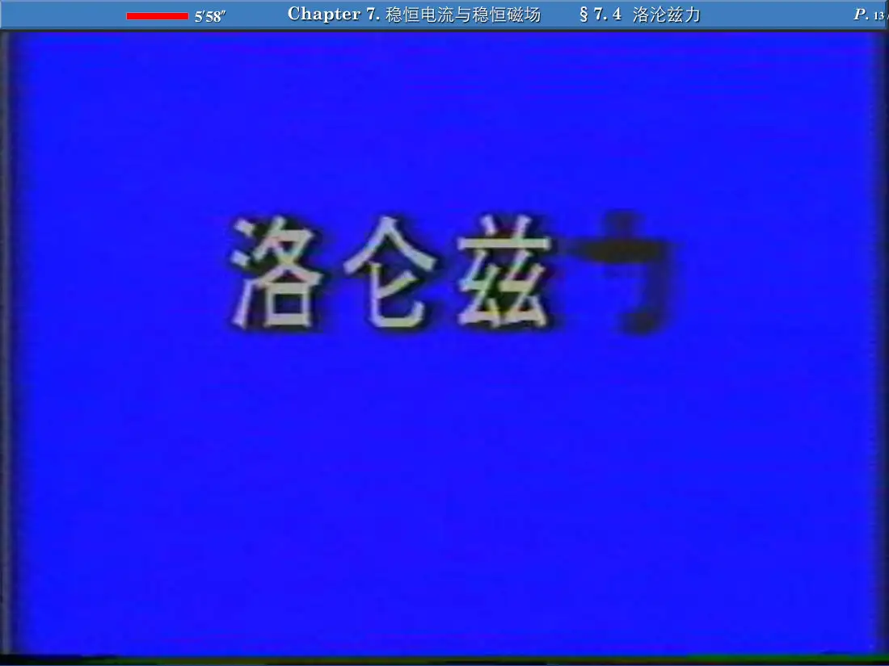

原文：

洛仑兹

P. 13

5'58"

Chapter 7. 稳恒电流与稳恒磁场 § 7.4 洛沦兹力

### 二、霍尔效应 (Hall effect)

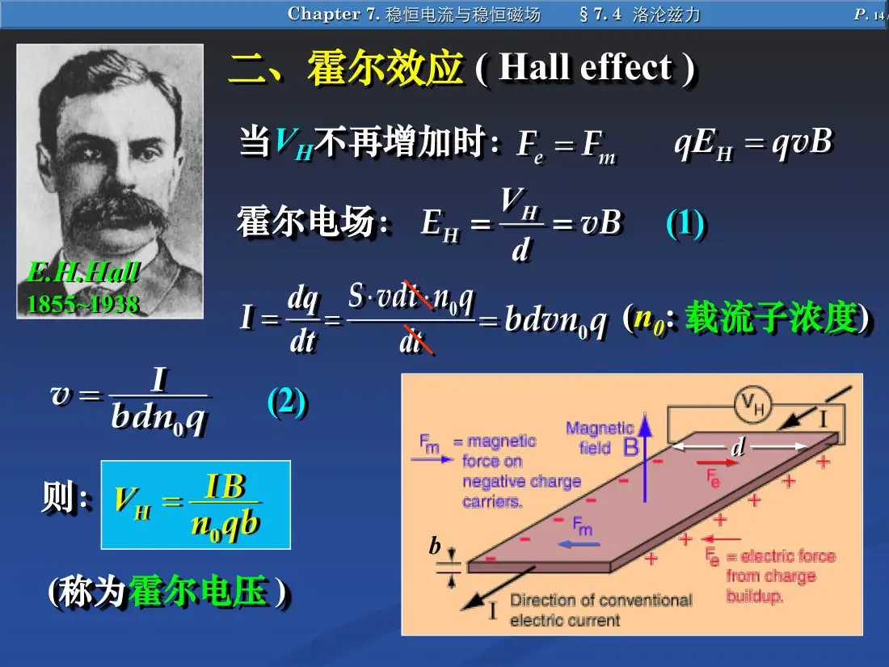

原文：

二、霍尔效应 (Hall effect)

当 $V_{H}$ 不再增加时： $F_{e}=F_{m}\quad qE_{H}=qvB$

霍尔电场: $E_{H} = \frac{V_{H}}{d} = v B$

(1)

$I=\frac{dq}{dt}=\frac{S\cdot vdt\cdot n_{0}q}{dt}=bdvn_{0}q$ ( $n_{0}$ : 载流子浓度)

$$
v = \frac {I}{b d n _ {0} q}\tag{2}
$$

则： $V_{H}=\frac{IB}{n_{0}qb}$

(称为霍尔电压)

Chapter 7. 稳恒电流与稳恒磁场

§ 7.4 洛沦兹力

P. 14

### 量子霍尔效应 (quantized Hall effect)

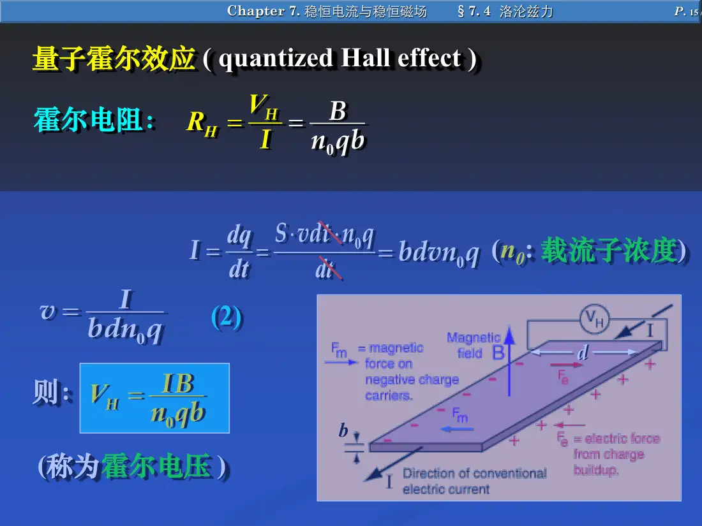

原文：

量子霍尔效应 (quantized Hall effect)

霍尔电阻: $R_{H} = \frac{V_{H}}{I} = \frac{B}{n_{0} q b}$

$I=\frac{dq}{dt}=\frac{S\cdot vdt\cdot n_{0}q}{dt}=bdvn_{0}q$ ( $n_{0}$ : 载流子浓度)

$$
v = \frac {I}{b d n _ {0} q}\tag{2}
$$

则： $V_{H}=\frac{IB}{n_{0}qb}$

(称为霍尔电压)

Chapter 7. 稳恒电流与稳恒磁场

§ 7.4 洛沦兹力

P. 15

### 量子霍尔效应 (quantized Hall effect)

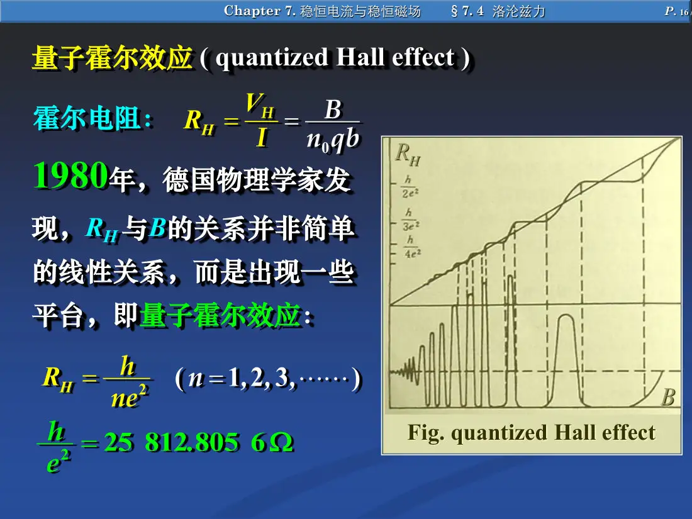

原文：

量子霍尔效应 (quantized Hall effect)

霍尔电阻: $R_{H} = \frac{V_{H}}{I} = \frac{B}{n_{0} q b}$ 1980年, 德国物理学家发现, $R_{H}$ 与 $B$ 的关系并非简单的线性关系, 而是出现一些平台, 即量子霍尔效应:

$$
R _ {H} = \frac {h}{n e ^ {2}} (n = 1, 2, 3, \dots \dots)
$$

$$
\frac {h}{e ^ {2}} = 2 5 8 1 2. 8 0 5 6 \Omega
$$

Fig. quantized Hall effect冯克利钦(Klaus von Klitzing, 1943\~)德国物理学家，1980年在研究半导体在极低温度

Chapter 7. 稳恒电流与稳恒磁场

§ 7.4 洛沦兹力

P. 16

### 下和强磁场中的霍尔效应时发现量子霍尔效应，获1985年度诺贝尔物理学奖。

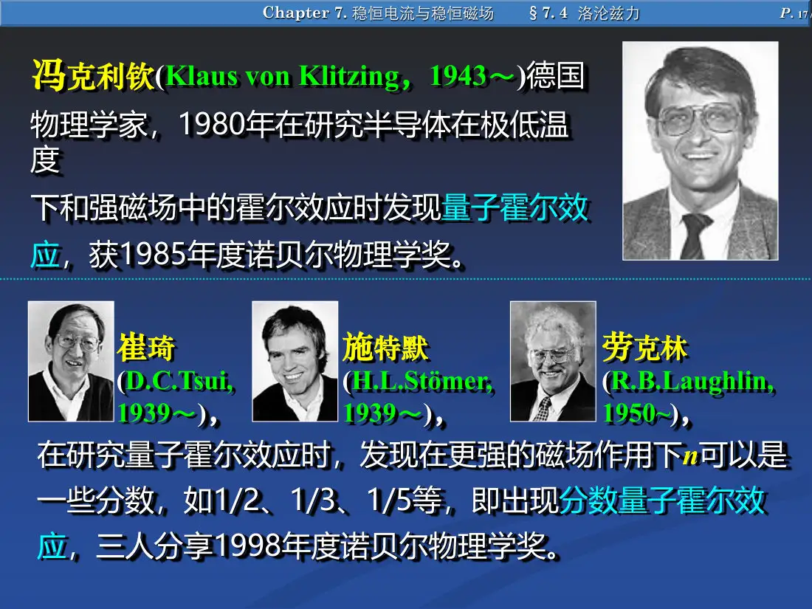

原文：

下和强磁场中的霍尔效应时发现量子霍尔效应，获1985年度诺贝尔物理学奖。

崔琦
(D.C.Tsui,
1939\~),施特默
(H.L.Stömer,
1939\~),

劳克林
(R.B.Laughlin,
1950\~),

在研究量子霍尔效应时，发现在更强的磁场作用下n可以是一些分数，如1/2、1/3、1/5等，即出现分数量子霍尔效应，三人分享1998年度诺贝尔物理学奖。

Chapter 7. 稳恒电流与稳恒磁场

§ 7.4 洛沦兹力

P. 17

### 三、磁偏转效应的应用

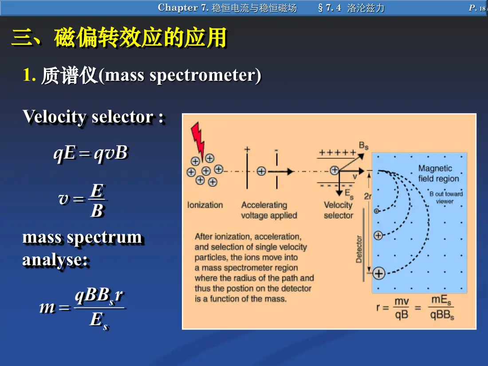

原文：

三、磁偏转效应的应用

1. 质谱仪(mass spectrometer)

Velocity selector :

$$
q E = q v B
$$

$$
v = \frac {E}{B}
$$

mass spectrum
analyse:

Ionization

Accelerating voltage applied

Velocity selector

$$
m = \frac {q B B _ {s} r}{E _ {s}}
$$

After ionization, acceleration, and selection of single velocity particles, the ions move into a mass spectrometer region where the radius of the path and thus the position on the detector is a function of the mass.

$$
r = \frac {m v}{q B} = \frac {m E _ {s}}{q B B _ {s}}
$$

Chapter 7. 稳恒电流与稳恒磁场

§ 7.4 洛沦兹力

P. 18

### 2. 回旋加速器(cyclotron)

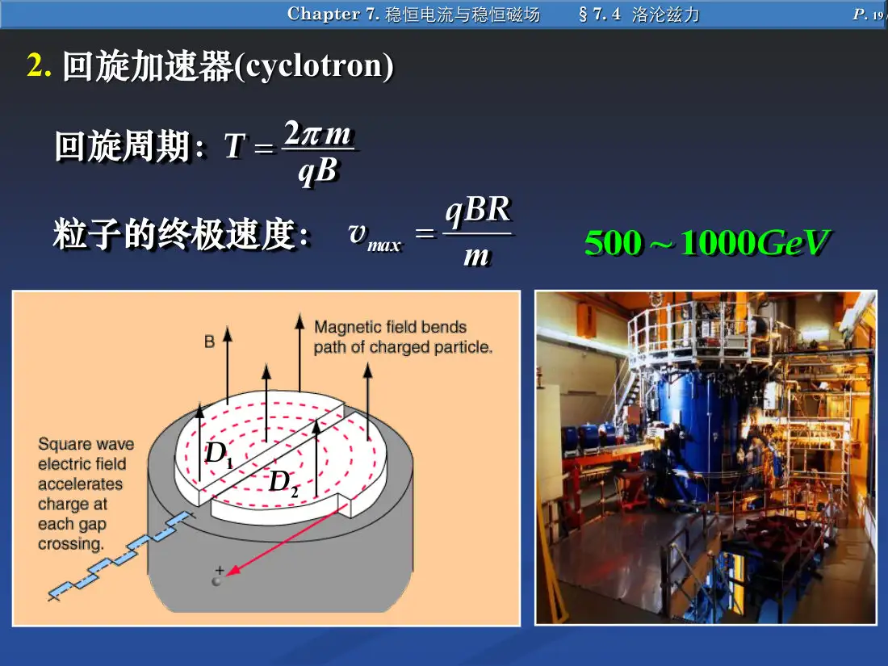

原文：

2. 回旋加速器(cyclotron)

回旋周期: $T = \frac{2\pi m}{qB}$ 粒子的终极速度: $v_{max} = \frac{qBR}{m}$

500 \~ 1000 GeV

Chapter 7. 稳恒电流与稳恒磁场

§ 7.4 洛沦兹力

P. 19

### 原理：利用等离子体的霍尔效应。

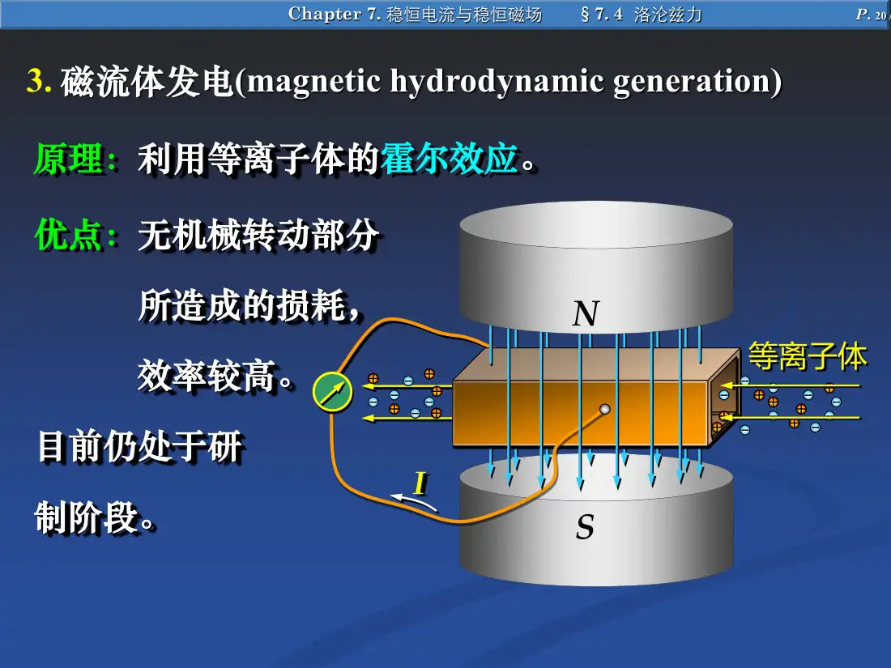

原文：

3. 磁流体发电(magnetic hydrodynamic generation)

原理：利用等离子体的霍尔效应。

优点：无机械转动部分

所造成的损耗，

效率较高。

目前仍处于研制阶段。

等离子体

Chapter 7. 稳恒电流与稳恒磁场

§ 7.4 洛沦兹力

P. 20

### 归纳

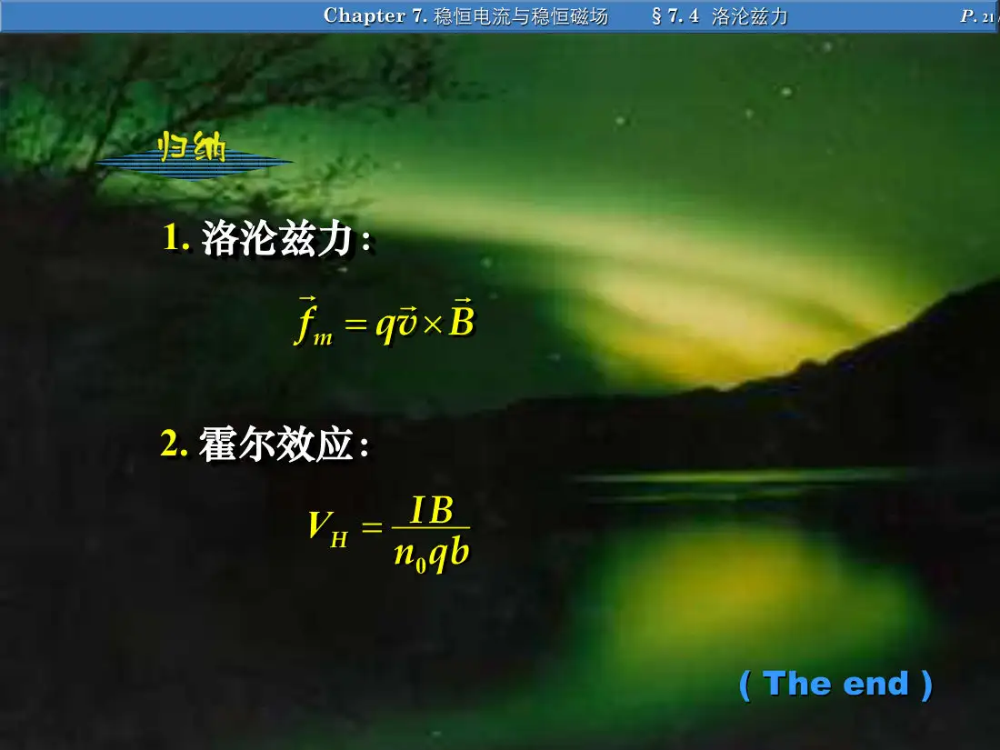

原文：

归纳

1. 洛沦兹力：

$$
\vec {f} _ {m} = q \vec {v} \times \vec {B}
$$

2. 霍尔效应:

$$
V _ {H} = \frac {I B}{n _ {0} q b}
$$

Chapter 7. 稳恒电流与稳恒磁场

§ 7.4 洛沦兹力

P. 21

( The end )
