# 《大学物理》第7章 稳恒电流与稳恒磁场 §7.5 安培定律 磁力矩（课件）

原件的每一页，下面附识别出的文字。

### §7.5 安培定律 磁力矩

原文：

§7.5 安培定律 磁力矩

Chapter 7. 稳恒电流与稳恒磁场

§ 7.5 安培定律 磁力矩

P. 1/

### 一、安培力 安培定律

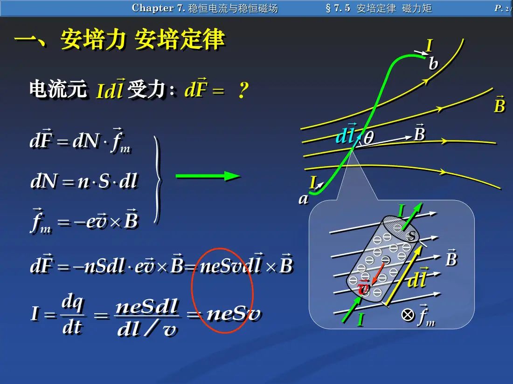

原文：

一、安培力 安培定律

电流元 $Id\vec{l}$ 受力: $d\vec{F} = ?$

$$
\left. \begin{array}{l} d \vec {F} = d N \cdot \vec {f} _ {m} \\ d N = n \cdot S \cdot d l \\ \vec {f} _ {m} = - e \vec {v} \times \vec {B} \end{array} \right\} \longrightarrow
$$

$$
d \vec {F} = - n S d l \cdot e \vec {v} \times \vec {B} = n e S v d \vec {l} \times \vec {B}
$$

$$
I = \frac {d q}{d t} = \frac {n e S d l}{d l / v} = n e S v
$$

Chapter 7. 稳恒电流与稳恒磁场

§ 7.5 安培定律 磁力矩

P. 2/

### 导线受到的磁力即为安培力：

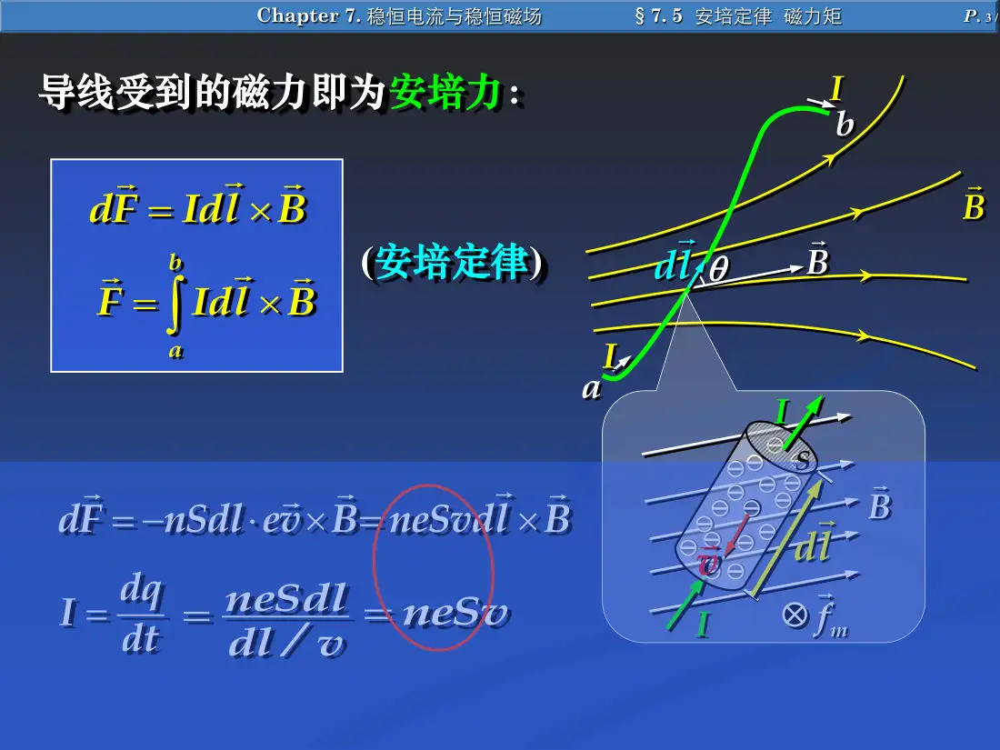

原文：

导线受到的磁力即为安培力：

$$
d \vec {F} = I d \vec {l} \times \vec {B}
$$

$$
\vec {F} = \int_ {a} ^ {b} I d \vec {l} \times \vec {B}
$$

(安培定律)

$$
d \vec {F} = - n S d l \cdot e \vec {v} \times \vec {B} = n e S v d \vec {l} \times \vec {B}
$$

$$
I = \frac {d q}{d t} = \frac {n e S d l}{d l / v} = n e S v
$$

Chapter 7. 稳恒电流与稳恒磁场

§ 7.5 安培定律 磁力矩

P. 3/

### 导线受到的磁力即为安培力：

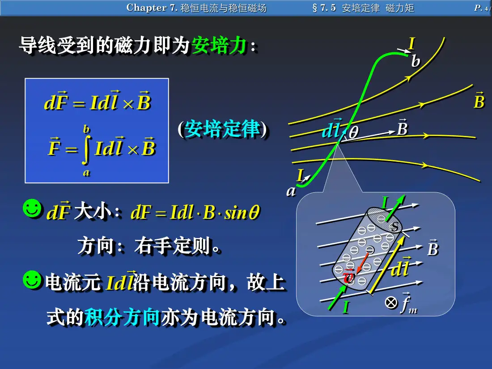

原文：

导线受到的磁力即为安培力：

$$
d \vec {F} = I d \vec {l} \times \vec {B}
$$

$$
\vec {F} = \int_ {a} ^ {b} I d \vec {l} \times \vec {B}
$$

(安培定律)

😊 $d\vec{F}$ 大小: $dF = Idl \cdot B \cdot sin \theta$ 方向: 右手定则。

电流元 $Id\vec{l}$ 沿电流方向，故上式的积分方向亦为电流方向。

Chapter 7. 稳恒电流与稳恒磁场

§ 7.5 安培定律 磁力矩

P. 4/

### 解 建立坐标系如图所示

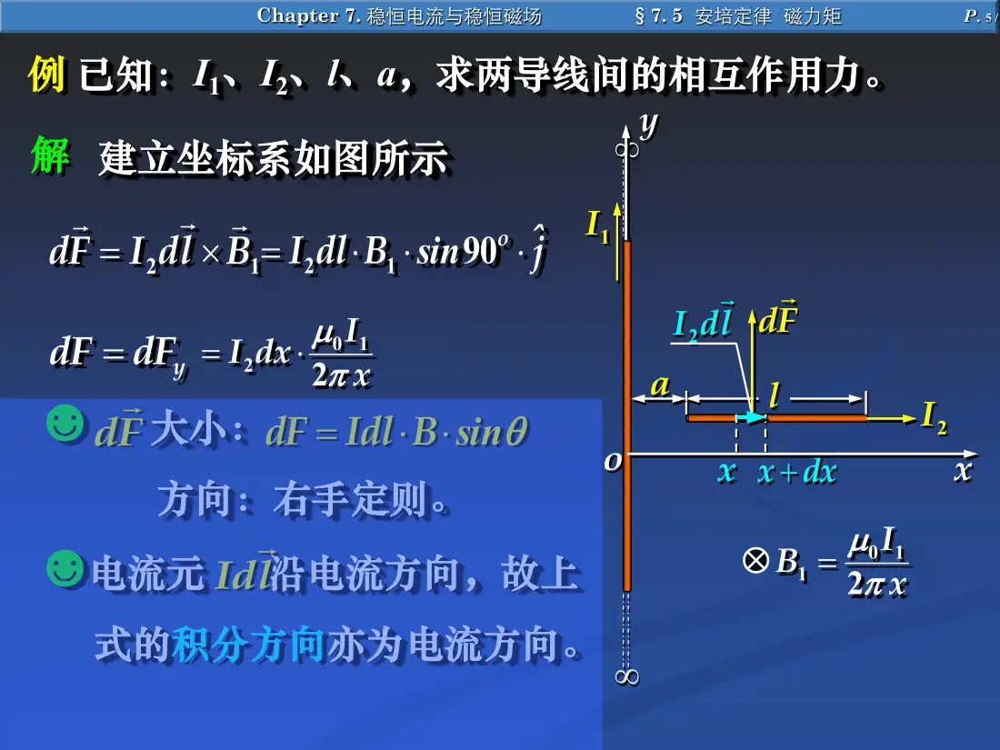

原文：

例 已知： $I_{1}$ 、 $I_{2}$ 、 $l$ 、 $a$ ，求两导线间的相互作用力。

解 建立坐标系如图所示

$$
d \vec {F} = I _ {2} d \vec {l} \times \vec {B} _ {1} = I _ {2} d l \cdot B _ {1} \cdot \sin 9 0 ^ {\circ} \cdot \hat {j}
$$

$dF = dF_{y} = I_{2}dx\cdot \frac{\mu_{0}I_{1}}{2\pi x}$

😊 $d\vec{F}$ 大小: $dF = Idl \cdot B \cdot sin\theta$

方向：右手定则。

电流元 $Id\vec{l}$ 沿电流方向，故上式的积分方向亦为电流方向。

$$
\otimes B _ {1} = \frac {\mu_ {0} I _ {1}}{2 \pi x}
$$

Chapter 7. 稳恒电流与稳恒磁场

§ 7.5 安培定律 磁力矩

P. 5/

### 解 建立坐标系如图所示

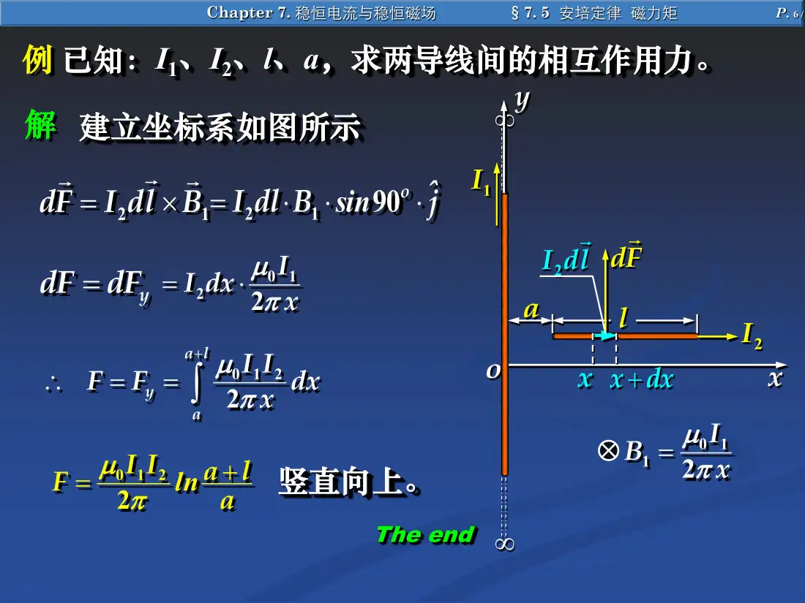

原文：

例 已知： $I_{1}$ 、 $I_{2}$ 、 $l$ 、 $a$ ，求两导线间的相互作用力。

解 建立坐标系如图所示

$$
d \vec {F} = I _ {2} d \vec {l} \times \vec {B} _ {1} = I _ {2} d l \cdot B _ {1} \cdot \sin 9 0 ^ {\circ} \cdot \hat {j}
$$

$$
d F = d F _ {y} = I _ {2} d x \cdot \frac {\mu_ {0} I _ {1}}{2 \pi x}
$$

$$
\therefore F = F _ {y} = \int_ {a} ^ {a + l} \frac {\mu_ {0} I _ {1} I _ {2}}{2 \pi x} d x
$$

$$
F = \frac {\mu_ {0} I _ {1} I _ {2}}{2 \pi} \ln \frac {a + l}{a}
$$

竖直向上。

$$
\otimes B _ {1} = \frac {\mu_ {0} I _ {1}}{2 \pi x}
$$

Chapter 7. 稳恒电流与稳恒磁场

§ 7.5 安培定律 磁力矩

P. 6/

The end

### 提示: 取元如图所示: $I_{2} d \vec{l}$

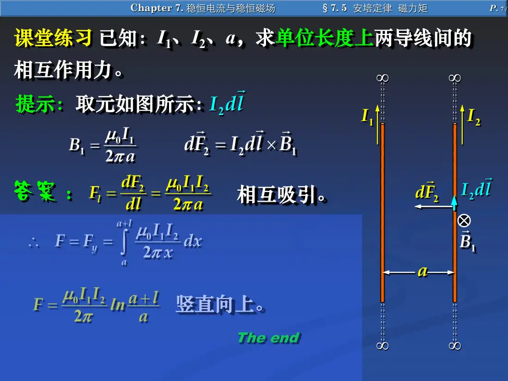

原文：

课堂练习 已知: $I_{1} 、 I_{2} 、 a$ , 求单位长度上两导线间的相互作用力。

提示: 取元如图所示: $I_{2} d \vec{l}$

$$
B _ {1} = \frac {\mu_ {0} I _ {1}}{2 \pi a}
$$

$$
d \vec {F} _ {2} = I _ {2} d \vec {l} \times \vec {B} _ {1}
$$

答案： $F_{l}=\frac{dF_{2}}{dl}=\frac{\mu_{0}I_{1}I_{2}}{2\pi a}$

相互吸引。

$\therefore F = F_{y} = \int_{a}^{a + l}\frac{\mu_{0}I_{1}I_{2}}{2\pi x} dx$

$F=\frac{\mu_{0}I_{1}I_{2}}{2\pi}\ln\frac{a+l}{a}$ 竖直向上。

$$
\text { The   end }
$$

Chapter 7. 稳恒电流与稳恒磁场

§ 7.5 安培定律 磁力矩

P. 71

### 提示: 取元如图所示: $I_{2} d \vec{l}$

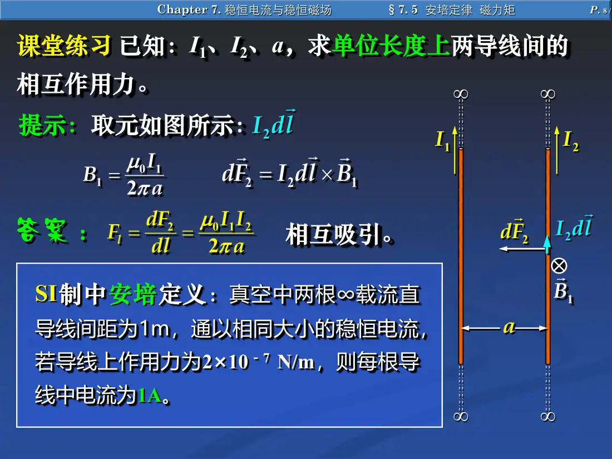

原文：

课堂练习 已知: $I_{1} 、 I_{2} 、 a$ , 求单位长度上两导线间的相互作用力。

提示: 取元如图所示: $I_{2} d \vec{l}$

$$
B _ {1} = \frac {\mu_ {0} I _ {1}}{2 \pi a}
$$

$$
d \vec {F} _ {2} = I _ {2} d \vec {l} \times \vec {B} _ {1}
$$

答案： $F_{l}=\frac{dF_{2}}{dl}=\frac{\mu_{0}I_{1}I_{2}}{2\pi a}$ 相互吸引。

SI制中安培定义：真空中两根∞载流直导线间距为1m，通以相同大小的稳恒电流，若导线上作用力为 $2 \times 10^{-7}$ N/m，则每根导线中电流为1A。

Chapter 7. 稳恒电流与稳恒磁场

§ 7.5 安培定律 磁力矩

P. 8/

### $$

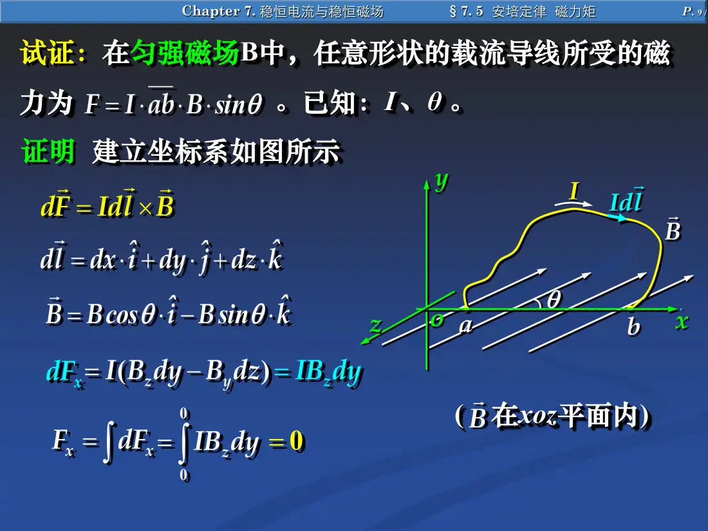

原文：

试证: 在匀强磁场B中, 任意形状的载流导线所受的磁力为 $F = I \cdot \overline{ab} \cdot B \cdot \sin \theta$ 。已知: $I$ 、 $\theta$ 。证明 建立坐标系如图所示

$$
d \vec {F} = I d \vec {l} \times \vec {B}
$$

$$
d \vec {l} = d x \cdot \hat {\dot {i}} + d y \cdot \hat {\dot {j}} + d z \cdot \hat {k}
$$

$$
\vec {B} = B \cos \theta \cdot \hat {\dot {i}} - B \sin \theta \cdot \hat {k}
$$

$$
d F _ {x} = I \left(B _ {z} d y - B _ {y} d z\right) = I B _ {z} d y
$$

$$
F _ {x} \equiv \int d F _ {x} = \int_ {0} ^ {0} I B _ {z} d y = 0
$$

( $\vec{B}$ 在xoz平面内)

Chapter 7. 稳恒电流与稳恒磁场

§ 7.5 安培定律 磁力矩

P. 9/

### $$

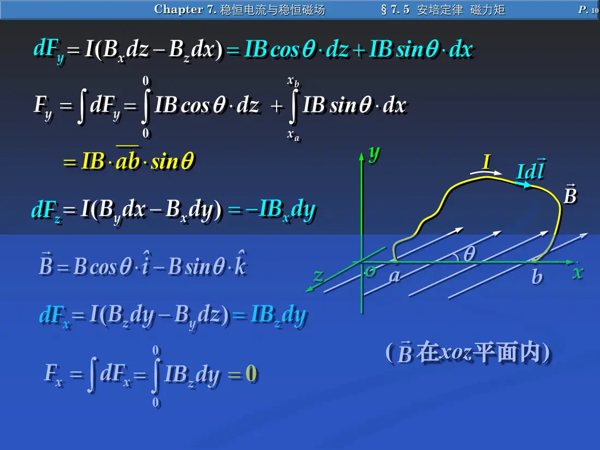

原文：

$$
d F _ {y} = I (B _ {x} d z - B _ {z} d x) = I B \cos \theta \cdot d z + I B \sin \theta \cdot d x
$$

$$
\begin{array}{l} F _ {y} = \int d F _ {y} = \int_ {0} ^ {0} I B \cos \theta \cdot d z + \int_ {x _ {a}} ^ {x _ {b}} I B \sin \theta \cdot d x \\ = I B \cdot \overline {{a b}} \cdot \sin \theta \end{array}
$$

$$
d F _ {z} = I (B _ {y} d x - B _ {x} d y) = - I B _ {x} d y
$$

$$
\vec {B} = B \cos \theta \cdot \hat {\dot {i}} - B \sin \theta \cdot \hat {k}
$$

$$
d F _ {x} = I (B _ {z} d y - B _ {y} d z) = I B _ {z} d y
$$

$$
F _ {x} \equiv \int d F _ {x} = \int_ {0} ^ {0} I B _ {z} d y \equiv 0
$$

( $\vec{B}$ 在xoz平面内)

Chapter 7. 稳恒电流与稳恒磁场

§ 7.5 安培定律 磁力矩

P. 10

### $$

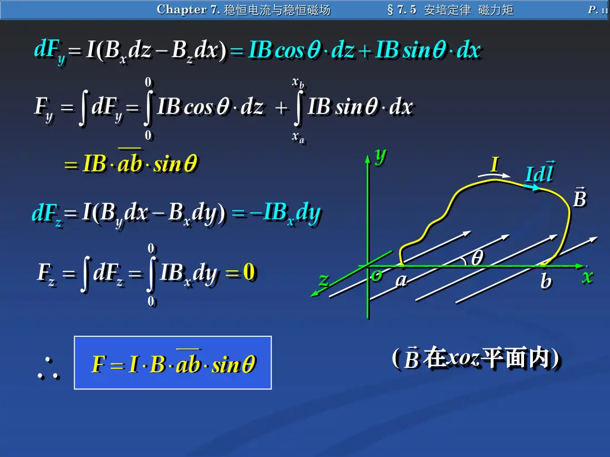

原文：

$$
d F _ {y} = I (B _ {x} d z - B _ {z} d x) = I B \cos \theta \cdot d z + I B \sin \theta \cdot d x
$$

$$
\begin{array}{l} F _ {y} = \int d F _ {y} = \int_ {0} ^ {0} I B \cos \theta \cdot d z + \int_ {x _ {a}} ^ {x _ {b}} I B \sin \theta \cdot d x \\ = I B \cdot \overline {{a b}} \cdot \sin \theta \end{array}
$$

$$
d F _ {z} = I (B _ {y} d x - B _ {x} d y) = - I B _ {x} d y
$$

$$
F _ {z} = \int d F _ {z} = \int_ {0} ^ {0} I B _ {x} d y = 0
$$

$$
F = I \cdot B \cdot \overline {{a b}} \cdot \sin \theta
$$

( $\vec{B}$ 在xoz平面内)

Chapter 7. 稳恒电流与稳恒磁场

§ 7.5 安培定律 磁力矩

P. 11

### 推论1：在匀强磁场B中，载流直导线所受的磁力：

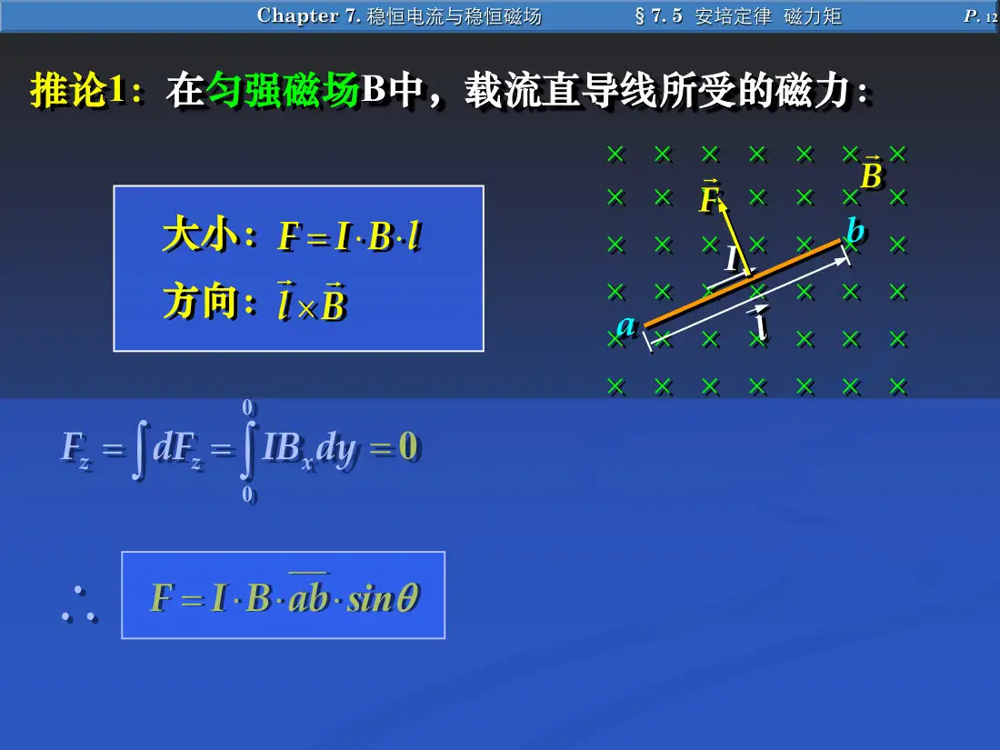

原文：

推论1：在匀强磁场B中，载流直导线所受的磁力：

大小： $F=I\cdot B\cdot l$

方向： $\vec{l} \times \vec{B}$

$$
F _ {z} \equiv \int d F _ {z} = \int_ {0} ^ {0} I B _ {x} d y = 0
$$

$$
F = I \cdot B \cdot \overline {{a b}} \cdot \sin \theta
$$

Chapter 7. 稳恒电流与稳恒磁场

§ 7.5 安培定律 磁力矩

P. 12

### 推论1：在匀强磁场B中，载流直导线所受的磁力：

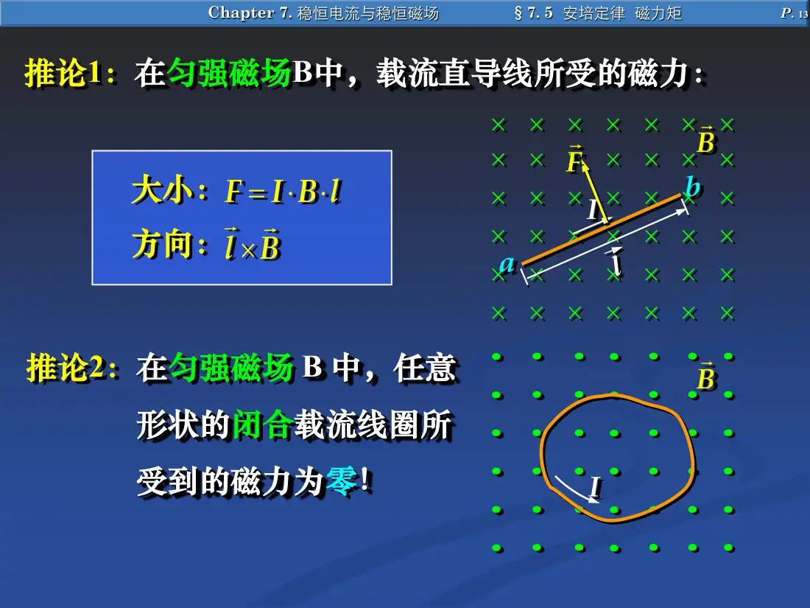

原文：

推论1：在匀强磁场B中，载流直导线所受的磁力：

大小： $F=I\cdot B\cdot l$

方向： $\vec{l} \times \vec{B}$

推论2：在匀强磁场 B 中，任意

形状的闭合载流线圈所

受到的磁力为零!

Chapter 7. 稳恒电流与稳恒磁场

§ 7.5 安培定律 磁力矩

P. 13

### 课堂练习 如图，匀强磁场B中，求该载流导线所受到的磁力。已知：B、R、I。

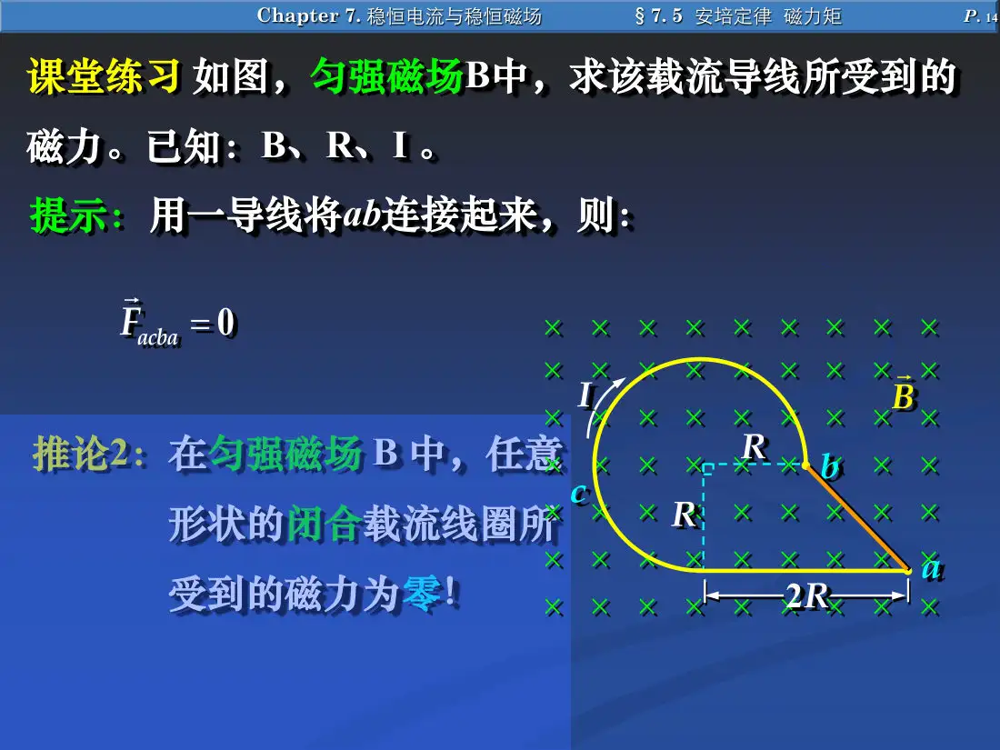

原文：

课堂练习 如图，匀强磁场B中，求该载流导线所受到的磁力。已知：B、R、I。

提示：用一导线将 $ab$ 连接起来，则：

$$
\vec {E} _ {a c b a} \equiv 0
$$

推论2: 在匀强磁场 B 中, 任意形状的闭合载流线圈所受到的磁力为零!

P. 14

Chapter 7. 稳恒电流与稳恒磁场

§ 7.5 安培定律 磁力矩

### 课堂练习 如图，匀强磁场B中，求该载流导线所受到的磁力。已知：B、R、I。

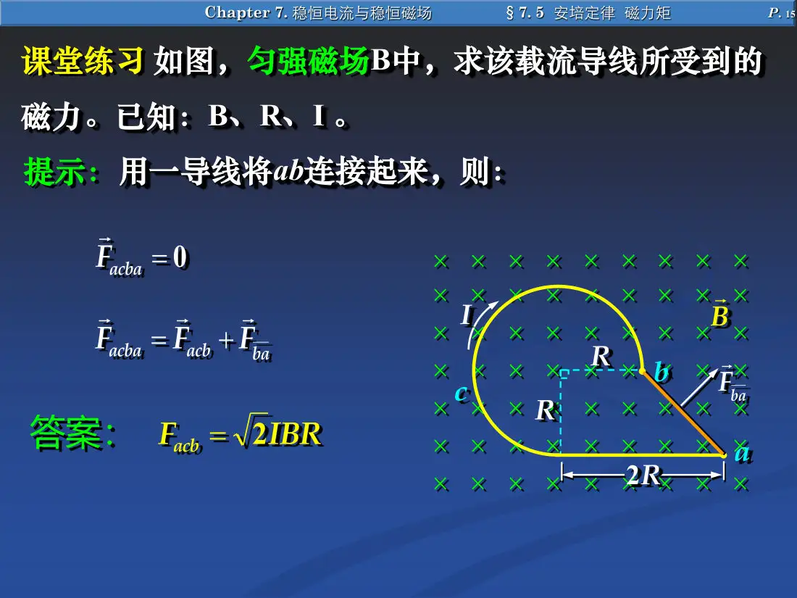

原文：

课堂练习 如图，匀强磁场B中，求该载流导线所受到的磁力。已知：B、R、I。

提示：用一导线将 $ab$ 连接起来，则：

$$
\vec {E} _ {a c b a} \equiv 0
$$

$$
\vec {F} _ {a c b a _ {l}} = \vec {F} _ {a c b} + \vec {F} _ {\overline {{b a _ {l}}}}
$$

答案: $F_{acb} = \sqrt{2} IBR$

Chapter 7. 稳恒电流与稳恒磁场

§ 7.5 安培定律 磁力矩

P. 15

### 提示：以半个线圈作为研究对象，则：

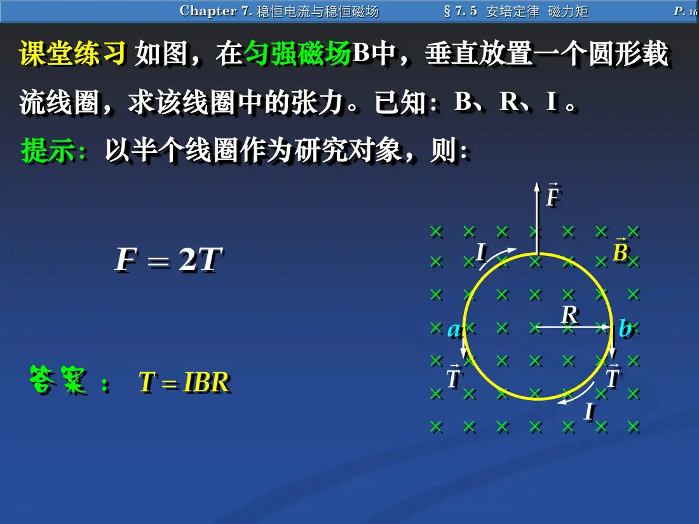

原文：

课堂练习 如图，在匀强磁场B中，垂直放置一个圆形载流线圈，求该线圈中的张力。已知：B、R、I。

提示：以半个线圈作为研究对象，则：

$$
F \equiv 2 T
$$

答案： $T = IBR$

Chapter 7. 稳恒电流与稳恒磁场

§ 7.5 安培定律 磁力矩

P. 16

### 二、载流线圈所受的磁力矩

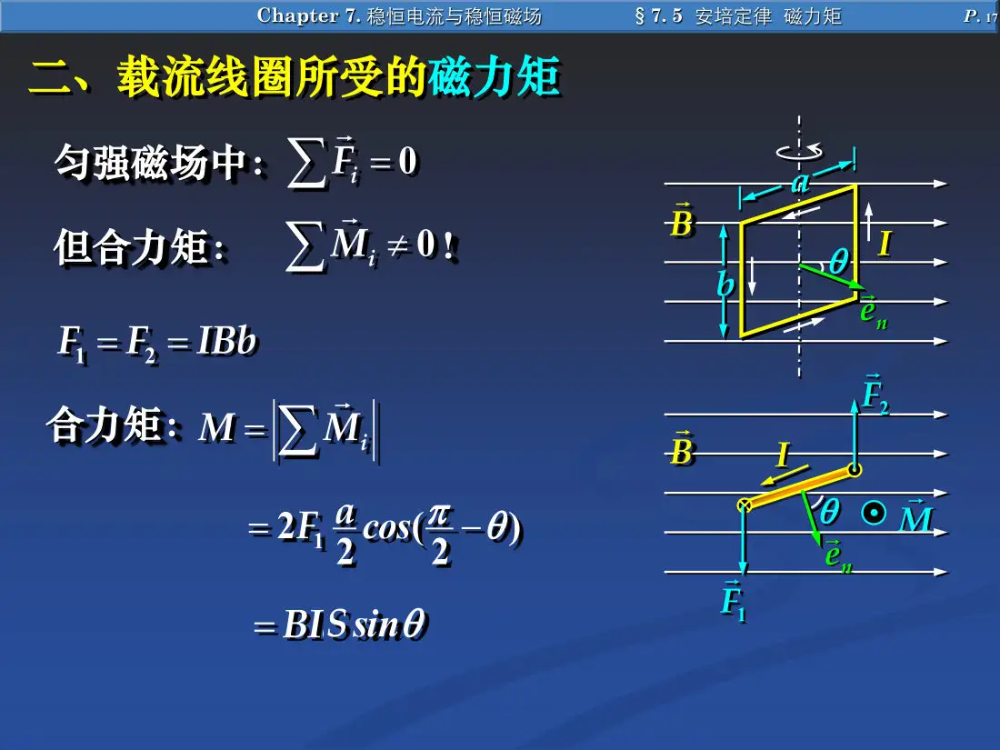

原文：

二、载流线圈所受的磁力矩

匀强磁场中： $\sum \vec{F}_i = 0$

但合力矩: $\sum \vec{M}_{i} \neq 0!$

$$
F _ {1} = F _ {2} = I B b
$$

$$
\begin{array}{r l} \text {合力矩:} M & = \left| \sum \vec {M} _ {i} \right| \\ & = 2 F _ {1} \frac {a}{2} \cos (\frac {\pi}{2} - \theta) \\ & = B I S \sin \theta \end{array}
$$

Chapter 7. 稳恒电流与稳恒磁场

§ 7.5 安培定律 磁力矩

P. 17

### 定义 磁偶极矩（磁矩）：

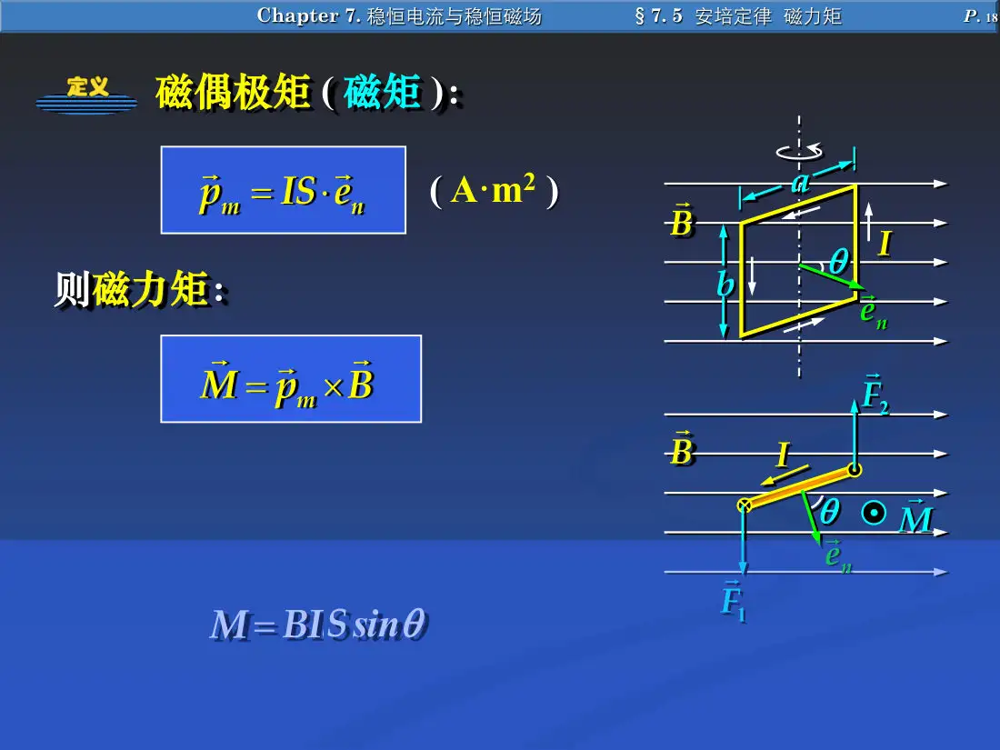

原文：

定义 磁偶极矩（磁矩）：

$$
\vec {p} _ {m} = I S \cdot \vec {e} _ {n}
$$

$$
(\mathrm{A} \cdot \mathrm{m} ^ {2})
$$

则磁力矩：

$$
\vec {M} = \vec {p} _ {m} \times \vec {B}
$$

$$
M = B I S \sin \theta
$$

Chapter 7. 稳恒电流与稳恒磁场

§ 7.5 安培定律 磁力矩

P. 18

### 定义 磁偶极矩 (磁矩):

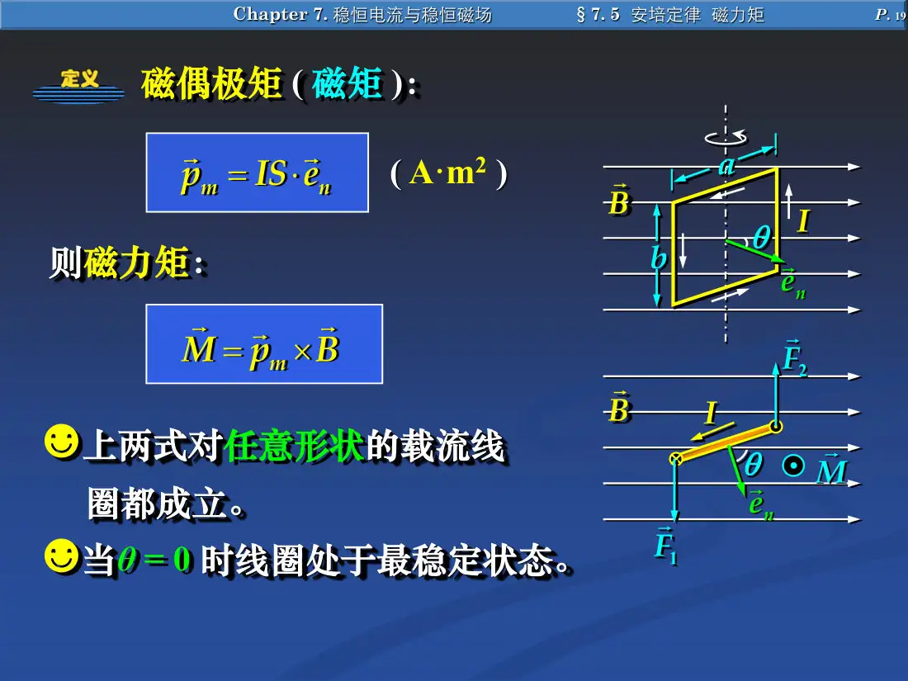

原文：

定义 磁偶极矩 (磁矩):

$$
\vec {p} _ {m} = I S \cdot \vec {e} _ {n}
$$

$$
(\mathrm{A} \cdot \mathrm{m} ^ {2})
$$

则磁力矩：

$$
\vec {M} = \vec {p} _ {m} \times \vec {B}
$$

上两式对任意形状的载流线圈都成立。

当θ=0时线圈处于最稳定状态。

Chapter 7. 稳恒电流与稳恒磁场

§ 7.5 安培定律 磁力矩

P. 19

### 解 大线圈在其圆心处产生的磁场:

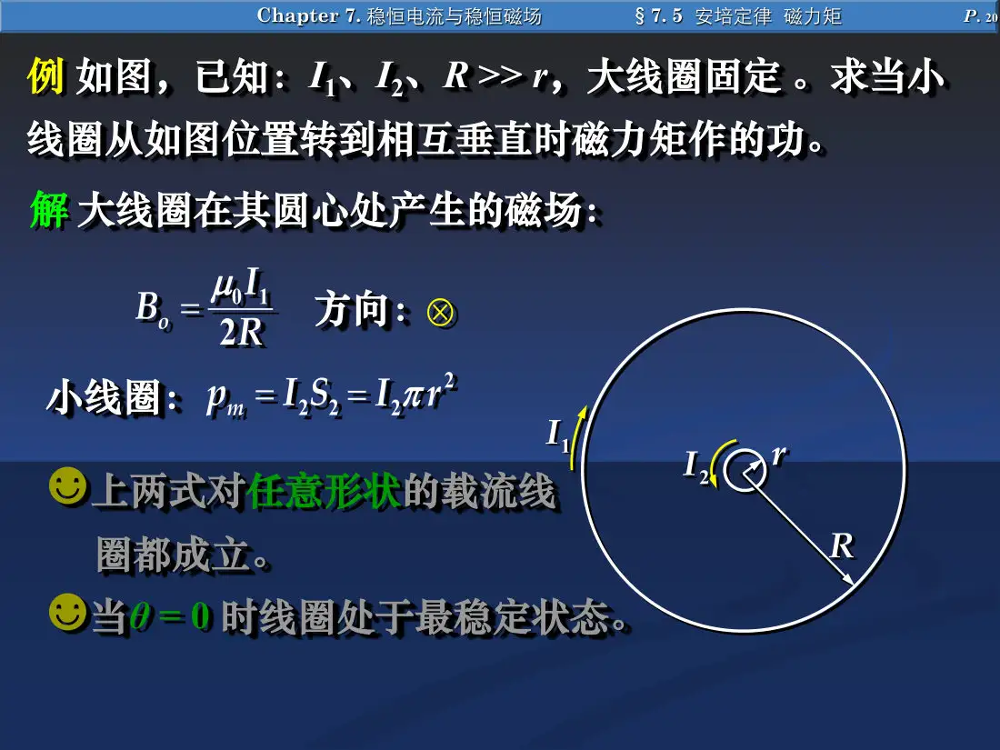

原文：

例如图，已知： $I_{1} 、 I_{2} 、 R >> r$ ，大线圈固定。求当小线圈从如图位置转到相互垂直时磁力矩作的功。

解 大线圈在其圆心处产生的磁场:

$B_{o}=\frac{\mu_{0}I_{1}}{2R}$ 方向：⊗

小线圈： $p_{m}=I_{2}S_{2}=I_{2}\pi r^{2}$

上两式对任意形状的载流线圈都成立。

当 $\theta = 0$ 时线圈处于最稳定状态。

Chapter 7. 稳恒电流与稳恒磁场

§ 7.5 安培定律 磁力矩

P. 20

### 解 大线圈在其圆心处产生的磁场:

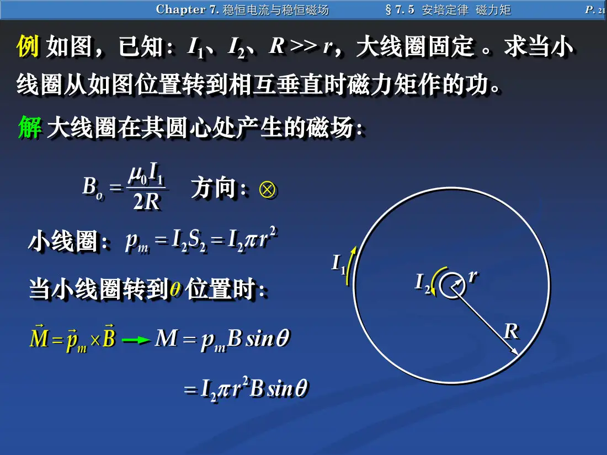

原文：

例如图，已知： $I_{1}$ 、 $I_{2}$ 、 $R >> r$ ，大线圈固定。求当小线圈从如图位置转到相互垂直时磁力矩作的功。

解 大线圈在其圆心处产生的磁场:

$B_{o}=\frac{\mu_{0}I_{1}}{2R}$ 方向：⊗

小线圈： $p_{m}=I_{2}S_{2}=I_{2}\pi r^{2}$

当小线圈转到 $\theta$ 位置时：

$$
\begin{array}{r l} \vec {M} = \vec {p} _ {m} \times \vec {B} & \longrightarrow M = p _ {m} B \sin \theta \\ & = I _ {2} \pi r ^ {2} B \sin \theta \end{array}
$$

Chapter 7. 稳恒电流与稳恒磁场

§ 7.5 安培定律 磁力矩

P. 21

### $$

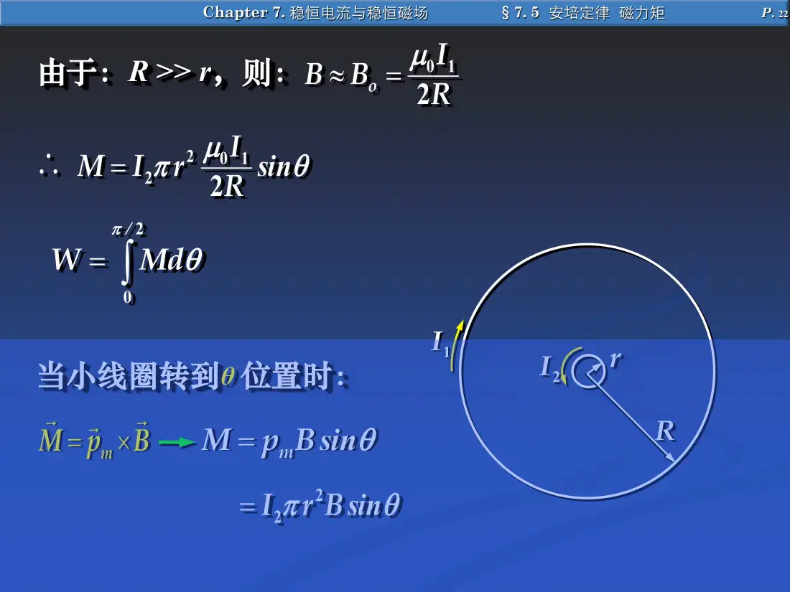

原文：

由于： $R \gg r$ ，则： $B \approx B_{o} = \frac{\mu_{0} I_{1}}{2 R}$

$$
\therefore M = I _ {2} \pi r ^ {2} \frac {\mu_ {0} I _ {1}}{2 R} \sin \theta
$$

$$
W = \int_ {0} ^ {\pi / 2} M d \theta
$$

当小线圈转到 $\theta$ 位置时：

$$
\begin{array}{r l} \vec {M} = \vec {p} _ {m} \times \vec {B} & \longrightarrow M = p _ {m} B \sin \theta \\ & = I _ {2} \pi r ^ {2} B \sin \theta \end{array}
$$

Chapter 7. 稳恒电流与稳恒磁场

§ 7.5 安培定律 磁力矩

P. 22

### $$

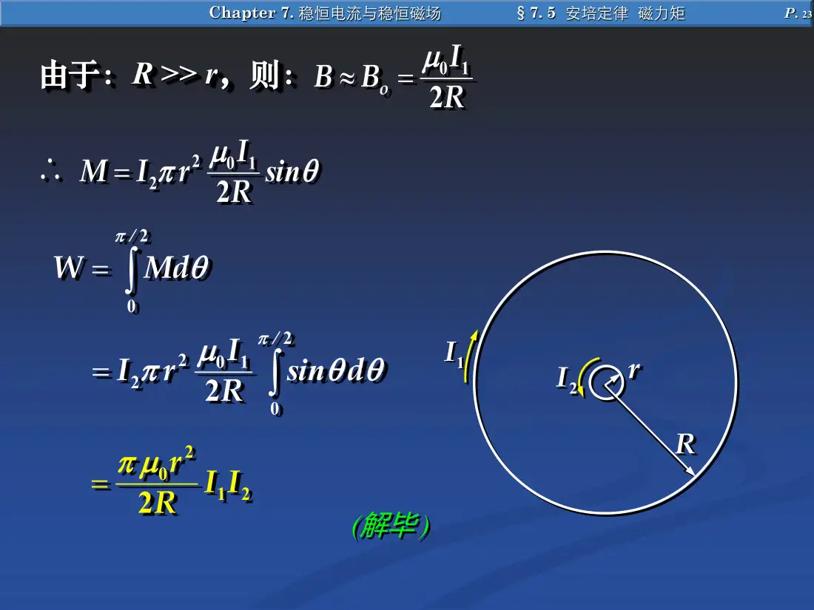

原文：

由于： $R \gg r$ ，则： $B \approx B_{o} = \frac{\mu_{0} I_{1}}{2 R}$

$$
\therefore M = I _ {2} \pi r ^ {2} \frac {\mu_ {0} I _ {1}}{2 R} \sin \theta
$$

$$
\begin{array}{r l} W & = \int_ {0} ^ {\pi / 2} M d \theta \\ & = I _ {2} \pi r ^ {2} \frac {\mu_ {0} I _ {1}}{2 R} \int_ {0} ^ {\pi / 2} \sin \theta d \theta \\ & = \frac {\pi \mu_ {0} r ^ {2}}{2 R} I _ {1} I _ {2} \end{array}
$$

(解毕)

Chapter 7. 稳恒电流与稳恒磁场

§ 7.5 安培定律 磁力矩

P. 23

### 归纳

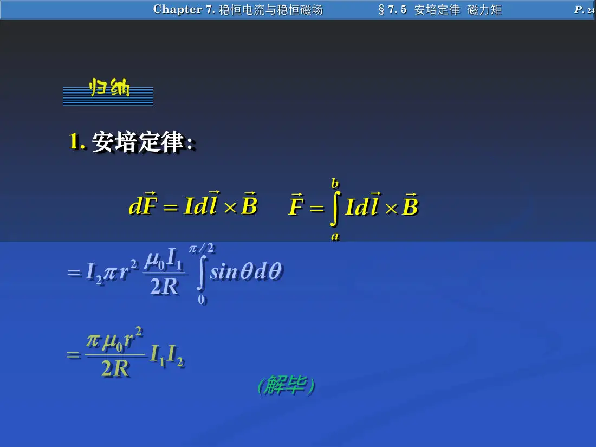

原文：

归纳

1. 安培定律：

$$
d \vec {F} = I d \vec {l} \times \vec {B} \quad \vec {F} = \int_ {a} ^ {b} I d \vec {l} \times \vec {B}
$$

$$
= I _ {2} \pi r ^ {2} \frac {\mu_ {0} I _ {1}}{2 R} \int_ {0} ^ {\pi / 2} \sin \theta d \theta
$$

$$
= \frac {\pi \mu_ {0} r ^ {2}}{2 R} I _ {1} I _ {2}
$$

(解毕)

Chapter 7. 稳恒电流与稳恒磁场

§ 7.5 安培定律 磁力矩

P. 24

### 归纳

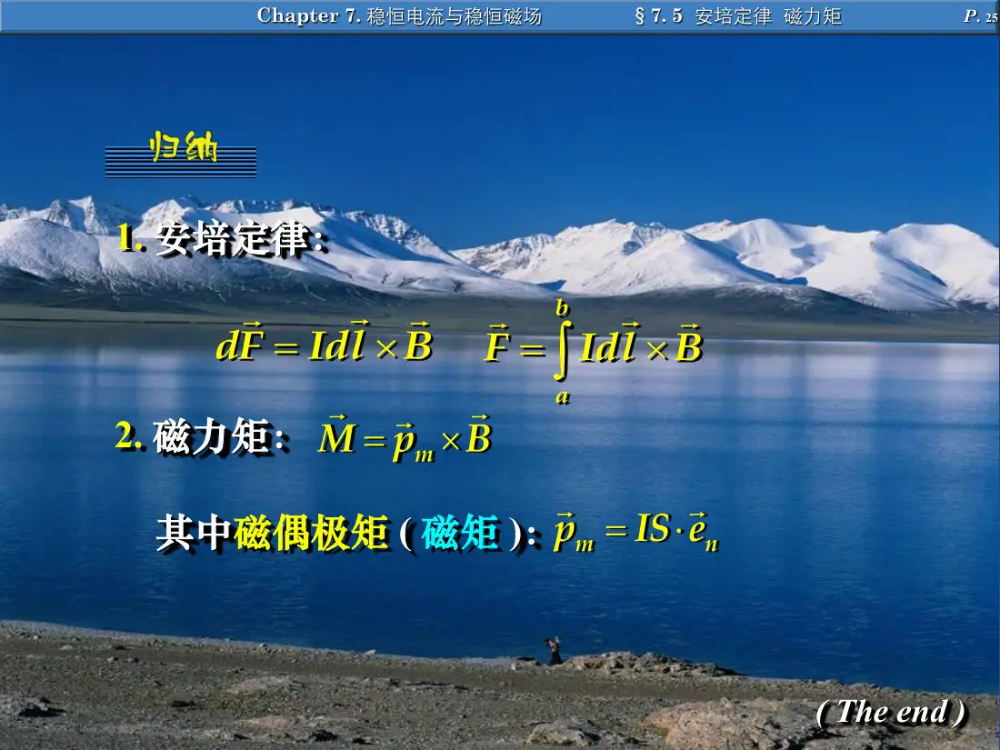

原文：

归纳

1. 安培定律:

$$
d \vec {F} = I d \vec {l} \times \vec {B} \quad \vec {F} = \int I d \vec {l} \times \vec {B}
$$

2. 磁力矩: $\vec{M} = \vec{p}_m \times \vec{B}$

其中磁偶极矩(磁矩): $\vec{p}_m = IS \cdot \vec{e}_n$

Chapter 7. 稳恒电流与稳恒磁场

§ 7.5 安培定律 磁力矩

P. 25

(The end)
