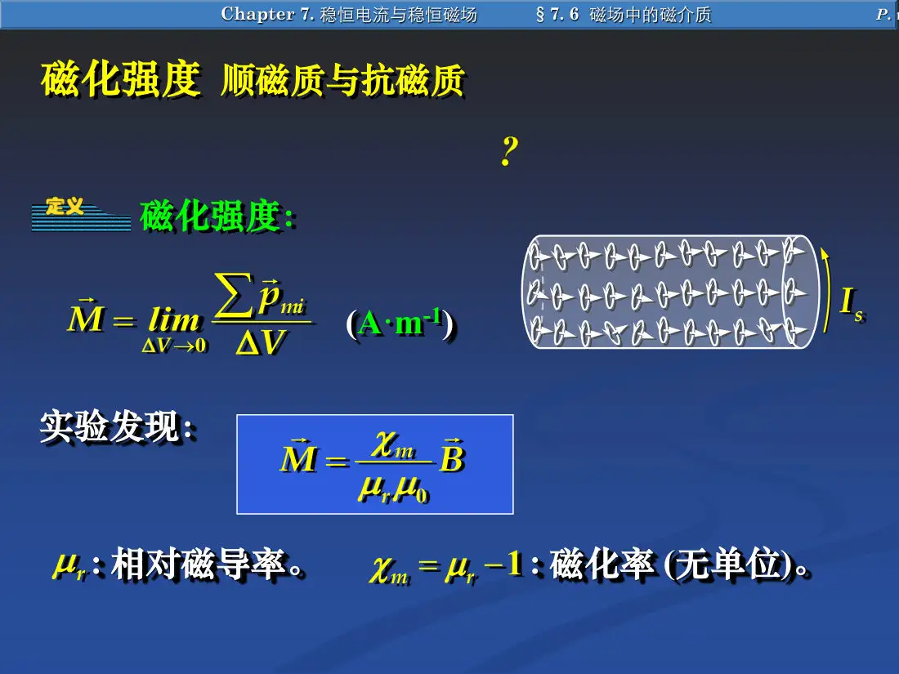
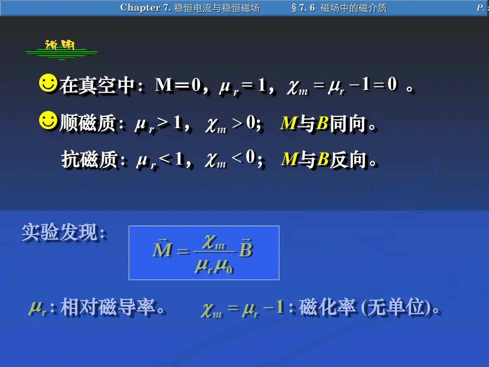
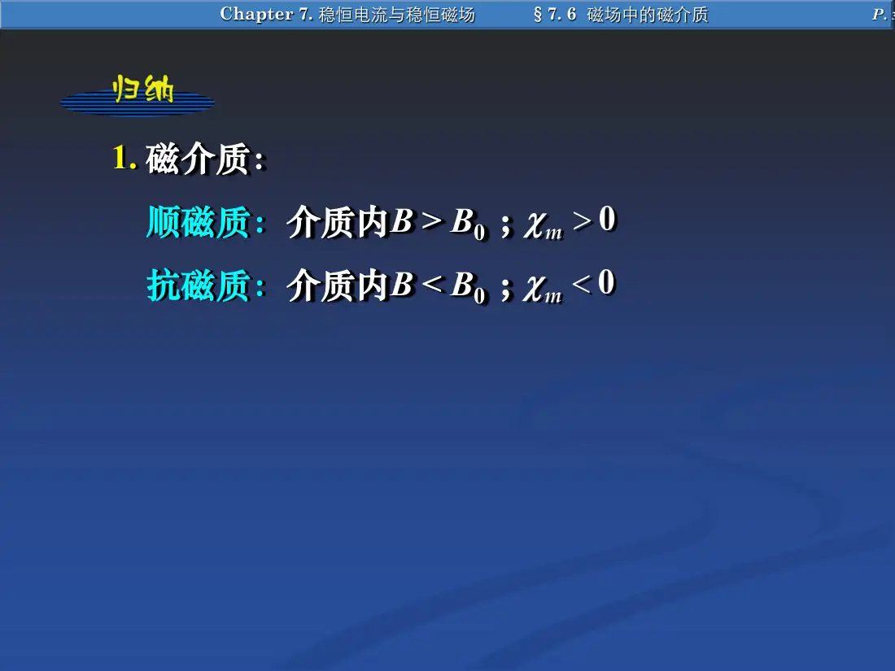
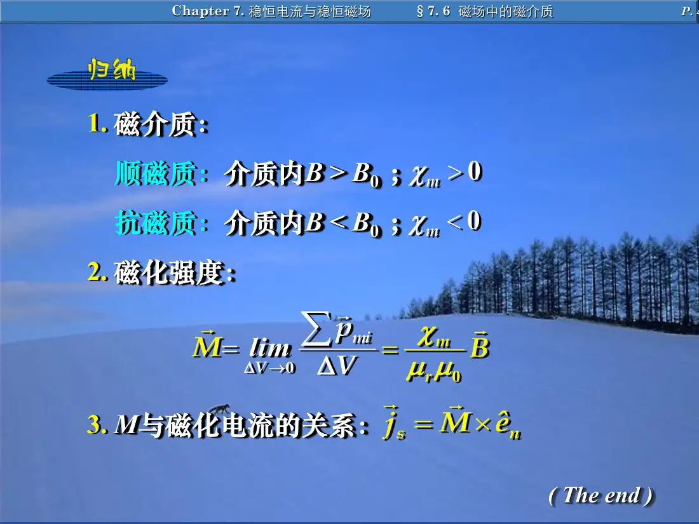

# 《大学物理》第7章 稳恒电流与稳恒磁场 §7.6 磁介质 磁化强度（课件）

原件的每一页，下面附识别出的文字。

### 磁化强度 顺磁质与抗磁质

原文：

磁化强度 顺磁质与抗磁质

?

定义 磁化强度:

$$
\vec {M} = \lim _ {\Delta V \rightarrow 0} \frac {\sum \vec {p} _ {m i}}{\Delta V} \quad (\mathrm{A} \cdot \mathrm{m} ^ {- 1})
$$

$$
\left( \begin{array}{c c c c c c c c c} 0 & 0 & 0 & 0 & 0 & 0 & 0 & 0 & 0 \\ 0 & 0 & 0 & 0 & 0 & 0 & 0 & 0 & 0 \\ 0 & 0 & 0 & 0 & 0 & 0 & 0 & 0 & 0 \\ 0 & 0 & 0 & 0 & 0 & 0 & 0 & 0 & 0 \end{array} \right) \xrightarrow {I _ {s}}
$$

实验发现:

$$
\vec {M} = \frac {\chi_ {m}}{\mu_ {r} \mu_ {0}} \vec {B}
$$

$\mu_{r}$ : 相对磁导率。 $\chi_{m} = \mu_{r} - 1$ : 磁化率 (无单位)。

Chapter 7. 稳恒电流与稳恒磁场

§ 7.6 磁场中的磁介质

P.

### 说明

原文：

说明

在真空中：M=0， $\mu_{r}=1$ ， $\chi_{m}=\mu_{r}-1=0$ 。

顺磁质： $\mu_{r}>1,\quad\chi_{m}>0;\quad M$ 与B同向。

抗磁质： $\mu_{r}<1,\quad\chi_{m}<0;\quad M$ 与B反向。

实验发现:

$$
\vec {M} = \frac {\chi_ {m}}{\mu_ {r} \mu_ {0}} \vec {B}
$$

$\mu_{r}$ : 相对磁导率。 $\chi_{m} = \mu_{r} - 1$ : 磁化率 (无单位)。

Chapter 7. 稳恒电流与稳恒磁场

§ 7.6 磁场中的磁介质

P.

### 归纳

原文：

归纳

1. 磁介质:

顺磁质：介质内 $B>B_{0}$ ； $\chi_{m}>0$

抗磁质：介质内 $B<B_{0}$ ； $\chi_{m}<0$

Chapter 7. 稳恒电流与稳恒磁场

§ 7.6 磁场中的磁介质

P.

### 归纳

原文：

归纳

1. 磁介质:

顺磁质：介质内 $B>B_{0}$ ； $\chi_{m}>0$

抗磁质：介质内 $B<B_{0}$ ； $\chi_{m}<0$

2. 磁化强度:

$$
\vec {M} = \lim _ {\Delta V \rightarrow 0} \frac {\sum \vec {p} _ {m i}}{\Delta V} = \frac {\chi_ {m}}{\mu_ {r} \mu_ {0}} \vec {B}
$$

3. M与磁化电流的关系: $\vec{j}_{s} = \vec{M} \times \hat{e}_{n}$

$$
(T h e e n d)
$$

Chapter 7. 稳恒电流与稳恒磁场

§ 7.6 磁场中的磁介质

P.
