# 《大学物理》第7章 稳恒电流与稳恒磁场 §7.6 磁场中的磁介质（课件）

原件的每一页，下面附识别出的文字。

### 一、磁场强度H的安培环路定理

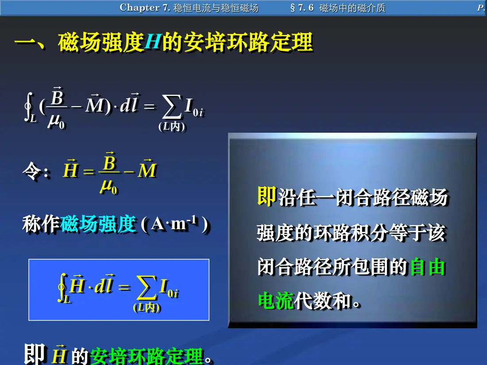

原文：

一、磁场强度H的安培环路定理

$$
\oint_ {L} \left(\frac {\vec {B}}{\mu_ {0}} - \vec {M}\right) \cdot d \vec {l} = \sum_ {(L \text {内})} I _ {0 i}
$$

令： $\vec{H} = \frac{\vec{B}}{\mu_0} -\vec{M}$

称作磁场强度 $(\mathrm{A} \cdot \mathrm{m}^{-1})$

$$
\oint_ {L} \vec {H} \cdot d \vec {l l} = \sum_ {(L \text {内})} I _ {0 i}
$$

即 $\vec{H}$ 的安培环路定理。

即沿任一闭合路径磁场强度的环路积分等于该闭合路径所包围的自由电流代数和。

Chapter 7. 稳恒电流与稳恒磁场

§ 7.6 磁场中的磁介质

P.

### 二、M、H、B间的关系

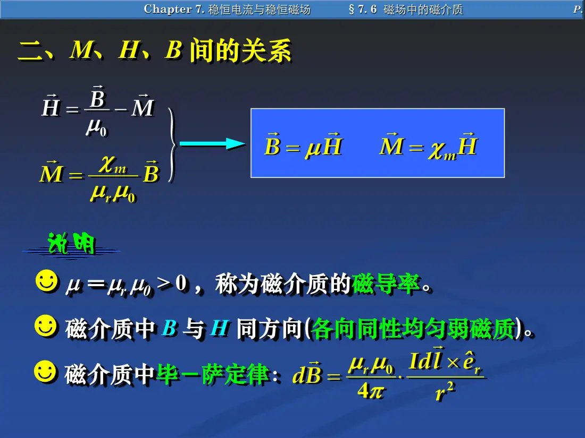

原文：

二、M、H、B间的关系

$$
\left. \begin{array}{l} \vec {H} = \frac {\vec {B}}{\mu_ {0}} - \vec {M} \\ \vec {M} = \frac {\chi_ {m}}{\mu_ {r} \mu_ {0}} \vec {B} \end{array} \right\} \longrightarrow \boxed {\vec {B} = \mu \vec {H} \quad \vec {M} = \chi_ {m} \vec {H}}
$$

说明

$\mu = \mu_{r} \mu_{0} > 0$ ，称为磁介质的磁导率。

😊 磁介质中 B 与 H 同方向(各向同性均匀弱磁质)。

😊 磁介质中毕—萨定律: $d\vec{B}=\frac{\mu_{r}\mu_{0}}{4\pi}\cdot\frac{Id\vec{l}\times\hat{e}_{r}}{r^{2}}$ 例如图，同轴电缆： $R_{1}$ 、 $R_{2}$ 、 $R_{3}$ ；磁介质：各相同性、 $\mu$ ；电流I沿圆柱导线向上均匀流去再由圆筒均匀流回。

Chapter 7. 稳恒电流与稳恒磁场

§ 7.6 磁场中的磁介质

P.

### 求H、B分布及介质内的M。

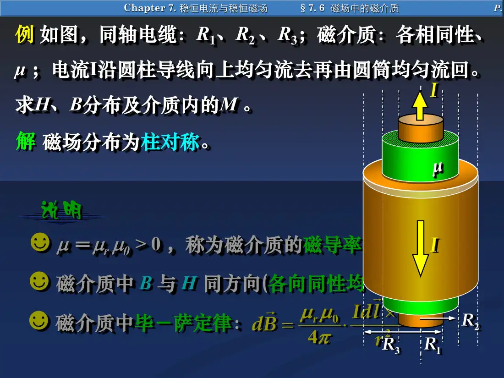

原文：

求H、B分布及介质内的M。

解 磁场分布为柱对称。

说明

😊 $\mu = \mu_{r} \mu_{0} > 0$ ，称为磁介质的磁导率

😊 磁介质中 B 与 H 同方向(各向同性均

😊 磁介质中毕—萨定律: $d\vec{B}=\frac{\mu_{r}\mu_{0}}{4\pi}\cdot\frac{Idl\times}{rR_{3}}$ $R_{2}$

Chapter 7. 稳恒电流与稳恒磁场

§ 7.6 磁场中的磁介质

P.

### 求H、B分布及介质内的M。

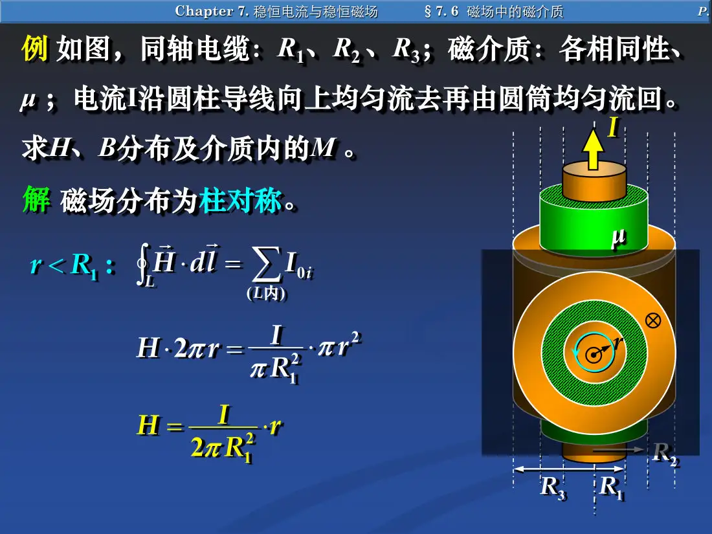

原文：

例如图，同轴电缆： $R_{1}$ 、 $R_{2}$ 、 $R_{3}$ ；磁介质：各相同性、 $\mu$ ；电流I沿圆柱导线向上均匀流去再由圆筒均匀流回。

求H、B分布及介质内的M。

解 磁场分布为柱对称。

$$
r <   R _ {1}: \oint_ {L} \vec {H} \cdot d \vec {l} = \sum_ {(L \text {内})} I _ {0 i}
$$

$$
H \cdot 2 \pi r = \frac {I}{\pi R _ {1} ^ {2}} \cdot \pi r ^ {2}
$$

$$
H = \frac {I}{2 \pi R _ {1} ^ {2}} \cdot r
$$

Chapter 7. 稳恒电流与稳恒磁场

§ 7.6 磁场中的磁介质

P.

### $$

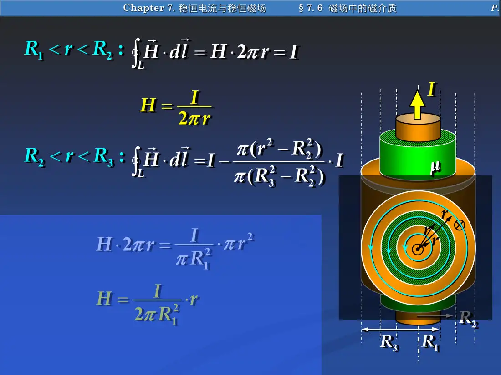

原文：

$$
R _ {1} <   r <   R _ {2}: \oint_ {L} \vec {H} \cdot d \vec {l} = H \cdot 2 \pi r = I
$$

$$
H = \frac {I}{2 \pi r}
$$

$$
R _ {2} <   r <   R _ {3}: \oint_ {L} \vec {H} \cdot d \vec {l} = I - \frac {\pi (r ^ {2} - R _ {2} ^ {2})}{\pi (R _ {3} ^ {2} - R _ {2} ^ {2})} \cdot I
$$

$$
H \cdot 2 \pi r = \frac {I}{\pi R _ {1} ^ {2}} \cdot \pi r ^ {2}
$$

$$
H = \frac {I}{2 \pi R _ {1} ^ {2}} \cdot r
$$

Chapter 7. 稳恒电流与稳恒磁场

§ 7.6 磁场中的磁介质

P.

### $$

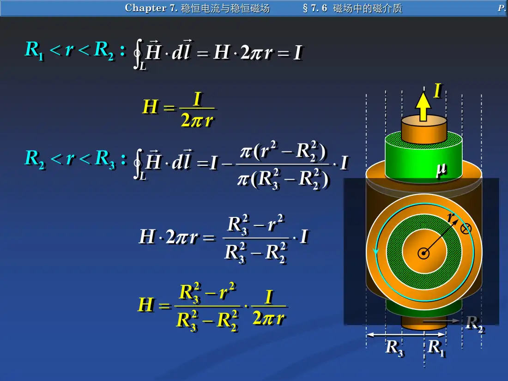

原文：

$$
R _ {1} <   r <   R _ {2}: \oint_ {L} \vec {H} \cdot d \vec {l} = H \cdot 2 \pi r = I
$$

$$
H = \frac {I}{2 \pi r}
$$

$$
R _ {2} <   r <   R _ {3}: \oint_ {L} \vec {H} \cdot d \vec {l} = I - \frac {\pi (r ^ {2} - R _ {2} ^ {2})}{\pi (R _ {3} ^ {2} - R _ {2} ^ {2})} \cdot I
$$

$$
H \cdot 2 \pi r = \frac {R _ {3} ^ {2} - r ^ {2}}{R _ {3} ^ {2} - R _ {2} ^ {2}} \cdot I
$$

$$
H = \frac {R _ {3} ^ {2} - r ^ {2}}{R _ {3} ^ {2} - R _ {2} ^ {2}} \cdot \frac {I}{2 \pi r}
$$

Chapter 7. 稳恒电流与稳恒磁场

§ 7.6 磁场中的磁介质

P.

### $$

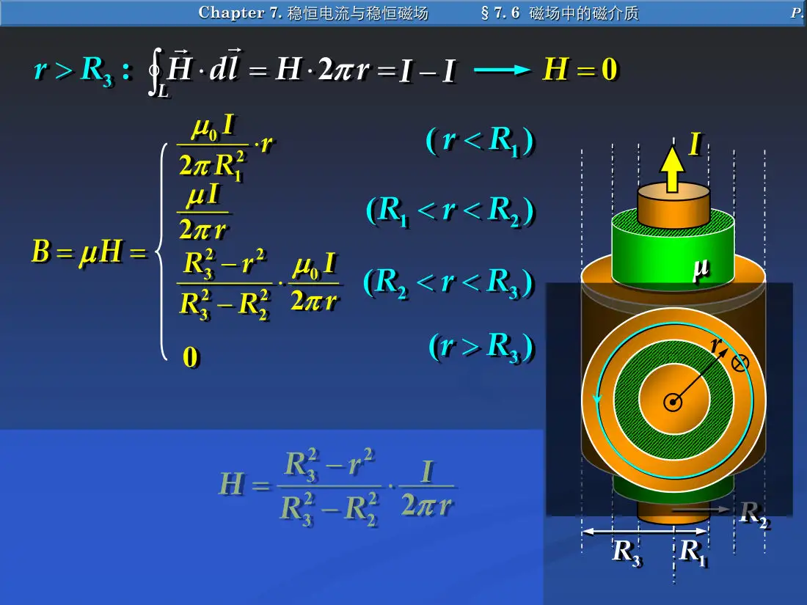

原文：

$$
r > R _ {3}: \oint_ {L} \vec {H} \cdot d \vec {l} = H \cdot 2 \pi r = I - I \longrightarrow H = 0
$$

$$
B = \mu H = \left\{ \begin{array}{l l} \frac {\mu_ {0} I}{2 \pi R _ {1} ^ {2}} \cdot r & (r <   R _ {1}) \\ \frac {\mu I}{2 \pi r} & (R _ {1} <   r <   R _ {2}) \\ \frac {R _ {3} ^ {2} - r ^ {2}}{R _ {3} ^ {2} - R _ {2} ^ {2}} \cdot \frac {\mu_ {0} I}{2 \pi r} & (R _ {2} <   r <   R _ {3}) \\ 0 & (r > R _ {3}) \end{array} \right.
$$

$$
H = \frac {R _ {3} ^ {2} - r ^ {2}}{R _ {3} ^ {2} - R _ {2} ^ {2}} \cdot \frac {I}{2 \pi r}
$$

Chapter 7. 稳恒电流与稳恒磁场

§ 7.6 磁场中的磁介质

P.

### $$

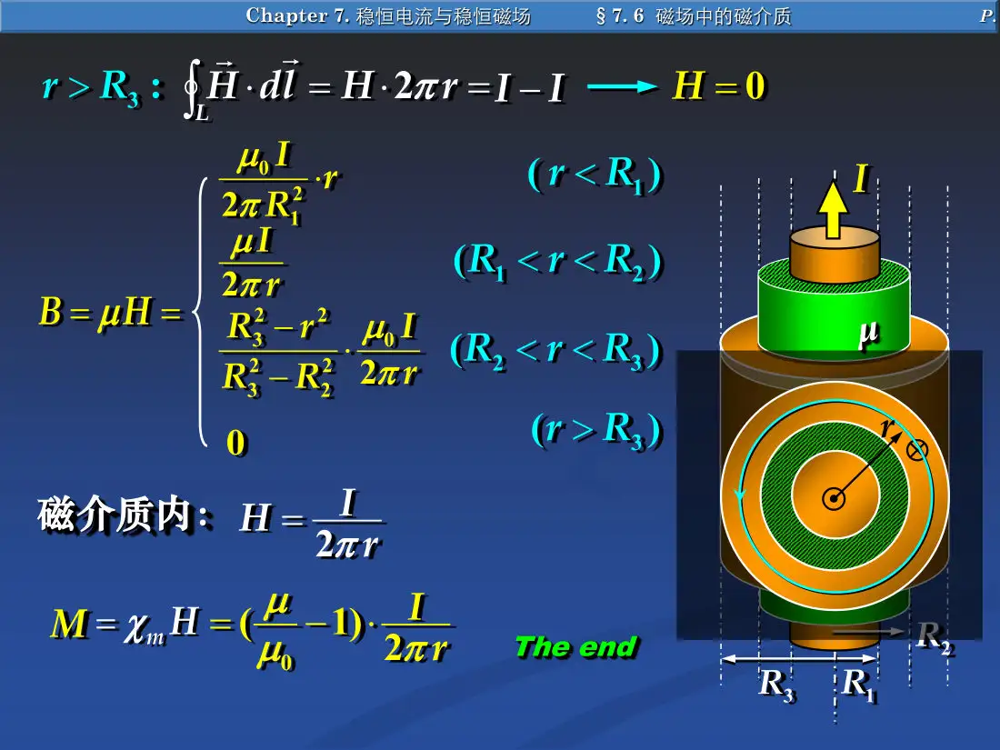

原文：

$r > R_{3}: \oint_{L} \vec{H} \cdot d\vec{l} = H \cdot 2\pi r = I - I \longrightarrow H = 0$

$$
B = \mu H = \left\{ \begin{array}{l l} \frac {\mu_ {0} I}{2 \pi R _ {1} ^ {2}} \cdot r & (r <   R _ {1}) \\ \frac {\mu I}{2 \pi r} & (R _ {1} <   r <   R _ {2}) \\ \frac {R _ {3} ^ {2} - r ^ {2}}{R _ {3} ^ {2} - R _ {2} ^ {2}} \cdot \frac {\mu_ {0} I}{2 \pi r} & (R _ {2} <   r <   R _ {3}) \\ 0 & (r > R _ {3}) \end{array} \right.
$$

磁介质内: $H = \frac{I}{2 \pi r}$

$$
M = \chi_ {m} H = (\frac {\mu}{\mu_ {0}} - 1) \cdot \frac {I}{2 \pi r}
$$

The end

Chapter 7. 稳恒电流与稳恒磁场

§ 7.6 磁场中的磁介质

P.

### 有磁介质时求磁场问题的一般方法:

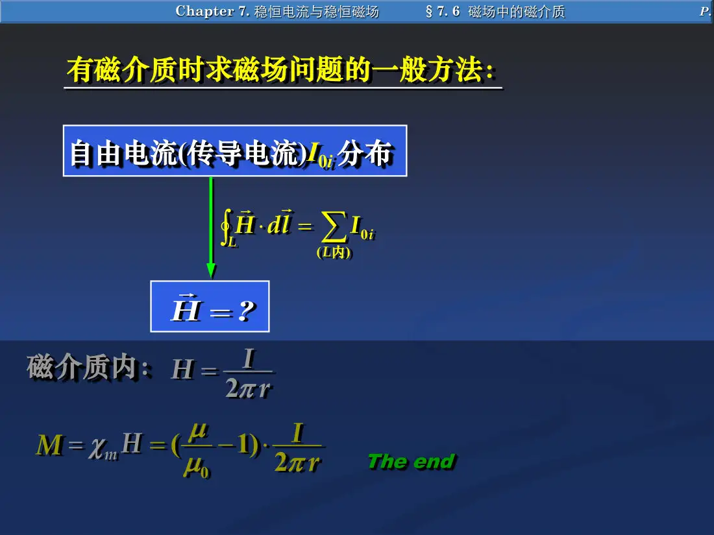

原文：

有磁介质时求磁场问题的一般方法:

自由电流(传导电流) $I_{0i}$ 分布

$$
\oint_ {L} \vec {H} \cdot d \vec {l} = \sum_ {(L \text {内})} I _ {0 i}
$$

$$
\vec {H} = ?
$$

磁介质内: $H = \frac{I}{2 \pi r}$

$M = \chi_{m} H = (\frac{\mu}{\mu_{0}} - 1) \cdot \frac{I}{2\pi r}$ The end有磁介质时求磁场问题的一般方法:

Chapter 7. 稳恒电流与稳恒磁场

§ 7.6 磁场中的磁介质

P.

### 自由电流(传导电流) $I_{0i}$ 分布

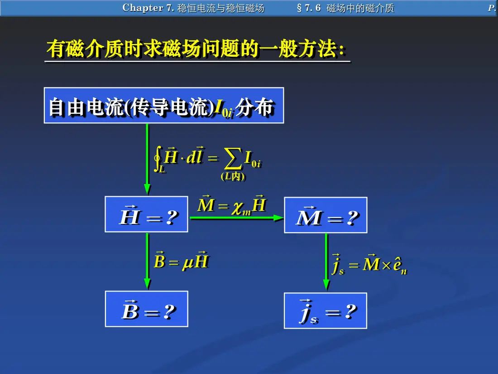

原文：

自由电流(传导电流) $I_{0i}$ 分布

$$
\oint_ {L} \vec {H} \cdot d \vec {l} = \sum_ {(L \text {内})} I _ {0 i}
$$

$$
\vec {H} = ?
$$

$$
\vec {M} = \chi_ {m} \vec {H}
$$

$$
\vec {M} = ?
$$

$$
\vec {B} = \mu \vec {H}
$$

$$
\vec {j} _ {s} = \vec {M} \times \hat {\boldsymbol {e}} _ {n}
$$

$$
\vec {B} \equiv ?
$$

$$
\vec {j} _ {s} = ?
$$

Chapter 7. 稳恒电流与稳恒磁场

§ 7.6 磁场中的磁介质

P.

### 归纳

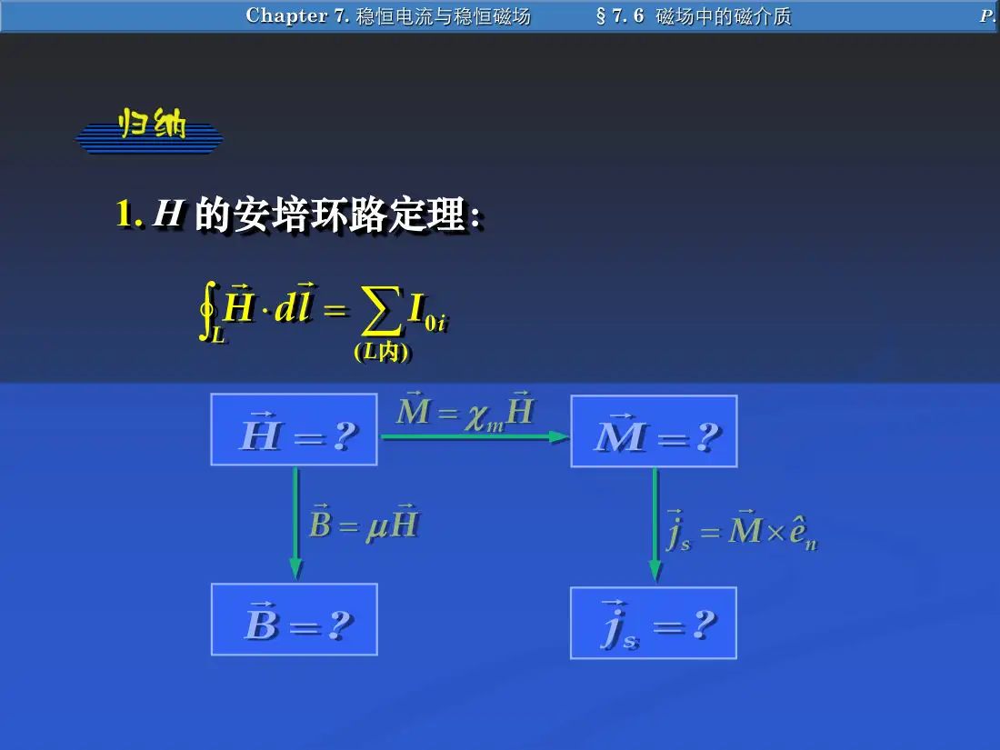

原文：

归纳

1. H 的安培环路定理:

$\oint_{L}\vec{H}\cdot dl = \sum_{(L\text{内})}I_{0i}$

$$
\vec {H} = ?
$$

$$
\vec {M} = \chi_ {m} \vec {H}
$$

$$
\vec {M} = ?
$$

$$
\vec {B} = \mu \vec {H}
$$

$$
\vec {j} _ {s} = \vec {M} \times \hat {e} _ {n}
$$

$$
\vec {B} \equiv ?
$$

$$
\vec {j} _ {s} = ?
$$

Chapter 7. 稳恒电流与稳恒磁场

§ 7.6 磁场中的磁介质

P.

### 归纳

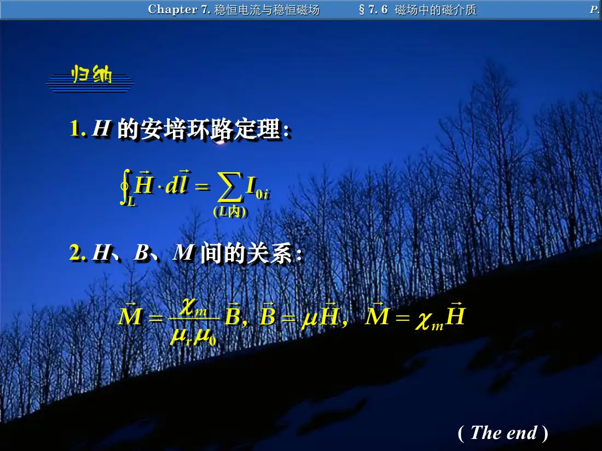

原文：

归纳

1. H 的安培环路定理:

$\oint_{L}\vec{H}\cdot dl\vec{l}=\sum_{(L\text{内})}I_{0i}$

2. H、B、M 间的关系：

$$
\vec {M} = \frac {\chi_ {m}}{\mu_ {r} \mu_ {0}} \vec {B}, \vec {B} = \mu \vec {H}, \vec {M} = \chi_ {m} \vec {H}
$$

Chapter 7. 稳恒电流与稳恒磁场

§ 7.6 磁场中的磁介质

P.

( The end )
