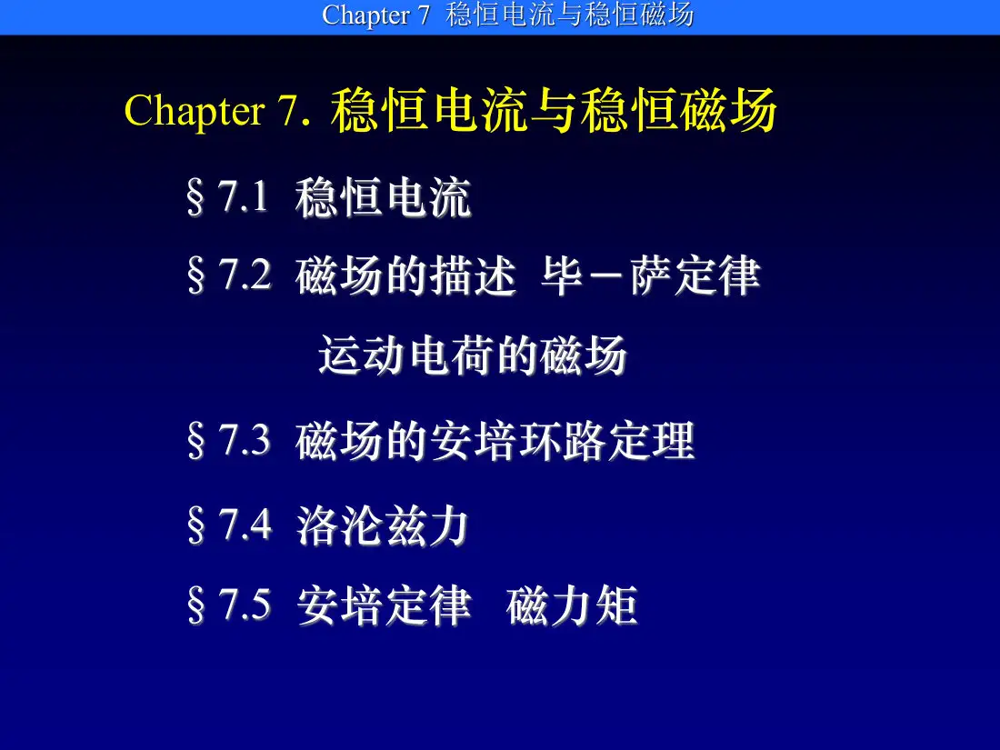

# 《大学物理》第7章 稳恒电流与稳恒磁场（课件）

原件的每一页，下面附识别出的文字。

### Chapter 7. 稳恒电流与稳恒磁场

原文：

Chapter 7. 稳恒电流与稳恒磁场

§7.1 稳恒电流

§7.2 磁场的描述 毕－萨定律

运动电荷的磁场

§7.3 磁场的安培环路定理

§7.4 洛沦兹力

§7.5 安培定律 磁力矩

作者：杨茂田Chapter 7 稳恒电流与稳恒磁场
