# 《大学物理》第8章 电磁感应 §8.4 自感与互感（课件）

原件的每一页，下面附识别出的文字。

### § 8.4 自感与互感

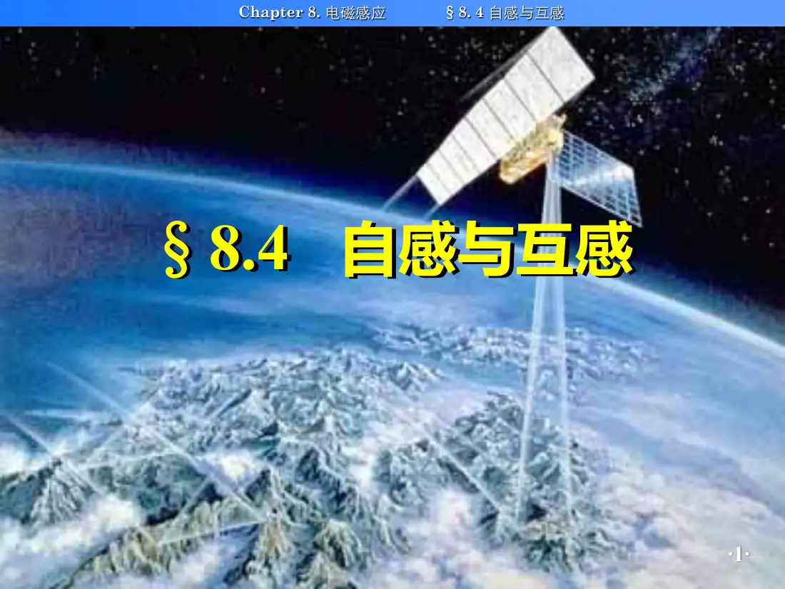

原文：

§ 8.4 自感与互感

Chapter 8. 电磁感应

§ 8.4 自感与互感

1

### 演示实验：回路的自感应现象。

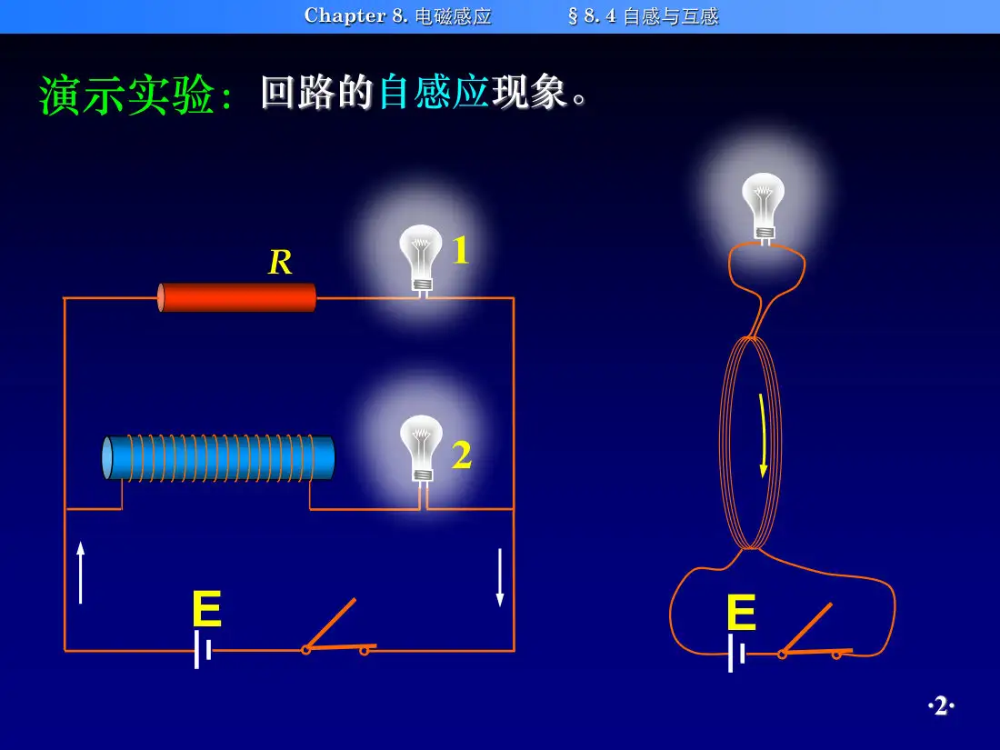

原文：

演示实验：回路的自感应现象。

Chapter 8. 电磁感应

§ 8.4 自感与互感

2

### 一、自感电动势 自感

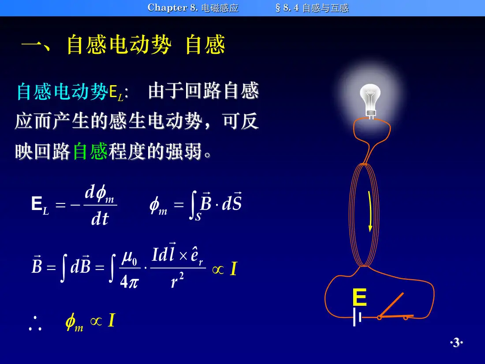

原文：

一、自感电动势 自感

自感电动势 $E_{L}$ ：由于回路自感应而产生的感生电动势，可反映回路自感程度的强弱。

$$
\mathsf {E} _ {L} = - \frac {d \phi_ {m}}{d t} \qquad \phi_ {m} = \int_ {S} \vec {B} \cdot d \vec {S}
$$

$$
\vec {B} = \int d \vec {B} = \int \frac {\mu_ {0}}{4 \pi} \cdot \frac {I d \vec {l} \times \hat {e} _ {r}}{r ^ {2}} \propto I
$$

$$
\therefore \quad \phi_ {m} \propto I
$$

Chapter 8. 电磁感应

§ 8.4 自感与互感

3.

### 令： $\phi_{m} = LI$

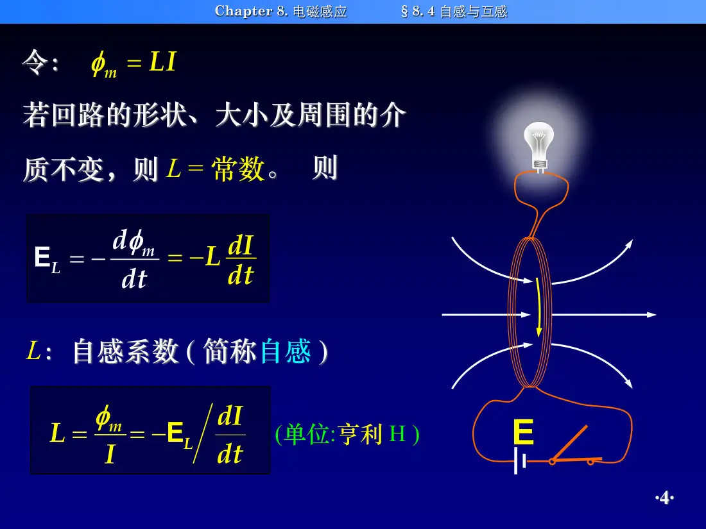

原文：

令： $\phi_{m} = LI$

若回路的形状、大小及周围的介质不变，则 $L =$ 常数。则

$$
E _ {L} = - \frac {d \phi_ {m}}{d t} = - L \frac {d I}{d t}
$$

L: 自感系数（简称自感）

$$
L = \frac {\phi_ {m}}{I} = - E _ {L} / \frac {d I}{d t}
$$

(单位:亨利 H)

Chapter 8. 电磁感应

§ 8.4 自感与互感

4

### Chapter 8. 电磁感应

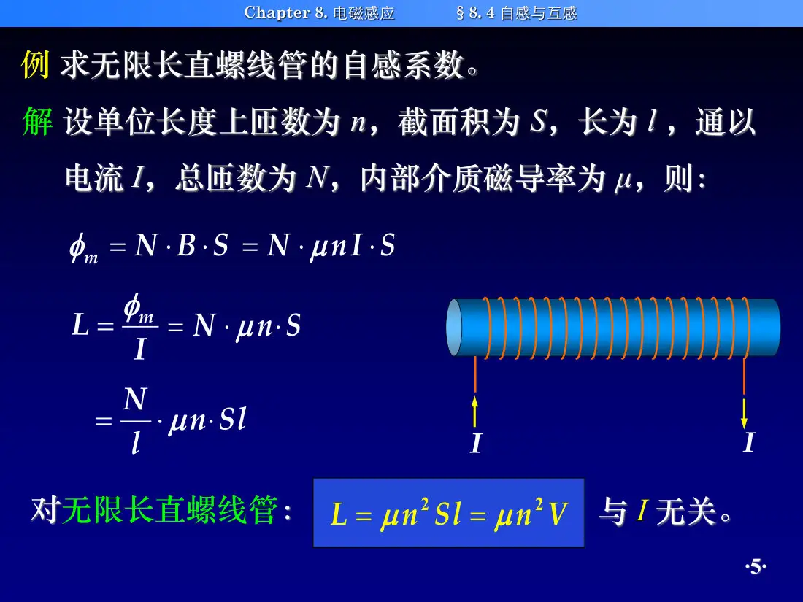

原文：

Chapter 8. 电磁感应

§ 8.4 自感与互感

例 求无限长直螺线管的自感系数。

解 设单位长度上匝数为 n，截面积为 S，长为 l，通以电流 I，总匝数为 N，内部介质磁导率为 $\mu$ ，则：

$$
\phi_ {m} = N \cdot B \cdot S = N \cdot \mu n I \cdot S
$$

$$
\begin{array}{r} L = \frac {\phi_ {m}}{I} = N \cdot \mu n \cdot S \\ = \frac {N}{l} \cdot \mu n \cdot S l \end{array}
$$

$$
\text {   I   } \quad \text {   I   }
$$

对无限长直螺线管： $L = \mu n^{2}Sl = \mu n^{2}V$ 与 $I$ 无关。

5.

### Chapter 8. 电磁感应

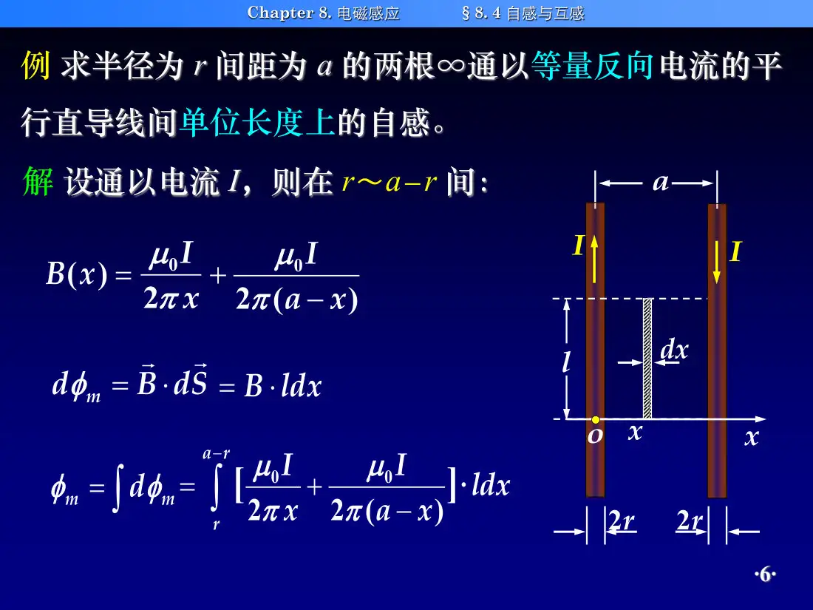

原文：

Chapter 8. 电磁感应

§ 8.4 自感与互感

例 求半径为 $r$ 间距为 $a$ 的两根 $\infty$ 通以等量反向电流的平行直导线间单位长度上的自感。

解 设通以电流 I，则在 $r \sim a - r$ 间：

$$
B (x) = \frac {\mu_ {0} I}{2 \pi x} + \frac {\mu_ {0} I}{2 \pi (a - x)}
$$

$$
d \phi_ {m} = \vec {B} \cdot d \vec {S} = B \cdot l d x
$$

$$
\phi_ {m} = \int d \phi_ {m} = \int_ {r} ^ {a - r} \left[ \frac {\mu_ {0} I}{2 \pi x} + \frac {\mu_ {0} I}{2 \pi (a - x)} \right] \cdot l d x
$$

6.

### $$

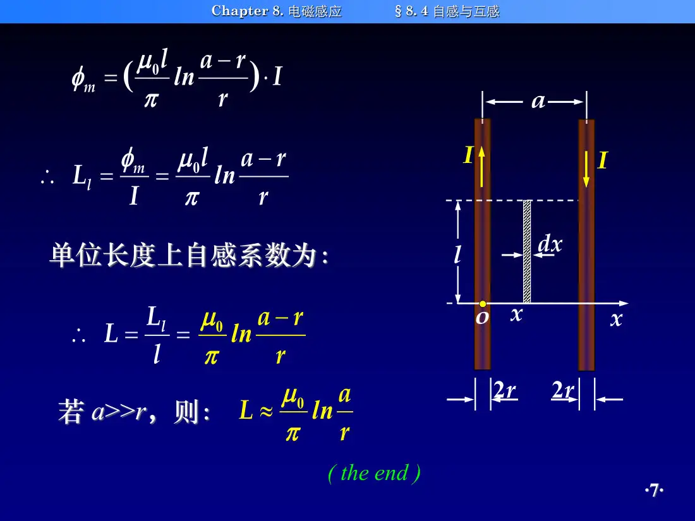

原文：

$$
\phi_ {m} = \left(\frac {\mu_ {0} l}{\pi} \ln \frac {a - r}{r}\right) \cdot I
$$

$$
\therefore L _ {l} = \frac {\phi_ {m}}{I} = \frac {\mu_ {0} l}{\pi} \ln \frac {a - r}{r}
$$

单位长度上自感系数为：

$$
\therefore L = \frac {L _ {l}}{l} = \frac {\mu_ {0}}{\pi} \ln \frac {a - r}{r}
$$

若 $a >> r$ ，则： $L \approx \frac{\mu_0}{\pi} \ln \frac{a}{r}$

§ 8.4 自感与互感

→|2r 2r|

( the end )

Chapter 8. 电磁感应

7.

### 自感的利与弊

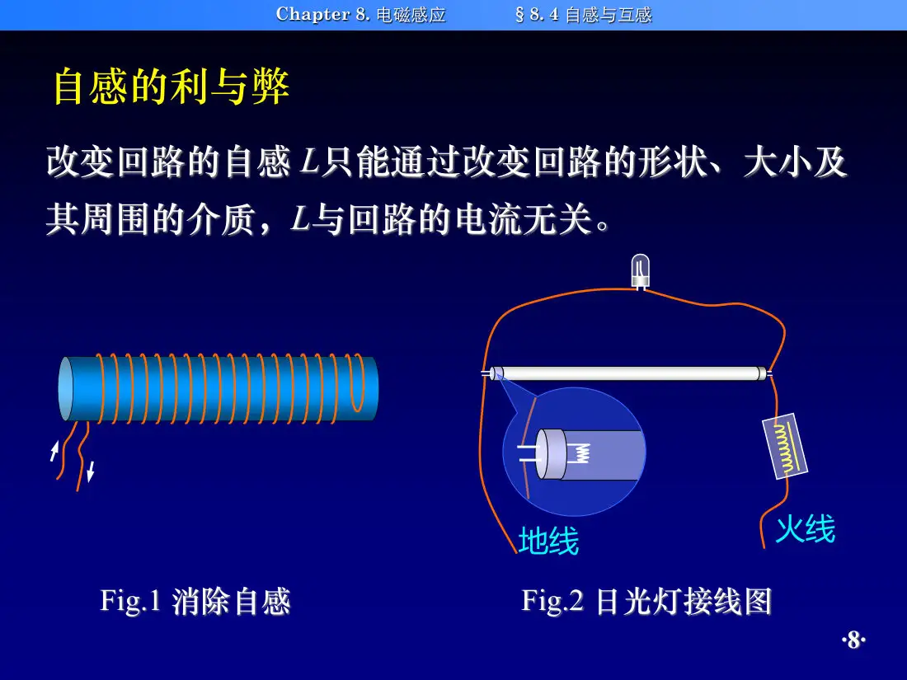

原文：

自感的利与弊

改变回路的自感 $L$ 只能通过改变回路的形状、大小及其周围的介质， $L$ 与回路的电流无关。

Fig.1 消除自感

地线

Fig.2 日光灯接线图

Chapter 8. 电磁感应

§ 8.4 自感与互感

8.

### 二、互感电动势 互感

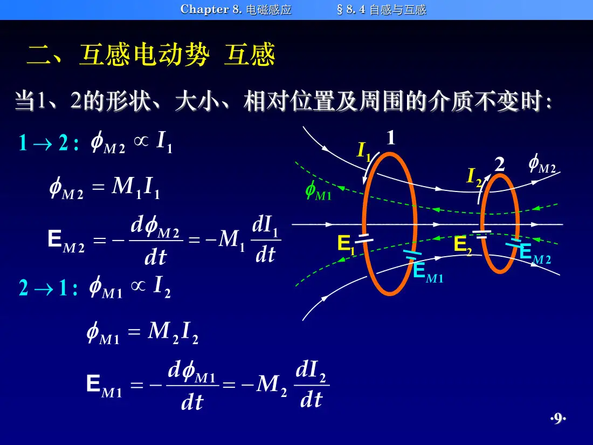

原文：

二、互感电动势 互感

当1、2的形状、大小、相对位置及周围的介质不变时：

$$
1 \rightarrow 2: \phi_ {M 2} \propto I _ {1}
$$

$$
\phi_ {M 2} = M _ {1} I _ {1}
$$

$$
2 \rightarrow 1 \colon \phi_ {M 1} \propto I _ {2}
$$

$$
\phi_ {M 1} = M _ {2} I _ {2}
$$

$$
E _ {M 1} = - \frac {d \phi_ {M 1}}{d t} = - M _ {2} \frac {d I _ {2}}{d t}
$$

Chapter 8. 电磁感应

§ 8.4 自感与互感

9.

### 改变磁场建立的顺序：

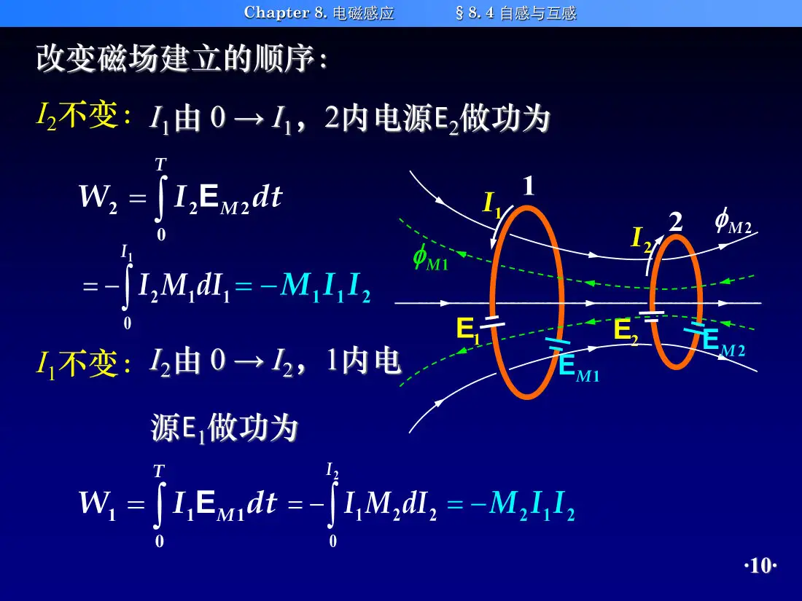

原文：

改变磁场建立的顺序：

$I_{2}$ 不变： $I_{1}$ 由 $0 \rightarrow I_{1}$ ，2内电源 $E_{2}$ 做功为

$$
\begin{array}{l} W _ {2} = \int_ {0} ^ {T} I _ {2} E _ {M 2} d t \\ = - \int_ {0} ^ {I _ {1}} I _ {2} M _ {1} d I _ {1} = - M _ {1} I _ {1} I _ {2} \end{array}
$$

$I_{1}$ 不变： $I_{2}$ 由 $0 \rightarrow I_{2}$ ，1内电

源 $E_{1}$ 做功为

$$
W _ {1} = \int_ {0} ^ {T} I _ {1} \mathsf {E} _ {M 1} d t = - \int_ {0} ^ {I _ {2}} I _ {1} M _ {2} d I _ {2} = - M _ {2} I _ {1} I _ {2}
$$

Chapter 8. 电磁感应

§ 8.4 自感与互感

•10•

### § 8.4 自感与互感

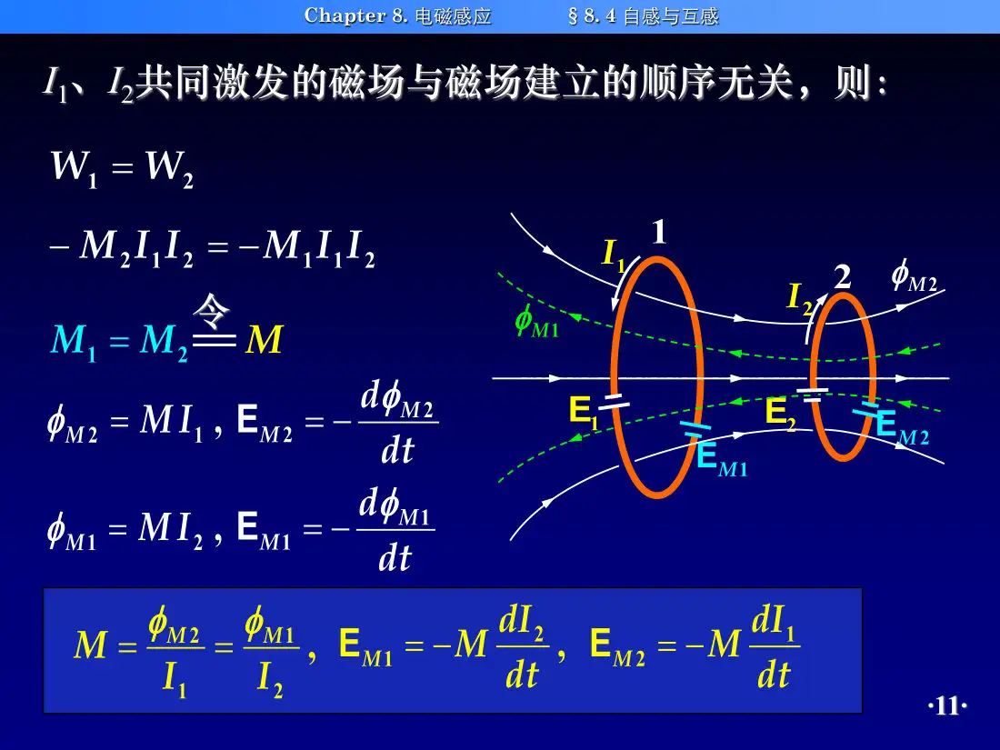

原文：

§ 8.4 自感与互感

$I_{1}$ 、 $I_{2}$ 共同激发的磁场与磁场建立的顺序无关，则：

$$
W _ {1} = W _ {2}
$$

$$
- M _ {2} I _ {1} I _ {2} = - M _ {1} I _ {1} I _ {2}
$$

$$
M _ {1} = M _ {2} \stackrel {\text {令}} {=} M
$$

$$
\phi_ {M 2} = M I _ {1}, \mathsf {E} _ {M 2} = - \frac {d \phi_ {M 2}}{d t}
$$

$$
\phi_ {M 1} = M I _ {2}, \mathsf {E} _ {M 1} = - \frac {d \phi_ {M 1}}{d t}
$$

$$
M = \frac {\phi_ {M 2}}{I _ {1}} = \frac {\phi_ {M 1}}{I _ {2}}, E _ {M 1} = - M \frac {d I _ {2}}{d t}, E _ {M 2} = - M \frac {d I _ {1}}{d t}
$$

Chapter 8. 电磁感应

•11•

### Chapter 8. 电磁感应

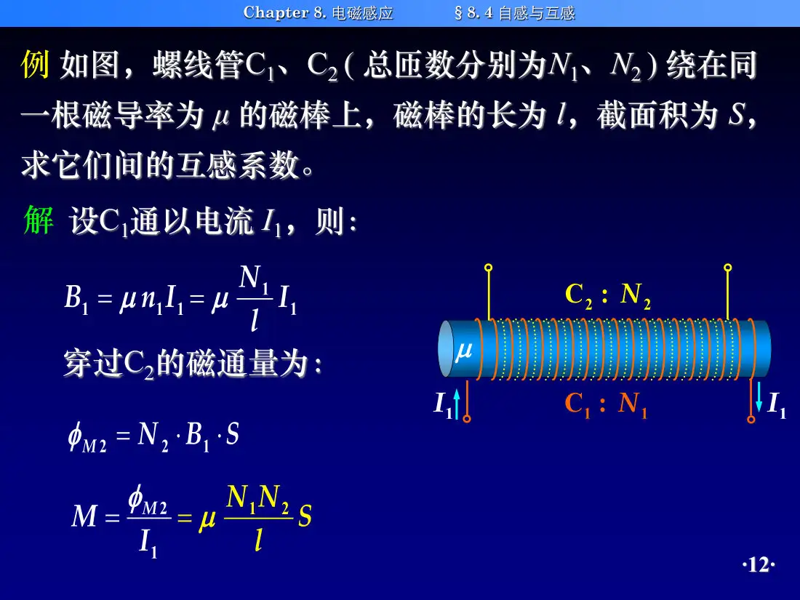

原文：

Chapter 8. 电磁感应

§ 8.4 自感与互感

例如图，螺线管 $C_{1}$ 、 $C_{2}$ （总匝数分别为 $N_{1}$ 、 $N_{2}$ ）绕在同一根磁导率为 $\mu$ 的磁棒上，磁棒的长为 l，截面积为 S，求它们间的互感系数。

解 设 $C_{1}$ 通以电流 $I_{1}$ ，则：

$$
B _ {1} = \mu n _ {1} I _ {1} = \mu \frac {N _ {1}}{l} I _ {1}
$$

穿过 $C_{2}$ 的磁通量为：

$$
\phi_ {M 2} = N _ {2} \cdot B _ {1} \cdot S
$$

$$
\mu \text {   C } _ {2}: N _ {2} \text {   I } _ {1} \uparrow \text {   C } _ {1}: N _ {1}
$$

$$
M = \frac {\phi_ {M 2}}{I _ {1}} = \mu \frac {N _ {1} N _ {2}}{l} S
$$

·12·

### $$

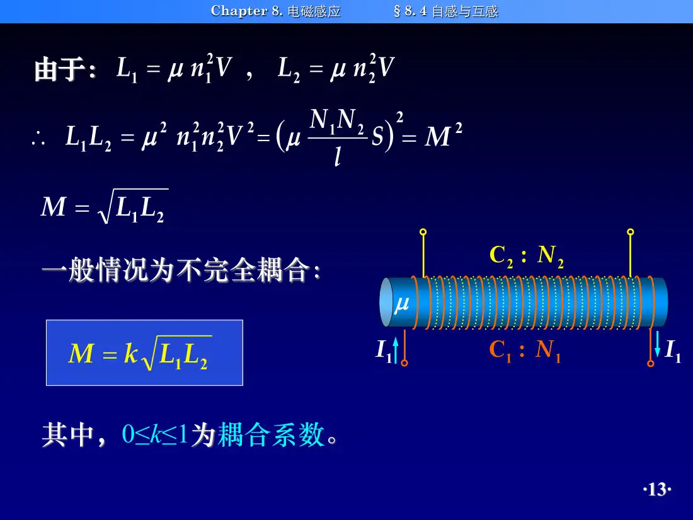

原文：

由于： $L_{1}=\mu n_{1}^{2}V$ ， $L_{2}=\mu n_{2}^{2}V$

$$
\therefore L _ {1} L _ {2} = \mu^ {2} n _ {1} ^ {2} n _ {2} ^ {2} V ^ {2} = \left(\mu \frac {N _ {1} N _ {2}}{l} S\right) ^ {2} = M ^ {2}
$$

$$
M = \sqrt {L _ {1} L _ {2}}
$$

一般情况为不完全耦合：

$$
M = k \sqrt {L _ {1} L _ {2}}
$$

$$
\begin{array}{c} \mathrm{C} _ {2}: N _ {2} \\ \mu \\ I _ {1} \uparrow \\ \mathrm{C} _ {1}: N _ {1} \\ \downarrow I _ {1} \end{array}
$$

其中， $0 \leq k \leq 1$ 为耦合系数。

Chapter 8. 电磁感应

§ 8.4 自感与互感

·13·

### Chapter 8. 电磁感应

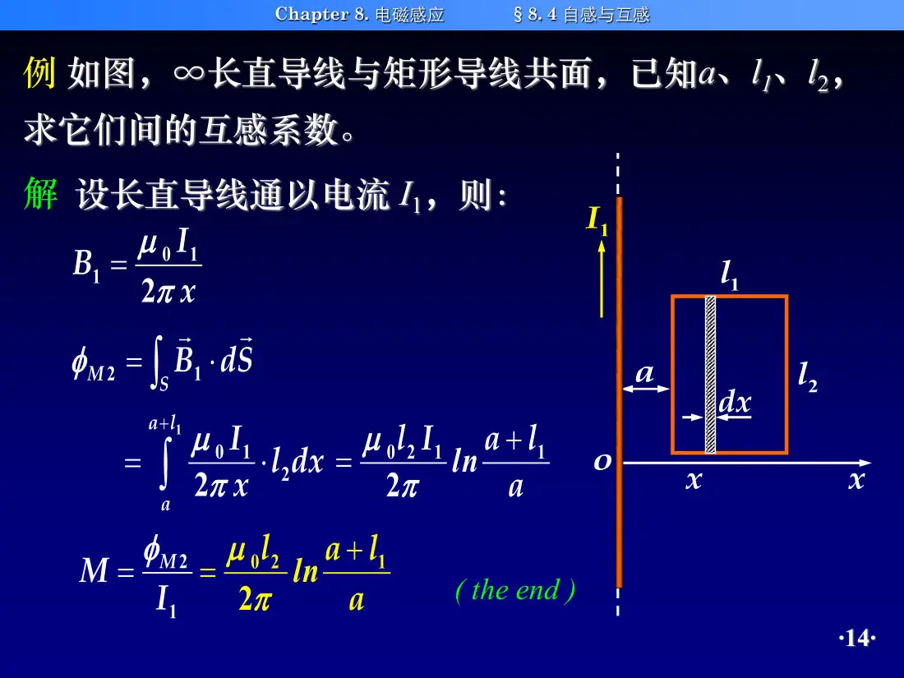

原文：

Chapter 8. 电磁感应

§ 8.4 自感与互感

例如图， $\infty$ 长直导线与矩形导线共面，已知 $a, l_1, l_2$ ，求它们间的互感系数。

解 设长直导线通以电流 $I_{1}$ , 则:

$$
B _ {1} = \frac {\mu_ {0} I _ {1}}{2 \pi x}
$$

$$
\begin{array}{l} \phi_ {M 2} = \int_ {S} \vec {B} _ {1} \cdot d \vec {S} \\ = \int_ {a} ^ {a + l _ {1}} \frac {\mu_ {0} I _ {1}}{2 \pi x} \cdot l _ {2} d x = \frac {\mu_ {0} l _ {2} I _ {1}}{2 \pi} \ln \frac {a + l _ {1}}{a} \end{array}
$$

$$
M = \frac {\phi_ {M 2}}{I _ {1}} = \frac {\mu_ {0} l _ {2}}{2 \pi} \ln \frac {a + l _ {1}}{a} \quad (\text { the   end })
$$

•14•

### Chapter 8. 电磁感应

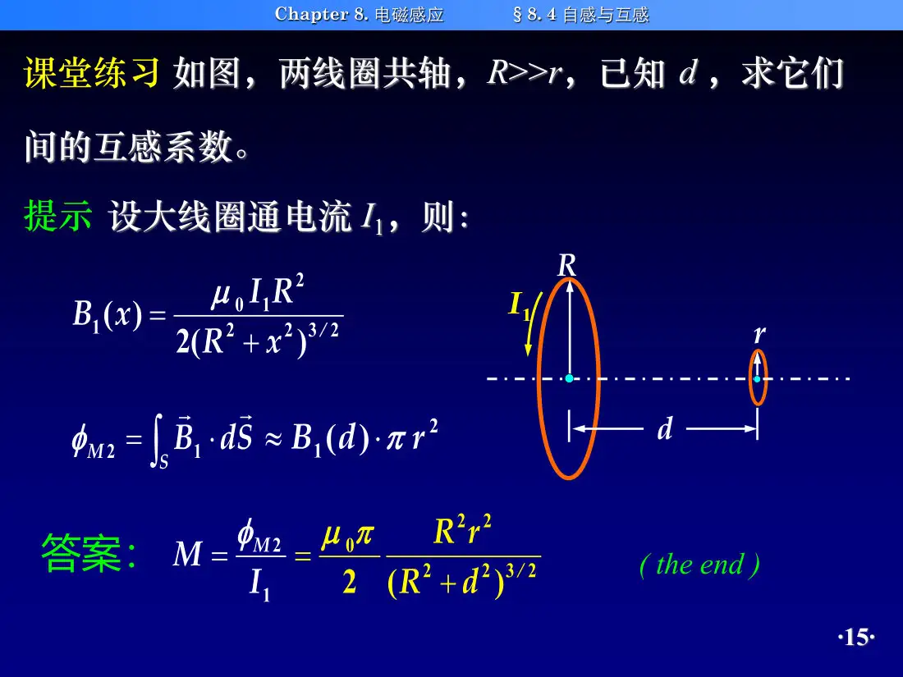

原文：

Chapter 8. 电磁感应

§ 8.4 自感与互感

课堂练习 如图，两线圈共轴， $R >> r$ ，已知 $d$ ，求它们间的互感系数。

提示 设大线圈通电流 $I_{1}$ , 则:

$$
B _ {1} (x) = \frac {\mu_ {0} I _ {1} R ^ {2}}{2 \left(R ^ {2} + x ^ {2}\right) ^ {3 / 2}}
$$

$$
\phi_ {M 2} = \int_ {S} \vec {B} _ {1} \cdot d \vec {S} \approx B _ {1} (d) \cdot \pi r ^ {2}
$$

$$
\begin{array}{c} R \\ I _ {1} \end{array} \text {   with   } r \text {   shown   in   the   diagram   } d
$$

答案: $M = \frac{\phi_{M2}}{I_1} = \frac{\mu_0\pi}{2}\frac{R^2r^2}{(R^2 + d^2)^{3 / 2}}$

( the end )

•15•

### 归纳

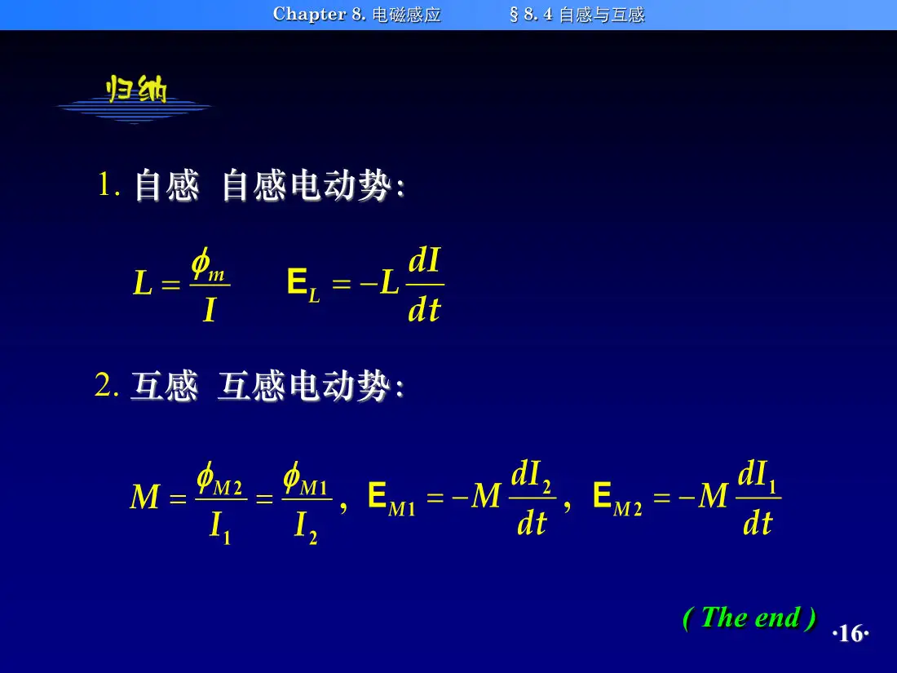

原文：

归纳

1. 自感 自感电动势:

$$
L = \frac {\phi_ {m}}{I}
$$

$$
E _ {L} = - L \frac {d I}{d t}
$$

2. 互感 互感电动势:

$$
M = \frac {\phi_ {M 2}}{I _ {1}} = \frac {\phi_ {M 1}}{I _ {2}}, E _ {M 1} = - M \frac {d I _ {2}}{d t}, E _ {M 2} = - M \frac {d I _ {1}}{d t}
$$

$$
(T h e e n d)
$$

Chapter 8. 电磁感应

§ 8.4 自感与互感

·16·
