# 《大学物理》第8章 电磁感应与电磁场 §8.2 动生电动势（课件）

原件的每一页，下面附识别出的文字。

### § 12.2 动生电动势

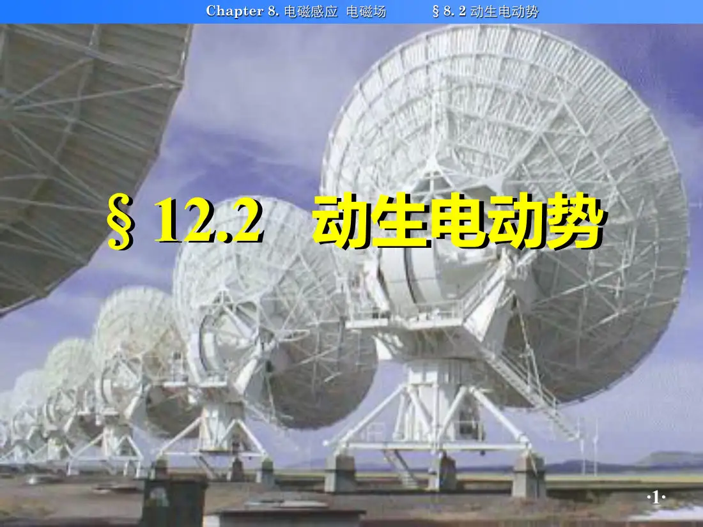

原文：

§ 12.2 动生电动势

Chapter 8. 电磁感应 电磁场 § 8.2 动生电动势

### 一、动生电动势

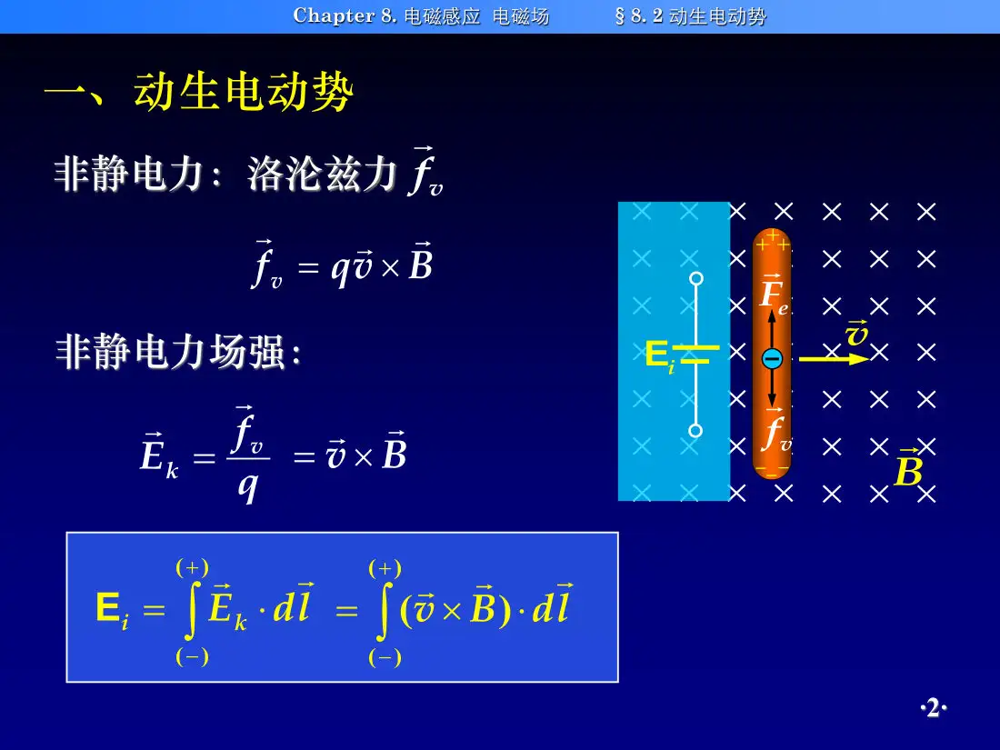

原文：

一、动生电动势

非静电力：洛沦兹力 $\vec{f}_v$

$$
\vec {f} _ {v} = q \vec {v} \times \vec {B}
$$

非静电力场强：

$$
\vec {E} _ {k} = \frac {\vec {f} _ {v}}{q} = \vec {v} \times \vec {B}
$$

$$
\vec {F} _ {e} \xrightarrow {\vec {v}} \vec {f} _ {v}
$$

$$
\mathbf {E} _ {i} = \int_ {(-)} ^ {(+)} \vec {E} _ {k} \cdot d \vec {l} = \int_ {(-)} ^ {(+)} (\vec {v} \times \vec {B}) \cdot d \vec {l}
$$

Chapter 8. 电磁感应 电磁场

§ 8.2 动生电动势

2

### 明确几点

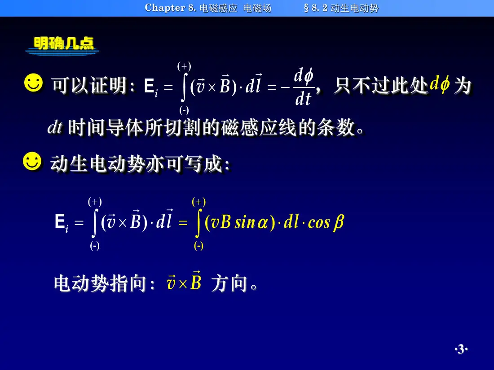

原文：

明确几点

可以证明： $E_{i}=\int_{(-)}^{(+)}(\vec{v}\times\vec{B})\cdot d\vec{l}=-\frac{d\phi}{dt}$ ，只不过此处 $d\phi$ 为dt时间导体所切割的磁感应线的条数。

动生电动势亦可写成:

$$
\mathbf {E} _ {i} = \int_ {(-)} ^ {(+)} (\vec {v} \times \vec {B}) \cdot d \vec {l} = \int_ {(-)} ^ {(+)} (v B \sin \alpha) \cdot d l \cdot \cos \beta
$$

电动势指向： $\vec{v} \times \vec{B}$ 方向。

Chapter 8. 电磁感应 电磁场

§ 8.2 动生电动势

3.

### 洛沦兹力作功吗？

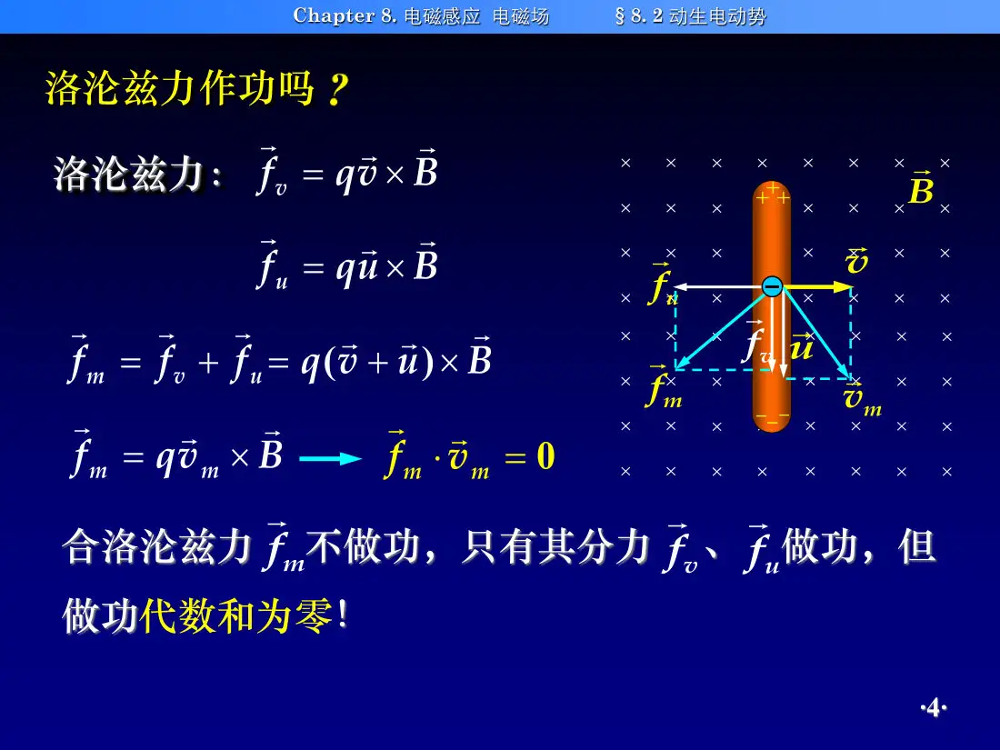

原文：

洛沦兹力作功吗？

洛沦兹力： $\vec{f}_v = q\vec{v} \times \vec{B}$

$$
\vec {f} _ {u} = q \vec {u} \times \vec {B}
$$

$$
\vec {f} _ {m} = \vec {f} _ {v} + \vec {f} _ {u} = q (\vec {v} + \vec {u}) \times \vec {B}
$$

$$
\vec {f} _ {m} = q \vec {v} _ {m} \times \vec {B} \longrightarrow \vec {f} _ {m} \cdot \vec {v} _ {m} = 0
$$

§ 8.2 动生电动势

合洛沦兹力 $\vec{f}_m$ 不做功，只有其分力 $\vec{f}_v$ 、 $\vec{f}_u$ 做功，但做功代数和为零！

Chapter 8. 电磁感应 电磁场

4

### 二、动生电动势的计算要点：

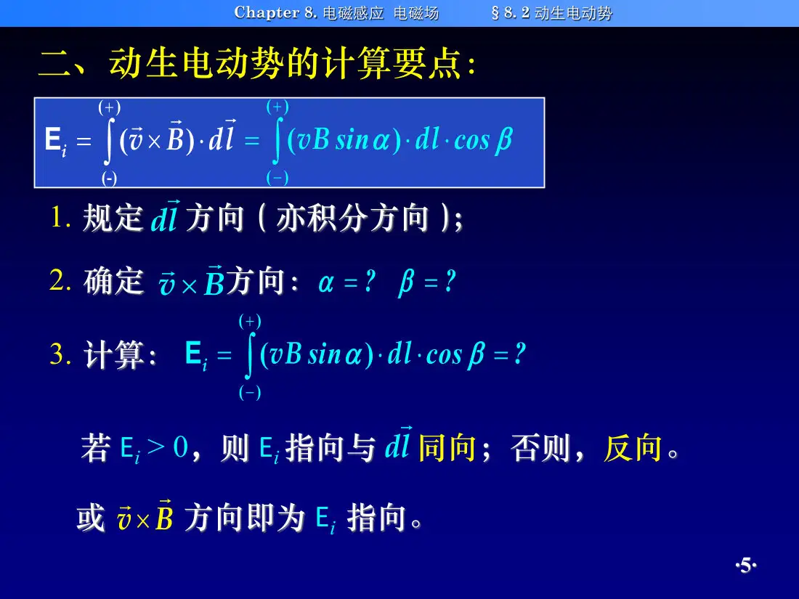

原文：

二、动生电动势的计算要点：

$$
E _ {i} = \int_ {(-)} ^ {(+)} (\vec {v} \times \vec {B}) \cdot d \vec {l} = \int_ {(-)} ^ {(+)} (v B \sin \alpha) \cdot d l \cdot \cos \beta
$$

1. 规定 $d\vec{l}$ 方向（亦积分方向）;

2. 确定 $\vec{v} \times \vec{B}$ 方向： $\alpha = ? \beta = ?$

3. 计算: $E_{i} = \int_ {(-)}^{(+)} (v B \sin \alpha) \cdot d l \cdot \cos \beta = ?$ 若 $E_{i} > 0$ , 则 $E_{i}$ 指向与 $d \vec{l}$ 同向; 否则, 反向。或 $\vec{v} \times \vec{B}$ 方向即为 $E_{i}$ 指向。

Chapter 8. 电磁感应 电磁场 § 8.2 动生电动势

5.

### Chapter 8. 电磁感应 电磁场

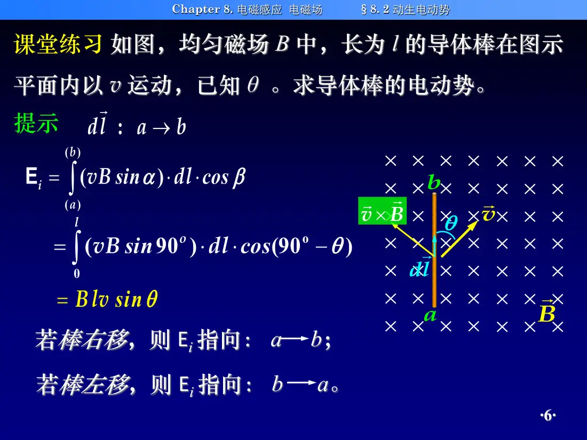

原文：

Chapter 8. 电磁感应 电磁场

§ 8.2 动生电动势

课堂练习 如图，均匀磁场 B 中，长为 l 的导体棒在图示平面内以 v 运动，已知 $\theta$ 。求导体棒的电动势。

提示 $d\vec{l}:a\to b$

$$
\begin{array}{r l} \mathbf {E} _ {i} & = \int_ {(a)} ^ {(b)} (v B \sin \alpha) \cdot d l \cdot \cos \beta \\ & = \int_ {0} ^ {l} (v B \sin 9 0 ^ {\circ}) \cdot d l \cdot \cos (9 0 ^ {\circ} - \theta) \\ & = B l v \sin \theta \end{array}
$$

若棒右移，则 $E_{i}$ 指向： $a \longrightarrow b$ ;

$$
\vec {v} \times \vec {B} \quad \begin{array}{c} b \\ \theta \\ d l \\ a \end{array} \quad \begin{array}{c} \vec {v} \\ \vec {b} \end{array}
$$

若棒左移，则 $E_{i}$ 指向： $b \longrightarrow a$ 。

6.

### Chapter 8. 电磁感应 电磁场

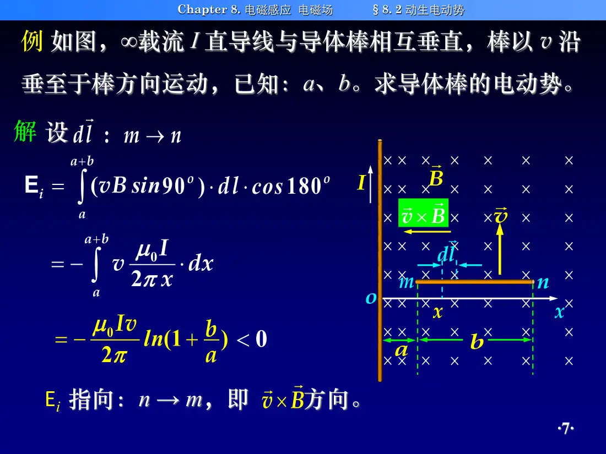

原文：

Chapter 8. 电磁感应 电磁场

§ 8.2 动生电动势

例如图，∞载流 I 直导线与导体棒相互垂直，棒以 v 沿垂至于棒方向运动，已知：a、b。求导体棒的电动势。

解设 $d\vec{l}:m\to n$

$$
\begin{array}{l} \mathsf {E} _ {i} = \int_ {a} ^ {a + b} (v B \sin 9 0 ^ {\circ}) \cdot d l \cdot \cos 1 8 0 ^ {\circ} \\ = - \int_ {a} ^ {a + b} v \frac {\mu_ {0} I}{2 \pi x} \cdot d x \\ = - \frac {\mu_ {0} I v}{2 \pi} \ln (1 + \frac {b}{a}) <   0 \end{array}
$$

$$
\begin{array}{c} \vec {B} \\ \vec {v} \times \vec {B} \\ \vec {v} \\ d l \\ m \\ n \\ o \\ x \\ a \\ b \end{array}
$$

$E_{i}$ 指向： $n \rightarrow m$ ，即 $\vec{v} \times \vec{B}$ 方向。

7.

### Chapter 8. 电磁感应 电磁场

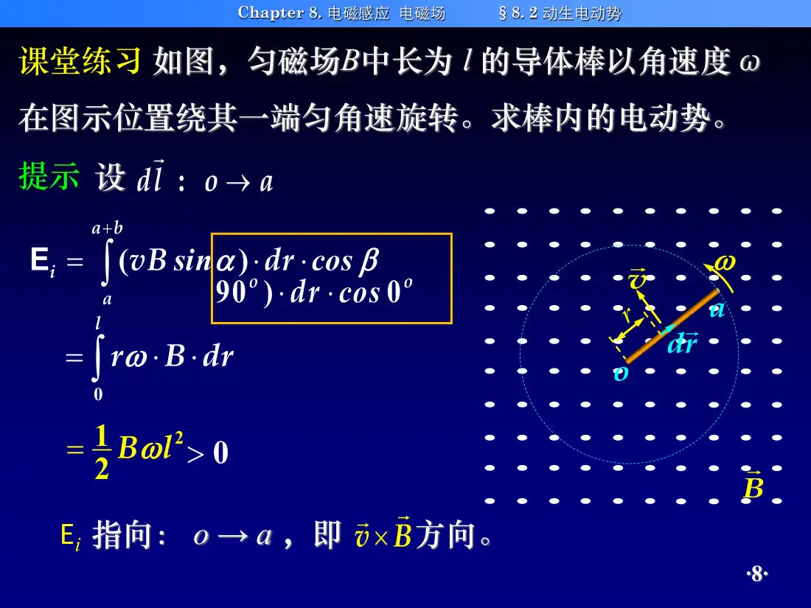

原文：

Chapter 8. 电磁感应 电磁场

§ 8.2 动生电动势

课堂练习 如图，匀磁场B中长为 l 的导体棒以角速度 $\omega$ 在图示位置绕其一端匀角速旋转。求棒内的电动势。

提示 设 $d\vec{l}:o\to a$

$$
\begin{array}{l} \mathbf {E} _ {i} = \int_ {a} ^ {a + b} (v B \sin \alpha) \cdot d r \cdot \cos \beta \\ = \int_ {0} ^ {l} r \omega \cdot B \cdot d r \\ = \frac {1}{2} B \omega l ^ {2} > 0 \end{array}
$$

$$
\begin{array}{c} \vec {v} \\ \vec {a} \\ d \vec {r} \\ \vec {v} \end{array}
$$

$E_{i}$ 指向： $o \rightarrow a$ ，即 $\vec{v} \times \vec{B}$ 方向。

8.

### Chapter 8. 电磁感应 电磁场 § 8.2 动生电动势

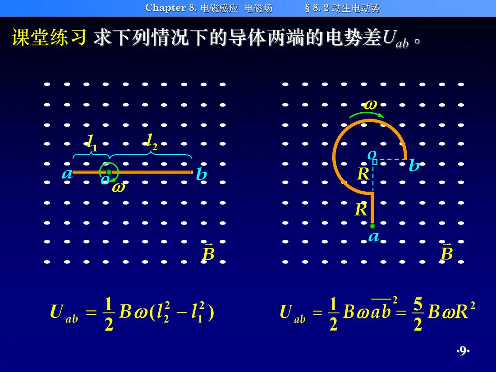

原文：

Chapter 8. 电磁感应 电磁场 § 8.2 动生电动势

课堂练习 求下列情况下的导体两端的电势差 $U_{ab}$ 。

$$
\begin{array}{c} \text { l } _ {1} \\ a \quad \text { o } \\ \omega \end{array} \begin{array}{c} \text { l } _ {2} \\ b \end{array}
$$

$$
U _ {a b} = \frac {1}{2} B \omega (l _ {2} ^ {2} - l _ {1} ^ {2})
$$

$$
\begin{array}{c} \omega \\ \text {   o   } \\ R \\ R \\ a \end{array} \tag {B}
$$

$$
U _ {a b} = \frac {1}{2} B \omega \overline {{a b}} ^ {2} = \frac {5}{2} B \omega R ^ {2}
$$

9.

### 三、直流发电机与交流发电机

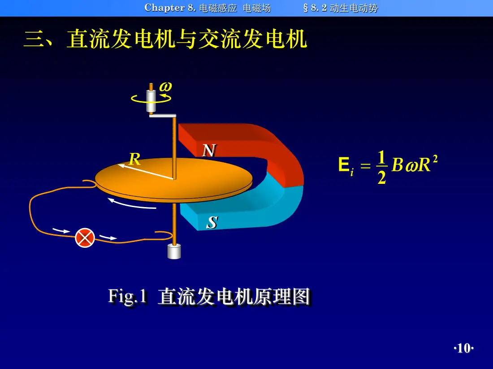

原文：

三、直流发电机与交流发电机

$$
E _ {i} = \frac {1}{2} B \omega R ^ {2}
$$

Fig.1 直流发电机原理图

Chapter 8. 电磁感应 电磁场

§ 8.2 动生电动势

•10•

### $$

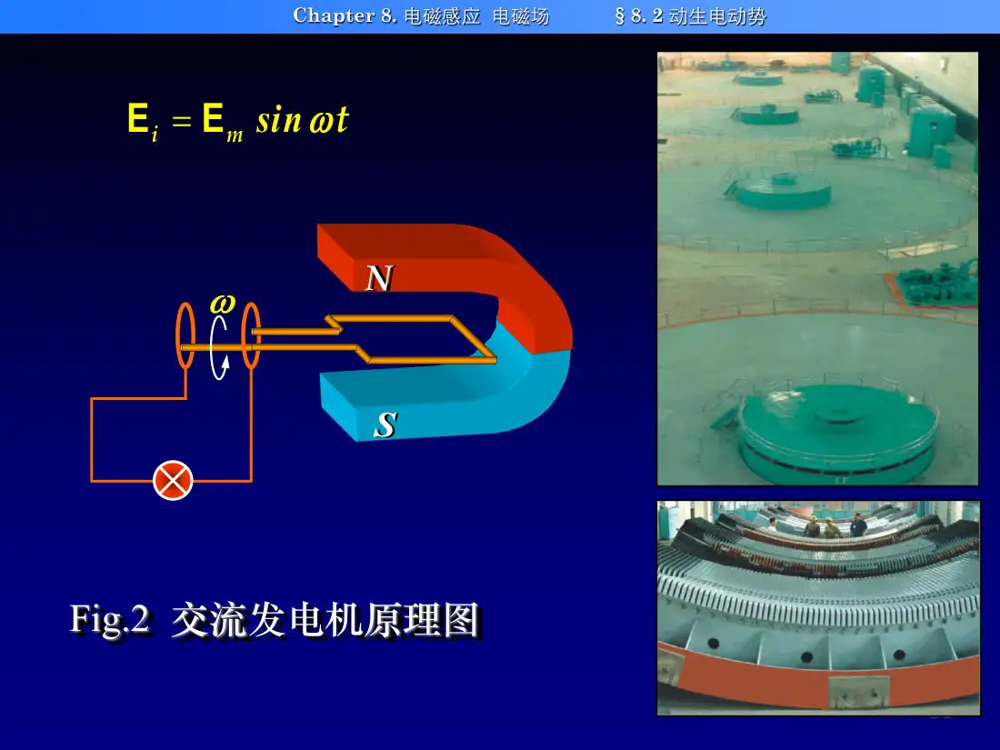

原文：

$$
\mathbf {E} _ {i} = \mathbf {E} _ {m} \sin \omega t
$$

Fig.2 交流发电机原理图

Chapter 8. 电磁感应 电磁场

§ 8.2 动生电动势

### 归纳

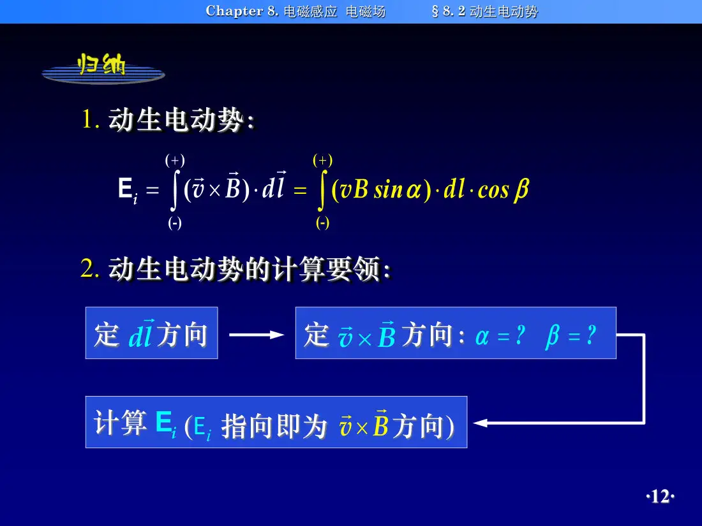

原文：

归纳

1. 动生电动势:

$$
\mathbf {E} _ {i} = \int_ {(-)} ^ {(+)} (\vec {v} \times \vec {B}) \cdot d \vec {l} = \int_ {(-)} ^ {(+)} (v B \sin \alpha) \cdot d l \cdot \cos \beta
$$

2. 动生电动势的计算要领:

定 $d\vec{l}$ 方向 $\longrightarrow$ 定 $\vec{v} \times \vec{B}$ 方向: $\alpha = ? \beta = ?$

计算 $E_{i}$ ( $E_{i}$ 指向即为 $\vec{v} \times \vec{B}$ 方向)

Chapter 8. 电磁感应 电磁场

§ 8.2 动生电动势

·12·

### Chapter 8. 电磁感应 电磁场

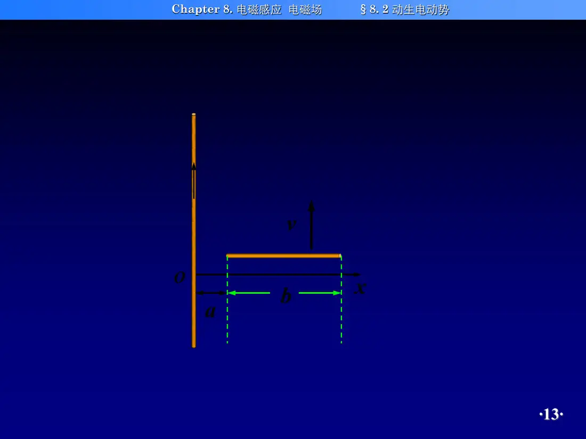

原文：

Chapter 8. 电磁感应 电磁场

§ 8.2 动生电动势

•13•
