# 《大学物理》第8章 电磁感应与电磁场（§8.1 电磁感应现象及电磁感应定律）（课件）

原件的每一页，下面附识别出的文字。

### § 8.1 电磁感应现象及电磁感应定律

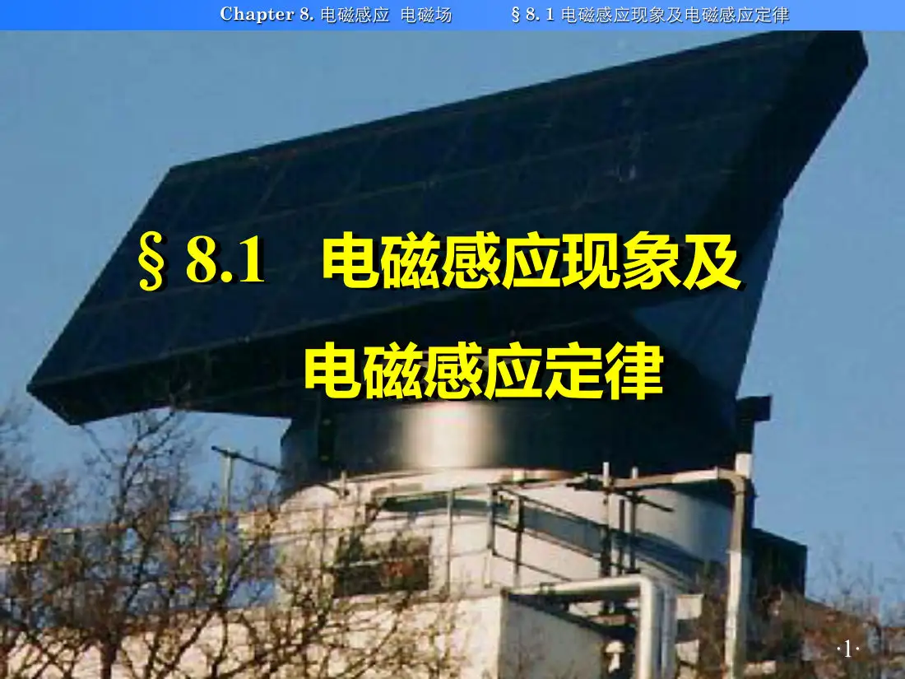

原文：

§ 8.1 电磁感应现象及电磁感应定律

Chapter 8. 电磁感应 电磁场

§ 8.1 电磁感应现象及电磁感应定律

### 一、电磁感应现象

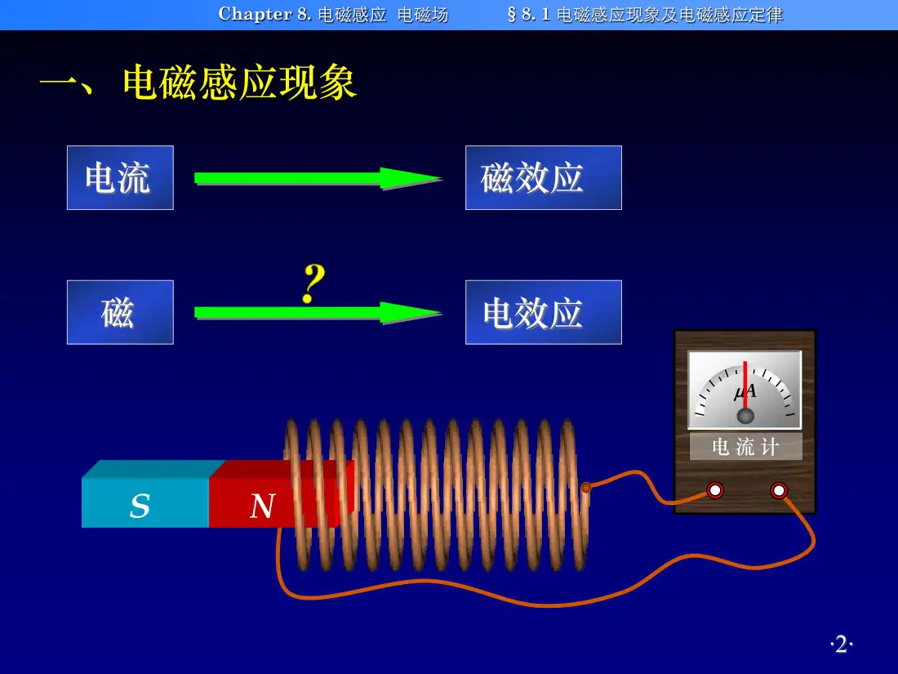

原文：

一、电磁感应现象

电流

磁

磁效应

电效应

Chapter 8. 电磁感应 电磁场

§ 8.1 电磁感应现象及电磁感应定律

2

### 楞次定律：

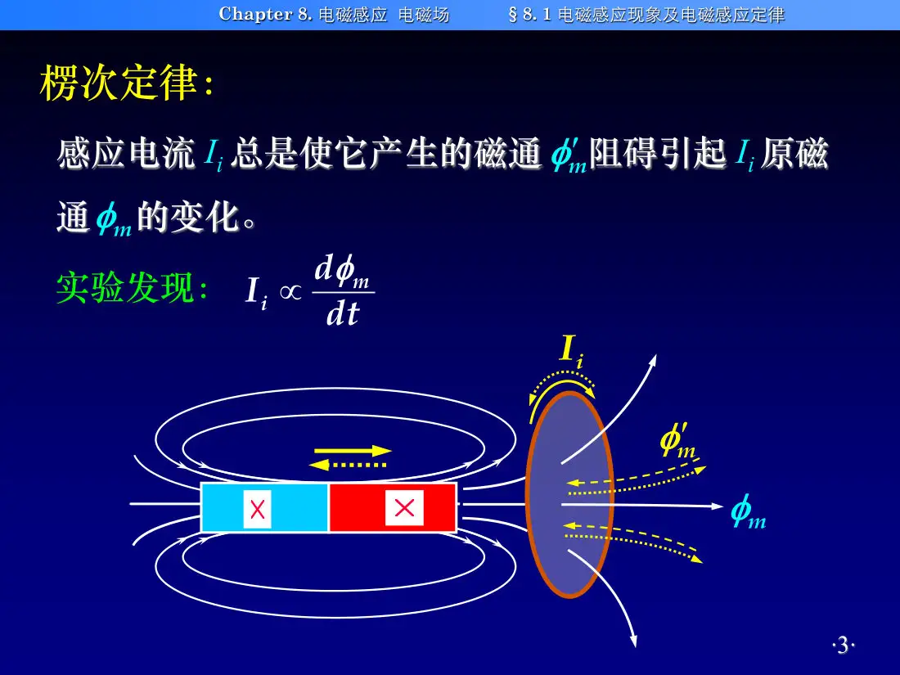

原文：

楞次定律：

感应电流 $I_{i}$ 总是使它产生的磁通 $\phi_{m}^{\prime}$ 阻碍引起 $I_{i}$ 原磁通 $\phi_{m}$ 的变化。

实验发现: $I_{i} \propto \frac{d \phi_{m}}{dt}$

Chapter 8. 电磁感应 电磁场

§ 8.1 电磁感应现象及电磁感应定律

·3·

### 二、法拉第电磁感应定律

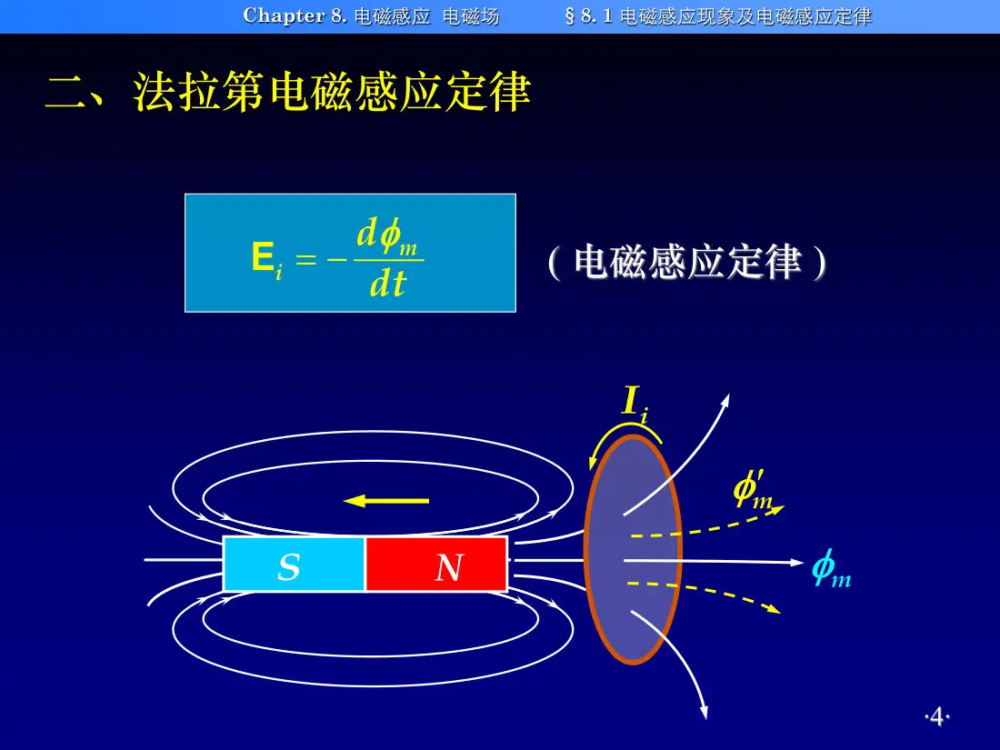

原文：

二、法拉第电磁感应定律

$$
E _ {i} = - \frac {d \phi_ {m}}{d t}
$$

(电磁感应定律)

Chapter 8. 电磁感应 电磁场

§ 8.1 电磁感应现象及电磁感应定律

4

### 二、法拉第电磁感应定律

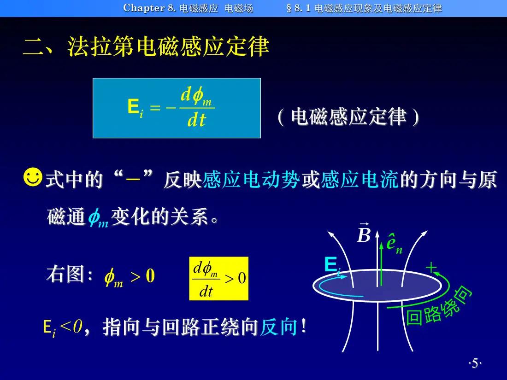

原文：

二、法拉第电磁感应定律

$$
E _ {i} = - \frac {d \phi_ {m}}{d t}
$$

(电磁感应定律)

😊式中的“-”反映感应电动势或感应电流的方向与原磁通 $\phi_{m}$ 变化的关系。

右图： $\phi_{m} > 0$

$$
\frac {d \phi_ {m}}{d t} > 0
$$

$E_{i}<0$ ，指向与回路正绕向反向！

回路绕

Chapter 8. 电磁感应 电磁场

§ 8.1 电磁感应现象及电磁感应定律

5.

### $$

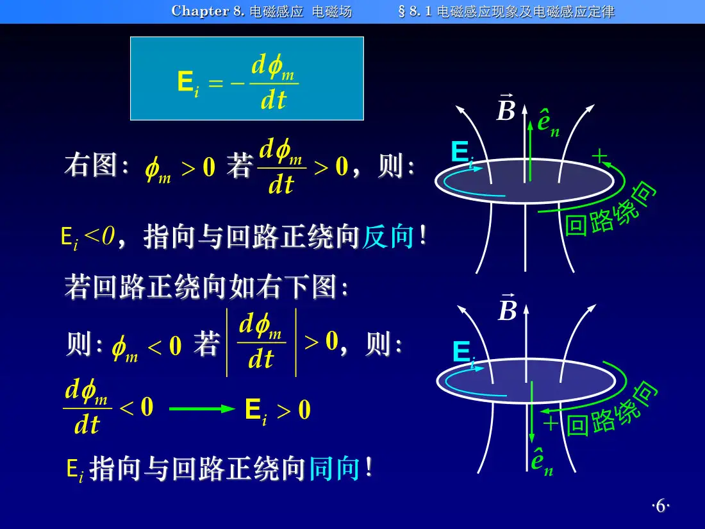

原文：

$$
E _ {i} = - \frac {d \phi_ {m}}{d t}
$$

右图： $\phi_{m} > 0$ 若 $\frac{d\phi_{m}}{dt} > 0$ ，则：

$E_{i}<0$ ，指向与回路正绕向反向！

若回路正绕向如右下图:

则: $\phi_{m}<0$ 若 $\left|\frac{d\phi_{m}}{dt}\right|>0$ , 则:

$$
\frac {d \phi_ {m}}{d t} <   0 \longrightarrow E _ {i} > 0
$$

$E_{i}$ 指向与回路正绕向同向！

Chapter 8. 电磁感应 电磁场

§ 8.1 电磁感应现象及电磁感应定律

6.

### 归纳 用法拉第电磁感应定律计算 $E_{i}$ 及其方向的判断：

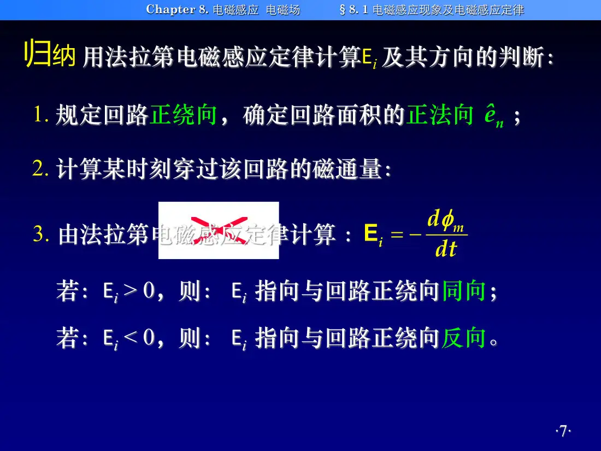

原文：

归纳 用法拉第电磁感应定律计算 $E_{i}$ 及其方向的判断：

1. 规定回路正绕向，确定回路面积的正法向 $\hat{e}_n$ ；

2. 计算某时刻穿过该回路的磁通量:

3. 由法拉第电磁感应定律计算： $E_{i} = -\frac{d\phi_{m}}{dt}$

若： $E_{i}>0$ ，则： $E_{i}$ 指向与回路正绕向同向；

若： $E_{i}<0$ ，则： $E_{i}$ 指向与回路正绕向反向。

Chapter 8. 电磁感应 电磁场

§ 8.1 电磁感应现象及电磁感应定律

7.

### 解 设 t=0 时线框处于图示位置。

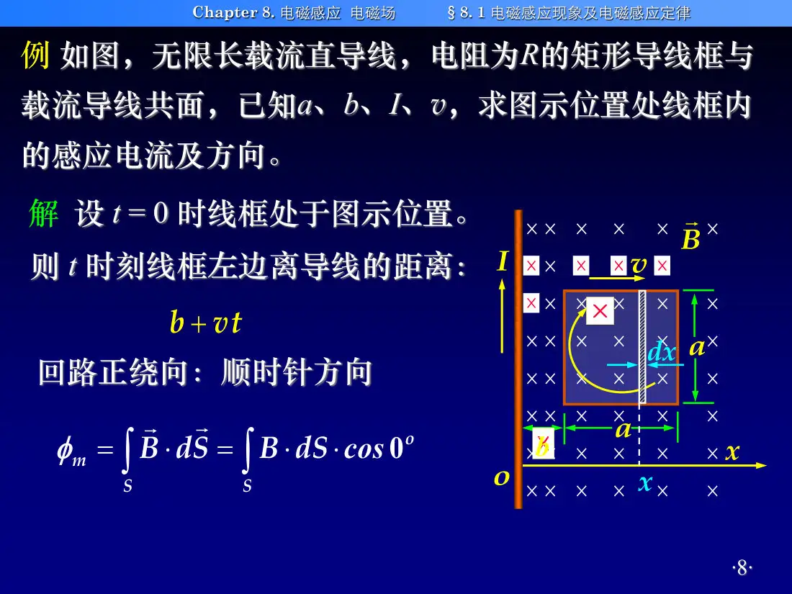

原文：

例如图，无限长载流直导线，电阻为R的矩形导线框与载流导线共面，已知a、b、I、v，求图示位置处线框内的感应电流及方向。

解 设 t=0 时线框处于图示位置。

则 $t$ 时刻线框左边离导线的距离：

b + vt

回路正绕向：顺时针方向

$$
\phi_ {m} = \int_ {S} \vec {B} \cdot d \vec {S} = \int_ {S} B \cdot d S \cdot c o s 0 ^ {o}
$$

Chapter 8. 电磁感应 电磁场

§ 8.1 电磁感应现象及电磁感应定律

8.

### $$

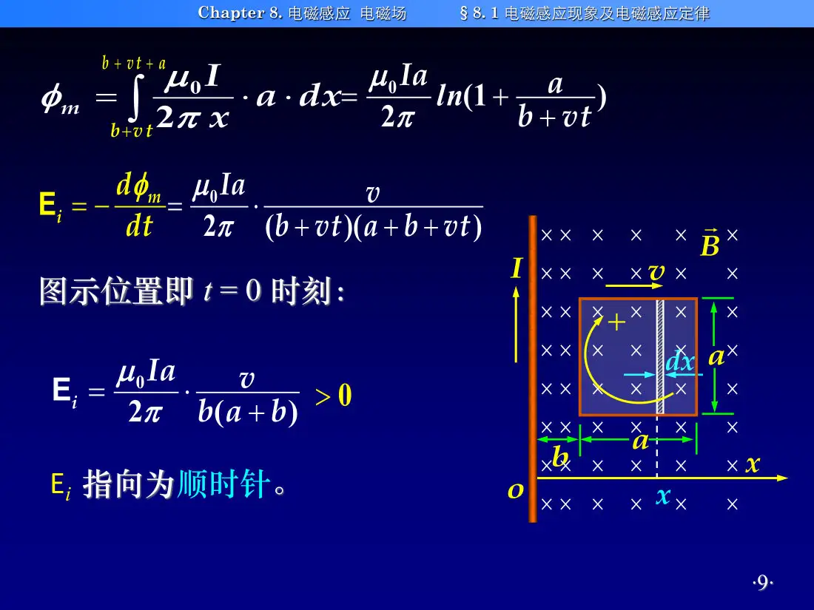

原文：

$$
\phi_ {m} = \int_ {b + v t} ^ {b + v t + a} \frac {\mu_ {0} I}{2 \pi x} \cdot a \cdot d x = \frac {\mu_ {0} I a}{2 \pi} \ln (1 + \frac {a}{b + v t})
$$

$$
E _ {i} = - \frac {d \phi_ {m}}{d t} = \frac {\mu_ {0} I a}{2 \pi} \cdot \frac {v}{(b + v t) (a + b + v t)}
$$

图示位置即 t = 0 时刻：

$$
E _ {i} = \frac {\mu_ {0} I a}{2 \pi} \cdot \frac {v}{b (a + b)} > 0
$$

$E_{i}$ 指向为顺时针。

$$
\begin{array}{c} \vec {B} \\ v \\ d x \\ a \\ b \\ x \end{array}
$$

Chapter 8. 电磁感应 电磁场

§ 8.1 电磁感应现象及电磁感应定律

.9.

### 感应电流 $I_{i}$ 为:

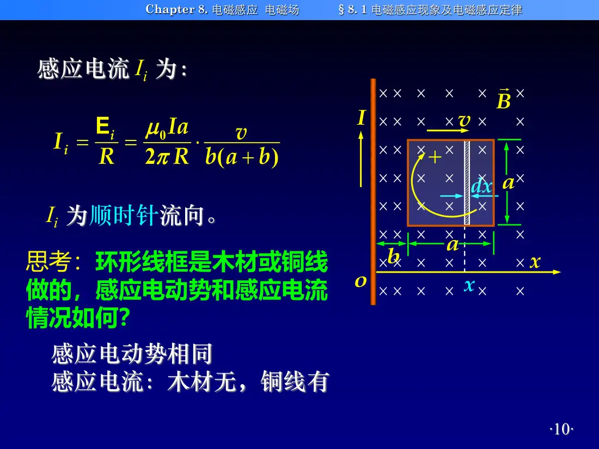

原文：

感应电流 $I_{i}$ 为:

$$
I _ {i} = \frac {\mathsf {E} _ {i}}{R} = \frac {\mu_ {0} I a}{2 \pi R} \cdot \frac {v}{b (a + b)}
$$

$I_{i}$ 为顺时针流向。

思考：环形线框是木材或铜线做的，感应电动势和感应电流情况如何？

感应电动势相同
感应电流：木材无，铜线有

Chapter 8. 电磁感应 电磁场

§ 8.1 电磁感应现象及电磁感应定律

10.

### 提示 穿过导线框的磁通量:

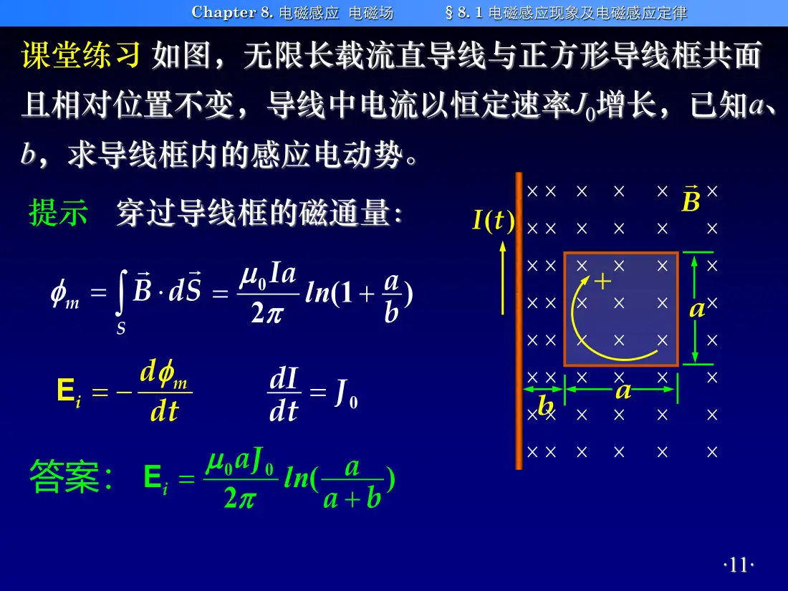

原文：

课堂练习 如图，无限长载流直导线与正方形导线框共面且相对位置不变，导线中电流以恒定速率 $J_{0}$ 增长，已知a、b，求导线框内的感应电动势。

提示 穿过导线框的磁通量:

$$
\phi_ {m} = \int_ {S} \vec {B} \cdot d \vec {S} = \frac {\mu_ {0} I a}{2 \pi} l n (1 + \frac {a}{b})
$$

$$
E _ {i} = - \frac {d \phi_ {m}}{d t} \quad \frac {d I}{d t} = J _ {0}
$$

答案: $\mathsf{E}_i = \frac{\mu_0 a J_0}{2 \pi} \ln \left( \frac{a}{a + b} \right)$

$I(t)$

$$
\vec {B} \quad \text {   a   } \quad \text {   b   } \quad \text {   a   } \quad \text {   a   }
$$

Chapter 8. 电磁感应 电磁场

§ 8.1 电磁感应现象及电磁感应定律

11.

### Chapter 8. 电磁感应 电磁场

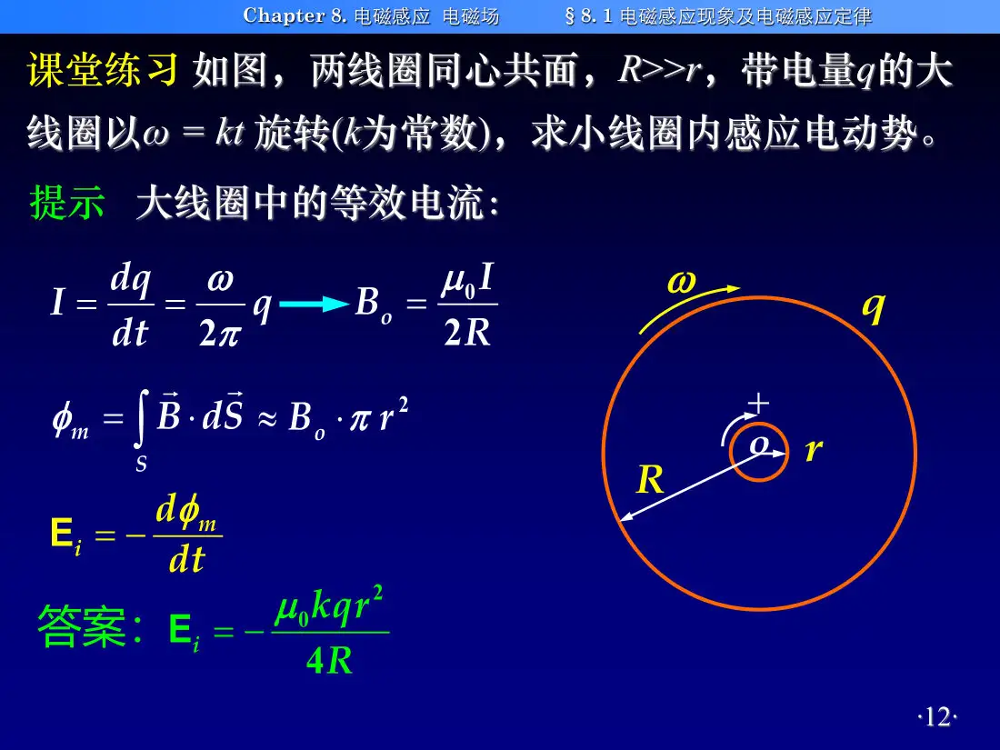

原文：

Chapter 8. 电磁感应 电磁场

§ 8.1 电磁感应现象及电磁感应定律

课堂练习 如图，两线圈同心共面， $R >> r$ ，带电量 $q$ 的大线圈以 $\omega = kt$ 旋转 ( $k$ 为常数)，求小线圈内感应电动势。

提示 大线圈中的等效电流:

$$
I = \frac {d q}{d t} = \frac {\omega}{2 \pi} q \longrightarrow B _ {o} = \frac {\mu_ {0} I}{2 R}
$$

$$
\phi_ {m} = \int_ {S} \vec {B} \cdot d \vec {S} \approx B _ {o} \cdot \pi r ^ {2}
$$

$$
\mathbf {E} _ {i} = - \frac {d \phi_ {m}}{d t}
$$

答案: $E_{i} = -\frac{\mu_{0} k q r^{2}}{4 R}$

·12·

### Chapter 8. 电磁感应 电磁场

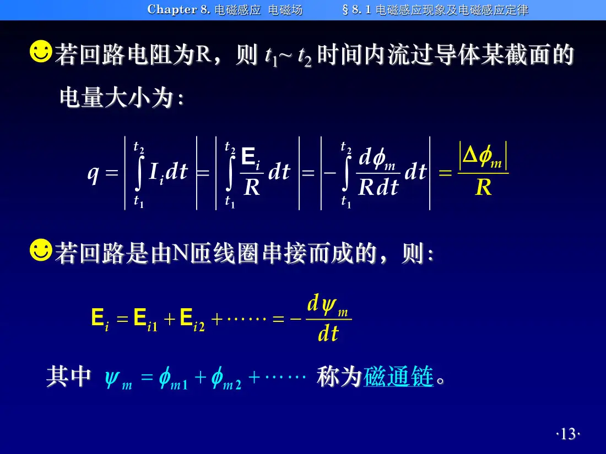

原文：

Chapter 8. 电磁感应 电磁场

§ 8.1 电磁感应现象及电磁感应定律

😊 若回路电阻为R，则 $t_{1} \sim t_{2}$ 时间内流过导体某截面的电量大小为：

$$
q = \left| \int_ {t _ {1}} ^ {t _ {2}} I _ {i} d t \right| = \left| \int_ {t _ {1}} ^ {t _ {2}} \frac {\mathsf {E} _ {i}}{R} d t \right| = \left| - \int_ {t _ {1}} ^ {t _ {2}} \frac {d \phi_ {m}}{R d t} d t \right| = \frac {| \Delta \phi_ {m} |}{R}
$$

😊若回路是由N匝线圈串接而成的，则：

$$
\mathbf {E} _ {i} = \mathbf {E} _ {i 1} + \mathbf {E} _ {i 2} + \dots \dots = - \frac {d \psi_ {m}}{d t}
$$

其中 $\psi_{m} = \phi_{m1} + \phi_{m2} + \cdots$ 称为磁通链。

13.

### 解 长直螺线管内的磁感强度:

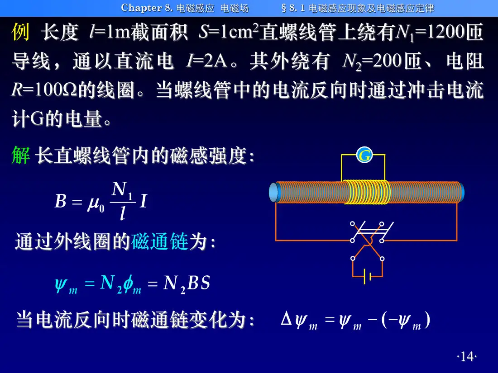

原文：

例 长度 $l = 1 \mathrm{~m}$ 截面积 $S = 1 \mathrm{~cm}^{2}$ 直螺线管上绕有 $N_{1} = 1200$ 匝导线, 通以直流电 $I = 2 \mathrm{~A}$ 。其外绕有 $N_{2} = 200$ 匝、电阻 $R = 100 \Omega$ 的线圈。当螺线管中的电流反向时通过冲击电流计G的电量。

解 长直螺线管内的磁感强度:

$$
B = \mu_ {0} \frac {N _ {1}}{l} I
$$

通过外线圈的磁通链为:

$$
\psi_ {m} = N _ {2} \phi_ {m} = N _ {2} B S
$$

当电流反向时磁通链变化为： $\Delta \psi_{m} = \psi_{m} - (-\psi_{m})$

Chapter 8. 电磁感应 电磁场

§ 8.1 电磁感应现象及电磁感应定律

·14·

### $$

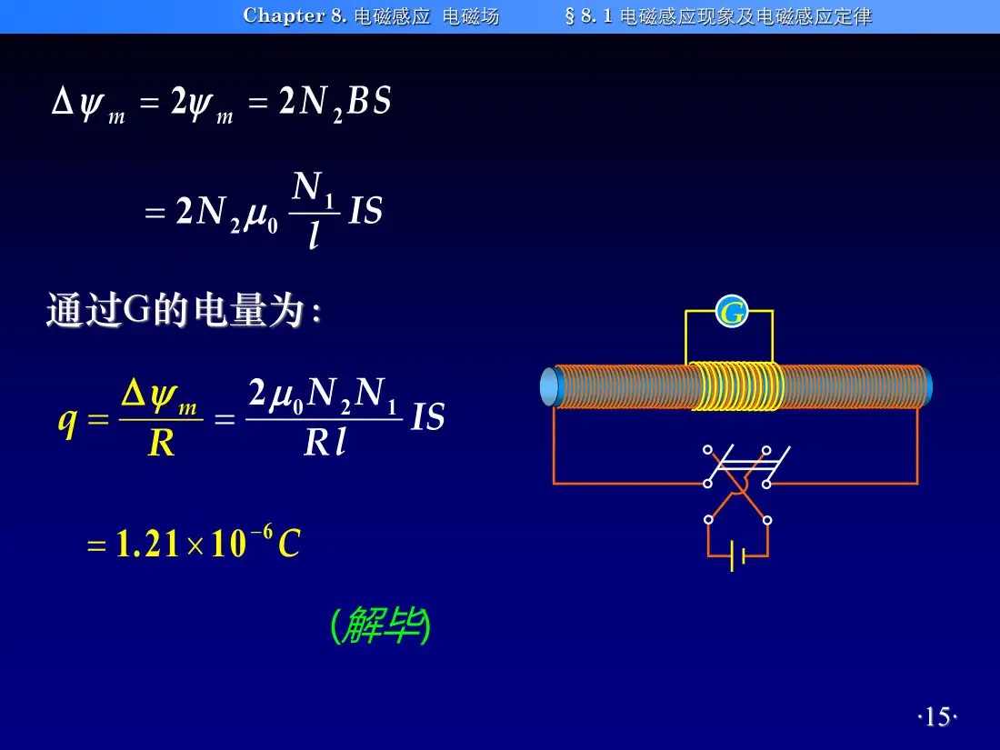

原文：

$$
\begin{array}{r} \Delta \psi_ {m} = 2 \psi_ {m} = 2 N _ {2} B S \\ = 2 N _ {2} \mu_ {0} \frac {N _ {1}}{l} I S \end{array}
$$

通过G的电量为:

$$
\begin{array}{r l} q & = \frac {\Delta \psi_ {m}}{R} = \frac {2 \mu_ {0} N _ {2} N _ {1}}{R l} I S \\ & = 1. 2 1 \times 1 0 ^ {- 6} C \end{array}
$$

(解毕)

Chapter 8. 电磁感应 电磁场

§ 8.1 电磁感应现象及电磁感应定律

15·

### 三、两种形式的感应电动势

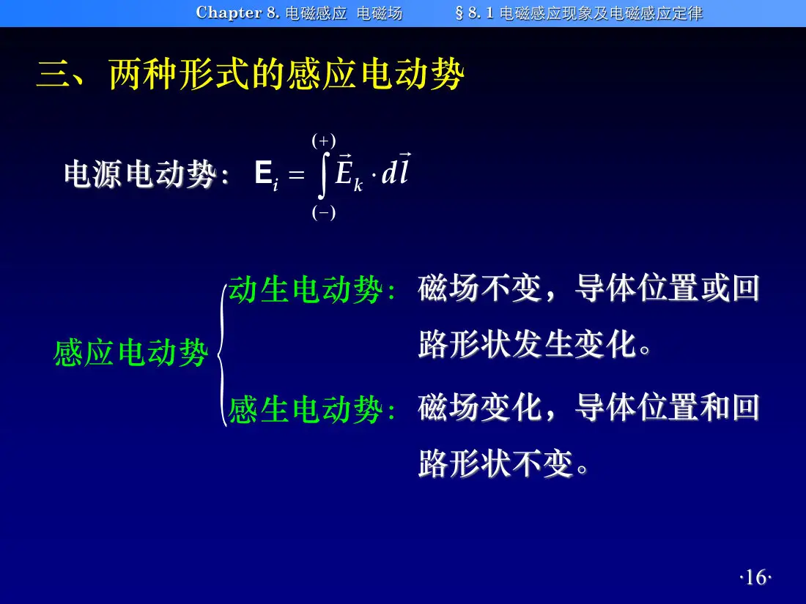

原文：

三、两种形式的感应电动势

电源电动势： $E_{i}=\int\limits_{(-)}^{(+)}\vec{E}_{k}\cdot dl$

感应电动势

动生电动势：磁场不变，导体位置或回路形状发生变化。

感生电动势：磁场变化，导体位置和回路形状不变。

Chapter 8. 电磁感应 电磁场

§ 8.1 电磁感应现象及电磁感应定律

16.

### 归纳：

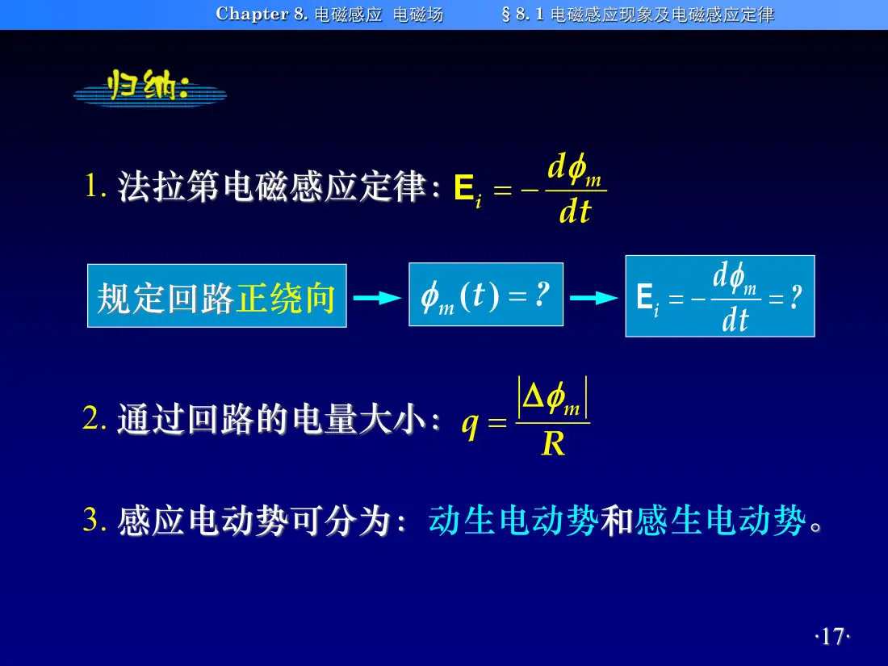

原文：

归纳：

1. 法拉第电磁感应定律: $E_{i} = -\frac{d \phi_{m}}{dt}$

规定回路正绕向 $\rightarrow \phi_{m}(t) = ?$ $\rightarrow E_{i} = -\frac{d\phi_{m}}{dt} = ?$

2. 通过回路的电量大小: $q = \frac{\left|\Delta \phi_{m}\right|}{R}$

3. 感应电动势可分为：动生电动势和感生电动势。

Chapter 8. 电磁感应 电磁场

§ 8.1 电磁感应现象及电磁感应定律

17.
