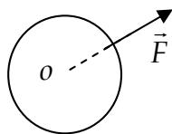
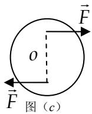
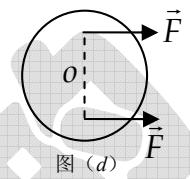
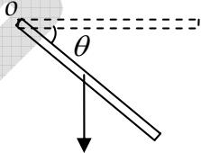
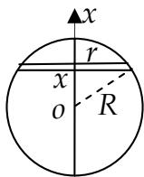
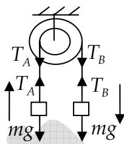
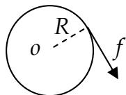

# 《大学物理》第9章 刚体定轴转动 转动定律（同步练习册答案）

原件经识别和整理；“参考解答”是我们补的。

# 大学物理 第9章 刚体定轴转动 转动定律（同步练习册答案）

本资料为《大学物理》第9章关于刚体定轴转动及转动定律的同步练习册参考答案，已根据识别内容进行格式整理与公式修正。

## 一、选择题与简答题

### 选择 1

题干：关于力矩与转动的关系，下列说法正确的是？

- A. 平行于转轴的力会引起转动效果
- B. 平行于转轴的力对转轴的力矩一定为零；垂直于转轴且作用线经过转轴的力力矩为零；大小相等方向相反但不共线的两个力合力为零但合力矩不为零；合力矩为零时合力不一定为零
- C. 合力矩为零时，合力一定为零
- D. 以上说法均错误

答案：B。
参考解答：
（a）平行于转轴的力不会引起转动效果，所以平行于转轴的力对转轴的力矩一定为零。

（b）垂直于转轴的力，如果力的作用线经过转轴，即力臂为零，力矩为零，如图（b）。
（c）如果两个力的大小相等，方向相反，但不在同一直线上，如图（c），合力为零，但合力矩不为零。
（d）合力矩为零时，合力不一定为零，例如图（d）。

知识点：[刚体定轴转动定律（M=Jα）](../../../topics/大学物理/刚体转动定律.md)、[刚体定轴转动的角量描述](../../../topics/大学物理/刚体定轴转动运动学.md)

### 选择 2

题干：关于细圆环的转动惯量，下列说法正确的是？

- A. 细圆环的转动惯量与质量分布有关
- B. 细圆环的转动惯量与半径无关
- C. 细圆环的转动惯量 $J = MR^2$，与质量在圆环上的分布是否均匀无关
- D. 细圆环的转动惯量小于同质量实心圆盘

答案：C。
参考解答：
细圆环上各质点到中心转轴的距离都相等，为圆环半径。由转动惯量的定义：

$$ J = \sum _ { i } \Delta m _ { i } r _ { i } ^ { 2 } = \sum _ { i } \Delta m _ { i } R ^ { 2 } = R ^ { 2 } \sum _ { i } \Delta m _ { i } = M R ^ { 2 } $$
可见，细圆环的转动惯量与圆环的半径和质量有关，与质量在圆环上的分布是否均匀无关。

知识点：[转动惯量的计算与平行轴定理](../../../topics/大学物理/转动惯量.md)

### 选择 3

题干：棒下摆过程中，角加速度 $\alpha$ 和角速度 $\omega$ 的变化情况是？

- A. $\alpha$ 增大，$\omega$ 减小
- B. $\alpha$ 减小，$\omega$ 减小
- C. $\alpha$ 增大，$\omega$ 增大
- D. $\alpha$ 减小，$\omega$ 增大

答案：D。
参考解答：
棒下摆过程中，只受重力矩的作用。当棒下摆到角度 $\theta$ 时，重力矩： $\vec { M } = \vec { r } \times m \vec { g }$

力矩大小： $M = { \frac { l } { 2 } } m g \sin ( { \frac { \pi } { 2 } } - \theta ) = { \frac { l } { 2 } } m g \cos \theta$ ，方向垂直纸面向里。

由转动定律： $M = J \alpha \ \Rightarrow \ \frac { l } { 2 } m g \cos \theta = \frac { 1 } { 3 } m l ^ { 2 } \alpha \ \Rightarrow \ \alpha = \frac { 3 g } { 2 l } \cos \theta \ ,$

棒下摆过程中，角度 $\theta$ 增大，$\cos \theta$ 减小，所以角加速度 $\alpha$ 从大到小。

$$
\alpha = \frac {d \omega}{d t} \Rightarrow \frac {d \omega}{d t} = \frac {3 g}{2 l} \cos \theta \Rightarrow \frac {d \omega}{d \theta} \frac {d \theta}{d t} = \frac {3 g}{2 l} \cos \theta \Rightarrow \omega \frac {d \omega}{d \theta} = \frac {3 g}{2 l} \cos \theta
$$

$$
\Rightarrow \omega d \omega = \frac {3 g}{2 l} \cos \theta d \theta \Rightarrow \int_ {0} ^ {\omega} \omega d \omega = \int_ {0} ^ {\theta} \frac {3 g}{2 l} \cos \theta d \theta \Rightarrow \omega = \sqrt {\frac {3 g}{l} \sin \theta}
$$

棒下摆过程中，角度 $\theta$ 增大，$\sin \theta$ 随之增大，所以角速度 $\omega$ 从小到大。

知识点：[刚体定轴转动定律（M=Jα）](../../../topics/大学物理/刚体转动定律.md)、[刚体定轴转动的角量描述](../../../topics/大学物理/刚体定轴转动运动学.md)

### 计算 1

题干：电唱机转速 $n = 78 \mathrm{rev/min}$，唱针半径 $r=0.15\mathrm{m}$。求：(1) P点的线速度大小；(2) 法向加速度；(3) 若经 $t=60\mathrm{s}$ 停止，求转过的圈数。

答案：见参考解答。
参考解答：
电唱机转速 $n = 7 8 \mathrm { r e v / m i n } \ \Rightarrow$ 角速度： $\omega = { \frac { 7 8 \times 2 \pi } { 6 0 } } = 2 . 6 \pi \mathrm { r a d / s }$

⇒ P点的线速度大小： $v = r \omega = 0 . 1 5 \mathrm { { m } \times 2 . 6 \pi \mathrm { { r a d } / s = 0 . 3 9 \pi \mathrm { { m } / s = 1 . 2 2 \mathrm { { m } / s } } } }$

⇒ 法向加速度： $a _ { n } = { \frac { v ^ { 2 } } { r } } = r \omega ^ { 2 } = 1 . 0 1 4 \pi ^ { 2 } \mathrm { m / s ^ { 2 } } = 9 . 9 9 8 \mathrm { m / s ^ { 2 } }$ ；

角加速度 $\alpha$ 为常数，转盘做匀变速转动，由 $\alpha = { \frac { d \omega } { d t } }$

$\Rightarrow \int _ { \omega } ^ { 0 } d \omega = \int _ { 0 } ^ { t } \alpha ~ d t \Rightarrow - \omega = \alpha t \Rightarrow$ 角加速度： $\alpha = - { \frac { \omega } { t } } = - 0 . 1 7 3 \pi \mathrm { r a d } { \big / } \mathrm { s } ^ { 2 }$ ；（负号表示方向）

$$
\text {又由} \alpha = \frac {d \omega}{d t} = \frac {d \omega}{d \theta} \frac {d \theta}{d t} \Rightarrow \alpha = \omega \frac {d \omega}{d \theta} \Rightarrow \int_ {\omega} ^ {0} \omega d \omega = \int_ {0} ^ {\theta} \alpha d \theta \Rightarrow - \omega^ {2} = 2 \alpha \theta \Rightarrow \theta = - \frac {\omega^ {2}}{2 \alpha} = \frac {\omega}{2} t,
$$

转过的圈数： $N = \frac { \theta } { 2 \pi } = \frac { \omega } { 4 \pi } t = 9 . 7 5$

知识点：[圆周运动的角量描述（角速度、角加速度）](../../../topics/大学物理/圆周运动描述.md)、[速度、加速度的定义与微分关系](../../../topics/大学物理/速度与加速度定义.md)、[刚体定轴转动的角量描述](../../../topics/大学物理/刚体定轴转动运动学.md)

### 计算 2

题干：一个阻力矩 $M = -k\omega$ 作用下的转子，初角速度为 $\omega_0$，求角速度降至一半所需的时间。

答案：见参考解答。
参考解答：
由转动定律： $M = J \alpha \ \Rightarrow \ - k \omega = J { \frac { d \omega } { d t } } \ \Rightarrow \ d t = - { \frac { J } { k } } { \frac { d \omega } { \omega } } \ \Rightarrow \ \int _ { 0 } ^ { t } d t = - { \frac { J } { k } } \int _ { \omega _ { 0 } } ^ { \omega } { \frac { d \omega } { \omega } } \ ,$

⇒ 角速度降至一半所需的时间： $t = - { \frac { J } { k } } \ln { \frac { 1 } { 2 } } = { \frac { J } { k } } \ln 2$

知识点：[刚体定轴转动定律（M=Jα）](../../../topics/大学物理/刚体转动定律.md)、[刚体定轴转动的角量描述](../../../topics/大学物理/刚体定轴转动运动学.md)

### 综合 1

题干：推导均匀球体绕直径的转动惯量。

答案：见参考解答。
参考解答：
如图，沿轴线方向建立 ox 轴，坐标原点 o 在球心处，球体的质量体密度 $\rho = m \bigg / ( \frac { 4 } { 3 } \pi R ^ { 3 } )$ ；把球体切割成大量薄圆盘，在任一位置 x 处取一厚度为 dx，半径为 $r = \sqrt { R ^ { 2 } - x ^ { 2 } }$ 的圆盘，薄圆盘的质量为： $d m = \rho ( \pi r ^ { 2 } d x )$ ，对 ox 轴的转动惯量为： $d J = \frac { 1 } { 2 } ( d m ) r ^ { 2 } = \frac { 1 } { 2 } \rho \pi ( R ^ { 2 } - x ^ { 2 } ) ^ { 2 } d x$

⇒ 整个球体对 ox 轴的转动惯量为： $J = \int d J = \int _ { - R } ^ { R } \frac { 1 } { 2 } \rho \pi ( R ^ { 2 } - x ^ { 2 } ) ^ { 2 } d x = \frac { 1 } { 2 } \rho \pi ( 2 R ^ { 5 } - \frac { 4 } { 3 } R ^ { 5 } + \frac { 2 } { 5 } R ^ { 5 } ) = \frac { 2 } { 5 } m R ^ { 2 }$

知识点：[转动惯量的计算与平行轴定理](../../../topics/大学物理/转动惯量.md)

### 综合 2

题干：如图所示装置，定滑轮半径分别为 $R$ 和 $r$，转动惯量为 $J$，两侧悬挂质量均为 $m$ 的物体 A 和 B（A 在 $r$ 侧，B 在 $R$ 侧）。求系统的角加速度及两物体的加速度。

答案：见参考解答。
参考解答：
设左右两侧轻绳中张力大小分别为 $T _ { A }$ 和 $T _ { B }$ ，物体 A 上升的加速度大小为 $a _ { A }$ ，物体 B 下落的加速度大小 $a _ { \scriptscriptstyle B }$ ，分别以物体 A、B 以及定滑轮为研究对象：

$$
\left\{ \begin{array}{l} T _ {A} - m g = m a _ {A} \\ m g - T _ {B} = m a _ {B} \\ R T _ {B} - r T _ {A} = J \alpha \\ a _ {B} = R \alpha \\ a _ {A} = r \alpha \end{array} \right. \quad \Rightarrow \quad \left\{ \begin{array}{l} \alpha = \frac {m g (R - r)}{J + m R ^ {2} + m r ^ {2}} \\ a _ {A} = \frac {m g r (R - r)}{J + m R ^ {2} + m r ^ {2}}. \\ a _ {B} = \frac {m g R (R - r)}{J + m R ^ {2} + m r ^ {2}} \end{array} \right.
$$

（第7题图）

知识点：[刚体定轴转动的角量描述](../../../topics/大学物理/刚体定轴转动运动学.md)、[刚体定轴转动定律（M=Jα）](../../../topics/大学物理/刚体转动定律.md)、[牛顿三定律与惯性系](../../../topics/大学物理/牛顿三定律.md)

### 计算 3

题干：质量为 $m$、长为 $L$ 的匀质细棒，一端固定在水平面上，以角速度 $\omega_0$ 旋转，受到摩擦系数为 $\mu$ 的摩擦力作用，求摩擦力矩及停止时间（若已知停止时间需反推或仅求力矩）。此处仅求摩擦力矩。

答案：见参考解答。
参考解答：
匀质细棒的质量线密度 $\lambda = \frac { m } { L }$ ，在细棒上任一位置 x 处取一小段 dx ，则这一小段的质量为 $d m = \lambda d x$ ，受到摩擦力的大小 $d f = \mu d m g = \mu \lambda g d x$ ，摩擦力矩 $d M = - x ( \mu \lambda g d x )$ ，（负号表示方向）

⇒ 细棒受到的摩擦力矩： $M = \int _ { 0 } ^ { L } - x ( \mu { \frac { m } { L } } d x g ) = - { \frac { 1 } { 2 } } \mu m g L$ ，摩擦力矩的大小： $M = \frac { 1 } { 2 } \mu m g L$

知识点：[刚体定轴转动定律（M=Jα）](../../../topics/大学物理/刚体转动定律.md)、[常见力（重力、弹力、摩擦力）的受力分析](../../../topics/大学物理/常见力分析.md)

### 综合 3

题干：质量为 $m$、半径为 $R$ 的圆环在水平桌面上逆时针旋转，角速度为 $\omega_0$，摩擦系数为 $\mu$。求：(1) 摩擦力矩；(2) 停止转动所需时间。

答案：见参考解答。
参考解答：
圆环逆时针旋转，角速度 $\omega$ 方向沿转轴向上，则取沿转轴向上为正方向。

（1）在圆环上任取一质元，质量为 dm，重力为 dm g，桌面对它的支持力 $N = d m g$，它受到的摩擦力为 $f = \mu d m g$，

这一小段受到的摩擦力矩： $d M = - R f = - R \mu d m g$，负号表示力矩沿转轴向下。

整个圆环受到的摩擦力矩： $M = \int d M = \int - R \mu d m \ : g = - R \mu \ : g \int d m = - \mu m \ : g R$

（2）由转动定律： $M = J \alpha \ \Rightarrow \quad - \mu m g R = m R ^ { 2 } \frac { d \omega } { d t } \ \Rightarrow \enspace - \mu g = R \frac { d \omega } { d t } \ \Rightarrow \enspace d t = - \frac { R } { \mu g } d \omega \ ,$

初始时刻 $t = 0$ 时，角速度为 $\omega _ { 0 }$；设经过时间 $t$ 停止转动，角速度 $\omega = 0$

$\int _ { 0 } ^ { t } d t = \int _ { \omega _ { 0 } } ^ { 0 } - \frac { R } { \mu g } d \omega \ \Rightarrow$ 停止转动所需时间： $t = \frac { R \omega _ { 0 } } { \mu g }$

知识点：[刚体定轴转动定律（M=Jα）](../../../topics/大学物理/刚体转动定律.md)、[常见力（重力、弹力、摩擦力）的受力分析](../../../topics/大学物理/常见力分析.md)、[转动惯量的计算与平行轴定理](../../../topics/大学物理/转动惯量.md)
