# 《大学物理》第9章 机械振动 §9.2 常见的简谐振动 阻尼振动（课件）

原件的每一页，下面附识别出的文字。

### § 9.2 常见的简谐振动阻尼振动

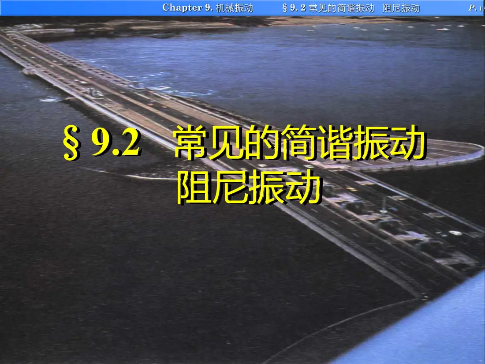

原文：

§ 9.2 常见的简谐振动阻尼振动

Chapter 9. 机械振动

§ 9.2 常见的简谐振动 阻尼振动

P.

### 一、简谐振动的判断

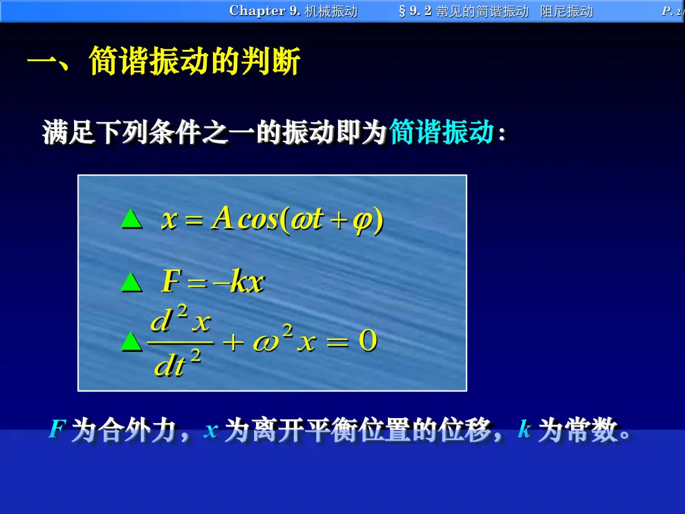

原文：

一、简谐振动的判断

满足下列条件之一的振动即为简谐振动：

$$
\triangle x = A \cos (\omega t + \varphi)
$$

$$
\triangle F = - k x
$$

$$
\triangle \frac {d ^ {2} x}{d t ^ {2}} + \omega^ {2} x = 0
$$

$F$ 为合外力， $x$ 为离开平衡位置的位移， $k$ 为常数。

Chapter 9. 机械振动

§ 9.2 常见的简谐振动 阻尼振动

P. 2

### 二、常见的简谐振动

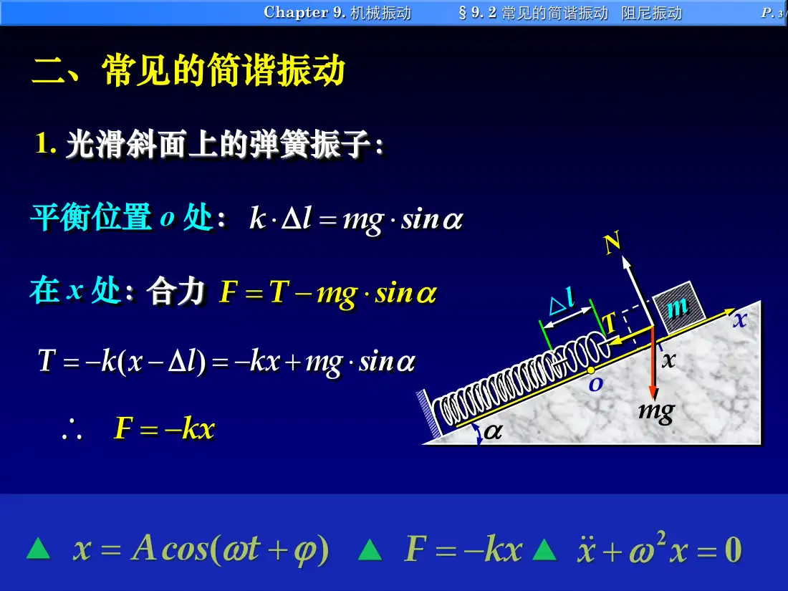

原文：

二、常见的简谐振动

1. 光滑斜面上的弹簧振子:

平衡位置 o 处： $k \cdot \Delta l = mg \cdot \sin \alpha$

在 $x$ 处: 合力 $F = T - mg \cdot \sin \alpha$

$T = -k(x - \Delta l) = -kx + mg \cdot \sin \alpha$

$$
\therefore F = - k x
$$

▲ x = A cos(ωt + φ) ▲ F = -kx ▲ $\ddot{x} + \omega^{2}x = 0$

Chapter 9. 机械振动

§ 9.2 常见的简谐振动 阻尼振动

P. 3/

### 二、常见的简谐振动

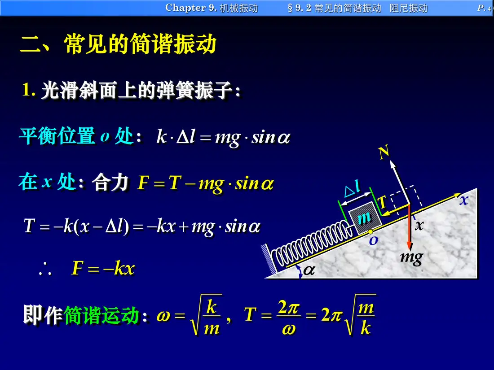

原文：

二、常见的简谐振动

1. 光滑斜面上的弹簧振子:

平衡位置 o 处： $k \cdot \Delta l = mg \cdot \sin \alpha$

在 $x$ 处: 合力 $F = T - mg \cdot \sin \alpha$

$$
T = - k (x - \Delta l) = - k x + m g \cdot \sin \alpha
$$

$$
\therefore F = - k x
$$

即作简谐运动： $\omega=\sqrt{\frac{k}{m}}$ ， $T=\frac{2\pi}{\omega}=2\pi\sqrt{\frac{m}{k}}$

Chapter 9. 机械振动

§ 9.2 常见的简谐振动 阻尼振动

P. 4/

### 2. 光滑平面上的复合弹簧：

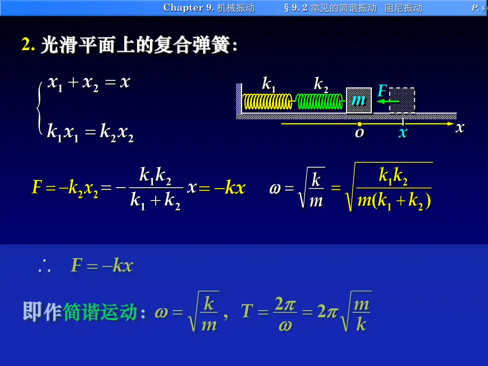

原文：

2. 光滑平面上的复合弹簧：

$$
\left\{ \begin{array}{l} x _ {1} + x _ {2} = x \\ k _ {1} x _ {1} = k _ {2} x _ {2} \end{array} \right.
$$

$$
F = - k _ {2} x _ {2} = - \frac {k _ {1} k _ {2}}{k _ {1} + k _ {2}} x = - k x \quad \omega = \sqrt {\frac {k}{m}} = \sqrt {\frac {k _ {1} k _ {2}}{m (k _ {1} + k _ {2})}}
$$

∴ F = -kx

即作简谐运动: $\omega = \sqrt{\frac{k}{m}}$ , $T = \frac{2 \pi}{\omega} = 2 \pi \sqrt{\frac{m}{k}}$

Chapter 9. 机械振动

§ 9.2 常见的简谐振动 阻尼振动

P. 5/

### 2. 光滑平面上的复合弹簧：

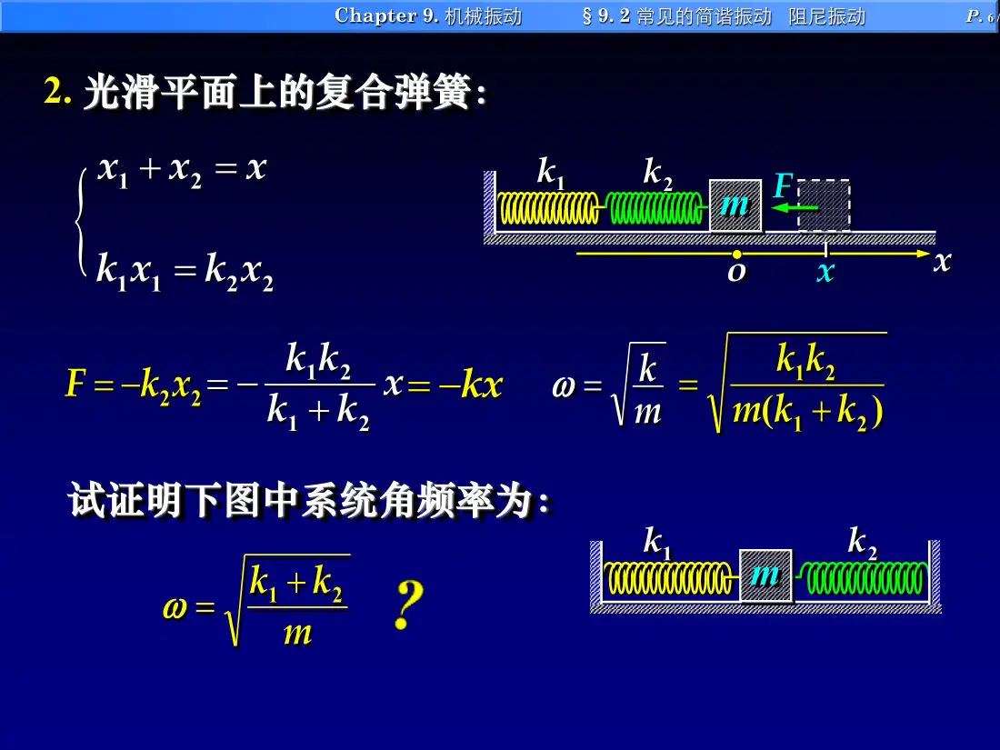

原文：

2. 光滑平面上的复合弹簧：

$$
x _ {1} + x _ {2} = x
$$

$$
k _ {1} x _ {1} = k _ {2} x _ {2}
$$

$$
F = - k _ {2} x _ {2} = - \frac {k _ {1} k _ {2}}{k _ {1} + k _ {2}} x = - k x \quad \omega = \sqrt {\frac {k}{m}} = \sqrt {\frac {k _ {1} k _ {2}}{m (k _ {1} + k _ {2})}}
$$

试证明下图中系统角频率为：

$$
\omega = \sqrt {\frac {k _ {1} + k _ {2}}{m}}
$$

Chapter 9. 机械振动

§ 9.2 常见的简谐振动 阻尼振动

P. 6/

$k_{1}$ $m$ $k_{2}$

### 解 考察 $m_{2}$ 的运动规律。

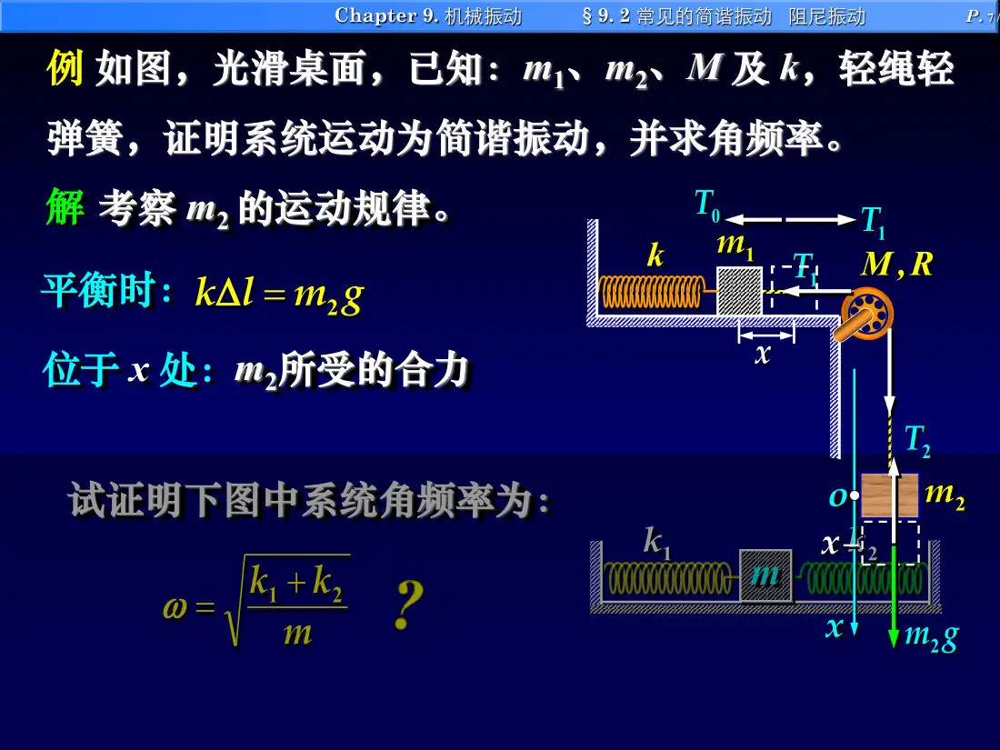

原文：

例如图，光滑桌面，已知： $m_{1} 、 m_{2} 、 M$ 及 $k$ ，轻绳轻弹簧，证明系统运动为简谐振动，并求角频率。

解 考察 $m_{2}$ 的运动规律。

平衡时: $k \Delta l = m_{2} g$

位于 x 处: $m_{2}$ 所受的合力

试证明下图中系统角频率为:

$$
\omega = \sqrt {\frac {k _ {1} + k _ {2}}{m}}?
$$

Chapter 9. 机械振动

§ 9.2 常见的简谐振动 阻尼振动

P. 7/

### 解 考察 $m_{2}$ 的运动规律。

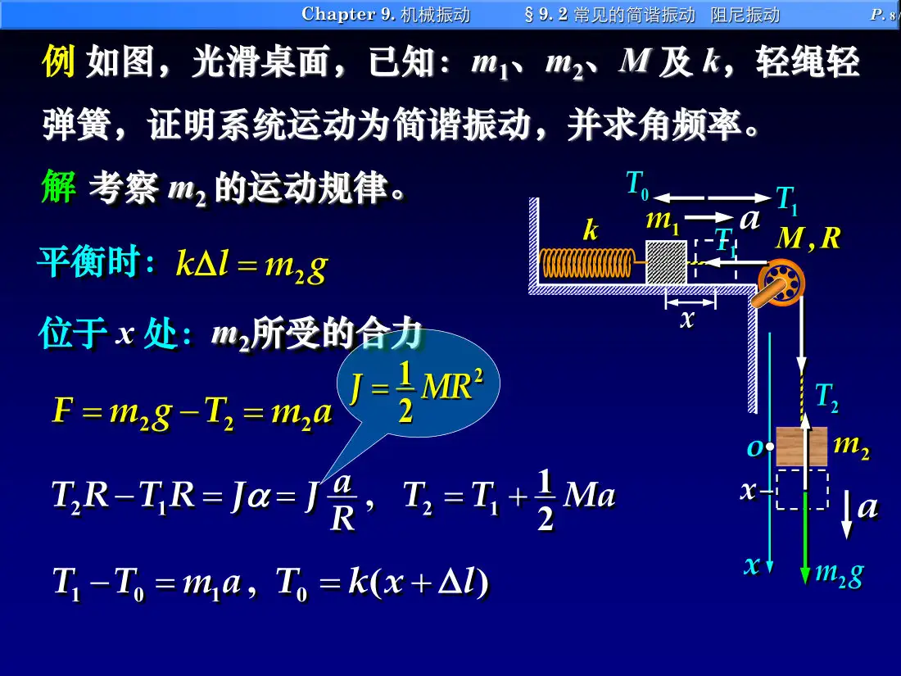

原文：

例如图，光滑桌面，已知： $m_{1} 、 m_{2} 、 M$ 及 $k$ ，轻绳轻弹簧，证明系统运动为简谐振动，并求角频率。

解 考察 $m_{2}$ 的运动规律。

平衡时: $k \Delta l = m_{2} g$

位于 $x$ 处: $m_{2}$ 所受的合力

$$
F = m _ {2} g - T _ {2} = m _ {2} a
$$

$$
J = \frac {1}{2} M R ^ {2}
$$

$$
T _ {2} R - T _ {1} R = J \alpha = J \frac {a}{R}, \quad T _ {2} = T _ {1} + \frac {1}{2} M a
$$

$$
T _ {1} - T _ {0} = m _ {1} a, T _ {0} = k (x + \Delta l)
$$

Chapter 9. 机械振动 § 9.2 常见的简谐振动 阻尼振动

P. 8/

### $$

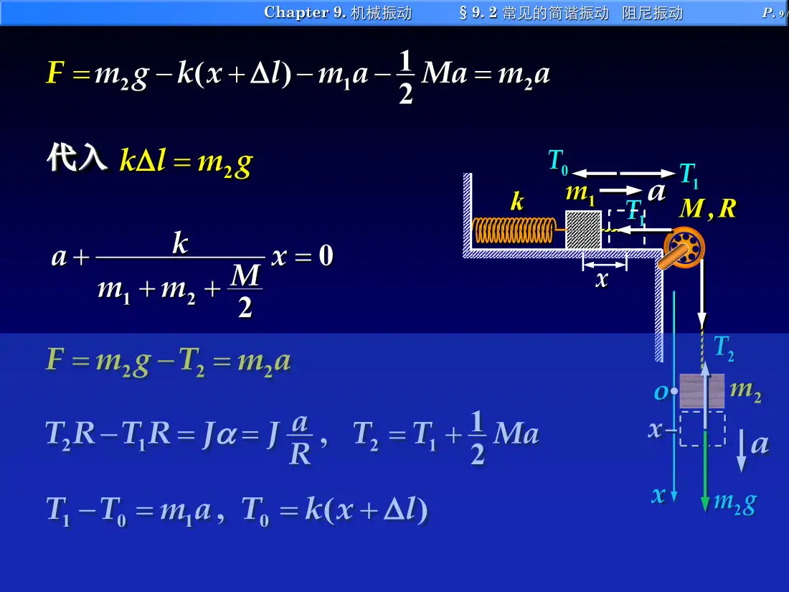

原文：

$$
F = m _ {2} g - k (x + \Delta l) - m _ {1} a - \frac {1}{2} M a = m _ {2} a
$$

代入 $k\Delta l = m_{2}g$

$$
a + \frac {k}{m _ {1} + m _ {2} + \frac {M}{2}} x = 0
$$

$$
F = m _ {2} g - T _ {2} = m _ {2} a
$$

$$
T _ {2} R - T _ {1} R = J \alpha = J \frac {a}{R}, \quad T _ {2} = T _ {1} + \frac {1}{2} M a
$$

$$
T _ {1} - T _ {0} = m _ {1} a, T _ {0} = k (x + \Delta l)
$$

Chapter 9. 机械振动

§ 9.2 常见的简谐振动 阻尼振动

P. 9/

### $$

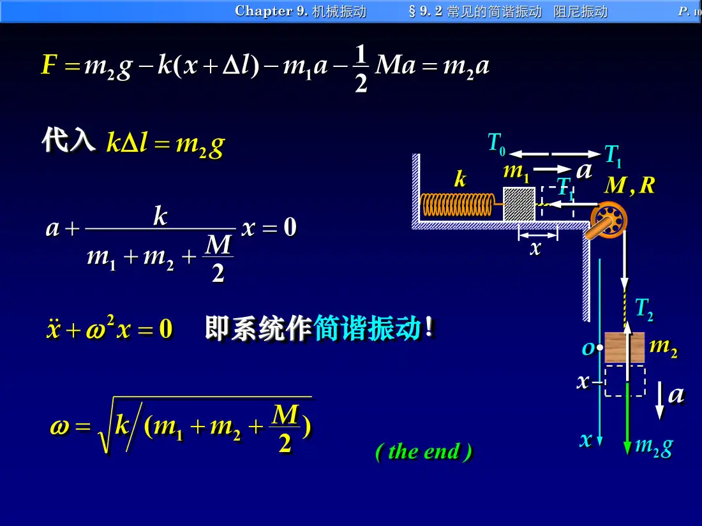

原文：

$$
F = m _ {2} g - k (x + \Delta l) - m _ {1} a - \frac {1}{2} M a = m _ {2} a
$$

代入 $k \Delta l = m_{2} g$

$$
a + \frac {k}{m _ {1} + m _ {2} + \frac {M}{2}} x = 0
$$

$\ddot{x} + \omega^2 x = 0$ 即系统作简谐振动！

$$
\omega = \sqrt {k / (m _ {1} + m _ {2} + \frac {M}{2})}
$$

(the end)

Chapter 9. 机械振动

§ 9.2 常见的简谐振动 阻尼振动

P. 10

### 3. 复摆与单摆:

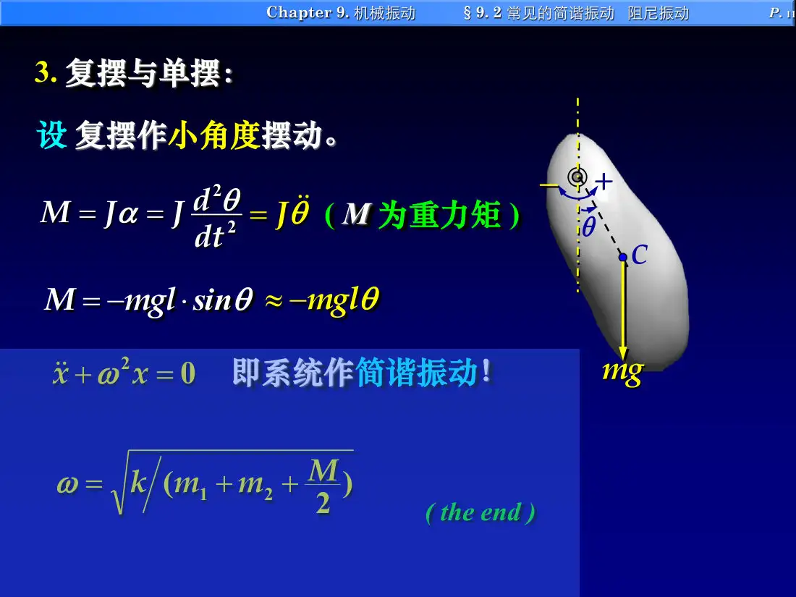

原文：

3. 复摆与单摆:

设 复摆作小角度摆动。

$M = J\alpha = J \frac{d^{2}\theta}{dt^{2}} = J \ddot{\theta}$ (M 为重力矩)

$$
M = - m g l \cdot \sin \theta \approx - m g l \theta
$$

$\ddot{x} + \omega^2 x = 0$ 即系统作简谐振动！

$$
\omega = \sqrt {k / (m _ {1} + m _ {2} + \frac {M}{2})}
$$

$$
(t h e e n d)
$$

Chapter 9. 机械振动

§ 9.2 常见的简谐振动 阻尼振动

P. 11

### 3. 复摆与单摆:

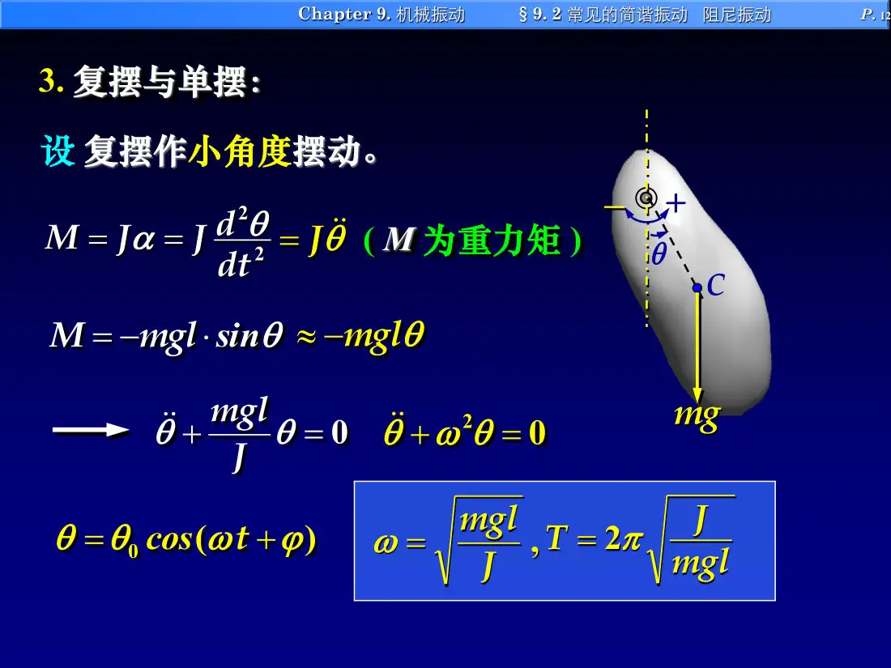

原文：

3. 复摆与单摆:

设 复摆作小角度摆动。

$M = J\alpha = J \frac{d^{2}\theta}{dt^{2}} = J \ddot{\theta}$ (M 为重力矩)

$$
M = - m g l \cdot \sin \theta \approx - m g l \theta
$$

$$
\longrightarrow \ddot {\theta} + \frac {m g l}{J} \theta = 0 \quad \ddot {\theta} + \omega^ {2} \theta = 0
$$

$$
\theta = \theta_ {0} \cos (\omega t + \varphi)
$$

$$
\omega = \sqrt {\frac {m g l}{J}}, T = 2 \pi \sqrt {\frac {J}{m g l}}
$$

Chapter 9. 机械振动

§ 9.2 常见的简谐振动 阻尼振动

P. 12

### 对作小角度摆动的单摆: $J = m l^{2}$

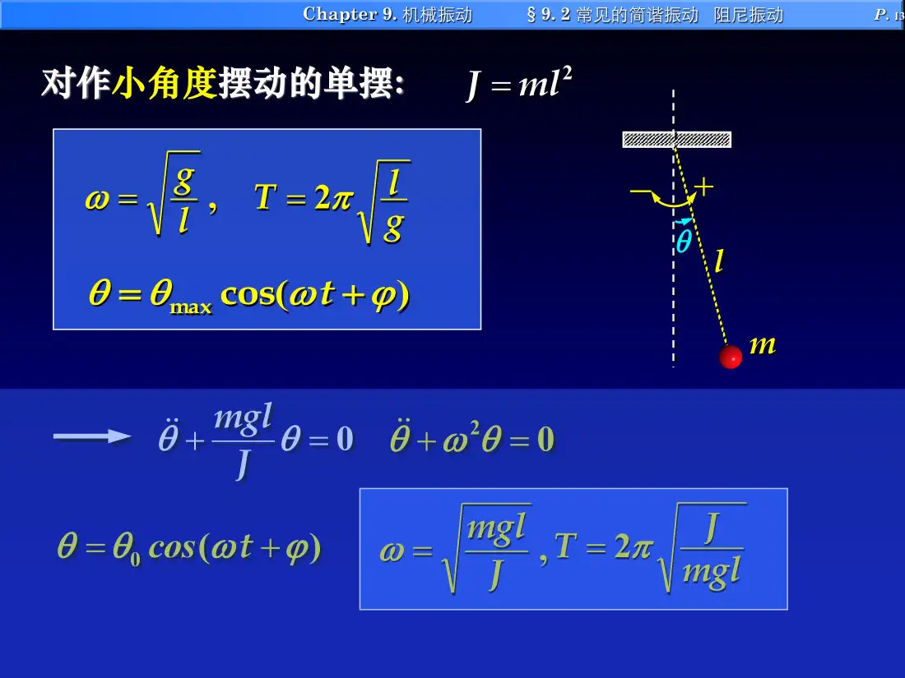

原文：

对作小角度摆动的单摆: $J = m l^{2}$

$$
\omega = \sqrt {\frac {g}{l}},
$$

$$
T = 2 \pi \sqrt {\frac {l}{g}}
$$

$$
\theta = \theta_ {\mathrm{max}} \cos (\omega t + \varphi)
$$

$$
\ddot {\theta} + \frac {m g l}{J} \theta = 0
$$

$$
\ddot {\theta} + \omega^ {2} \theta = 0
$$

$$
\theta = \theta_ {0} \cos (\omega t + \varphi)
$$

$$
\omega = \sqrt {\frac {m g l}{J}}, T = 2 \pi \sqrt {\frac {J}{m g l}}
$$

Chapter 9. 机械振动

§ 9.2 常见的简谐振动 阻尼振动

P. 13

### 对作小角度摆动的单摆: $J = m l^{2}$

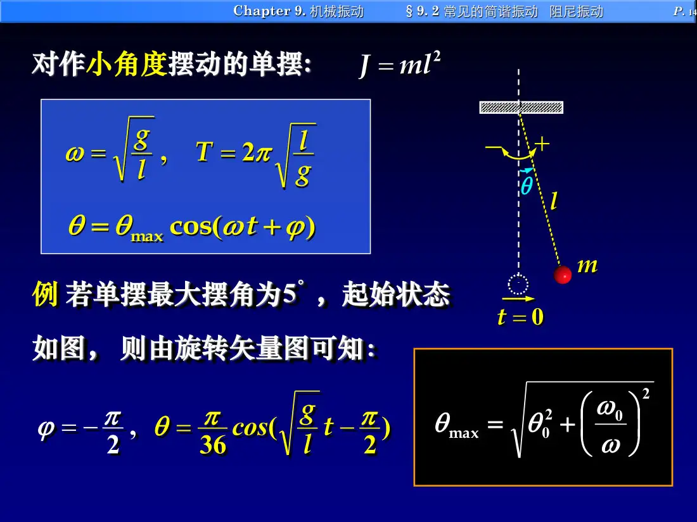

原文：

对作小角度摆动的单摆: $J = m l^{2}$

$$
\omega = \sqrt {\frac {g}{l}},
$$

$$
T = 2 \pi \sqrt {\frac {l}{g}}
$$

$\theta = \theta_{\mathrm{max}}\cos (\omega t + \varphi)$

例 若单摆最大摆角为 $5^{\circ}$ , 起始状态如图, 则由旋转矢量图可知:

$$
\varphi = - \frac {\pi}{2}, \theta = \frac {\pi}{3 6} c o s (\sqrt {\frac {g}{l}} t - \frac {\pi}{2})
$$

$$
\theta_ {\mathrm{max}} = \sqrt {\theta_ {0} ^ {2} + \left(\frac {\omega_ {0}}{\omega}\right) ^ {2}}
$$

Chapter 9. 机械振动

§ 9.2 常见的简谐振动 阻尼振动

P. 14

### 4. 水中浮块:

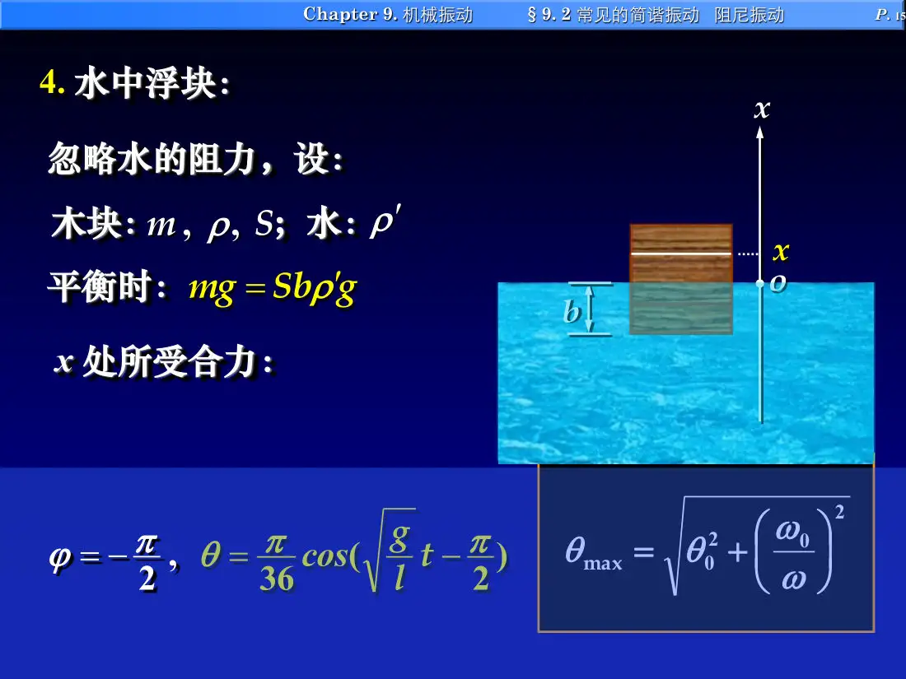

原文：

4. 水中浮块:

忽略水的阻力，设：

木块: m, ρ, S; 水: ρ'

平衡时: $mg = Sb\rho'g$

x 处所受合力：

$$
\varphi = - \frac {\pi}{2}, \theta = \frac {\pi}{3 6} c o s (\sqrt {\frac {g}{l}} t - \frac {\pi}{2})
$$

$$
\theta_ {\mathrm{max}} = \sqrt {\theta_ {0} ^ {2} + \left(\frac {\omega_ {0}}{\omega}\right) ^ {2}}
$$

Chapter 9. 机械振动

§ 9.2 常见的简谐振动 阻尼振动

P. 15

### 4. 水中浮块:

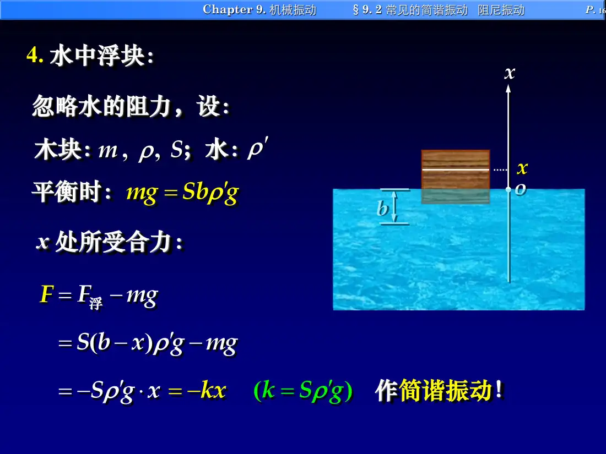

原文：

4. 水中浮块:

忽略水的阻力，设：

木块: m, ρ, S; 水: ρ'

平衡时: $mg = Sb\rho'g$

x 处所受合力：

$$
\begin{array}{r l} & F = F _ {\text {浮}} - m g \\ & = S (b - x) \rho^ {\prime} g - m g \\ & = - S \rho^ {\prime} g \cdot x = - k x \end{array}
$$

作简谐振动！

Chapter 9. 机械振动

§ 9.2 常见的简谐振动 阻尼振动

P. 16

### $$

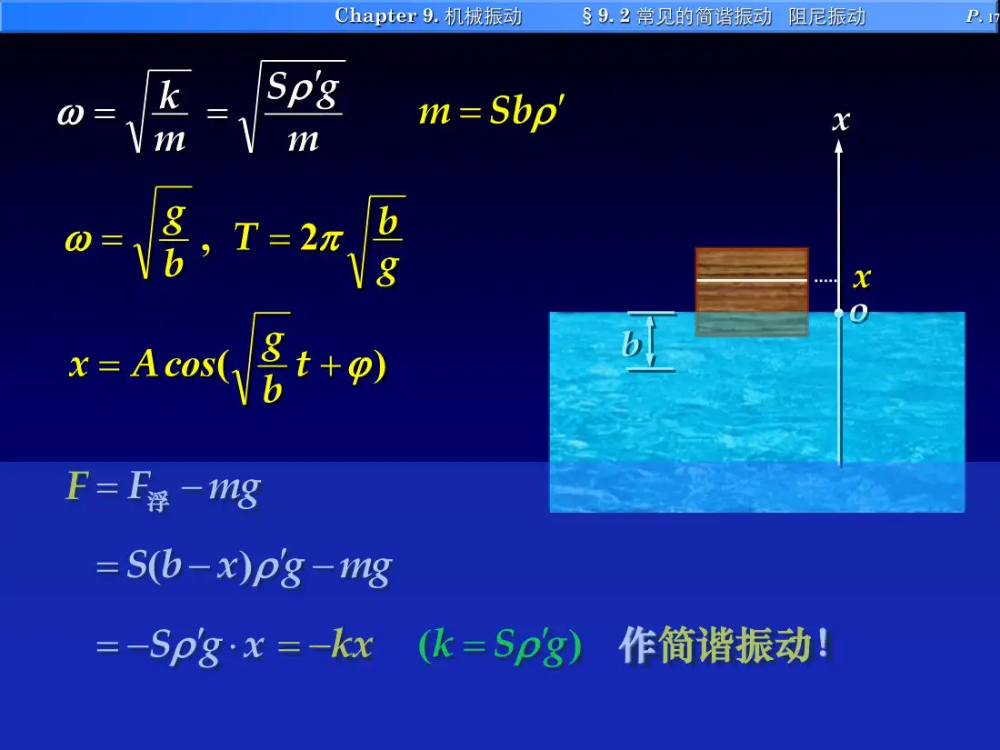

原文：

$$
\omega = \sqrt {\frac {k}{m}} = \sqrt {\frac {S \rho^ {\prime} g}{m}}
$$

$$
m = S b \rho^ {\prime}
$$

$$
\omega = \sqrt {\frac {g}{b}}, T = 2 \pi \sqrt {\frac {b}{g}}
$$

$$
x = A \cos (
$$

$$
(\sqrt {\frac {g}{b}} t + \varphi)
$$

$$
\begin{array}{r l} & F = F _ {\text {浮}} - m g \\ & = S (b - x) \rho^ {\prime} g - m g \\ & = - S \rho^ {\prime} g \cdot x = - k x \end{array}
$$

(k ≡ S ρ'g)

作简谐振动！

Chapter 9. 机械振动

§ 9.2 常见的简谐振动 阻尼振动

P. 17

### $$

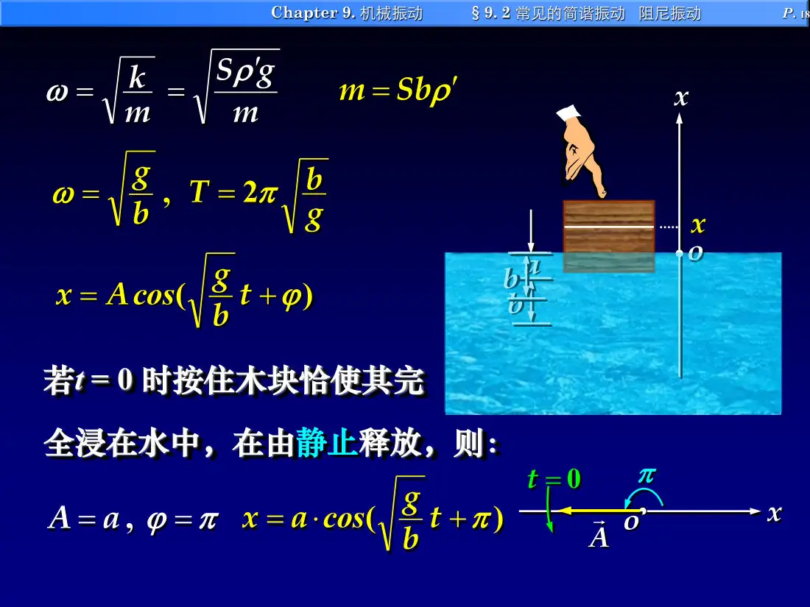

原文：

$$
\omega = \sqrt {\frac {k}{m}} = \sqrt {\frac {S \rho^ {\prime} g}{m}}
$$

$$
m = S b \rho^ {\prime}
$$

$$
\omega = \sqrt {\frac {g}{b}}, T = 2 \pi \sqrt {\frac {b}{g}}
$$

$$
x = A \cos (\sqrt {\frac {g}{b}} t + \varphi)
$$

若 $t = 0$ 时按住木块恰使其完

全浸在水中，在由静止释放，则：

$A = a, \varphi = \pi x = a \cdot \cos(\sqrt{\frac{g}{b}} t + \pi) \xrightarrow{t=0} \overrightarrow{A} \xrightarrow{\pi} x$

Chapter 9. 机械振动

§ 9.2 常见的简谐振动 阻尼振动

P. 18

### 三、阻尼振动\

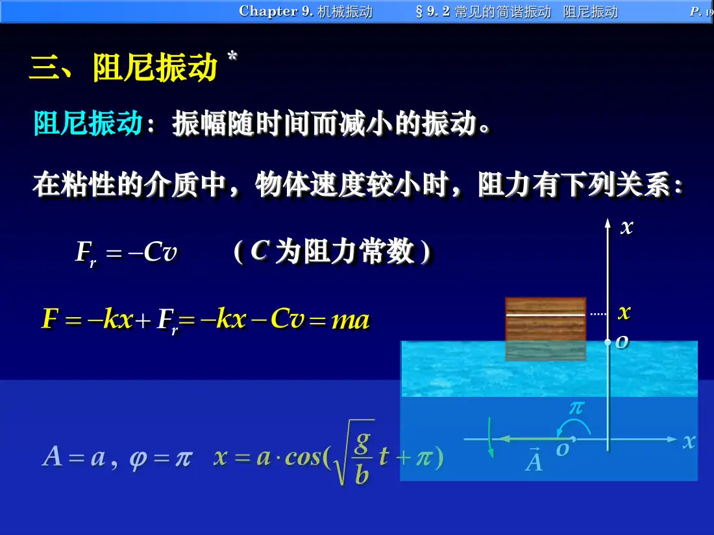

原文：

三、阻尼振动\*

阻尼振动：振幅随时间而减小的振动。

在粘性的介质中，物体速度较小时，阻力有下列关系：

$F_{r}=-Cv$ (C为阻力常数)

$$
F = - k x + F _ {r} = - k x - C v = m a
$$

$$
A = a, \varphi = \pi x = a \cdot c o s (\sqrt {\frac {g}{b}} t + \pi)
$$

Chapter 9. 机械振动

§ 9.2 常见的简谐振动 阻尼振动

P. 19

### 三、阻尼振动\

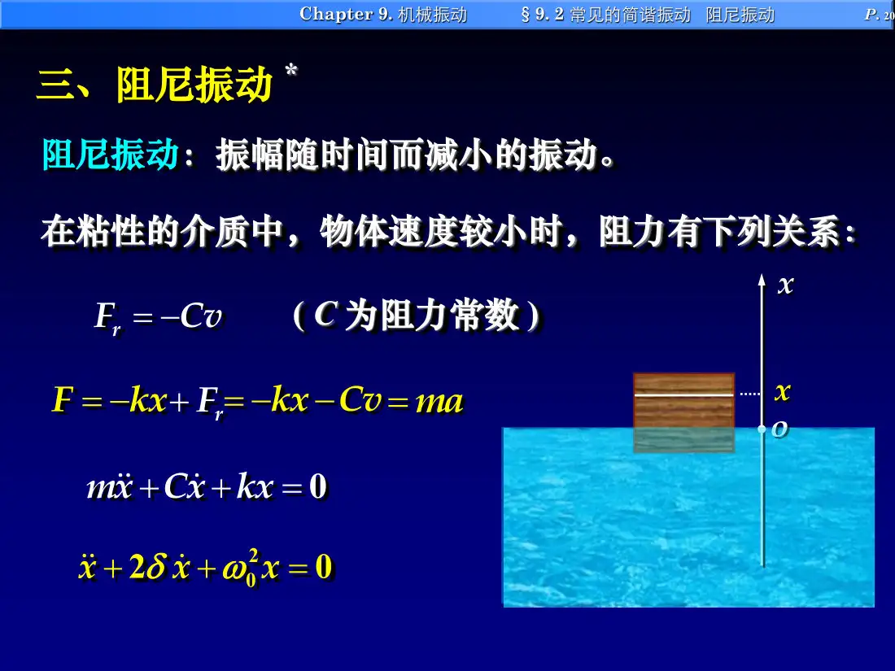

原文：

三、阻尼振动\*

阻尼振动：振幅随时间而减小的振动。

在粘性的介质中，物体速度较小时，阻力有下列关系：

$F_{r}=-Cv$ (C为阻力常数)

$$
F = - k x + F _ {r} = - k x - C v = m a
$$

$$
m \ddot {x} + C \dot {x} + k x = 0
$$

$$
\ddot {x} + 2 \delta \dot {x} + \omega_ {0} ^ {2} x = 0
$$

Chapter 9. 机械振动

§ 9.2 常见的简谐振动 阻尼振动

P. 20

### 其中 $\delta=\frac{C}{2m}$ （阻尼系数）

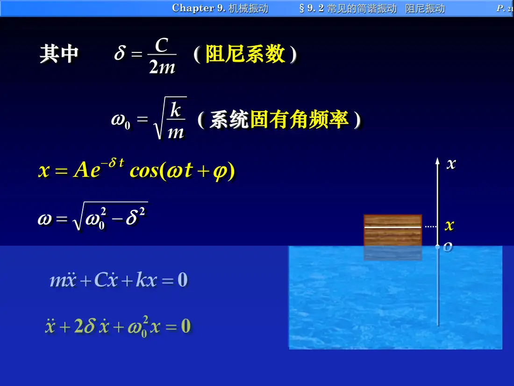

原文：

其中 $\delta=\frac{C}{2m}$ （阻尼系数）

$\omega_{0}=\sqrt{\frac{k}{m}}$ （系统固有角频率）

$$
x = A e ^ {- \delta t} \cos (\omega t + \varphi)
$$

$$
\omega = \sqrt {\omega_ {0} ^ {2} - \delta^ {2}}
$$

$$
m \ddot {x} + C \dot {x} + k x = 0
$$

$$
\ddot {x} + 2 \delta \dot {x} + \omega_ {0} ^ {2} x = 0
$$

Chapter 9. 机械振动

§ 9.2 常见的简谐振动 阻尼振动

P. 21

### 其中 $\delta=\frac{C}{2m}$ （阻尼系数）

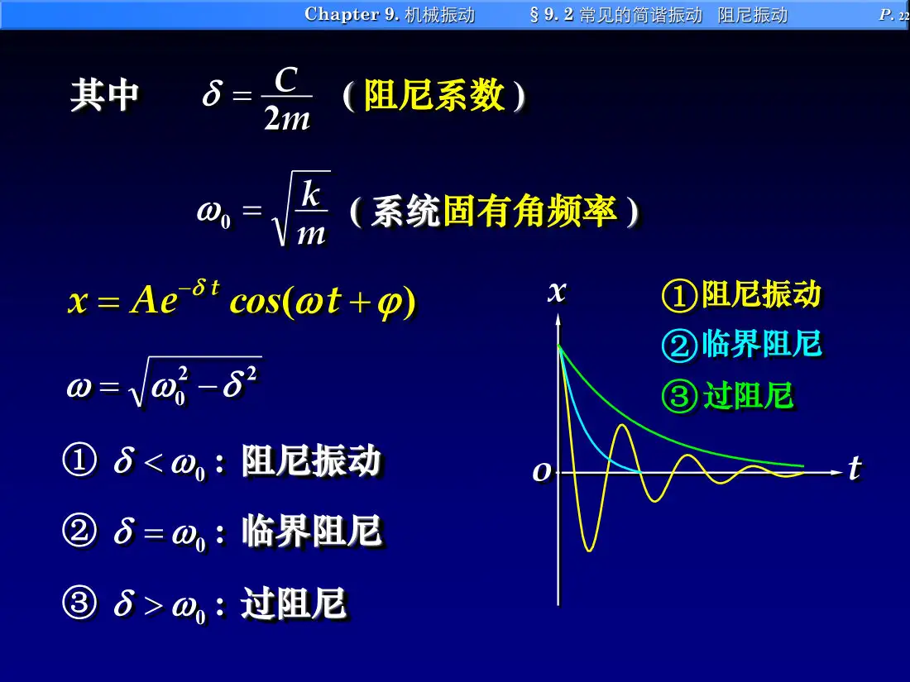

原文：

其中 $\delta=\frac{C}{2m}$ （阻尼系数）

$\omega_{0}=\sqrt{\frac{k}{m}}$ （系统固有角频率）

$x = Ae^{-\delta t}\cos (\omega t + \varphi)$

$$
\omega = \sqrt {\omega_ {0} ^ {2} - \delta^ {2}}
$$

① $\delta < \omega_{0}$ : 阻尼振动

② $\delta=\omega_{0}$ ：临界阻尼

③ $\delta > \omega_{0}$ : 过阻尼

②临界阻尼

①阻尼振动

③过阻尼

Chapter 9. 机械振动

§ 9.2 常见的简谐振动 阻尼振动

P. 22

### 归纳：

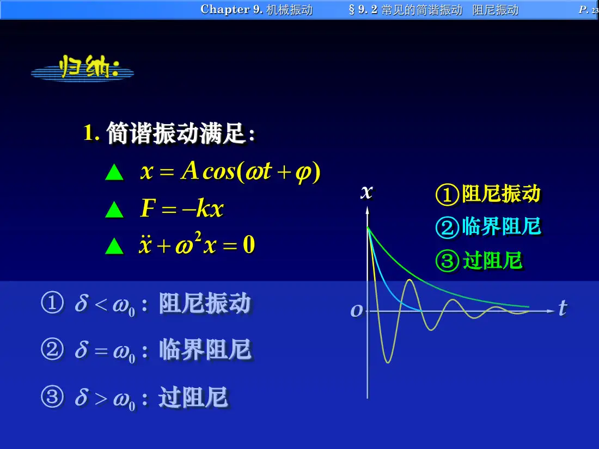

原文：

归纳：

1. 简谐振动满足：

$x = A\cos(\omega t + \varphi)$

▲ F = -kx

$$
\Delta \ddot {x} + \omega^ {2} x = 0
$$

① $\delta < \omega_{0}$ : 阻尼振动

② $\delta = \omega_{0}$ ：临界阻尼

③ $\delta > \omega_{0}$ : 过阻尼

①阻尼振动

②临界阻尼

③过阻尼

Chapter 9. 机械振动

§ 9.2 常见的简谐振动 阻尼振动

P. 23

### 归纳：

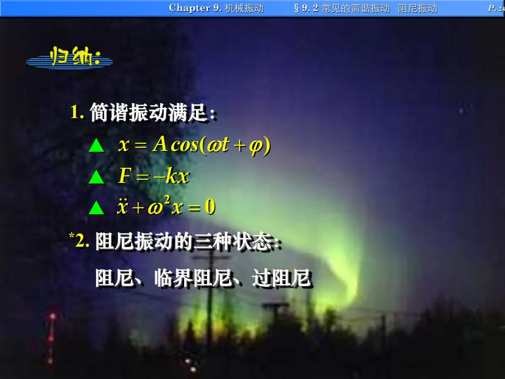

原文：

归纳：

1. 简谐振动满足：

$$
x = A \cos (\omega t + \varphi)
$$

$$
\triangle F = - k x
$$

$$
\Delta \ddot {x} + \omega^ {2} x = 0
$$

\*2. 阻尼振动的三种状态: 阻尼、临界阻尼、过阻尼

Chapter 9. 机械振动

§ 9.2 常见的简谐振动 阻尼振动

P. 24

### P. 25

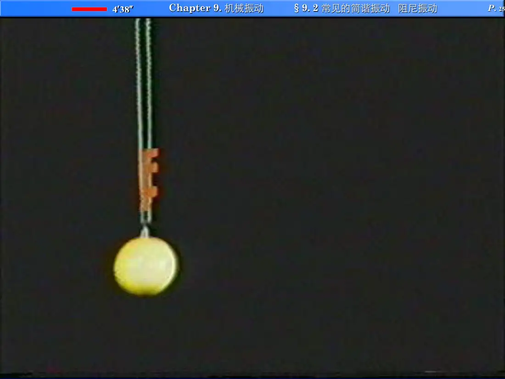

原文：

P. 25

### 和共振

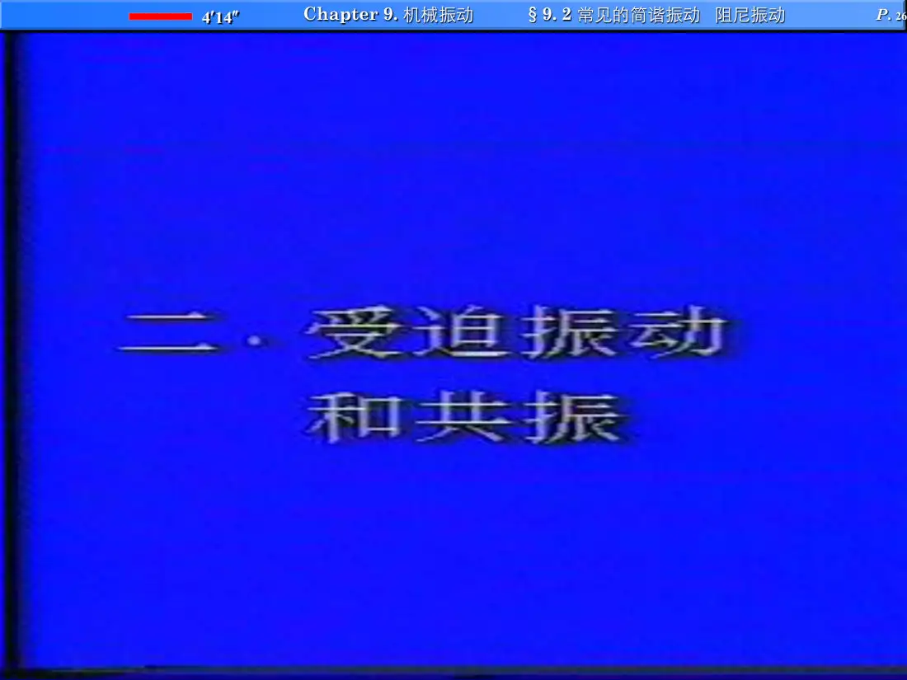

原文：

和共振

P. 26
