# 《大学物理》第9章 机械振动 §9.4 简谐振动的能量（课件）

原件的每一页，下面附识别出的文字。

### §§13.3 9.4 简谐振动的能量 简谐振动的能量

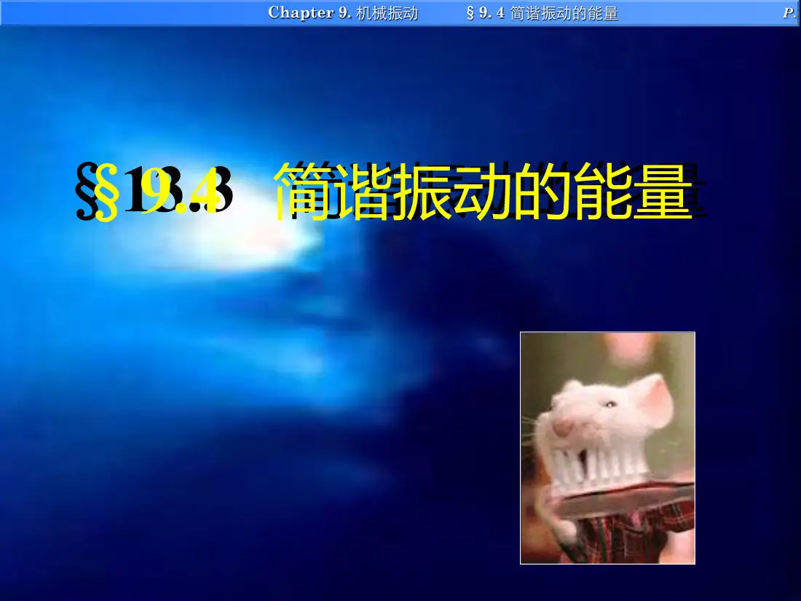

原文：

§§13.3 9.4 简谐振动的能量 简谐振动的能量

Chapter 9. 机械振动作者：杨

§9. 4 简谐振动的能量

P.

### 一、振动动能/势能/总能量

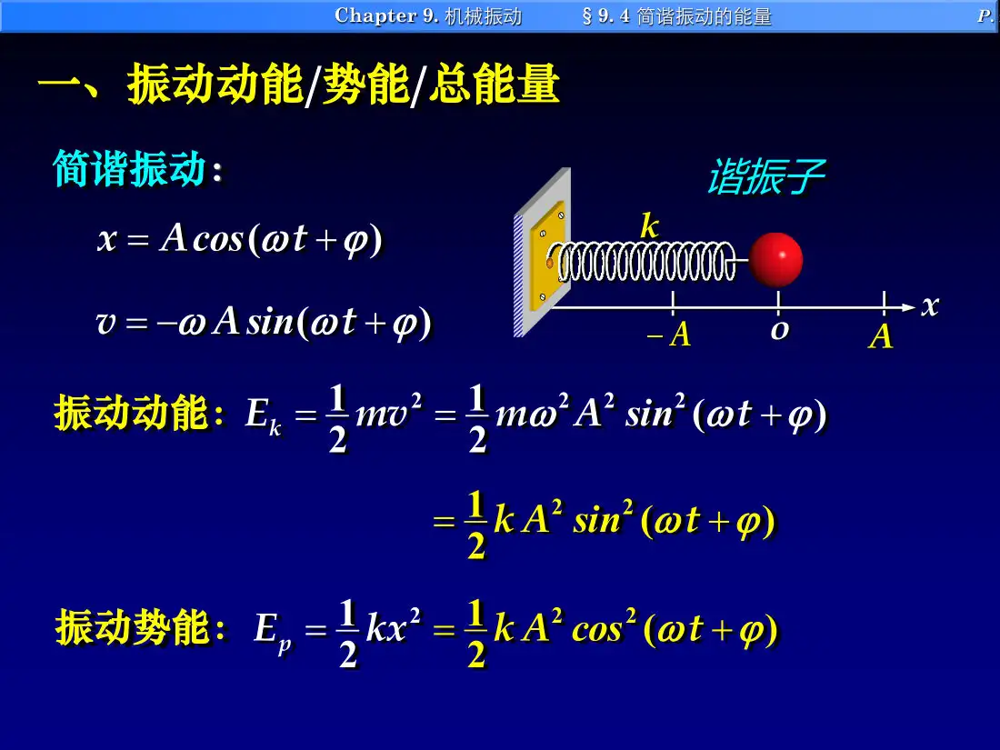

原文：

一、振动动能/势能/总能量

简谐振动：

谐振子

$$
x = A \cos (\omega t + \varphi)
$$

000000

$$
v = - \omega A \sin (\omega t + \varphi)
$$

振动动能： $\frac { 1 } { 2 } \times \frac { 1 } { 3 } \times \frac { 1 } { 2 } \times \frac { 1 } { 3 } \times \frac { 1 } { 2 } \times \frac { 1 } { 3 } \times \frac { 1 } { 2 } \times \frac { 1 } { 3 } \times \frac { 1 } { 2 } \times \frac { 1 } { 3 } \times \frac { 1 } { 2 } \times \frac { 1 } { 3 } \times \frac { 1 } { 2 } \times \frac { 1 } { 3 }$

振动势能： $( 1 5 , - 3 , - 5 , - 5 , - 6 , - 6 , 0 ) = ( 1 5 , - 3 , 0 )$

Chapter 9. 机械振动 作者：杨

§9. 4 简谐振动的能量

P.

### $$

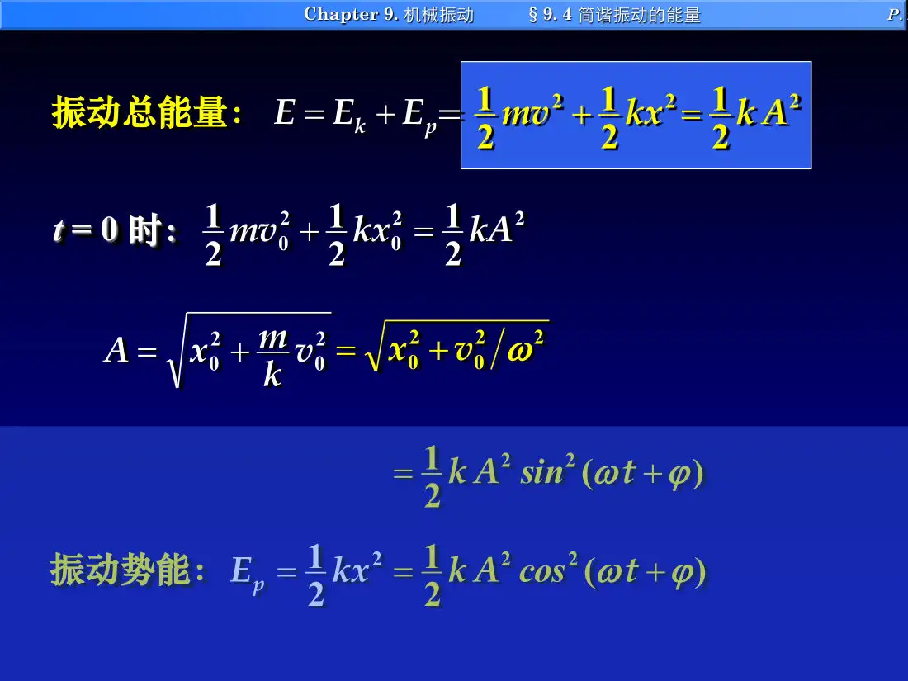

原文：

振动总能量： $1 5 0 = 1 5 0 0 0 0 \div \frac { 1 } { 2 } m \times 0 . 2 = \frac { 1 } { 2 } \times 0 . 2 = \frac { 1 } { 2 } \times 0 . 2$

$l i = 1 1$ 时： $\frac { 1 } { 2 } ( 1 + \frac { 1 } { 2 } \times \frac { 1 } { 3 } ) \times \frac { 1 } { 2 } = \frac { 1 } { 2 } ( 1 + \frac { 1 } { 2 } )$

$$
A = \sqrt {x _ {0} ^ {2} + \frac {m}{k} v _ {0} ^ {2}} = \sqrt {x _ {0} ^ {2} + v _ {0} ^ {2} / \omega^ {2}}
$$

$$
= \frac {1}{2} k A ^ {2} \sin^ {2} (\omega t + \varphi)
$$

振动势能： $1 5 . 5 \times 5 . 5 = 1 5 . 5 ( c m )$

Chapter 9. 机械振动 作者：杨

§9. 4 简谐振动的能量

P.

### $$

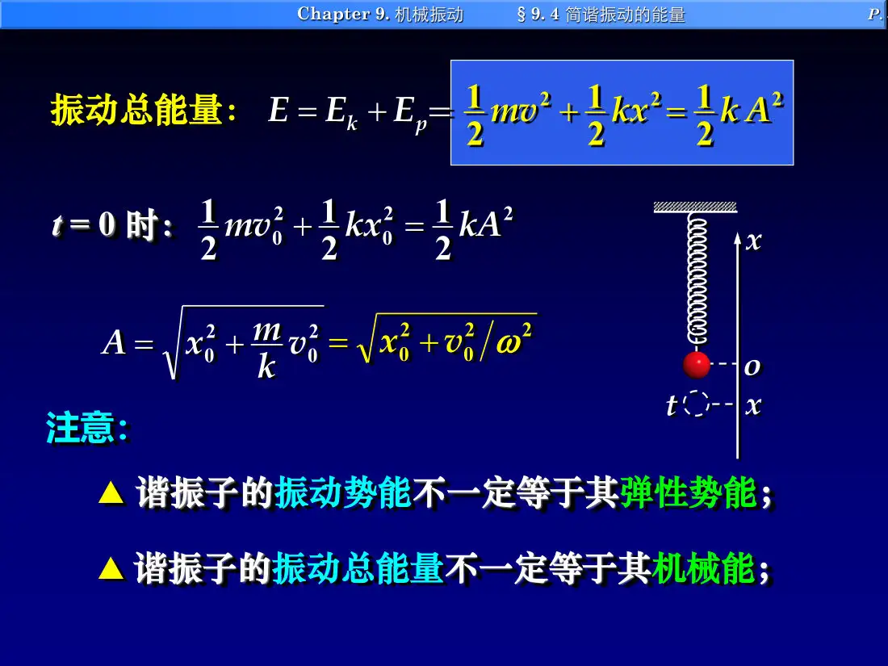

原文：

振动总能量： $1 5 \div b = \frac { 1 } { 2 } \times 2 = \frac { 1 } { 2 } ( c m ^ { 2 } ) = \frac { 1 } { 2 } ( c m ^ { 2 } ) = \frac { 1 } { 2 } ( c m ^ { 2 } )$

$l i = 1 1$ 时： $\frac { 1 } { 2 } \times ( 1 0 0 - \frac { 1 } { 2 } ) = \frac { 1 } { 2 } \times ( 1 0 0 - \frac { 1 } { 2 } ) = \frac { 1 } { 2 } \times ( 1 0 0 - \frac { 1 } { 2 } )$

$$
A = \sqrt {x _ {0} ^ {2} + \frac {m}{k} v _ {0} ^ {2}} = \sqrt {x _ {0} ^ {2} + v _ {0} ^ {2} / \omega^ {2}}
$$

注意：

谐振子的振动势能不一定等于其弹性势能；

▲ 谐振子的振动总能量不一定等于其机械能；

Chapter 9. 机械振动 作者：杨

§9. 4 简谐振动的能量

P.

### 二、势能、能量曲线

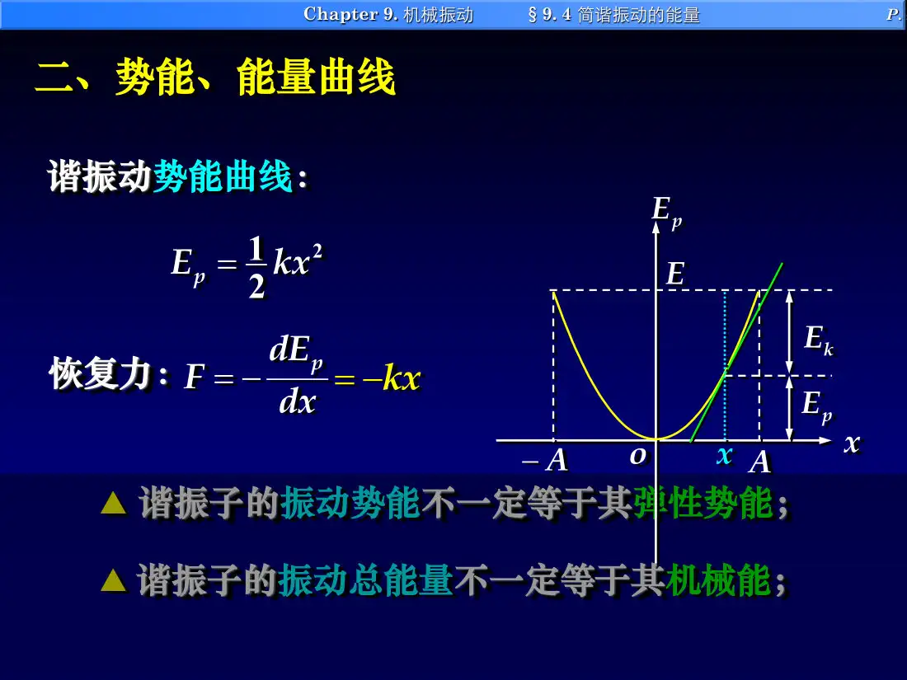

原文：

二、势能、能量曲线

谐振动势能曲线：

$$
E _ {p} = \frac {1}{2} k x ^ {2}
$$

恢复力： $\frac { 1 0 } { 1 0 } = \frac { 1 0 \sqrt { 1 3 } } { 1 0 \sqrt { 1 3 } } = 1 \sqrt { 1 3 } .$

谐振子的振动势能不一定等于其弹性势能；

谐振子的振动总能量不一定等于其机械能；

Chapter 9. 机械振动作者：杨

§9. 4 简谐振动的能量

P.

### 二、势能、能量曲线

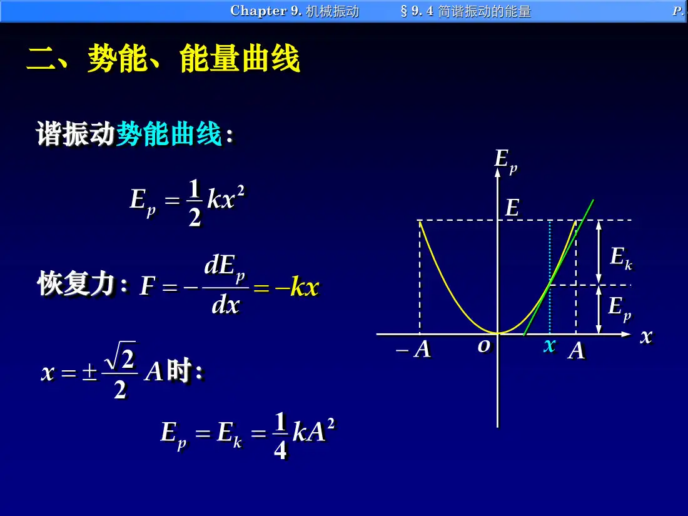

原文：

二、势能、能量曲线

谐振动势能曲线：

$$
E _ {p} = \frac {1}{2} k x ^ {2}
$$

恢复力： $\frac { 1 4 } { 1 2 } = \frac { 1 4 \times 3 } { 1 2 } = \frac { 1 4 \times 3 } { 1 2 }$

$\frac { 1 } { 2 } \times \frac { 1 } { 3 } = \frac { 1 } { 2 } \times \frac { 1 } { 3 }$ 时：

$$
E _ {p} = E _ {k} = \frac {1}{4} k A ^ {2}
$$

Chapter 9. 机械振动作者：杨

§9. 4 简谐振动的能量

P.

### 谐振动能量曲线：

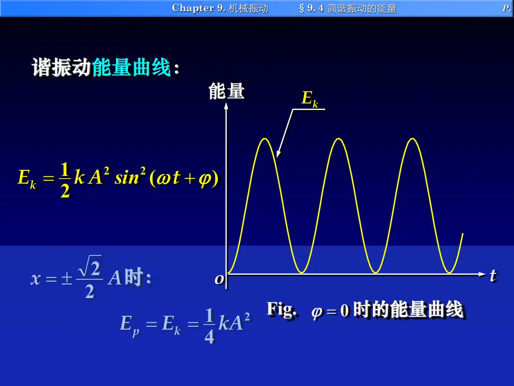

原文：

谐振动能量曲线：

$$
E _ {k} = \frac {1}{2} k A ^ {2} \sin^ {2} (\omega t + \varphi)
$$

$$
x = \pm \frac {\sqrt {2}}{2} A \text {时:}
$$

$$
E _ {p} = E _ {k} = \frac {1}{4} k A ^ {2}
$$

Fig. $( \pmb { \mathscr { p } } ) { = } 0$ 时的能量曲线

Chapter 9. 机械振动 作者：杨

§9. 4 简谐振动的能量

P.

### 谐振动能量曲线：

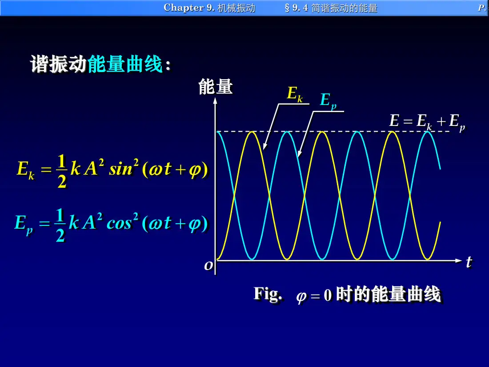

原文：

谐振动能量曲线：

$$
E _ {k} = \frac {1}{2} k A ^ {2} \sin^ {2} (\omega t + \varphi)
$$

$$
E _ {p} = \frac {1}{2} k A ^ {2} \cos^ {2} (\omega t + \varphi)
$$

Fig. $( \pmb { / / } ) \in [ 0 ]$ 时的能量曲线

Chapter 9. 机械振动作者：杨

§9. 4 简谐振动的能量

P.

### $$

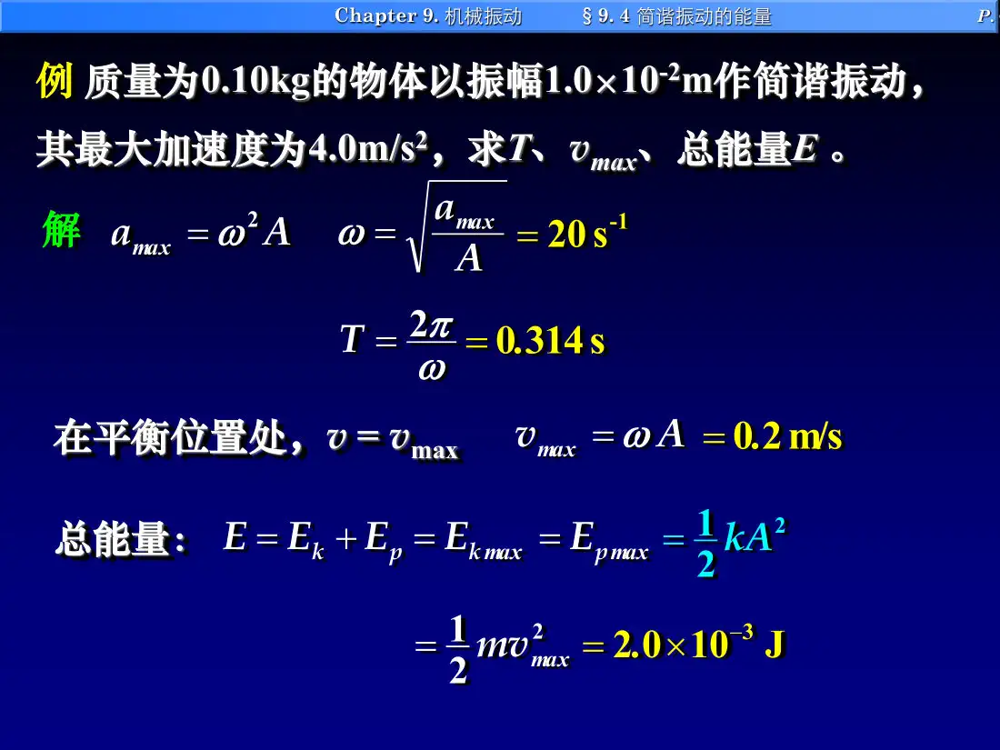

原文：

例 质量为0.10kg的物体以振幅 $\pmb { \mathrm { I I } } \pmb { \mathrm { I I } } \pmb { \mathrm { I I } } \pmb { \mathrm { I I } }$ 作简谐振动，其最大加速度为 $\angle \Delta [ | \mathbf { | | } \mathbf { | | \nabla \mathcal { W } | } ]$ 求T、 $\wp \hbar \hbar \hbar \hbar \hbar \hbar \hbar \hbar \hbar \hbar \hbar \hbar \hbar \hbar \hbar \hbar \hbar \hbar \hbar \hbar \hbar \hbar \hbar \hbar \hbar \hbar \hbar \hbar \hbar \hbar \hbar \hbar \hbar \hbar \hbar \hbar \hbar \hbar \hbar \hbar \hbar \hbar \hbar \hbar \hbar \hbar \hbar \hbar \hbar \hbar \hbar \hbar \hbar \hbar \hbar \hbar \hbar \hbar \hbar \hbar \hbar \hbar \hbar \hbar \hbar \hbar \hbar \hbar \hbar \hbar \hbar \hbar \hbar \hbar \hbar \hbar \hbar \hbar \hbar \hbar \hbar \hbar \hbar \hbar \hbar \hbar \hbar \hbar \hbar \hbar \hbar \hbar \hbar \hbar \hbar \hbar \hbar \hbar \hbar \hbar \hbar \hbar \hbar \hbar \hbar \hbar \hbar \hbar \hbar \hbar \hbar \hbar \hbar \hbar \hbar \hbar \hbar \hbar \hbar \hbar \hbar \hbar \hbar \hbar \hbar \hbar \hbar \hbar \hbar \hbar \hbar \hbar \hbar \hbar \hbar \hbar \hbar \hbar \hbar \hbar \hbar \hbar \hbar \hbar \hbar \hbar \hbar \hbar \hbar \hbar \hbar \hbar \hbar \hbar \hbar \hbar \hbar \hbar \hbar \hbar \hbar \hbar \hbar \hbar \hbar \hbar \hbar \hbar \hbar \hbar \hbar \hbar \hbar \hbar \hbar \hbar \hbar \hbar \hbar \hbar \hbar \hbar \hbar \hbar \hbar \hbar \hbar \hbar \hbar \hbar \hbar \hbar \hbar \hbar \hbar \hbar \hbar \hbar \hbar \hbar \hbar \hbar \hbar \hbar \hbar \hbar \hbar \hbar \hbar \hbar \hbar \hbar \hbar \hbar \hbar \hbar \hbar \hbar \hbar \hbar \hbar \hbar \hbar \hbar \hbar \hbar \hbar \hbar \hbar \hbar \hbar \hbar \hbar \hbar \hbar \hbar \hbar \hbar \hbar \hbar \hbar \hbar \hbar \hbar \hbar \hbar \hbar \hbar \hbar \hbar \hbar \hbar \hbar \hbar \hbar \hbar \hbar \hbar \hbar \hbar \hbar \hbar \hbar \hbar \hbar \hbar \hbar \hbar \hbar \hbar \hbar \hbar \hbar \hbar \hbar \hbar \hbar \hbar \hbar \hbar \hbar \hbar \hbar \hbar \hbar \hbar \hbar \hbar \hbar \hbar \hbar \hbar \hbar \hbar \hbar \hbar \hbar \hbar \hbar \hbar \hbar \hbar \hbar \hbar \hbar \hbar \hbar \hbar \hbar \hbar \hbar \hbar \hbar \hbar \hbar \hbar \hbar \hbar \hbar \hbar \hbar \hbar \hbar \hbar \hbar \hbar \hbar \hbar \hbar \hbar \hbar \hbar \hbar \hbar \hbar \hbar \hbar \hbar \hbar \hbar \hbar \hbar \hbar \hbar \hbar \hbar \hbar \hbar \hbar \hbar \hbar \hbar \hbar \hbar \hbar \hbar \hbar \hbar \hbar \hbar \hbar \hbar \hbar \hbar \hbar \hbar \hbar \hbar \hbar \hbar \hbar \hbar \hbar \hbar \hbar \hbar \hbar \hbar \hbar \hbar \hbar \hbar \hbar$ 总能量E 。

解 $( 2 ) a _ { 1 } ( 2 ) + ( 2 ) a _ { 2 } ( 2 ) = ( 2 ) a _ { 1 } ( 2 ) + ( 2 ) a _ { 2 } ( 2 ) = ( 2 ) a _ { 1 } ( 2 )$

$$
T = \frac {2 \pi}{\omega} = 0. 3 1 4 \mathrm{s}
$$

在平衡位置处， $( \pmb { \mathscr { o } } ) = ( \pmb { \mathscr { o } } )$ $( 0 ) \because ( 0 , 1 ) = ( 1 , 0 , 1 ) ( 1 , 1 )$

总能量： $1 8 0 \times 2 = 1 8 0 0 ( c m ) = 1 8 0 ( c m )$

Chapter 9. 机械振动作者：杨 §9. 4 简谐振动的能量

P.

### 提示 击中后，系统初始状态：

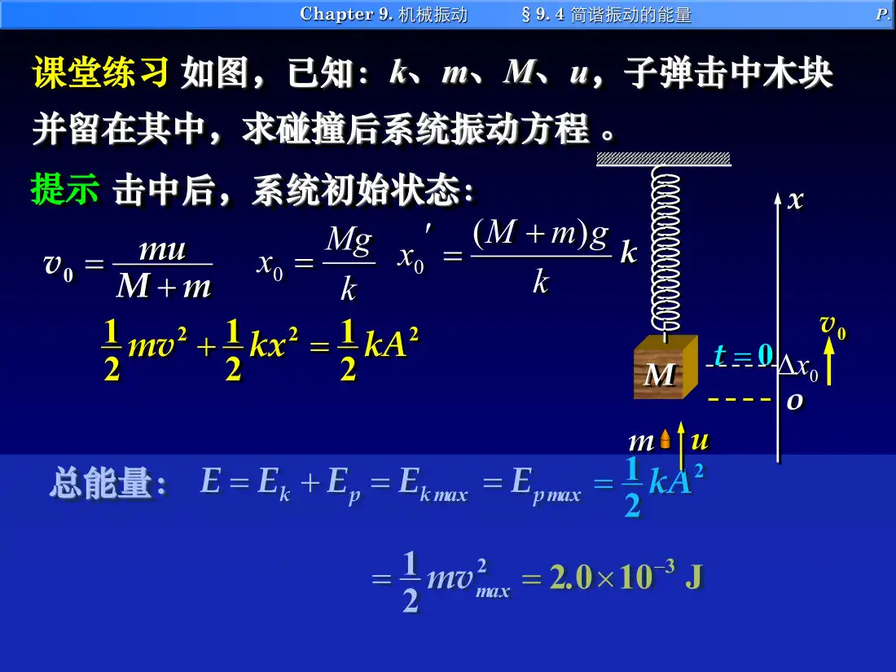

原文：

课堂练习如图，已知： $l s = l n s - a _ { 2 } s _ { 2 } = 0 . 0 2 m$ 子弹击中木块并留在其中，求碰撞后系统振动方程 。

提示 击中后，系统初始状态：

$$
\begin{array}{l} v _ {0} = \frac {m u}{M + m} x _ {0} = \frac {M g}{k} x _ {0} ^ {\prime} = \frac {(M + m) g}{k} k \\ \frac {1}{2} m v ^ {2} + \frac {1}{2} k x ^ {2} = \frac {1}{2} k A ^ {2} \end{array}
$$

总能量：

$$
E = E _ {k} + E _ {p} = E _ {k m a x} = E _ {p m a x} = \frac {1}{2} k A ^ {2}
$$

Chapter 9. 机械振动 作者：杨

§9. 4 简谐振动的能量

P.

### 提示 击中后，系统初始状态：

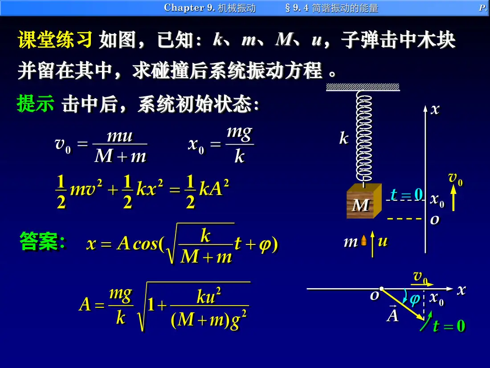

原文：

课堂练习 如图，已知： $l s = l i s - a _ { 1 } s _ { 2 } = 1 8 0 c m$ 子弹击中木块并留在其中，求碰撞后系统振动方程 。

提示 击中后，系统初始状态：

$$
v _ {0} = \frac {m u}{M + m} x _ {0} = \frac {m g}{k}
$$

$$
\frac {1}{2} m v ^ {2} + \frac {1}{2} k x ^ {2} = \frac {1}{2} k A ^ {2}
$$

答案：

$$
x = A \cos (\sqrt {\frac {k}{M + m}} t + \varphi)
$$

$$
A = \frac {m g}{k} \sqrt {1 + \frac {k u ^ {2}}{(M + m) g ^ {2}}}
$$

$$
\begin{array}{c} v _ {0} \\ \vec {A} \end{array} \quad \begin{array}{c} \varphi \\ x _ {0} \end{array} \quad t = 0
$$

Chapter 9. 机械振动 作者：杨

§9. 4 简谐振动的能量

P.
